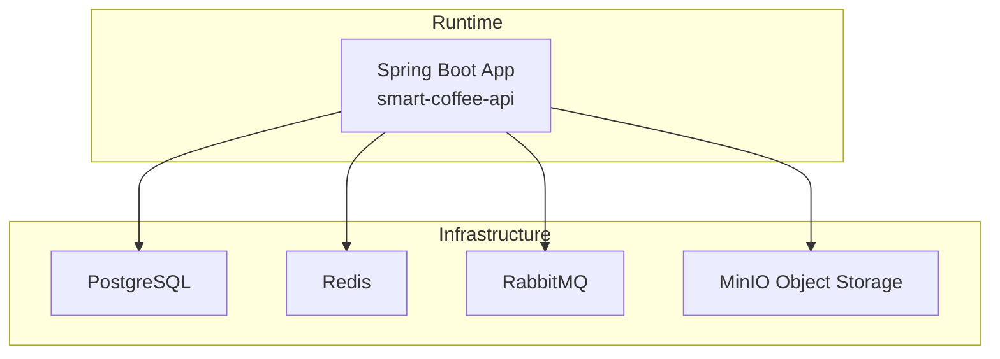
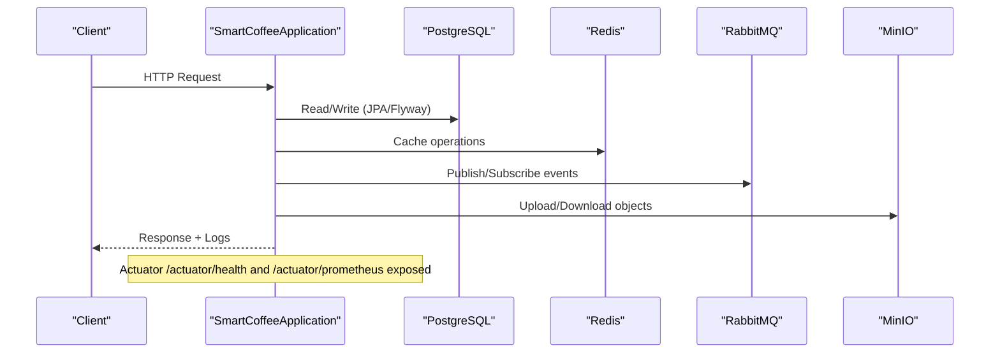
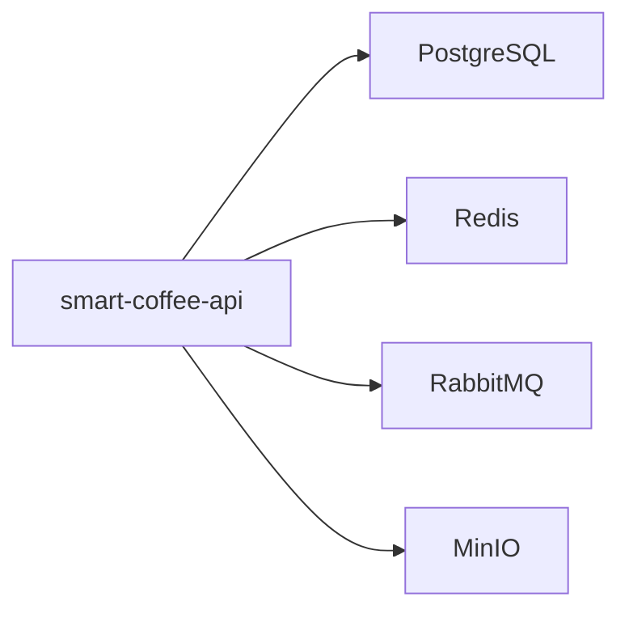

# Deployment & Operations

<cite>
**Referenced Files in This Document**
- [Dockerfile](file://Dockerfile)
- [compose.yaml](file://compose.yaml)
- [application.yml](file://src/main/resources/application.yml)
- [application-test.yml](file://src/test/resources/application-test.yml)
- [pom.xml](file://pom.xml)
- [SmartCoffeeApplication.java](file://src/main/java/com/smartcoffee/SmartCoffeeApplication.java)
- [HealthIndicators.java](file://src/main/java/com/smartcoffee/infrastructure/observability/HealthIndicators.java)
- [ReadinessHealthIndicator.java](file://src/main/java/com/smartcoffee/infrastructure/observability/ReadinessHealthIndicator.java)
- [MetricsService.java](file://src/main/java/com/smartcoffee/infrastructure/observability/MetricsService.java)
- [RequestLoggingFilter.java](file://src/main/java/com/smartcoffee/infrastructure/observability/RequestLoggingFilter.java)
- [IntegrationTestBase.java](file://src/test/java/com/smartcoffee/testsupport/IntegrationTestBase.java)
</cite>

## Table of Contents
1. Introduction
2. Project Structure
3. Core Components
4. Architecture Overview
5. Detailed Component Analysis
6. Dependency Analysis
7. Performance Considerations
8. Troubleshooting Guide
9. Conclusion
10. Appendices

## Introduction
This document provides deployment and operations guidance for the Smart Coffee Backend. It covers containerization with Docker, environment-specific configuration, deployment strategies across development, staging, and production, monitoring and observability (health indicators, metrics, logging), operational procedures (scaling, backup/recovery, disaster recovery, performance tuning), CI/CD pipeline integration, automated testing, rollback strategies, and troubleshooting common issues.

## Project Structure
The application is a Spring Boot service packaged as a JAR and run inside a minimal JRE container. Dependencies include PostgreSQL, Redis, RabbitMQ, and MinIO. The project uses Flyway for database migrations and exposes Actuator endpoints for health and metrics. A Compose file defines local infrastructure services.

**Diagram sources**
- [compose.yaml:1-71](file://compose.yaml#L1-L71)
- [application.yml:17-41](file://src/main/resources/application.yml#L17-L41)

**Section sources**
- [Dockerfile:1-11](file://Dockerfile#L1-L11)
- [compose.yaml:1-71](file://compose.yaml#L1-L71)
- [application.yml:1-93](file://src/main/resources/application.yml#L1-L93)

## Core Components
- Container image built via multi-stage Maven build and executed with a small JRE runtime.
- Configuration-driven connectivity to Postgres, Redis, RabbitMQ, and MinIO using environment variables.
- Database schema managed by Flyway with validation enabled and clean disabled.
- Observability exposed through Spring Boot Actuator (health probes, info, metrics, Prometheus).
- Scheduling enabled at application startup.

Operational implications:
- All external dependencies are configurable via environment variables; no secrets should be hardcoded.
- Health probes are enabled for Kubernetes or orchestrator readiness/liveness checks.
- Metrics endpoint supports Prometheus scraping.

**Section sources**
- [Dockerfile:1-11](file://Dockerfile#L1-L11)
- [application.yml:17-41](file://src/main/resources/application.yml#L17-L41)
- [application.yml:81-93](file://src/main/resources/application.yml#L81-L93)
- [SmartCoffeeApplication.java:1-11](file://src/main/java/com/smartcoffee/SmartCoffeeApplication.java#L1-L11)

## Architecture Overview
The backend runs as a single process that interacts with multiple infrastructure services. Health and metrics are exposed via Actuator. Logging captures request-level details for observability.

**Diagram sources**
- [application.yml:17-41](file://src/main/resources/application.yml#L17-L41)
- [application.yml:81-93](file://src/main/resources/application.yml#L81-L93)
- [compose.yaml:1-71](file://compose.yaml#L1-L71)

## Detailed Component Analysis

### Containerization and Image Build
- Multi-stage build compiles with Maven and packages the app into a fat JAR.
- Runtime image uses a minimal JRE and exposes port 8080.
- Entrypoint runs the packaged JAR directly.

Operational notes:
- Use a registry with image scanning and tag images by commit SHA.
- Pin base images to specific versions for reproducibility.

**Section sources**
- [Dockerfile:1-11](file://Dockerfile#L1-L11)

### Local Development Stack with Compose
- Defines PostgreSQL, Redis, RabbitMQ, and MinIO with health checks and restart policies.
- Exposes ports for local access and management consoles where applicable.
- Redis includes append-only mode for durability in dev.

Operational notes:
- For non-dev environments, replace compose with orchestrated services (Kubernetes, ECS, etc.).
- Ensure network isolation and restrict ports in production.

**Section sources**
- [compose.yaml:1-71](file://compose.yaml#L1-L71)

### Environment-Specific Configuration
- Default profile is local; test profile disables scheduling and validates schema during tests.
- Externalized configuration via environment variables for datasource, JWT secret, MinIO, WebSocket origins, and more.
- Flyway configured to validate on migrate and disallow clean.

Environment variable highlights:
- DATABASE_URL, DATABASE_USERNAME, DATABASE_PASSWORD
- JWT_HMAC_SECRET_BASE64
- MINIO_ENDPOINT, MINIO_ACCESS_KEY, MINIO_SECRET_KEY
- WEBSOCKET_ALLOWED_ORIGINS
- RECEIPT_BUCKET

**Section sources**
- [application.yml:1-93](file://src/main/resources/application.yml#L1-L93)
- [application-test.yml:1-19](file://src/test/resources/application-test.yml#L1-L19)

### Monitoring and Observability
- Actuator endpoints exposed: health, info, metrics, prometheus.
- Health probes enabled for orchestration readiness/liveness.
- Custom health indicator reports service identity.
- Database readiness check verifies connectivity.
- Micrometer Prometheus registry included for metrics scraping.
- Request logging filter records method, path, status, and duration per request.

Operational guidance:
- Scrape /actuator/prometheus with Prometheus/Grafana.
- Configure liveness/readiness probes to use /actuator/health.
- Centralize logs with an aggregator (e.g., Loki, ELK) and correlate via correlation IDs if added later.

**Section sources**
- [application.yml:81-93](file://src/main/resources/application.yml#L81-L93)
- [HealthIndicators.java:1-16](file://src/main/java/com/smartcoffee/infrastructure/observability/HealthIndicators.java#L1-L16)
- [ReadinessHealthIndicator.java:1-29](file://src/main/java/com/smartcoffee/infrastructure/observability/ReadinessHealthIndicator.java#L1-L29)
- [MetricsService.java:1-4](file://src/main/java/com/smartcoffee/infrastructure/observability/MetricsService.java#L1-L4)
- [RequestLoggingFilter.java:1-26](file://src/main/java/com/smartcoffee/infrastructure/observability/RequestLoggingFilter.java#L1-L26)

### CI/CD and Automated Testing
- Maven Failsafe plugin executes integration tests annotated with @Tag("integration") and named *IT.java.
- Testcontainers used in integration tests to spin up Postgres, RabbitMQ, Redis, and MinIO dynamically.
- Dynamic property injection wires test containers to the application under test.

Pipeline recommendations:
- Stages: build, unit tests, integration tests, package, push image, deploy.
- Cache Maven dependencies to speed builds.
- Run integration tests against ephemeral containers in CI.
- Gate deployments on passing tests and image scan results.

**Section sources**
- [pom.xml:373-396](file://pom.xml#L373-L396)
- [IntegrationTestBase.java:17-105](file://src/test/java/com/smartcoffee/testsupport/IntegrationTestBase.java#L17-L105)

### Deployment Strategies
Recommended approach:
- Blue/Green or Rolling updates with zero-downtime deployments.
- Use readiness probes to ensure traffic only routes to healthy instances.
- Keep stateless app pods; persist data in managed Postgres and object storage.

Rollback strategy:
- Maintain previous image tags and revert deployment to last known good version.
- Keep Flyway migrations backward-compatible; avoid destructive changes without migration safeguards.

**Section sources**
- [application.yml:81-93](file://src/main/resources/application.yml#L81-L93)

## Dependency Analysis
External runtime dependencies and their roles:
- PostgreSQL: primary relational store; schema managed by Flyway.
- Redis: caching and potential session/state usage.
- RabbitMQ: asynchronous messaging and event publishing.
- MinIO: object storage for receipts and other artifacts.

**Diagram sources**
- [compose.yaml:1-71](file://compose.yaml#L1-L71)
- [application.yml:17-41](file://src/main/resources/application.yml#L17-L41)

**Section sources**
- [compose.yaml:1-71](file://compose.yaml#L1-L71)
- [application.yml:17-41](file://src/main/resources/application.yml#L17-L41)

## Performance Considerations
- Connection pooling: tune datasource pool size based on CPU and DB capacity.
- Caching: leverage Redis for hot reads; set appropriate TTLs and cache invalidation strategies.
- Messaging: configure RabbitMQ concurrency and batch sizes for outbox/event processing.
- I/O: optimize MinIO uploads/downloads with multipart and connection reuse.
- JVM: set heap limits and GC parameters suitable for your workload; monitor with metrics.
- Queries: review N+1 patterns and add indexes as needed; use pagination.

[No sources needed since this section provides general guidance]

## Troubleshooting Guide
Common deployment issues and resolutions:
- Startup fails due to missing environment variables: ensure DATABASE_URL, JWT_HMAC_SECRET_BASE64, MINIO_* are set.
- Database migration errors: verify Flyway settings and migration compatibility; do not disable validate-on-migrate in prod.
- Health checks failing: inspect /actuator/health; confirm database readiness and external service connectivity.
- Metrics not scraped: expose /actuator/prometheus and configure scrape targets.
- High latency requests: analyze request logs from RequestLoggingFilter; identify slow endpoints and bottlenecks.

Operational alerts:
- Alert on unhealthy instances via readiness probe failures.
- Alert on elevated error rates and slow responses using metrics.
- Alert on message backlog growth in RabbitMQ.

Backup and Recovery:
- Back up PostgreSQL regularly; retain point-in-time recovery WAL archives.
- Versioned backups for MinIO buckets; enable lifecycle policies for retention.
- Disaster recovery plan: define RTO/RPO, restore procedures, and run drills.

Scaling:
- Horizontal scaling: run multiple replicas behind a load balancer; ensure statelessness.
- Vertical scaling: increase resources when CPU/memory bound.
- Autoscaling: scale based on CPU, memory, or custom metrics (e.g., queue depth).

**Section sources**
- [application.yml:17-41](file://src/main/resources/application.yml#L17-L41)
- [application.yml:81-93](file://src/main/resources/application.yml#L81-L93)
- [ReadinessHealthIndicator.java:1-29](file://src/main/java/com/smartcoffee/infrastructure/observability/ReadinessHealthIndicator.java#L1-L29)
- [RequestLoggingFilter.java:1-26](file://src/main/java/com/smartcoffee/infrastructure/observability/RequestLoggingFilter.java#L1-L26)

## Conclusion
The Smart Coffee Backend is containerized with a lean runtime, configured via environment variables, and integrated with essential infrastructure services. Observability is enabled through Actuator and Prometheus, with custom health indicators and request logging. Follow the recommended CI/CD practices, deployment strategies, and operational procedures to ensure reliable releases, robust monitoring, and effective incident response.

## Appendices

### Environment Variables Reference
- DATABASE_URL, DATABASE_USERNAME, DATABASE_PASSWORD
- JWT_HMAC_SECRET_BASE64
- MINIO_ENDPOINT, MINIO_ACCESS_KEY, MINIO_SECRET_KEY
- WEBSOCKET_ALLOWED_ORIGINS
- RECEIPT_BUCKET

**Section sources**
- [application.yml:17-41](file://src/main/resources/application.yml#L17-L41)
- [application.yml:43-80](file://src/main/resources/application.yml#L43-L80)

### Actuator Endpoints
- /actuator/health (probes enabled)
- /actuator/info
- /actuator/metrics
- /actuator/prometheus

**Section sources**
- [application.yml:81-93](file://src/main/resources/application.yml#L81-L93)