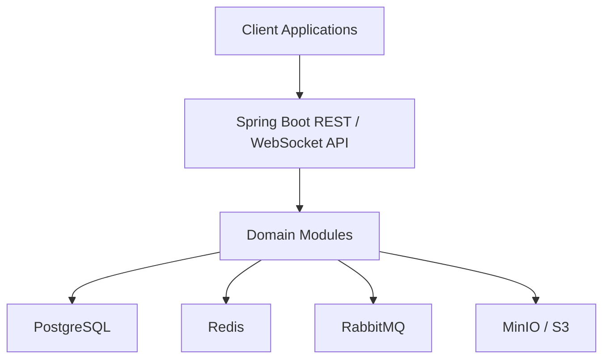
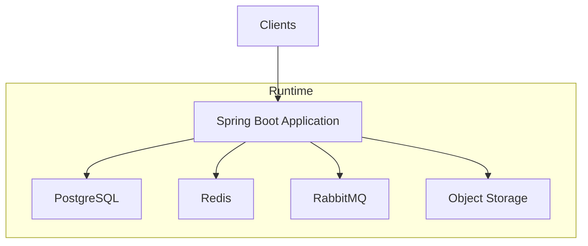
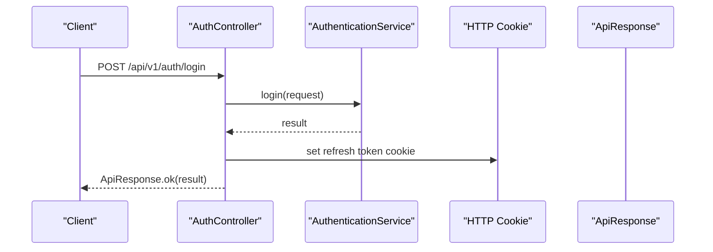
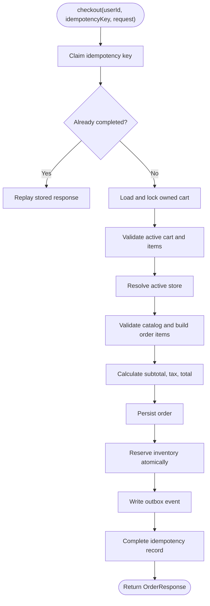
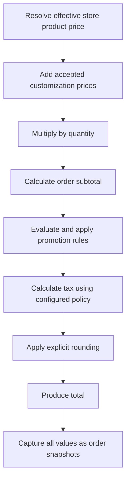
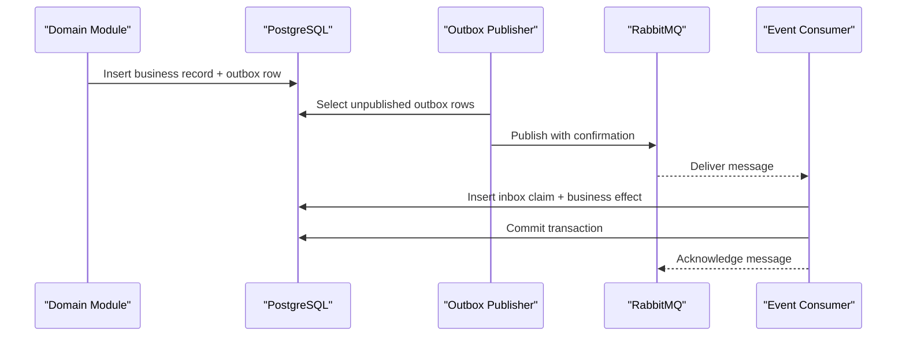
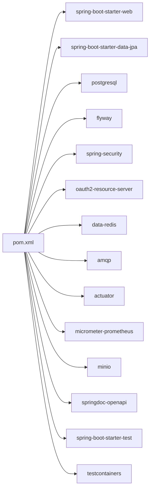

# Development Guide

<cite>
**Referenced Files in This Document**   
- [ADR-001-modular-monolith.md](file://adr/ADR-001-modular-monolith.md)
- [ADR-002-postgresql-ownership.md](file://adr/ADR-002-postgresql-ownership.md)
- [ADR-003-rabbitmq.md](file://adr/ADR-003-rabbitmq.md)
- [ADR-004-transactional-outbox.md](file://adr/ADR-004-transactional-outbox.md)
- [ADR-005-money-model.md](file://adr/ADR-005-money-model.md)
- [SYSTEM_ARCHITECTURE.md](file://architecture/SYSTEM_ARCHITECTURE.md)
- [DB_OWNERSHIP_MATRIX.md](file://database/DB_OWNERSHIP_MATRIX.md)
- [pom.xml](file://pom.xml)
- [application.yml](file://src/main/resources/application.yml)
- [README_STEP2.md](file://README_STEP2.md)
- [BusinessException.java](file://src/main/java/com/smartcoffee/common/exception/BusinessException.java)
- [ApiResponse.java](file://src/main/java/com/smartcoffee/common/api/ApiResponse.java)
- [AuthController.java](file://src/main/java/com/smartcoffee/modules/auth/api/AuthController.java)
- [OrderCheckoutService.java](file://src/main/java/com/smartcoffee/modules/ordering/application/OrderCheckoutService.java)
- [V001__identity_auth_rbac.sql](file://src/main/resources/db/migration/V001__identity_auth_rbac.sql)
</cite>

## Table of Contents
1. [Introduction](#introduction)
2. [Project Structure](#project-structure)
3. [Core Components](#core-components)
4. [Architecture Overview](#architecture-overview)
5. [Detailed Component Analysis](#detailed-component-analysis)
6. [Dependency Analysis](#dependency-analysis)
7. [Performance Considerations](#performance-considerations)
8. [Troubleshooting Guide](#troubleshooting-guide)
9. [Conclusion](#conclusion)
10. [Appendices](#appendices)

## Introduction
This development guide explains how to contribute effectively to the Smart Coffee Backend. The system is a Spring Boot modular monolith that coordinates store, catalog, cart, ordering, payment, inventory, promotion, loyalty, kitchen, notification, audit, and reporting capabilities. It uses PostgreSQL as the durable source of truth, Redis for bounded caching and coordination, RabbitMQ for durable asynchronous work, and MinIO or S3-compatible storage for objects.

The repository currently carries a transitional project name, but its structure represents an operational backend rather than a dedicated identity service. Contributors should treat it as a modular monolith with strict module boundaries, one write owner per table, server-authoritative pricing, transactional outbox messaging, and eventual consistency only where explicitly allowed.

## Project Structure
The codebase follows a layered, feature-oriented layout:

- `src/main/java/com/smartcoffee/common`: Shared cross-cutting concerns such as API responses, exceptions, context, persistence base types, security helpers, money utilities, and infrastructure adapters.
- `src/main/java/com/smartcoffee/config`: Spring configuration for JPA, Redis, RabbitMQ, security, OpenAPI, WebSocket, scheduling, and external integrations.
- `src/main/java/com/smartcoffee/infrastructure`: Cross-module infrastructure such as caching, idempotency, messaging, notifications, observability, payments, real-time publishing, and object storage.
- `src/main/java/com/smartcoffee/modules`: Domain modules organized by business capability, each containing `api`, `application`, `domain`, and `persistence` layers.
- `src/main/resources/db/migration`: Flyway SQL migrations aligned with database schemas and ownership.
- `src/test/java`: Integration tests using Testcontainers and Failsafe conventions.
- `adr`: Architecture Decision Records describing architectural choices and constraints.
- `architecture`: High-level architecture documentation and diagrams.
- `database`: Database ownership matrix and schema planning.



**Diagram sources**
- [SYSTEM_ARCHITECTURE.md:88-132](file://architecture/SYSTEM_ARCHITECTURE.md#L88-L132)
- [application.yml:17-42](file://src/main/resources/application.yml#L17-L42)

**Section sources**
- [SYSTEM_ARCHITECTURE.md:15-47](file://architecture/SYSTEM_ARCHITECTURE.md#L15-L47)
- [pom.xml:14-30](file://pom.xml#L14-L30)

## Core Components
Smart Coffee Backend is built around these core components:

- Modular domain modules under `modules`. Each module owns its API, application services, domain models, and persistence layer.
- Shared common package for cross-cutting concerns such as exception types, API response envelopes, correlation context, auditing, security, and money handling.
- Infrastructure package for cross-module capabilities including Redis cache, idempotency, RabbitMQ outbox/inbox, notifications, observability, payments, real-time events, and object storage.
- Configuration classes for JPA, Redis, RabbitMQ, security, OpenAPI, WebSocket, scheduling, and external systems.
- Flyway-driven database migrations under `db/migration`.
- Integration test suite under `src/test/java` using Testcontainers and Failsafe integration test naming.

Key implementation rules include:
- Controllers must not contain business logic.
- Application services define transaction boundaries.
- Business state transitions belong to aggregates or domain services.
- Modules communicate through explicit application interfaces or documented events.
- One module must not directly inject another module’s JPA repository.

**Section sources**
- [ADR-001-modular-monolith.md:16-50](file://adr/ADR-001-modular-monolith.md#L16-L50)
- [ADR-001-modular-monolith.md:82-92](file://adr/ADR-001-modular-monolith.md#L82-L92)
- [SYSTEM_ARCHITECTURE.md:136-196](file://architecture/SYSTEM_ARCHITECTURE.md#L136-L196)

## Architecture Overview
The platform begins as a modular monolith because checkout requires coordinated validation of store availability, server-authoritative product pricing, customization rules, promotion eligibility, recipe requirements, and inventory availability. Splitting these into independent microservices too early would introduce distributed transactions, network failure modes, event ordering concerns, compensation logic, and unnecessary operational cost.

The runtime stack includes:
- Spring Boot web API and WebSocket endpoints.
- PostgreSQL as the durable source of truth.
- Redis for bounded caches, rate limiting, optional session revocation cache, and short-lived coordination.
- RabbitMQ for durable asynchronous work such as notifications, receipts, reporting projections, retries, and background processing.
- MinIO locally and S3-compatible storage in production.



**Diagram sources**
- [SYSTEM_ARCHITECTURE.md:88-132](file://architecture/SYSTEM_ARCHITECTURE.md#L88-L132)

Module boundaries and ownership are defined so that every table has exactly one write owner. Historical order, payment, inventory, loyalty, and audit data must not be cascade-deleted. Reporting owns projections only and never modifies operational records.

**Section sources**
- [ADR-001-modular-monolith.md:8-14](file://adr/ADR-001-modular-monolith.md#L8-L14)
- [SYSTEM_ARCHITECTURE.md:23-49](file://architecture/SYSTEM_ARCHITECTURE.md#L23-L49)
- [DB_OWNERSHIP_MATRIX.md:1-15](file://database/DB_OWNERSHIP_MATRIX.md#L1-L15)

## Detailed Component Analysis

### Authentication and Authorization Flow
Authentication exposes login, register, refresh, logout, and user lookup endpoints. The controller delegates to an application service, sets secure cookies for local development, and returns a standardized API response envelope with correlation request identifiers.



**Diagram sources**
- [AuthController.java:13-71](file://src/main/java/com/smartcoffee/modules/auth/api/AuthController.java#L13-L71)
- [ApiResponse.java:5-9](file://src/main/java/com/smartcoffee/common/api/ApiResponse.java#L5-L9)

Contributors should:
- Keep controllers thin and delegate to application services.
- Use validated request DTOs.
- Return consistent API responses.
- Avoid storing secrets in source code; use environment variables.
- Review JWT secret rotation and cookie security settings before production.

**Section sources**
- [AuthController.java:13-71](file://src/main/java/com/smartcoffee/modules/auth/api/AuthController.java#L13-L71)
- [README_STEP2.md:1-23](file://README_STEP2.md#L1-L23)
- [application.yml:49-53](file://src/main/resources/application.yml#L49-L53)

### Order Checkout Transaction
Order checkout demonstrates the approved transaction boundary. It claims an idempotency key, validates the cart, loads authoritative catalog data, calculates prices and tax, reserves inventory, persists the order, writes an outbox event, and stores the idempotency replay response.



**Diagram sources**
- [OrderCheckoutService.java:62-133](file://src/main/java/com/smartcoffee/modules/ordering/application/OrderCheckoutService.java#L62-L133)

Important rules enforced by this flow:
- No external payment request executes while the database transaction remains open.
- Catalog prices and customizations are revalidated at checkout time.
- Inventory reservation succeeds or fails atomically.
- Events are written through the transactional outbox.
- Idempotency prevents duplicate order creation.

**Section sources**
- [OrderCheckoutService.java:62-133](file://src/main/java/com/smartcoffee/modules/ordering/application/OrderCheckoutService.java#L62-L133)
- [SYSTEM_ARCHITECTURE.md:232-259](file://architecture/SYSTEM_ARCHITECTURE.md#L232-L259)

### Money Model and Pricing Rules
Money values must be represented with exact arithmetic. The system uses an immutable value object with amount and currency, persists financial amounts as precise numeric types, and never trusts client-supplied totals. The pricing pipeline resolves effective store product price, adds customization prices, multiplies by quantity, evaluates promotions, applies tax, rounds explicitly, and captures snapshots.



**Diagram sources**
- [ADR-005-money-model.md:39-53](file://adr/ADR-005-money-model.md#L39-L53)

Guidelines:
- Never use floating-point types for financial calculations.
- Always specify scale and rounding mode explicitly.
- Capture exchange rates immutably with payment attempts.
- Validate non-negative prices, positive quantities, discount limits, refund limits, and supported currencies.

**Section sources**
- [ADR-005-money-model.md:8-27](file://adr/ADR-005-money-model.md#L8-L27)
- [ADR-005-money-model.md:55-77](file://adr/ADR-005-money-model.md#L55-L77)
- [ADR-005-money-model.md:109-117](file://adr/ADR-005-money-model.md#L109-L117)

### Database Ownership and Migrations
Every table has exactly one write owner. During the modular monolith phase, one PostgreSQL database with domain-aligned schemas is acceptable. After extraction, cross-service foreign keys must be removed and replaced by logical UUID references. Data exchange occurs through APIs and versioned events.

Migration rules include:
- Never modify an applied migration.
- Prefer additive changes.
- Use expand-and-contract for breaking changes.
- Backfill before making new columns mandatory.
- Validate constraints after cleanup when legacy data exists.
- Test every migration against a production-like PostgreSQL container.

```mermaid
erDiagram
USERS {
uuid user_id PK
string full_name
string email UK
string normalized_email UK
enum status
bigint security_version
timestamptz created_at
timestamptz updated_at
bigint version
}
USER_CREDENTIALS {
uuid user_id PK FK
text password_hash
int failed_login_count
timestamptz locked_until
timestamptz password_changed_at
}
ROLES {
uuid role_id PK
string role_code UK
string role_name
}
PERMISSIONS {
uuid permission_id PK
string permission_code UK
}
ROLE_PERMISSIONS {
uuid role_id PK FK
uuid permission_id PK FK
}
USER_ROLE_ASSIGNMENTS {
uuid assignment_id PK
uuid user_id FK
uuid role_id FK
uuid store_id
timestamptz assigned_at
timestamptz expires_at
timestamptz revoked_at
}
AUTH_SESSIONS {
uuid session_id PK
uuid user_id FK
uuid token_family_id
char refresh_token_hash UK
timestamptz expires_at
timestamptz revoked_at
timestamptz created_at
}
USERS ||--o{ USER_CREDENTIALS : "has"
ROLES ||--o{ ROLE_PERMISSIONS : "grants"
PERMISSIONS ||--o{ ROLE_PERMISSIONS : "has"
USERS ||--o{ USER_ROLE_ASSIGNMENTS : "assigned"
ROLES ||--o{ USER_ROLE_ASSIGNMENTS : "role"
USERS ||--o{ AUTH_SESSIONS : "owns"
```

**Diagram sources**
- [V001__identity_auth_rbac.sql:1-135](file://src/main/resources/db/migration/V001__identity_auth_rbac.sql#L1-L135)

**Section sources**
- [DB_OWNERSHIP_MATRIX.md:1-15](file://database/DB_OWNERSHIP_MATRIX.md#L1-L15)
- [DB_OWNERSHIP_MATRIX.md:16-65](file://database/DB_OWNERSHIP_MATRIX.md#L16-L65)
- [DB_OWNERSHIP_MATRIX.md:103-118](file://database/DB_OWNERSHIP_MATRIX.md#L103-L118)
- [ADR-002-postgresql-ownership.md:14-49](file://adr/ADR-002-postgresql-ownership.md#L14-L49)
- [ADR-002-postgresql-ownership.md:82-103](file://adr/ADR-002-postgresql-ownership.md#L82-L103)

### Messaging and Outbox Pattern
RabbitMQ is used for durable asynchronous work. Critical events must be published through a transactional outbox and consumed through a durable inbox. Delivery semantics are at-least-once, so consumers must be idempotent.



**Diagram sources**
- [ADR-004-transactional-outbox.md:14-20](file://adr/ADR-004-transactional-outbox.md#L14-L20)
- [ADR-004-transactional-outbox.md:49-69](file://adr/ADR-004-transactional-outbox.md#L49-L69)
- [ADR-003-rabbitmq.md:63-85](file://adr/ADR-003-rabbitmq.md#L63-L85)

**Section sources**
- [ADR-003-rabbitmq.md:8-20](file://adr/ADR-003-rabbitmq.md#L8-L20)
- [ADR-003-rabbitmq.md:63-85](file://adr/ADR-003-rabbitmq.md#L63-L85)
- [ADR-004-transactional-outbox.md:8-20](file://adr/ADR-004-transactional-outbox.md#L8-L20)
- [ADR-004-transactional-outbox.md:105-112](file://adr/ADR-004-transactional-outbox.md#L105-L112)

## Dependency Analysis
The Maven project defines Spring Boot 4, Spring Web MVC, JPA, PostgreSQL, Flyway, Security, OAuth2 resource server, Redis, RabbitMQ, Actuator, Prometheus, MinIO, Bouncy Castle, OpenAPI, Devtools, and Testcontainers. Integration tests are executed by Failsafe using the `*IT.java` pattern.



**Diagram sources**
- [pom.xml:62-306](file://pom.xml#L62-L306)
- [pom.xml:373-396](file://pom.xml#L373-L396)

Application defaults configure PostgreSQL via environment variables, disable Hibernate DDL auto-generation, enable Flyway migrations from `classpath:db/migration`, and configure RabbitMQ publisher confirms and returns. Redis repositories are disabled, and management endpoints expose health, info, metrics, and Prometheus.

**Section sources**
- [pom.xml:14-30](file://pom.xml#L14-L30)
- [pom.xml:62-306](file://pom.xml#L62-L306)
- [pom.xml:373-396](file://pom.xml#L373-L396)
- [application.yml:17-42](file://src/main/resources/application.yml#L17-L42)
- [application.yml:81-93](file://src/main/resources/application.yml#L81-L93)

## Performance Considerations
- Keep long-running operations out of database transactions. Only persist durable state and publish outbox events within the transaction boundary.
- Use Redis for bounded caches and coordination, not as the sole source of truth for orders, payments, stock, promotion usage, or loyalty points.
- Batch outbox publication and avoid unbounded queues.
- Index frequently queried columns and avoid N+1 queries in read paths.
- Use pagination for list endpoints and projection-based reads where appropriate.
- Monitor Actuator health, metrics, and Prometheus endpoints.
- Profile slow queries and hot paths using application logs, database query logging, and external profiling tools.

[No sources needed since this section provides general guidance]

## Troubleshooting Guide
Common error handling patterns:
- Business errors use a structured exception type carrying a machine-readable code, human-readable message, HTTP status, and optional cause.
- Global exception handling should map exceptions to consistent API error responses.
- Infrastructure failures should be distinguished from business validation failures.

Debugging strategies:
- Enable correlation IDs through the request context.
- Inspect Flyway migration history and validate migrations before deployment.
- Check RabbitMQ publisher confirmations and dead-letter queues.
- Verify outbox events are published and consumer inbox claims are recorded.
- Validate Redis connectivity and cache invalidation behavior.
- Review WebSocket authorization interceptors and allowed origins.

Testing strategy:
- Unit tests cover pure domain logic and application services without external dependencies.
- Integration tests use Testcontainers for PostgreSQL, RabbitMQ, and other required services.
- Concurrency-sensitive flows such as idempotency, outbox claiming, inventory reservation, and payment settlement require dedicated integration tests.

**Section sources**
- [BusinessException.java:3-26](file://src/main/java/com/smartcoffee/common/exception/BusinessException.java#L3-L26)
- [application.yml:33-42](file://src/main/resources/application.yml#L33-L42)
- [application.yml:71-76](file://src/main/resources/application.yml#L71-L76)
- [pom.xml:373-396](file://pom.xml#L373-L396)

## Conclusion
Smart Coffee Backend is a modular monolith designed for correctness, maintainability, and future extraction. Contributors should respect module boundaries, enforce one write owner per table, keep controllers thin, place business logic in domain and application layers, use exact money arithmetic, rely on transactional outbox messaging, and write tests that reflect real concurrency and failure scenarios. When adding features, follow the established patterns, document decisions through ADRs, and plan migrations carefully.

[No sources needed since this section summarizes without analyzing specific files]

## Appendices

### Coding Standards and Naming Conventions
- Package names follow `com.smartcoffee.modules.<module>.<layer>`.
- Controllers live under `api`, application services under `application`, domain models under `domain`, and repositories under `persistence`.
- Request and response DTOs are separate from domain entities.
- Exception codes should be stable, uppercase, and machine-readable.
- API responses use a consistent envelope with success flag, data, request ID, and timestamp.
- Database tables use UUID primary keys for business entities and append-only history where appropriate.
- Money values use precise decimal types and explicit rounding.

**Section sources**
- [ADR-001-modular-monolith.md:82-92](file://adr/ADR-001-modular-monolith.md#L82-L92)
- [ADR-002-postgresql-ownership.md:82-93](file://adr/ADR-002-postgresql-ownership.md#L82-L93)
- [ADR-005-money-model.md:14-27](file://adr/ADR-005-money-model.md#L14-L27)
- [ApiResponse.java:5-9](file://src/main/java/com/smartcoffee/common/api/ApiResponse.java#L5-L9)
- [BusinessException.java:3-26](file://src/main/java/com/smartcoffee/common/exception/BusinessException.java#L3-L26)

### Adding New Features
1. Identify the owning module and table ownership.
2. Create domain models, application services, and persistence repositories inside the correct module.
3. Expose functionality through a thin controller if it is a user-facing operation.
4. Use application ports or documented events for cross-module communication.
5. Add a Flyway migration only if the schema changes.
6. Write unit tests for domain logic and integration tests for transactional and concurrent behavior.
7. Update OpenAPI documentation if public APIs change.

**Section sources**
- [ADR-001-modular-monolith.md:82-92](file://adr/ADR-001-modular-monolith.md#L82-L92)
- [DB_OWNERSHIP_MATRIX.md:1-15](file://database/DB_OWNERSHIP_MATRIX.md#L1-L15)
- [SYSTEM_ARCHITECTURE.md:198-229](file://architecture/SYSTEM_ARCHITECTURE.md#L198-L229)

### Creating Database Migrations
- Place migrations under `src/main/resources/db/migration`.
- Name migrations with incremental versions and descriptive titles.
- Do not modify already applied migrations.
- Prefer additive changes and backfills.
- Align schema changes with the database ownership matrix.
- Test migrations against a production-like PostgreSQL container.

**Section sources**
- [ADR-002-postgresql-ownership.md:95-103](file://adr/ADR-002-postgresql-ownership.md#L95-L103)
- [DB_OWNERSHIP_MATRIX.md:16-65](file://database/DB_OWNERSHIP_MATRIX.md#L16-L65)

### Writing Tests
- Use unit tests for pure logic.
- Use integration tests for database, messaging, caching, and security interactions.
- Use Testcontainers for realistic dependency isolation.
- Cover idempotency, rollback, concurrency, and failure paths.
- Follow Failsafe integration test naming conventions.

**Section sources**
- [pom.xml:373-396](file://pom.xml#L373-L396)
- [ORDER_PRODUCTION_PATCH.md](file://ORDER_PRODUCTION_PATCH.md)
- [PAYMENT_INTEGRATION_PATCH.md](file://PAYMENT_INTEGRATION_PATCH.md)

### Code Review Checklist
- Does the change stay within the owning module?
- Are controllers free of business logic?
- Are transaction boundaries clear and minimal?
- Is money handled with exact arithmetic?
- Are cross-module calls made through application ports or events?
- Are Flyway migrations additive and safe?
- Are integration tests covering critical paths?
- Are secrets externalized and not committed?

**Section sources**
- [ADR-001-modular-monolith.md:82-92](file://adr/ADR-001-modular-monolith.md#L82-L92)
- [ADR-005-money-model.md:109-117](file://adr/ADR-005-money-model.md#L109-L117)
- [SYSTEM_ARCHITECTURE.md:291-300](file://architecture/SYSTEM_ARCHITECTURE.md#L291-L300)

### Architecture Decision Records Process
ADRs capture context, decision, alternatives, consequences, implementation rules, and revisit conditions. They serve as the architectural contract for contributors and reviewers.

- ADR-001 establishes the modular monolith approach.
- ADR-002 defines PostgreSQL ownership and database boundaries.
- ADR-003 selects RabbitMQ for durable messaging.
- ADR-004 mandates transactional outbox and consumer inbox.
- ADR-005 defines the money model and pricing rules.

When proposing a new architectural choice:
1. Draft an ADR with context and scope.
2. List alternatives and explain why they were rejected.
3. Document consequences and implementation rules.
4. Define revisit conditions.
5. Seek review from architecture and domain owners.

**Section sources**
- [ADR-001-modular-monolith.md:1-115](file://adr/ADR-001-modular-monolith.md#L1-L115)
- [ADR-002-postgresql-ownership.md:1-107](file://adr/ADR-002-postgresql-ownership.md#L1-L107)
- [ADR-003-rabbitmq.md:1-112](file://adr/ADR-003-rabbitmq.md#L1-L112)
- [ADR-004-transactional-outbox.md:1-117](file://adr/ADR-004-transactional-outbox.md#L1-L117)
- [ADR-005-money-model.md:1-122](file://adr/ADR-005-money-model.md#L1-L122)

### Release Procedures and Versioning
- Use Maven for builds and packaging.
- Keep `spring.jpa.hibernate.ddl-auto` disabled in production.
- Run Flyway migrations automatically during startup.
- Validate migrations with `validate-on-migrate`.
- Clean database cleaning is disabled to protect production data.
- Manage dependency versions through the Spring Boot parent and imported BOMs.
- Tag releases and track semantic versions outside the current snapshot artifact metadata.

**Section sources**
- [pom.xml:14-19](file://pom.xml#L14-L19)
- [pom.xml:312-341](file://pom.xml#L312-L341)
- [application.yml:23-37](file://src/main/resources/application.yml#L23-L37)

### Common Refactoring Patterns
- Extract business logic from controllers into application services.
- Replace direct repository access between modules with application ports or events.
- Move shared validation and calculation logic into domain services or reusable utilities.
- Introduce explicit DTOs for API input and output.
- Separate read models from write models when performance or ownership requires it.

**Section sources**
- [ADR-001-modular-monolith.md:82-92](file://adr/ADR-001-modular-monolith.md#L82-L92)
- [SYSTEM_ARCHITECTURE.md:198-229](file://architecture/SYSTEM_ARCHITECTURE.md#L198-L229)

### Debugging Strategies and Profiling Tools
- Use correlation context for request tracing.
- Enable detailed logging for Flyway and infrastructure components as needed.
- Monitor Actuator health and readiness probes.
- Export metrics to Prometheus.
- Inspect RabbitMQ queues, dead-letter queues, and outbox/inbox tables.
- Validate Redis connectivity and cache invalidation.
- Use IDE profilers and database query analysis tools to locate bottlenecks.

**Section sources**
- [application.yml:33-42](file://src/main/resources/application.yml#L33-L42)
- [application.yml:81-93](file://src/main/resources/application.yml#L81-L93)
- [ADR-004-transactional-outbox.md:49-69](file://adr/ADR-004-transactional-outbox.md#L49-L69)