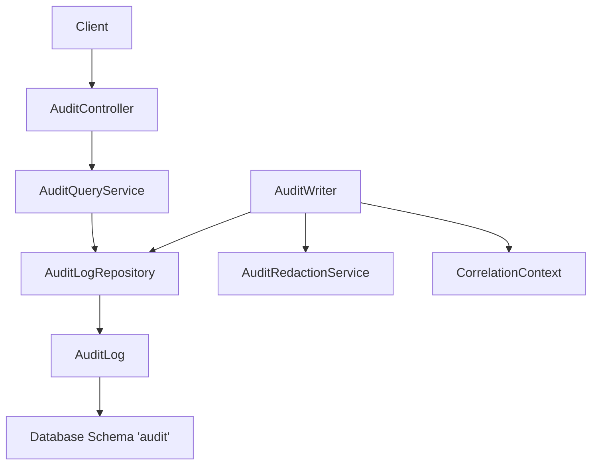
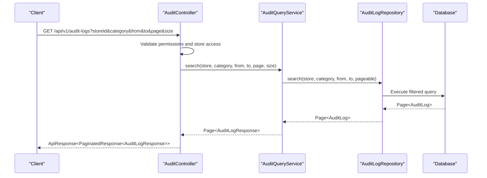
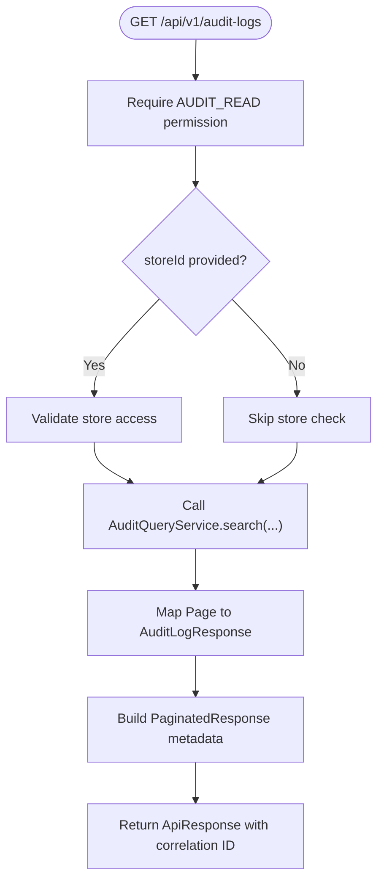
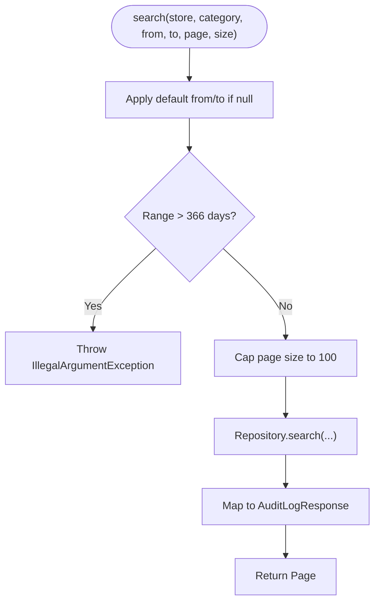
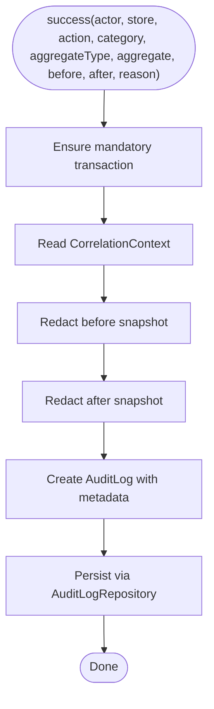
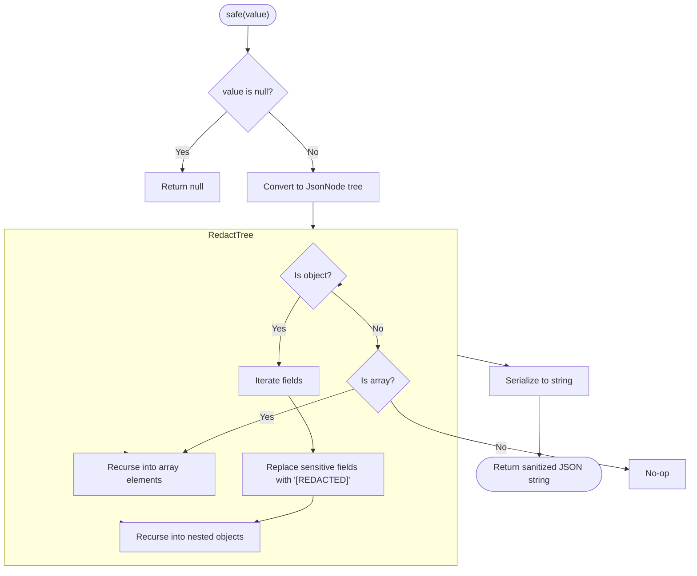
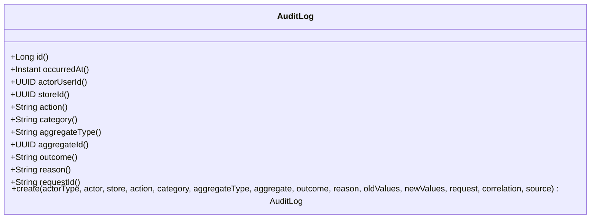
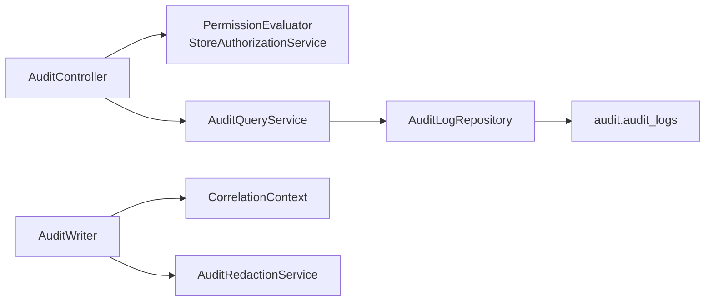

# Audit Logging Module

<cite>
**Referenced Files in This Document**
- [AuditController.java](file://src/main/java/com/smartcoffee/modules/audit/api/AuditController.java)
- [AuditLogResponse.java](file://src/main/java/com/smartcoffee/modules/audit/api/AuditLogResponse.java)
- [AuditQueryService.java](file://src/main/java/com/smartcoffee/modules/audit/application/AuditQueryService.java)
- [AuditRedactionService.java](file://src/main/java/com/smartcoffee/modules/audit/application/AuditRedactionService.java)
- [AuditWriter.java](file://src/main/java/com/smartcoffee/modules/audit/application/AuditWriter.java)
- [AuditLog.java](file://src/main/java/com/smartcoffee/modules/audit/domain/AuditLog.java)
- [AuditLogRepository.java](file://src/main/java/com/smartcoffee/modules/audit/persistence/AuditLogRepository.java)
- [V010__notifications_audit.sql](file://src/main/resources/db/migration/V010__notifications_audit.sql)
- [BUSINESS_AUDIT_PATCH.md](file://BUSINESS_AUDIT_PATCH.md)
- [AuditRedactionServiceTest.java](file://src/test/java/com/smartcoffee/modules/audit/AuditRedactionServiceTest.java)
- [AuditAuthorizationIT.java](file://src/test/java/com/smartcoffee/modules/audit/AuditAuthorizationIT.java)
</cite>

## Table of Contents
1. [Introduction](#introduction)
2. [Project Structure](#project-structure)
3. [Core Components](#core-components)
4. [Architecture Overview](#architecture-overview)
5. [Detailed Component Analysis](#detailed-component-analysis)
6. [Dependency Analysis](#dependency-analysis)
7. [Performance Considerations](#performance-considerations)
8. [Troubleshooting Guide](#troubleshooting-guide)
9. [Conclusion](#conclusion)
10. [Appendices](#appendices)

## Introduction
The Audit Logging module provides an immutable, append-only audit trail for business operations. It captures who performed an action, what changed, and why, while ensuring sensitive data is redacted before persistence. The module exposes a secure, paginated query API for auditing and compliance reporting, integrates with correlation context for request tracing, and enforces store-scoped authorization.

Key capabilities:
- Immutable audit trail creation through a mandatory transaction boundary.
- Sensitive field redaction for JSON payloads stored as JSONB.
- Store-scoped, permission-gated audit log querying.
- Correlation and request ID propagation for end-to-end traceability.
- Database schema with indexes optimized for time-based and aggregate queries.

## Project Structure
The audit module follows a layered structure:
- API layer: HTTP controller exposing the audit log search endpoint.
- Application layer: Query service, redaction service, and writer service.
- Domain layer: Persistent audit entity model.
- Persistence layer: JPA repository with append-only constraints.

**Diagram sources**
- [AuditController.java:12-41](file://src/main/java/com/smartcoffee/modules/audit/api/AuditController.java#L12-L41)
- [AuditQueryService.java:19-30](file://src/main/java/com/smartcoffee/modules/audit/application/AuditQueryService.java#L19-L30)
- [AuditLogRepository.java:10-13](file://src/main/java/com/smartcoffee/modules/audit/persistence/AuditLogRepository.java#L10-L13)
- [AuditLog.java:7-43](file://src/main/java/com/smartcoffee/modules/audit/domain/AuditLog.java#L7-L43)
- [AuditWriter.java:21-28](file://src/main/java/com/smartcoffee/modules/audit/application/AuditWriter.java#L21-L28)
- [AuditRedactionService.java:31-40](file://src/main/java/com/smartcoffee/modules/audit/application/AuditRedactionService.java#L31-L40)

**Section sources**
- [AuditController.java:12-41](file://src/main/java/com/smartcoffee/modules/audit/api/AuditController.java#L12-L41)
- [AuditQueryService.java:19-30](file://src/main/java/com/smartcoffee/modules/audit/application/AuditQueryService.java#L19-L30)
- [AuditLogRepository.java:10-13](file://src/main/java/com/smartcoffee/modules/audit/persistence/AuditLogRepository.java#L10-L13)
- [AuditLog.java:7-43](file://src/main/java/com/smartcoffee/modules/audit/domain/AuditLog.java#L7-L43)
- [AuditWriter.java:21-28](file://src/main/java/com/smartcoffee/modules/audit/application/AuditWriter.java#L21-L28)
- [AuditRedactionService.java:31-40](file://src/main/java/com/smartcoffee/modules/audit/application/AuditRedactionService.java#L31-L40)

## Core Components
- AuditController: Exposes GET /api/v1/audit-logs with filtering by store, category, and time range, plus pagination. Enforces AUDIT_READ permission and store authorization.
- AuditQueryService: Applies safe defaults for time ranges, enforces maximum range size, and maps persisted entities to response DTOs.
- AuditWriter: Creates immutable audit entries within a mandatory transaction, capturing actor, store, action, category, aggregate identity, outcome, reason, and redacted before/after values. Propagates correlation and request IDs.
- AuditRedactionService: Recursively redacts known sensitive fields from JSON structures before persistence or exposure.
- AuditLog: Persistent domain entity representing an immutable audit record.
- AuditLogRepository: Provides filtered search and enforces append-only semantics by overriding delete operations.

**Section sources**
- [AuditController.java:12-41](file://src/main/java/com/smartcoffee/modules/audit/api/AuditController.java#L12-L41)
- [AuditQueryService.java:19-30](file://src/main/java/com/smartcoffee/modules/audit/application/AuditQueryService.java#L19-L30)
- [AuditWriter.java:21-28](file://src/main/java/com/smartcoffee/modules/audit/application/AuditWriter.java#L21-L28)
- [AuditRedactionService.java:31-40](file://src/main/java/com/smartcoffee/modules/audit/application/AuditRedactionService.java#L31-L40)
- [AuditLog.java:7-68](file://src/main/java/com/smartcoffee/modules/audit/domain/AuditLog.java#L7-L68)
- [AuditLogRepository.java:10-23](file://src/main/java/com/smartcoffee/modules/audit/persistence/AuditLogRepository.java#L10-L23)

## Architecture Overview
The audit system integrates into business operations via AuditWriter, which must be invoked inside the same transaction as the authoritative mutation. Queries are exposed through a secured REST endpoint that delegates to a read-only query service. All audit records are persisted in the audit schema with appropriate indexes for efficient filtering.

**Diagram sources**
- [AuditController.java:28-41](file://src/main/java/com/smartcoffee/modules/audit/api/AuditController.java#L28-L41)
- [AuditQueryService.java:19-30](file://src/main/java/com/smartcoffee/modules/audit/application/AuditQueryService.java#L19-L30)
- [AuditLogRepository.java:10-13](file://src/main/java/com/smartcoffee/modules/audit/persistence/AuditLogRepository.java#L10-L13)

## Detailed Component Analysis

### AuditController
Responsibilities:
- Accepts audit log search requests with optional filters.
- Requires AUDIT_READ permission and validates store ownership when provided.
- Returns a paginated response including metadata and correlation ID.

Security and validation:
- Permission check ensures only authorized actors can read audit logs.
- Store authorization restricts cross-store visibility.

Filtering and pagination:
- Supports filtering by storeId, category, and time range (from/to).
- Pagination parameters include page and size; default size is capped at 100 by the query service.

**Diagram sources**
- [AuditController.java:28-41](file://src/main/java/com/smartcoffee/modules/audit/api/AuditController.java#L28-L41)
- [AuditQueryService.java:19-30](file://src/main/java/com/smartcoffee/modules/audit/application/AuditQueryService.java#L19-L30)

**Section sources**
- [AuditController.java:12-41](file://src/main/java/com/smartcoffee/modules/audit/api/AuditController.java#L12-L41)

### AuditQueryService
Responsibilities:
- Applies safe defaults for time range if not provided.
- Enforces a maximum range of 366 days to prevent overly broad queries.
- Caps page size to 100 to protect performance.
- Maps persisted AuditLog entities to AuditLogResponse DTOs.

Query behavior:
- Read-only transactional method.
- Delegates filtering to repository with Pageable.

**Diagram sources**
- [AuditQueryService.java:19-30](file://src/main/java/com/smartcoffee/modules/audit/application/AuditQueryService.java#L19-L30)

**Section sources**
- [AuditQueryService.java:19-30](file://src/main/java/com/smartcoffee/modules/audit/application/AuditQueryService.java#L19-L30)

### AuditWriter
Responsibilities:
- Creates immutable audit entries with outcome SUCCESS.
- Persists redacted before/after snapshots.
- Enforces mandatory transaction propagation so audit writes occur within the business transaction.
- Captures correlation and request IDs from context.

Integration guidance:
- Business services should call AuditWriter.success after successful mutations and within the same transaction.
- Avoid serializing full domain entities; pass explicit safe DTOs to minimize sensitive data exposure.

**Diagram sources**
- [AuditWriter.java:21-28](file://src/main/java/com/smartcoffee/modules/audit/application/AuditWriter.java#L21-L28)
- [AuditLog.java:48-68](file://src/main/java/com/smartcoffee/modules/audit/domain/AuditLog.java#L48-L68)

**Section sources**
- [AuditWriter.java:21-28](file://src/main/java/com/smartcoffee/modules/audit/application/AuditWriter.java#L21-L28)
- [BUSINESS_AUDIT_PATCH.md:1-3](file://BUSINESS_AUDIT_PATCH.md#L1-L3)

### AuditRedactionService
Responsibilities:
- Recursively traverses JSON nodes and replaces sensitive field values with a placeholder.
- Uses a predefined set of sensitive field names (case-insensitive matching).
- Converts objects to JSON trees, redacts, and returns sanitized strings.

Sensitive fields:
- Includes common secrets such as passwords, tokens, secrets, authorization headers, device tokens, and private keys.

**Diagram sources**
- [AuditRedactionService.java:31-40](file://src/main/java/com/smartcoffee/modules/audit/application/AuditRedactionService.java#L31-L40)
- [AuditRedactionService.java:42-67](file://src/main/java/com/smartcoffee/modules/audit/application/AuditRedactionService.java#L42-L67)

**Section sources**
- [AuditRedactionService.java:11-74](file://src/main/java/com/smartcoffee/modules/audit/application/AuditRedactionService.java#L11-L74)
- [AuditRedactionServiceTest.java:16-27](file://src/test/java/com/smartcoffee/modules/audit/AuditRedactionServiceTest.java#L16-L27)

### AuditLog (Domain Entity)
Responsibilities:
- Represents an immutable audit record with fields for actor, store, action, category, aggregate identity, outcome, reason, old/new values, request/correlation IDs, and source.
- Factory method create sets occurredAt and all required fields.

Immutability guarantees:
- Repository overrides delete methods to throw exceptions, enforcing append-only semantics.

**Diagram sources**
- [AuditLog.java:7-68](file://src/main/java/com/smartcoffee/modules/audit/domain/AuditLog.java#L7-L68)
- [AuditLogRepository.java:15-23](file://src/main/java/com/smartcoffee/modules/audit/persistence/AuditLogRepository.java#L15-L23)

**Section sources**
- [AuditLog.java:7-113](file://src/main/java/com/smartcoffee/modules/audit/domain/AuditLog.java#L7-L113)
- [AuditLogRepository.java:15-23](file://src/main/java/com/smartcoffee/modules/audit/persistence/AuditLogRepository.java#L15-L23)

### AuditLogRepository
Responsibilities:
- Provides filtered search by store, category, and time range with ordering by occurredAt descending.
- Enforces append-only policy by throwing unsupported operation on delete calls.

Indexing strategy:
- Optimized for store+time queries and aggregate-type/id lookups.
- Request ID index supports tracing.

**Section sources**
- [AuditLogRepository.java:10-23](file://src/main/java/com/smartcoffee/modules/audit/persistence/AuditLogRepository.java#L10-L23)
- [V010__notifications_audit.sql:111-138](file://src/main/resources/db/migration/V010__notifications_audit.sql#L111-L138)

## Dependency Analysis
The audit module depends on:
- Common security components for current actor resolution, permission evaluation, and store authorization.
- Correlation context for request and correlation ID propagation.
- Database schema under the audit schema with foreign key references to identity and organization schemas.

**Diagram sources**
- [AuditController.java:12-41](file://src/main/java/com/smartcoffee/modules/audit/api/AuditController.java#L12-L41)
- [AuditQueryService.java:19-30](file://src/main/java/com/smartcoffee/modules/audit/application/AuditQueryService.java#L19-L30)
- [AuditWriter.java:21-28](file://src/main/java/com/smartcoffee/modules/audit/application/AuditWriter.java#L21-L28)
- [AuditLogRepository.java:10-13](file://src/main/java/com/smartcoffee/modules/audit/persistence/AuditLogRepository.java#L10-L13)
- [V010__notifications_audit.sql:111-138](file://src/main/resources/db/migration/V010__notifications_audit.sql#L111-L138)

**Section sources**
- [AuditController.java:12-41](file://src/main/java/com/smartcoffee/modules/audit/api/AuditController.java#L12-L41)
- [AuditQueryService.java:19-30](file://src/main/java/com/smartcoffee/modules/audit/application/AuditQueryService.java#L19-L30)
- [AuditWriter.java:21-28](file://src/main/java/com/smartcoffee/modules/audit/application/AuditWriter.java#L21-L28)
- [AuditLogRepository.java:10-13](file://src/main/java/com/smartcoffee/modules/audit/persistence/AuditLogRepository.java#L10-L13)
- [V010__notifications_audit.sql:111-138](file://src/main/resources/db/migration/V010__notifications_audit.sql#L111-L138)

## Performance Considerations
- Time range defaults: If not provided, the query service uses a 30-day window, reducing scan scope.
- Maximum range enforcement: Queries exceeding 366 days are rejected to prevent heavy scans.
- Page size cap: Page size is limited to 100 to avoid large result sets.
- Index usage: The repository query orders by occurredAt descending and filters by store/category/time, leveraging database indexes defined in the migration.
- Append-only design: No deletes reduce write amplification and simplify retention strategies.

Recommendations:
- Always provide explicit time ranges in production queries.
- Use store and category filters to narrow results.
- Export large datasets asynchronously rather than via direct API responses.

[No sources needed since this section provides general guidance]

## Troubleshooting Guide
Common issues and resolutions:
- Missing AUDIT_READ permission: Ensure the current actor has the audit:read permission.
- Cross-store access denied: Verify store authorization; users cannot query other stores’ audit logs.
- Range too large: Adjust from/to parameters to stay within 366 days.
- Large page sizes: Reduce page size to 100 or less.
- Transaction errors: AuditWriter requires a mandatory transaction; ensure it is called within the same transaction as the business mutation.
- Sensitive data leakage: Confirm that before/after snapshots are passed as safe DTOs and not raw entities.

Operational checks:
- Verify database indexes exist for audit.audit_logs (store+time, aggregate_type+aggregate_id, request_id).
- Confirm permission seed includes audit:read.

**Section sources**
- [AuditController.java:28-41](file://src/main/java/com/smartcoffee/modules/audit/api/AuditController.java#L28-L41)
- [AuditQueryService.java:19-30](file://src/main/java/com/smartcoffee/modules/audit/application/AuditQueryService.java#L19-L30)
- [AuditWriter.java:21-28](file://src/main/java/com/smartcoffee/modules/audit/application/AuditWriter.java#L21-L28)
- [V010__notifications_audit.sql:111-152](file://src/main/resources/db/migration/V010__notifications_audit.sql#L111-L152)

## Conclusion
The Audit Logging module delivers a secure, immutable audit trail with strong privacy controls and efficient querying. By integrating AuditWriter into business transactions, enforcing permissions and store scoping, and redacting sensitive data, the system supports compliance reporting and operational investigations. Proper use of time-range filters, pagination, and asynchronous exports will maintain performance and data safety at scale.

[No sources needed since this section summarizes without analyzing specific files]

## Appendices

### API Usage Examples

- Create an audit entry:
  - Inject AuditWriter into your business service.
  - After a successful mutation and within the same transaction, call success with safe before/after DTOs.
  - Reference: [AuditWriter.java:21-28](file://src/main/java/com/smartcoffee/modules/audit/application/AuditWriter.java#L21-L28), [BUSINESS_AUDIT_PATCH.md:1-3](file://BUSINESS_AUDIT_PATCH.md#L1-L3)

- Query audit logs:
  - GET /api/v1/audit-logs?storeId={uuid}&category={string}&from={iso-instant}&to={iso-instant}&page={int}&size={int}
  - Requires AUDIT_READ permission and store authorization when storeId is provided.
  - Reference: [AuditController.java:28-41](file://src/main/java/com/smartcoffee/modules/audit/api/AuditController.java#L28-L41), [AuditQueryService.java:19-30](file://src/main/java/com/smartcoffee/modules/audit/application/AuditQueryService.java#L19-L30)

- Compliance export:
  - Use the query API with strict filters and pagination.
  - For large exports, implement an asynchronous job that streams pages and persists them to secure storage.
  - Reference: [AuditQueryService.java:19-30](file://src/main/java/com/smartcoffee/modules/audit/application/AuditQueryService.java#L19-L30)

### Data Privacy and Security Notes
- Sensitive fields are automatically redacted before persistence.
- Audit entries capture minimal identifiers (actor user ID, store ID, aggregate identity) and outcomes/reasons.
- Authorization ensures users can only access their own store’s audit logs.
- Reference: [AuditRedactionService.java:11-74](file://src/main/java/com/smartcoffee/modules/audit/application/AuditRedactionService.java#L11-L74), [AuditController.java:28-41](file://src/main/java/com/smartcoffee/modules/audit/api/AuditController.java#L28-L41)

### Long-Term Storage Strategy
- Keep audit logs append-only; do not delete rows.
- Archive older partitions to cold storage based on retention policies.
- Maintain indexes for recent data; consider partitioning by time for very large datasets.
- Reference: [AuditLogRepository.java:15-23](file://src/main/java/com/smartcoffee/modules/audit/persistence/AuditLogRepository.java#L15-L23), [V010__notifications_audit.sql:111-138](file://src/main/resources/db/migration/V010__notifications_audit.sql#L111-L138)