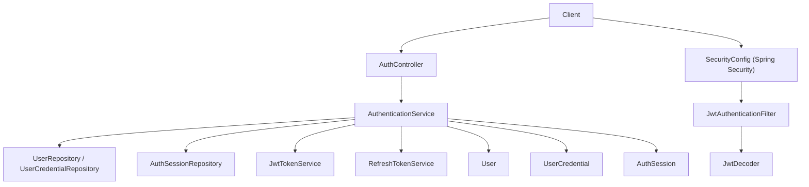
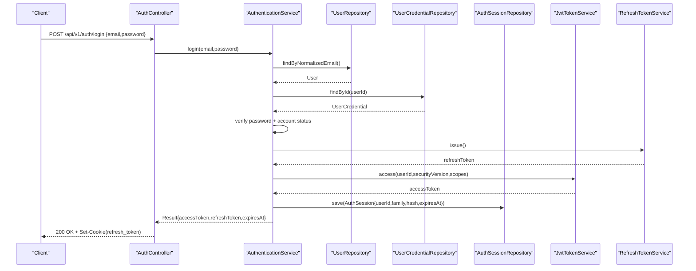
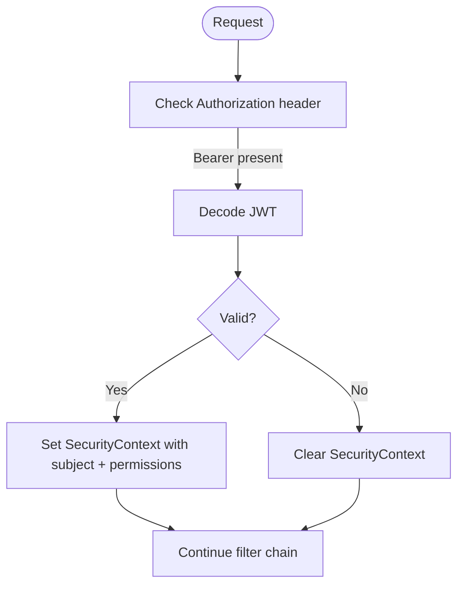
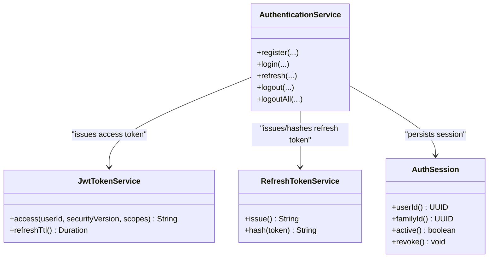
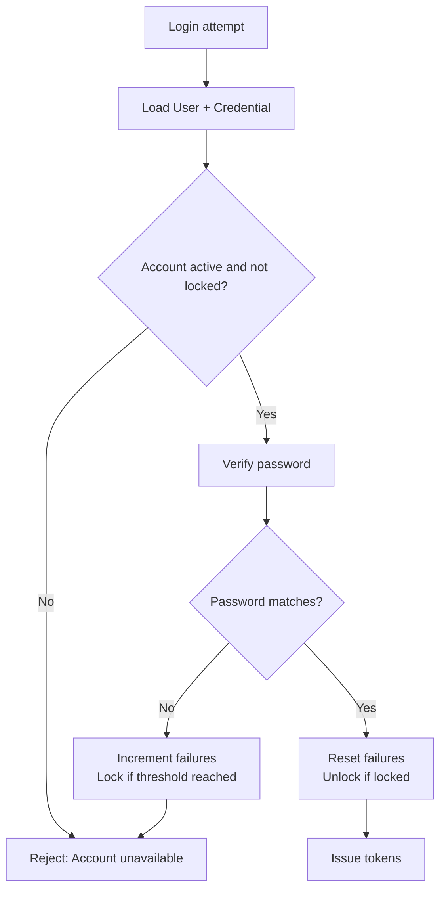
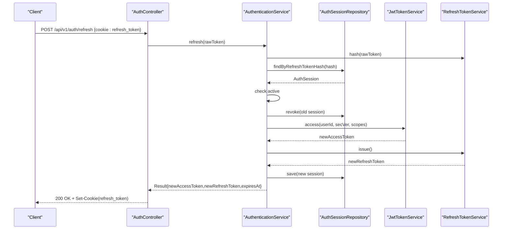
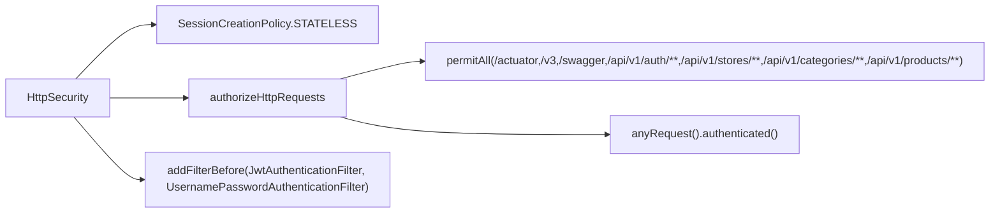
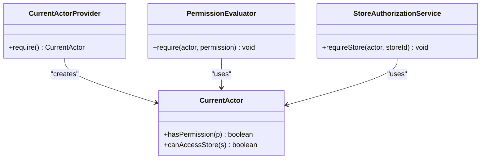
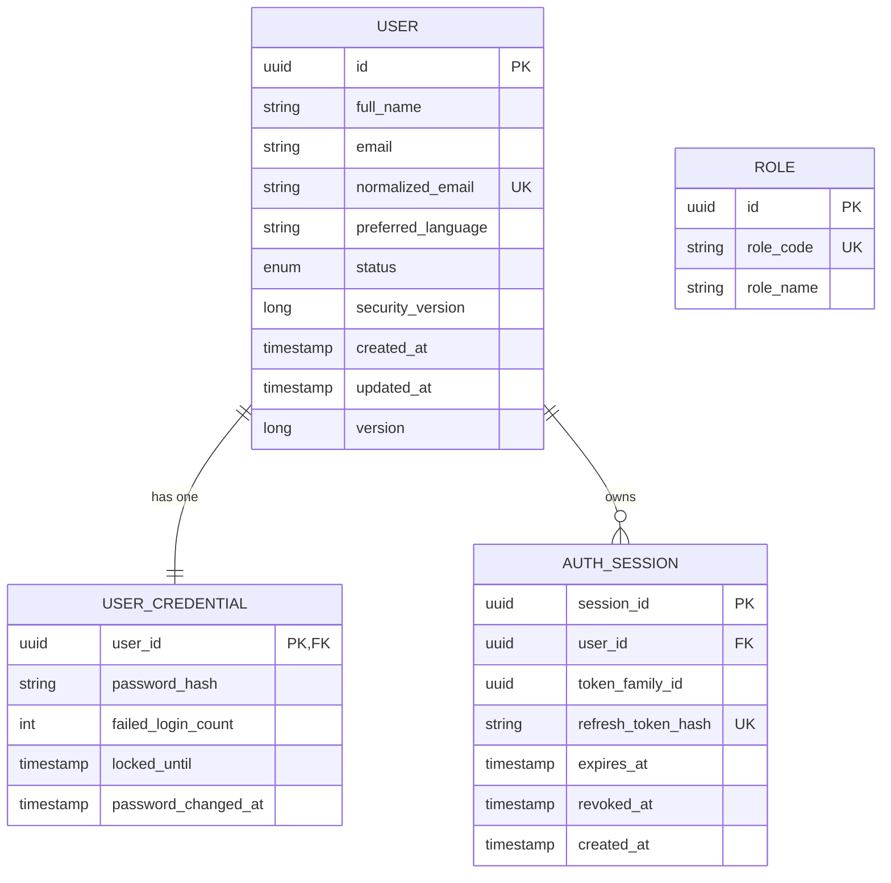
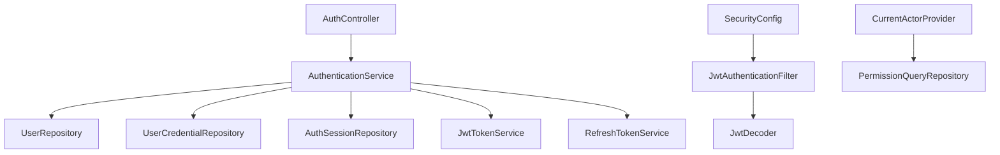

# Authentication & Authorization Module

<cite>
**Referenced Files in This Document**
- [AuthController.java](file://src/main/java/com/smartcoffee/modules/auth/api/AuthController.java)
- [AuthenticationService.java](file://src/main/java/com/smartcoffee/modules/auth/application/AuthenticationService.java)
- [JwtAuthenticationFilter.java](file://src/main/java/com/smartcoffee/modules/auth/security/JwtAuthenticationFilter.java)
- [JwtTokenService.java](file://src/main/java/com/smartcoffee/modules/auth/security/JwtTokenService.java)
- [RefreshTokenService.java](file://src/main/java/com/smartcoffee/modules/auth/security/RefreshTokenService.java)
- [SecurityConfig.java](file://src/main/java/com/smartcoffee/config/SecurityConfig.java)
- [PermissionEvaluator.java](file://src/main/java/com/smartcoffee/common/security/PermissionEvaluator.java)
- [StoreAuthorizationService.java](file://src/main/java/com/smartcoffee/common/security/StoreAuthorizationService.java)
- [CurrentActor.java](file://src/main/java/com/smartcoffee/common/security/CurrentActor.java)
- [CurrentActorProvider.java](file://src/main/java/com/smartcoffee/common/security/CurrentActorProvider.java)
- [AuthSession.java](file://src/main/java/com/smartcoffee/modules/auth/domain/AuthSession.java)
- [AuthSessionRepository.java](file://src/main/java/com/smartcoffee/modules/auth/persistence/AuthSessionRepository.java)
- [User.java](file://src/main/java/com/smartcoffee/modules/identity/domain/User.java)
- [UserCredential.java](file://src/main/java/com/smartcoffee/modules/identity/domain/UserCredential.java)
- [Role.java](file://src/main/java/com/smartcoffee/modules/rbac/domain/Role.java)
</cite>

## Table of Contents
1. [Introduction](#introduction)
2. [Project Structure](#project-structure)
3. [Core Components](#core-components)
4. [Architecture Overview](#architecture-overview)
5. [Detailed Component Analysis](#detailed-component-analysis)
6. [Dependency Analysis](#dependency-analysis)
7. [Performance Considerations](#performance-considerations)
8. [Troubleshooting Guide](#troubleshooting-guide)
9. [Conclusion](#conclusion)

## Introduction
This document explains the Authentication & Authorization module for the Smart Coffee backend. It covers:
- JWT-based authentication flow and token lifecycle
- Refresh token management and session handling
- Security architecture including password hashing, token validation, and store-scoped authorization
- Integration with Spring Security, custom filters, and permission evaluation
- Examples of authentication endpoints and best practices for secure storage and rotation

## Project Structure
The authentication and authorization logic spans several packages:
- API layer: REST endpoints for register, login, refresh, logout, and logout-all
- Application layer: orchestration of user lookup, credential verification, session creation, and token issuance
- Security layer: JWT encoding/decoding, filter to populate security context, and refresh token utilities
- Domain and persistence: user entities, credentials, and auth sessions
- Common security primitives: current actor abstraction, permission evaluator, and store authorization service
- Configuration: Spring Security setup, password encoder, and JWT decoder

**Diagram sources**
- [AuthController.java:13-70](file://src/main/java/com/smartcoffee/modules/auth/api/AuthController.java#L13-L70)
- [AuthenticationService.java:16-100](file://src/main/java/com/smartcoffee/modules/auth/application/AuthenticationService.java#L16-L100)
- [JwtAuthenticationFilter.java:1-5](file://src/main/java/com/smartcoffee/modules/auth/security/JwtAuthenticationFilter.java#L1-L5)
- [JwtTokenService.java:23-85](file://src/main/java/com/smartcoffee/modules/auth/security/JwtTokenService.java#L23-L85)
- [RefreshTokenService.java:1-5](file://src/main/java/com/smartcoffee/modules/auth/security/RefreshTokenService.java#L1-L5)
- [SecurityConfig.java:22-80](file://src/main/java/com/smartcoffee/config/SecurityConfig.java#L22-L80)
- [AuthSession.java:7-53](file://src/main/java/com/smartcoffee/modules/auth/domain/AuthSession.java#L7-L53)
- [User.java:7-84](file://src/main/java/com/smartcoffee/modules/identity/domain/User.java#L7-L84)
- [UserCredential.java:1-16](file://src/main/java/com/smartcoffee/modules/identity/domain/UserCredential.java#L1-L16)

**Section sources**
- [AuthController.java:13-70](file://src/main/java/com/smartcoffee/modules/auth/api/AuthController.java#L13-L70)
- [AuthenticationService.java:16-100](file://src/main/java/com/smartcoffee/modules/auth/application/AuthenticationService.java#L16-L100)
- [SecurityConfig.java:22-80](file://src/main/java/com/smartcoffee/config/SecurityConfig.java#L22-L80)

## Core Components
- AuthController: Exposes REST endpoints for registration, login, refresh, logout, and logout-all; manages refresh token cookie lifecycle.
- AuthenticationService: Orchestrates registration, login, refresh, and logout flows; issues access tokens and persists refresh sessions.
- JwtTokenService: Encodes HS256 JWTs with configurable TTLs and claims such as subject, issuer, scopes, and security version.
- RefreshTokenService: Generates cryptographically random refresh tokens and hashes them before persistence.
- JwtAuthenticationFilter: Extracts Bearer tokens from Authorization headers, decodes them, and populates SecurityContext with authorities derived from token claims.
- SecurityConfig: Configures Spring Security, stateless sessions, public endpoints, and registers the custom filter.
- CurrentActorProvider and CurrentActor: Resolve authenticated principal into a domain-friendly actor with permissions and store scoping.
- PermissionEvaluator and StoreAuthorizationService: Provide declarative checks for permissions and store-scoped access.
- AuthSession and AuthSessionRepository: Persist refresh sessions with family grouping, expiration, and revocation support.
- User and UserCredential: Represent users and their hashed passwords with lockout tracking.

**Section sources**
- [AuthController.java:13-70](file://src/main/java/com/smartcoffee/modules/auth/api/AuthController.java#L13-L70)
- [AuthenticationService.java:16-100](file://src/main/java/com/smartcoffee/modules/auth/application/AuthenticationService.java#L16-L100)
- [JwtTokenService.java:23-85](file://src/main/java/com/smartcoffee/modules/auth/security/JwtTokenService.java#L23-L85)
- [RefreshTokenService.java:1-5](file://src/main/java/com/smartcoffee/modules/auth/security/RefreshTokenService.java#L1-L5)
- [JwtAuthenticationFilter.java:1-5](file://src/main/java/com/smartcoffee/modules/auth/security/JwtAuthenticationFilter.java#L1-L5)
- [SecurityConfig.java:22-80](file://src/main/java/com/smartcoffee/config/SecurityConfig.java#L22-L80)
- [CurrentActorProvider.java:12-41](file://src/main/java/com/smartcoffee/common/security/CurrentActorProvider.java#L12-L41)
- [CurrentActor.java:1-17](file://src/main/java/com/smartcoffee/common/security/CurrentActor.java#L1-L17)
- [PermissionEvaluator.java:1-14](file://src/main/java/com/smartcoffee/common/security/PermissionEvaluator.java#L1-L14)
- [StoreAuthorizationService.java:1-15](file://src/main/java/com/smartcoffee/common/security/StoreAuthorizationService.java#L1-L15)
- [AuthSession.java:7-53](file://src/main/java/com/smartcoffee/modules/auth/domain/AuthSession.java#L7-L53)
- [AuthSessionRepository.java:1-5](file://src/main/java/com/smartcoffee/modules/auth/persistence/AuthSessionRepository.java#L1-L5)
- [User.java:7-84](file://src/main/java/com/smartcoffee/modules/identity/domain/User.java#L7-L84)
- [UserCredential.java:1-16](file://src/main/java/com/smartcoffee/modules/identity/domain/UserCredential.java#L1-L16)

## Architecture Overview
The system uses stateless HTTP requests secured by JWTs. Clients authenticate via REST endpoints that issue an access token and a refresh token stored in an HttpOnly cookie. Subsequent requests carry the access token in the Authorization header. A custom filter validates the token and sets the security context. Business services resolve the current actor’s permissions and store scope using RBAC data.

**Diagram sources**
- [AuthController.java:33-38](file://src/main/java/com/smartcoffee/modules/auth/api/AuthController.java#L33-L38)
- [AuthenticationService.java:48-62](file://src/main/java/com/smartcoffee/modules/auth/application/AuthenticationService.java#L48-L62)
- [JwtTokenService.java:66-85](file://src/main/java/com/smartcoffee/modules/auth/security/JwtTokenService.java#L66-L85)
- [RefreshTokenService.java:1-5](file://src/main/java/com/smartcoffee/modules/auth/security/RefreshTokenService.java#L1-L5)
- [AuthSessionRepository.java:1-5](file://src/main/java/com/smartcoffee/modules/auth/persistence/AuthSessionRepository.java#L1-L5)

## Detailed Component Analysis

### Authentication Endpoints and Cookie Lifecycle
- Register: Creates user and credential, returns access token and refresh token cookie.
- Login: Validates credentials, tracks failures/locks, returns tokens and refresh cookie.
- Refresh: Validates refresh token hash against persisted session, revokes old session, rotates tokens within the same family.
- Logout: Revokes a single refresh session by hash.
- Logout-all: Revokes all active sessions for the current user.

Cookie configuration:
- Name: refresh_token
- Path: /api/v1/auth
- HttpOnly: true
- SameSite: Lax
- Secure: false (development default; see recommendations below)
- Max-Age: computed from refresh token expiry

**Diagram sources**
- [JwtAuthenticationFilter.java:1-5](file://src/main/java/com/smartcoffee/modules/auth/security/JwtAuthenticationFilter.java#L1-L5)

**Section sources**
- [AuthController.java:25-70](file://src/main/java/com/smartcoffee/modules/auth/api/AuthController.java#L25-L70)

### Token Issuance and Validation
- Access tokens:
  - Algorithm: HS256
  - Claims include issuer, subject (user ID), scopes, and security version
  - TTL configured via properties
- Refresh tokens:
  - Randomly generated and hashed before persistence
  - Stored per session with family grouping and expiry
  - Rotation on refresh invalidates previous session while preserving family

**Diagram sources**
- [JwtTokenService.java:23-85](file://src/main/java/com/smartcoffee/modules/auth/security/JwtTokenService.java#L23-L85)
- [RefreshTokenService.java:1-5](file://src/main/java/com/smartcoffee/modules/auth/security/RefreshTokenService.java#L1-L5)
- [AuthSession.java:7-53](file://src/main/java/com/smartcoffee/modules/auth/domain/AuthSession.java#L7-L53)
- [AuthenticationService.java:64-100](file://src/main/java/com/smartcoffee/modules/auth/application/AuthenticationService.java#L64-L100)

**Section sources**
- [JwtTokenService.java:23-85](file://src/main/java/com/smartcoffee/modules/auth/security/JwtTokenService.java#L23-L85)
- [RefreshTokenService.java:1-5](file://src/main/java/com/smartcoffee/modules/auth/security/RefreshTokenService.java#L1-L5)
- [AuthenticationService.java:64-100](file://src/main/java/com/smartcoffee/modules/auth/application/AuthenticationService.java#L64-L100)

### Password Hashing and Account Lockout
- Passwords are encoded using Argon2 via Spring Security defaults.
- Failed login attempts increment a counter; after threshold, the account locks for a period.
- Successful login resets failure count and unlocks the account.

**Diagram sources**
- [AuthenticationService.java:48-62](file://src/main/java/com/smartcoffee/modules/auth/application/AuthenticationService.java#L48-L62)
- [UserCredential.java:1-16](file://src/main/java/com/smartcoffee/modules/identity/domain/UserCredential.java#L1-L16)
- [SecurityConfig.java:26-29](file://src/main/java/com/smartcoffee/config/SecurityConfig.java#L26-L29)

**Section sources**
- [AuthenticationService.java:48-62](file://src/main/java/com/smartcoffee/modules/auth/application/AuthenticationService.java#L48-L62)
- [UserCredential.java:1-16](file://src/main/java/com/smartcoffee/modules/identity/domain/UserCredential.java#L1-L16)
- [SecurityConfig.java:26-29](file://src/main/java/com/smartcoffee/config/SecurityConfig.java#L26-L29)

### Session Handling and Refresh Flow
- On refresh, the service:
  - Hashes the incoming refresh token
  - Finds the matching session and verifies it is active
  - Revokes the old session
  - Issues a new access token and refresh token within the same family
- Logout revokes a specific session; logout-all revokes all active sessions for the user.

**Diagram sources**
- [AuthController.java:40-45](file://src/main/java/com/smartcoffee/modules/auth/api/AuthController.java#L40-L45)
- [AuthenticationService.java:64-74](file://src/main/java/com/smartcoffee/modules/auth/application/AuthenticationService.java#L64-L74)
- [AuthSessionRepository.java:1-5](file://src/main/java/com/smartcoffee/modules/auth/persistence/AuthSessionRepository.java#L1-L5)
- [JwtTokenService.java:66-85](file://src/main/java/com/smartcoffee/modules/auth/security/JwtTokenService.java#L66-L85)
- [RefreshTokenService.java:1-5](file://src/main/java/com/smartcoffee/modules/auth/security/RefreshTokenService.java#L1-L5)

**Section sources**
- [AuthenticationService.java:64-87](file://src/main/java/com/smartcoffee/modules/auth/application/AuthenticationService.java#L64-L87)
- [AuthSessionRepository.java:1-5](file://src/main/java/com/smartcoffee/modules/auth/persistence/AuthSessionRepository.java#L1-L5)

### Spring Security Integration and Custom Filter
- Stateful sessions disabled; requests are stateless.
- Public endpoints include health, OpenAPI, Swagger UI, and auth/stores/categories/products routes.
- The custom JwtAuthenticationFilter runs before UsernamePasswordAuthenticationFilter to decode Bearer tokens and set authorities from the “permissions” claim list.

**Diagram sources**
- [SecurityConfig.java:46-80](file://src/main/java/com/smartcoffee/config/SecurityConfig.java#L46-L80)
- [JwtAuthenticationFilter.java:1-5](file://src/main/java/com/smartcoffee/modules/auth/security/JwtAuthenticationFilter.java#L1-L5)

**Section sources**
- [SecurityConfig.java:46-80](file://src/main/java/com/smartcoffee/config/SecurityConfig.java#L46-L80)
- [JwtAuthenticationFilter.java:1-5](file://src/main/java/com/smartcoffee/modules/auth/security/JwtAuthenticationFilter.java#L1-L5)

### Permission Evaluation and Store-Scoped Authorization
- CurrentActorProvider resolves the authenticated user’s store IDs and permissions at request time using RBAC repositories.
- CurrentActor encapsulates userId, actorType, permissions, storeIds, and globalAccess flags.
- PermissionEvaluator enforces required permissions in business code.
- StoreAuthorizationService enforces store-scoped access.

**Diagram sources**
- [CurrentActorProvider.java:12-41](file://src/main/java/com/smartcoffee/common/security/CurrentActorProvider.java#L12-L41)
- [CurrentActor.java:1-17](file://src/main/java/com/smartcoffee/common/security/CurrentActor.java#L1-L17)
- [PermissionEvaluator.java:1-14](file://src/main/java/com/smartcoffee/common/security/PermissionEvaluator.java#L1-L14)
- [StoreAuthorizationService.java:1-15](file://src/main/java/com/smartcoffee/common/security/StoreAuthorizationService.java#L1-L15)

**Section sources**
- [CurrentActorProvider.java:12-41](file://src/main/java/com/smartcoffee/common/security/CurrentActorProvider.java#L12-L41)
- [CurrentActor.java:1-17](file://src/main/java/com/smartcoffee/common/security/CurrentActor.java#L1-L17)
- [PermissionEvaluator.java:1-14](file://src/main/java/com/smartcoffee/common/security/PermissionEvaluator.java#L1-L14)
- [StoreAuthorizationService.java:1-15](file://src/main/java/com/smartcoffee/common/security/StoreAuthorizationService.java#L1-L15)

### Data Model Relationships

**Diagram sources**
- [User.java:7-84](file://src/main/java/com/smartcoffee/modules/identity/domain/User.java#L7-L84)
- [UserCredential.java:1-16](file://src/main/java/com/smartcoffee/modules/identity/domain/UserCredential.java#L1-L16)
- [AuthSession.java:7-53](file://src/main/java/com/smartcoffee/modules/auth/domain/AuthSession.java#L7-L53)
- [Role.java:1-29](file://src/main/java/com/smartcoffee/modules/rbac/domain/Role.java#L1-L29)

## Dependency Analysis
Key dependencies and interactions:
- AuthController depends on AuthenticationService and CurrentActorProvider.
- AuthenticationService depends on UserRepository, UserCredentialRepository, AuthSessionRepository, PasswordEncoder, JwtTokenService, and RefreshTokenService.
- JwtAuthenticationFilter depends on JwtDecoder and populates SecurityContext.
- SecurityConfig wires PasswordEncoder, JwtDecoder, and SecurityFilterChain.
- CurrentActorProvider depends on PermissionQueryRepository to load store-scoped permissions.

**Diagram sources**
- [AuthController.java:13-23](file://src/main/java/com/smartcoffee/modules/auth/api/AuthController.java#L13-L23)
- [AuthenticationService.java:16-36](file://src/main/java/com/smartcoffee/modules/auth/application/AuthenticationService.java#L16-L36)
- [SecurityConfig.java:22-80](file://src/main/java/com/smartcoffee/config/SecurityConfig.java#L22-L80)
- [JwtAuthenticationFilter.java:1-5](file://src/main/java/com/smartcoffee/modules/auth/security/JwtAuthenticationFilter.java#L1-L5)
- [CurrentActorProvider.java:12-18](file://src/main/java/com/smartcoffee/common/security/CurrentActorProvider.java#L12-L18)

**Section sources**
- [AuthController.java:13-23](file://src/main/java/com/smartcoffee/modules/auth/api/AuthController.java#L13-L23)
- [AuthenticationService.java:16-36](file://src/main/java/com/smartcoffee/modules/auth/application/AuthenticationService.java#L16-L36)
- [SecurityConfig.java:22-80](file://src/main/java/com/smartcoffee/config/SecurityConfig.java#L22-L80)
- [JwtAuthenticationFilter.java:1-5](file://src/main/java/com/smartcoffee/modules/auth/security/JwtAuthenticationFilter.java#L1-L5)
- [CurrentActorProvider.java:12-18](file://src/main/java/com/smartcoffee/common/security/CurrentActorProvider.java#L12-L18)

## Performance Considerations
- Use short-lived access tokens to minimize exposure window.
- Rotate refresh tokens on each use to limit replay risk.
- Prefer server-side session revocation for immediate logout effects.
- Avoid storing sensitive tokens in localStorage; prefer HttpOnly cookies when appropriate.
- Ensure database indexes exist on refresh token hash and user_id for fast lookups.
- Keep JWT payload minimal; avoid embedding large datasets.

[No sources needed since this section provides general guidance]

## Troubleshooting Guide
Common issues and resolutions:
- Invalid credentials or account unavailable:
  - Verify user status and credential lockout state.
  - Check failed login counters and lock timers.
- Invalid refresh session or expired:
  - Confirm the refresh token exists and is not revoked.
  - Ensure the session has not passed its expiry.
- Missing required permission or store access denied:
  - Validate that the current actor has the required permission or store scope.
  - Ensure RBAC assignments are loaded correctly for the user and store.
- Token decoding errors:
  - Verify the secret used for HS256 matches between encoder and decoder.
  - Ensure the Authorization header format is correct (Bearer <token>).

**Section sources**
- [AuthenticationService.java:48-87](file://src/main/java/com/smartcoffee/modules/auth/application/AuthenticationService.java#L48-L87)
- [JwtAuthenticationFilter.java:1-5](file://src/main/java/com/smartcoffee/modules/auth/security/JwtAuthenticationFilter.java#L1-L5)
- [PermissionEvaluator.java:1-14](file://src/main/java/com/smartcoffee/common/security/PermissionEvaluator.java#L1-L14)
- [StoreAuthorizationService.java:1-15](file://src/main/java/com/smartcoffee/common/security/StoreAuthorizationService.java#L1-L15)

## Conclusion
The module implements a robust, stateless authentication and authorization system built on JWTs and Spring Security. It separates concerns across API, application, security, domain, and configuration layers. Security controls include Argon2 password hashing, token rotation, session revocation, and fine-grained permission and store-scoped authorization. Following the recommended practices ensures secure token handling, predictable lifecycles, and resilient error handling.

[No sources needed since this section summarizes without analyzing specific files]