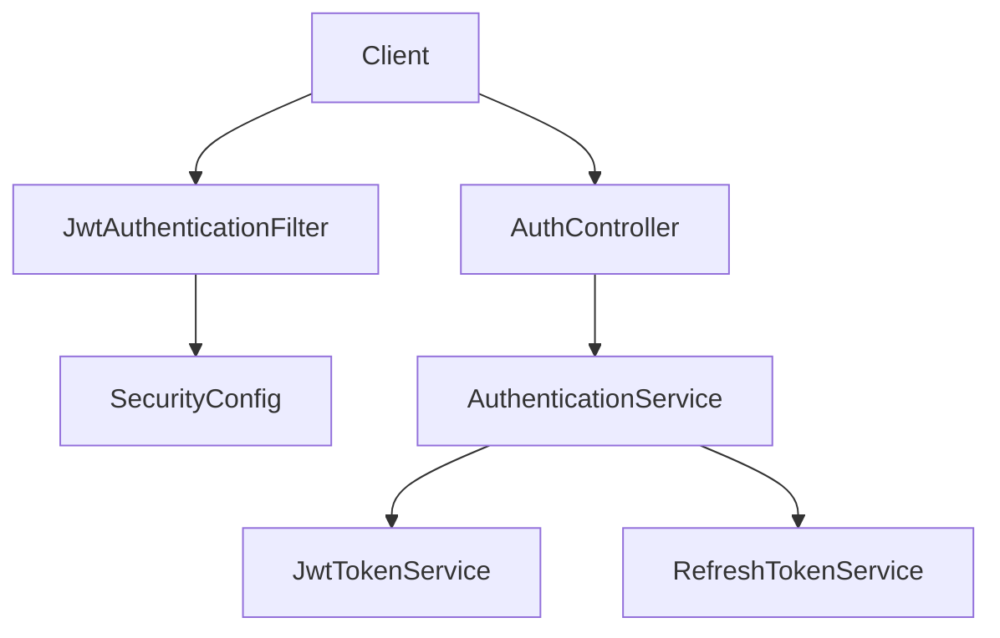
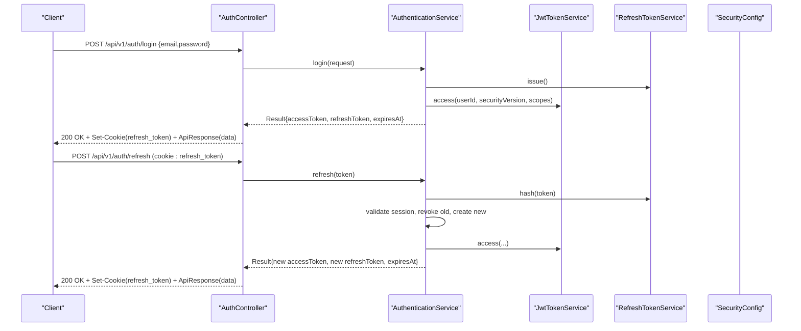
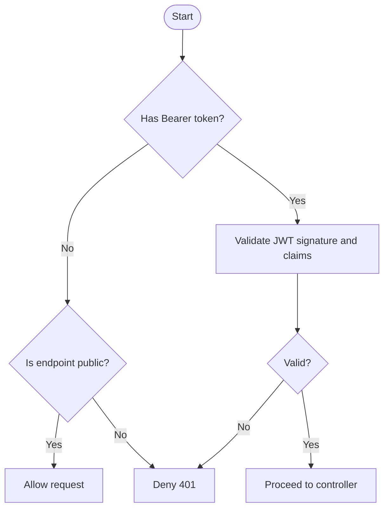
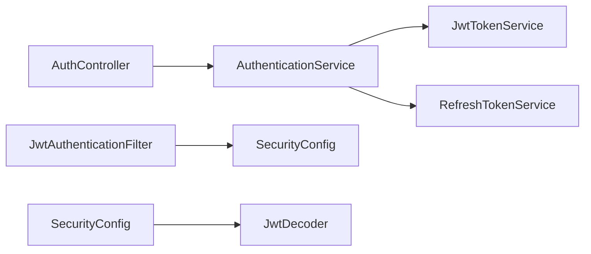

# Authentication API Endpoints

<cite>
**Referenced Files in This Document**
- [AuthController.java](file://src/main/java/com/smartcoffee/modules/auth/api/AuthController.java)
- [AuthenticationService.java](file://src/main/java/com/smartcoffee/modules/auth/application/AuthenticationService.java)
- [JwtTokenService.java](file://src/main/java/com/smartcoffee/modules/auth/security/JwtTokenService.java)
- [RefreshTokenService.java](file://src/main/java/com/smartcoffee/modules/auth/security/RefreshTokenService.java)
- [JwtAuthenticationFilter.java](file://src/main/java/com/smartcoffee/modules/auth/security/JwtAuthenticationFilter.java)
- [SecurityConfig.java](file://src/main/java/com/smartcoffee/config/SecurityConfig.java)
- [LoginRequest.java](file://src/main/java/com/smartcoffee/modules/auth/api/LoginRequest.java)
- [RegisterRequest.java](file://src/main/java/com/smartcoffee/modules/auth/api/RegisterRequest.java)
- [AuthResponse.java](file://src/main/java/com/smartcoffee/modules/auth/api/AuthResponse.java)
- [ApiResponse.java](file://src/main/java/com/smartcoffee/common/api/ApiResponse.java)
- [ApiErrorResponse.java](file://src/main/java/com/smartcoffee/common/api/ApiErrorResponse.java)
- [UnauthorizedException.java](file://src/main/java/com/smartcoffee/common/exception/UnauthorizedException.java)
- [ConflictException.java](file://src/main/java/com/smartcoffee/common/exception/ConflictException.java)
- [JwtProperties.java](file://src/main/java/com/smartcoffee/modules/auth/security/JwtProperties.java)
- [ADR-006-authentication-model.md](file://adr/ADR-006-authentication-model.md)
</cite>

## Table of Contents
1. Introduction
2. Project Structure
3. Core Components
4. Architecture Overview
5. Detailed Component Analysis
6. Dependency Analysis
7. Performance Considerations
8. Troubleshooting Guide
9. Conclusion
10. Appendices

## Introduction
This document provides comprehensive API documentation for the Authentication endpoints, covering user registration, login, session management (refresh and logout), and token handling. It explains HTTP methods, URL patterns, request/response schemas, authentication requirements, error codes, security headers, rate limiting considerations, and client implementation guidelines for secure consumption.

## Project Structure
The authentication feature is implemented under the auth module with a clear separation:
- API layer: controllers and request/response models
- Application layer: business logic for registration, login, refresh, and logout
- Security layer: JWT encoding/decoding, refresh token issuance/hashing, and request filtering
- Global configuration: Spring Security rules and public endpoint allow-listing

**Diagram sources**
- [SecurityConfig.java:46-79](file://src/main/java/com/smartcoffee/config/SecurityConfig.java#L46-L79)
- [AuthController.java:13-70](file://src/main/java/com/smartcoffee/modules/auth/api/AuthController.java#L13-L70)
- [AuthenticationService.java:16-100](file://src/main/java/com/smartcoffee/modules/auth/application/AuthenticationService.java#L16-L100)
- [JwtTokenService.java:23-85](file://src/main/java/com/smartcoffee/modules/auth/security/JwtTokenService.java#L23-L85)
- [RefreshTokenService.java:1-5](file://src/main/java/com/smartcoffee/modules/auth/security/RefreshTokenService.java#L1-L5)
- [JwtAuthenticationFilter.java:1-5](file://src/main/java/com/smartcoffee/modules/auth/security/JwtAuthenticationFilter.java#L1-L5)

**Section sources**
- [SecurityConfig.java:46-79](file://src/main/java/com/smartcoffee/config/SecurityConfig.java#L46-L79)
- [AuthController.java:13-70](file://src/main/java/com/smartcoffee/modules/auth/api/AuthController.java#L13-L70)

## Core Components
- AuthController: Exposes REST endpoints for register, login, refresh, logout, and logout-all; manages refresh token cookie lifecycle.
- AuthenticationService: Orchestrates user creation, credential verification, session creation, refresh rotation, and logout revocation.
- JwtTokenService: Issues short-lived access tokens using HS256 with configurable TTLs and claims.
- RefreshTokenService: Generates cryptographically secure refresh tokens and stores only their hashes.
- JwtAuthenticationFilter: Extracts Bearer tokens from Authorization header and populates Spring Security context.
- SecurityConfig: Defines stateless sessions, public endpoints, and JWT decoder setup.

Key behaviors:
- Registration creates a user and credentials, then issues an access token and sets a refresh token cookie.
- Login validates credentials and issues tokens; refresh rotates the refresh token and returns a new one.
- Logout revokes the current or all sessions and clears the cookie.

**Section sources**
- [AuthController.java:25-59](file://src/main/java/com/smartcoffee/modules/auth/api/AuthController.java#L25-L59)
- [AuthenticationService.java:38-100](file://src/main/java/com/smartcoffee/modules/auth/application/AuthenticationService.java#L38-L100)
- [JwtTokenService.java:66-85](file://src/main/java/com/smartcoffee/modules/auth/security/JwtTokenService.java#L66-L85)
- [RefreshTokenService.java:1-5](file://src/main/java/com/smartcoffee/modules/auth/security/RefreshTokenService.java#L1-L5)
- [JwtAuthenticationFilter.java:1-5](file://src/main/java/com/smartcoffee/modules/auth/security/JwtAuthenticationFilter.java#L1-L5)
- [SecurityConfig.java:46-79](file://src/main/java/com/smartcoffee/config/SecurityConfig.java#L46-L79)

## Architecture Overview
The authentication flow uses stateless JWT access tokens and server-side refresh token sessions stored as hashed values. Public endpoints are explicitly allowed by Spring Security. Clients authenticate via POST to /api/v1/auth/* and use Bearer tokens for protected resources.

**Diagram sources**
- [AuthController.java:33-45](file://src/main/java/com/smartcoffee/modules/auth/api/AuthController.java#L33-L45)
- [AuthenticationService.java:48-74](file://src/main/java/com/smartcoffee/modules/auth/application/AuthenticationService.java#L48-L74)
- [JwtTokenService.java:66-85](file://src/main/java/com/smartcoffee/modules/auth/security/JwtTokenService.java#L66-L85)
- [RefreshTokenService.java:1-5](file://src/main/java/com/smartcoffee/modules/auth/security/RefreshTokenService.java#L1-L5)
- [SecurityConfig.java:58-71](file://src/main/java/com/smartcoffee/config/SecurityConfig.java#L58-L71)

## Detailed Component Analysis

### Endpoints Reference
Base path: /api/v1/auth

- Register
  - Method: POST
  - Path: /register
  - Authentication: None (public)
  - Request body: RegisterRequest
  - Response: ApiResponse<AuthResponse>
  - Status codes: 201 on success, 409 on duplicate email, 400 on validation errors
  - Side effects: Sets HttpOnly refresh_token cookie scoped to /api/v1/auth

- Login
  - Method: POST
  - Path: /login
  - Authentication: None (public)
  - Request body: LoginRequest
  - Response: ApiResponse<AuthResponse>
  - Status codes: 200 on success, 401 on invalid credentials or inactive/locked account, 400 on validation errors
  - Side effects: Sets HttpOnly refresh_token cookie scoped to /api/v1/auth

- Refresh
  - Method: POST
  - Path: /refresh
  - Authentication: None (public)
  - Cookie: refresh_token (required)
  - Response: ApiResponse<AuthResponse>
  - Status codes: 200 on success, 401 on invalid/expired refresh session
  - Side effects: Rotates refresh token and sets new refresh_token cookie

- Logout
  - Method: POST
  - Path: /logout
  - Authentication: None (public)
  - Cookie: refresh_token (optional)
  - Response: 204 No Content
  - Side effects: Revokes provided session if present and clears cookie

- Logout All
  - Method: POST
  - Path: /logout-all
  - Authentication: Requires valid Bearer token (protected)
  - Response: 204 No Content
  - Side effects: Revokes all sessions for the authenticated user and clears cookie

Request and response schemas:
- RegisterRequest fields: fullName, email, password, preferredLanguage
- LoginRequest fields: email, password
- AuthResponse fields: userId, fullName, email, preferredLanguage, accessToken
- ApiResponse wrapper fields: success, data, requestId, timestamp
- ApiErrorResponse structure: success=false, error.code, error.message, error.details[], requestId, timestamp

Notes:
- All endpoints return a consistent ApiResponse envelope for successful responses.
- Errors follow a standardized format with code, message, and optional details.

**Section sources**
- [AuthController.java:25-59](file://src/main/java/com/smartcoffee/modules/auth/api/AuthController.java#L25-L59)
- [RegisterRequest.java:1-4](file://src/main/java/com/smartcoffee/modules/auth/api/RegisterRequest.java#L1-L4)
- [LoginRequest.java:1-4](file://src/main/java/com/smartcoffee/modules/auth/api/LoginRequest.java#L1-L4)
- [AuthResponse.java:1-4](file://src/main/java/com/smartcoffee/modules/auth/api/AuthResponse.java#L1-L4)
- [ApiResponse.java:1-11](file://src/main/java/com/smartcoffee/common/api/ApiResponse.java#L1-L11)
- [ApiErrorResponse.java:1-15](file://src/main/java/com/smartcoffee/common/api/ApiErrorResponse.java#L1-L15)

### Authentication Flow Details
- Access tokens: Short-lived JWTs signed with HS256; include issuer, subject (userId), security version, scopes, issuedAt, and expiresAt.
- Refresh tokens: Long-lived opaque tokens generated securely; only their SHA-256 hashes are persisted per session.
- Session rotation: On each refresh, the previous session is revoked and a new session is created with a fresh refresh token.
- Statelessness: Protected endpoints rely on Bearer tokens validated by JwtAuthenticationFilter; no server-side HTTP sessions.

**Diagram sources**
- [JwtAuthenticationFilter.java:1-5](file://src/main/java/com/smartcoffee/modules/auth/security/JwtAuthenticationFilter.java#L1-L5)
- [SecurityConfig.java:58-79](file://src/main/java/com/smartcoffee/config/SecurityConfig.java#L58-L79)

**Section sources**
- [JwtTokenService.java:66-85](file://src/main/java/com/smartcoffee/modules/auth/security/JwtTokenService.java#L66-L85)
- [RefreshTokenService.java:1-5](file://src/main/java/com/smartcoffee/modules/auth/security/RefreshTokenService.java#L1-L5)
- [AuthenticationService.java:64-74](file://src/main/java/com/smartcoffee/modules/auth/application/AuthenticationService.java#L64-L74)
- [JwtAuthenticationFilter.java:1-5](file://src/main/java/com/smartcoffee/modules/auth/security/JwtAuthenticationFilter.java#L1-L5)
- [SecurityConfig.java:58-79](file://src/main/java/com/smartcoffee/config/SecurityConfig.java#L58-L79)

### Error Handling and Status Codes
- 400 Bad Request: Validation failures on request bodies.
- 401 Unauthorized: Invalid credentials, inactive/locked accounts, invalid/expired refresh sessions, or missing/invalid Bearer tokens.
- 409 Conflict: Duplicate email during registration.
- 201 Created: Successful registration.
- 200 OK: Successful login/refresh with ApiResponse envelope.
- 204 No Content: Successful logout/logout-all.

Error payload shape:
- success: false
- error.code: application-specific code
- error.message: human-readable message
- error.details: list of field-level validation errors (when applicable)
- requestId: correlation ID
- timestamp: ISO instant

**Section sources**
- [UnauthorizedException.java:1-13](file://src/main/java/com/smartcoffee/common/exception/UnauthorizedException.java#L1-L13)
- [ConflictException.java:1-13](file://src/main/java/com/smartcoffee/common/exception/ConflictException.java#L1-L13)
- [ApiErrorResponse.java:1-15](file://src/main/java/com/smartcoffee/common/api/ApiErrorResponse.java#L1-L15)

### Security Headers and Cookie Policy
- Refresh token cookie:
  - Name: refresh_token
  - Path: /api/v1/auth
  - HttpOnly: true
  - SameSite: Lax
  - Secure: false (configure to true in production behind HTTPS)
  - Max-Age: derived from refresh token TTL
- Authorization:
  - Use Authorization: Bearer <access_token> for protected endpoints.
- CSRF: Disabled for stateless JWT flows.

**Section sources**
- [AuthController.java:61-70](file://src/main/java/com/smartcoffee/modules/auth/api/AuthController.java#L61-L70)
- [SecurityConfig.java:51-56](file://src/main/java/com/smartcoffee/config/SecurityConfig.java#L51-L56)

### Rate Limiting Considerations
- The design recommends enforcing rate limits on login and refresh endpoints to mitigate brute-force and token abuse.
- Implement at gateway or application level to limit attempts per IP/user within time windows.
- Combine with generic error messages to avoid account enumeration.

**Section sources**
- [ADR-006-authentication-model.md:85-92](file://adr/ADR-006-authentication-model.md#L85-L92)

### Client Implementation Guidelines
- Registration:
  - POST /api/v1/auth/register with RegisterRequest.
  - Handle 201 and store the returned accessToken for subsequent calls.
  - Store the refresh_token cookie automatically via browser or HTTP client.
- Login:
  - POST /api/v1/auth/login with LoginRequest.
  - On success, use accessToken for protected endpoints.
  - Maintain refresh_token cookie for future refreshes.
- Token refresh:
  - POST /api/v1/auth/refresh with refresh_token cookie.
  - On success, replace the existing accessToken and update the refresh_token cookie.
  - Retry once on 401 due to expired access token by refreshing first.
- Logout:
  - POST /api/v1/auth/logout to revoke the current session and clear cookie.
  - POST /api/v1/auth/logout-all (requires valid Bearer) to revoke all sessions.
- Security best practices:
  - Always send requests over HTTPS in production.
  - Do not log raw tokens or passwords.
  - Keep access tokens short-lived; rely on refresh rotation.

**Section sources**
- [AuthController.java:25-59](file://src/main/java/com/smartcoffee/modules/auth/api/AuthController.java#L25-L59)
- [AuthenticationService.java:38-100](file://src/main/java/com/smartcoffee/modules/auth/application/AuthenticationService.java#L38-L100)
- [JwtTokenService.java:66-85](file://src/main/java/com/smartcoffee/modules/auth/security/JwtTokenService.java#L66-L85)
- [ADR-006-authentication-model.md:53-63](file://adr/ADR-006-authentication-model.md#L53-L63)

## Dependency Analysis
The authentication subsystem depends on Spring Security, JWT libraries, and internal repositories for users, credentials, and sessions.

**Diagram sources**
- [AuthController.java:13-70](file://src/main/java/com/smartcoffee/modules/auth/api/AuthController.java#L13-L70)
- [AuthenticationService.java:16-100](file://src/main/java/com/smartcoffee/modules/auth/application/AuthenticationService.java#L16-L100)
- [JwtTokenService.java:23-85](file://src/main/java/com/smartcoffee/modules/auth/security/JwtTokenService.java#L23-L85)
- [RefreshTokenService.java:1-5](file://src/main/java/com/smartcoffee/modules/auth/security/RefreshTokenService.java#L1-L5)
- [JwtAuthenticationFilter.java:1-5](file://src/main/java/com/smartcoffee/modules/auth/security/JwtAuthenticationFilter.java#L1-L5)
- [SecurityConfig.java:31-44](file://src/main/java/com/smartcoffee/config/SecurityConfig.java#L31-L44)

**Section sources**
- [JwtProperties.java:1-5](file://src/main/java/com/smartcoffee/modules/auth/security/JwtProperties.java#L1-L5)
- [SecurityConfig.java:31-44](file://src/main/java/com/smartcoffee/config/SecurityConfig.java#L31-L44)

## Performance Considerations
- Access tokens are short-lived to minimize exposure and reduce server checks.
- Refresh tokens are rotated on each use to prevent replay attacks.
- Password hashing uses Argon2 for strong security; ensure appropriate CPU/memory settings in production.
- Stateless design avoids server-side session storage overhead.

[No sources needed since this section provides general guidance]

## Troubleshooting Guide
Common issues and resolutions:
- 401 Unauthorized on protected endpoints:
  - Ensure Authorization: Bearer <token> is set.
  - Verify token has not expired; refresh if necessary.
- 401 on refresh:
  - Confirm refresh_token cookie is present and not expired.
  - If reused or revoked, obtain a new token via login.
- 409 Conflict on registration:
  - Email already exists; prompt user to login or recover.
- 400 Validation errors:
  - Check required fields and formats in request payloads.

Operational tips:
- Log correlation IDs from ApiResponse.requestId for tracing.
- Avoid logging sensitive data such as passwords or raw tokens.

**Section sources**
- [UnauthorizedException.java:1-13](file://src/main/java/com/smartcoffee/common/exception/UnauthorizedException.java#L1-L13)
- [ConflictException.java:1-13](file://src/main/java/com/smartcoffee/common/exception/ConflictException.java#L1-L13)
- [ApiResponse.java:1-11](file://src/main/java/com/smartcoffee/common/api/ApiResponse.java#L1-L11)

## Conclusion
The authentication API provides a secure, stateless flow using short-lived JWT access tokens and rotating refresh tokens stored as hashes. Endpoints are clearly separated into public and protected categories, with consistent response envelopes and error formats. Clients should implement robust token handling, including refresh-on-expiry and safe logout procedures, while adhering to recommended security and rate-limiting practices.

[No sources needed since this section summarizes without analyzing specific files]

## Appendices

### Configuration Properties
- app.security.jwt.secret: Base64-encoded secret used for HS256 signing and decoding.
- app.security.jwt.accessTokenMinutes: Lifetime of access tokens in minutes.
- app.security.jwt.refreshTokenDays: Lifetime of refresh tokens in days.

**Section sources**
- [JwtProperties.java:1-5](file://src/main/java/com/smartcoffee/modules/auth/security/JwtProperties.java#L1-L5)
- [JwtTokenService.java:30-48](file://src/main/java/com/smartcoffee/modules/auth/security/JwtTokenService.java#L30-L48)
- [SecurityConfig.java:31-44](file://src/main/java/com/smartcoffee/config/SecurityConfig.java#L31-L44)