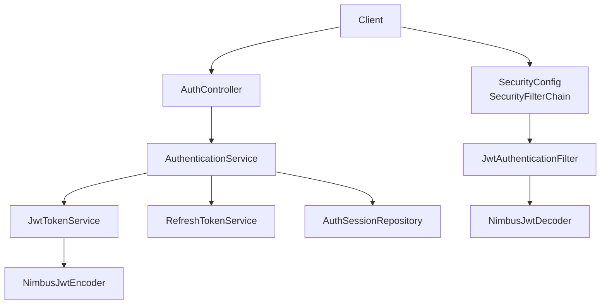
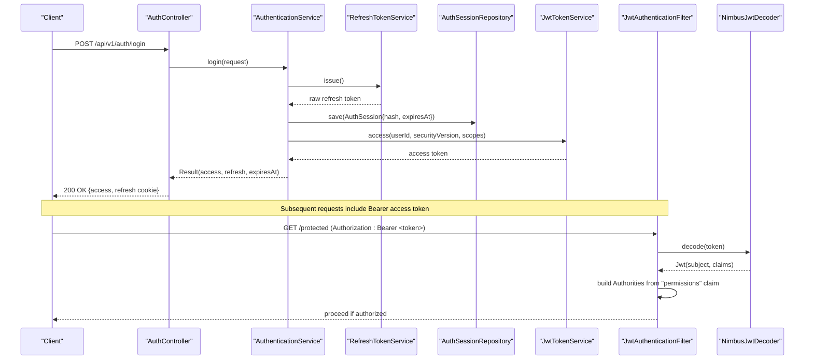
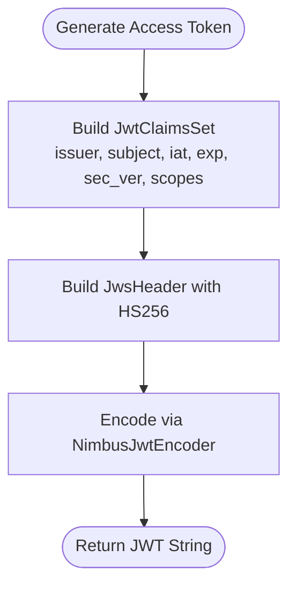
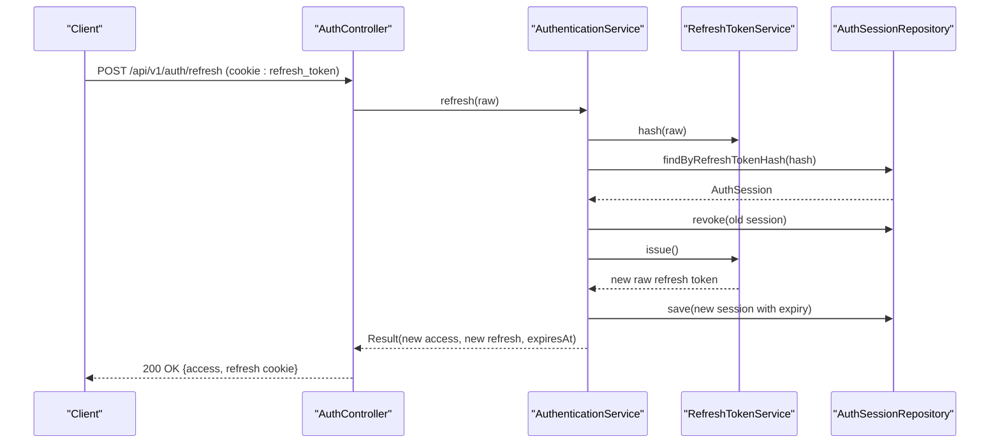
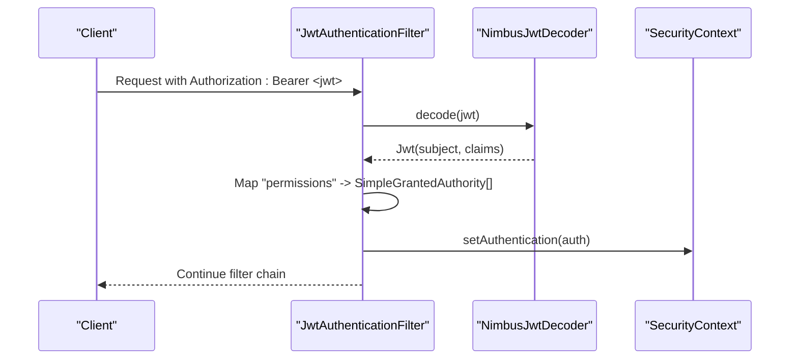
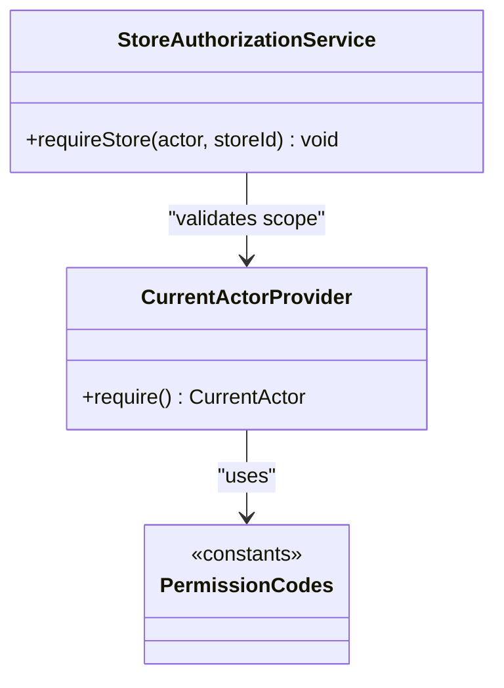
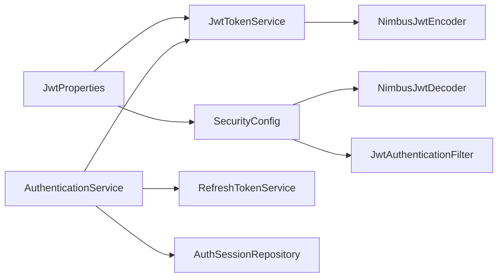

# JWT Token Service

<cite>
**Referenced Files in This Document**
- [JwtTokenService.java](file://src/main/java/com/smartcoffee/modules/auth/security/JwtTokenService.java)
- [JwtAuthenticationFilter.java](file://src/main/java/com/smartcoffee/modules/auth/security/JwtAuthenticationFilter.java)
- [JwtProperties.java](file://src/main/java/com/smartcoffee/modules/auth/security/JwtProperties.java)
- [RefreshTokenService.java](file://src/main/java/com/smartcoffee/modules/auth/security/RefreshTokenService.java)
- [SecurityConfig.java](file://src/main/java/com/smartcoffee/config/SecurityConfig.java)
- [AuthController.java](file://src/main/java/com/smartcoffee/modules/auth/api/AuthController.java)
- [AuthenticationService.java](file://src/main/java/com/smartcoffee/modules/auth/application/AuthenticationService.java)
- [AuthSession.java](file://src/main/java/com/smartcoffee/modules/auth/domain/AuthSession.java)
- [AuthSessionRepository.java](file://src/main/java/com/smartcoffee/modules/auth/persistence/AuthSessionRepository.java)
- [application.yml](file://src/main/resources/application.yml)
- [CurrentActorProvider.java](file://src/main/java/com/smartcoffee/common/security/CurrentActorProvider.java)
- [PermissionCodes.java](file://src/main/java/com/smartcoffee/common/security/PermissionCodes.java)
- [StoreAuthorizationService.java](file://src/main/java/com/smartcoffee/common/security/StoreAuthorizationService.java)
</cite>

## Table of Contents
1. Introduction
2. Project Structure
3. Core Components
4. Architecture Overview
5. Detailed Component Analysis
6. Dependency Analysis
7. Performance Considerations
8. Troubleshooting Guide
9. Conclusion
10. Appendices

## Introduction
This document explains the JWT token service implementation in the Smart Coffee backend. It covers token generation and validation, signing algorithms, expiration handling, token structure (claims and subject mapping), store-scoped permissions integration, Spring Security filter chain integration, configuration options, refresh token lifecycle, rotation strategies, blacklisting mechanisms, and security best practices for storage and transmission.

## Project Structure
The JWT functionality is implemented within the auth module and integrated with Spring Security:
- Token generation and encoding: JwtTokenService
- Filter-based authentication: JwtAuthenticationFilter
- Configuration and decoder setup: SecurityConfig and JwtProperties
- Refresh token issuance and lifecycle: RefreshTokenService and AuthSession domain/repository
- Authentication endpoints and session orchestration: AuthController and AuthenticationService
- Authorization context and store-scoped permissions: CurrentActorProvider, PermissionCodes, StoreAuthorizationService
- Application-wide settings: application.yml

**Diagram sources**
- [SecurityConfig.java:31-44](file://src/main/java/com/smartcoffee/config/SecurityConfig.java#L31-L44)
- [SecurityConfig.java:46-80](file://src/main/java/com/smartcoffee/config/SecurityConfig.java#L46-L80)
- [JwtAuthenticationFilter.java:1-5](file://src/main/java/com/smartcoffee/modules/auth/security/JwtAuthenticationFilter.java#L1-L5)
- [JwtTokenService.java:23-105](file://src/main/java/com/smartcoffee/modules/auth/security/JwtTokenService.java#L23-L105)
- [RefreshTokenService.java:1-5](file://src/main/java/com/smartcoffee/modules/auth/security/RefreshTokenService.java#L1-L5)
- [AuthSessionRepository.java:1-5](file://src/main/java/com/smartcoffee/modules/auth/persistence/AuthSessionRepository.java#L1-L5)
- [AuthController.java:13-73](file://src/main/java/com/smartcoffee/modules/auth/api/AuthController.java#L13-L73)
- [AuthenticationService.java:16-103](file://src/main/java/com/smartcoffee/modules/auth/application/AuthenticationService.java#L16-L103)

**Section sources**
- [JwtTokenService.java:23-105](file://src/main/java/com/smartcoffee/modules/auth/security/JwtTokenService.java#L23-L105)
- [JwtAuthenticationFilter.java:1-5](file://src/main/java/com/smartcoffee/modules/auth/security/JwtAuthenticationFilter.java#L1-L5)
- [SecurityConfig.java:31-80](file://src/main/java/com/smartcoffee/config/SecurityConfig.java#L31-L80)
- [RefreshTokenService.java:1-5](file://src/main/java/com/smartcoffee/modules/auth/security/RefreshTokenService.java#L1-L5)
- [AuthSession.java:1-55](file://src/main/java/com/smartcoffee/modules/auth/domain/AuthSession.java#L1-L55)
- [AuthSessionRepository.java:1-5](file://src/main/java/com/smartcoffee/modules/auth/persistence/AuthSessionRepository.java#L1-L5)
- [AuthController.java:13-73](file://src/main/java/com/smartcoffee/modules/auth/api/AuthController.java#L13-L73)
- [AuthenticationService.java:16-103](file://src/main/java/com/smartcoffee/modules/auth/application/AuthenticationService.java#L16-L103)
- [application.yml:49-53](file://src/main/resources/application.yml#L49-L53)

## Core Components
- JwtTokenService: Encodes access tokens using HS256 with configurable TTLs; includes issuer, subject, scopes, and a security version claim to support revocation/rotation.
- JwtAuthenticationFilter: Extracts Bearer tokens from Authorization headers, decodes them via NimbusJwtDecoder, and sets Spring Security’s Authentication with authorities derived from a claims list.
- SecurityConfig: Configures stateless sessions, registers the filter before UsernamePasswordAuthenticationFilter, and provides a symmetric-key JwtDecoder.
- RefreshTokenService: Generates secure random refresh tokens and hashes them for storage.
- AuthenticationService: Orchestrates login/refresh/logout flows, persists refresh sessions, and issues access tokens.
- AuthSession: Stores hashed refresh tokens, expiry, and revocation timestamps for session management and logout/blacklisting.
- CurrentActorProvider and related authorization utilities: Build an actor context with store-scoped permissions loaded at runtime.

**Section sources**
- [JwtTokenService.java:23-105](file://src/main/java/com/smartcoffee/modules/auth/security/JwtTokenService.java#L23-L105)
- [JwtAuthenticationFilter.java:1-5](file://src/main/java/com/smartcoffee/modules/auth/security/JwtAuthenticationFilter.java#L1-L5)
- [SecurityConfig.java:31-80](file://src/main/java/com/smartcoffee/config/SecurityConfig.java#L31-L80)
- [RefreshTokenService.java:1-5](file://src/main/java/com/smartcoffee/modules/auth/security/RefreshTokenService.java#L1-L5)
- [AuthenticationService.java:16-103](file://src/main/java/com/smartcoffee/modules/auth/application/AuthenticationService.java#L16-L103)
- [AuthSession.java:1-55](file://src/main/java/com/smartcoffee/modules/auth/domain/AuthSession.java#L1-L55)
- [CurrentActorProvider.java:12-44](file://src/main/java/com/smartcoffee/common/security/CurrentActorProvider.java#L12-L44)

## Architecture Overview
The system uses short-lived access tokens signed with HMAC-SHA256 and long-lived refresh tokens persisted server-side. The Spring Security filter chain validates incoming requests by decoding the JWT and establishing an authenticated principal. Refresh tokens are stored as hashes and can be revoked per user or per family.

**Diagram sources**
- [AuthController.java:33-45](file://src/main/java/com/smartcoffee/modules/auth/api/AuthController.java#L33-L45)
- [AuthenticationService.java:48-100](file://src/main/java/com/smartcoffee/modules/auth/application/AuthenticationService.java#L48-L100)
- [RefreshTokenService.java:1-5](file://src/main/java/com/smartcoffee/modules/auth/security/RefreshTokenService.java#L1-L5)
- [AuthSessionRepository.java:1-5](file://src/main/java/com/smartcoffee/modules/auth/persistence/AuthSessionRepository.java#L1-L5)
- [JwtTokenService.java:66-85](file://src/main/java/com/smartcoffee/modules/auth/security/JwtTokenService.java#L66-L85)
- [JwtAuthenticationFilter.java:1-5](file://src/main/java/com/smartcoffee/modules/auth/security/JwtAuthenticationFilter.java#L1-L5)
- [SecurityConfig.java:31-44](file://src/main/java/com/smartcoffee/config/SecurityConfig.java#L31-L44)

## Detailed Component Analysis

### Token Generation and Validation
- Signing algorithm: HS256 (HMAC-SHA256) using a Base64-decoded secret key configured via properties.
- Access token creation:
  - Claims include issuer, subject (user ID), issued-at, expires-at, optional scopes, and a security version claim used for rotation/revocation.
  - Header specifies HS256 algorithm.
- Token validation:
  - NimbusJwtDecoder verifies signature using the same symmetric key.
  - Expiration is enforced by the decoder.
- Subject mapping:
  - Subject is set to the user’s UUID string.
- Scopes and permissions:
  - Access tokens may carry a scopes claim; the filter maps a permissions claim to Spring authorities when present.

**Diagram sources**
- [JwtTokenService.java:66-85](file://src/main/java/com/smartcoffee/modules/auth/security/JwtTokenService.java#L66-L85)
- [JwtTokenService.java:87-104](file://src/main/java/com/smartcoffee/modules/auth/security/JwtTokenService.java#L87-L104)

**Section sources**
- [JwtTokenService.java:23-105](file://src/main/java/com/smartcoffee/modules/auth/security/JwtTokenService.java#L23-L105)
- [SecurityConfig.java:31-44](file://src/main/java/com/smartcoffee/config/SecurityConfig.java#L31-L44)
- [JwtAuthenticationFilter.java:1-5](file://src/main/java/com/smartcoffee/modules/auth/security/JwtAuthenticationFilter.java#L1-L5)

### Refresh Token Lifecycle and Blacklisting
- Issuance:
  - Secure random bytes are generated and URL-safe Base64-encoded to produce a raw refresh token.
  - The token is hashed (SHA-256) and stored in AuthSession along with expiry and user/family identifiers.
- Rotation:
  - On refresh, the previous session is revoked and a new session is created with a fresh refresh token while preserving the token family.
- Blacklisting/Revocation:
  - Single logout: revoke a specific session by hash lookup.
  - Logout-all: revoke all active sessions for a user atomically.
  - Sessions are considered inactive if revoked or expired.

**Diagram sources**
- [AuthController.java:40-45](file://src/main/java/com/smartcoffee/modules/auth/api/AuthController.java#L40-L45)
- [AuthenticationService.java:64-100](file://src/main/java/com/smartcoffee/modules/auth/application/AuthenticationService.java#L64-L100)
- [RefreshTokenService.java:1-5](file://src/main/java/com/smartcoffee/modules/auth/security/RefreshTokenService.java#L1-L5)
- [AuthSessionRepository.java:1-5](file://src/main/java/com/smartcoffee/modules/auth/persistence/AuthSessionRepository.java#L1-L5)

**Section sources**
- [RefreshTokenService.java:1-5](file://src/main/java/com/smartcoffee/modules/auth/security/RefreshTokenService.java#L1-L5)
- [AuthSession.java:1-55](file://src/main/java/com/smartcoffee/modules/auth/domain/AuthSession.java#L1-L55)
- [AuthSessionRepository.java:1-5](file://src/main/java/com/smartcoffee/modules/auth/persistence/AuthSessionRepository.java#L1-L5)
- [AuthenticationService.java:64-100](file://src/main/java/com/smartcoffee/modules/auth/application/AuthenticationService.java#L64-L100)

### Spring Security Integration and Custom Extraction
- Stateless sessions: SessionCreationPolicy.STATELESS ensures no server-side session state for requests.
- Filter placement: JwtAuthenticationFilter runs before UsernamePasswordAuthenticationFilter to intercept Bearer tokens early.
- Token extraction:
  - Reads Authorization header, strips “Bearer ” prefix, and decodes via JwtDecoder.
  - Builds Authentication with authorities derived from a “permissions” claim list.
- Public endpoints: Health, OpenAPI, and certain API paths are permitted without authentication.

**Diagram sources**
- [SecurityConfig.java:46-80](file://src/main/java/com/smartcoffee/config/SecurityConfig.java#L46-L80)
- [JwtAuthenticationFilter.java:1-5](file://src/main/java/com/smartcoffee/modules/auth/security/JwtAuthenticationFilter.java#L1-L5)

**Section sources**
- [SecurityConfig.java:46-80](file://src/main/java/com/smartcoffee/config/SecurityConfig.java#L46-L80)
- [JwtAuthenticationFilter.java:1-5](file://src/main/java/com/smartcoffee/modules/auth/security/JwtAuthenticationFilter.java#L1-L5)

### Token Structure and Claims
- Standard claims:
  - iss: issuer identifier
  - sub: subject (user ID)
  - iat: issued-at timestamp
  - exp: expiration timestamp
- Custom claims:
  - sec_ver: security version tied to the user’s current version to support rotation/revocation
  - scopes: optional set of scopes
  - permissions: read by the filter to populate Spring authorities
- Subject mapping:
  - Subject is the user’s UUID string.

**Section sources**
- [JwtTokenService.java:66-85](file://src/main/java/com/smartcoffee/modules/auth/security/JwtTokenService.java#L66-L85)
- [JwtAuthenticationFilter.java:1-5](file://src/main/java/com/smartcoffee/modules/auth/security/JwtAuthenticationFilter.java#L1-L5)

### Store-Scoped Permissions and Authorization Context
- At runtime, CurrentActorProvider loads store IDs and permissions for the authenticated user and builds a CurrentActor with:
  - User ID and role
  - Store-scoped permission set
  - Global permissions
- StoreAuthorizationService enforces that the current actor can access a given store, throwing a forbidden exception otherwise.
- Permission codes define standard permission strings used across the system.

**Diagram sources**
- [CurrentActorProvider.java:12-44](file://src/main/java/com/smartcoffee/common/security/CurrentActorProvider.java#L12-L44)
- [StoreAuthorizationService.java:7-13](file://src/main/java/com/smartcoffee/common/security/StoreAuthorizationService.java#L7-L13)
- [PermissionCodes.java:1-11](file://src/main/java/com/smartcoffee/common/security/PermissionCodes.java#L1-L11)

**Section sources**
- [CurrentActorProvider.java:12-44](file://src/main/java/com/smartcoffee/common/security/CurrentActorProvider.java#L12-L44)
- [StoreAuthorizationService.java:7-13](file://src/main/java/com/smartcoffee/common/security/StoreAuthorizationService.java#L7-L13)
- [PermissionCodes.java:1-11](file://src/main/java/com/smartcoffee/common/security/PermissionCodes.java#L1-L11)

## Dependency Analysis
- JwtTokenService depends on:
  - JwtProperties for secret and TTLs
  - NimbusJwtEncoder for HS256 signing
- SecurityConfig provides:
  - NimbusJwtDecoder configured with the same symmetric key
  - SecurityFilterChain wiring JwtAuthenticationFilter
- AuthenticationService depends on:
  - JwtTokenService for access tokens
  - RefreshTokenService for refresh token issuance
  - AuthSessionRepository for persistence and revocation
- JwtAuthenticationFilter depends on:
  - JwtDecoder to validate tokens and extract claims

**Diagram sources**
- [JwtTokenService.java:23-48](file://src/main/java/com/smartcoffee/modules/auth/security/JwtTokenService.java#L23-L48)
- [SecurityConfig.java:31-44](file://src/main/java/com/smartcoffee/config/SecurityConfig.java#L31-L44)
- [AuthenticationService.java:16-36](file://src/main/java/com/smartcoffee/modules/auth/application/AuthenticationService.java#L16-L36)
- [RefreshTokenService.java:1-5](file://src/main/java/com/smartcoffee/modules/auth/security/RefreshTokenService.java#L1-L5)
- [AuthSessionRepository.java:1-5](file://src/main/java/com/smartcoffee/modules/auth/persistence/AuthSessionRepository.java#L1-L5)

**Section sources**
- [JwtTokenService.java:23-48](file://src/main/java/com/smartcoffee/modules/auth/security/JwtTokenService.java#L23-L48)
- [SecurityConfig.java:31-80](file://src/main/java/com/smartcoffee/config/SecurityConfig.java#L31-L80)
- [AuthenticationService.java:16-36](file://src/main/java/com/smartcoffee/modules/auth/application/AuthenticationService.java#L16-L36)

## Performance Considerations
- Short-lived access tokens reduce exposure window and minimize server checks.
- Stateless authentication avoids session storage overhead.
- Refresh token hashing and indexed lookups keep revocation checks efficient.
- HS256 is fast and suitable for high-throughput microservices.
- Consider enabling metrics and tracing around token operations for observability.

[No sources needed since this section provides general guidance]

## Troubleshooting Guide
- Invalid or missing Authorization header:
  - Ensure clients send Authorization: Bearer <access_token>.
- Signature verification failures:
  - Verify the secret key matches between encoder and decoder configuration.
- Expired tokens:
  - Use refresh flow to obtain a new access token.
- Revoked sessions:
  - Check AuthSession.revoked_at and expires_at; use logout or logout-all to invalidate.
- Missing permissions:
  - Confirm the “permissions” claim is populated during token issuance and that the filter maps it to authorities.

**Section sources**
- [JwtAuthenticationFilter.java:1-5](file://src/main/java/com/smartcoffee/modules/auth/security/JwtAuthenticationFilter.java#L1-L5)
- [SecurityConfig.java:31-44](file://src/main/java/com/smartcoffee/config/SecurityConfig.java#L31-L44)
- [AuthSession.java:46-52](file://src/main/java/com/smartcoffee/modules/auth/domain/AuthSession.java#L46-L52)
- [AuthenticationService.java:64-87](file://src/main/java/com/smartcoffee/modules/auth/application/AuthenticationService.java#L64-L87)

## Conclusion
The JWT implementation uses short-lived HS256-signed access tokens and server-side managed refresh tokens with robust revocation capabilities. Spring Security integrates via a custom filter that decodes tokens and establishes authentication. Store-scoped permissions are resolved at runtime to enforce fine-grained access control. Proper configuration and operational practices ensure secure, scalable authentication.

[No sources needed since this section summarizes without analyzing specific files]

## Appendices

### Configuration Options
- app.security.jwt.secret: Base64-encoded HMAC secret (minimum 32 bytes after decoding).
- app.security.jwt.access-token-minutes: Access token lifetime in minutes.
- app.security.jwt.refresh-token-days: Refresh token lifetime in days.
- Spring Security:
  - Stateful vs stateless: STATELESS is used.
  - Public endpoints: health, OpenAPI, and selected API paths are permitted.

**Section sources**
- [application.yml:49-53](file://src/main/resources/application.yml#L49-L53)
- [SecurityConfig.java:46-80](file://src/main/java/com/smartcoffee/config/SecurityConfig.java#L46-L80)
- [JwtProperties.java:1-5](file://src/main/java/com/smartcoffee/modules/auth/security/JwtProperties.java#L1-L5)

### Security Best Practices
- Storage:
  - Store only hashed refresh tokens; never persist raw tokens.
  - Enforce unique constraints on refresh token hashes.
- Transmission:
  - Use HTTPS for all endpoints.
  - Set HttpOnly and appropriate SameSite flags for cookies.
- Rotation and Revocation:
  - Rotate secrets periodically; maintain backward compatibility during transition.
  - Use security version claims to invalidate older tokens upon policy changes.
  - Provide logout and logout-all endpoints to revoke sessions.
- Least Privilege:
  - Limit scopes and permissions in tokens to the minimum required.
  - Validate store-scoped access at service boundaries.

**Section sources**
- [RefreshTokenService.java:1-5](file://src/main/java/com/smartcoffee/modules/auth/security/RefreshTokenService.java#L1-L5)
- [AuthSession.java:1-55](file://src/main/java/com/smartcoffee/modules/auth/domain/AuthSession.java#L1-L55)
- [AuthController.java:61-70](file://src/main/java/com/smartcoffee/modules/auth/api/AuthController.java#L61-L70)
- [JwtTokenService.java:66-85](file://src/main/java/com/smartcoffee/modules/auth/security/JwtTokenService.java#L66-L85)
- [StoreAuthorizationService.java:7-13](file://src/main/java/com/smartcoffee/common/security/StoreAuthorizationService.java#L7-L13)