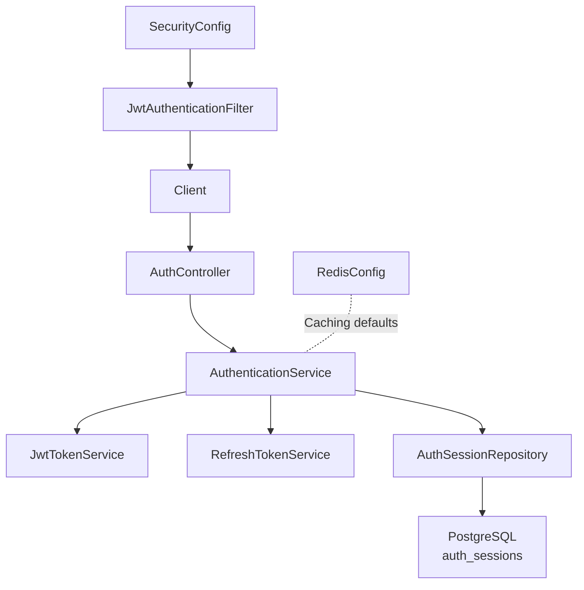
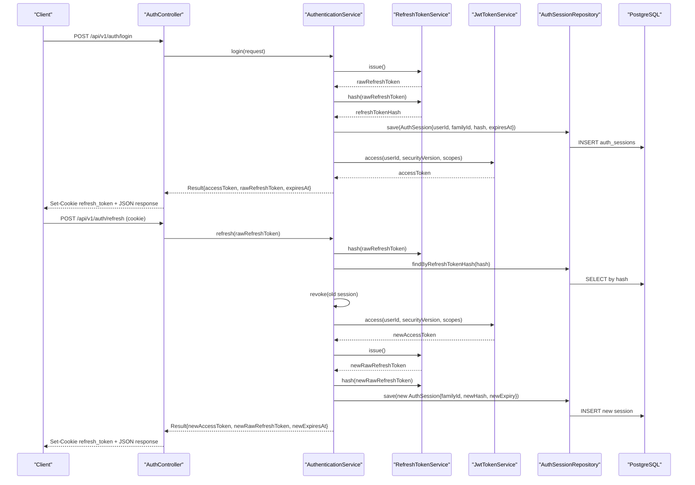
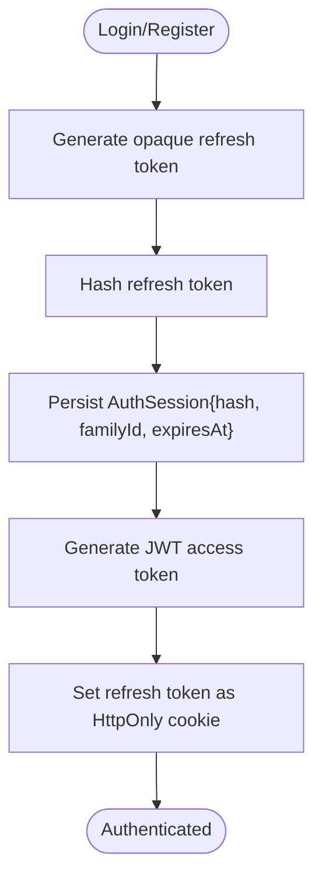
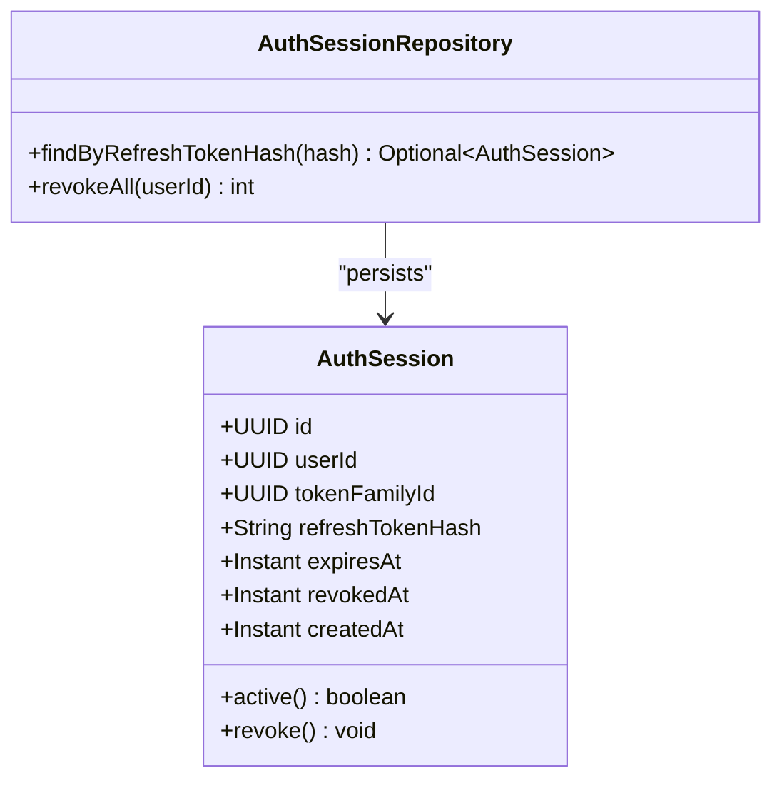
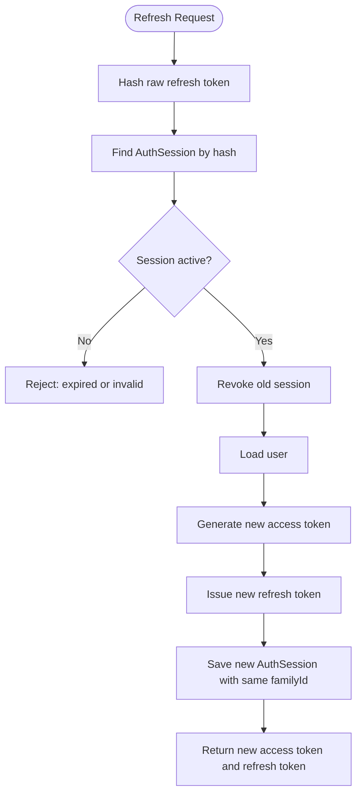
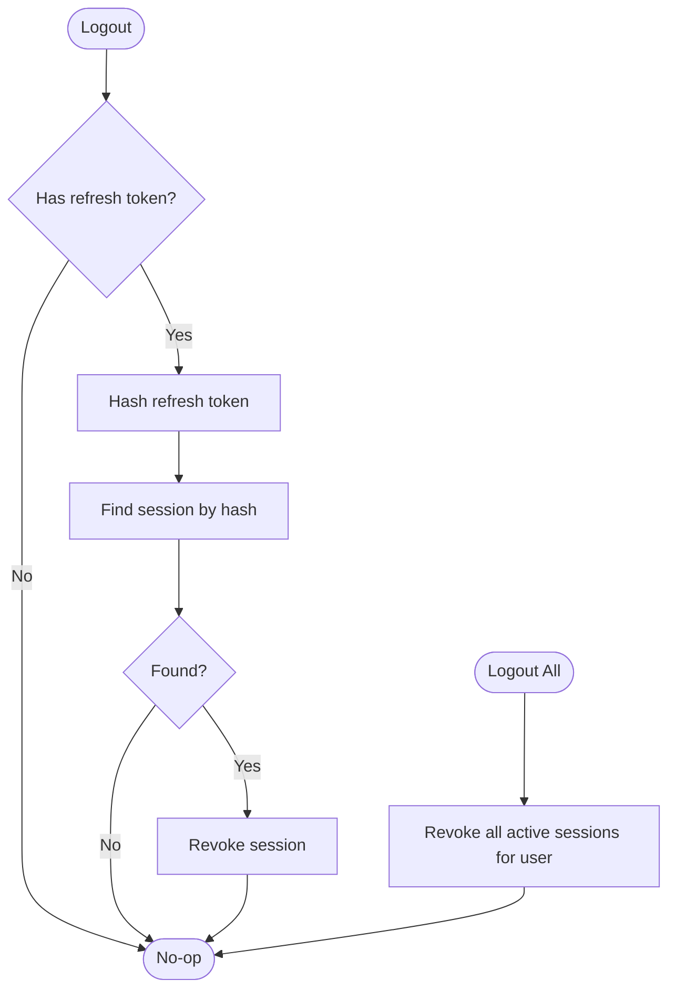
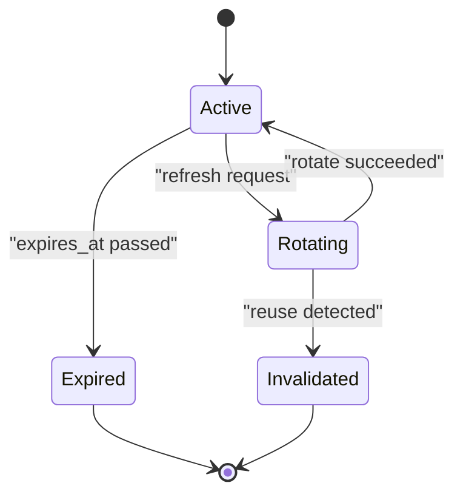
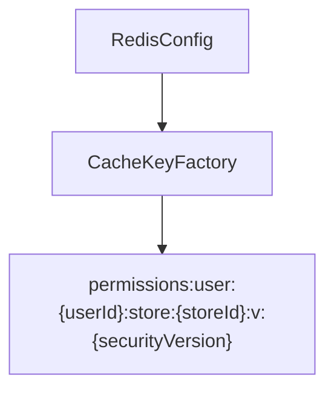
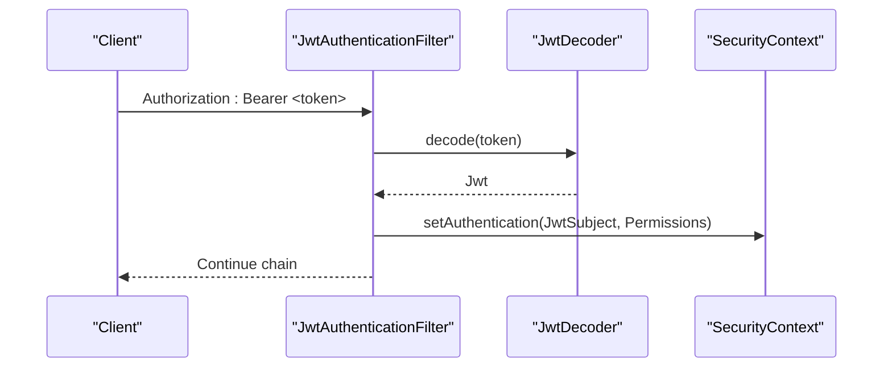
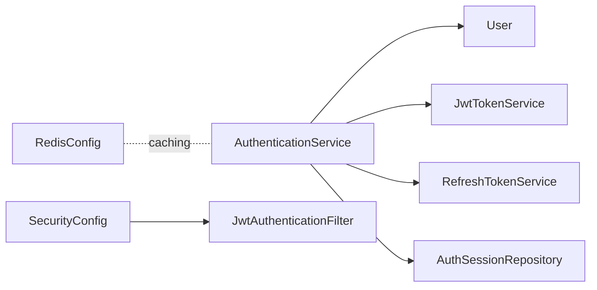

# Refresh Token Management

<cite>
**Referenced Files in This Document**
- [AuthenticationService.java](file://src/main/java/com/smartcoffee/modules/auth/application/AuthenticationService.java)
- [AuthController.java](file://src/main/java/com/smartcoffee/modules/auth/api/AuthController.java)
- [JwtTokenService.java](file://src/main/java/com/smartcoffee/modules/auth/security/JwtTokenService.java)
- [RefreshTokenService.java](file://src/main/java/com/smartcoffee/modules/auth/security/RefreshTokenService.java)
- [JwtProperties.java](file://src/main/java/com/smartcoffee/modules/auth/security/JwtProperties.java)
- [AuthSession.java](file://src/main/java/com/smartcoffee/modules/auth/domain/AuthSession.java)
- [AuthSessionRepository.java](file://src/main/java/com/smartcoffee/modules/auth/persistence/AuthSessionRepository.java)
- [User.java](file://src/main/java/com/smartcoffee/modules/identity/domain/User.java)
- [SecurityConfig.java](file://src/main/java/com/smartcoffee/config/SecurityConfig.java)
- [JwtAuthenticationFilter.java](file://src/main/java/com/smartcoffee/modules/auth/security/JwtAuthenticationFilter.java)
- [RedisConfig.java](file://src/main/java/com/smartcoffee/config/RedisConfig.java)
- [CacheKeyFactory.java](file://src/main/java/com/smartcoffee/infrastructure/cache/CacheKeyFactory.java)
- [application.yml](file://src/main/resources/application.yml)
- [ADR-006-authentication-model.md](file://adr/ADR-006-authentication-model.md)
</cite>

## Table of Contents
1. [Introduction](#introduction)
2. [Project Structure](#project-structure)
3. [Core Components](#core-components)
4. [Architecture Overview](#architecture-overview)
5. [Detailed Component Analysis](#detailed-component-analysis)
6. [Dependency Analysis](#dependency-analysis)
7. [Performance Considerations](#performance-considerations)
8. [Troubleshooting Guide](#troubleshooting-guide)
9. [Conclusion](#conclusion)

## Introduction
This document explains the refresh token management system used by the Smart Coffee backend. It covers the dual-token architecture with short-lived access tokens and long-lived opaque refresh tokens, their lifecycles, rotation strategy, session persistence through AuthSession entities, Redis caching configuration, token refresh flow, invalidation mechanisms, concurrent session handling, and security considerations for storage, rotation policies, and attack mitigation.

The design follows an OAuth 2.1/OpenID Connect-inspired model: access tokens are signed JWTs with a short lifetime, while refresh tokens are opaque values whose hashes are stored server-side to support rotation, reuse detection, and revocation.

## Project Structure
The refresh token system spans several modules:
- Authentication API endpoints expose login, register, refresh, logout, and logout-all operations.
- Application logic orchestrates user lookup, password verification, session creation, refresh rotation, and revocation.
- Security components generate and decode JWTs, issue and hash refresh tokens, and configure Spring Security.
- Persistence models store hashed refresh tokens and family identifiers for rotation and revocation.
- Configuration defines JWT parameters, security filter chain behavior, and Redis cache defaults.

**Diagram sources**
- [AuthController.java:13-70](file://src/main/java/com/smartcoffee/modules/auth/api/AuthController.java#L13-L70)
- [AuthenticationService.java:16-100](file://src/main/java/com/smartcoffee/modules/auth/application/AuthenticationService.java#L16-L100)
- [JwtTokenService.java:23-104](file://src/main/java/com/smartcoffee/modules/auth/security/JwtTokenService.java#L23-L104)
- [RefreshTokenService.java:1-5](file://src/main/java/com/smartcoffee/modules/auth/security/RefreshTokenService.java#L1-L5)
- [AuthSessionRepository.java:1-5](file://src/main/java/com/smartcoffee/modules/auth/persistence/AuthSessionRepository.java#L1-L5)
- [SecurityConfig.java:22-80](file://src/main/java/com/smartcoffee/config/SecurityConfig.java#L22-L80)
- [JwtAuthenticationFilter.java:1-5](file://src/main/java/com/smartcoffee/modules/auth/security/JwtAuthenticationFilter.java#L1-L5)
- [RedisConfig.java:1-5](file://src/main/java/com/smartcoffee/config/RedisConfig.java#L1-L5)

**Section sources**
- [AuthController.java:13-70](file://src/main/java/com/smartcoffee/modules/auth/api/AuthController.java#L13-L70)
- [AuthenticationService.java:16-100](file://src/main/java/com/smartcoffee/modules/auth/application/AuthenticationService.java#L16-L100)
- [JwtTokenService.java:23-104](file://src/main/java/com/smartcoffee/modules/auth/security/JwtTokenService.java#L23-L104)
- [RefreshTokenService.java:1-5](file://src/main/java/com/smartcoffee/modules/auth/security/RefreshTokenService.java#L1-L5)
- [AuthSessionRepository.java:1-5](file://src/main/java/com/smartcoffee/modules/auth/persistence/AuthSessionRepository.java#L1-L5)
- [SecurityConfig.java:22-80](file://src/main/java/com/smartcoffee/config/SecurityConfig.java#L22-L80)
- [JwtAuthenticationFilter.java:1-5](file://src/main/java/com/smartcoffee/modules/auth/security/JwtAuthenticationFilter.java#L1-L5)
- [RedisConfig.java:1-5](file://src/main/java/com/smartcoffee/config/RedisConfig.java#L1-L5)

## Core Components
- Access tokens: Short-lived signed JWTs containing subject, issuer, issued-at, expires-at, security version, and scopes.
- Refresh tokens: Opaque random values; only their SHA-256 hashes are persisted.
- Sessions: AuthSession entities track hashed refresh tokens, token family identifiers, expiry, revocation time, and timestamps.
- Rotation: On every successful refresh, the old session is revoked and a new refresh token is issued within the same token family.
- Revocation: Single-session logout and all-sessions logout invalidate sessions at the database level.
- Security: Spring Security uses stateless sessions and a custom JWT filter that decodes access tokens and populates authentication context.

**Section sources**
- [JwtTokenService.java:58-104](file://src/main/java/com/smartcoffee/modules/auth/security/JwtTokenService.java#L58-L104)
- [RefreshTokenService.java:1-5](file://src/main/java/com/smartcoffee/modules/auth/security/RefreshTokenService.java#L1-L5)
- [AuthSession.java:7-52](file://src/main/java/com/smartcoffee/modules/auth/domain/AuthSession.java#L7-L52)
- [AuthenticationService.java:64-100](file://src/main/java/com/smartcoffee/modules/auth/application/AuthenticationService.java#L64-L100)
- [SecurityConfig.java:46-80](file://src/main/java/com/smartcoffee/config/SecurityConfig.java#L46-L80)
- [JwtAuthenticationFilter.java:1-5](file://src/main/java/com/smartcoffee/modules/auth/security/JwtAuthenticationFilter.java#L1-L5)

## Architecture Overview
The system implements a dual-token architecture:
- Clients receive an access token and a refresh token after login or registration.
- The refresh token is set as an HTTP-only cookie scoped to the auth endpoints.
- Access tokens are validated by a Spring Security filter on protected routes.
- Refresh tokens are rotated on each successful refresh, maintaining a token family for reuse detection.
- Session data is persisted in PostgreSQL via JPA entities.
- Redis is configured for general caching with a default TTL; it is not used directly for refresh token storage.

**Diagram sources**
- [AuthController.java:33-45](file://src/main/java/com/smartcoffee/modules/auth/api/AuthController.java#L33-L45)
- [AuthenticationService.java:48-100](file://src/main/java/com/smartcoffee/modules/auth/application/AuthenticationService.java#L48-L100)
- [RefreshTokenService.java:1-5](file://src/main/java/com/smartcoffee/modules/auth/security/RefreshTokenService.java#L1-L5)
- [JwtTokenService.java:66-84](file://src/main/java/com/smartcoffee/modules/auth/security/JwtTokenService.java#L66-L84)
- [AuthSessionRepository.java:1-5](file://src/main/java/com/smartcoffee/modules/auth/persistence/AuthSessionRepository.java#L1-L5)

## Detailed Component Analysis

### Dual-Token Model and Lifecycles
- Access tokens:
  - Signed using HS256 with a secret configured via properties.
  - Include subject, issuer, issued-at, expires-at, security version, and scopes.
  - Lifetime is configurable via `access-token-minutes`.
- Refresh tokens:
  - Opaque random strings generated by RefreshTokenService.
  - Only their SHA-256 hashes are stored in the database.
  - Lifetime is configurable via `refresh-token-days`.
- Token family:
  - Each session has a token family identifier.
  - Rotation preserves the family across refreshes to enable reuse detection.

**Diagram sources**
- [AuthenticationService.java:89-100](file://src/main/java/com/smartcoffee/modules/auth/application/AuthenticationService.java#L89-L100)
- [RefreshTokenService.java:1-5](file://src/main/java/com/smartcoffee/modules/auth/security/RefreshTokenService.java#L1-L5)
- [JwtTokenService.java:66-84](file://src/main/java/com/smartcoffee/modules/auth/security/JwtTokenService.java#L66-L84)
- [AuthSession.java:29-36](file://src/main/java/com/smartcoffee/modules/auth/domain/AuthSession.java#L29-L36)

**Section sources**
- [JwtTokenService.java:23-104](file://src/main/java/com/smartcoffee/modules/auth/security/JwtTokenService.java#L23-L104)
- [RefreshTokenService.java:1-5](file://src/main/java/com/smartcoffee/modules/auth/security/RefreshTokenService.java#L1-L5)
- [application.yml:49-53](file://src/main/resources/application.yml#L49-L53)

### Session Persistence Layer
- AuthSession entity:
  - Stores hashed refresh token, token family ID, expiry, revocation timestamp, and audit timestamps.
  - Provides active status based on expiry and revocation.
- Repository:
  - Lookup by refresh token hash.
  - Bulk revoke all active sessions for a user.

**Diagram sources**
- [AuthSession.java:7-52](file://src/main/java/com/smartcoffee/modules/auth/domain/AuthSession.java#L7-L52)
- [AuthSessionRepository.java:1-5](file://src/main/java/com/smartcoffee/modules/auth/persistence/AuthSessionRepository.java#L1-L5)

**Section sources**
- [AuthSession.java:7-52](file://src/main/java/com/smartcoffee/modules/auth/domain/AuthSession.java#L7-L52)
- [AuthSessionRepository.java:1-5](file://src/main/java/com/smartcoffee/modules/auth/persistence/AuthSessionRepository.java#L1-L5)

### Token Refresh Flow and Rotation Strategy
- Refresh endpoint receives the raw refresh token from the cookie.
- The service hashes the token, locates the corresponding session, validates activity, revokes the old session, and issues a new refresh token within the same family.
- A new access token is generated with the current security version.

**Diagram sources**
- [AuthenticationService.java:64-100](file://src/main/java/com/smartcoffee/modules/auth/application/AuthenticationService.java#L64-L100)
- [AuthSession.java:46-52](file://src/main/java/com/smartcoffee/modules/auth/domain/AuthSession.java#L46-L52)

**Section sources**
- [AuthenticationService.java:64-100](file://src/main/java/com/smartcoffee/modules/auth/application/AuthenticationService.java#L64-L100)
- [AuthSession.java:46-52](file://src/main/java/com/smartcoffee/modules/auth/domain/AuthSession.java#L46-L52)

### Invalidation Mechanisms
- Single-session logout:
  - Hashes the provided refresh token and revokes the matching session if present.
- All-sessions logout:
  - Revokes all active sessions for the authenticated user.
- Security version:
  - Access tokens include a security version claim; changing this can invalidate stale tokens until they expire.

**Diagram sources**
- [AuthenticationService.java:76-87](file://src/main/java/com/smartcoffee/modules/auth/application/AuthenticationService.java#L76-L87)
- [AuthSessionRepository.java:1-5](file://src/main/java/com/smartcoffee/modules/auth/persistence/AuthSessionRepository.java#L1-L5)

**Section sources**
- [AuthenticationService.java:76-87](file://src/main/java/com/smartcoffee/modules/auth/application/AuthenticationService.java#L76-L87)
- [AuthSessionRepository.java:1-5](file://src/main/java/com/smartcoffee/modules/auth/persistence/AuthSessionRepository.java#L1-L5)

### Concurrent Session Handling
- Rotation protects against simple reuse: the old session is revoked before issuing a new one.
- Concurrency risks remain if multiple refresh requests arrive simultaneously for the same session because the check-then-revoke pattern is not atomic at the repository level.
- Recommended hardening:
  - Add a unique constraint on refresh token hash and use upsert semantics to detect reuse atomically.
  - Use optimistic locking or explicit row-level locks during refresh to ensure exactly-one rotation.
  - Consider a distributed lock keyed by refresh token hash when scaling horizontally.

**Diagram sources**
- [AuthenticationService.java:64-100](file://src/main/java/com/smartcoffee/modules/auth/application/AuthenticationService.java#L64-L100)
- [AuthSession.java:46-52](file://src/main/java/com/smartcoffee/modules/auth/domain/AuthSession.java#L46-L52)

**Section sources**
- [AuthenticationService.java:64-100](file://src/main/java/com/smartcoffee/modules/auth/application/AuthenticationService.java#L64-L100)
- [AuthSession.java:46-52](file://src/main/java/com/smartcoffee/modules/auth/domain/AuthSession.java#L46-L52)

### Redis Caching Context
- Redis is enabled for caching with a default TTL of 10 minutes and null-value caching disabled.
- Cache keys exist for store, catalog, and permissions, including a security version component for permission cache invalidation.
- Refresh tokens themselves are not cached; they are persisted in PostgreSQL.

**Diagram sources**
- [RedisConfig.java:1-5](file://src/main/java/com/smartcoffee/config/RedisConfig.java#L1-L5)
- [CacheKeyFactory.java:1-4](file://src/main/java/com/smartcoffee/infrastructure/cache/CacheKeyFactory.java#L1-L4)

**Section sources**
- [RedisConfig.java:1-5](file://src/main/java/com/smartcoffee/config/RedisConfig.java#L1-L5)
- [CacheKeyFactory.java:1-4](file://src/main/java/com/smartcoffee/infrastructure/cache/CacheKeyFactory.java#L1-L4)

### Security Configuration and Access Token Validation
- Spring Security is configured with stateless sessions.
- Public endpoints include health, OpenAPI, Swagger, and auth endpoints.
- A custom JWT filter decodes Bearer tokens and sets the authentication context with permissions derived from claims.

**Diagram sources**
- [SecurityConfig.java:46-80](file://src/main/java/com/smartcoffee/config/SecurityConfig.java#L46-L80)
- [JwtAuthenticationFilter.java:1-5](file://src/main/java/com/smartcoffee/modules/auth/security/JwtAuthenticationFilter.java#L1-L5)

**Section sources**
- [SecurityConfig.java:46-80](file://src/main/java/com/smartcoffee/config/SecurityConfig.java#L46-L80)
- [JwtAuthenticationFilter.java:1-5](file://src/main/java/com/smartcoffee/modules/auth/security/JwtAuthenticationFilter.java#L1-L5)

## Dependency Analysis
The refresh token system depends on:
- Identity module for user data and security version.
- JPA repository for session persistence.
- Spring Security for access token validation and route protection.
- Configuration properties for JWT secrets and lifetimes.
- Redis for general caching, not token storage.

**Diagram sources**
- [User.java:1-85](file://src/main/java/com/smartcoffee/modules/identity/domain/User.java#L1-L85)
- [AuthenticationService.java:16-100](file://src/main/java/com/smartcoffee/modules/auth/application/AuthenticationService.java#L16-L100)
- [JwtTokenService.java:23-104](file://src/main/java/com/smartcoffee/modules/auth/security/JwtTokenService.java#L23-L104)
- [RefreshTokenService.java:1-5](file://src/main/java/com/smartcoffee/modules/auth/security/RefreshTokenService.java#L1-L5)
- [AuthSessionRepository.java:1-5](file://src/main/java/com/smartcoffee/modules/auth/persistence/AuthSessionRepository.java#L1-L5)
- [SecurityConfig.java:22-80](file://src/main/java/com/smartcoffee/config/SecurityConfig.java#L22-L80)
- [JwtAuthenticationFilter.java:1-5](file://src/main/java/com/smartcoffee/modules/auth/security/JwtAuthenticationFilter.java#L1-L5)
- [RedisConfig.java:1-5](file://src/main/java/com/smartcoffee/config/RedisConfig.java#L1-L5)

**Section sources**
- [User.java:1-85](file://src/main/java/com/smartcoffee/modules/identity/domain/User.java#L1-L85)
- [AuthenticationService.java:16-100](file://src/main/java/com/smartcoffee/modules/auth/application/AuthenticationService.java#L16-L100)
- [JwtTokenService.java:23-104](file://src/main/java/com/smartcoffee/modules/auth/security/JwtTokenService.java#L23-L104)
- [RefreshTokenService.java:1-5](file://src/main/java/com/smartcoffee/modules/auth/security/RefreshTokenService.java#L1-L5)
- [AuthSessionRepository.java:1-5](file://src/main/java/com/smartcoffee/modules/auth/persistence/AuthSessionRepository.java#L1-L5)
- [SecurityConfig.java:22-80](file://src/main/java/com/smartcoffee/config/SecurityConfig.java#L22-L80)
- [JwtAuthenticationFilter.java:1-5](file://src/main/java/com/smartcoffee/modules/auth/security/JwtAuthenticationFilter.java#L1-L5)
- [RedisConfig.java:1-5](file://src/main/java/com/smartcoffee/config/RedisConfig.java#L1-L5)

## Performance Considerations
- Access token generation is lightweight and stateless, suitable for high-throughput APIs.
- Refresh token rotation involves database writes; batch operations like logout-all should be used judiciously.
- Redis caching defaults provide short TTLs; ensure caches do not outlive token validity where sensitive data could be exposed.
- Avoid caching refresh tokens; rely on PostgreSQL for authoritative session state.

[No sources needed since this section provides general guidance]

## Troubleshooting Guide
Common issues and mitigations:
- Invalid refresh session:
  - Occurs when the refresh token hash is not found or the session is inactive.
  - Verify client sends the correct cookie and that the session has not been revoked or expired.
- Refresh session expired:
  - Occurs when the session’s expires_at has passed.
  - Re-login to obtain a new session.
- Concurrent refresh race:
  - Multiple simultaneous refreshes may rotate the same token family.
  - Harden with atomic upserts or row-level locks keyed by refresh token hash.
- Stale access tokens:
  - Access tokens remain valid until expiry even after role changes.
  - Enforce short lifetimes and consider incrementing security version on critical changes.

**Section sources**
- [AuthenticationService.java:64-87](file://src/main/java/com/smartcoffee/modules/auth/application/AuthenticationService.java#L64-L87)
- [AuthSession.java:46-52](file://src/main/java/com/smartcoffee/modules/auth/domain/AuthSession.java#L46-L52)

## Conclusion
The Smart Coffee backend implements a secure dual-token authentication model with short-lived access tokens and long-lived opaque refresh tokens. Refresh tokens are hashed and persisted in PostgreSQL, supporting rotation, reuse detection, and revocation. Spring Security validates access tokens statelessly, while Redis provides general caching with conservative TTLs. To strengthen concurrency safety and theft mitigation, adopt atomic rotation semantics, enforce strict cookie security settings, and maintain short access token lifetimes with appropriate revocation strategies.

[No sources needed since this section summarizes without analyzing specific files]