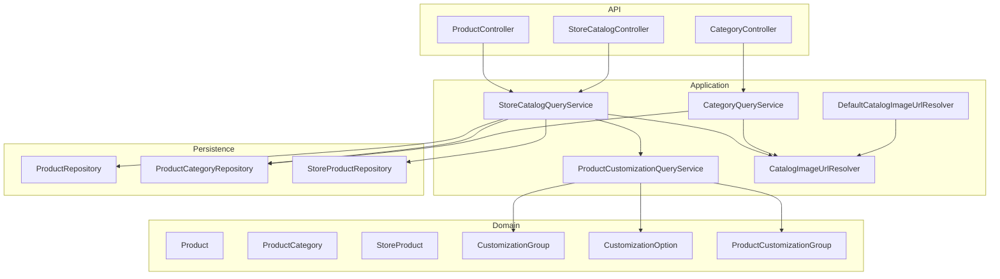
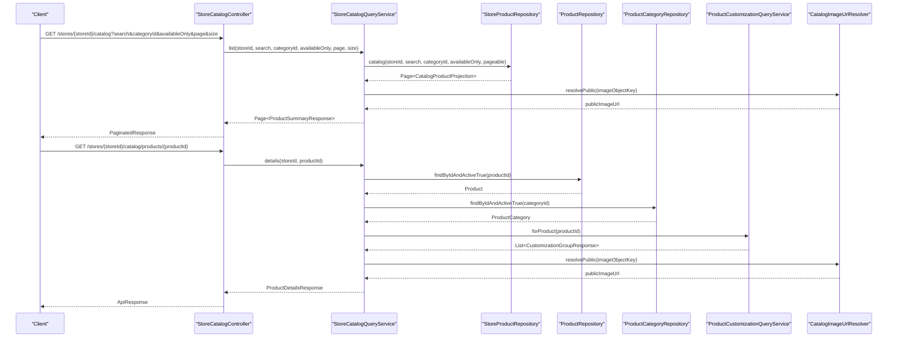
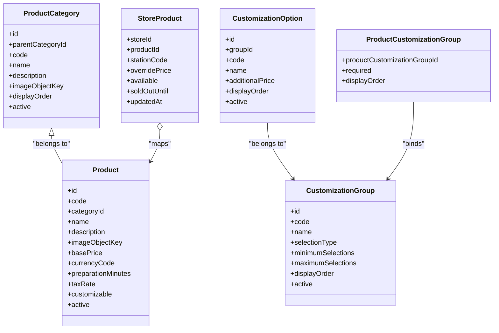
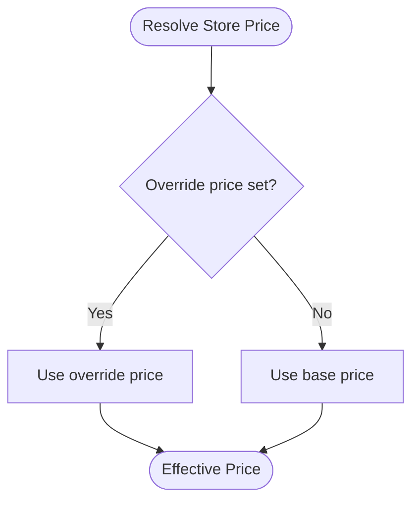
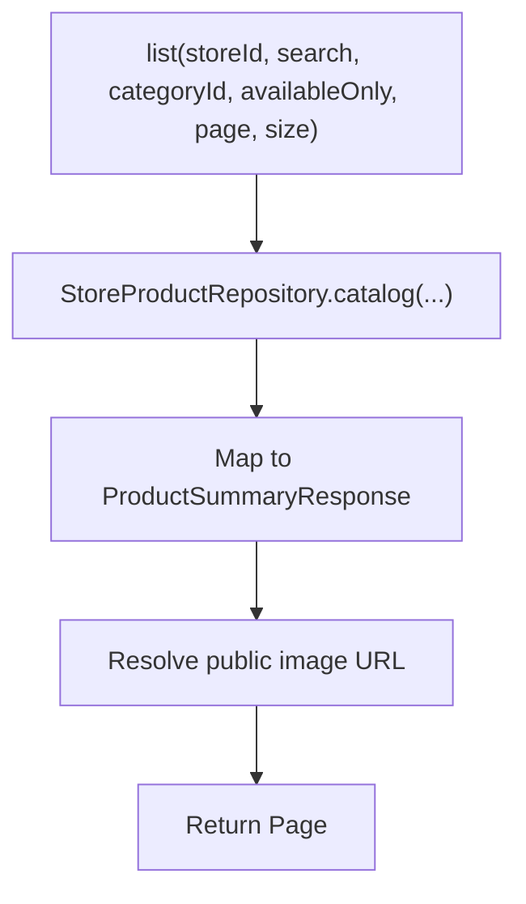
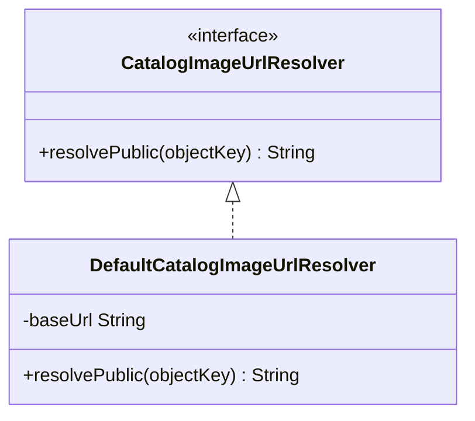
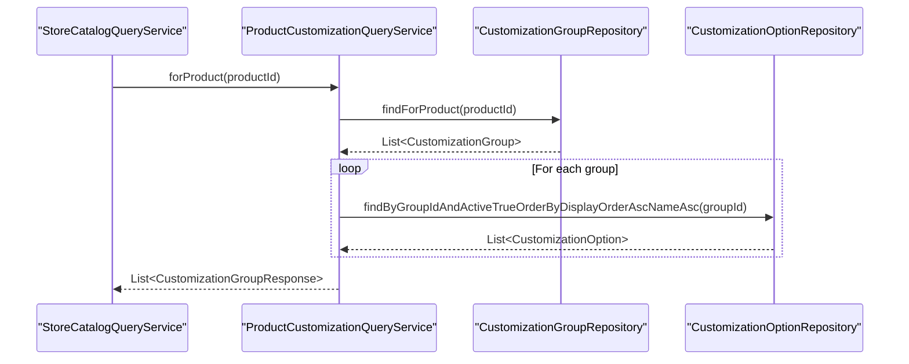
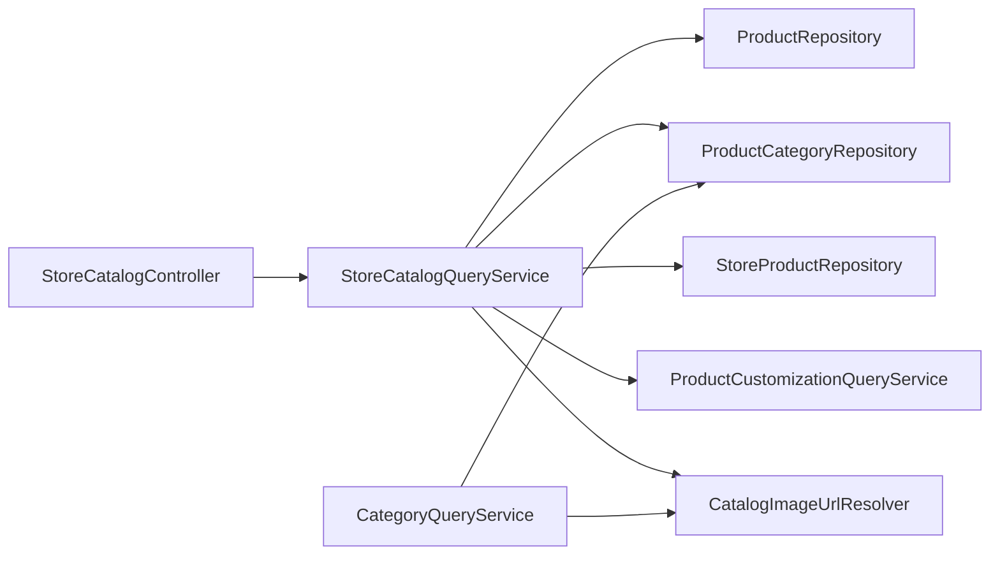

# Catalog Management Module

<cite>
**Referenced Files in This Document**
- [smart-coffee-logical.dbml](file://database/smart-coffee-logical.dbml)
- [Product.java](file://src/main/java/com/smartcoffee/modules/catalog/domain/Product.java)
- [ProductCategory.java](file://src/main/java/com/smartcoffee/modules/catalog/domain/ProductCategory.java)
- [StoreProduct.java](file://src/main/java/com/smartcoffee/modules/catalog/domain/StoreProduct.java)
- [CustomizationGroup.java](file://src/main/java/com/smartcoffee/modules/catalog/domain/CustomizationGroup.java)
- [CustomizationOption.java](file://src/main/java/com/smartcoffee/modules/catalog/domain/CustomizationOption.java)
- [ProductCustomizationGroup.java](file://src/main/java/com/smartcoffee/modules/catalog/domain/ProductCustomizationGroup.java)
- [ProductController.java](file://src/main/java/com/smartcoffee/modules/catalog/api/ProductController.java)
- [CategoryController.java](file://src/main/java/com/smartcoffee/modules/catalog/api/CategoryController.java)
- [StoreCatalogController.java](file://src/main/java/com/smartcoffee/modules/catalog/api/StoreCatalogController.java)
- [StoreCatalogQueryService.java](file://src/main/java/com/smartcoffee/modules/catalog/application/StoreCatalogQueryService.java)
- [CategoryQueryService.java](file://src/main/java/com/smartcoffee/modules/catalog/application/CategoryQueryService.java)
- [ProductCustomizationQueryService.java](file://src/main/java/com/smartcoffee/modules/catalog/application/ProductCustomizationQueryService.java)
- [CatalogImageUrlResolver.java](file://src/main/java/com/smartcoffee/modules/catalog/application/CatalogImageUrlResolver.java)
- [DefaultCatalogImageUrlResolver.java](file://src/main/java/com/smartcoffee/modules/catalog/application/DefaultCatalogImageUrlResolver.java)
- [ProductRepository.java](file://src/main/java/com/smartcoffee/modules/catalog/persistence/ProductRepository.java)
- [ProductCategoryRepository.java](file://src/main/java/com/smartcoffee/modules/catalog/persistence/ProductCategoryRepository.java)
- [StoreProductRepository.java](file://src/main/java/com/smartcoffee/modules/catalog/persistence/StoreProductRepository.java)
</cite>

## Table of Contents
1. [Introduction](#introduction)
2. [Project Structure](#project-structure)
3. [Core Components](#core-components)
4. [Architecture Overview](#architecture-overview)
5. [Detailed Component Analysis](#detailed-component-analysis)
6. [Dependency Analysis](#dependency-analysis)
7. [Performance Considerations](#performance-considerations)
8. [Troubleshooting Guide](#troubleshooting-guide)
9. [Conclusion](#conclusion)

## Introduction
This document explains the Catalog Management module, focusing on product hierarchy (categories and products), store-level availability and pricing, customization groups and options, catalog query services, image handling, and search capabilities. It also provides guidance for performance at scale and caching strategies.

## Project Structure
The catalog module is organized by layer:
- API controllers expose endpoints for categories, products, and store catalogs.
- Application services implement read operations and orchestrate persistence and image resolution.
- Domain entities model products, categories, store-product mappings, and customizations.
- Persistence repositories provide JPA access to catalog tables.

**Diagram sources**
- [ProductController.java:1-24](file://src/main/java/com/smartcoffee/modules/catalog/api/ProductController.java#L1-L24)
- [CategoryController.java:1-24](file://src/main/java/com/smartcoffee/modules/catalog/api/CategoryController.java#L1-L24)
- [StoreCatalogController.java:1-15](file://src/main/java/com/smartcoffee/modules/catalog/api/StoreCatalogController.java#L1-L15)
- [StoreCatalogQueryService.java:1-66](file://src/main/java/com/smartcoffee/modules/catalog/application/StoreCatalogQueryService.java#L1-L66)
- [CategoryQueryService.java:1-28](file://src/main/java/com/smartcoffee/modules/catalog/application/CategoryQueryService.java#L1-L28)
- [ProductCustomizationQueryService.java:1-32](file://src/main/java/com/smartcoffee/modules/catalog/application/ProductCustomizationQueryService.java#L1-L32)
- [CatalogImageUrlResolver.java:1-7](file://src/main/java/com/smartcoffee/modules/catalog/application/CatalogImageUrlResolver.java#L1-L7)
- [DefaultCatalogImageUrlResolver.java:1-23](file://src/main/java/com/smartcoffee/modules/catalog/application/DefaultCatalogImageUrlResolver.java#L1-L23)
- [ProductRepository.java:1-7](file://src/main/java/com/smartcoffee/modules/catalog/persistence/ProductRepository.java#L1-L7)
- [ProductCategoryRepository.java:1-7](file://src/main/java/com/smartcoffee/modules/catalog/persistence/ProductCategoryRepository.java#L1-L7)
- [StoreProductRepository.java:1-33](file://src/main/java/com/smartcoffee/modules/catalog/persistence/StoreProductRepository.java#L1-L33)

**Section sources**
- [ProductController.java:1-24](file://src/main/java/com/smartcoffee/modules/catalog/api/ProductController.java#L1-L24)
- [CategoryController.java:1-24](file://src/main/java/com/smartcoffee/modules/catalog/api/CategoryController.java#L1-L24)
- [StoreCatalogController.java:1-15](file://src/main/java/com/smartcoffee/modules/catalog/api/StoreCatalogController.java#L1-L15)
- [StoreCatalogQueryService.java:1-66](file://src/main/java/com/smartcoffee/modules/catalog/application/StoreCatalogQueryService.java#L1-L66)
- [CategoryQueryService.java:1-28](file://src/main/java/com/smartcoffee/modules/catalog/application/CategoryQueryService.java#L1-L28)
- [ProductCustomizationQueryService.java:1-32](file://src/main/java/com/smartcoffee/modules/catalog/application/ProductCustomizationQueryService.java#L1-L32)
- [CatalogImageUrlResolver.java:1-7](file://src/main/java/com/smartcoffee/modules/catalog/application/CatalogImageUrlResolver.java#L1-L7)
- [DefaultCatalogImageUrlResolver.java:1-23](file://src/main/java/com/smartcoffee/modules/catalog/application/DefaultCatalogImageUrlResolver.java#L1-L23)
- [ProductRepository.java:1-7](file://src/main/java/com/smartcoffee/modules/catalog/persistence/ProductRepository.java#L1-L7)
- [ProductCategoryRepository.java:1-7](file://src/main/java/com/smartcoffee/modules/catalog/persistence/ProductCategoryRepository.java#L1-L7)
- [StoreProductRepository.java:1-33](file://src/main/java/com/smartcoffee/modules/catalog/persistence/StoreProductRepository.java#L1-L33)

## Core Components
- Product entity stores master product data including code, name, description, category reference, base price, currency, preparation time, tax rate, customizable flag, and active status.
- ProductCategory entity models hierarchical categories with parent references, codes, names, descriptions, images, display order, and active status.
- StoreProduct maps a product to a store with per-store availability, optional override price, sold-out window, and timestamps.
- CustomizationGroup defines reusable option sets (single or multiple selection) with min/max selections and ordering.
- CustomizationOption defines selectable options within a group with additional price and ordering.
- ProductCustomizationGroup links products to customization groups with required flags and ordering.

Key responsibilities:
- Product and Category are catalog master data.
- StoreProduct enforces store-level availability and pricing overrides.
- CustomizationGroup/Option define flexible product customization.
- Query services provide store-scoped catalog listing and product details, including customization metadata and public image URLs.

**Section sources**
- [Product.java:1-31](file://src/main/java/com/smartcoffee/modules/catalog/domain/Product.java#L1-L31)
- [ProductCategory.java:1-25](file://src/main/java/com/smartcoffee/modules/catalog/domain/ProductCategory.java#L1-L25)
- [StoreProduct.java:1-55](file://src/main/java/com/smartcoffee/modules/catalog/domain/StoreProduct.java#L1-L55)
- [CustomizationGroup.java:1-24](file://src/main/java/com/smartcoffee/modules/catalog/domain/CustomizationGroup.java#L1-L24)
- [CustomizationOption.java:1-24](file://src/main/java/com/smartcoffee/modules/catalog/domain/CustomizationOption.java#L1-L24)
- [ProductCustomizationGroup.java:1-13](file://src/main/java/com/smartcoffee/modules/catalog/domain/ProductCustomizationGroup.java#L1-L13)

## Architecture Overview
The catalog read path uses controllers to delegate to application services, which coordinate repository queries and image URL resolution. The store catalog endpoint supports filtering by category, availability, and text search, returning paginated results. Product details resolve the product, its category, store mapping, effective price, and customization groups.

**Diagram sources**
- [StoreCatalogController.java:1-15](file://src/main/java/com/smartcoffee/modules/catalog/api/StoreCatalogController.java#L1-L15)
- [StoreCatalogQueryService.java:1-66](file://src/main/java/com/smartcoffee/modules/catalog/application/StoreCatalogQueryService.java#L1-L66)
- [StoreProductRepository.java:1-33](file://src/main/java/com/smartcoffee/modules/catalog/persistence/StoreProductRepository.java#L1-L33)
- [ProductRepository.java:1-7](file://src/main/java/com/smartcoffee/modules/catalog/persistence/ProductRepository.java#L1-L7)
- [ProductCategoryRepository.java:1-7](file://src/main/java/com/smartcoffee/modules/catalog/persistence/ProductCategoryRepository.java#L1-L7)
- [ProductCustomizationQueryService.java:1-32](file://src/main/java/com/smartcoffee/modules/catalog/application/ProductCustomizationQueryService.java#L1-L32)
- [CatalogImageUrlResolver.java:1-7](file://src/main/java/com/smartcoffee/modules/catalog/application/CatalogImageUrlResolver.java#L1-L7)

## Detailed Component Analysis

### Product Hierarchy and Data Model
- Categories support a parent-child hierarchy via a self-referencing parent identifier.
- Products belong to a single category and carry base pricing and metadata.
- StoreProduct associates products with stores, controlling availability and optional price overrides.
- CustomizationGroup and CustomizationOption define reusable option sets; ProductCustomizationGroup binds them to products.

**Diagram sources**
- [Product.java:1-31](file://src/main/java/com/smartcoffee/modules/catalog/domain/Product.java#L1-L31)
- [ProductCategory.java:1-25](file://src/main/java/com/smartcoffee/modules/catalog/domain/ProductCategory.java#L1-L25)
- [StoreProduct.java:1-55](file://src/main/java/com/smartcoffee/modules/catalog/domain/StoreProduct.java#L1-L55)
- [CustomizationGroup.java:1-24](file://src/main/java/com/smartcoffee/modules/catalog/domain/CustomizationGroup.java#L1-L24)
- [CustomizationOption.java:1-24](file://src/main/java/com/smartcoffee/modules/catalog/domain/CustomizationOption.java#L1-L24)
- [ProductCustomizationGroup.java:1-13](file://src/main/java/com/smartcoffee/modules/catalog/domain/ProductCustomizationGroup.java#L1-L13)

**Section sources**
- [Product.java:1-31](file://src/main/java/com/smartcoffee/modules/catalog/domain/Product.java#L1-L31)
- [ProductCategory.java:1-25](file://src/main/java/com/smartcoffee/modules/catalog/domain/ProductCategory.java#L1-L25)
- [StoreProduct.java:1-55](file://src/main/java/com/smartcoffee/modules/catalog/domain/StoreProduct.java#L1-L55)
- [CustomizationGroup.java:1-24](file://src/main/java/com/smartcoffee/modules/catalog/domain/CustomizationGroup.java#L1-L24)
- [CustomizationOption.java:1-24](file://src/main/java/com/smartcoffee/modules/catalog/domain/CustomizationOption.java#L1-L24)
- [ProductCustomizationGroup.java:1-13](file://src/main/java/com/smartcoffee/modules/catalog/domain/ProductCustomizationGroup.java#L1-L13)

### Store Availability and Pricing
- StoreProduct tracks whether a product is offered at a store and when it becomes unavailable (sold out).
- Effective price for a store is the override price if present; otherwise, the product’s base price is used.
- Availability considers both the boolean flag and the sold-out timestamp.

**Diagram sources**
- [StoreProduct.java:1-55](file://src/main/java/com/smartcoffee/modules/catalog/domain/StoreProduct.java#L1-L55)
- [Product.java:1-31](file://src/main/java/com/smartcoffee/modules/catalog/domain/Product.java#L1-L31)
- [StoreCatalogQueryService.java:46-59](file://src/main/java/com/smartcoffee/modules/catalog/application/StoreCatalogQueryService.java#L46-L59)

**Section sources**
- [StoreProduct.java:1-55](file://src/main/java/com/smartcoffee/modules/catalog/domain/StoreProduct.java#L1-L55)
- [Product.java:1-31](file://src/main/java/com/smartcoffee/modules/catalog/domain/Product.java#L1-L31)
- [StoreCatalogQueryService.java:46-59](file://src/main/java/com/smartcoffee/modules/catalog/application/StoreCatalogQueryService.java#L46-L59)

### Catalog Query Services and Search
- StoreCatalogQueryService.list performs a store-scoped catalog query with filters for category, availability, and text search across product name and code. Results are paginated and mapped to summary responses with resolved public image URLs.
- StoreCatalogQueryService.details loads product, category, store mapping, effective price, and customization groups.

**Diagram sources**
- [StoreCatalogQueryService.java:33-44](file://src/main/java/com/smartcoffee/modules/catalog/application/StoreCatalogQueryService.java#L33-L44)
- [StoreProductRepository.java:8-29](file://src/main/java/com/smartcoffee/modules/catalog/persistence/StoreProductRepository.java#L8-L29)
- [DefaultCatalogImageUrlResolver.java:14-20](file://src/main/java/com/smartcoffee/modules/catalog/application/DefaultCatalogImageUrlResolver.java#L14-L20)

**Section sources**
- [StoreCatalogQueryService.java:33-44](file://src/main/java/com/smartcoffee/modules/catalog/application/StoreCatalogQueryService.java#L33-L44)
- [StoreProductRepository.java:8-29](file://src/main/java/com/smartcoffee/modules/catalog/persistence/StoreProductRepository.java#L8-L29)
- [DefaultCatalogImageUrlResolver.java:14-20](file://src/main/java/com/smartcoffee/modules/catalog/application/DefaultCatalogImageUrlResolver.java#L14-L20)

### Image Handling
- CatalogImageUrlResolver abstracts public URL generation from object keys.
- DefaultCatalogImageUrlResolver composes a public base URL with the object key, normalizing slashes.

**Diagram sources**
- [CatalogImageUrlResolver.java:1-7](file://src/main/java/com/smartcoffee/modules/catalog/application/CatalogImageUrlResolver.java#L1-L7)
- [DefaultCatalogImageUrlResolver.java:1-23](file://src/main/java/com/smartcoffee/modules/catalog/application/DefaultCatalogImageUrlResolver.java#L1-L23)

**Section sources**
- [CatalogImageUrlResolver.java:1-7](file://src/main/java/com/smartcoffee/modules/catalog/application/CatalogImageUrlResolver.java#L1-L7)
- [DefaultCatalogImageUrlResolver.java:1-23](file://src/main/java/com/smartcoffee/modules/catalog/application/DefaultCatalogImageUrlResolver.java#L1-L23)

### Customization Groups and Options
- ProductCustomizationQueryService.forProduct returns all customization groups bound to a product, along with their active options ordered by display and name.
- CustomizationGroup defines selection constraints (single/multiple, min/max).
- CustomizationOption carries per-option additional price and active state.

**Diagram sources**
- [ProductCustomizationQueryService.java:20-29](file://src/main/java/com/smartcoffee/modules/catalog/application/ProductCustomizationQueryService.java#L20-L29)
- [CustomizationGroup.java:1-24](file://src/main/java/com/smartcoffee/modules/catalog/domain/CustomizationGroup.java#L1-L24)
- [CustomizationOption.java:1-24](file://src/main/java/com/smartcoffee/modules/catalog/domain/CustomizationOption.java#L1-L24)

**Section sources**
- [ProductCustomizationQueryService.java:20-29](file://src/main/java/com/smartcoffee/modules/catalog/application/ProductCustomizationQueryService.java#L20-L29)
- [CustomizationGroup.java:1-24](file://src/main/java/com/smartcoffee/modules/catalog/domain/CustomizationGroup.java#L1-L24)
- [CustomizationOption.java:1-24](file://src/main/java/com/smartcoffee/modules/catalog/domain/CustomizationOption.java#L1-L24)

### API Endpoints and Usage Examples
- Category listing: GET /api/v1/categories returns all active categories with public image URLs.
- Product details: GET /api/v1/products/{productId}?storeId={storeId} returns product details including category, price, and customization groups.
- Store catalog listing: GET /api/v1/stores/{storeId}/catalog?search=&categoryId=&availableOnly=false&page=0&size=20 returns paginated products filtered by category, availability, and search terms.

Example flows:
- Create/update categories and products: Manage master data through your admin APIs (not shown here), then map products to stores and set availability/pricing.
- Read store catalog: Call the store catalog endpoint with filters to build storefront listings.
- Read product details: Fetch product details to render customization options and final price.

**Section sources**
- [CategoryController.java:1-24](file://src/main/java/com/smartcoffee/modules/catalog/api/CategoryController.java#L1-L24)
- [ProductController.java:1-24](file://src/main/java/com/smartcoffee/modules/catalog/api/ProductController.java#L1-L24)
- [StoreCatalogController.java:1-15](file://src/main/java/com/smartcoffee/modules/catalog/api/StoreCatalogController.java#L1-L15)
- [CategoryQueryService.java:19-25](file://src/main/java/com/smartcoffee/modules/catalog/application/CategoryQueryService.java#L19-L25)
- [StoreCatalogQueryService.java:33-59](file://src/main/java/com/smartcoffee/modules/catalog/application/StoreCatalogQueryService.java#L33-L59)

## Dependency Analysis
The catalog module depends on:
- Organization store data to validate store existence.
- Inventory and recipe modules indirectly via product cost and recipe versioning (schema-defined relationships).
- Storage infrastructure via image object keys resolved into public URLs.

**Diagram sources**
- [StoreCatalogController.java:1-15](file://src/main/java/com/smartcoffee/modules/catalog/api/StoreCatalogController.java#L1-L15)
- [StoreCatalogQueryService.java:1-66](file://src/main/java/com/smartcoffee/modules/catalog/application/StoreCatalogQueryService.java#L1-L66)
- [CategoryQueryService.java:1-28](file://src/main/java/com/smartcoffee/modules/catalog/application/CategoryQueryService.java#L1-L28)
- [ProductRepository.java:1-7](file://src/main/java/com/smartcoffee/modules/catalog/persistence/ProductRepository.java#L1-L7)
- [ProductCategoryRepository.java:1-7](file://src/main/java/com/smartcoffee/modules/catalog/persistence/ProductCategoryRepository.java#L1-L7)
- [StoreProductRepository.java:1-33](file://src/main/java/com/smartcoffee/modules/catalog/persistence/StoreProductRepository.java#L1-L33)
- [ProductCustomizationQueryService.java:1-32](file://src/main/java/com/smartcoffee/modules/catalog/application/ProductCustomizationQueryService.java#L1-L32)
- [CatalogImageUrlResolver.java:1-7](file://src/main/java/com/smartcoffee/modules/catalog/application/CatalogImageUrlResolver.java#L1-L7)

**Section sources**
- [StoreCatalogController.java:1-15](file://src/main/java/com/smartcoffee/modules/catalog/api/StoreCatalogController.java#L1-L15)
- [StoreCatalogQueryService.java:1-66](file://src/main/java/com/smartcoffee/modules/catalog/application/StoreCatalogQueryService.java#L1-L66)
- [CategoryQueryService.java:1-28](file://src/main/java/com/smartcoffee/modules/catalog/application/CategoryQueryService.java#L1-L28)
- [ProductRepository.java:1-7](file://src/main/java/com/smartcoffee/modules/catalog/persistence/ProductRepository.java#L1-L7)
- [ProductCategoryRepository.java:1-7](file://src/main/java/com/smartcoffee/modules/catalog/persistence/ProductCategoryRepository.java#L1-L7)
- [StoreProductRepository.java:1-33](file://src/main/java/com/smartcoffee/modules/catalog/persistence/StoreProductRepository.java#L1-L33)
- [ProductCustomizationQueryService.java:1-32](file://src/main/java/com/smartcoffee/modules/catalog/application/ProductCustomizationQueryService.java#L1-L32)
- [CatalogImageUrlResolver.java:1-7](file://src/main/java/com/smartcoffee/modules/catalog/application/CatalogImageUrlResolver.java#L1-L7)

## Performance Considerations
- Pagination: Catalog listing uses pagination with bounded page sizes to prevent large result sets.
- Native queries: Store catalog search uses native SQL with indexed columns for efficient filtering by store, category, availability, and text search.
- Indexes: Database schema includes indexes on category/product availability and store-product combinations to optimize common queries.
- Image resolution: Public URL composition is lightweight; consider CDN caching for image objects.
- Read-only transactions: Query services use read-only transactions to reduce transaction overhead.

Recommendations for large catalogs:
- Cache category lists and product summaries per store using Redis or an in-process cache with invalidation on updates.
- Precompute and cache effective prices per store-product pair.
- Use database partitioning or sharding by store for very large catalogs.
- Offload full-text search to a dedicated search engine if needed.

[No sources needed since this section provides general guidance]

## Troubleshooting Guide
Common issues and resolutions:
- Product not found: Ensure the product exists and is active.
- Product not offered by this store: Map the product to the store and mark it available.
- Category not found: Ensure the product’s category exists and is active.
- Store not found: Validate the store exists and is active before querying catalog.
- Image URL null or incorrect: Verify image object key is set and public-image-base-url is configured correctly.

Operational checks:
- Confirm store validation logic rejects invalid store IDs.
- Verify that store_product_prices and store_products rows exist for the target store.
- Ensure customization groups and options are active and properly linked to the product.

**Section sources**
- [StoreCatalogQueryService.java:46-64](file://src/main/java/com/smartcoffee/modules/catalog/application/StoreCatalogQueryService.java#L46-L64)
- [DefaultCatalogImageUrlResolver.java:14-20](file://src/main/java/com/smartcoffee/modules/catalog/application/DefaultCatalogImageUrlResolver.java#L14-L20)

## Conclusion
The Catalog Management module provides a robust foundation for managing product hierarchies, store-level availability and pricing, and flexible customization options. Its query services deliver efficient, store-scoped catalog browsing with search and filtering. With proper indexing, pagination, and optional caching, the module scales well for large catalogs while maintaining clear separation between domain, application, and persistence layers.

[No sources needed since this section summarizes without analyzing specific files]