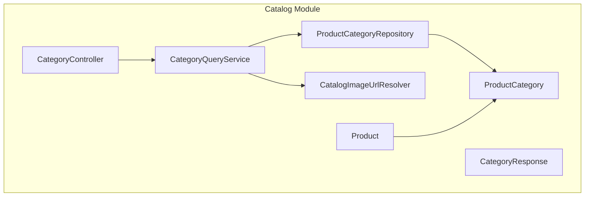
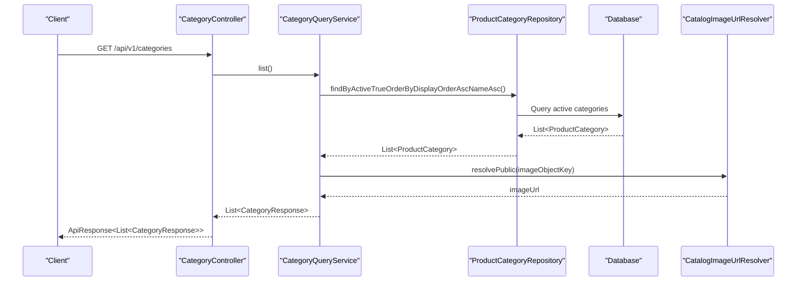
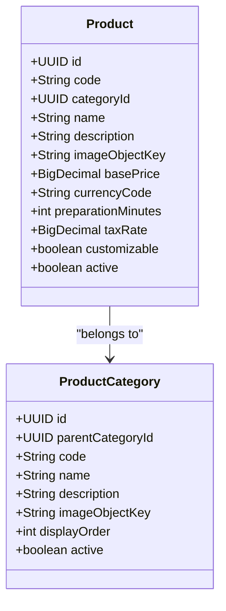
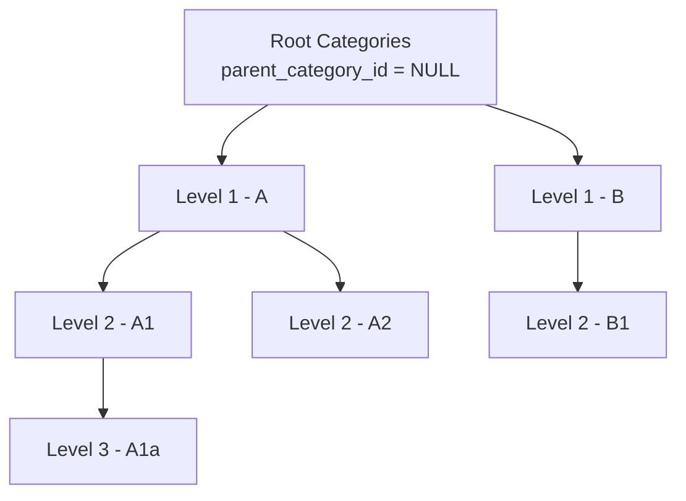
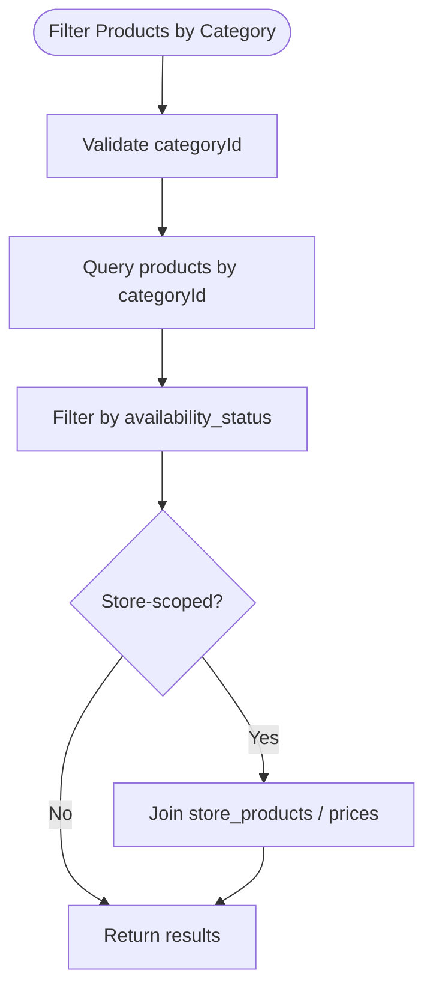
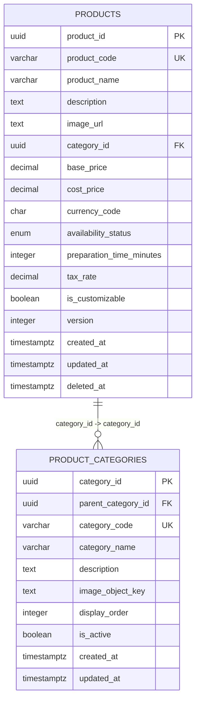
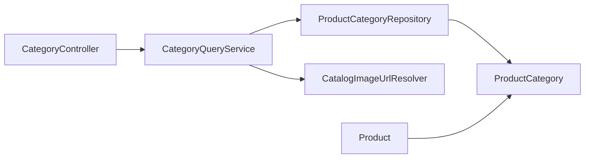

# Category Hierarchy

<cite>
**Referenced Files in This Document**
- [ProductCategory.java](file://src/main/java/com/smartcoffee/modules/catalog/domain/ProductCategory.java)
- [Product.java](file://src/main/java/com/smartcoffee/modules/catalog/domain/Product.java)
- [CategoryController.java](file://src/main/java/com/smartcoffee/modules/catalog/api/CategoryController.java)
- [CategoryResponse.java](file://src/main/java/com/smartcoffee/modules/catalog/api/CategoryResponse.java)
- [CategoryQueryService.java](file://src/main/java/com/smartcoffee/modules/catalog/application/CategoryQueryService.java)
- [CatalogImageUrlResolver.java](file://src/main/java/com/smartcoffee/modules/catalog/application/CatalogImageUrlResolver.java)
- [ProductCategoryRepository.java](file://src/main/java/com/smartcoffee/modules/catalog/persistence/ProductCategoryRepository.java)
- [V003__catalog_categories_products_customizations.sql](file://src/main/resources/db/migration/V003__catalog_categories_products_customizations.sql)
- [smart-coffee-logical.dbml](file://database/smart-coffee-logical.dbml)
</cite>

## Table of Contents
1. [Introduction](#introduction)
2. [Project Structure](#project-structure)
3. [Core Components](#core-components)
4. [Architecture Overview](#architecture-overview)
5. [Detailed Component Analysis](#detailed-component-analysis)
6. [Dependency Analysis](#dependency-analysis)
7. [Performance Considerations](#performance-considerations)
8. [Troubleshooting Guide](#troubleshooting-guide)
9. [Conclusion](#conclusion)

## Introduction
This document explains the Category Hierarchy system for product categorization. It covers the hierarchical structure of categories, parent-child relationships, and how products are associated with categories. It also documents the current category management APIs, data model, and provides guidance on performance optimization and caching strategies for deep hierarchies.

## Project Structure
The Category Hierarchy is implemented within the catalog module:
- Domain entities define categories and their relationship to products.
- A REST controller exposes a read-only list endpoint for categories.
- A query service orchestrates repository access and image URL resolution.
- A JPA repository provides efficient queries over active categories.
- Database schema defines the self-referencing hierarchy and indexes.

**Diagram sources**
- [CategoryController.java:9-21](file://src/main/java/com/smartcoffee/modules/catalog/api/CategoryController.java#L9-L21)
- [CategoryQueryService.java:9-25](file://src/main/java/com/smartcoffee/modules/catalog/application/CategoryQueryService.java#L9-L25)
- [ProductCategoryRepository.java:4-5](file://src/main/java/com/smartcoffee/modules/catalog/persistence/ProductCategoryRepository.java#L4-L5)
- [ProductCategory.java:5-22](file://src/main/java/com/smartcoffee/modules/catalog/domain/ProductCategory.java#L5-L22)
- [Product.java:6-28](file://src/main/java/com/smartcoffee/modules/catalog/domain/Product.java#L6-L28)
- [CategoryResponse.java:1-3](file://src/main/java/com/smartcoffee/modules/catalog/api/CategoryResponse.java#L1-L3)
- [CatalogImageUrlResolver.java:1-5](file://src/main/java/com/smartcoffee/modules/catalog/application/CatalogImageUrlResolver.java#L1-L5)

**Section sources**
- [CategoryController.java:9-21](file://src/main/java/com/smartcoffee/modules/catalog/api/CategoryController.java#L9-L21)
- [CategoryQueryService.java:9-25](file://src/main/java/com/smartcoffee/modules/catalog/application/CategoryQueryService.java#L9-L25)
- [ProductCategoryRepository.java:4-5](file://src/main/java/com/smartcoffee/modules/catalog/persistence/ProductCategoryRepository.java#L4-L5)
- [ProductCategory.java:5-22](file://src/main/java/com/smartcoffee/modules/catalog/domain/ProductCategory.java#L5-L22)
- [Product.java:6-28](file://src/main/java/com/smartcoffee/modules/catalog/domain/Product.java#L6-L28)
- [CategoryResponse.java:1-3](file://src/main/java/com/smartcoffee/modules/catalog/api/CategoryResponse.java#L1-L3)
- [CatalogImageUrlResolver.java:1-5](file://src/main/java/com/smartcoffee/modules/catalog/application/CatalogImageUrlResolver.java#L1-L5)

## Core Components
- ProductCategory: The domain entity representing a category node with optional parent reference, code, name, description, image key, display order, and active flag.
- Product: The domain entity referencing a category via categoryId, linking products to the category tree.
- CategoryController: Exposes GET /api/v1/categories to return all active categories as a flat list.
- CategoryQueryService: Reads active categories from the repository and maps them to CategoryResponse, resolving public image URLs.
- ProductCategoryRepository: Provides queries for listing active categories ordered by display order and name, and fetching a single active category by ID.
- CategoryResponse: DTO returned by the API containing category identifiers, metadata, and resolved image URL.
- CatalogImageUrlResolver: Abstraction for converting internal object keys to public URLs.

**Section sources**
- [ProductCategory.java:5-22](file://src/main/java/com/smartcoffee/modules/catalog/domain/ProductCategory.java#L5-L22)
- [Product.java:6-28](file://src/main/java/com/smartcoffee/modules/catalog/domain/Product.java#L6-L28)
- [CategoryController.java:9-21](file://src/main/java/com/smartcoffee/modules/catalog/api/CategoryController.java#L9-L21)
- [CategoryQueryService.java:9-25](file://src/main/java/com/smartcoffee/modules/catalog/application/CategoryQueryService.java#L9-L25)
- [ProductCategoryRepository.java:4-5](file://src/main/java/com/smartcoffee/modules/catalog/persistence/ProductCategoryRepository.java#L4-L5)
- [CategoryResponse.java:1-3](file://src/main/java/com/smartcoffee/modules/catalog/api/CategoryResponse.java#L1-L3)
- [CatalogImageUrlResolver.java:1-5](file://src/main/java/com/smartcoffee/modules/catalog/application/CatalogImageUrlResolver.java#L1-L5)

## Architecture Overview
The category system follows a layered approach:
- API layer (controller) receives requests and delegates to the application layer.
- Application layer (query service) coordinates data retrieval and transformation.
- Persistence layer (repository) abstracts database access.
- Domain layer contains entities that model the business concepts.

**Diagram sources**
- [CategoryController.java:18-21](file://src/main/java/com/smartcoffee/modules/catalog/api/CategoryController.java#L18-L21)
- [CategoryQueryService.java:19-25](file://src/main/java/com/smartcoffee/modules/catalog/application/CategoryQueryService.java#L19-L25)
- [ProductCategoryRepository.java:5](file://src/main/java/com/smartcoffee/modules/catalog/persistence/ProductCategoryRepository.java#L5)
- [CatalogImageUrlResolver.java:3-4](file://src/main/java/com/smartcoffee/modules/catalog/application/CatalogImageUrlResolver.java#L3-L4)

## Detailed Component Analysis

### Category Domain Model
The category model supports a self-referencing hierarchy through an optional parent reference. Products link to categories via a foreign key.

**Diagram sources**
- [ProductCategory.java:5-22](file://src/main/java/com/smartcoffee/modules/catalog/domain/ProductCategory.java#L5-L22)
- [Product.java:6-28](file://src/main/java/com/smartcoffee/modules/catalog/domain/Product.java#L6-L28)

**Section sources**
- [ProductCategory.java:5-22](file://src/main/java/com/smartcoffee/modules/catalog/domain/ProductCategory.java#L5-L22)
- [Product.java:6-28](file://src/main/java/com/smartcoffee/modules/catalog/domain/Product.java#L6-L28)

### Category Tree Structure
Categories form a tree where each node may have one parent. The database enforces constraints to prevent self-parenting and ensures ordering is non-negative.

[No sources needed since this diagram shows conceptual workflow, not actual code structure]

### Category Management APIs
Current API surface:
- GET /api/v1/categories
  - Returns a list of active categories sorted by display order then name.
  - Response wraps a list of CategoryResponse objects.

Example response shape:
- Array of CategoryResponse entries with fields: categoryId, parentCategoryId, code, name, description, imageUrl, displayOrder.

Notes:
- Only active categories are returned.
- Image URLs are resolved to public links via CatalogImageUrlResolver.

**Section sources**
- [CategoryController.java:9-21](file://src/main/java/com/smartcoffee/modules/catalog/api/CategoryController.java#L9-L21)
- [CategoryResponse.java:1-3](file://src/main/java/com/smartcoffee/modules/catalog/api/CategoryResponse.java#L1-L3)
- [CategoryQueryService.java:19-25](file://src/main/java/com/smartcoffee/modules/catalog/application/CategoryQueryService.java#L19-L25)

### Category-Based Product Filtering
Products are linked to categories via categoryId. To filter products by category:
- Use the product repository to query by categoryId and availability status.
- Combine with store-specific availability if needed via store_product_prices or store_products tables.

[No sources needed since this diagram shows conceptual workflow, not actual code structure]

### Data Model and Schema Details
- Table catalog.product_categories includes:
  - Self-referencing parent_category_id.
  - Unique category_code.
  - Display ordering and active flag.
  - Index on (active, display_order, category_name).
- Table catalog.products includes:
  - Non-null category_id linking to product_categories.
  - Availability and pricing attributes.

**Diagram sources**
- [smart-coffee-logical.dbml:212-244](file://database/smart-coffee-logical.dbml#L212-L244)
- [V003__catalog_categories_products_customizations.sql:3-26](file://src/main/resources/db/migration/V003__catalog_categories_products_customizations.sql#L3-L26)

**Section sources**
- [smart-coffee-logical.dbml:212-244](file://database/smart-coffee-logical.dbml#L212-L244)
- [V003__catalog_categories_products_customizations.sql:3-26](file://src/main/resources/db/migration/V003__catalog_categories_products_customizations.sql#L3-L26)

## Dependency Analysis
The following diagram shows runtime dependencies among components involved in category operations.

**Diagram sources**
- [CategoryController.java:9-21](file://src/main/java/com/smartcoffee/modules/catalog/api/CategoryController.java#L9-L21)
- [CategoryQueryService.java:9-25](file://src/main/java/com/smartcoffee/modules/catalog/application/CategoryQueryService.java#L9-L25)
- [ProductCategoryRepository.java:4-5](file://src/main/java/com/smartcoffee/modules/catalog/persistence/ProductCategoryRepository.java#L4-L5)
- [ProductCategory.java:5-22](file://src/main/java/com/smartcoffee/modules/catalog/domain/ProductCategory.java#L5-L22)
- [Product.java:6-28](file://src/main/java/com/smartcoffee/modules/catalog/domain/Product.java#L6-L28)
- [CatalogImageUrlResolver.java:1-5](file://src/main/java/com/smartcoffee/modules/catalog/application/CatalogImageUrlResolver.java#L1-L5)

**Section sources**
- [CategoryController.java:9-21](file://src/main/java/com/smartcoffee/modules/catalog/api/CategoryController.java#L9-L21)
- [CategoryQueryService.java:9-25](file://src/main/java/com/smartcoffee/modules/catalog/application/CategoryQueryService.java#L9-L25)
- [ProductCategoryRepository.java:4-5](file://src/main/java/com/smartcoffee/modules/catalog/persistence/ProductCategoryRepository.java#L4-L5)
- [ProductCategory.java:5-22](file://src/main/java/com/smartcoffee/modules/catalog/domain/ProductCategory.java#L5-L22)
- [Product.java:6-28](file://src/main/java/com/smartcoffee/modules/catalog/domain/Product.java#L6-L28)
- [CatalogImageUrlResolver.java:1-5](file://src/main/java/com/smartcoffee/modules/catalog/application/CatalogImageUrlResolver.java#L1-L5)

## Performance Considerations
- Query efficiency:
  - The repository method orders by active, display_order, and name using a composite index, which optimizes the default list operation.
- Caching strategy:
  - Cache the full list of active categories keyed by a stable cache name.
  - Invalidate the cache whenever categories change (create/update/delete).
  - For deep hierarchies, consider precomputing a flattened view or adjacency list projection to reduce client-side assembly cost.
- Image resolution:
  - Resolve public image URLs once per category and include in cached responses to avoid repeated resolver calls.
- Pagination and filtering:
  - If the number of categories grows large, add pagination parameters and server-side filters (e.g., by parent category or code prefix).
- Read isolation:
  - Keep category reads transactional and read-only to benefit from connection pooling and query plan reuse.

[No sources needed since this section provides general guidance]

## Troubleshooting Guide
- Missing categories in list:
  - Ensure categories are marked active; inactive categories are excluded by the repository query.
- Incorrect ordering:
  - Verify display_order values and the composite index on (active, display_order, category_name).
- Parent-child issues:
  - Prevent self-parenting; the schema enforces a constraint disallowing a category as its own parent.
- Image URL problems:
  - Validate image_object_key mapping in CatalogImageUrlResolver implementation and ensure public endpoints are accessible.
- Product-category mismatch:
  - Confirm product.category_id references a valid active category; consider adding referential integrity checks at the application level.

**Section sources**
- [ProductCategoryRepository.java:5](file://src/main/java/com/smartcoffee/modules/catalog/persistence/ProductCategoryRepository.java#L5)
- [V003__catalog_categories_products_customizations.sql:15-26](file://src/main/resources/db/migration/V003__catalog_categories_products_customizations.sql#L15-L26)
- [CatalogImageUrlResolver.java:3-4](file://src/main/java/com/smartcoffee/modules/catalog/application/CatalogImageUrlResolver.java#L3-L4)

## Conclusion
The Category Hierarchy system models a flexible, self-referencing category tree with clear associations to products. The current API provides a simple, efficient way to retrieve active categories. For production-scale use, adopt caching, pagination, and precomputed views to optimize performance for deep hierarchies while maintaining consistency through proper invalidation strategies.