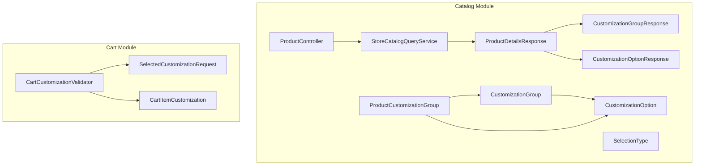
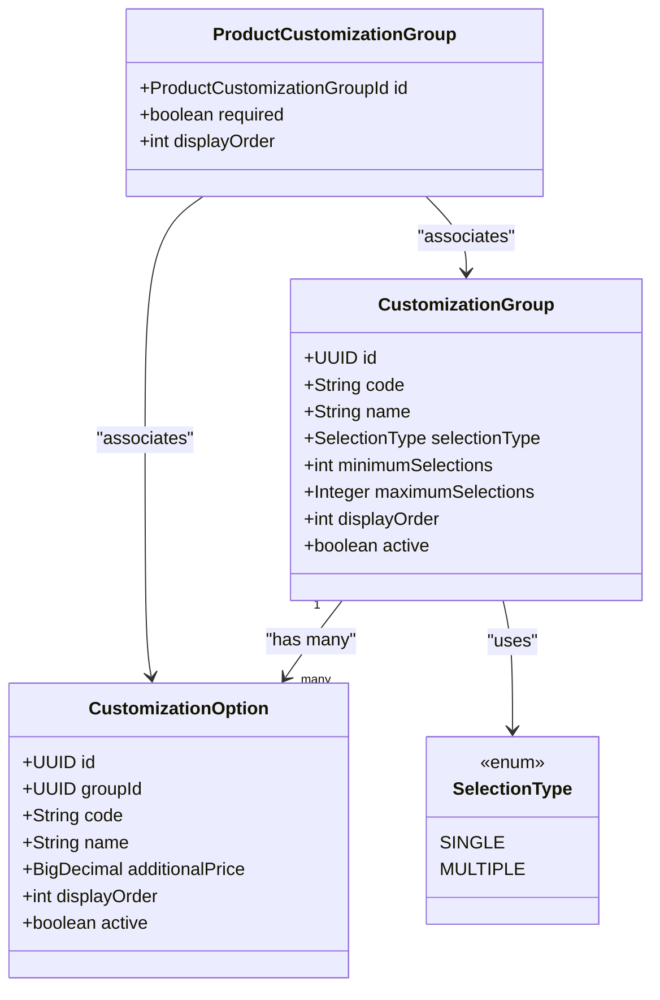
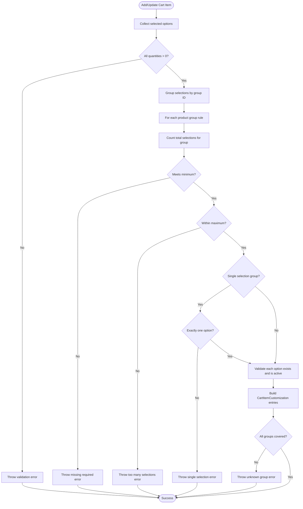
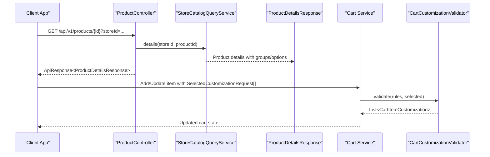
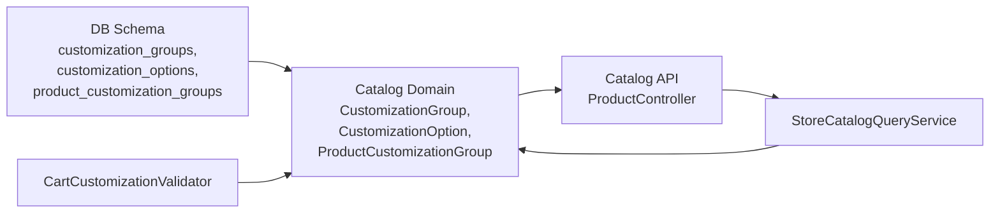

# Customization Groups & Options

<cite>
**Referenced Files in This Document**
- [CustomizationGroup.java](file://src/main/java/com/smartcoffee/modules/catalog/domain/CustomizationGroup.java)
- [CustomizationOption.java](file://src/main/java/com/smartcoffee/modules/catalog/domain/CustomizationOption.java)
- [ProductCustomizationGroup.java](file://src/main/java/com/smartcoffee/modules/catalog/domain/ProductCustomizationGroup.java)
- [SelectionType.java](file://src/main/java/com/smartcoffee/modules/catalog/domain/SelectionType.java)
- [CartCustomizationValidator.java](file://src/main/java/com/smartcoffee/modules/cart/application/CartCustomizationValidator.java)
- [ProductController.java](file://src/main/java/com/smartcoffee/modules/catalog/api/ProductController.java)
- [StoreCatalogQueryService.java](file://src/main/java/com/smartcoffee/modules/catalog/application/StoreCatalogQueryService.java)
- [ProductDetailsResponse.java](file://src/main/java/com/smartcoffee/modules/catalog/api/response/ProductDetailsResponse.java)
- [CustomizationGroupResponse.java](file://src/main/java/com/smartcoffee/modules/catalog/api/response/CustomizationGroupResponse.java)
- [CustomizationOptionResponse.java](file://src/main/java/com/smartcoffee/modules/catalog/api/response/CustomizationOptionResponse.java)
- [SelectedCustomizationRequest.java](file://src/main/java/com/smartcoffee/modules/cart/api/SelectedCustomizationRequest.java)
- [CartItemCustomization.java](file://src/main/java/com/smartcoffee/modules/cart/domain/CartItemCustomization.java)
- [V003__catalog_categories_products_customizations.sql](file://src/main/resources/db/migration/V003__catalog_categories_products_customizations.sql)
</cite>

## Table of Contents
1. Introduction
2. Project Structure
3. Core Components
4. Architecture Overview
5. Detailed Component Analysis
6. Dependency Analysis
7. Performance Considerations
8. Troubleshooting Guide
9. Conclusion

## Introduction
This document explains the Customization Groups and Options system that allows customers to modify products such as drink sizes, toppings, or preparation modifications. It covers the domain models, their relationships, validation rules, how customizations are attached to products, and how they flow through the cart and checkout processes. It also addresses mandatory vs optional options, pricing impacts, and inventory implications for customizable products.

## Project Structure
The customization feature spans the catalog module (domain and API) and the cart module (validation). The key pieces are:
- Domain entities for groups, options, and product-group associations
- API responses that expose available customizations for a product
- A validator that enforces group-level selection rules when items are added to the cart

**Diagram sources**
- [CustomizationGroup.java:1-24](file://src/main/java/com/smartcoffee/modules/catalog/domain/CustomizationGroup.java#L1-L24)
- [CustomizationOption.java:1-24](file://src/main/java/com/smartcoffee/modules/catalog/domain/CustomizationOption.java#L1-L24)
- [ProductCustomizationGroup.java:1-13](file://src/main/java/com/smartcoffee/modules/catalog/domain/ProductCustomizationGroup.java#L1-L13)
- [SelectionType.java:1-7](file://src/main/java/com/smartcoffee/modules/catalog/domain/SelectionType.java#L1-L7)
- [ProductController.java:1-24](file://src/main/java/com/smartcoffee/modules/catalog/api/ProductController.java#L1-L24)
- [StoreCatalogQueryService.java](file://src/main/java/com/smartcoffee/modules/catalog/application/StoreCatalogQueryService.java)
- [ProductDetailsResponse.java](file://src/main/java/com/smartcoffee/modules/catalog/api/response/ProductDetailsResponse.java)
- [CustomizationGroupResponse.java](file://src/main/java/com/smartcoffee/modules/catalog/api/response/CustomizationGroupResponse.java)
- [CustomizationOptionResponse.java](file://src/main/java/com/smartcoffee/modules/catalog/api/response/CustomizationOptionResponse.java)
- [CartCustomizationValidator.java:1-54](file://src/main/java/com/smartcoffee/modules/cart/application/CartCustomizationValidator.java#L1-L54)
- [SelectedCustomizationRequest.java](file://src/main/java/com/smartcoffee/modules/cart/api/SelectedCustomizationRequest.java)
- [CartItemCustomization.java](file://src/main/java/com/smartcoffee/modules/cart/domain/CartItemCustomization.java)

**Section sources**
- [ProductController.java:1-24](file://src/main/java/com/smartcoffee/modules/catalog/api/ProductController.java#L1-L24)
- [StoreCatalogQueryService.java](file://src/main/java/com/smartcoffee/modules/catalog/application/StoreCatalogQueryService.java)
- [ProductDetailsResponse.java](file://src/main/java/com/smartcoffee/modules/catalog/api/response/ProductDetailsResponse.java)
- [CustomizationGroupResponse.java](file://src/main/java/com/smartcoffee/modules/catalog/api/response/CustomizationGroupResponse.java)
- [CustomizationOptionResponse.java](file://src/main/java/com/smartcoffee/modules/catalog/api/response/CustomizationOptionResponse.java)
- [CartCustomizationValidator.java:1-54](file://src/main/java/com/smartcoffee/modules/cart/application/CartCustomizationValidator.java#L1-L54)

## Core Components
- CustomizationGroup: Defines a grouping of related options (e.g., size, milk type), including whether selections are single or multiple, minimum/maximum counts, display order, and active status.
- CustomizationOption: Represents an individual selectable option within a group, with name, code, additional price impact, display order, and active status.
- ProductCustomizationGroup: Associates a product with one or more customization groups and marks each group as required or optional, plus its display order on the product page.
- SelectionType: Enum indicating SINGLE or MULTIPLE selection behavior per group.
- CartCustomizationValidator: Enforces group-level constraints when adding items to the cart, including quantity positivity, required/optional enforcement, maximums, single-selection uniqueness, option availability, and duplicate prevention.

Key behaviors:
- Group-level selection rules:
  - Minimum and maximum number of selections enforced at group level
  - Single-selection groups disallow duplicates; multiple-selection groups allow distinct options
- Option-level constraints:
  - Only active options can be selected
  - Each option carries an additional price that contributes to item total
- Product association:
  - Products declare which groups apply and whether each is required
  - Display ordering controls UI presentation

**Section sources**
- [CustomizationGroup.java:1-24](file://src/main/java/com/smartcoffee/modules/catalog/domain/CustomizationGroup.java#L1-L24)
- [CustomizationOption.java:1-24](file://src/main/java/com/smartcoffee/modules/catalog/domain/CustomizationOption.java#L1-L24)
- [ProductCustomizationGroup.java:1-13](file://src/main/java/com/smartcoffee/modules/catalog/domain/ProductCustomizationGroup.java#L1-L13)
- [SelectionType.java:1-7](file://src/main/java/com/smartcoffee/modules/catalog/domain/SelectionType.java#L1-L7)
- [CartCustomizationValidator.java:1-54](file://src/main/java/com/smartcoffee/modules/cart/application/CartCustomizationValidator.java#L1-L54)

## Architecture Overview
The customization data model centers around three entities and an enum. The catalog API exposes product details including available customization groups and options. When a customer adds a product to the cart, the cart layer validates the chosen options against group rules before persisting them.

**Diagram sources**
- [CustomizationGroup.java:1-24](file://src/main/java/com/smartcoffee/modules/catalog/domain/CustomizationGroup.java#L1-L24)
- [CustomizationOption.java:1-24](file://src/main/java/com/smartcoffee/modules/catalog/domain/CustomizationOption.java#L1-L24)
- [ProductCustomizationGroup.java:1-13](file://src/main/java/com/smartcoffee/modules/catalog/domain/ProductCustomizationGroup.java#L1-L13)
- [SelectionType.java:1-7](file://src/main/java/com/smartcoffee/modules/catalog/domain/SelectionType.java#L1-L7)

## Detailed Component Analysis

### Domain Models and Relationships
- CustomizationGroup defines the shape of a customization category and its selection policy (single vs multiple) along with min/max bounds.
- CustomizationOption belongs to a group and provides the actual choices with optional price adjustments.
- ProductCustomizationGroup binds a product to specific groups, marking each as required or optional and controlling UI order.

These entities are persisted under the catalog schema and referenced by product detail queries and cart validation.

**Section sources**
- [CustomizationGroup.java:1-24](file://src/main/java/com/smartcoffee/modules/catalog/domain/CustomizationGroup.java#L1-L24)
- [CustomizationOption.java:1-24](file://src/main/java/com/smartcoffee/modules/catalog/domain/CustomizationOption.java#L1-L24)
- [ProductCustomizationGroup.java:1-13](file://src/main/java/com/smartcoffee/modules/catalog/domain/ProductCustomizationGroup.java#L1-L13)

### API Endpoints for Customizations
- GET /api/v1/products/{productId}?storeId={storeId}
  - Returns product details including available customization groups and options for the specified store context.
  - Responses include structured group and option objects suitable for rendering selection UIs.

Typical usage:
- Frontend fetches product details to render available customization groups and options.
- Customer selects options, then submits cart add/update requests with selected customization payloads.

**Section sources**
- [ProductController.java:1-24](file://src/main/java/com/smartcoffee/modules/catalog/api/ProductController.java#L1-L24)
- [StoreCatalogQueryService.java](file://src/main/java/com/smartcoffee/modules/catalog/application/StoreCatalogQueryService.java)
- [ProductDetailsResponse.java](file://src/main/java/com/smartcoffee/modules/catalog/api/response/ProductDetailsResponse.java)
- [CustomizationGroupResponse.java](file://src/main/java/com/smartcoffee/modules/catalog/api/response/CustomizationGroupResponse.java)
- [CustomizationOptionResponse.java](file://src/main/java/com/smartcoffee/modules/catalog/api/response/CustomizationOptionResponse.java)

### Validation Logic for Customization Combinations
When adding or updating a cart item, the cart layer validates selections against group rules:
- Quantity must be positive for each selected option
- Required groups must meet minimum selections; optional groups may be omitted
- Maximum selections per group are enforced
- Single-selection groups reject multiple distinct options
- Duplicate option selections within a group are rejected
- Only active options belonging to the product’s groups are allowed
- Any unrecognized group IDs are rejected

**Diagram sources**
- [CartCustomizationValidator.java:1-54](file://src/main/java/com/smartcoffee/modules/cart/application/CartCustomizationValidator.java#L1-L54)

**Section sources**
- [CartCustomizationValidator.java:1-54](file://src/main/java/com/smartcoffee/modules/cart/application/CartCustomizationValidator.java#L1-L54)
- [SelectedCustomizationRequest.java](file://src/main/java/com/smartcoffee/modules/cart/api/SelectedCustomizationRequest.java)
- [CartItemCustomization.java](file://src/main/java/com/smartcoffee/modules/cart/domain/CartItemCustomization.java)

### Data Flow: From Product Details to Validated Cart Items

**Diagram sources**
- [ProductController.java:1-24](file://src/main/java/com/smartcoffee/modules/catalog/api/ProductController.java#L1-L24)
- [StoreCatalogQueryService.java](file://src/main/java/com/smartcoffee/modules/catalog/application/StoreCatalogQueryService.java)
- [ProductDetailsResponse.java](file://src/main/java/com/smartcoffee/modules/catalog/api/response/ProductDetailsResponse.java)
- [CartCustomizationValidator.java:1-54](file://src/main/java/com/smartcoffee/modules/cart/application/CartCustomizationValidator.java#L1-L54)
- [SelectedCustomizationRequest.java](file://src/main/java/com/smartcoffee/modules/cart/api/SelectedCustomizationRequest.java)
- [CartItemCustomization.java](file://src/main/java/com/smartcoffee/modules/cart/domain/CartItemCustomization.java)

### Pricing Impacts
- Each CustomizationOption includes an additional price that contributes to the line item total when selected.
- The cart builds CartItemCustomization records carrying option names and additional prices, enabling accurate totals and receipts.

Practical implication:
- Selecting multiple options sums their additional prices according to group rules and quantities.

**Section sources**
- [CustomizationOption.java:1-24](file://src/main/java/com/smartcoffee/modules/catalog/domain/CustomizationOption.java#L1-L24)
- [CartItemCustomization.java](file://src/main/java/com/smartcoffee/modules/cart/domain/CartItemCustomization.java)

### Inventory Implications
- Customization options themselves do not directly reserve inventory in this model. Instead, inventory is typically managed via recipes/ingredients tied to final orders.
- If an option represents a physical ingredient (e.g., extra syrup), ensure the recipe or production pipeline accounts for it so inventory deductions occur at order fulfillment time.
- For non-physical modifiers (e.g., “no ice”), no inventory impact is expected.

Recommendation:
- Map high-cost or consumable options to recipe lines or ingredient demands so stock levels reflect real consumption during production.

[No sources needed since this section provides general guidance]

### Mandatory vs Optional Options
- ProductCustomizationGroup.required indicates whether a group must be satisfied for a valid item configuration.
- Group-level minimum and maximum enforce how many options must be chosen within a group.
- Single-selection groups restrict to exactly one choice; multiple-selection groups allow choosing zero up to the maximum.

Operational guidance:
- Use required=true for essential decisions like size or base drink.
- Use required=false for extras like “whip cream” or “extra shot”.

**Section sources**
- [ProductCustomizationGroup.java:1-13](file://src/main/java/com/smartcoffee/modules/catalog/domain/ProductCustomizationGroup.java#L1-L13)
- [CustomizationGroup.java:1-24](file://src/main/java/com/smartcoffee/modules/catalog/domain/CustomizationGroup.java#L1-L24)
- [CartCustomizationValidator.java:1-54](file://src/main/java/com/smartcoffee/modules/cart/application/CartCustomizationValidator.java#L1-L54)

## Dependency Analysis
The customization feature has clear boundaries:
- Catalog module owns the data model and read APIs for groups and options
- Cart module owns validation logic for user selections
- Database migrations define the schema for these entities

**Diagram sources**
- [V003__catalog_categories_products_customizations.sql](file://src/main/resources/db/migration/V003__catalog_categories_products_customizations.sql)
- [CustomizationGroup.java:1-24](file://src/main/java/com/smartcoffee/modules/catalog/domain/CustomizationGroup.java#L1-L24)
- [CustomizationOption.java:1-24](file://src/main/java/com/smartcoffee/modules/catalog/domain/CustomizationOption.java#L1-L24)
- [ProductCustomizationGroup.java:1-13](file://src/main/java/com/smartcoffee/modules/catalog/domain/ProductCustomizationGroup.java#L1-L13)
- [ProductController.java:1-24](file://src/main/java/com/smartcoffee/modules/catalog/api/ProductController.java#L1-L24)
- [StoreCatalogQueryService.java](file://src/main/java/com/smartcoffee/modules/catalog/application/StoreCatalogQueryService.java)
- [CartCustomizationValidator.java:1-54](file://src/main/java/com/smartcoffee/modules/cart/application/CartCustomizationValidator.java#L1-L54)

**Section sources**
- [V003__catalog_categories_products_customizations.sql](file://src/main/resources/db/migration/V003__catalog_categories_products_customizations.sql)
- [ProductController.java:1-24](file://src/main/java/com/smartcoffee/modules/catalog/api/ProductController.java#L1-L24)
- [StoreCatalogQueryService.java](file://src/main/java/com/smartcoffee/modules/catalog/application/StoreCatalogQueryService.java)
- [CartCustomizationValidator.java:1-54](file://src/main/java/com/smartcoffee/modules/cart/application/CartCustomizationValidator.java#L1-L54)

## Performance Considerations
- Cache product customization metadata at the store level to reduce repeated reads for popular products.
- Keep group and option lists small and ordered to minimize client-side processing.
- Validate early in the request pipeline to fail fast on invalid selections.
- Avoid N+1 queries when loading product details with nested customization groups and options; prefer batched reads or projections.

[No sources needed since this section provides general guidance]

## Troubleshooting Guide
Common validation errors and resolutions:
- “Customization quantity must be positive”: Ensure all selected option quantities are greater than zero.
- “Required customization is missing”: Mark the group as required and ensure the minimum count is met.
- “Too many selections for …”: Reduce selections to meet the group maximum.
- “Only one option is allowed for …”: Switch to a multiple-selection group or limit to a single option.
- “Duplicate customization option”: Remove duplicate selections of the same option within a group.
- “Invalid customization option for …”: Verify the option is active and belongs to the product’s groups.
- “Customization group does not belong to product”: Ensure the group ID is associated with the product.

Where to inspect:
- Validation exceptions originate from the cart customization validator.
- Product details endpoints return the authoritative list of groups and options to align client UI with server rules.

**Section sources**
- [CartCustomizationValidator.java:1-54](file://src/main/java/com/smartcoffee/modules/cart/application/CartCustomizationValidator.java#L1-L54)
- [ProductController.java:1-24](file://src/main/java/com/smartcoffee/modules/catalog/api/ProductController.java#L1-L24)

## Conclusion
The Customization Groups and Options system provides a flexible way to let customers tailor products while enforcing business rules at the cart layer. By modeling groups, options, and product associations clearly, and validating selections rigorously, the system supports complex scenarios like mandatory choices, caps, single vs multiple selections, and price adjustments. For inventory-sensitive options, integrate with recipes or production flows to ensure stock accuracy at fulfillment time.