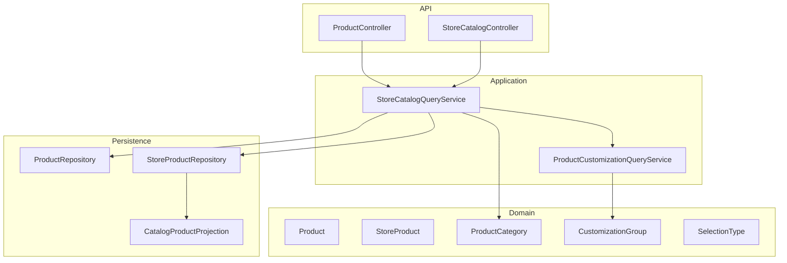
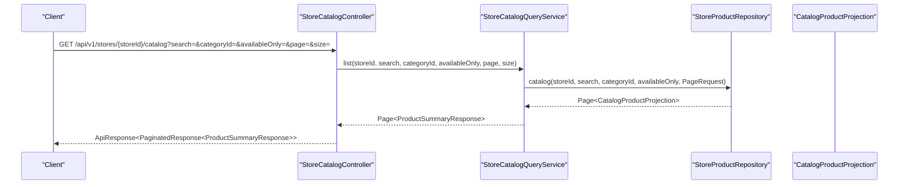
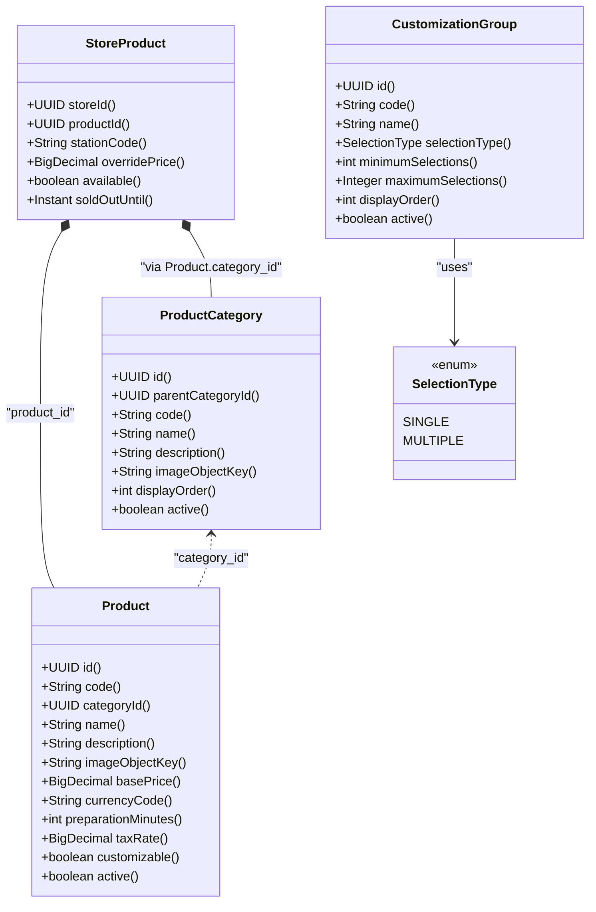
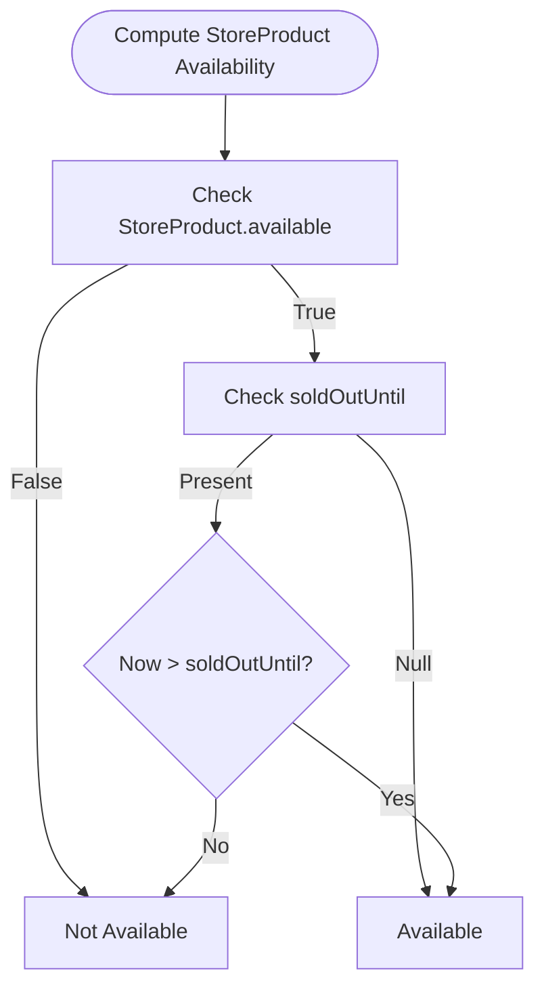
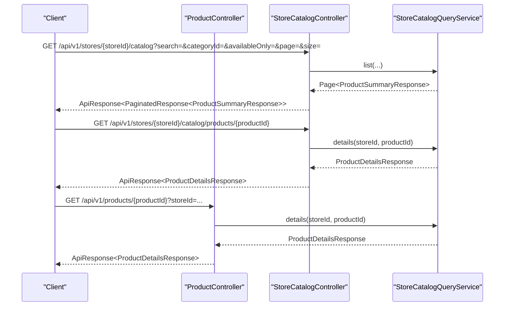
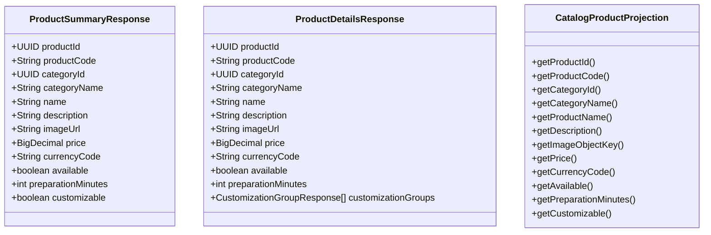
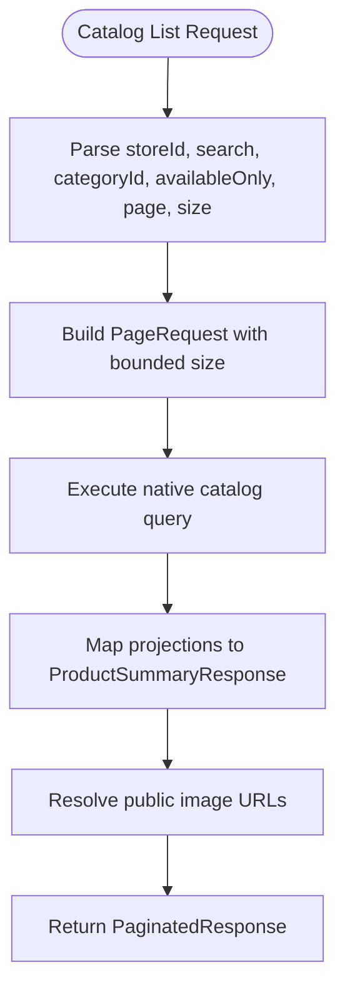
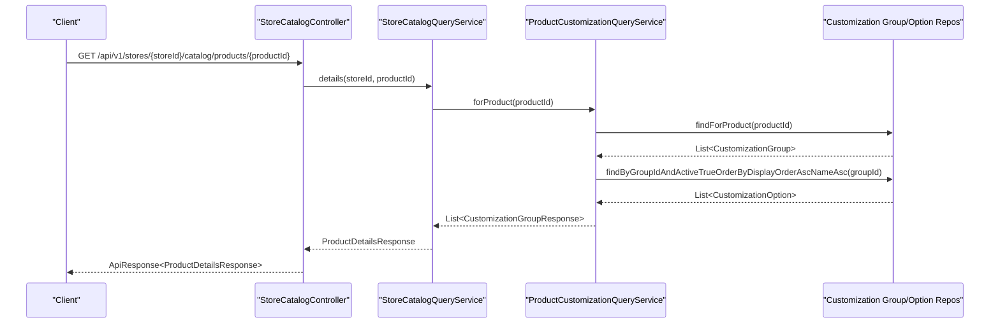
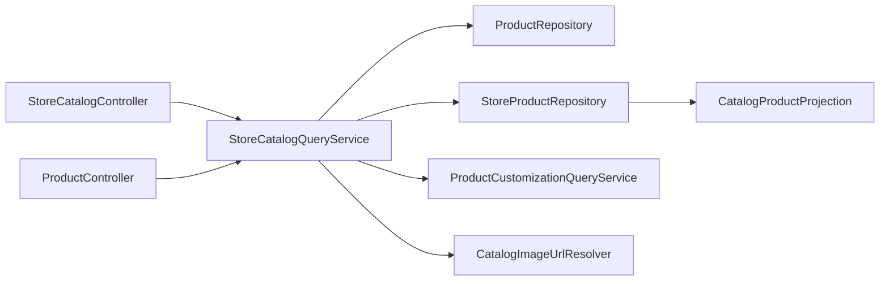

# Product Management

<cite>
**Referenced Files in This Document**
- [Product.java](file://src/main/java/com/smartcoffee/modules/catalog/domain/Product.java)
- [StoreProduct.java](file://src/main/java/com/smartcoffee/modules/catalog/domain/StoreProduct.java)
- [ProductCategory.java](file://src/main/java/com/smartcoffee/modules/catalog/domain/ProductCategory.java)
- [CustomizationGroup.java](file://src/main/java/com/smartcoffee/modules/catalog/domain/CustomizationGroup.java)
- [SelectionType.java](file://src/main/java/com/smartcoffee/modules/catalog/domain/SelectionType.java)
- [ProductController.java](file://src/main/java/com/smartcoffee/modules/catalog/api/ProductController.java)
- [StoreCatalogController.java](file://src/main/java/com/smartcoffee/modules/catalog/api/StoreCatalogController.java)
- [ProductDetailsResponse.java](file://src/main/java/com/smartcoffee/modules/catalog/api/ProductDetailsResponse.java)
- [ProductSummaryResponse.java](file://src/main/java/com/smartcoffee/modules/catalog/api/ProductSummaryResponse.java)
- [StoreCatalogQueryService.java](file://src/main/java/com/smartcoffee/modules/catalog/application/StoreCatalogQueryService.java)
- [ProductCustomizationQueryService.java](file://src/main/java/com/smartcoffee/modules/catalog/application/ProductCustomizationQueryService.java)
- [StoreProductRepository.java](file://src/main/java/com/smartcoffee/modules/catalog/persistence/StoreProductRepository.java)
- [ProductRepository.java](file://src/main/java/com/smartcoffee/modules/catalog/persistence/ProductRepository.java)
- [CatalogProductProjection.java](file://src/main/java/com/smartcoffee/modules/catalog/persistence/CatalogProductProjection.java)
</cite>

## Table of Contents
1. Introduction
2. Project Structure
3. Core Components
4. Architecture Overview
5. Detailed Component Analysis
6. Dependency Analysis
7. Performance Considerations
8. Troubleshooting Guide
9. Conclusion

## Introduction
This document explains the Product Management functionality within the Catalog module. It covers the product domain model (attributes, pricing, availability), relationships with categories and customizations, store-specific availability, REST APIs for listing and retrieving products, search and filtering, and performance considerations for large catalogs. Integration points with inventory systems are also outlined based on available code.

## Project Structure
The Product Management feature is implemented under the catalog module with a clear separation between API, application services, domain entities, and persistence:
- API layer exposes endpoints for store-scoped catalog browsing and product details.
- Application services orchestrate queries across repositories and map results to response models.
- Domain entities define products, store-product associations, categories, and customization groups.
- Persistence layer provides repositories and native queries optimized for catalog listing.

**Diagram sources**
- [ProductController.java:9-22](file://src/main/java/com/smartcoffee/modules/catalog/api/ProductController.java#L9-L22)
- [StoreCatalogController.java:8-13](file://src/main/java/com/smartcoffee/modules/catalog/api/StoreCatalogController.java#L8-L13)
- [StoreCatalogQueryService.java:13-65](file://src/main/java/com/smartcoffee/modules/catalog/application/StoreCatalogQueryService.java#L13-L65)
- [ProductCustomizationQueryService.java:9-29](file://src/main/java/com/smartcoffee/modules/catalog/application/ProductCustomizationQueryService.java#L9-L29)
- [Product.java:6-29](file://src/main/java/com/smartcoffee/modules/catalog/domain/Product.java#L6-L29)
- [StoreProduct.java:8-53](file://src/main/java/com/smartcoffee/modules/catalog/domain/StoreProduct.java#L8-L53)
- [ProductCategory.java:5-23](file://src/main/java/com/smartcoffee/modules/catalog/domain/ProductCategory.java#L5-L23)
- [CustomizationGroup.java:5-22](file://src/main/java/com/smartcoffee/modules/catalog/domain/CustomizationGroup.java#L5-L22)
- [SelectionType.java:1-5](file://src/main/java/com/smartcoffee/modules/catalog/domain/SelectionType.java#L1-L5)
- [ProductRepository.java:4-5](file://src/main/java/com/smartcoffee/modules/catalog/persistence/ProductRepository.java#L4-L5)
- [StoreProductRepository.java:7-30](file://src/main/java/com/smartcoffee/modules/catalog/persistence/StoreProductRepository.java#L7-L30)
- [CatalogProductProjection.java:4-7](file://src/main/java/com/smartcoffee/modules/catalog/persistence/CatalogProductProjection.java#L4-L7)

**Section sources**
- [ProductController.java:9-22](file://src/main/java/com/smartcoffee/modules/catalog/api/ProductController.java#L9-L22)
- [StoreCatalogController.java:8-13](file://src/main/java/com/smartcoffee/modules/catalog/api/StoreCatalogController.java#L8-L13)
- [StoreCatalogQueryService.java:13-65](file://src/main/java/com/smartcoffee/modules/catalog/application/StoreCatalogQueryService.java#L13-L65)
- [ProductCustomizationQueryService.java:9-29](file://src/main/java/com/smartcoffee/modules/catalog/application/ProductCustomizationQueryService.java#L9-L29)
- [Product.java:6-29](file://src/main/java/com/smartcoffee/modules/catalog/domain/Product.java#L6-L29)
- [StoreProduct.java:8-53](file://src/main/java/com/smartcoffee/modules/catalog/domain/StoreProduct.java#L8-L53)
- [ProductCategory.java:5-23](file://src/main/java/com/smartcoffee/modules/catalog/domain/ProductCategory.java#L5-L23)
- [CustomizationGroup.java:5-22](file://src/main/java/com/smartcoffee/modules/catalog/domain/CustomizationGroup.java#L5-L22)
- [SelectionType.java:1-5](file://src/main/java/com/smartcoffee/modules/catalog/domain/SelectionType.java#L1-L5)
- [ProductRepository.java:4-5](file://src/main/java/com/smartcoffee/modules/catalog/persistence/ProductRepository.java#L4-L5)
- [StoreProductRepository.java:7-30](file://src/main/java/com/smartcoffee/modules/catalog/persistence/StoreProductRepository.java#L7-L30)
- [CatalogProductProjection.java:4-7](file://src/main/java/com/smartcoffee/modules/catalog/persistence/CatalogProductProjection.java#L4-L7)

## Core Components
- Product entity defines core attributes such as identifier, code, category reference, name, description, image key, base price, currency, preparation time, tax rate, customizable flag, active status, and audit fields.
- StoreProduct associates a product with a store, providing per-store override price, availability flag, sold-out until timestamp, and computed availability logic that considers both flags and sold-out window.
- ProductCategory represents hierarchical categories with code, name, description, image key, display order, and active status.
- CustomizationGroup and SelectionType define how customers can customize a product (single or multiple selections).
- StoreCatalogQueryService orchestrates listing and detail retrieval, enforcing store existence, resolving images, and composing responses.
- ProductCustomizationQueryService fetches customization groups and options for a given product.
- Repositories provide access to data; StoreProductRepository includes a native query for efficient catalog listing with search, category filter, and availability filter.

**Section sources**
- [Product.java:6-29](file://src/main/java/com/smartcoffee/modules/catalog/domain/Product.java#L6-L29)
- [StoreProduct.java:8-53](file://src/main/java/com/smartcoffee/modules/catalog/domain/StoreProduct.java#L8-L53)
- [ProductCategory.java:5-23](file://src/main/java/com/smartcoffee/modules/catalog/domain/ProductCategory.java#L5-L23)
- [CustomizationGroup.java:5-22](file://src/main/java/com/smartcoffee/modules/catalog/domain/CustomizationGroup.java#L5-L22)
- [SelectionType.java:1-5](file://src/main/java/com/smartcoffee/modules/catalog/domain/SelectionType.java#L1-L5)
- [StoreCatalogQueryService.java:13-65](file://src/main/java/com/smartcoffee/modules/catalog/application/StoreCatalogQueryService.java#L13-L65)
- [ProductCustomizationQueryService.java:9-29](file://src/main/java/com/smartcoffee/modules/catalog/application/ProductCustomizationQueryService.java#L9-L29)
- [StoreProductRepository.java:7-30](file://src/main/java/com/smartcoffee/modules/catalog/persistence/StoreProductRepository.java#L7-L30)

## Architecture Overview
The catalog APIs are read-only for browsing and details. Listing uses a single native query that joins store_products, products, and product_categories to compute effective price and availability while supporting search and filters. Details resolve product, store-product association, category, and customization groups.

**Diagram sources**
- [StoreCatalogController.java:8-13](file://src/main/java/com/smartcoffee/modules/catalog/api/StoreCatalogController.java#L8-L13)
- [StoreCatalogQueryService.java:33-44](file://src/main/java/com/smartcoffee/modules/catalog/application/StoreCatalogQueryService.java#L33-L44)
- [StoreProductRepository.java:7-30](file://src/main/java/com/smartcoffee/modules/catalog/persistence/StoreProductRepository.java#L7-L30)
- [CatalogProductProjection.java:4-7](file://src/main/java/com/smartcoffee/modules/catalog/persistence/CatalogProductProjection.java#L4-L7)

## Detailed Component Analysis

### Product Domain Model
- Product: core catalog item with base price, currency, preparation time, tax rate, customizable flag, and active status.
- StoreProduct: per-store linkage with override price, availability flag, and sold-out window; availability is computed by combining flags and sold-out timestamp.
- ProductCategory: hierarchical categories with active flag and display ordering.
- CustomizationGroup and SelectionType: define grouping and selection constraints for product customizations.

**Diagram sources**
- [Product.java:6-29](file://src/main/java/com/smartcoffee/modules/catalog/domain/Product.java#L6-L29)
- [StoreProduct.java:8-53](file://src/main/java/com/smartcoffee/modules/catalog/domain/StoreProduct.java#L8-L53)
- [ProductCategory.java:5-23](file://src/main/java/com/smartcoffee/modules/catalog/domain/ProductCategory.java#L5-L23)
- [CustomizationGroup.java:5-22](file://src/main/java/com/smartcoffee/modules/catalog/domain/CustomizationGroup.java#L5-L22)
- [SelectionType.java:1-5](file://src/main/java/com/smartcoffee/modules/catalog/domain/SelectionType.java#L1-L5)

**Section sources**
- [Product.java:6-29](file://src/main/java/com/smartcoffee/modules/catalog/domain/Product.java#L6-L29)
- [StoreProduct.java:8-53](file://src/main/java/com/smartcoffee/modules/catalog/domain/StoreProduct.java#L8-L53)
- [ProductCategory.java:5-23](file://src/main/java/com/smartcoffee/modules/catalog/domain/ProductCategory.java#L5-L23)
- [CustomizationGroup.java:5-22](file://src/main/java/com/smartcoffee/modules/catalog/domain/CustomizationGroup.java#L5-L22)
- [SelectionType.java:1-5](file://src/main/java/com/smartcoffee/modules/catalog/domain/SelectionType.java#L1-L5)

### Store-Specific Availability and Pricing
- Effective price per store: if StoreProduct has an override price, it is used; otherwise, Product.basePrice applies.
- Availability per store: computed from StoreProduct.available and soldOutUntil; a product is considered available only when the flag is true and either no sold-out timestamp exists or the current time is past the timestamp.
- Station code can be associated with a store-product for operational routing.

**Diagram sources**
- [StoreProduct.java:17-48](file://src/main/java/com/smartcoffee/modules/catalog/domain/StoreProduct.java#L17-L48)

**Section sources**
- [StoreProduct.java:17-48](file://src/main/java/com/smartcoffee/modules/catalog/domain/StoreProduct.java#L17-L48)

### REST APIs for Product Management
- List store catalog: GET /api/v1/stores/{storeId}/catalog
  - Query parameters:
    - search: substring match against product name or code
    - categoryId: optional filter by category
    - availableOnly: boolean filter to show only available items
    - page: zero-based page index
    - size: page size (capped internally)
  - Response: paginated list of ProductSummaryResponse
- Get product details: GET /api/v1/stores/{storeId}/catalog/products/{productId}
  - Response: ProductDetailsResponse including effective price, availability, and customization groups
- Legacy product endpoint: GET /api/v1/products/{productId}?storeId=...
  - Returns ProductDetailsResponse via StoreCatalogQueryService

**Diagram sources**
- [StoreCatalogController.java:8-13](file://src/main/java/com/smartcoffee/modules/catalog/api/StoreCatalogController.java#L8-L13)
- [ProductController.java:9-22](file://src/main/java/com/smartcoffee/modules/catalog/api/ProductController.java#L9-L22)
- [StoreCatalogQueryService.java:33-59](file://src/main/java/com/smartcoffee/modules/catalog/application/StoreCatalogQueryService.java#L33-L59)

**Section sources**
- [StoreCatalogController.java:8-13](file://src/main/java/com/smartcoffee/modules/catalog/api/StoreCatalogController.java#L8-L13)
- [ProductController.java:9-22](file://src/main/java/com/smartcoffee/modules/catalog/api/ProductController.java#L9-L22)
- [StoreCatalogQueryService.java:33-59](file://src/main/java/com/smartcoffee/modules/catalog/application/StoreCatalogQueryService.java#L33-L59)

### Data Models and Responses
- ProductSummaryResponse: summary fields for listing including effective price, availability, preparation minutes, and customizable flag.
- ProductDetailsResponse: detailed fields including category info, image URL, effective price, availability, preparation minutes, and customization groups.
- CatalogProductProjection: interface used by native query to project joined columns efficiently.

**Diagram sources**
- [ProductSummaryResponse.java:1-5](file://src/main/java/com/smartcoffee/modules/catalog/api/ProductSummaryResponse.java#L1-L5)
- [ProductDetailsResponse.java:1-5](file://src/main/java/com/smartcoffee/modules/catalog/api/ProductDetailsResponse.java#L1-L5)
- [CatalogProductProjection.java:4-7](file://src/main/java/com/smartcoffee/modules/catalog/persistence/CatalogProductProjection.java#L4-L7)

**Section sources**
- [ProductSummaryResponse.java:1-5](file://src/main/java/com/smartcoffee/modules/catalog/api/ProductSummaryResponse.java#L1-L5)
- [ProductDetailsResponse.java:1-5](file://src/main/java/com/smartcoffee/modules/catalog/api/ProductDetailsResponse.java#L1-L5)
- [CatalogProductProjection.java:4-7](file://src/main/java/com/smartcoffee/modules/catalog/persistence/CatalogProductProjection.java#L4-L7)

### Search, Filtering, and Pagination
- Search: case-insensitive substring matching on product name and product code.
- Category filter: optional UUID to restrict results to a specific category.
- Availability filter: boolean to include only currently available products at the specified store.
- Pagination: page and size parameters with internal bounds enforcement to prevent excessive page sizes.

**Diagram sources**
- [StoreCatalogController.java:8-13](file://src/main/java/com/smartcoffee/modules/catalog/api/StoreCatalogController.java#L8-L13)
- [StoreCatalogQueryService.java:33-44](file://src/main/java/com/smartcoffee/modules/catalog/application/StoreCatalogQueryService.java#L33-L44)
- [StoreProductRepository.java:7-30](file://src/main/java/com/smartcoffee/modules/catalog/persistence/StoreProductRepository.java#L7-L30)

**Section sources**
- [StoreCatalogController.java:8-13](file://src/main/java/com/smartcoffee/modules/catalog/api/StoreCatalogController.java#L8-L13)
- [StoreCatalogQueryService.java:33-44](file://src/main/java/com/smartcoffee/modules/catalog/application/StoreCatalogQueryService.java#L33-L44)
- [StoreProductRepository.java:7-30](file://src/main/java/com/smartcoffee/modules/catalog/persistence/StoreProductRepository.java#L7-L30)

### Customizations Integration
- For product details, customization groups and options are fetched and included in the response.
- Groups support selection type (single or multiple) and min/max selection constraints.
- Options include additional pricing and active status.

**Diagram sources**
- [StoreCatalogController.java:8-13](file://src/main/java/com/smartcoffee/modules/catalog/api/StoreCatalogController.java#L8-L13)
- [StoreCatalogQueryService.java:46-59](file://src/main/java/com/smartcoffee/modules/catalog/application/StoreCatalogQueryService.java#L46-L59)
- [ProductCustomizationQueryService.java:20-29](file://src/main/java/com/smartcoffee/modules/catalog/application/ProductCustomizationQueryService.java#L20-L29)

**Section sources**
- [StoreCatalogQueryService.java:46-59](file://src/main/java/com/smartcoffee/modules/catalog/application/StoreCatalogQueryService.java#L46-L59)
- [ProductCustomizationQueryService.java:20-29](file://src/main/java/com/smartcoffee/modules/catalog/application/ProductCustomizationQueryService.java#L20-L29)

### Inventory Integration Notes
- The current catalog implementation focuses on product visibility and availability flags per store. There is no direct stock-level integration in the listed files.
- To integrate with inventory systems, consider:
  - Using StoreProduct.soldOutUntil to reflect temporary unavailability due to low stock.
  - Extending StoreProduct with real-time stock indicators or integrating with an inventory service to update availability flags and sold-out windows.
  - Publishing events when inventory changes to keep catalog availability consistent.

[No sources needed since this section provides general guidance]

## Dependency Analysis
- StoreCatalogQueryService depends on:
  - StoreRepository to validate store existence
  - ProductRepository to load active products
  - StoreProductRepository for store-product associations and catalog listing
  - ProductCustomizationQueryService to assemble customization groups
  - CatalogImageUrlResolver to produce public image URLs
- StoreProductRepository executes a native query joining store_products, products, and product_categories to compute effective price and availability efficiently.

**Diagram sources**
- [StoreCatalogController.java:8-13](file://src/main/java/com/smartcoffee/modules/catalog/api/StoreCatalogController.java#L8-L13)
- [ProductController.java:9-22](file://src/main/java/com/smartcoffee/modules/catalog/api/ProductController.java#L9-L22)
- [StoreCatalogQueryService.java:13-65](file://src/main/java/com/smartcoffee/modules/catalog/application/StoreCatalogQueryService.java#L13-L65)
- [StoreProductRepository.java:7-30](file://src/main/java/com/smartcoffee/modules/catalog/persistence/StoreProductRepository.java#L7-L30)
- [CatalogProductProjection.java:4-7](file://src/main/java/com/smartcoffee/modules/catalog/persistence/CatalogProductProjection.java#L4-L7)

**Section sources**
- [StoreCatalogQueryService.java:13-65](file://src/main/java/com/smartcoffee/modules/catalog/application/StoreCatalogQueryService.java#L13-L65)
- [StoreProductRepository.java:7-30](file://src/main/java/com/smartcoffee/modules/catalog/persistence/StoreProductRepository.java#L7-L30)

## Performance Considerations
- Single native query for catalog listing reduces round-trips and computes effective price and availability server-side.
- Pagination with bounded page size prevents excessive memory usage.
- Case-insensitive search uses LIKE patterns; ensure appropriate indexes on product_name and product_code for large catalogs.
- Category and availability filters are applied in SQL to minimize result set size.
- Image URL resolution occurs after mapping; caching image keys or resolved URLs may improve response times.

[No sources needed since this section provides general guidance]

## Troubleshooting Guide
- Product not found: thrown when an active product cannot be located by ID.
- Product not offered by store: thrown when no StoreProduct association exists for the given store and product.
- Store not found: thrown when the requested store does not exist or is inactive.
- Ensure storeId is provided for product details endpoints and matches an active store.

**Section sources**
- [StoreCatalogQueryService.java:46-64](file://src/main/java/com/smartcoffee/modules/catalog/application/StoreCatalogQueryService.java#L46-L64)

## Conclusion
The Catalog module provides robust read-only product management APIs focused on store-scoped catalog browsing and detailed product information. The domain model cleanly separates global product definitions from store-specific availability and pricing. Search and filtering are implemented efficiently using a native query, and customization groups are integrated into product details. For full inventory integration, extend availability logic with real-time stock data and event-driven updates.