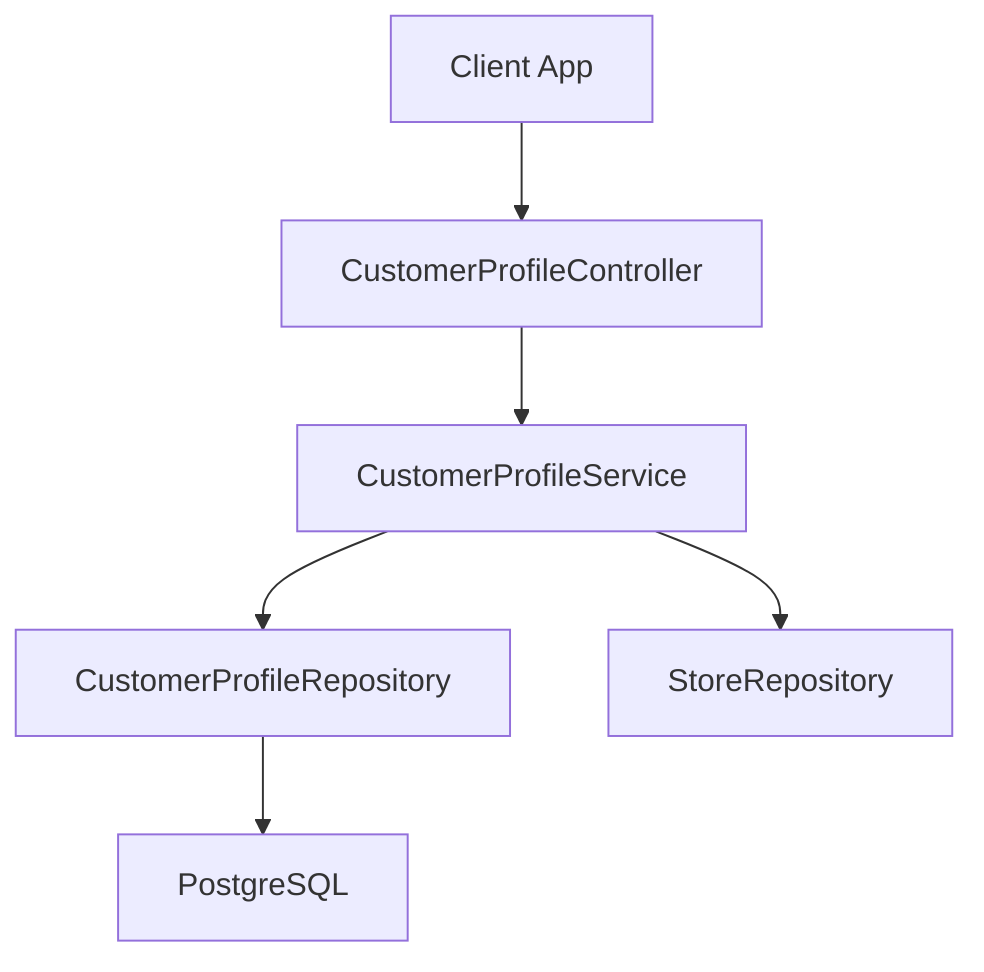
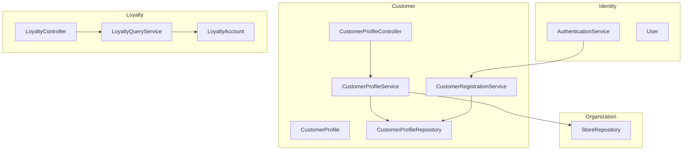
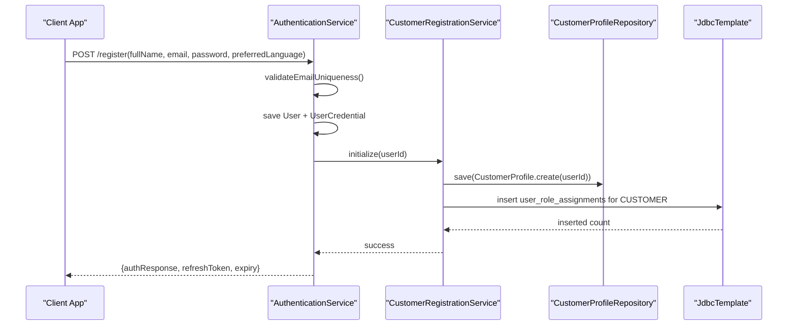
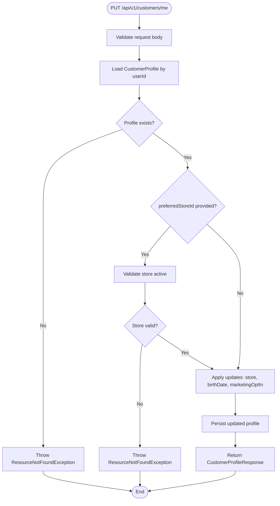
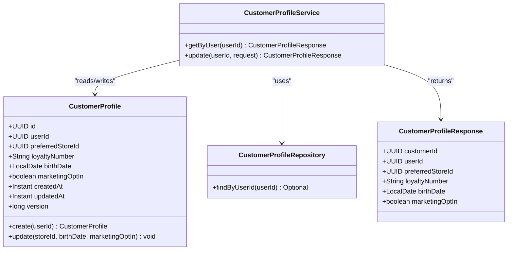
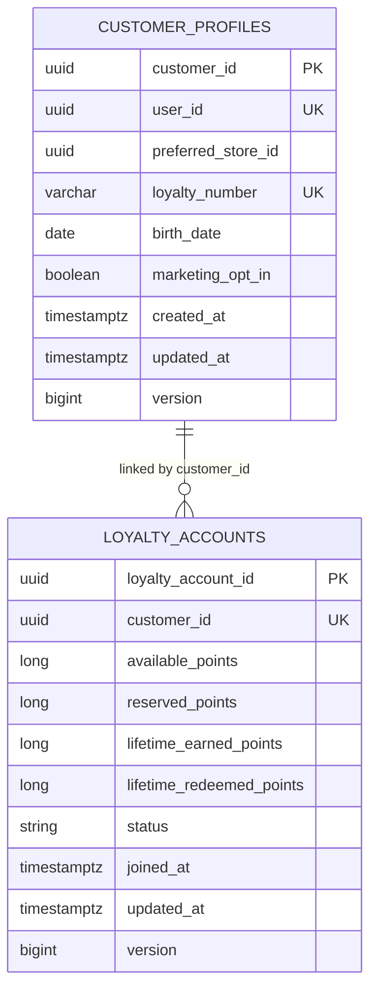
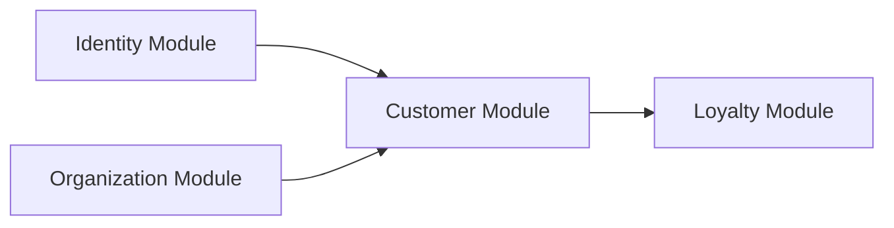

# Customer Profile Module

<cite>
**Referenced Files in This Document**
- [CustomerProfileController.java](file://src/main/java/com/smartcoffee/modules/customer/api/CustomerProfileController.java)
- [CustomerProfileResponse.java](file://src/main/java/com/smartcoffee/modules/customer/api/CustomerProfileResponse.java)
- [UpdateCustomerProfileRequest.java](file://src/main/java/com/smartcoffee/modules/customer/api/UpdateCustomerProfileRequest.java)
- [CustomerProfileService.java](file://src/main/java/com/smartcoffee/modules/customer/application/CustomerProfileService.java)
- [CustomerRegistrationService.java](file://src/main/java/com/smartcoffee/modules/customer/application/CustomerRegistrationService.java)
- [CustomerProfile.java](file://src/main/java/com/smartcoffee/modules/customer/domain/CustomerProfile.java)
- [CustomerProfileRepository.java](file://src/main/java/com/smartcoffee/modules/customer/persistence/CustomerProfileRepository.java)
- [AuthenticationService.java](file://src/main/java/com/smartcoffee/modules/auth/application/AuthenticationService.java)
- [RegisterRequest.java](file://src/main/java/com/smartcoffee/modules/auth/api/RegisterRequest.java)
- [CurrentActorProvider.java](file://src/main/java/com/smartcoffee/common/security/CurrentActorProvider.java)
- [V002__organization_customer_and_role_seed.sql](file://src/main/resources/db/migration/V002__organization_customer_and_role_seed.sql)
- [smart-coffee-logical.dbml](file://database/smart-coffee-logical.dbml)
- [LoyaltyController.java](file://src/main/java/com/smartcoffee/modules/loyalty/api/LoyaltyController.java)
- [LoyaltyAccount.java](file://src/main/java/com/smartcoffee/modules/loyalty/domain/LoyaltyAccount.java)
- [LoyaltyPointService.java](file://src/main/java/com/smartcoffee/modules/loyalty/application/LoyaltyPointService.java)
- [LoyaltyQueryService.java](file://src/main/java/com/smartcoffee/modules/loyalty/application/LoyaltyQueryService.java)
- [DB_OWNERSHIP_MATRIX.md](file://database\DB_OWNERSHIP_MATRIX.md)
- [ADR-006-authentication-model.md](file://adr/ADR-006-authentication-model.md)
</cite>

## Table of Contents
1. [Introduction](#introduction)
2. [Project Structure](#project-structure)
3. [Core Components](#core-components)
4. [Architecture Overview](#architecture-overview)
5. [Detailed Component Analysis](#detailed-component-analysis)
6. [Dependency Analysis](#dependency-analysis)
7. [Performance Considerations](#performance-considerations)
8. [Troubleshooting Guide](#troubleshooting-guide)
9. [Conclusion](#conclusion)
10. [Appendices](#appendices)

## Introduction
This document explains the Customer Profile module for the Smart Coffee Backend. It covers customer registration, profile management, account lifecycle, data validation, and relationships with orders and loyalty programs. It also documents integration points with authentication, order history, personalization features, and addresses data privacy, GDPR compliance, and security considerations.

The Customer Profile module owns customer-specific metadata such as preferred store, birth date, marketing opt-in status, and a unique loyalty number. It is created automatically when a user registers, and it can be updated by authenticated customers through a dedicated API.

## Project Structure
The Customer Profile module follows a layered structure:
- API layer: REST endpoints for reading and updating the current customer’s profile.
- Application layer: Use cases for retrieving and updating profiles, including store validation.
- Domain layer: The CustomerProfile entity encapsulating customer attributes and update behavior.
- Persistence layer: JPA repository for customer profile storage.



**Diagram sources**
- [CustomerProfileController.java:10-25](file://src/main/java/com/smartcoffee/modules/customer/api/CustomerProfileController.java#L10-L25)
- [CustomerProfileService.java:12-38](file://src/main/java/com/smartcoffee/modules/customer/application/CustomerProfileService.java#L12-L38)
- [CustomerProfileRepository.java:8-10](file://src/main/java/com/smartcoffee/modules/customer/persistence/CustomerProfileRepository.java#L8-L10)

**Section sources**
- [CustomerProfileController.java:10-25](file://src/main/java/com/smartcoffee/modules/customer/api/CustomerProfileController.java#L10-L25)
- [CustomerProfileService.java:12-38](file://src/main/java/com/smartcoffee/modules/customer/application/CustomerProfileService.java#L12-L38)
- [CustomerProfileRepository.java:8-10](file://src/main/java/com/smartcoffee/modules/customer/persistence/CustomerProfileRepository.java#L8-L10)

## Core Components
- CustomerProfileController: Exposes GET and PUT endpoints under /api/v1/customers/me to retrieve and update the authenticated customer’s profile.
- CustomerProfileService: Implements business logic for fetching and updating profiles, validating preferred store existence, and mapping domain objects to responses.
- CustomerProfile: JPA entity representing the customer profile with fields for preferred store, loyalty number, birth date, marketing opt-in, audit timestamps, and optimistic locking version.
- CustomerProfileRepository: JPA repository providing findByUserId lookup.
- CustomerRegistrationService: Initializes a new customer profile and assigns the CUSTOMER role within the same transaction as user registration.

Key responsibilities:
- Registration lifecycle: Create CustomerProfile and assign roles during user registration.
- Profile retrieval: Read-only access to the current customer’s profile.
- Profile updates: Validate optional preferred store and persist changes.

**Section sources**
- [CustomerProfileController.java:10-25](file://src/main/java/com/smartcoffee/modules/customer/api/CustomerProfileController.java#L10-L25)
- [CustomerProfileService.java:12-38](file://src/main/java/com/smartcoffee/modules/customer/application/CustomerProfileService.java#L12-L38)
- [CustomerProfile.java:8-43](file://src/main/java/com/smartcoffee/modules/customer/domain/CustomerProfile.java#L8-L43)
- [CustomerProfileRepository.java:8-10](file://src/main/java/com/smartcoffee/modules/customer/persistence/CustomerProfileRepository.java#L8-L10)
- [CustomerRegistrationService.java:13-28](file://src/main/java/com/smartcoffee/modules/customer/application/CustomerRegistrationService.java#L13-L28)

## Architecture Overview
The Customer Profile module integrates with Identity (authentication), Organization (stores), and Loyalty modules.



**Diagram sources**
- [AuthenticationService.java:38-46](file://src/main/java/com/smartcoffee/modules/auth/application/AuthenticationService.java#L38-L46)
- [CustomerRegistrationService.java:19-28](file://src/main/java/com/smartcoffee/modules/customer/application/CustomerRegistrationService.java#L19-L28)
- [CustomerProfileController.java:10-25](file://src/main/java/com/smartcoffee/modules/customer/api/CustomerProfileController.java#L10-L25)
- [CustomerProfileService.java:12-38](file://src/main/java/com/smartcoffee/modules/customer/application/CustomerProfileService.java#L12-L38)
- [LoyaltyController.java:10-27](file://src/main/java/com/smartcoffee/modules/loyalty/api/LoyaltyController.java#L10-L27)
- [LoyaltyQueryService.java:10-24](file://src/main/java/com/smartcoffee/modules/loyalty/application/LoyaltyQueryService.java#L10-L24)

## Detailed Component Analysis

### Customer Registration Lifecycle
When a user registers, the system creates an identity user, stores credentials, issues sessions, and initializes the customer profile along with assigning the CUSTOMER role.



**Diagram sources**
- [AuthenticationService.java:38-46](file://src/main/java/com/smartcoffee/modules/auth/application/AuthenticationService.java#L38-L46)
- [CustomerRegistrationService.java:19-28](file://src/main/java/com/smartcoffee/modules/customer/application/CustomerRegistrationService.java#L19-L28)

**Section sources**
- [AuthenticationService.java:38-46](file://src/main/java/com/smartcoffee/modules/auth/application/AuthenticationService.java#L38-L46)
- [CustomerRegistrationService.java:19-28](file://src/main/java/com/smartcoffee/modules/customer/application/CustomerRegistrationService.java#L19-L28)

### Profile Retrieval Flow
Authenticated clients retrieve their own profile using the CurrentActor context.

```mermaid
sequenceDiagram
participant Client as "Client App"
participant Ctl as "CustomerProfileController"
participant Actor as "CurrentActorProvider"
participant Svc as "CustomerProfileService"
participant Repo as "CustomerProfileRepository"
Client->>Ctl : GET /api/v1/customers/me
Ctl->>Actor : require()
Actor-->>Ctl : userId
Ctl->>Svc : getByUser(userId)
Svc->>Repo : findByUserId(userId)
Repo-->>Svc : Optional<CustomerProfile>
Svc-->>Ctl : CustomerProfileResponse
Ctl-->>Client : ApiResponse<CustomerProfileResponse>
```

**Diagram sources**
- [CustomerProfileController.java:17-20](file://src/main/java/com/smartcoffee/modules/customer/api/CustomerProfileController.java#L17-L20)
- [CurrentActorProvider.java:20-40](file://src/main/java/com/smartcoffee/common/security/CurrentActorProvider.java#L20-L40)
- [CustomerProfileService.java:20-24](file://src/main/java/com/smartcoffee/modules/customer/application/CustomerProfileService.java#L20-L24)
- [CustomerProfileRepository.java:8-10](file://src/main/java/com/smartcoffee/modules/customer/persistence/CustomerProfileRepository.java#L8-L10)

**Section sources**
- [CustomerProfileController.java:17-20](file://src/main/java/com/smartcoffee/modules/customer/api/CustomerProfileController.java#L17-L20)
- [CustomerProfileService.java:20-24](file://src/main/java/com/smartcoffee/modules/customer/application/CustomerProfileService.java#L20-L24)

### Profile Update Flow
Clients update their profile with optional preferred store, birth date, and marketing opt-in. The service validates the preferred store if provided.



**Diagram sources**
- [CustomerProfileController.java:22-25](file://src/main/java/com/smartcoffee/modules/customer/api/CustomerProfileController.java#L22-L25)
- [CustomerProfileService.java:26-33](file://src/main/java/com/smartcoffee/modules/customer/application/CustomerProfileService.java#L26-L33)
- [CustomerProfile.java:41-43](file://src/main/java/com/smartcoffee/modules/customer/domain/CustomerProfile.java#L41-L43)

**Section sources**
- [CustomerProfileController.java:22-25](file://src/main/java/com/smartcoffee/modules/customer/api/CustomerProfileController.java#L22-L25)
- [CustomerProfileService.java:26-33](file://src/main/java/com/smartcoffee/modules/customer/application/CustomerProfileService.java#L26-L33)
- [CustomerProfile.java:41-43](file://src/main/java/com/smartcoffee/modules/customer/domain/CustomerProfile.java#L41-L43)

### Data Model and Relationships
The CustomerProfile entity maps to the customer schema and includes fields for identity linkage, preferred store, loyalty number, birth date, marketing opt-in, audit timestamps, and optimistic concurrency control.



**Diagram sources**
- [CustomerProfile.java:8-43](file://src/main/java/com/smartcoffee/modules/customer/domain/CustomerProfile.java#L8-L43)
- [CustomerProfileResponse.java:6-12](file://src/main/java/com/smartcoffee/modules/customer/api/CustomerProfileResponse.java#L6-L12)
- [CustomerProfileService.java:12-38](file://src/main/java/com/smartcoffee/modules/customer/application/CustomerProfileService.java#L12-L38)
- [CustomerProfileRepository.java:8-10](file://src/main/java/com/smartcoffee/modules/customer/persistence/CustomerProfileRepository.java#L8-L10)

**Section sources**
- [CustomerProfile.java:8-43](file://src/main/java/com/smartcoffee/modules/customer/domain/CustomerProfile.java#L8-L43)
- [CustomerProfileResponse.java:6-12](file://src/main/java/com/smartcoffee/modules/customer/api/CustomerProfileResponse.java#L6-L12)
- [CustomerProfileService.java:12-38](file://src/main/java/com/smartcoffee/modules/customer/application/CustomerProfileService.java#L12-L38)
- [CustomerProfileRepository.java:8-10](file://src/main/java/com/smartcoffee/modules/customer/persistence/CustomerProfileRepository.java#L8-L10)

### Integration with Orders and Order History
While the Customer Profile module does not directly manage orders, it participates indirectly:
- Orders are associated with a customer via the ordering module.
- The CustomerProfile contains a loyaltyNumber that may be used for identification or reporting across modules.
- Order-related services typically resolve the current customer from authentication context and then interact with order entities; the profile itself remains separate.

For example, the loyalty module uses the customer identifier to query loyalty accounts, demonstrating how other modules reference the customer entity.

**Section sources**
- [LoyaltyController.java:10-27](file://src/main/java/com/smartcoffee/modules/loyalty/api/LoyaltyController.java#L10-L27)
- [LoyaltyQueryService.java:10-24](file://src/main/java/com/smartcoffee/modules/loyalty/application/LoyaltyQueryService.java#L10-L24)

### Integration with Loyalty Programs
The CustomerProfile holds a unique loyaltyNumber field, while the Loyalty module manages loyalty accounts separately. The loyalty account is linked to the customer via a foreign key relationship at the database level.



**Diagram sources**
- [V002__organization_customer_and_role_seed.sql:49-76](file://src/main/resources/db/migration/V002__organization_customer_and_role_seed.sql#L49-L76)
- [smart-coffee-logical.dbml:862-869](file://database/smart-coffee-logical.dbml#L862-L869)
- [LoyaltyAccount.java:8-31](file://src/main/java/com/smartcoffee/modules/loyalty/domain/LoyaltyAccount.java#L8-L31)

**Section sources**
- [V002__organization_customer_and_role_seed.sql:49-76](file://src/main/resources/db/migration/V002__organization_customer_and_role_seed.sql#L49-L76)
- [smart-coffee-logical.dbml:862-869](file://database/smart-coffee-logical.dbml#L862-L869)
- [LoyaltyAccount.java:8-31](file://src/main/java/com/smartcoffee/modules/loyalty/domain/LoyaltyAccount.java#L8-L31)

### Personalization Features
Personalization can leverage the CustomerProfile fields:
- Preferred store: Used to tailor catalog, promotions, and availability per location.
- Birth date: Enables birthday offers and personalized communications.
- Marketing opt-in: Controls whether marketing messages are sent.

These fields are exposed in the response and can be consumed by downstream services for personalization logic.

**Section sources**
- [CustomerProfile.java:15-22](file://src/main/java/com/smartcoffee/modules/customer/domain/CustomerProfile.java#L15-L22)
- [CustomerProfileResponse.java:6-12](file://src/main/java/com/smartcoffee/modules/customer/api/CustomerProfileResponse.java#L6-L12)

## Dependency Analysis
The Customer Profile module depends on:
- Identity module for user creation and role assignment.
- Organization module for store validation.
- Loyalty module for account linkage and point operations.



**Diagram sources**
- [AuthenticationService.java:38-46](file://src/main/java/com/smartcoffee/modules/auth/application/AuthenticationService.java#L38-L46)
- [CustomerRegistrationService.java:19-28](file://src/main/java/com/smartcoffee/modules/customer/application/CustomerRegistrationService.java#L19-L28)
- [CustomerProfileService.java:26-33](file://src/main/java/com/smartcoffee/modules/customer/application/CustomerProfileService.java#L26-L33)
- [LoyaltyPointService.java:20-32](file://src/main/java/com/smartcoffee/modules/loyalty/application/LoyaltyPointService.java#L20-L32)

**Section sources**
- [AuthenticationService.java:38-46](file://src/main/java/com/smartcoffee/modules/auth/application/AuthenticationService.java#L38-L46)
- [CustomerRegistrationService.java:19-28](file://src/main/java/com/smartcoffee/modules/customer/application/CustomerRegistrationService.java#L19-L28)
- [CustomerProfileService.java:26-33](file://src/main/java/com/smartcoffee/modules/customer/application/CustomerProfileService.java#L26-L33)
- [LoyaltyPointService.java:20-32](file://src/main/java/com/smartcoffee/modules/loyalty/application/LoyaltyPointService.java#L20-L32)

## Performance Considerations
- Optimistic concurrency: CustomerProfile uses a version column to prevent lost updates during concurrent edits.
- Read-only queries: Profile retrieval is marked read-only to optimize transaction behavior.
- Store validation: Preferred store checks use repository methods that should be indexed for performance.
- Minimal payload: Responses include only necessary fields to reduce network overhead.

[No sources needed since this section provides general guidance]

## Troubleshooting Guide
Common issues and resolutions:
- Authentication required: Ensure the client sends a valid access token; CurrentActorProvider enforces authentication.
- Profile not found: If the profile cannot be loaded by userId, verify that registration completed successfully and the profile was initialized.
- Preferred store not found: When updating the profile, ensure the preferred store exists and is active.
- Duplicate email during registration: AuthenticationService rejects duplicate normalized emails.

Operational tips:
- Inspect error types: ResourceNotFoundException indicates missing resources; ConflictException indicates duplicates; UnauthorizedException indicates authentication failures.
- Audit logs: Use audit mechanisms to trace registration and profile update events.

**Section sources**
- [CurrentActorProvider.java:20-40](file://src/main/java/com/smartcoffee/common/security/CurrentActorProvider.java#L20-L40)
- [CustomerProfileService.java:20-33](file://src/main/java/com/smartcoffee/modules/customer/application/CustomerProfileService.java#L20-L33)
- [AuthenticationService.java:38-46](file://src/main/java/com/smartcoffee/modules/auth/application/AuthenticationService.java#L38-L46)

## Conclusion
The Customer Profile module provides a secure, validated, and extensible foundation for managing customer metadata. It integrates tightly with authentication to ensure proper authorization, supports profile updates with robust validation, and links to loyalty programs for rewards and personalization. Its design emphasizes clear separation of concerns, optimistic concurrency, and minimal exposure of sensitive data.

[No sources needed since this section summarizes without analyzing specific files]

## Appendices

### API Examples

- Register a new customer:
  - Endpoint: POST /api/v1/register
  - Request fields: fullName, email, password, preferredLanguage
  - Behavior: Creates user, credentials, session, initializes customer profile, assigns CUSTOMER role.

  **Section sources**
  - [RegisterRequest.java:1-4](file://src/main/java/com/smartcoffee/modules/auth/api/RegisterRequest.java#L1-L4)
  - [AuthenticationService.java:38-46](file://src/main/java/com/smartcoffee/modules/auth/application/AuthenticationService.java#L38-L46)
  - [CustomerRegistrationService.java:19-28](file://src/main/java/com/smartcoffee/modules/customer/application/CustomerRegistrationService.java#L19-L28)

- Retrieve current customer profile:
  - Endpoint: GET /api/v1/customers/me
  - Response: customerId, userId, preferredStoreId, loyaltyNumber, birthDate, marketingOptIn

  **Section sources**
  - [CustomerProfileController.java:17-20](file://src/main/java/com/smartcoffee/modules/customer/api/CustomerProfileController.java#L17-L20)
  - [CustomerProfileResponse.java:6-12](file://src/main/java/com/smartcoffee/modules/customer/api/CustomerProfileResponse.java#L6-L12)

- Update customer profile:
  - Endpoint: PUT /api/v1/customers/me
  - Request fields: preferredStoreId (optional), birthDate (optional), marketingOptIn (optional)
  - Validation: Preferred store must exist and be active if provided.

  **Section sources**
  - [UpdateCustomerProfileRequest.java:6-9](file://src/main/java/com/smartcoffee/modules/customer/api/UpdateCustomerProfileRequest.java#L6-L9)
- [CustomerProfileController.java:22-25](file://src/main/java/com/smartcoffee/modules/customer/api/CustomerProfileController.java#L22-L25)
- [CustomerProfileService.java:26-33](file://src/main/java/com/smartcoffee/modules/customer/application/CustomerProfileService.java#L26-L33)

### Data Privacy, GDPR Compliance, and Security Considerations
- Consent and marketing opt-in:
  - The marketingOptIn flag controls marketing communications and should be respected by all outbound channels.
- Data minimization:
  - Only necessary fields are exposed in responses; avoid leaking sensitive identifiers unless required.
- Access control:
  - All profile endpoints require authentication; CurrentActorProvider ensures the caller is authenticated and resolves permissions.
- Token and session security:
  - Follow authentication model recommendations: short-lived access tokens, refresh rotation, reuse detection, logout revocation, and MFA for high-risk roles.
- Secret management:
  - Signing keys and provider credentials must be stored securely and never in user-editable settings.
- Cross-service references:
  - After extraction, logical references remain UUIDs; validation occurs via authenticated claims, APIs, or replicated reference data rather than physical foreign keys.

**Section sources**
- [CustomerProfile.java:21-22](file://src/main/java/com/smartcoffee/modules/customer/domain/CustomerProfile.java#L21-L22)
- [CurrentActorProvider.java:20-40](file://src/main/java/com/smartcoffee/common/security/CurrentActorProvider.java#L20-L40)
- [ADR-006-authentication-model.md:168-180](file://adr/ADR-006-authentication-model.md#L168-L180)
- [DB_OWNERSHIP_MATRIX.md:103-129](file://database\DB_OWNERSHIP_MATRIX.md#L103-L129)