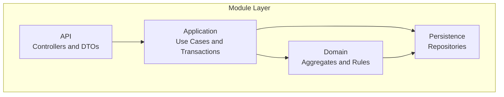
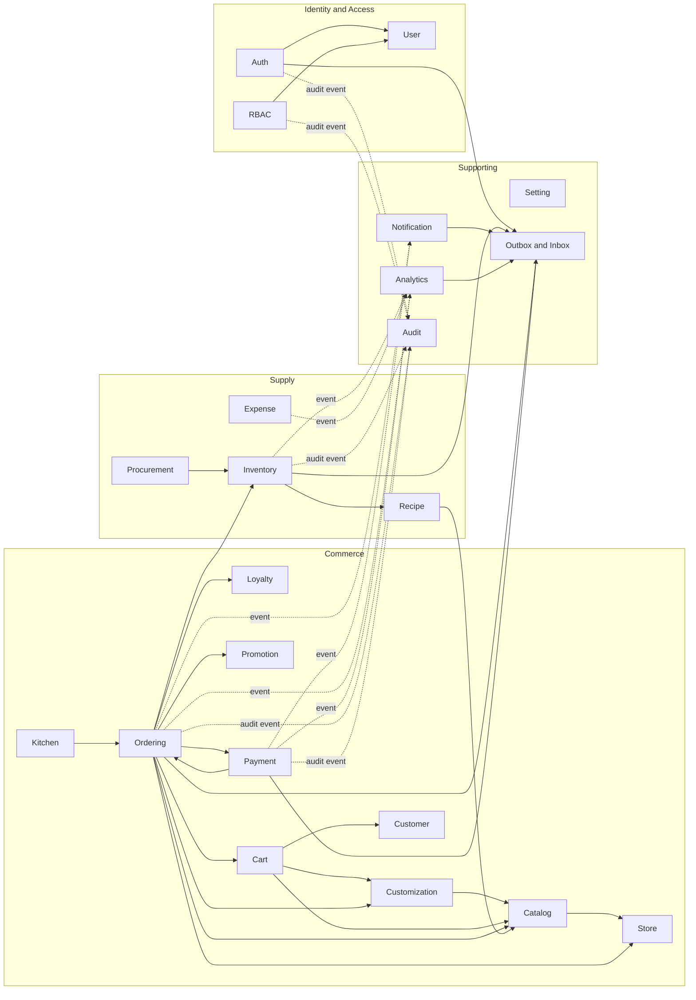
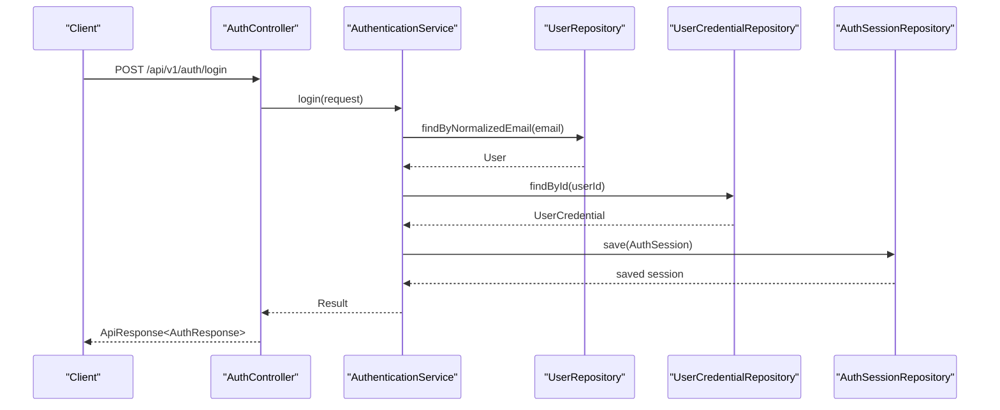
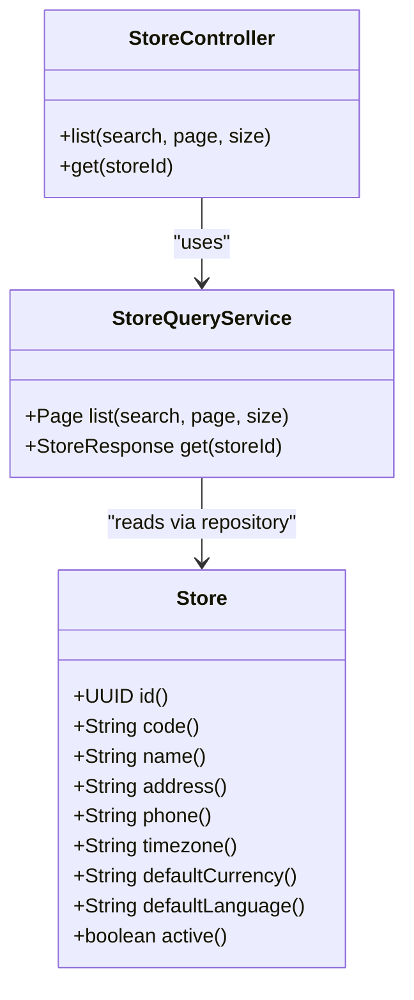
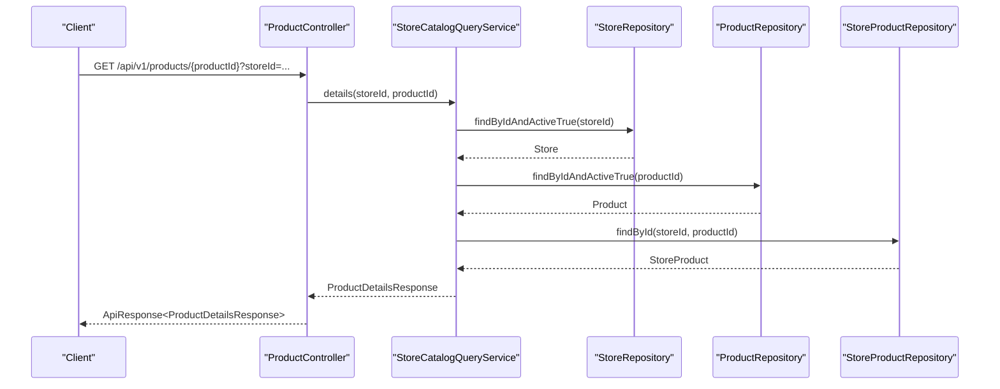
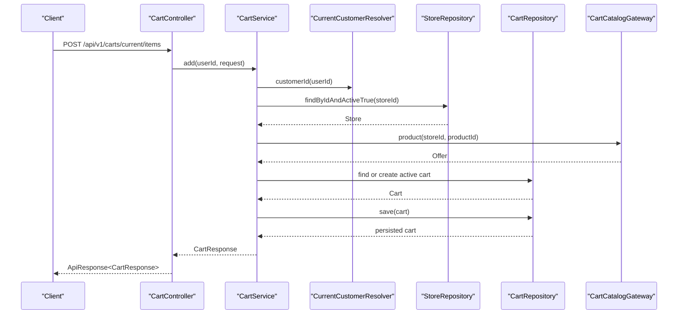
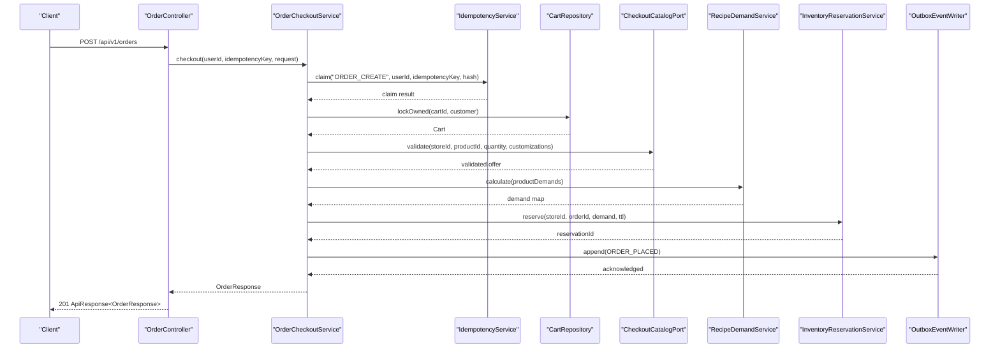
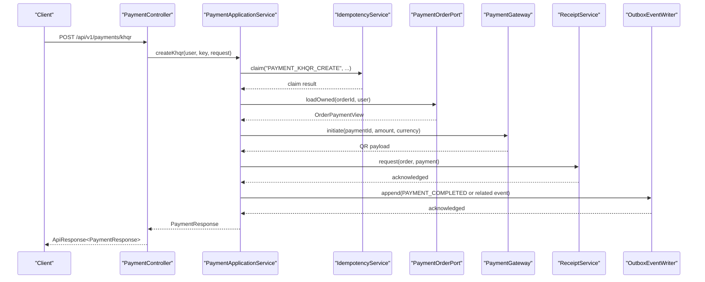
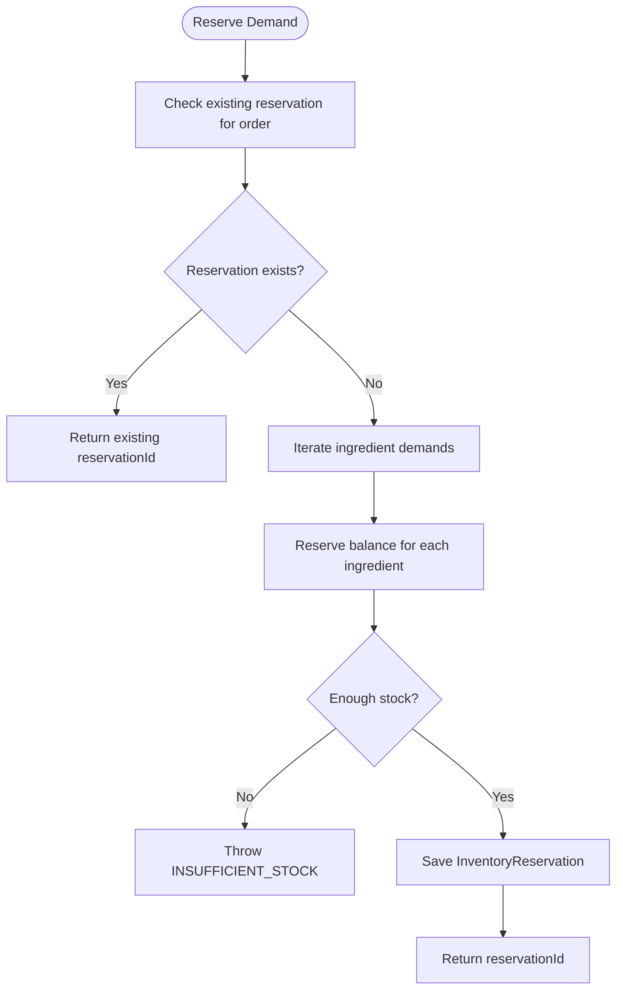
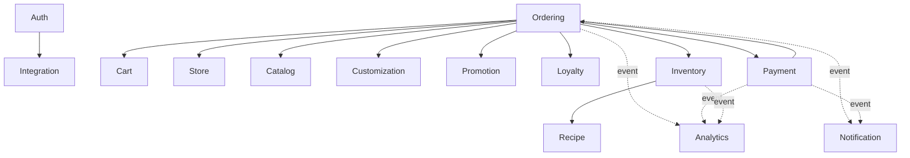

# Domain Modules

<cite>
**Referenced Files in This Document**
- [ADR-001-modular-monolith.md](file://adr/ADR-001-modular-monolith.md)
- [SYSTEM_ARCHITECTURE.md](file://architecture/SYSTEM_ARCHITECTURE.md)
- [MODULE_DEPENDENCIES.mermaid](file://architecture/MODULE_DEPENDENCIES.mermaid)
- [Store.java](file://src/main/java/com/smartcoffee/modules/organization/domain/Store.java)
- [StoreQueryService.java](file://src/main/java/com/smartcoffee/modules/organization/application/StoreQueryService.java)
- [StoreController.java](file://src/main/java/com/smartcoffee/modules/organization/api/StoreController.java)
- [AuthController.java](file://src/main/java/com/smartcoffee/modules/auth/api/AuthController.java)
- [AuthenticationService.java](file://src/main/java/com/smartcoffee/modules/auth/application/AuthenticationService.java)
- [ProductController.java](file://src/main/java/com/smartcoffee/modules/catalog/api/ProductController.java)
- [StoreCatalogQueryService.java](file://src/main/java/com/smartcoffee/modules/catalog/application/StoreCatalogQueryService.java)
- [CartController.java](file://src/main/java/com/smartcoffee/modules/cart/api/CartController.java)
- [CartService.java](file://src/main/java/com/smartcoffee/modules/cart/application/CartService.java)
- [OrderController.java](file://src/main/java/com/smartcoffee/modules/ordering/api/OrderController.java)
- [OrderCheckoutService.java](file://src/main/java/com/smartcoffee/modules/ordering/application/OrderCheckoutService.java)
- [PaymentController.java](file://src/main/java/com/smartcoffee/modules/payment/api/PaymentController.java)
- [PaymentApplicationService.java](file://src/main/java/com/smartcoffee/modules/payment/application/PaymentApplicationService.java)
- [InventoryController.java](file://src/main/java/com/smartcoffee/modules/inventory/api/InventoryController.java)
- [InventoryReservationService.java](file://src/main/java/com/smartcoffee/modules/inventory/application/InventoryReservationService.java)
</cite>

## Table of Contents
1. [Introduction](#introduction)
2. [Project Structure](#project-structure)
3. [Core Components](#core-components)
4. [Architecture Overview](#architecture-overview)
5. [Detailed Component Analysis](#detailed-component-analysis)
6. [Dependency Analysis](#dependency-analysis)
7. [Performance Considerations](#performance-considerations)
8. [Troubleshooting Guide](#troubleshooting-guide)
9. [Conclusion](#conclusion)
10. [Appendices](#appendices)

## Introduction
This document explains the domain modules of the Smart Coffee Backend and how they form a modular monolith. Each business capability is encapsulated in its own module with clear boundaries, following an api/application/domain/persistence layering pattern. Modules communicate through explicit application interfaces for synchronous operations and durable events for asynchronous integration. The system begins as one Spring Boot deployable to protect checkout correctness while remaining microservice-ready.

The architecture emphasizes:
- One write owner per table and per aggregate.
- Controllers that expose transport concerns only.
- Application services that define transaction boundaries.
- Domain logic inside aggregates or domain services.
- No direct cross-module JPA repository injection.
- Event-driven integration using a transactional outbox and durable inbox semantics.

**Section sources**
- [ADR-001-modular-monolith.md:16-90](file://adr/ADR-001-modular-monolith.md#L16-L90)
- [SYSTEM_ARCHITECTURE.md:23-49](file://architecture/SYSTEM_ARCHITECTURE.md#L23-L49)
- [SYSTEM_ARCHITECTURE.md:198-229](file://architecture/SYSTEM_ARCHITECTURE.md#L198-L229)

## Project Structure
The backend organizes code under `com.smartcoffee.modules`, where each module follows the same layered structure:
- `api`: REST controllers and request/response models.
- `application`: use cases, orchestration, validation, and transaction boundaries.
- `domain`: aggregates, value objects, enums, and domain rules.
- `persistence`: repositories and persistence-specific types.

Shared infrastructure lives outside modules under `common` and `infrastructure`. Cross-module communication uses application ports or documented events rather than shared database access.

[No sources needed since this diagram shows conceptual workflow, not actual code structure]

**Section sources**
- [SYSTEM_ARCHITECTURE.md:136-195](file://architecture/SYSTEM_ARCHITECTURE.md#L136-L195)
- [Download ARCHITECTURE_AUDIT.md:144-163](file://Download%20ARCHITECTURE_AUDIT.md#L144-L163)

## Core Components
The core operational modules are:
- Identity and Access: authentication, sessions, tokens, and user identity.
- Organization: stores and store-scoped context.
- Catalog: products, categories, customization groups, and store product availability.
- Cart: active customer carts and cart items.
- Ordering: order creation, status history, and checkout coordination.
- Payment: payment attempts, provider interactions, receipts, and reconciliation.
- Inventory: ingredient balances, reservations, and stock ledger.
- Supporting modules such as notification, audit, analytics, promotion, loyalty, recipe, production, and settings exist alongside these core flows.

Key implementation patterns visible in the codebase:
- Controllers delegate to application services and return structured API responses.
- Application services enforce authorization, idempotency, validation, and transactions.
- Domain entities model state transitions and invariants.
- Persistence layers expose repositories used by application services within their owning module.

**Section sources**
- [AuthController.java:13-70](file://src/main/java/com/smartcoffee/modules/auth/api/AuthController.java#L13-L70)
- [AuthenticationService.java:38-100](file://src/main/java/com/smartcoffee/modules/auth/application/AuthenticationService.java#L38-L100)
- [StoreController.java:11-31](file://src/main/java/com/smartcoffee/modules/organization/api/StoreController.java#L11-L31)
- [StoreQueryService.java:20-37](file://src/main/java/com/smartcoffee/modules/organization/application/StoreQueryService.java#L20-L37)
- [ProductController.java:9-21](file://src/main/java/com/smartcoffee/modules/catalog/api/ProductController.java#L9-L21)
- [StoreCatalogQueryService.java:33-64](file://src/main/java/com/smartcoffee/modules/catalog/application/StoreCatalogQueryService.java#L33-L64)
- [CartController.java:11-47](file://src/main/java/com/smartcoffee/modules/cart/api/CartController.java#L11-L47)
- [CartService.java:35-114](file://src/main/java/com/smartcoffee/modules/cart/application/CartService.java#L35-L114)
- [OrderController.java:13-40](file://src/main/java/com/smartcoffee/modules/ordering/api/OrderController.java#L13-L40)
- [OrderCheckoutService.java:62-132](file://src/main/java/com/smartcoffee/modules/ordering/application/OrderCheckoutService.java#L62-L132)
- [PaymentController.java:11-37](file://src/main/java/com/smartcoffee/modules/payment/api/PaymentController.java#L11-L37)
- [PaymentApplicationService.java:48-151](file://src/main/java/com/smartcoffee/modules/payment/application/PaymentApplicationService.java#L48-L151)
- [InventoryController.java:10-32](file://src/main/java/com/smartcoffee/modules/inventory/api/InventoryController.java#L10-L32)
- [InventoryReservationService.java:43-97](file://src/main/java/com/smartcoffee/modules/inventory/application/InventoryReservationService.java#L43-L97)

## Architecture Overview
The platform is a modular monolith organized into logical boundaries:
- Identity and Access boundary: auth, user, rbac.
- Commerce boundary: store, catalog, customization, customer, loyalty, cart, promotion, ordering, payment, kitchen.
- Supply boundary: recipe, inventory, procurement, expense.
- Supporting boundary: notification, analytics, audit, settings, and integration components.

Synchronous dependencies are shown as solid arrows; event-driven dependencies are dashed. Modules must not inject another module’s JPA repository directly.

**Diagram sources**
- [MODULE_DEPENDENCIES.mermaid:1-93](file://architecture/MODULE_DEPENDENCIES.mermaid#L1-L93)

**Section sources**
- [MODULE_DEPENDENCIES.mermaid:1-93](file://architecture/MODULE_DEPENDENCIES.mermaid#L1-L93)
- [SYSTEM_ARCHITECTURE.md:136-195](file://architecture/SYSTEM_ARCHITECTURE.md#L136-L195)

## Detailed Component Analysis

### Identity and Access Module
Responsibilities:
- Register users, authenticate credentials, manage refresh sessions, issue access tokens, and revoke sessions.
- Coordinate with identity and credential persistence.
- Provide security primitives used across other modules.

Implementation highlights:
- Controller exposes register, login, refresh, logout, and logout-all endpoints.
- Application service validates input, checks account status, hashes and verifies passwords, issues JWT access tokens, manages refresh token lifecycle, and persists session records.
- Security helpers handle cookie management and correlation context propagation.

**Diagram sources**
- [AuthController.java:33-38](file://src/main/java/com/smartcoffee/modules/auth/api/AuthController.java#L33-L38)
- [AuthenticationService.java:48-62](file://src/main/java/com/smartcoffee/modules/auth/application/AuthenticationService.java#L48-L62)

**Section sources**
- [AuthController.java:13-70](file://src/main/java/com/smartcoffee/modules/auth/api/AuthController.java#L13-L70)
- [AuthenticationService.java:38-100](file://src/main/java/com/smartcoffee/modules/auth/application/AuthenticationService.java#L38-L100)

### Organization Module
Responsibilities:
- Own store data including store code, name, address, timezone, currency, language, and active status.
- Provide read-only queries for administrative and operational use.

Implementation highlights:
- Domain entity maps to the organization schema.
- Query service returns paginated store listings and single-store details.
- Controller delegates to query service and wraps results in standard API response format.

**Diagram sources**
- [Store.java:7-46](file://src/main/java/com/smartcoffee/modules/organization/domain/Store.java#L7-L46)
- [StoreQueryService.java:14-37](file://src/main/java/com/smartcoffee/modules/organization/application/StoreQueryService.java#L14-L37)
- [StoreController.java:11-31](file://src/main/java/com/smartcoffee/modules/organization/api/StoreController.java#L11-L31)

**Section sources**
- [Store.java:7-46](file://src/main/java/com/smartcoffee/modules/organization/domain/Store.java#L7-L46)
- [StoreQueryService.java:20-37](file://src/main/java/com/smartcoffee/modules/organization/application/StoreQueryService.java#L20-L37)
- [StoreController.java:11-31](file://src/main/java/com/smartcoffee/modules/organization/api/StoreController.java#L11-L31)

### Catalog Module
Responsibilities:
- Serve store-scoped product catalogs, categories, customization options, and effective prices.
- Validate store context before returning catalog data.

Implementation highlights:
- Product controller requests product details by product ID and store ID.
- Query service enforces store existence, loads product and store-product records, resolves images, and composes detail responses.

**Diagram sources**
- [ProductController.java:18-21](file://src/main/java/com/smartcoffee/modules/catalog/api/ProductController.java#L18-L21)
- [StoreCatalogQueryService.java:46-59](file://src/main/java/com/smartcoffee/modules/catalog/application/StoreCatalogQueryService.java#L46-L59)

**Section sources**
- [ProductController.java:9-21](file://src/main/java/com/smartcoffee/modules/catalog/api/ProductController.java#L9-L21)
- [StoreCatalogQueryService.java:33-64](file://src/main/java/com/smartcoffee/modules/catalog/application/StoreCatalogQueryService.java#L33-L64)

### Cart Module
Responsibilities:
- Manage active customer carts, add/update/remove items, validate customizations, and ensure store and currency consistency.

Implementation highlights:
- Controller exposes current cart and item mutation endpoints.
- Service resolves customer, validates store, interacts with catalog gateway, applies customization rules, and persists cart changes.

**Diagram sources**
- [CartController.java:27-30](file://src/main/java/com/smartcoffee/modules/cart/api/CartController.java#L27-L30)
- [CartService.java:48-61](file://src/main/java/com/smartcoffee/modules/cart/application/CartService.java#L48-L61)

**Section sources**
- [CartController.java:11-47](file://src/main/java/com/smartcoffee/modules/cart/api/CartController.java#L11-L47)
- [CartService.java:35-114](file://src/main/java/com/smartcoffee/modules/cart/application/CartService.java#L35-L114)

### Ordering Module
Responsibilities:
- Orchestrate checkout: claim idempotency key, lock cart, validate catalog prices, calculate totals, reserve inventory, persist order, emit outbox event, and record idempotency result.

Implementation highlights:
- Controller accepts Idempotency-Key header and delegates to checkout service.
- Checkout service coordinates multiple modules through application ports and services while keeping transaction boundaries clear.

**Diagram sources**
- [OrderController.java:29-34](file://src/main/java/com/smartcoffee/modules/ordering/api/OrderController.java#L29-L34)
- [OrderCheckoutService.java:62-132](file://src/main/java/com/smartcoffee/modules/ordering/application/OrderCheckoutService.java#L62-L132)

**Section sources**
- [OrderController.java:13-40](file://src/main/java/com/smartcoffee/modules/ordering/api/OrderController.java#L13-L40)
- [OrderCheckoutService.java:62-132](file://src/main/java/com/smartcoffee/modules/ordering/application/OrderCheckoutService.java#L62-L132)

### Payment Module
Responsibilities:
- Handle cash payments and KHQR payment initiation and verification.
- Enforce idempotency, store ownership, payment state transitions, receipt requests, and durable event emission.

Implementation highlights:
- Controller exposes cash, khqr, and verify endpoints.
- Application service validates orders, selects payment methods, calls external gateways, updates payment state, confirms orders, and writes outbox events.

**Diagram sources**
- [PaymentController.java:28-32](file://src/main/java/com/smartcoffee/modules/payment/api/PaymentController.java#L28-L32)
- [PaymentApplicationService.java:72-86](file://src/main/java/com/smartcoffee/modules/payment/application/PaymentApplicationService.java#L72-L86)
- [PaymentApplicationService.java:128-136](file://src/main/java/com/smartcoffee/modules/payment/application/PaymentApplicationService.java#L128-L136)

**Section sources**
- [PaymentController.java:11-37](file://src/main/java/com/smartcoffee/modules/payment/api/PaymentController.java#L11-L37)
- [PaymentApplicationService.java:48-151](file://src/main/java/com/smartcoffee/modules/payment/application/PaymentApplicationService.java#L48-L151)

### Inventory Module
Responsibilities:
- Reserve ingredients for orders, consume them on fulfillment, release expired reservations, and maintain immutable stock transactions.

Implementation highlights:
- Controller lists inventory balances with permission and store authorization checks.
- Reservation service performs atomic reserve/consume/release operations and persists ledger entries.

**Diagram sources**
- [InventoryReservationService.java:43-54](file://src/main/java/com/smartcoffee/modules/inventory/application/InventoryReservationService.java#L43-L54)

**Section sources**
- [InventoryController.java:10-32](file://src/main/java/com/smartcoffee/modules/inventory/api/InventoryController.java#L10-L32)
- [InventoryReservationService.java:43-97](file://src/main/java/com/smartcoffee/modules/inventory/application/InventoryReservationService.java#L43-L97)

## Dependency Analysis
Modules interact through two primary mechanisms:
- Synchronous application interfaces: used when an immediate decision is required, such as catalog validation during checkout or inventory reservation.
- Durable events: used for asynchronous integration, such as notifications, analytics projections, and audit trails.

The dependency graph clarifies allowed relationships and prevents accidental coupling:
- Ordering depends on cart, store, catalog, customization, promotion, loyalty, inventory, and payment.
- Payment depends on ordering.
- Inventory depends on recipe.
- Supporting modules observe business activity through events.

**Diagram sources**
- [MODULE_DEPENDENCIES.mermaid:10-77](file://architecture/MODULE_DEPENDENCIES.mermaid#L10-L77)

**Section sources**
- [MODULE_DEPENDENCIES.mermaid:1-93](file://architecture/MODULE_DEPENDENCIES.mermaid#L1-L93)
- [SYSTEM_ARCHITECTURE.md:198-229](file://architecture/SYSTEM_ARCHITECTURE.md#L198-L229)

## Performance Considerations
- Keep long-running external calls outside critical database transactions. For example, payment gateway calls occur after persisting payment state and outbox records.
- Use bounded pagination and safe size limits for read endpoints to avoid excessive memory usage.
- Prefer read-only transactions for query services to reduce contention.
- Use Redis for approved caching and rate limiting, but never as the sole source of truth for critical state.
- Ensure event consumers are idempotent because delivery is at least once.

[No sources needed since this section provides general guidance]

## Troubleshooting Guide
Common issues and resolution strategies:
- Duplicate resource errors: check idempotency keys and conflict exceptions thrown by registration, payment, or checkout flows.
- Insufficient stock: review inventory reservation failures and balance conflicts.
- Currency mismatch: verify cart/store/product currency alignment during cart mutations and checkout.
- Price changed: ensure catalog validation occurs at checkout time and client-provided prices are not trusted.
- Store authorization failures: confirm store existence and active status before catalog or inventory operations.
- Event replay problems: verify outbox persistence and consumer deduplication.

**Section sources**
- [AuthenticationService.java:38-100](file://src/main/java/com/smartcoffee/modules/auth/application/AuthenticationService.java#L38-L100)
- [CartService.java:48-61](file://src/main/java/com/smartcoffee/modules/cart/application/CartService.java#L48-L61)
- [OrderCheckoutService.java:92-104](file://src/main/java/com/smartcoffee/modules/ordering/application/OrderCheckoutService.java#L92-L104)
- [InventoryReservationService.java:43-97](file://src/main/java/com/smartcoffee/modules/inventory/application/InventoryReservationService.java#L43-L97)
- [PaymentApplicationService.java:48-151](file://src/main/java/com/smartcoffee/modules/payment/application/PaymentApplicationService.java#L48-L151)

## Conclusion
Smart Coffee Backend implements a modular monolith where each business capability is encapsulated in a clearly bounded module. The api/application/domain/persistence layering pattern keeps responsibilities clean, while synchronous application interfaces and durable events provide loose coupling. Strong transaction boundaries protect checkout correctness, and the architecture remains ready for future extraction into independent services.

[No sources needed since this section summarizes without analyzing specific files]

## Appendices

### Adding a New Module
Follow these steps while respecting architectural boundaries:
1. Create a new module directory under `modules/<name>` with `api`, `application`, `domain`, and `persistence` packages.
2. Define domain entities and value objects in `domain`.
3. Implement use cases and transaction boundaries in `application`.
4. Expose controllers in `api` that delegate to application services and return structured responses.
5. Add repositories in `persistence` owned exclusively by the new module.
6. If another module needs functionality from the new module, expose it through an application interface or port, not a direct repository dependency.
7. If the change produces side effects for other modules, publish durable events through the outbox and make consumers idempotent.
8. Update module dependency documentation if the new capability introduces new dependencies.

**Section sources**
- [ADR-001-modular-monolith.md:82-90](file://adr/ADR-001-modular-monolith.md#L82-L90)
- [SYSTEM_ARCHITECTURE.md:198-229](file://architecture/SYSTEM_ARCHITECTURE.md#L198-L229)

### Extending Existing Functionality
Guidelines:
- Keep business logic in domain or application layers; controllers should remain thin.
- Do not inject another module’s JPA repository; use application ports or documented events.
- Preserve transaction boundaries in application services.
- Treat client-supplied prices, totals, roles, store IDs, and payment results as untrusted.
- Make asynchronous integrations resilient to retries and duplicates.

**Section sources**
- [SYSTEM_ARCHITECTURE.md:291-299](file://architecture/SYSTEM_ARCHITECTURE.md#L291-L299)
- [Download ARCHITECTURE_AUDIT.md:152-163](file://Download%20ARCHITECTURE_AUDIT.md#L152-L163)