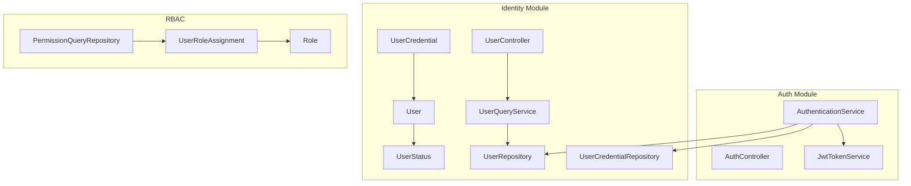
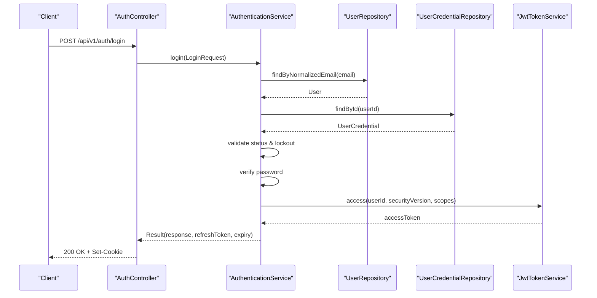
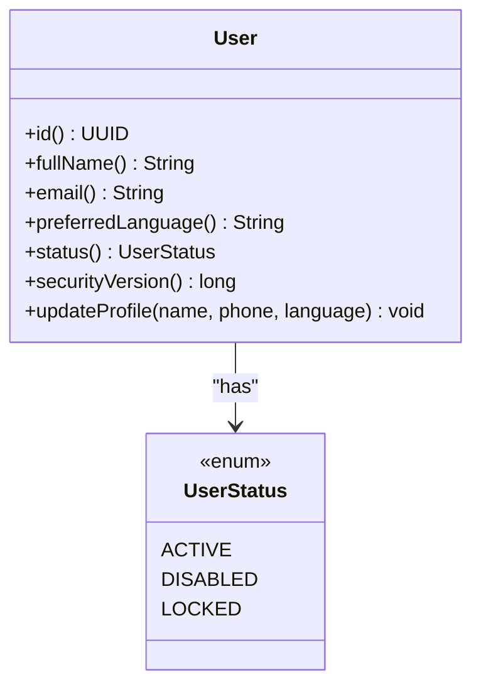
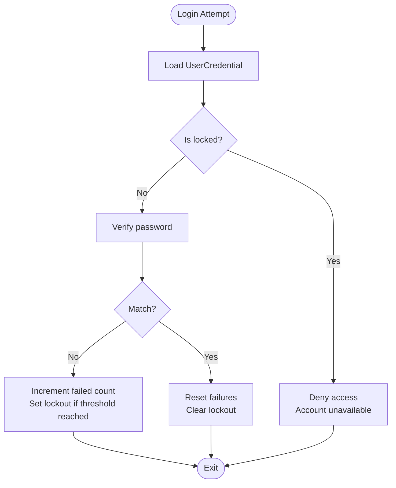
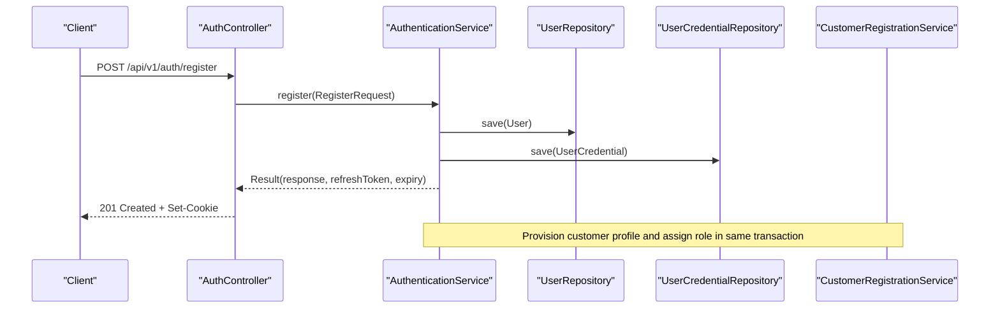
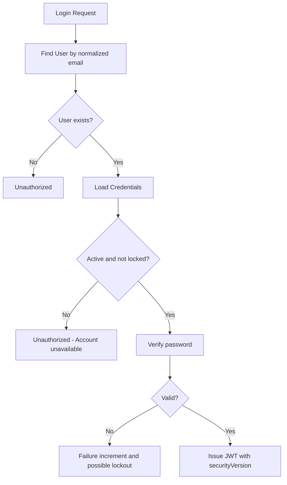
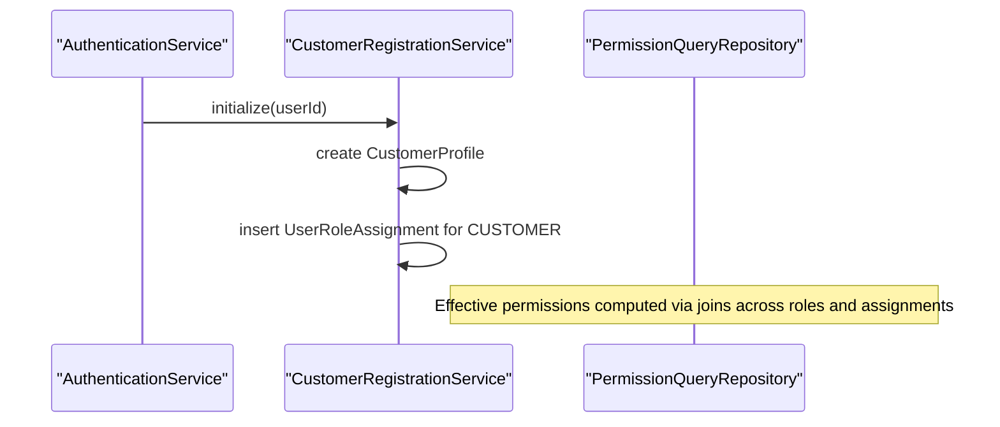
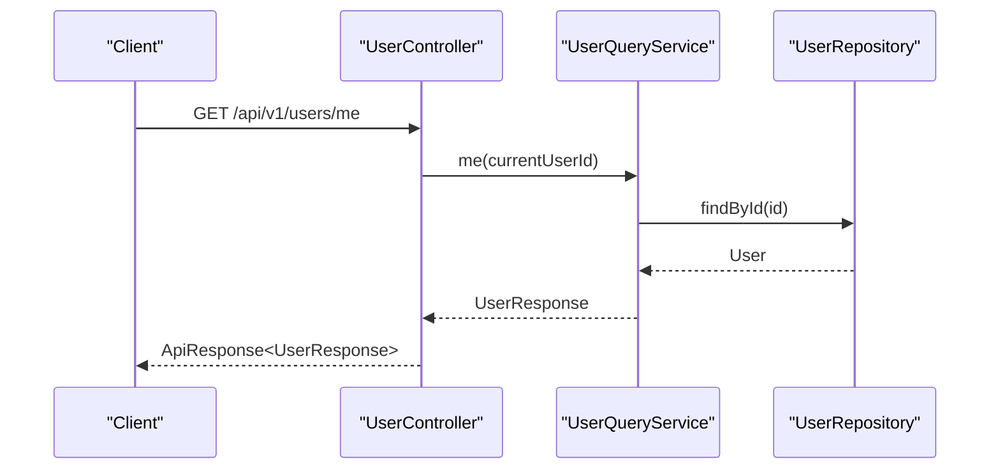
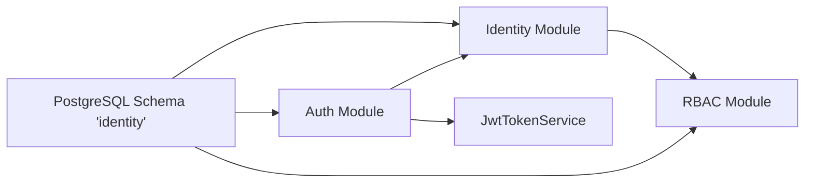

# Identity Management Module

<cite>
**Referenced Files in This Document**
- [User.java](file://src/main/java/com/smartcoffee/modules/identity/domain/User.java)
- [UserCredential.java](file://src/main/java/com/smartcoffee/modules/identity/domain/UserCredential.java)
- [UserStatus.java](file://src/main/java/com/smartcoffee/modules/identity/domain/UserStatus.java)
- [UserRepository.java](file://src/main/java/com/smartcoffee/modules/identity/persistence/UserRepository.java)
- [UserCredentialRepository.java](file://src/main/java/com/smartcoffee/modules/identity/persistence/UserCredentialRepository.java)
- [UserController.java](file://src/main/java/com/smartcoffee/modules/identity/api/UserController.java)
- [UserQueryService.java](file://src/main/java/com/smartcoffee/modules/identity/application/UserQueryService.java)
- [AuthenticationService.java](file://src/main/java/com/smartcoffee/modules/auth/application/AuthenticationService.java)
- [AuthController.java](file://src/main/java/com/smartcoffee/modules/auth/api/AuthController.java)
- [JwtTokenService.java](file://src/main/java/com/smartcoffee/modules/auth/security/JwtTokenService.java)
- [CustomerRegistrationService.java](file://src/main/java/com/smartcoffee/modules/customer/application/CustomerRegistrationService.java)
- [Role.java](file://src/main/java/com/smartcoffee/modules/rbac/domain/Role.java)
- [UserRoleAssignment.java](file://src/main/java/com/smartcoffee/modules/rbac/domain/UserRoleAssignment.java)
- [PermissionQueryRepository.java](file://src/main/java/com/smartcoffee/modules/rbac/persistence/PermissionQueryRepository.java)
- [DB_OWNERSHIP_MATRIX.md](file://database/DB_OWNERSHIP_MATRIX.md)
</cite>

## Table of Contents
1. Introduction
2. Project Structure
3. Core Components
4. Architecture Overview
5. Detailed Component Analysis
6. Dependency Analysis
7. Performance Considerations
8. Troubleshooting Guide
9. Conclusion

## Introduction
This document explains the Identity Management module, focusing on user entity management, credential handling, and user status management. It covers user lifecycle operations (registration, login, refresh, logout), account verification via status and lockout policies, identity validation through JWT security versioning, integration with the authentication system, role assignments, and user provisioning. It also includes examples of user management operations, credential updates, and account administration guidance, along with security considerations such as password hashing, lockout behavior, and token revocation.

## Project Structure
The Identity Management module is organized by layers:
- Domain: User, UserCredential, UserStatus
- Persistence: UserRepository, UserCredentialRepository
- Application: UserQueryService
- API: UserController
- Integration points: AuthenticationService (auth module), RBAC entities for roles and assignments

**Diagram sources**
- [User.java:1-85](file://src/main/java/com/smartcoffee/modules/identity/domain/User.java#L1-L85)
- [UserCredential.java:1-16](file://src/main/java/com/smartcoffee/modules/identity/domain/UserCredential.java#L1-L16)
- [UserStatus.java:1-4](file://src/main/java/com/smartcoffee/modules/identity/domain/UserStatus.java#L1-L4)
- [UserRepository.java:1-5](file://src/main/java/com/smartcoffee/modules/identity/persistence/UserRepository.java#L1-L5)
- [UserCredentialRepository.java:1-5](file://src/main/java/com/smartcoffee/modules/identity/persistence/UserCredentialRepository.java#L1-L5)
- [UserQueryService.java:1-5](file://src/main/java/com/smartcoffee/modules/identity/application/UserQueryService.java#L1-L5)
- [UserController.java:1-20](file://src/main/java/com/smartcoffee/modules/identity/api/UserController.java#L1-L20)
- [AuthenticationService.java:1-103](file://src/main/java/com/smartcoffee/modules/auth/application/AuthenticationService.java#L1-L103)
- [AuthController.java:1-73](file://src/main/java/com/smartcoffee/modules/auth/api/AuthController.java#L1-L73)
- [JwtTokenService.java:66-72](file://src/main/java/com/smartcoffee/modules/auth/security/JwtTokenService.java#L66-L72)
- [Role.java:1-29](file://src/main/java/com/smartcoffee/modules/rbac/domain/Role.java#L1-L29)
- [UserRoleAssignment.java:1-29](file://src/main/java/com/smartcoffee/modules/rbac/domain/UserRoleAssignment.java#L1-L29)
- [PermissionQueryRepository.java:1-20](file://src/main/java/com/smartcoffee/modules/rbac/persistence/PermissionQueryRepository.java#L1-L20)

**Section sources**
- [User.java:1-85](file://src/main/java/com/smartcoffee/modules/identity/domain/User.java#L1-L85)
- [UserCredential.java:1-16](file://src/main/java/com/smartcoffee/modules/identity/domain/UserCredential.java#L1-L16)
- [UserStatus.java:1-4](file://src/main/java/com/smartcoffee/modules/identity/domain/UserStatus.java#L1-L4)
- [UserRepository.java:1-5](file://src/main/java/com/smartcoffee/modules/identity/persistence/UserRepository.java#L1-L5)
- [UserCredentialRepository.java:1-5](file://src/main/java/com/smartcoffee/modules/identity/persistence/UserCredentialRepository.java#L1-L5)
- [UserQueryService.java:1-5](file://src/main/java/com/smartcoffee/modules/identity/application/UserQueryService.java#L1-L5)
- [UserController.java:1-20](file://src/main/java/com/smartcoffee/modules/identity/api/UserController.java#L1-L20)
- [AuthenticationService.java:1-103](file://src/main/java/com/smartcoffee/modules/auth/application/AuthenticationService.java#L1-L103)
- [AuthController.java:1-73](file://src/main/java/com/smartcoffee/modules/auth/api/AuthController.java#L1-L73)
- [JwtTokenService.java:66-72](file://src/main/java/com/smartcoffee/modules/auth/security/JwtTokenService.java#L66-L72)
- [Role.java:1-29](file://src/main/java/com/smartcoffee/modules/rbac/domain/Role.java#L1-L29)
- [UserRoleAssignment.java:1-29](file://src/main/java/com/smartcoffee/modules/rbac/domain/UserRoleAssignment.java#L1-L29)
- [PermissionQueryRepository.java:1-20](file://src/main/java/com/smartcoffee/modules/rbac/persistence/PermissionQueryRepository.java#L1-L20)

## Core Components
- User: Represents a user profile with identity fields, preferred language, status, and security version used to invalidate tokens upon credential changes.
- UserCredential: Stores password hash, failed login count, lockout state, and last password change timestamp; provides success/failure methods to manage lockouts.
- UserStatus: Enumerates ACTIVE, DISABLED, LOCKED states that gate access during authentication.
- Repositories: Provide persistence for users and credentials, including lookup by normalized email and existence checks.
- UserQueryService: Read-only service to fetch current user details for API responses.
- AuthenticationService: Orchestrates registration, login, refresh, logout, and logout-all flows, integrating with JWT and session management.
- RBAC: Role and UserRoleAssignment define role-based permissions; PermissionQueryRepository computes effective permissions and store scoping.

**Section sources**
- [User.java:1-85](file://src/main/java/com/smartcoffee/modules/identity/domain/User.java#L1-L85)
- [UserCredential.java:1-16](file://src/main/java/com/smartcoffee/modules/identity/domain/UserCredential.java#L1-L16)
- [UserStatus.java:1-4](file://src/main/java/com/smartcoffee/modules/identity/domain/UserStatus.java#L1-L4)
- [UserRepository.java:1-5](file://src/main/java/com/smartcoffee/modules/identity/persistence/UserRepository.java#L1-L5)
- [UserCredentialRepository.java:1-5](file://src/main/java/com/smartcoffee/modules/identity/persistence/UserCredentialRepository.java#L1-L5)
- [UserQueryService.java:1-5](file://src/main/java/com/smartcoffee/modules/identity/application/UserQueryService.java#L1-L5)
- [AuthenticationService.java:1-103](file://src/main/java/com/smartcoffee/modules/auth/application/AuthenticationService.java#L1-L103)
- [Role.java:1-29](file://src/main/java/com/smartcoffee/modules/rbac/domain/Role.java#L1-L29)
- [UserRoleAssignment.java:1-29](file://src/main/java/com/smartcoffee/modules/rbac/domain/UserRoleAssignment.java#L1-L29)
- [PermissionQueryRepository.java:1-20](file://src/main/java/com/smartcoffee/modules/rbac/persistence/PermissionQueryRepository.java#L1-L20)

## Architecture Overview
The Identity Management module integrates with the Auth module for authentication flows and with RBAC for authorization. Registration creates a User and a corresponding UserCredential, then provisions a Customer profile and assigns the CUSTOMER role within the same transaction. Login validates credentials, enforces status and lockout rules, and issues JWTs with a security version claim tied to the user’s securityVersion. Refresh rotates sessions while preserving family context. Logout revokes sessions.

**Diagram sources**
- [AuthController.java:33-38](file://src/main/java/com/smartcoffee/modules/auth/api/AuthController.java#L33-L38)
- [AuthenticationService.java:48-62](file://src/main/java/com/smartcoffee/modules/auth/application/AuthenticationService.java#L48-L62)
- [JwtTokenService.java:66-72](file://src/main/java/com/smartcoffee/modules/auth/security/JwtTokenService.java#L66-L72)
- [UserRepository.java:1-5](file://src/main/java/com/smartcoffee/modules/identity/persistence/UserRepository.java#L1-L5)
- [UserCredentialRepository.java:1-5](file://src/main/java/com/smartcoffee/modules/identity/persistence/UserCredentialRepository.java#L1-L5)

## Detailed Component Analysis

### User Entity and Status Management
- User stores identity attributes, preferred language, status, and securityVersion. New users are created with ACTIVE status and timestamps. Profile updates modify personal data and update timestamps.
- UserStatus defines ACTIVE, DISABLED, LOCKED. During login, only ACTIVE users can authenticate unless otherwise handled by policy.
- SecurityVersion is embedded into JWT claims to invalidate tokens when credentials change.

**Diagram sources**
- [User.java:1-85](file://src/main/java/com/smartcoffee/modules/identity/domain/User.java#L1-L85)
- [UserStatus.java:1-4](file://src/main/java/com/smartcoffee/modules/identity/domain/UserStatus.java#L1-L4)

**Section sources**
- [User.java:1-85](file://src/main/java/com/smartcoffee/modules/identity/domain/User.java#L1-L85)
- [UserStatus.java:1-4](file://src/main/java/com/smartcoffee/modules/identity/domain/UserStatus.java#L1-L4)

### Credential Handling and Lockout Policy
- UserCredential holds passwordHash, failedLoginCount, lockedUntil, and passwordChangedAt.
- On successful login, failure counters reset and lockout cleared.
- On failed attempts, counter increments; after threshold, lockedUntil is set for a fixed duration.
- Passwords are encoded using Spring Security’s PasswordEncoder before storage.

**Diagram sources**
- [UserCredential.java:1-16](file://src/main/java/com/smartcoffee/modules/identity/domain/UserCredential.java#L1-L16)
- [AuthenticationService.java:48-62](file://src/main/java/com/smartcoffee/modules/auth/application/AuthenticationService.java#L48-L62)

**Section sources**
- [UserCredential.java:1-16](file://src/main/java/com/smartcoffee/modules/identity/domain/UserCredential.java#L1-L16)
- [AuthenticationService.java:48-62](file://src/main/java/com/smartcoffee/modules/auth/application/AuthenticationService.java#L48-L62)

### User Lifecycle Operations
- Registration: Creates User and UserCredential, returns session with access token and refresh cookie.
- Login: Validates credentials, enforces status and lockout, issues tokens.
- Refresh: Rotates refresh token and issues new access token while maintaining session family.
- Logout: Revokes current refresh session.
- Logout All: Revokes all sessions for a user.

**Diagram sources**
- [AuthController.java:25-31](file://src/main/java/com/smartcoffee/modules/auth/api/AuthController.java#L25-L31)
- [AuthenticationService.java:38-46](file://src/main/java/com/smartcoffee/modules/auth/application/AuthenticationService.java#L38-L46)
- [CustomerRegistrationService.java:19-28](file://src/main/java/com/smartcoffee/modules/customer/application/CustomerRegistrationService.java#L19-L28)

**Section sources**
- [AuthController.java:25-31](file://src/main/java/com/smartcoffee/modules/auth/api/AuthController.java#L25-L31)
- [AuthenticationService.java:38-46](file://src/main/java/com/smartcoffee/modules/auth/application/AuthenticationService.java#L38-L46)
- [CustomerRegistrationService.java:19-28](file://src/main/java/com/smartcoffee/modules/customer/application/CustomerRegistrationService.java#L19-L28)

### Account Verification and Identity Validation
- Account availability is enforced by checking User.status and UserCredential.locked during login.
- Identity validation uses JWT with securityVersion claim; any credential change invalidates prior tokens.
- Normalized email lookups ensure consistent user resolution.

**Diagram sources**
- [AuthenticationService.java:48-62](file://src/main/java/com/smartcoffee/modules/auth/application/AuthenticationService.java#L48-L62)
- [JwtTokenService.java:66-72](file://src/main/java/com/smartcoffee/modules/auth/security/JwtTokenService.java#L66-L72)
- [UserRepository.java:1-5](file://src/main/java/com/smartcoffee/modules/identity/persistence/UserRepository.java#L1-L5)

**Section sources**
- [AuthenticationService.java:48-62](file://src/main/java/com/smartcoffee/modules/auth/application/AuthenticationService.java#L48-L62)
- [JwtTokenService.java:66-72](file://src/main/java/com/smartcoffee/modules/auth/security/JwtTokenService.java#L66-L72)
- [UserRepository.java:1-5](file://src/main/java/com/smartcoffee/modules/identity/persistence/UserRepository.java#L1-L5)

### Role Assignments and User Provisioning
- Upon registration, a Customer profile is initialized and the CUSTOMER role is assigned to the user within the same transaction.
- RBAC queries compute effective permissions scoped by user and store, supporting global and store-scoped roles.

**Diagram sources**
- [CustomerRegistrationService.java:19-28](file://src/main/java/com/smartcoffee/modules/customer/application/CustomerRegistrationService.java#L19-L28)
- [PermissionQueryRepository.java:10-18](file://src/main/java/com/smartcoffee/modules/rbac/persistence/PermissionQueryRepository.java#L10-L18)
- [Role.java:1-29](file://src/main/java/com/smartcoffee/modules/rbac/domain/Role.java#L1-L29)
- [UserRoleAssignment.java:1-29](file://src/main/java/com/smartcoffee/modules/rbac/domain/UserRoleAssignment.java#L1-L29)

**Section sources**
- [CustomerRegistrationService.java:19-28](file://src/main/java/com/smartcoffee/modules/customer/application/CustomerRegistrationService.java#L19-L28)
- [PermissionQueryRepository.java:10-18](file://src/main/java/com/smartcoffee/modules/rbac/persistence/PermissionQueryRepository.java#L10-L18)
- [Role.java:1-29](file://src/main/java/com/smartcoffee/modules/rbac/domain/Role.java#L1-L29)
- [UserRoleAssignment.java:1-29](file://src/main/java/com/smartcoffee/modules/rbac/domain/UserRoleAssignment.java#L1-L29)

### Current User API
- GET /api/v1/users/me returns the authenticated user’s profile information using the current actor context.

**Diagram sources**
- [UserController.java:14-17](file://src/main/java/com/smartcoffee/modules/identity/api/UserController.java#L14-L17)
- [UserQueryService.java:1-5](file://src/main/java/com/smartcoffee/modules/identity/application/UserQueryService.java#L1-L5)
- [UserRepository.java:1-5](file://src/main/java/com/smartcoffee/modules/identity/persistence/UserRepository.java#L1-L5)

**Section sources**
- [UserController.java:14-17](file://src/main/java/com/smartcoffee/modules/identity/api/UserController.java#L14-L17)
- [UserQueryService.java:1-5](file://src/main/java/com/smartcoffee/modules/identity/application/UserQueryService.java#L1-L5)
- [UserRepository.java:1-5](file://src/main/java/com/smartcoffee/modules/identity/persistence/UserRepository.java#L1-L5)

## Dependency Analysis
- Identity depends on RBAC for role assignment and permission evaluation.
- Auth depends on Identity for user and credential persistence and on JWT services for token issuance.
- Database ownership clarifies that identity-related tables reside under the identity schema and are owned by Identity/Auth/RBAC modules.

**Diagram sources**
- [DB_OWNERSHIP_MATRIX.md:18-30](file://database/DB_OWNERSHIP_MATRIX.md#L18-L30)
- [AuthenticationService.java:21-36](file://src/main/java/com/smartcoffee/modules/auth/application/AuthenticationService.java#L21-L36)
- [PermissionQueryRepository.java:10-18](file://src/main/java/com/smartcoffee/modules/rbac/persistence/PermissionQueryRepository.java#L10-L18)

**Section sources**
- [DB_OWNERSHIP_MATRIX.md:18-30](file://database/DB_OWNERSHIP_MATRIX.md#L18-L30)
- [AuthenticationService.java:21-36](file://src/main/java/com/smartcoffee/modules/auth/application/AuthenticationService.java#L21-L36)
- [PermissionQueryRepository.java:10-18](file://src/main/java/com/smartcoffee/modules/rbac/persistence/PermissionQueryRepository.java#L10-L18)

## Performance Considerations
- Use normalized email lookups to avoid case-sensitivity overhead and ensure index efficiency.
- Keep read-only queries in UserQueryService under read-only transactions to leverage database optimizations.
- Avoid unnecessary credential loads in non-auth paths; cache permissions where appropriate based on securityVersion.
- Monitor lockout thresholds to balance security and user experience.

[No sources needed since this section provides general guidance]

## Troubleshooting Guide
- Duplicate email during registration: The system rejects duplicate normalized emails. Ensure unique email per user.
- Invalid credentials: Occurs when user not found, password mismatch, or account inactive/locked.
- Account unavailable: Triggered when user status is not ACTIVE or credential is locked due to failed attempts.
- Session expired or invalid refresh: Refresh flow validates active sessions and revokes old ones.
- Role configuration missing: If CUSTOMER role is not configured, initialization fails; ensure role exists before registration.

**Section sources**
- [AuthenticationService.java:38-87](file://src/main/java/com/smartcoffee/modules/auth/application/AuthenticationService.java#L38-L87)
- [CustomerRegistrationService.java:19-28](file://src/main/java/com/smartcoffee/modules/customer/application/CustomerRegistrationService.java#L19-L28)

## Conclusion
The Identity Management module provides robust user entity management, secure credential handling with lockout policies, and clear user status enforcement. It integrates tightly with the authentication system to issue and validate JWTs with security versioning, and supports role-based access control through RBAC. Registration provisions customer profiles and assigns roles atomically. Administrators can rely on standardized APIs for user queries and authentication flows, while developers should follow the outlined security practices for passwords, lockouts, and token management.

[No sources needed since this section summarizes without analyzing specific files]