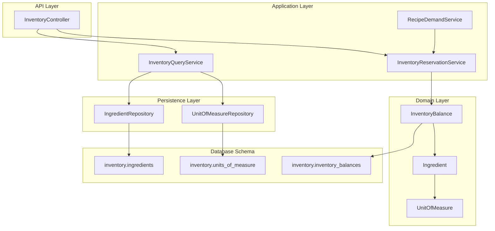
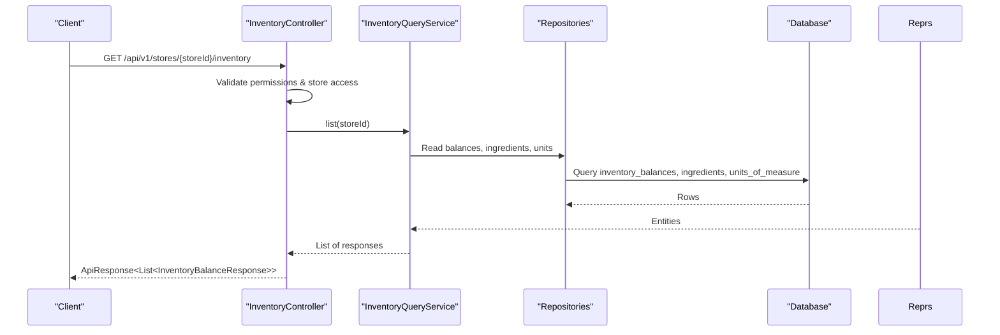
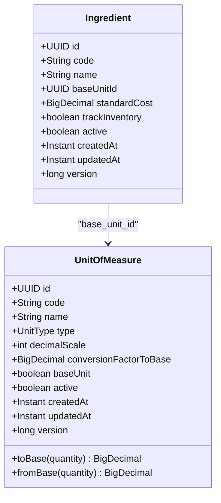
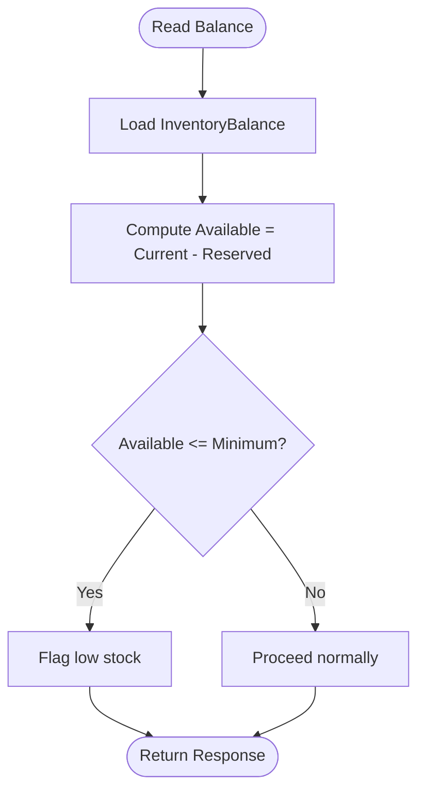
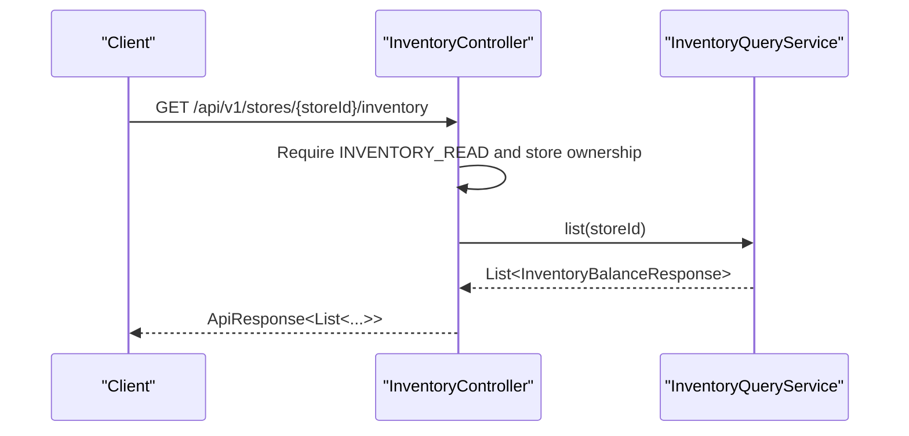
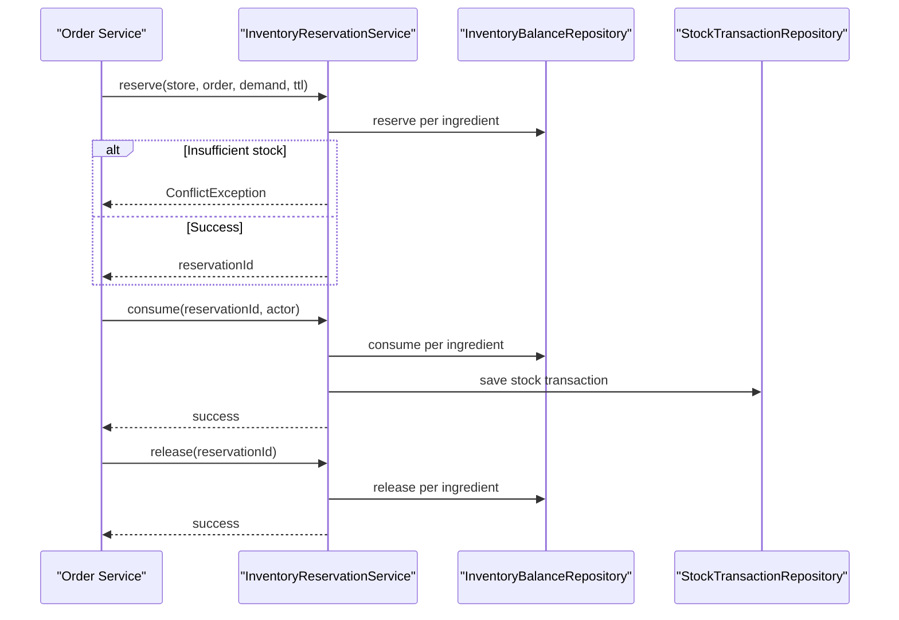
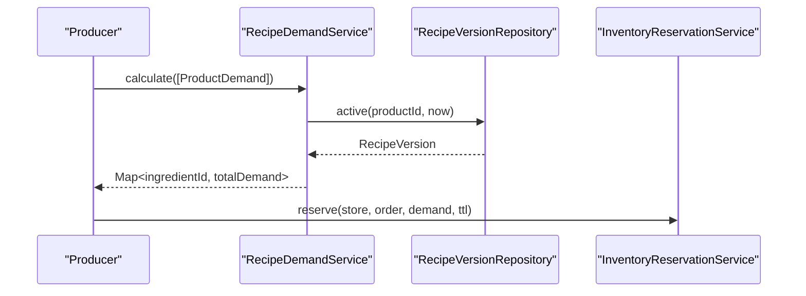
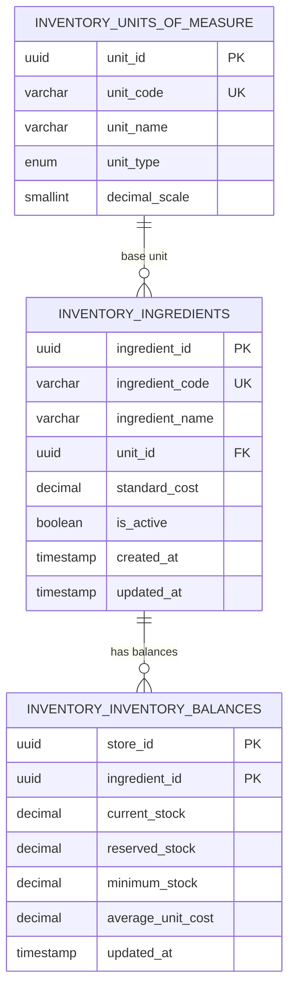
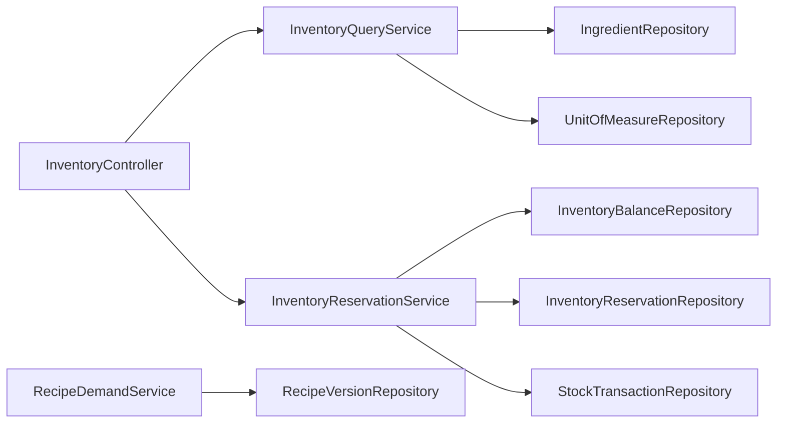

# Ingredient Management

<cite>
**Referenced Files in This Document**
- [Ingredient.java](file://src/main/java/com/smartcoffee/modules/inventory/domain/Ingredient.java)
- [UnitOfMeasure.java](file://src/main/java/com/smartcoffee/modules/inventory/domain/UnitOfMeasure.java)
- [InventoryBalance.java](file://src/main/java/com/smartcoffee/modules/inventory/domain/InventoryBalance.java)
- [InventoryController.java](file://src/main/java/com/smartcoffee/modules/inventory/api/InventoryController.java)
- [InventoryQueryService.java](file://src/main/java/com/smartcoffee/modules/inventory/application/InventoryQueryService.java)
- [IngredientRepository.java](file://src/main/java/com/smartcoffee/modules/inventory/persistence/IngredientRepository.java)
- [UnitOfMeasureRepository.java](file://src/main/java/com/smartcoffee/modules/inventory/persistence/UnitOfMeasureRepository.java)
- [InventoryReservationService.java](file://src/main/java/com/smartcoffee/modules/inventory/application/InventoryReservationService.java)
- [RecipeDemandService.java](file://src/main/java/com/smartcoffee/modules/recipe/application/RecipeDemandService.java)
- [smart-coffee-logical.dbml](file://database/smart-coffee-logical.dbml)
</cite>

## Table of Contents
1. Introduction
2. Project Structure
3. Core Components
4. Architecture Overview
5. Detailed Component Analysis
6. Dependency Analysis
7. Performance Considerations
8. Troubleshooting Guide
9. Conclusion

## Introduction
This document explains the ingredient management functionality within the inventory module. It covers the Ingredient domain model, its relationship to Units of Measure and Inventory Balances, and how ingredients participate in reservation, consumption, and recipe-driven demand calculations. It also documents available API surfaces for querying inventory, outlines validation and business constraints, and provides guidance on categorization, search, and bulk operations where applicable.

## Project Structure
The ingredient-related functionality is implemented under the inventory module with clear separation between domain entities, application services, persistence repositories, and API controllers. The database schema defines the core tables for ingredients, units of measure, and inventory balances, along with related structures for reservations and stock transactions.

**Diagram sources**
- [InventoryController.java:10-32](file://src/main/java/com/smartcoffee/modules/inventory/api/InventoryController.java#L10-L32)
- [InventoryQueryService.java:1-3](file://src/main/java/com/smartcoffee/modules/inventory/application/InventoryQueryService.java#L1-L3)
- [InventoryReservationService.java:30-98](file://src/main/java/com/smartcoffee/modules/inventory/application/InventoryReservationService.java#L30-L98)
- [RecipeDemandService.java:11-63](file://src/main/java/com/smartcoffee/modules/recipe/application/RecipeDemandService.java#L11-L63)
- [Ingredient.java:8-31](file://src/main/java/com/smartcoffee/modules/inventory/domain/Ingredient.java#L8-L31)
- [UnitOfMeasure.java:8-34](file://src/main/java/com/smartcoffee/modules/inventory/domain/UnitOfMeasure.java#L8-L34)
- [InventoryBalance.java:7-23](file://src/main/java/com/smartcoffee/modules/inventory/domain/InventoryBalance.java#L7-L23)
- [IngredientRepository.java:7-9](file://src/main/java/com/smartcoffee/modules/inventory/persistence/IngredientRepository.java#L7-L9)
- [UnitOfMeasureRepository.java:7-11](file://src/main/java/com/smartcoffee/modules/inventory/persistence/UnitOfMeasureRepository.java#L7-L11)
- [smart-coffee-logical.dbml:569-616](file://database/smart-coffee-logical.dbml#L569-L616)

**Section sources**
- [InventoryController.java:10-32](file://src/main/java/com/smartcoffee/modules/inventory/api/InventoryController.java#L10-L32)
- [smart-coffee-logical.dbml:569-616](file://database/smart-coffee-logical.dbml#L569-L616)

## Core Components
- Ingredient: Represents a purchasable or usable item with code, name, base unit reference, cost, tracking flags, and lifecycle state.
- UnitOfMeasure: Defines measurement units (weight, volume, count, other), conversion factors to base units, and decimal precision rules.
- InventoryBalance: Tracks per-store per-ingredient current stock, reserved stock, minimum thresholds, average unit cost, and versioning.
- InventoryQueryService: Aggregates balance data with ingredient and unit details for read operations.
- InventoryReservationService: Manages reservation lifecycles (reserve, consume, release, expire) and integrates with stock ledger.
- RecipeDemandService: Computes ingredient demand from active recipes for one or more products.

**Section sources**
- [Ingredient.java:8-59](file://src/main/java/com/smartcoffee/modules/inventory/domain/Ingredient.java#L8-L59)
- [UnitOfMeasure.java:8-80](file://src/main/java/com/smartcoffee/modules/inventory/domain/UnitOfMeasure.java#L8-L80)
- [InventoryBalance.java:7-55](file://src/main/java/com/smartcoffee/modules/inventory/domain/InventoryBalance.java#L7-L55)
- [InventoryQueryService.java:1-3](file://src/main/java/com/smartcoffee/modules/inventory/application/InventoryQueryService.java#L1-L3)
- [InventoryReservationService.java:30-98](file://src/main/java/com/smartcoffee/modules/inventory/application/InventoryReservationService.java#L30-L98)
- [RecipeDemandService.java:11-63](file://src/main/java/com/smartcoffee/modules/recipe/application/RecipeDemandService.java#L11-L63)

## Architecture Overview
The system exposes a store-scoped inventory query endpoint that returns balances enriched with ingredient and unit information. Reservation and consumption flows are orchestrated by application services that enforce business rules and persist changes via repositories. Recipe-driven demand calculation aggregates ingredient requirements across multiple products using active recipes.

**Diagram sources**
- [InventoryController.java:26-32](file://src/main/java/com/smartcoffee/modules/inventory/api/InventoryController.java#L26-L32)
- [InventoryQueryService.java:1-3](file://src/main/java/com/smartcoffee/modules/inventory/application/InventoryQueryService.java#L1-L3)
- [smart-coffee-logical.dbml:569-616](file://database/smart-coffee-logical.dbml#L569-L616)

## Detailed Component Analysis

### Ingredient Domain Model
- Identity and attributes:
  - Unique identifier and unique code for identification.
  - Human-readable name.
  - Base unit of measure association via a foreign key to units_of_measure.
  - Standard cost used for costing and valuation.
  - Flags to control inventory tracking and visibility (active).
  - Audit fields (created_at, updated_at) and optimistic concurrency (version).
- Business constraints:
  - Code uniqueness ensures stable references across systems.
  - Active flag controls whether an ingredient participates in reservations and queries.
  - Base unit must be valid and active for conversions and reporting.

**Diagram sources**
- [Ingredient.java:8-59](file://src/main/java/com/smartcoffee/modules/inventory/domain/Ingredient.java#L8-L59)
- [UnitOfMeasure.java:8-80](file://src/main/java/com/smartcoffee/modules/inventory/domain/UnitOfMeasure.java#L8-L80)

**Section sources**
- [Ingredient.java:8-59](file://src/main/java/com/smartcoffee/modules/inventory/domain/Ingredient.java#L8-L59)
- [UnitOfMeasure.java:8-80](file://src/main/java/com/smartcoffee/modules/inventory/domain/UnitOfMeasure.java#L8-L80)
- [smart-coffee-logical.dbml:569-588](file://database/smart-coffee-logical.dbml#L569-L588)

### Inventory Balance and Stock Tracking
- InventoryBalance tracks per-store per-ingredient:
  - Current stock quantity.
  - Reserved stock for pending orders or production.
  - Minimum stock threshold for alerts.
  - Average unit cost for valuation.
  - Versioned updates to prevent lost updates.
- Derived availability:
  - Available stock equals current minus reserved.
  - Low-stock indicators can be derived by comparing available vs minimum.

**Diagram sources**
- [InventoryBalance.java:7-55](file://src/main/java/com/smartcoffee/modules/inventory/domain/InventoryBalance.java#L7-L55)
- [InventoryQueryService.java:1-3](file://src/main/java/com/smartcoffee/modules/inventory/application/InventoryQueryService.java#L1-L3)

**Section sources**
- [InventoryBalance.java:7-55](file://src/main/java/com/smartcoffee/modules/inventory/domain/InventoryBalance.java#L7-L55)
- [InventoryQueryService.java:1-3](file://src/main/java/com/smartcoffee/modules/inventory/application/InventoryQueryService.java#L1-L3)
- [smart-coffee-logical.dbml:607-616](file://database/smart-coffee-logical.dbml#L607-L616)

### API Surface for Ingredients
- Store-scoped inventory listing:
  - Endpoint: GET /api/v1/stores/{storeId}/inventory
  - Authorization: Requires inventory read permission and store scoping.
  - Response: List of inventory balances enriched with ingredient code/name and unit code, including computed availability and low-stock flags.

**Diagram sources**
- [InventoryController.java:10-32](file://src/main/java/com/smartcoffee/modules/inventory/api/InventoryController.java#L10-L32)
- [InventoryQueryService.java:1-3](file://src/main/java/com/smartcoffee/modules/inventory/application/InventoryQueryService.java#L1-L3)

**Section sources**
- [InventoryController.java:10-32](file://src/main/java/com/smartcoffee/modules/inventory/api/InventoryController.java#L10-L32)

### Reservation, Consumption, and Expiration Flow
- Reserve: Validates sufficient stock and creates a reservation with lines per ingredient; throws conflict if insufficient.
- Consume: Locks reservation, decrements balances, records stock transaction lines, and marks reservation consumed.
- Release: Releases reserved quantities back to available stock when order is canceled or invalid.
- Expire: Releases expired reservations not yet consumed.

**Diagram sources**
- [InventoryReservationService.java:43-98](file://src/main/java/com/smartcoffee/modules/inventory/application/InventoryReservationService.java#L43-L98)

**Section sources**
- [InventoryReservationService.java:43-98](file://src/main/java/com/smartcoffee/modules/inventory/application/InventoryReservationService.java#L43-L98)

### Recipe Integration and Demand Calculation
- RecipeDemandService computes total ingredient demand for a set of product quantities by:
  - Fetching the active recipe at the current time.
  - Summing line demands scaled by product quantity.
  - Merging ingredient totals across multiple products.
- This demand feeds into reservation workflows to ensure adequate stock before order confirmation.

**Diagram sources**
- [RecipeDemandService.java:22-59](file://src/main/java/com/smartcoffee/modules/recipe/application/RecipeDemandService.java#L22-L59)
- [InventoryReservationService.java:43-54](file://src/main/java/com/smartcoffee/modules/inventory/application/InventoryReservationService.java#L43-L54)

**Section sources**
- [RecipeDemandService.java:22-59](file://src/main/java/com/smartcoffee/modules/recipe/application/RecipeDemandService.java#L22-L59)
- [InventoryReservationService.java:43-54](file://src/main/java/com/smartcoffee/modules/inventory/application/InventoryReservationService.java#L43-L54)

### Data Model Relationships

**Diagram sources**
- [smart-coffee-logical.dbml:569-616](file://database/smart-coffee-logical.dbml#L569-L616)

**Section sources**
- [smart-coffee-logical.dbml:569-616](file://database/smart-coffee-logical.dbml#L569-L616)

## Dependency Analysis
- Coupling:
  - InventoryController depends on InventoryQueryService and authorization components.
  - InventoryQueryService depends on repositories for balances, ingredients, and units.
  - InventoryReservationService depends on balance and reservation repositories and writes to stock transactions.
  - RecipeDemandService depends on recipe repository to compute demand.
- Cohesion:
  - Each service encapsulates a specific concern: querying, reserving/consuming, and demand calculation.
- External dependencies:
  - Database schema enforces referential integrity and indexing for performance.
  - Permission and store authorization middleware protect endpoints.

**Diagram sources**
- [InventoryController.java:10-32](file://src/main/java/com/smartcoffee/modules/inventory/api/InventoryController.java#L10-L32)
- [InventoryQueryService.java:1-3](file://src/main/java/com/smartcoffee/modules/inventory/application/InventoryQueryService.java#L1-L3)
- [InventoryReservationService.java:30-98](file://src/main/java/com/smartcoffee/modules/inventory/application/InventoryReservationService.java#L30-L98)
- [RecipeDemandService.java:11-63](file://src/main/java/com/smartcoffee/modules/recipe/application/RecipeDemandService.java#L11-L63)

**Section sources**
- [InventoryController.java:10-32](file://src/main/java/com/smartcoffee/modules/inventory/api/InventoryController.java#L10-L32)
- [InventoryQueryService.java:1-3](file://src/main/java/com/smartcoffee/modules/inventory/application/InventoryQueryService.java#L1-L3)
- [InventoryReservationService.java:30-98](file://src/main/java/com/smartcoffee/modules/inventory/application/InventoryReservationService.java#L30-L98)
- [RecipeDemandService.java:11-63](file://src/main/java/com/smartcoffee/modules/recipe/application/RecipeDemandService.java#L11-L63)

## Performance Considerations
- Indexes:
  - Store-scoped queries benefit from indexes on store_id and status fields in related tables.
  - Unique constraints on codes and identifiers reduce lookup costs.
- Transaction boundaries:
  - Reservation and consumption are transactional to ensure consistency.
- Computation:
  - Demand aggregation merges ingredient totals efficiently using map merge strategies.
- Unit conversions:
  - Use provided toBase/fromBase methods to maintain consistent precision and rounding.

[No sources needed since this section provides general guidance]

## Troubleshooting Guide
Common issues and resolutions:
- Insufficient stock during reservation:
  - Symptom: Conflict exception indicating insufficient ingredient stock.
  - Resolution: Review current vs reserved stock and adjust order quantities or replenish inventory.
- Inventory balance conflicts:
  - Symptom: Conflict exceptions when releasing or consuming stock.
  - Resolution: Ensure reservation exists and is locked; verify concurrent modifications and retry logic.
- Missing active recipe:
  - Symptom: Resource not found when calculating demand.
  - Resolution: Ensure an active recipe exists for the product at the current time.
- Low stock detection:
  - Use available stock vs minimum stock flags returned by the inventory listing to trigger reordering workflows.

**Section sources**
- [InventoryReservationService.java:43-98](file://src/main/java/com/smartcoffee/modules/inventory/application/InventoryReservationService.java#L43-L98)
- [RecipeDemandService.java:22-59](file://src/main/java/com/smartcoffee/modules/recipe/application/RecipeDemandService.java#L22-L59)

## Conclusion
Ingredient management in this system centers on a robust domain model with clear relationships to units of measure and inventory balances. Read operations expose store-scoped inventory with enriched context, while reservation and consumption flows enforce business rules and maintain accurate stock levels. Recipe-driven demand calculation enables proactive inventory planning. For full CRUD capabilities beyond querying, extend the API layer with create/update/delete endpoints following the same authorization and validation patterns demonstrated here.