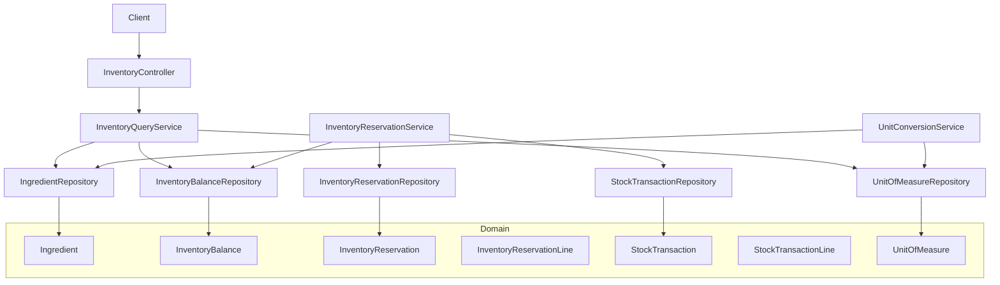
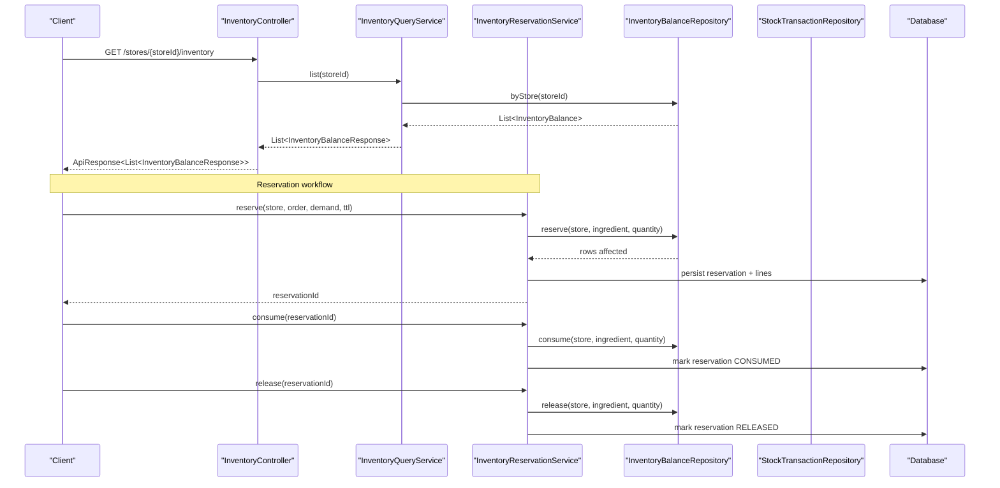
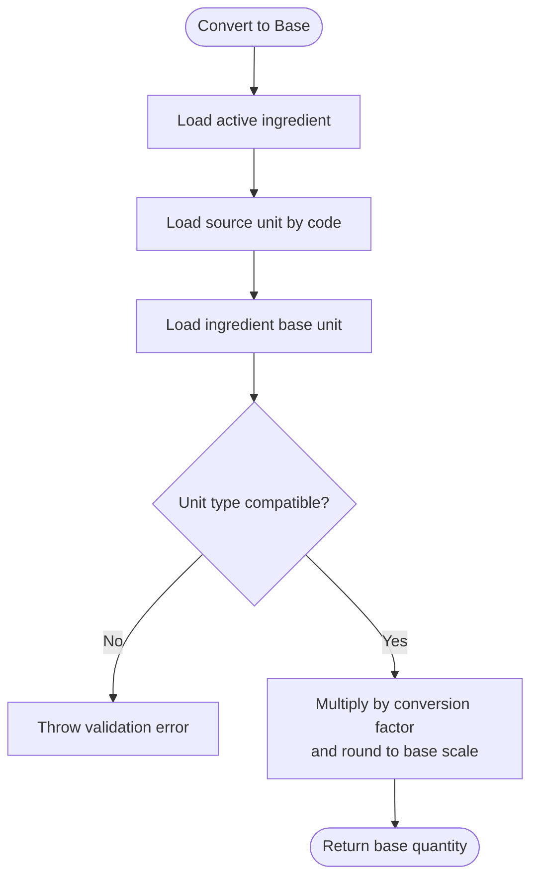
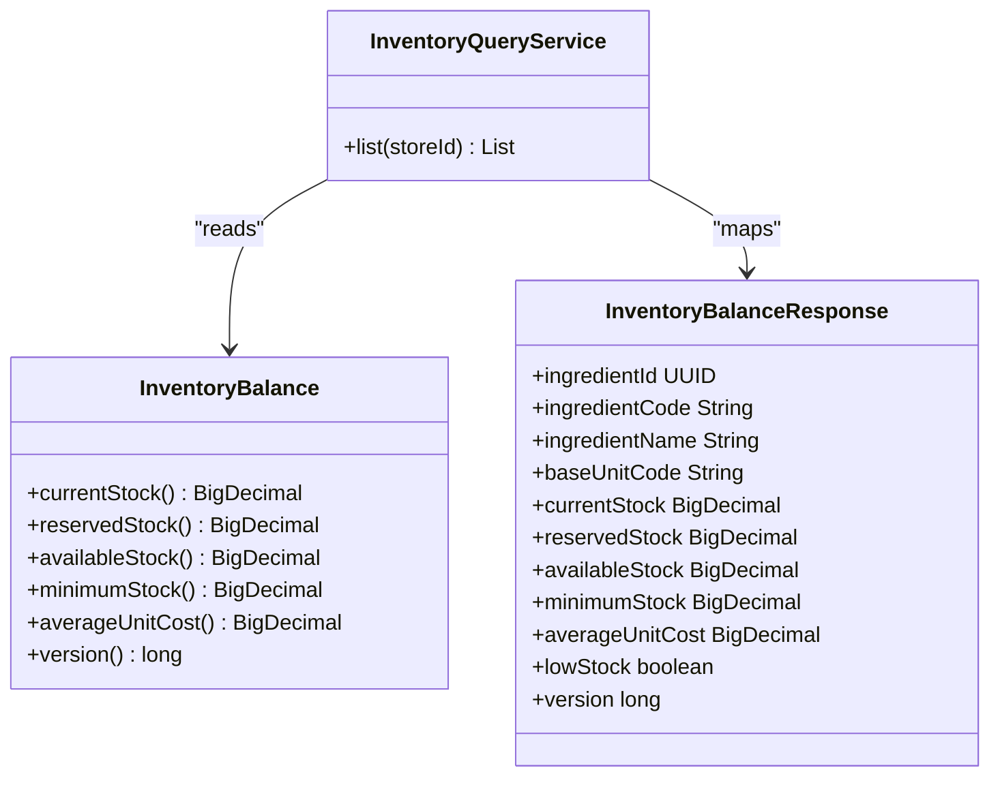
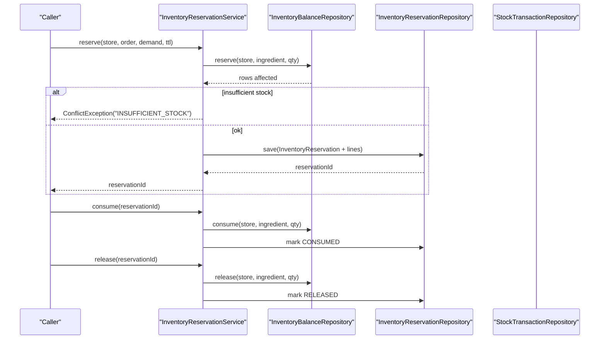
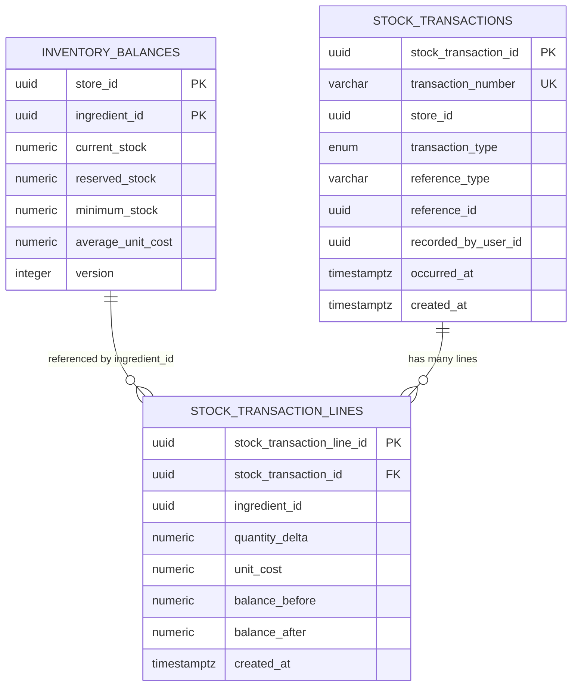
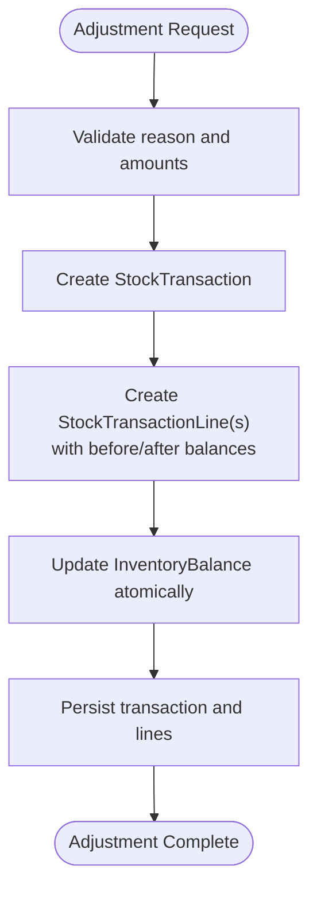
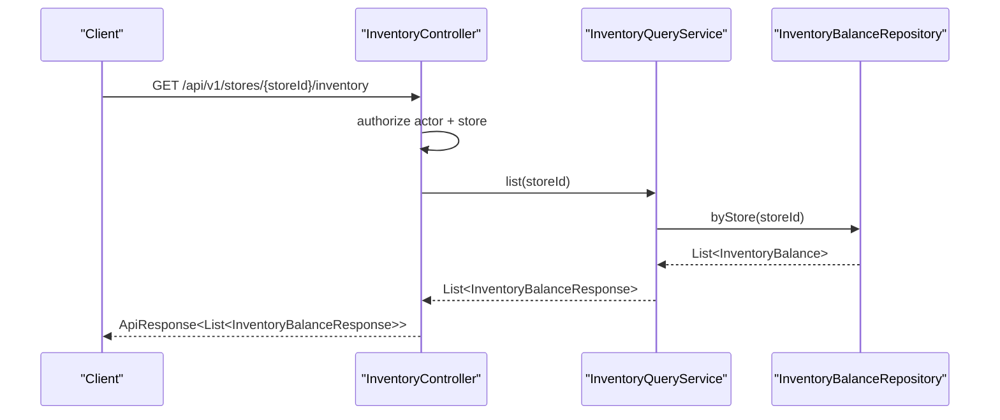
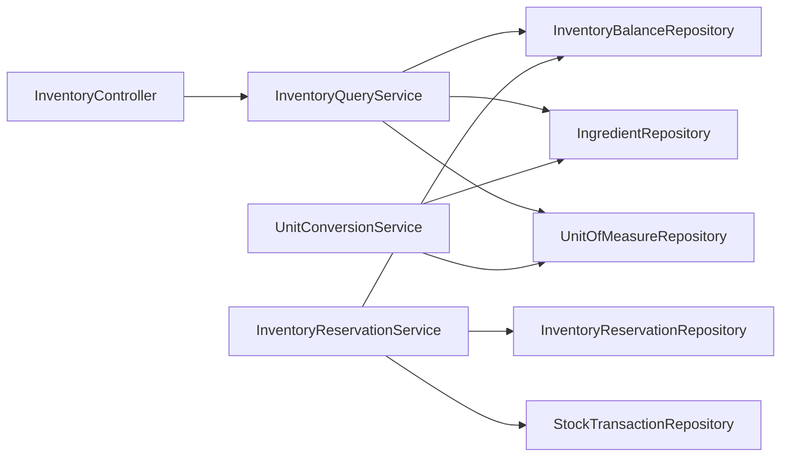

# Inventory Management Module

<cite>
**Referenced Files in This Document**
- [InventoryController.java](file://src/main/java/com/smartcoffee/modules/inventory/api/InventoryController.java)
- [InventoryBalanceResponse.java](file://src/main/java/com/smartcoffee/modules/inventory/api/InventoryBalanceResponse.java)
- [InventoryQueryService.java](file://src/main/java/com/smartcoffee/modules/inventory/application/InventoryQueryService.java)
- [InventoryReservationService.java](file://src/main/java/com/smartcoffee/modules/inventory/application/InventoryReservationService.java)
- [UnitConversionService.java](file://src/main/java/com/smartcoffee/modules/inventory/application/UnitConversionService.java)
- [Ingredient.java](file://src/main/java/com/smartcoffee/modules/inventory/domain/Ingredient.java)
- [InventoryBalance.java](file://src/main/java/com/smartcoffee/modules/inventory/domain/InventoryBalance.java)
- [InventoryReservation.java](file://src/main/java/com/smartcoffee/modules/inventory/domain/InventoryReservation.java)
- [InventoryReservationLine.java](file://src/main/java/com/smartcoffee/modules/inventory/domain/InventoryReservationLine.java)
- [StockTransaction.java](file://src/main/java/com/smartcoffee/modules/inventory/domain/StockTransaction.java)
- [StockTransactionLine.java](file://src/main/java/com/smartcoffee/modules/inventory/domain/StockTransactionLine.java)
- [UnitOfMeasure.java](file://src/main/java/com/smartcoffee/modules/inventory/domain/UnitOfMeasure.java)
- [InventoryBalanceRepository.java](file://src/main/java/com/smartcoffee/modules/inventory/persistence/InventoryBalanceRepository.java)
- [StockTransactionRepository.java](file://src/main/java/com/smartcoffee/modules/inventory/persistence/StockTransactionRepository.java)
- [smart-coffee-logical.dbml](file://database/smart-coffee-logical.dbml)
- [V005__recipe_inventory_uom_reservation_ledger.sql](file://src/main/resources/db/migration/V005__recipe_inventory_uom_reservation_ledger.sql)
</cite>

## Table of Contents
1. [Introduction](#introduction)
2. [Project Structure](#project-structure)
3. [Core Components](#core-components)
4. [Architecture Overview](#architecture-overview)
5. [Detailed Component Analysis](#detailed-component-analysis)
6. [Dependency Analysis](#dependency-analysis)
7. [Performance Considerations](#performance-considerations)
8. [Troubleshooting Guide](#troubleshooting-guide)
9. [Conclusion](#conclusion)
10. [Appendices](#appendices)

## Introduction
This document explains the Inventory Management module responsible for ingredient tracking, stock level management, reservations, unit-of-measure conversions, low-stock alerts, consumption monitoring, inventory balance calculations, transaction ledgering, and stock adjustments. It also covers concurrent access handling, stock accuracy guarantees, and performance optimization strategies for large inventories.

The module is organized as a modular monolith component with clear domain entities, application services, persistence repositories, and API endpoints. The database schema defines balances, reservations, transactions, ingredients, units of measure, and related structures.

## Project Structure
The Inventory Management module lives under `modules/inventory` and follows a layered structure:
- API layer exposes store-scoped inventory queries.
- Application layer provides query and reservation services plus unit conversion utilities.
- Domain layer models ingredients, balances, reservations, transactions, and units of measure.
- Persistence layer contains JPA repositories and native update queries for concurrency-safe stock operations.

**Diagram sources**
- [InventoryController.java:10-32](file://src/main/java/com/smartcoffee/modules/inventory/api/InventoryController.java#L10-L32)
- [InventoryQueryService.java:1-3](file://src/main/java/com/smartcoffee/modules/inventory/application/InventoryQueryService.java#L1-L3)
- [InventoryReservationService.java:31-65](file://src/main/java/com/smartcoffee/modules/inventory/application/InventoryReservationService.java#L31-L65)
- [UnitConversionService.java:11-32](file://src/main/java/com/smartcoffee/modules/inventory/application/UnitConversionService.java#L11-L32)
- [InventoryBalanceRepository.java:9-24](file://src/main/java/com/smartcoffee/modules/inventory/persistence/InventoryBalanceRepository.java#L9-L24)
- [StockTransactionRepository.java:7-8](file://src/main/java/com/smartcoffee/modules/inventory/persistence/StockTransactionRepository.java#L7-L8)

**Section sources**
- [InventoryController.java:10-32](file://src/main/java/com/smartcoffee/modules/inventory/api/InventoryController.java#L10-L32)
- [smart-coffee-logical.dbml:569-677](file://database/smart-coffee-logical.dbml#L569-L677)

## Core Components
- Ingredient: Master data for tracked items, including base unit, cost, and active status.
- InventoryBalance: Per-store per-ingredient current stock, reserved stock, minimum stock, average unit cost, and optimistic version.
- InventoryReservation and InventoryReservationLine: Order-scoped reservations that reserve available stock until consumed or released.
- StockTransaction and StockTransactionLine: Immutable audit ledger for stock movements with before/after balances.
- UnitOfMeasure: Units with type, scale, conversion factor to base, and conversion helpers.
- Services:
  - InventoryQueryService: Read-only listing of inventory balances with low-stock flags.
  - InventoryReservationService: Reserve, consume, release, and expire reservations with concurrency-safe updates.
  - UnitConversionService: Convert submitted quantities to ingredient base units safely.

Key responsibilities:
- Track ingredient stock levels per store.
- Manage reservations tied to orders.
- Provide low-stock alerts based on available stock vs minimum stock.
- Maintain an immutable transaction ledger for all stock changes.
- Enforce unit-of-measure compatibility and conversions.

**Section sources**
- [Ingredient.java:8-59](file://src/main/java/com/smartcoffee/modules/inventory/domain/Ingredient.java#L8-L59)
- [InventoryBalance.java:7-55](file://src/main/java/com/smartcoffee/modules/inventory/domain/InventoryBalance.java#L7-L55)
- [InventoryReservation.java:8-104](file://src/main/java/com/smartcoffee/modules/inventory/domain/InventoryReservation.java#L8-L104)
- [InventoryReservationLine.java:8-53](file://src/main/java/com/smartcoffee/modules/inventory/domain/InventoryReservationLine.java#L8-L53)
- [StockTransaction.java:7-53](file://src/main/java/com/smartcoffee/modules/inventory/domain/StockTransaction.java#L7-L53)
- [StockTransactionLine.java:8-47](file://src/main/java/com/smartcoffee/modules/inventory/domain/StockTransactionLine.java#L8-L47)
- [UnitOfMeasure.java:8-80](file://src/main/java/com/smartcoffee/modules/inventory/domain/UnitOfMeasure.java#L8-L80)
- [InventoryQueryService.java:1-3](file://src/main/java/com/smartcoffee/modules/inventory/application/InventoryQueryService.java#L1-L3)
- [InventoryReservationService.java:31-65](file://src/main/java/com/smartcoffee/modules/inventory/application/InventoryReservationService.java#L31-L65)
- [UnitConversionService.java:11-32](file://src/main/java/com/smartcoffee/modules/inventory/application/UnitConversionService.java#L11-L32)

## Architecture Overview
The inventory subsystem integrates with ordering and production flows through reservations and consumption events. Orders create reservations; production consumes them; failed or expired reservations release stock back.

**Diagram sources**
- [InventoryController.java:26-32](file://src/main/java/com/smartcoffee/modules/inventory/api/InventoryController.java#L26-L32)
- [InventoryQueryService.java:1-3](file://src/main/java/com/smartcoffee/modules/inventory/application/InventoryQueryService.java#L1-L3)
- [InventoryReservationService.java:43-65](file://src/main/java/com/smartcoffee/modules/inventory/application/InventoryReservationService.java#L43-L65)
- [InventoryBalanceRepository.java:10-20](file://src/main/java/com/smartcoffee/modules/inventory/persistence/InventoryBalanceRepository.java#L10-L20)

## Detailed Component Analysis

### Ingredient Tracking and Unit of Measure Conversions
- Ingredients define the tracked item and its base unit.
- Units of measure support multiple types (e.g., mass, volume, count) with conversion factors to a base unit.
- UnitConversionService validates that the submitted unit type matches the ingredient’s base unit type and converts quantities to the base unit using the unit’s conversion factor and decimal scale.

**Diagram sources**
- [UnitConversionService.java:21-32](file://src/main/java/com/smartcoffee/modules/inventory/application/UnitConversionService.java#L21-L32)
- [UnitOfMeasure.java:71-79](file://src/main/java/com/smartcoffee/modules/inventory/domain/UnitOfMeasure.java#L71-L79)
- [Ingredient.java:18-23](file://src/main/java/com/smartcoffee/modules/inventory/domain/Ingredient.java#L18-L23)

**Section sources**
- [UnitConversionService.java:11-32](file://src/main/java/com/smartcoffee/modules/inventory/application/UnitConversionService.java#L11-L32)
- [UnitOfMeasure.java:8-80](file://src/main/java/com/smartcoffee/modules/inventory/domain/UnitOfMeasure.java#L8-L80)
- [Ingredient.java:8-59](file://src/main/java/com/smartcoffee/modules/inventory/domain/Ingredient.java#L8-L59)

### Stock Level Management and Low Stock Alerts
- InventoryBalance tracks current_stock, reserved_stock, minimum_stock, and average_unit_cost per store and ingredient.
- Available stock is computed as current_stock minus reserved_stock.
- InventoryQueryService lists balances per store and computes a low_stock flag when available_stock is less than or equal to minimum_stock.
- The API endpoint returns this information via InventoryBalanceResponse.

**Diagram sources**
- [InventoryBalance.java:7-55](file://src/main/java/com/smartcoffee/modules/inventory/domain/InventoryBalance.java#L7-L55)
- [InventoryQueryService.java:1-3](file://src/main/java/com/smartcoffee/modules/inventory/application/InventoryQueryService.java#L1-L3)
- [InventoryBalanceResponse.java:6-9](file://src/main/java/com/smartcoffee/modules/inventory/api/InventoryBalanceResponse.java#L6-L9)

**Section sources**
- [InventoryBalance.java:7-55](file://src/main/java/com/smartcoffee/modules/inventory/domain/InventoryBalance.java#L7-L55)
- [InventoryQueryService.java:1-3](file://src/main/java/com/smartcoffee/modules/inventory/application/InventoryQueryService.java#L1-L3)
- [InventoryBalanceResponse.java:6-9](file://src/main/java/com/smartcoffee/modules/inventory/api/InventoryBalanceResponse.java#L6-L9)

### Reservation System and Consumption Monitoring
- InventoryReservationService reserves stock for an order by updating reserved_stock atomically per ingredient.
- Reservations have an expiry time and can be consumed, released, or expired.
- Consuming a reservation decrements both current_stock and reserved_stock.
- Releasing a reservation decrements reserved_stock only.
- The service uses optimistic locking via versioned updates and row-level checks to prevent race conditions.

**Diagram sources**
- [InventoryReservationService.java:43-65](file://src/main/java/com/smartcoffee/modules/inventory/application/InventoryReservationService.java#L43-L65)
- [InventoryBalanceRepository.java:10-20](file://src/main/java/com/smartcoffee/modules/inventory/persistence/InventoryBalanceRepository.java#L10-L20)
- [InventoryReservation.java:63-79](file://src/main/java/com/smartcoffee/modules/inventory/domain/InventoryReservation.java#L63-L79)

**Section sources**
- [InventoryReservationService.java:31-65](file://src/main/java/com/smartcoffee/modules/inventory/application/InventoryReservationService.java#L31-L65)
- [InventoryReservation.java:8-104](file://src/main/java/com/smartcoffee/modules/inventory/domain/InventoryReservation.java#L8-L104)
- [InventoryReservationLine.java:8-53](file://src/main/java/com/smartcoffee/modules/inventory/domain/InventoryReservationLine.java#L8-L53)
- [InventoryBalanceRepository.java:10-20](file://src/main/java/com/smartcoffee/modules/inventory/persistence/InventoryBalanceRepository.java#L10-L20)

### Inventory Balance Calculations and Transaction Ledger
- InventoryBalance stores current and reserved stock; available stock is derived.
- StockTransaction and StockTransactionLine provide an immutable ledger of stock movements with before/after balances.
- The ledger supports multiple transaction types such as STOCK_IN, ADJUSTMENT, SALE_CONSUMPTION, RETURN, DAMAGED.
- Database constraints ensure non-zero deltas and non-negative balances.

**Diagram sources**
- [smart-coffee-logical.dbml:607-677](file://database/smart-coffee-logical.dbml#L607-L677)
- [V005__recipe_inventory_uom_reservation_ledger.sql:146-187](file://src/main/resources/db/migration/V005__recipe_inventory_uom_reservation_ledger.sql#L146-L187)

**Section sources**
- [InventoryBalance.java:7-55](file://src/main/java/com/smartcoffee/modules/inventory/domain/InventoryBalance.java#L7-L55)
- [StockTransaction.java:7-53](file://src/main/java/com/smartcoffee/modules/inventory/domain/StockTransaction.java#L7-L53)
- [StockTransactionLine.java:8-47](file://src/main/java/com/smartcoffee/modules/inventory/domain/StockTransactionLine.java#L8-L47)
- [smart-coffee-logical.dbml:607-677](file://database/smart-coffee-logical.dbml#L607-L677)
- [V005__recipe_inventory_uom_reservation_ledger.sql:146-187](file://src/main/resources/db/migration/V005__recipe_inventory_uom_reservation_ledger.sql#L146-L187)

### Stock Adjustment Processes
- Stock adjustments are represented by transactions with type ADJUSTMENT and associated lines capturing delta, unit cost, and before/after balances.
- Adjustments should be audited and constrained to non-negative balances.
- While the repository for stock transactions exists, adjustment orchestration is typically implemented in application services that create StockTransaction and StockTransactionLine records and update balances accordingly.

[No sources needed since this diagram shows conceptual workflow, not actual code structure]

### API Surface for Inventory Queries
- GET /api/v1/stores/{storeId}/inventory returns a list of inventory balances with low-stock flags and version numbers.
- Authorization requires inventory read permission and store authorization.

**Diagram sources**
- [InventoryController.java:26-32](file://src/main/java/com/smartcoffee/modules/inventory/api/InventoryController.java#L26-L32)
- [InventoryQueryService.java:1-3](file://src/main/java/com/smartcoffee/modules/inventory/application/InventoryQueryService.java#L1-L3)
- [InventoryBalanceRepository.java:22-23](file://src/main/java/com/smartcoffee/modules/inventory/persistence/InventoryBalanceRepository.java#L22-L23)

**Section sources**
- [InventoryController.java:10-32](file://src/main/java/com/smartcoffee/modules/inventory/api/InventoryController.java#L10-L32)
- [InventoryBalanceResponse.java:6-9](file://src/main/java/com/smartcoffee/modules/inventory/api/InventoryBalanceResponse.java#L6-L9)

## Dependency Analysis
The inventory module depends on:
- Common exceptions and security components for authorization and error handling.
- JPA repositories for balances, reservations, ingredients, units of measure, and stock transactions.
- Database schema enforcing constraints and indexes for performance and integrity.

**Diagram sources**
- [InventoryController.java:10-32](file://src/main/java/com/smartcoffee/modules/inventory/api/InventoryController.java#L10-L32)
- [InventoryQueryService.java:1-3](file://src/main/java/com/smartcoffee/modules/inventory/application/InventoryQueryService.java#L1-L3)
- [InventoryReservationService.java:31-65](file://src/main/java/com/smartcoffee/modules/inventory/application/InventoryReservationService.java#L31-L65)
- [UnitConversionService.java:11-32](file://src/main/java/com/smartcoffee/modules/inventory/application/UnitConversionService.java#L11-L32)
- [InventoryBalanceRepository.java:9-24](file://src/main/java/com/smartcoffee/modules/inventory/persistence/InventoryBalanceRepository.java#L9-L24)
- [StockTransactionRepository.java:7-8](file://src/main/java/com/smartcoffee/modules/inventory/persistence/StockTransactionRepository.java#L7-L8)

**Section sources**
- [InventoryController.java:10-32](file://src/main/java/com/smartcoffee/modules/inventory/api/InventoryController.java#L10-L32)
- [InventoryReservationService.java:31-65](file://src/main/java/com/smartcoffee/modules/inventory/application/InventoryReservationService.java#L31-L65)
- [UnitConversionService.java:11-32](file://src/main/java/com/smartcoffee/modules/inventory/application/UnitConversionService.java#L11-L32)

## Performance Considerations
- Optimistic concurrency control:
  - InventoryBalance uses a version column updated by native SQL statements to prevent lost updates during concurrent reservations, releases, and consumptions.
- Native SQL updates:
  - reserve, release, and consume use direct UPDATE statements with conditional checks to ensure atomicity and avoid extra SELECTs.
- Indexes:
  - Store-scoped queries benefit from indexes on store_id columns.
  - Reservation queries leverage indexes on store_id, status, and expires_at for efficient expiration handling.
- Batch operations:
  - For large inventories, batch reservation requests and process demands sorted deterministically to reduce lock contention.
- Read scaling:
  - InventoryQueryService.list is read-only and suitable for caching at the service layer if appropriate.
- Ledger growth:
  - StockTransaction and StockTransactionLine grow over time; consider partitioning by store_id and time ranges for historical reporting.

[No sources needed since this section provides general guidance]

## Troubleshooting Guide
Common issues and resolutions:
- Insufficient stock during reservation:
  - Occurs when current_stock - reserved_stock < requested quantity.
  - Resolution: Increase stock via adjustments or reduce demand; review reservation TTL and expiration policies.
- Inventory balance conflict during release:
  - Occurs when reserved_stock < quantity being released.
  - Resolution: Ensure reservations are consumed before release; validate reservation state transitions.
- Unit conversion errors:
  - Thrown when submitted unit type does not match ingredient base unit type or unit code is unknown.
  - Resolution: Validate unit codes and ingredient base units; ensure correct unit type mapping.
- Low stock alerts:
  - Triggered when available_stock <= minimum_stock.
  - Resolution: Replenish stock or adjust minimum thresholds; monitor via inventory listing.

**Section sources**
- [InventoryReservationService.java:43-65](file://src/main/java/com/smartcoffee/modules/inventory/application/InventoryReservationService.java#L43-L65)
- [UnitConversionService.java:21-32](file://src/main/java/com/smartcoffee/modules/inventory/application/UnitConversionService.java#L21-L32)
- [InventoryQueryService.java:1-3](file://src/main/java/com/smartcoffee/modules/inventory/application/InventoryQueryService.java#L1-L3)

## Conclusion
The Inventory Management module provides robust ingredient tracking, stock level management, and reservation workflows with strong concurrency guarantees and an immutable transaction ledger. Unit-of-measure conversions ensure consistent measurements across different unit types. Low-stock alerts and consumption monitoring enable proactive inventory management. With careful indexing, optimistic locking, and ledger design, the system scales to large inventories while maintaining stock accuracy.

[No sources needed since this section summarizes without analyzing specific files]

## Appendices

### Examples of Inventory Operations
- List inventory balances for a store:
  - Endpoint: GET /api/v1/stores/{storeId}/inventory
  - Response includes current_stock, reserved_stock, available_stock, minimum_stock, average_unit_cost, low_stock flag, and version.
- Reserve stock for an order:
  - Call InventoryReservationService.reserve with store, order, demand map, and TTL.
  - On success, returns reservationId; on failure, throws INSUFFICIENT_STOCK.
- Consume a reservation:
  - Call InventoryReservationService.consume (or equivalent) to decrement current_stock and reserved_stock and mark reservation CONSUMED.
- Release a reservation:
  - Call InventoryReservationService.release to decrement reserved_stock and mark reservation RELEASED.
- Convert units:
  - Use UnitConversionService.toIngredientBase to convert submitted quantities to the ingredient’s base unit.

**Section sources**
- [InventoryController.java:26-32](file://src/main/java/com/smartcoffee/modules/inventory/api/InventoryController.java#L26-L32)
- [InventoryReservationService.java:43-65](file://src/main/java/com/smartcoffee/modules/inventory/application/InventoryReservationService.java#L43-L65)
- [UnitConversionService.java:21-32](file://src/main/java/com/smartcoffee/modules/inventory/application/UnitConversionService.java#L21-L32)

### Reporting Queries
- Low-stock report:
  - Filter inventory balances where available_stock <= minimum_stock.
- Consumption trends:
  - Aggregate StockTransactionLine.quantity_delta grouped by ingredient_id and date range for SALE_CONSUMPTION type.
- Stock movement history:
  - Join StockTransaction and StockTransactionLine to get per-ingredient movements with before/after balances.

[No sources needed since this section provides general guidance]