# Reservation System

<cite>
**Referenced Files in This Document**
- [InventoryReservation.java](file://src/main/java/com/smartcoffee/modules/inventory/domain/InventoryReservation.java)
- [InventoryReservationLine.java](file://src/main/java/com/smartcoffee/modules/inventory/domain/InventoryReservationLine.java)
- [ReservationStatus.java](file://src/main/java/com/smartcoffee/modules/inventory/domain/ReservationStatus.java)
- [InventoryBalance.java](file://src/main/java/com/smartcoffee/modules/inventory/domain/InventoryBalance.java)
- [StockTransaction.java](file://src/main/java/com/smartcoffee/modules/inventory/domain/StockTransaction.java)
- [StockTransactionLine.java](file://src/main/java/com/smartcoffee/modules/inventory/domain/StockTransactionLine.java)
- [InventoryReservationService.java](file://src/main/java/com/smartcoffee/modules/inventory/application/InventoryReservationService.java)
- [InventoryReservationRepository.java](file://src/main/java/com/smartcoffee/modules/inventory/persistence/InventoryReservationRepository.java)
- [InventoryBalanceRepository.java](file://src/main/java/com/smartcoffee/modules/inventory/persistence/InventoryBalanceRepository.java)
- [PaymentExpirationService.java](file://src/main/java/com/smartcoffee/modules/payment/application/PaymentExpirationService.java)
- [V005__recipe_inventory_uom_reservation_ledger.sql](file://src/main/resources/db/migration/V005__recipe_inventory_uom_reservation_ledger.sql)
</cite>

## Table of Contents
1. [Introduction](#introduction)
2. [Project Structure](#project-structure)
3. [Core Components](#core-components)
4. [Architecture Overview](#architecture-overview)
5. [Detailed Component Analysis](#detailed-component-analysis)
6. [Dependency Analysis](#dependency-analysis)
7. [Performance Considerations](#performance-considerations)
8. [Troubleshooting Guide](#troubleshooting-guide)
9. [Conclusion](#conclusion)

## Introduction
This document explains the inventory reservation system used to reserve ingredients for orders, consume them during fulfillment, and release or expire reservations when orders are cancelled or payments time out. It focuses on the InventoryReservation and InventoryReservationLine entities, the service layer that orchestrates reservation operations, and the persistence model that guarantees consistency under concurrency.

The system supports:
- Creating reservations per order with a TTL (time-to-live).
- Consuming reserved stock when an order is prepared.
- Releasing reservations when an order is cancelled.
- Expiring inactive reservations and returning reserved stock.
- Auditing consumption through immutable stock transaction records.

## Project Structure
The reservation logic lives in the inventory module and integrates with payment expiration handling. The key files are:
- Domain models: InventoryReservation, InventoryReservationLine, ReservationStatus, InventoryBalance, StockTransaction, StockTransactionLine.
- Application service: InventoryReservationService.
- Persistence: InventoryReservationRepository, InventoryBalanceRepository.
- Scheduling integration: PaymentExpirationService triggers reservation release when payments expire.
- Database schema: V005 migration defines tables, constraints, and indexes.

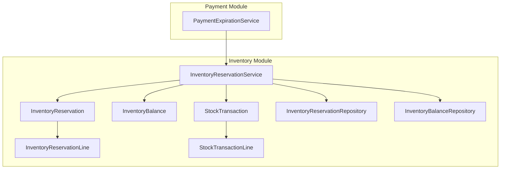

**Diagram sources**
- [InventoryReservation.java:8-36](file://src/main/java/com/smartcoffee/modules/inventory/domain/InventoryReservation.java#L8-L36)
- [InventoryReservationLine.java:8-17](file://src/main/java/com/smartcoffee/modules/inventory/domain/InventoryReservationLine.java#L8-L17)
- [InventoryBalance.java:7-23](file://src/main/java/com/smartcoffee/modules/inventory/domain/InventoryBalance.java#L7-L23)
- [StockTransaction.java:7-31](file://src/main/java/com/smartcoffee/modules/inventory/domain/StockTransaction.java#L7-L31)
- [StockTransactionLine.java:8-16](file://src/main/java/com/smartcoffee/modules/inventory/domain/StockTransactionLine.java#L8-L16)
- [InventoryReservationService.java:30-41](file://src/main/java/com/smartcoffee/modules/inventory/application/InventoryReservationService.java#L30-L41)
- [InventoryReservationRepository.java:11-20](file://src/main/java/com/smartcoffee/modules/inventory/persistence/InventoryReservationRepository.java#L11-L20)
- [InventoryBalanceRepository.java:9-23](file://src/main/java/com/smartcoffee/modules/inventory/persistence/InventoryBalanceRepository.java#L9-L23)
- [PaymentExpirationService.java:12-24](file://src/main/java/com/smartcoffee/modules/payment/application/PaymentExpirationService.java#L12-L24)

**Section sources**
- [InventoryReservation.java:1-106](file://src/main/java/com/smartcoffee/modules/inventory/domain/InventoryReservation.java#L1-L106)
- [InventoryReservationLine.java:1-55](file://src/main/java/com/smartcoffee/modules/inventory/domain/InventoryReservationLine.java#L1-L55)
- [InventoryReservationService.java:1-100](file://src/main/java/com/smartcoffee/modules/inventory/application/InventoryReservationService.java#L1-L100)
- [InventoryReservationRepository.java:1-23](file://src/main/java/com/smartcoffee/modules/inventory/persistence/InventoryReservationRepository.java#L1-L23)
- [InventoryBalanceRepository.java:1-26](file://src/main/java/com/smartcoffee/modules/inventory/persistence/InventoryBalanceRepository.java#L1-L26)
- [PaymentExpirationService.java:1-42](file://src/main/java/com/smartcoffee/modules/payment/application/PaymentExpirationService.java#L1-L42)
- [V005__recipe_inventory_uom_reservation_ledger.sql:85-189](file://src/main/resources/db/migration/V005__recipe_inventory_uom_reservation_ledger.sql#L85-L189)

## Core Components
- InventoryReservation represents a reservation for an order at a store, including its status, expiry, timestamps, and lines.
- InventoryReservationLine represents one ingredient’s reserved quantity within a reservation.
- ReservationStatus enumerates ACTIVE, CONSUMED, RELEASED, EXPIRED.
- InventoryBalance tracks current_stock, reserved_stock, minimum_stock, and average_unit_cost per store and ingredient.
- StockTransaction and StockTransactionLine provide an append-only audit ledger for stock changes.

Key behaviors:
- Reservations are created with a TTL and marked ACTIVE.
- Consumption transitions ACTIVE to CONSUMED and decrements both reserved_stock and current_stock.
- Release transitions ACTIVE to RELEASED and returns reserved_stock.
- Expiration transitions ACTIVE to EXPIRED after TTL and returns reserved_stock.

**Section sources**
- [InventoryReservation.java:8-79](file://src/main/java/com/smartcoffee/modules/inventory/domain/InventoryReservation.java#L8-L79)
- [InventoryReservationLine.java:8-52](file://src/main/java/com/smartcoffee/modules/inventory/domain/InventoryReservationLine.java#L8-L52)
- [ReservationStatus.java:1-7](file://src/main/java/com/smartcoffee/modules/inventory/domain/ReservationStatus.java#L1-L7)
- [InventoryBalance.java:7-55](file://src/main/java/com/smartcoffee/modules/inventory/domain/InventoryBalance.java#L7-L55)
- [StockTransaction.java:7-53](file://src/main/java/com/smartcoffee/modules/inventory/domain/StockTransaction.java#L7-L53)
- [StockTransactionLine.java:8-47](file://src/main/java/com/smartcoffee/modules/inventory/domain/StockTransactionLine.java#L8-L47)

## Architecture Overview
The reservation workflow spans order placement, payment timeout handling, preparation/consumption, cancellation/release, and expiration.

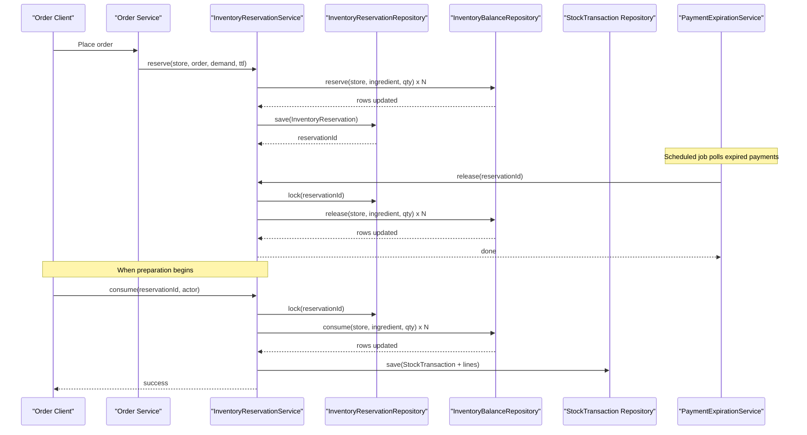

**Diagram sources**
- [InventoryReservationService.java:43-85](file://src/main/java/com/smartcoffee/modules/inventory/application/InventoryReservationService.java#L43-L85)
- [InventoryReservationRepository.java:11-20](file://src/main/java/com/smartcoffee/modules/inventory/persistence/InventoryReservationRepository.java#L11-L20)
- [InventoryBalanceRepository.java:10-20](file://src/main/java/com/smartcoffee/modules/inventory/persistence/InventoryBalanceRepository.java#L10-L20)
- [PaymentExpirationService.java:27-40](file://src/main/java/com/smartcoffee/modules/payment/application/PaymentExpirationService.java#L27-L40)

## Detailed Component Analysis

### Entities and Data Model
- InventoryReservation
  - Fields: id, storeId, orderId (unique), status, expiresAt, consumedAt, releasedAt, expiredAt, createdAt, updatedAt, version, lines.
  - Factory method create(...) initializes ACTIVE state and attaches lines.
  - State transitions: consumed(), released(), expired() enforce ACTIVE preconditions.
- InventoryReservationLine
  - Fields: id, reservation (many-to-one), ingredientId, quantityReserved, quantityConsumed, createdAt.
  - Unique constraint on (reservation_id, ingredient_id).
  - consume() sets quantityConsumed equal to quantityReserved.
- ReservationStatus
  - Values: ACTIVE, CONSUMED, RELEASED, EXPIRED.
- InventoryBalance
  - Tracks current_stock, reserved_stock, minimum_stock, average_unit_cost; provides availableStock().
- StockTransaction and StockTransactionLine
  - Append-only audit trail for stock movements, capturing before/after balances and deltas.

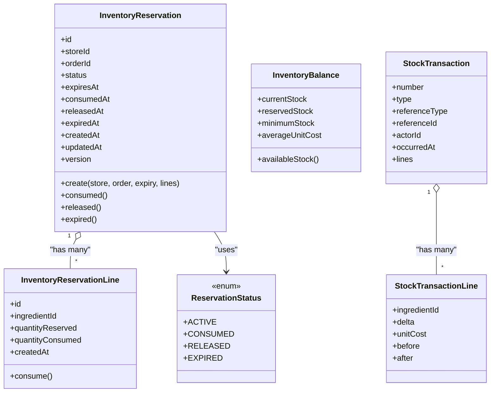

**Diagram sources**
- [InventoryReservation.java:8-103](file://src/main/java/com/smartcoffee/modules/inventory/domain/InventoryReservation.java#L8-L103)
- [InventoryReservationLine.java:8-52](file://src/main/java/com/smartcoffee/modules/inventory/domain/InventoryReservationLine.java#L8-L52)
- [ReservationStatus.java:1-7](file://src/main/java/com/smartcoffee/modules/inventory/domain/ReservationStatus.java#L1-L7)
- [InventoryBalance.java:7-55](file://src/main/java/com/smartcoffee/modules/inventory/domain/InventoryBalance.java#L7-L55)
- [StockTransaction.java:7-53](file://src/main/java/com/smartcoffee/modules/inventory/domain/StockTransaction.java#L7-L53)
- [StockTransactionLine.java:8-47](file://src/main/java/com/smartcoffee/modules/inventory/domain/StockTransactionLine.java#L8-L47)

**Section sources**
- [InventoryReservation.java:8-103](file://src/main/java/com/smartcoffee/modules/inventory/domain/InventoryReservation.java#L8-L103)
- [InventoryReservationLine.java:8-52](file://src/main/java/com/smartcoffee/modules/inventory/domain/InventoryReservationLine.java#L8-L52)
- [ReservationStatus.java:1-7](file://src/main/java/com/smartcoffee/modules/inventory/domain/ReservationStatus.java#L1-L7)
- [InventoryBalance.java:7-55](file://src/main/java/com/smartcoffee/modules/inventory/domain/InventoryBalance.java#L7-L55)
- [StockTransaction.java:7-53](file://src/main/java/com/smartcoffee/modules/inventory/domain/StockTransaction.java#L7-L53)
- [StockTransactionLine.java:8-47](file://src/main/java/com/smartcoffee/modules/inventory/domain/StockTransactionLine.java#L8-L47)

### Reservation Lifecycle and Workflow

#### Reservation Creation
- Input: store, order, demand map (ingredient -> quantity), TTL duration.
- Steps:
  - Check if a reservation already exists for the order; return existing reservationId if present.
  - For each ingredient in deterministic order, attempt to reserve stock via InventoryBalanceRepository.reserve(...).
  - If any ingredient lacks sufficient stock, throw a conflict error.
  - Create InventoryReservation with ACTIVE status and expiry = now + TTL.
  - Persist and return reservationId.

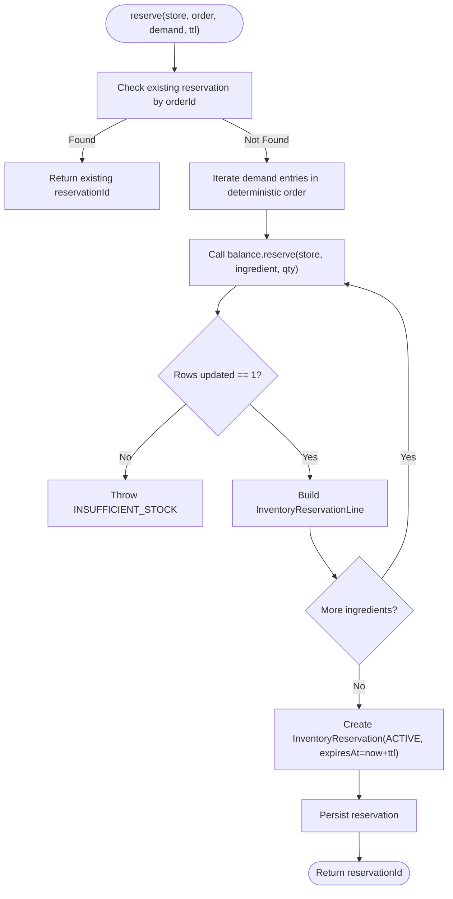

**Diagram sources**
- [InventoryReservationService.java:43-54](file://src/main/java/com/smartcoffee/modules/inventory/application/InventoryReservationService.java#L43-L54)
- [InventoryBalanceRepository.java:10-12](file://src/main/java/com/smartcoffee/modules/inventory/persistence/InventoryBalanceRepository.java#L10-L12)

**Section sources**
- [InventoryReservationService.java:43-54](file://src/main/java/com/smartcoffee/modules/inventory/application/InventoryReservationService.java#L43-L54)

#### Reservation Consumption (Fulfillment)
- Input: reservationId, actor.
- Steps:
  - Lock the reservation row using pessimistic write to prevent concurrent modifications.
  - For each line in deterministic order:
    - Read current balance before consumption.
    - Consume stock via InventoryBalanceRepository.consume(...), which decrements both reserved_stock and current_stock.
    - Mark line as fully consumed.
    - Record a StockTransactionLine with negative delta and before/after balances.
  - Transition reservation to CONSUMED.
  - Persist StockTransaction with type SALE_CONSUMPTION and reference to order.

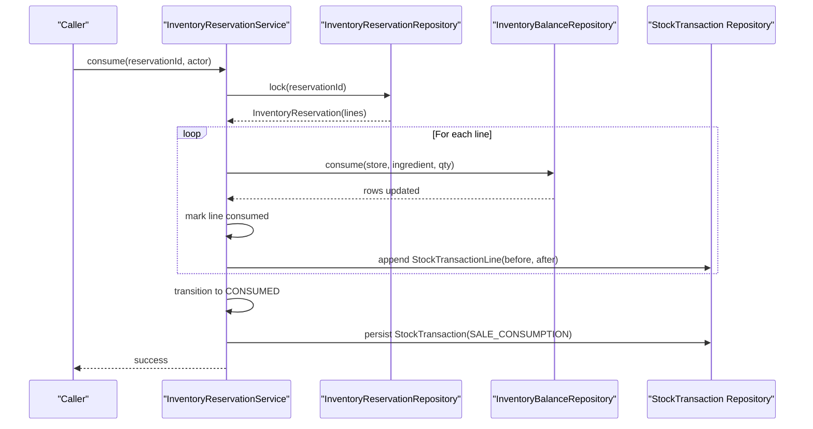

**Diagram sources**
- [InventoryReservationService.java:67-85](file://src/main/java/com/smartcoffee/modules/inventory/application/InventoryReservationService.java#L67-L85)
- [InventoryReservationRepository.java:11-15](file://src/main/java/com/smartcoffee/modules/inventory/persistence/InventoryReservationRepository.java#L11-L15)
- [InventoryBalanceRepository.java:18-20](file://src/main/java/com/smartcoffee/modules/inventory/persistence/InventoryBalanceRepository.java#L18-L20)

**Section sources**
- [InventoryReservationService.java:67-85](file://src/main/java/com/smartcoffee/modules/inventory/application/InventoryReservationService.java#L67-L85)

#### Reservation Release (Cancellation)
- Input: reservationId.
- Steps:
  - Lock the reservation row.
  - For each line in deterministic order, release reserved stock via InventoryBalanceRepository.release(...).
  - Transition reservation to RELEASED.

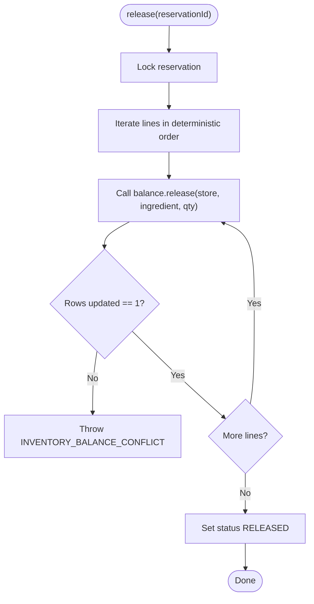

**Diagram sources**
- [InventoryReservationService.java:56-65](file://src/main/java/com/smartcoffee/modules/inventory/application/InventoryReservationService.java#L56-L65)
- [InventoryBalanceRepository.java:14-16](file://src/main/java/com/smartcoffee/modules/inventory/persistence/InventoryBalanceRepository.java#L14-L16)

**Section sources**
- [InventoryReservationService.java:56-65](file://src/main/java/com/smartcoffee/modules/inventory/application/InventoryReservationService.java#L56-L65)

#### Reservation Expiration Handling
- Input: reservationId.
- Steps:
  - Lock the reservation row.
  - If not yet expired (expiresAt > now), do nothing.
  - Otherwise, release all reserved quantities and set status to EXPIRED.

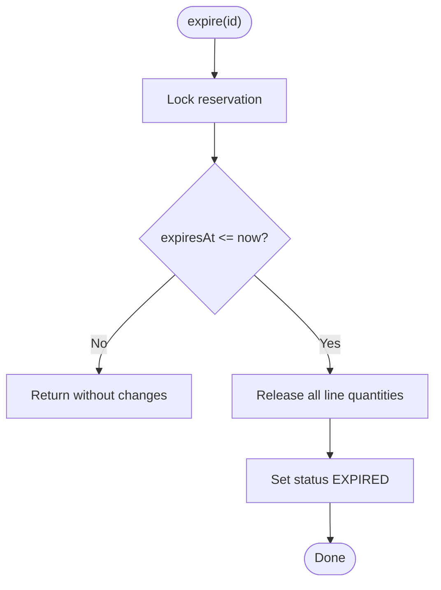

**Diagram sources**
- [InventoryReservationService.java:87-97](file://src/main/java/com/smartcoffee/modules/inventory/application/InventoryReservationService.java#L87-L97)

**Section sources**
- [InventoryReservationService.java:87-97](file://src/main/java/com/smartcoffee/modules/inventory/application/InventoryReservationService.java#L87-L97)

### Reservation Status Transitions
- ACTIVE: Initial state upon creation.
- CONSUMED: After successful consumption during preparation.
- RELEASED: After explicit release due to cancellation.
- EXPIRED: After TTL elapses without consumption.

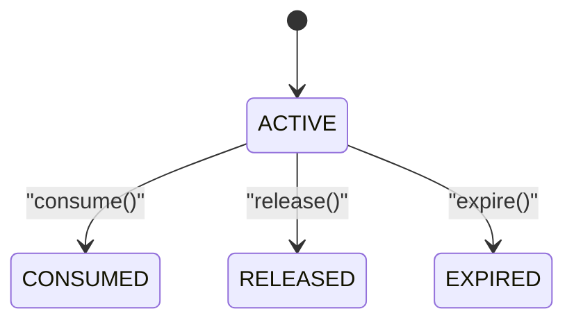

**Diagram sources**
- [ReservationStatus.java:1-7](file://src/main/java/com/smartcoffee/modules/inventory/domain/ReservationStatus.java#L1-L7)
- [InventoryReservation.java:58-79](file://src/main/java/com/smartcoffee/modules/inventory/domain/InventoryReservation.java#L58-L79)

**Section sources**
- [ReservationStatus.java:1-7](file://src/main/java/com/smartcoffee/modules/inventory/domain/ReservationStatus.java#L1-L7)
- [InventoryReservation.java:58-79](file://src/main/java/com/smartcoffee/modules/inventory/domain/InventoryReservation.java#L58-L79)

### Audit Logging
- Every consumption creates a StockTransaction with type SALE_CONSUMPTION and associated StockTransactionLine entries.
- Each line captures ingredientId, delta (negative), unit cost (optional), and snapshot balances before and after.
- Transaction numbers are unique and generated per StockTransaction.

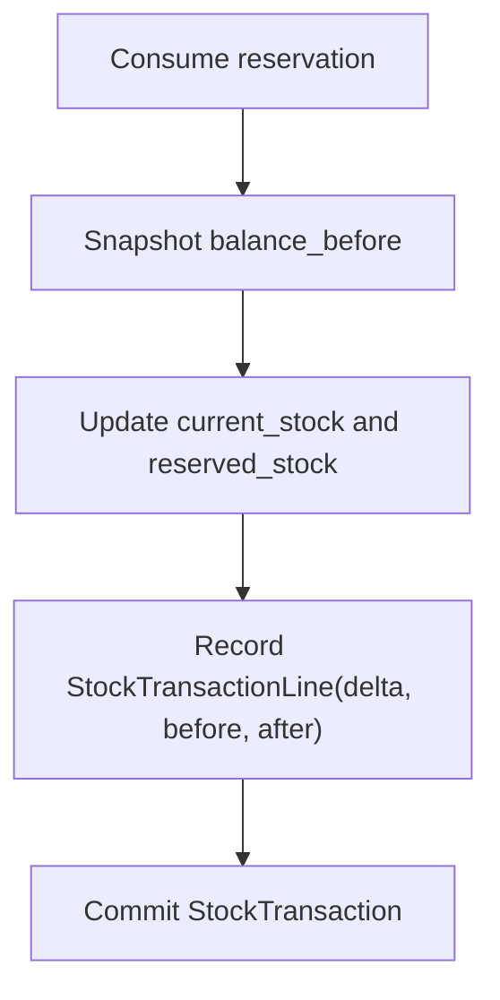

**Diagram sources**
- [InventoryReservationService.java:71-84](file://src/main/java/com/smartcoffee/modules/inventory/application/InventoryReservationService.java#L71-L84)
- [StockTransaction.java:36-53](file://src/main/java/com/smartcoffee/modules/inventory/domain/StockTransaction.java#L36-L53)
- [StockTransactionLine.java:33-42](file://src/main/java/com/smartcoffee/modules/inventory/domain/StockTransactionLine.java#L33-L42)

**Section sources**
- [InventoryReservationService.java:71-84](file://src/main/java/com/smartcoffee/modules/inventory/application/InventoryReservationService.java#L71-L84)
- [StockTransaction.java:36-53](file://src/main/java/com/smartcoffee/modules/inventory/domain/StockTransaction.java#L36-L53)
- [StockTransactionLine.java:33-42](file://src/main/java/com/smartcoffee/modules/inventory/domain/StockTransactionLine.java#L33-L42)

### Priority Queuing and Conflict Resolution
- Deterministic processing: Lines are sorted by ingredientId to ensure consistent ordering across retries and transactions.
- Conflict resolution:
  - Insufficient stock during reservation results in a conflict exception.
  - Balance updates use optimistic versioning and row-level checks to avoid partial updates.
  - Pessimistic locking on reservations prevents concurrent state mutations.

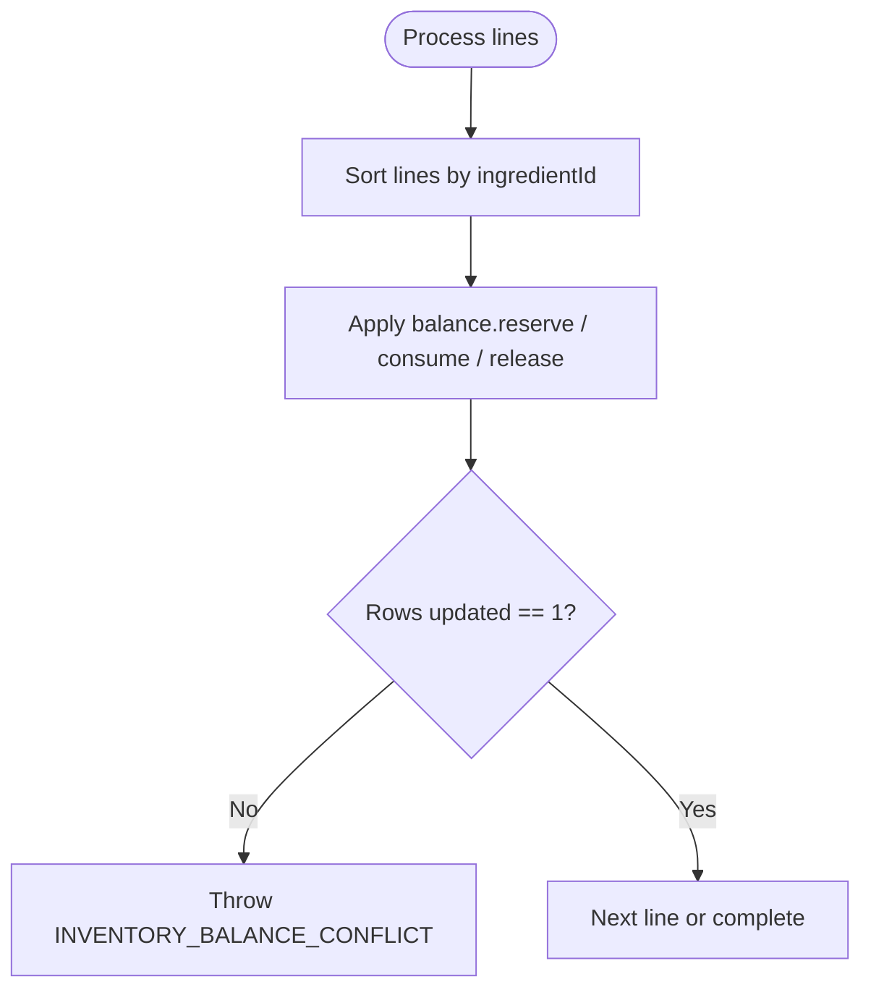

**Diagram sources**
- [InventoryReservationService.java:47-53](file://src/main/java/com/smartcoffee/modules/inventory/application/InventoryReservationService.java#L47-L53)
- [InventoryReservationService.java:60-64](file://src/main/java/com/smartcoffee/modules/inventory/application/InventoryReservationService.java#L60-L64)
- [InventoryReservationService.java:72-81](file://src/main/java/com/smartcoffee/modules/inventory/application/InventoryReservationService.java#L72-L81)

**Section sources**
- [InventoryReservationService.java:47-53](file://src/main/java/com/smartcoffee/modules/inventory/application/InventoryReservationService.java#L47-L53)
- [InventoryReservationService.java:60-64](file://src/main/java/com/smartcoffee/modules/inventory/application/InventoryReservationService.java#L60-L64)
- [InventoryReservationService.java:72-81](file://src/main/java/com/smartcoffee/modules/inventory/application/InventoryReservationService.java#L72-L81)

### Examples

#### Reserving Stock for Orders
- Call reserve(store, orderId, demandMap, ttl).
- Demand map keys are ingredient IDs; values are required quantities.
- On success, returns a reservationId; on insufficient stock, throws a conflict error.

**Section sources**
- [InventoryReservationService.java:43-54](file://src/main/java/com/smartcoffee/modules/inventory/application/InventoryReservationService.java#L43-L54)

#### Partial Fulfillments
- The current implementation consumes the full reserved quantity per line.
- To support partial fulfillment, extend InventoryReservationLine to allow partial consumption and adjust StockTransactionLine accordingly.

[No sources needed since this section proposes future extension]

#### Reservation Releases
- Call release(reservationId) to cancel an order and return reserved stock.
- Ensures all lines are released atomically within a transaction.

**Section sources**
- [InventoryReservationService.java:56-65](file://src/main/java/com/smartcoffee/modules/inventory/application/InventoryReservationService.java#L56-L65)

### Concurrent Reservation Handling and Deadlock Prevention
- Pessimistic locking: InventoryReservationRepository.lock uses PESSIMISTIC_WRITE to serialize access to a reservation.
- Optimistic versioning: InventoryBalance uses a version column and SQL conditions to prevent lost updates.
- Deterministic iteration: Sorting by ingredientId reduces deadlock risk by ensuring consistent lock acquisition order across multiple resources.
- Idempotency: Checking for existing reservation by orderId avoids duplicate reservations.

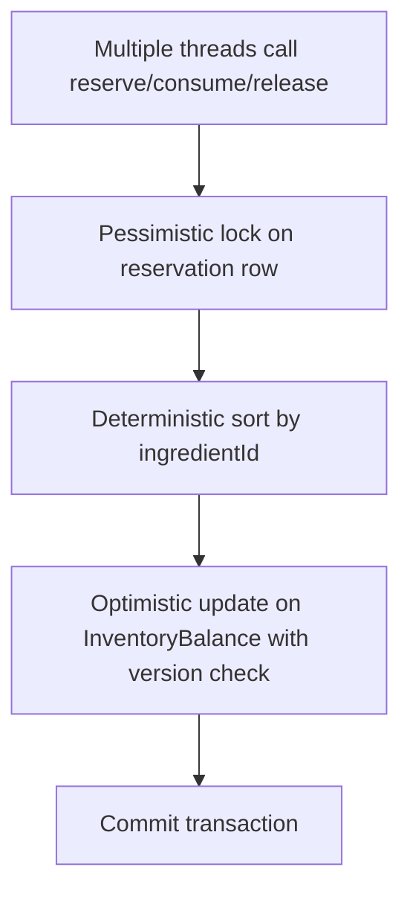

**Diagram sources**
- [InventoryReservationRepository.java:11-15](file://src/main/java/com/smartcoffee/modules/inventory/persistence/InventoryReservationRepository.java#L11-L15)
- [InventoryBalanceRepository.java:10-20](file://src/main/java/com/smartcoffee/modules/inventory/persistence/InventoryBalanceRepository.java#L10-L20)
- [InventoryReservationService.java:47-53](file://src/main/java/com/smartcoffee/modules/inventory/application/InventoryReservationService.java#L47-L53)

**Section sources**
- [InventoryReservationRepository.java:11-15](file://src/main/java/com/smartcoffee/modules/inventory/persistence/InventoryReservationRepository.java#L11-L15)
- [InventoryBalanceRepository.java:10-20](file://src/main/java/com/smartcoffee/modules/inventory/persistence/InventoryBalanceRepository.java#L10-L20)
- [InventoryReservationService.java:47-53](file://src/main/java/com/smartcoffee/modules/inventory/application/InventoryReservationService.java#L47-L53)

### Integration with Payment Expiration
- PaymentExpirationService runs periodically to expire unpaid orders.
- For each expired payment:
  - Marks the payment as expired.
  - Expires the corresponding order.
  - Finds the active reservation for the order and calls release to return reserved stock.

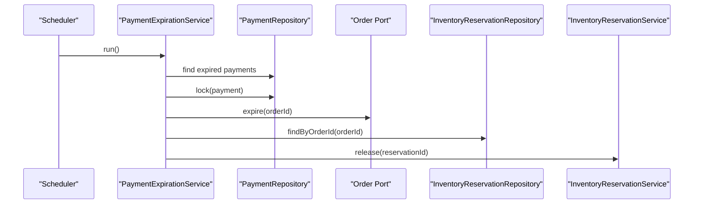

**Diagram sources**
- [PaymentExpirationService.java:27-40](file://src/main/java/com/smartcoffee/modules/payment/application/PaymentExpirationService.java#L27-L40)

**Section sources**
- [PaymentExpirationService.java:27-40](file://src/main/java/com/smartcoffee/modules/payment/application/PaymentExpirationService.java#L27-L40)

## Dependency Analysis
- InventoryReservationService depends on:
  - InventoryBalanceRepository for atomic balance updates.
  - InventoryReservationRepository for reservation persistence and locking.
  - StockTransactionRepository for audit logging.
- PaymentExpirationService depends on:
  - InventoryReservationRepository to locate reservations by order.
  - InventoryReservationService to perform releases.

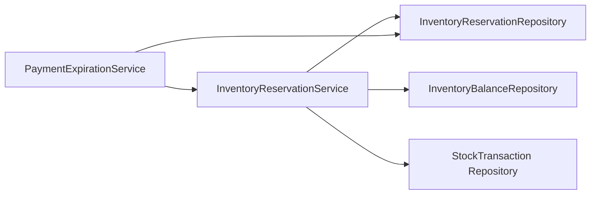

**Diagram sources**
- [InventoryReservationService.java:30-41](file://src/main/java/com/smartcoffee/modules/inventory/application/InventoryReservationService.java#L30-L41)
- [PaymentExpirationService.java:12-24](file://src/main/java/com/smartcoffee/modules/payment/application/PaymentExpirationService.java#L12-L24)

**Section sources**
- [InventoryReservationService.java:30-41](file://src/main/java/com/smartcoffee/modules/inventory/application/InventoryReservationService.java#L30-L41)
- [PaymentExpirationService.java:12-24](file://src/main/java/com/smartcoffee/modules/payment/application/PaymentExpirationService.java#L12-L24)

## Performance Considerations
- Batched expiration queries: Use page-based queries to process expired reservations in batches.
- Index usage: Ensure indexes exist on expires_at for fast expiration scans and on store_id + ingredient_id for balance lookups.
- Deterministic ordering: Sorting by ingredientId minimizes contention and deadlocks.
- Avoid unnecessary reads: Prefer repository methods that fetch only necessary data; entity graphs load lines efficiently.
- Transaction boundaries: Keep transactions short and focused to reduce lock hold times.

[No sources needed since this section provides general guidance]

## Troubleshooting Guide
Common issues and resolutions:
- INSUFFICIENT_STOCK: Occurs when attempting to reserve more than available stock. Validate demand against availableStock(current_stock - reserved_stock).
- INVENTORY_BALANCE_CONFLICT: Indicates a failed balance update, often due to concurrent modifications or inconsistent state. Retry with backoff and verify reservation state.
- RESERVATION_STATE_CONFLICT: Attempting to consume/release/expire a non-ACTIVE reservation. Verify lifecycle and idempotency.
- Reservation not found: Ensure the correct reservationId is passed and that it was created successfully.

Operational checks:
- Confirm that scheduled jobs are running and configured correctly.
- Monitor database locks and slow queries related to reservation and balance updates.
- Review audit logs via StockTransaction entries to trace consumption paths.

**Section sources**
- [InventoryReservationService.java:43-97](file://src/main/java/com/smartcoffee/modules/inventory/application/InventoryReservationService.java#L43-L97)
- [InventoryReservation.java:58-79](file://src/main/java/com/smartcoffee/modules/inventory/domain/InventoryReservation.java#L58-L79)

## Conclusion
The inventory reservation system provides robust, auditable, and concurrent-safe mechanisms to reserve, consume, release, and expire stock for orders. It leverages pessimistic locking for reservations, optimistic versioning for balances, deterministic processing to prevent deadlocks, and append-only audit trails for traceability. Integrating with payment expiration ensures timely release of reserved stock when orders are not paid.

[No sources needed since this section summarizes without analyzing specific files]