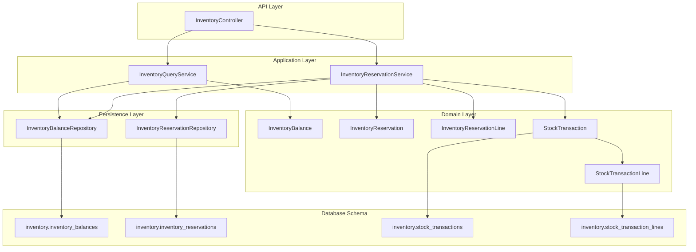
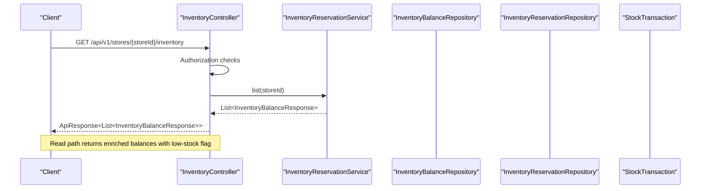
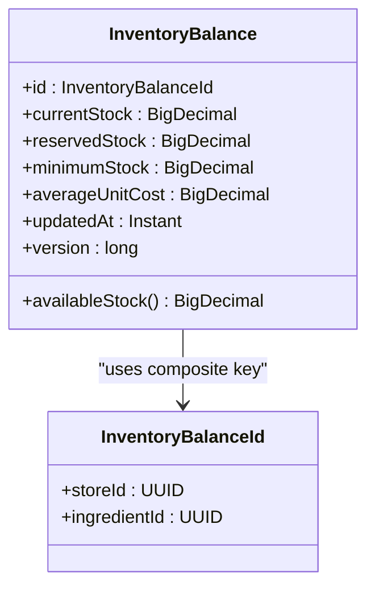
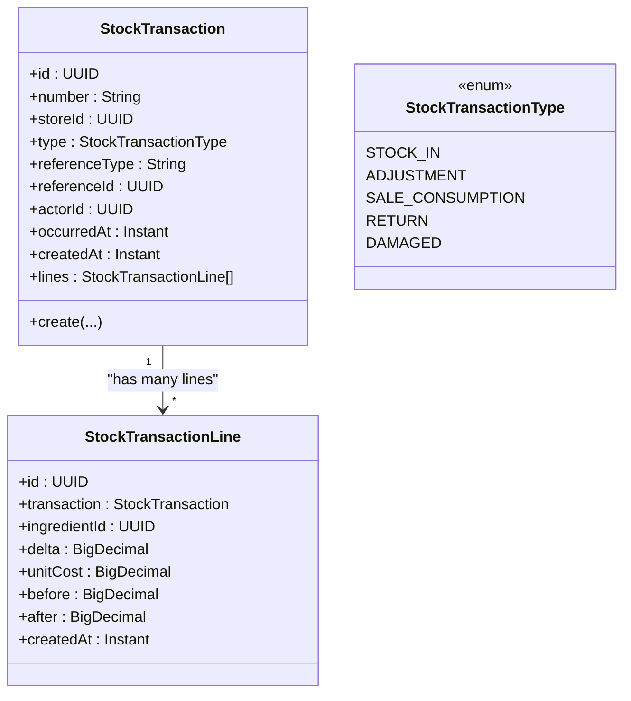
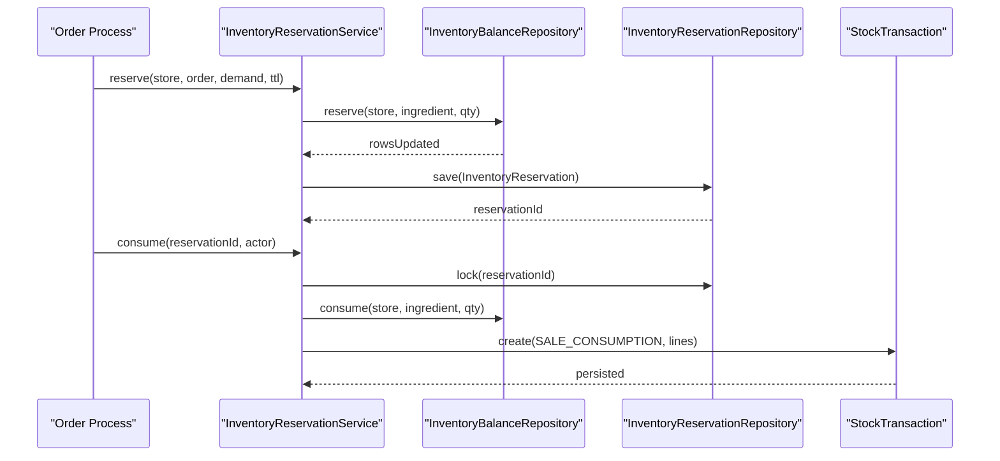
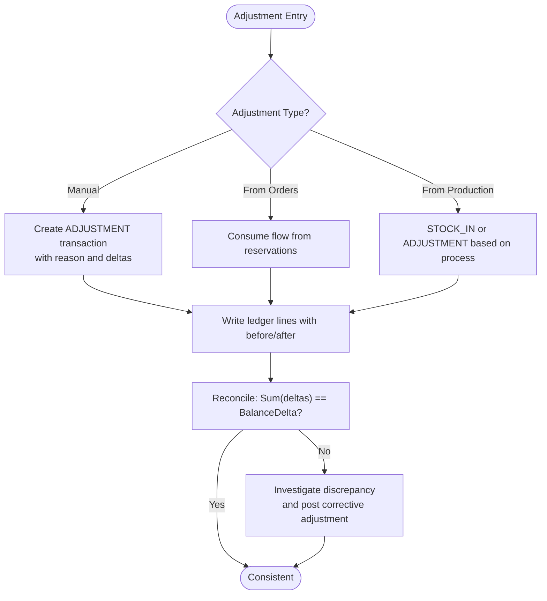
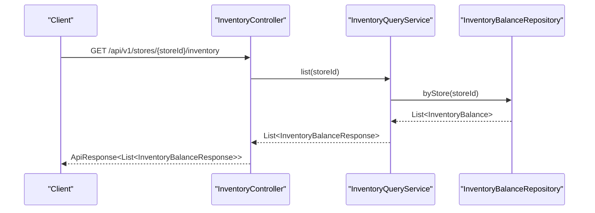
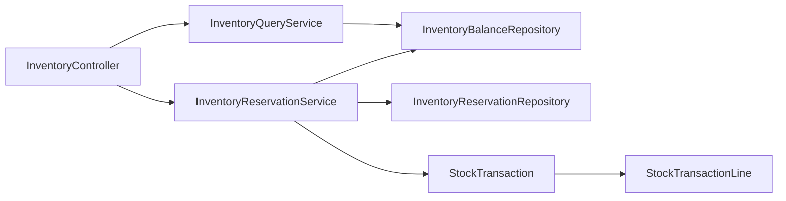

# Stock Level Tracking

<cite>
**Referenced Files in This Document**
- [InventoryBalance.java](file://src/main/java/com/smartcoffee/modules/inventory/domain/InventoryBalance.java)
- [InventoryBalanceId.java](file://src/main/java/com/smartcoffee/modules/inventory/domain/InventoryBalanceId.java)
- [StockTransaction.java](file://src/main/java/com/smartcoffee/modules/inventory/domain/StockTransaction.java)
- [StockTransactionLine.java](file://src/main/java/com/smartcoffee/modules/inventory/domain/StockTransactionLine.java)
- [StockTransactionType.java](file://src/main/java/com/smartcoffee/modules/inventory/domain/StockTransactionType.java)
- [InventoryReservation.java](file://src/main/java/com/smartcoffee/modules/inventory/domain/InventoryReservation.java)
- [InventoryReservationLine.java](file://src/main/java/com/smartcoffee/modules/inventory/domain/InventoryReservationLine.java)
- [InventoryReservationService.java](file://src/main/java/com/smartcoffee/modules/inventory/application/InventoryReservationService.java)
- [InventoryQueryService.java](file://src/main/java/com/smartcoffee/modules/inventory/application/InventoryQueryService.java)
- [InventoryController.java](file://src/main/java/com/smartcoffee/modules/inventory/api/InventoryController.java)
- [InventoryBalanceResponse.java](file://src/main/java/com/smartcoffee/modules/inventory/api/InventoryBalanceResponse.java)
- [InventoryBalanceRepository.java](file://src/main/java/com/smartcoffee/modules/inventory/persistence/InventoryBalanceRepository.java)
- [InventoryReservationRepository.java](file://src/main/java/com/smartcoffee/modules/inventory/persistence/InventoryReservationRepository.java)
- [smart-coffee-logical.dbml](file://database/smart-coffee-logical.dbml)
</cite>

## Table of Contents
1. [Introduction](#introduction)
2. [Project Structure](#project-structure)
3. [Core Components](#core-components)
4. [Architecture Overview](#architecture-overview)
5. [Detailed Component Analysis](#detailed-component-analysis)
6. [Dependency Analysis](#dependency-analysis)
7. [Performance Considerations](#performance-considerations)
8. [Troubleshooting Guide](#troubleshooting-guide)
9. [Conclusion](#conclusion)

## Introduction
This document explains the stock level tracking system for ingredients across stores. It covers:
- InventoryBalance entity structure and available stock calculation
- Real-time inventory updates via reservations, consumption, and release
- StockTransaction ledger for audit trails and historical tracking
- Stock adjustment processes (manual adjustments, automatic calculations from orders and production)
- Reconciliation procedures to ensure data consistency
- Examples of stock queries, balance reporting, and transaction history retrieval
- Concurrency controls, optimistic locking, and consistency guarantees
- Low stock alerting thresholds and notification triggers

## Project Structure
The stock tracking functionality is implemented within the inventory module with clear separation between domain entities, application services, persistence repositories, and API controllers. The database schema defines balances, reservations, and a double-entry style ledger for transactions.

**Diagram sources**
- [InventoryController.java:10-32](file://src/main/java/com/smartcoffee/modules/inventory/api/InventoryController.java#L10-L32)
- [InventoryQueryService.java:1-3](file://src/main/java/com/smartcoffee/modules/inventory/application/InventoryQueryService.java#L1-L3)
- [InventoryReservationService.java:30-98](file://src/main/java/com/smartcoffee/modules/inventory/application/InventoryReservationService.java#L30-L98)
- [InventoryBalance.java:7-55](file://src/main/java/com/smartcoffee/modules/inventory/domain/InventoryBalance.java#L7-L55)
- [InventoryReservation.java:8-104](file://src/main/java/com/smartcoffee/modules/inventory/domain/InventoryReservation.java#L8-L104)
- [InventoryReservationLine.java:8-53](file://src/main/java/com/smartcoffee/modules/inventory/domain/InventoryReservationLine.java#L8-L53)
- [StockTransaction.java:7-54](file://src/main/java/com/smartcoffee/modules/inventory/domain/StockTransaction.java#L7-L54)
- [StockTransactionLine.java:8-47](file://src/main/java/com/smartcoffee/modules/inventory/domain/StockTransactionLine.java#L8-L47)
- [InventoryBalanceRepository.java:9-24](file://src/main/java/com/smartcoffee/modules/inventory/persistence/InventoryBalanceRepository.java#L9-L24)
- [InventoryReservationRepository.java:11-21](file://src/main/java/com/smartcoffee/modules/inventory/persistence/InventoryReservationRepository.java#L11-L21)
- [smart-coffee-logical.dbml:607-677](file://database/smart-coffee-logical.dbml#L607-L677)

**Section sources**
- [InventoryController.java:10-32](file://src/main/java/com/smartcoffee/modules/inventory/api/InventoryController.java#L10-L32)
- [InventoryQueryService.java:1-3](file://src/main/java/com/smartcoffee/modules/inventory/application/InventoryQueryService.java#L1-L3)
- [InventoryReservationService.java:30-98](file://src/main/java/com/smartcoffee/modules/inventory/application/InventoryReservationService.java#L30-L98)
- [InventoryBalance.java:7-55](file://src/main/java/com/smartcoffee/modules/inventory/domain/InventoryBalance.java#L7-L55)
- [InventoryReservation.java:8-104](file://src/main/java/com/smartcoffee/modules/inventory/domain/InventoryReservation.java#L8-L104)
- [InventoryReservationLine.java:8-53](file://src/main/java/com/smartcoffee/modules/inventory/domain/InventoryReservationLine.java#L8-L53)
- [StockTransaction.java:7-54](file://src/main/java/com/smartcoffee/modules/inventory/domain/StockTransaction.java#L7-L54)
- [StockTransactionLine.java:8-47](file://src/main/java/com/smartcoffee/modules/inventory/domain/StockTransactionLine.java#L8-L47)
- [InventoryBalanceRepository.java:9-24](file://src/main/java/com/smartcoffee/modules/inventory/persistence/InventoryBalanceRepository.java#L9-L24)
- [InventoryReservationRepository.java:11-21](file://src/main/java/com/smartcoffee/modules/inventory/persistence/InventoryReservationRepository.java#L11-L21)
- [smart-coffee-logical.dbml:607-677](file://database/smart-coffee-logical.dbml#L607-L677)

## Core Components
- InventoryBalance: Represents per-store ingredient balances including current stock, reserved stock, minimum stock, average unit cost, and versioned optimistic lock. Provides derived available stock.
- InventoryReservation and InventoryReservationLine: Model temporary holds on stock for an order with expiration and lifecycle states (active, consumed, released, expired).
- StockTransaction and StockTransactionLine: Immutable ledger entries capturing deltas, before/after balances, and metadata for auditability.
- InventoryReservationService: Orchestrates reservation, release, consumption, and expiration workflows with concurrency-safe operations.
- InventoryQueryService: Reads store-level inventory balances and enriches them with ingredient and unit-of-measure details.
- InventoryController: Exposes read-only listing of inventory balances with authorization checks.

Key behaviors:
- Available stock = current stock - reserved stock
- Reservations increment reserved stock; consumption decrements both reserved and current stock
- Ledger lines record before/after snapshots for traceability
- Optimistic locking via version fields ensures safe concurrent updates

**Section sources**
- [InventoryBalance.java:7-55](file://src/main/java/com/smartcoffee/modules/inventory/domain/InventoryBalance.java#L7-L55)
- [InventoryReservation.java:8-104](file://src/main/java/com/smartcoffee/modules/inventory/domain/InventoryReservation.java#L8-L104)
- [InventoryReservationLine.java:8-53](file://src/main/java/com/smartcoffee/modules/inventory/domain/InventoryReservationLine.java#L8-L53)
- [StockTransaction.java:7-54](file://src/main/java/com/smartcoffee/modules/inventory/domain/StockTransaction.java#L7-L54)
- [StockTransactionLine.java:8-47](file://src/main/java/com/smartcoffee/modules/inventory/domain/StockTransactionLine.java#L8-L47)
- [InventoryReservationService.java:30-98](file://src/main/java/com/smartcoffee/modules/inventory/application/InventoryReservationService.java#L30-L98)
- [InventoryQueryService.java:1-3](file://src/main/java/com/smartcoffee/modules/inventory/application/InventoryQueryService.java#L1-L3)
- [InventoryController.java:10-32](file://src/main/java/com/smartcoffee/modules/inventory/api/InventoryController.java#L10-L32)

## Architecture Overview
The system uses a layered architecture with strict boundaries:
- API layer validates permissions and delegates to services
- Application layer implements business workflows and orchestrates persistence
- Domain layer encapsulates state transitions and invariants
- Persistence layer provides atomic SQL updates and pessimistic locks where needed
- Database schema enforces referential integrity and indexes for performance

**Diagram sources**
- [InventoryController.java:26-32](file://src/main/java/com/smartcoffee/modules/inventory/api/InventoryController.java#L26-L32)
- [InventoryQueryService.java:1-3](file://src/main/java/com/smartcoffee/modules/inventory/application/InventoryQueryService.java#L1-L3)

## Detailed Component Analysis

### InventoryBalance Entity
- Composite key: store + ingredient
- Fields: current_stock, reserved_stock, minimum_stock, average_unit_cost, updated_at, version
- Derived method: available_stock = current_stock - reserved_stock
- Optimistic locking via @Version ensures safe concurrent updates

**Diagram sources**
- [InventoryBalance.java:7-55](file://src/main/java/com/smartcoffee/modules/inventory/domain/InventoryBalance.java#L7-L55)
- [InventoryBalanceId.java:7-9](file://src/main/java/com/smartcoffee/modules/inventory/domain/InventoryBalanceId.java#L7-L9)

**Section sources**
- [InventoryBalance.java:7-55](file://src/main/java/com/smartcoffee/modules/inventory/domain/InventoryBalance.java#L7-L55)
- [InventoryBalanceId.java:7-9](file://src/main/java/com/smartcoffee/modules/inventory/domain/InventoryBalanceId.java#L7-L9)

### StockTransaction Ledger System
- Transaction header: unique number, store, type, reference context, actor, timestamps
- Lines: ingredient delta, optional unit cost, before/after balance snapshots
- Types include STOCK_IN, ADJUSTMENT, SALE_CONSUMPTION, RETURN, DAMAGED

**Diagram sources**
- [StockTransaction.java:7-54](file://src/main/java/com/smartcoffee/modules/inventory/domain/StockTransaction.java#L7-L54)
- [StockTransactionLine.java:8-47](file://src/main/java/com/smartcoffee/modules/inventory/domain/StockTransactionLine.java#L8-L47)
- [StockTransactionType.java:3-5](file://src/main/java/com/smartcoffee/modules/inventory/domain/StockTransactionType.java#L3-L5)

**Section sources**
- [StockTransaction.java:7-54](file://src/main/java/com/smartcoffee/modules/inventory/domain/StockTransaction.java#L7-L54)
- [StockTransactionLine.java:8-47](file://src/main/java/com/smartcoffee/modules/inventory/domain/StockTransactionLine.java#L8-L47)
- [StockTransactionType.java:3-5](file://src/main/java/com/smartcoffee/modules/inventory/domain/StockTransactionType.java#L3-L5)

### Reservation Workflow and Real-Time Updates
- reserve: Idempotent by order; increments reserved stock atomically; creates reservation with TTL
- consume: Locks reservation; decrements reserved and current stock; writes ledger lines with before/after snapshots
- release/expiry: Releases reserved stock back to available pool; marks reservation state accordingly

**Diagram sources**
- [InventoryReservationService.java:43-85](file://src/main/java/com/smartcoffee/modules/inventory/application/InventoryReservationService.java#L43-L85)
- [InventoryBalanceRepository.java:10-20](file://src/main/java/com/smartcoffee/modules/inventory/persistence/InventoryBalanceRepository.java#L10-L20)
- [InventoryReservationRepository.java:11-21](file://src/main/java/com/smartcoffee/modules/inventory/persistence/InventoryReservationRepository.java#L11-L21)

**Section sources**
- [InventoryReservationService.java:43-85](file://src/main/java/com/smartcoffee/modules/inventory/application/InventoryReservationService.java#L43-L85)
- [InventoryBalanceRepository.java:10-20](file://src/main/java/com/smartcoffee/modules/inventory/persistence/InventoryBalanceRepository.java#L10-L20)
- [InventoryReservationRepository.java:11-21](file://src/main/java/com/smartcoffee/modules/inventory/persistence/InventoryReservationRepository.java#L11-L21)

### Stock Adjustment Processes
- Manual adjustments: Use StockTransactionType.ADJUSTMENT to adjust balances directly; write ledger lines with reason and before/after snapshots
- Automatic calculations from orders: Handled via reservation and consumption flows that decrement stock upon sale
- Production integration: Production tickets can trigger stock movements; typically recorded as STOCK_IN or ADJUSTMENT depending on process
- Reconciliation: Compare sum of ledger line deltas against balance changes; detect discrepancies and correct via adjustment transactions

**Diagram sources**
- [StockTransactionType.java:3-5](file://src/main/java/com/smartcoffee/modules/inventory/domain/StockTransactionType.java#L3-L5)
- [InventoryReservationService.java:67-85](file://src/main/java/com/smartcoffee/modules/inventory/application/InventoryReservationService.java#L67-L85)

**Section sources**
- [StockTransactionType.java:3-5](file://src/main/java/com/smartcoffee/modules/inventory/domain/StockTransactionType.java#L3-L5)
- [InventoryReservationService.java:67-85](file://src/main/java/com/smartcoffee/modules/inventory/application/InventoryReservationService.java#L67-L85)

### Stock Queries and Reporting
- Listing balances: Returns current stock, reserved stock, available stock, minimum stock, average unit cost, low stock flag, and version
- Low stock flag: Computed as availableStock <= minimumStock
- Enrichment: Joins ingredient and unit-of-measure metadata for readable responses

**Diagram sources**
- [InventoryController.java:26-32](file://src/main/java/com/smartcoffee/modules/inventory/api/InventoryController.java#L26-L32)
- [InventoryQueryService.java:1-3](file://src/main/java/com/smartcoffee/modules/inventory/application/InventoryQueryService.java#L1-L3)
- [InventoryBalanceRepository.java:22-23](file://src/main/java/com/smartcoffee/modules/inventory/persistence/InventoryBalanceRepository.java#L22-L23)

**Section sources**
- [InventoryController.java:26-32](file://src/main/java/com/smartcoffee/modules/inventory/api/InventoryController.java#L26-L32)
- [InventoryQueryService.java:1-3](file://src/main/java/com/smartcoffee/modules/inventory/application/InventoryQueryService.java#L1-L3)
- [InventoryBalanceResponse.java:6-9](file://src/main/java/com/smartcoffee/modules/inventory/api/InventoryBalanceResponse.java#L6-L9)

### Transaction History Retrieval
- Retrieve StockTransaction headers filtered by store and type
- Retrieve StockTransactionLines linked to a transaction for detailed deltas and snapshots
- Use idempotency keys and indexes for efficient querying and deduplication

**Section sources**
- [StockTransaction.java:7-54](file://src/main/java/com/smartcoffee/modules/inventory/domain/StockTransaction.java#L7-L54)
- [StockTransactionLine.java:8-47](file://src/main/java/com/smartcoffee/modules/inventory/domain/StockTransactionLine.java#L8-L47)
- [smart-coffee-logical.dbml:653-677](file://database/smart-coffee-logical.dbml#L653-L677)

## Dependency Analysis
- InventoryController depends on InventoryQueryService for read operations
- InventoryReservationService depends on InventoryBalanceRepository, InventoryReservationRepository, and persists StockTransaction
- Domain entities are decoupled from persistence except through repository interfaces
- Database schema provides strong constraints and indexes for performance

**Diagram sources**
- [InventoryController.java:10-32](file://src/main/java/com/smartcoffee/modules/inventory/api/InventoryController.java#L10-L32)
- [InventoryQueryService.java:1-3](file://src/main/java/com/smartcoffee/modules/inventory/application/InventoryQueryService.java#L1-L3)
- [InventoryReservationService.java:30-98](file://src/main/java/com/smartcoffee/modules/inventory/application/InventoryReservationService.java#L30-L98)
- [InventoryBalanceRepository.java:9-24](file://src/main/java/com/smartcoffee/modules/inventory/persistence/InventoryBalanceRepository.java#L9-L24)
- [InventoryReservationRepository.java:11-21](file://src/main/java/com/smartcoffee/modules/inventory/persistence/InventoryReservationRepository.java#L11-L21)
- [StockTransaction.java:7-54](file://src/main/java/com/smartcoffee/modules/inventory/domain/StockTransaction.java#L7-L54)
- [StockTransactionLine.java:8-47](file://src/main/java/com/smartcoffee/modules/inventory/domain/StockTransactionLine.java#L8-L47)

**Section sources**
- [InventoryController.java:10-32](file://src/main/java/com/smartcoffee/modules/inventory/api/InventoryController.java#L10-L32)
- [InventoryQueryService.java:1-3](file://src/main/java/com/smartcoffee/modules/inventory/application/InventoryQueryService.java#L1-L3)
- [InventoryReservationService.java:30-98](file://src/main/java/com/smartcoffee/modules/inventory/application/InventoryReservationService.java#L30-L98)
- [InventoryBalanceRepository.java:9-24](file://src/main/java/com/smartcoffee/modules/inventory/persistence/InventoryBalanceRepository.java#L9-L24)
- [InventoryReservationRepository.java:11-21](file://src/main/java/com/smartcoffee/modules/inventory/persistence/InventoryReservationRepository.java#L11-L21)
- [StockTransaction.java:7-54](file://src/main/java/com/smartcoffee/modules/inventory/domain/StockTransaction.java#L7-L54)
- [StockTransactionLine.java:8-47](file://src/main/java/com/smartcoffee/modules/inventory/domain/StockTransactionLine.java#L8-L47)

## Performance Considerations
- Atomic SQL updates in InventoryBalanceRepository prevent race conditions and reduce contention
- Pessimistic locking on reservation reads avoids lost updates during consume/release/expiry
- Indexes on store_id, transaction_number, and expires_at support fast queries and scheduled expiry processing
- Batch operations should be used when adjusting multiple ingredients to minimize round trips
- Avoid reading large result sets without pagination; consider projections for reporting

[No sources needed since this section provides general guidance]

## Troubleshooting Guide
Common issues and resolutions:
- Insufficient stock errors: Occur when reserve fails due to insufficient available stock; verify minimum_stock settings and incoming supply
- Inventory balance conflicts: Happen when version mismatch occurs during update; retry with fresh reads or implement backoff
- Reservation not found: Ensure reservation exists and is active; check lifecycle state transitions
- Low stock alerts: Compute using availableStock vs minimumStock; integrate with notification system to alert operators

Operational tips:
- Monitor conflict exceptions and log transaction numbers for traceability
- Use reconciliation jobs to compare ledger sums with balance changes
- Validate that all consumption paths produce corresponding ledger entries

**Section sources**
- [InventoryReservationService.java:43-98](file://src/main/java/com/smartcoffee/modules/inventory/application/InventoryReservationService.java#L43-L98)
- [InventoryQueryService.java:1-3](file://src/main/java/com/smartcoffee/modules/inventory/application/InventoryQueryService.java#L1-L3)

## Conclusion
The stock level tracking system provides robust, auditable, and concurrent-safe management of ingredient inventories. Through atomic updates, optimistic locking, reservation lifecycles, and comprehensive ledger entries, it ensures data consistency and supports real-time visibility into stock levels. The design enables manual adjustments, automated order-driven consumption, and production-related stock movements while offering clear mechanisms for reconciliation and alerting.

[No sources needed since this section summarizes without analyzing specific files]