# Loyalty Account Management

<cite>
**Referenced Files in This Document**
- [LoyaltyAccount.java](file://src/main/java/com/smartcoffee/modules/loyalty/domain/LoyaltyAccount.java)
- [LoyaltyTransaction.java](file://src/main/java/com/smartcoffee/modules/loyalty/domain/LoyaltyTransaction.java)
- [LoyaltyPointService.java](file://src/main/java/com/smartcoffee/modules/loyalty/application/LoyaltyPointService.java)
- [LoyaltyQueryService.java](file://src/main/java/com/smartcoffee/modules/loyalty/application/LoyaltyQueryService.java)
- [LoyaltyController.java](file://src/main/java/com/smartcoffee/modules/loyalty/api/LoyaltyController.java)
- [LoyaltyAccountRepository.java](file://src/main/java/com/smartcoffee/modules/loyalty/persistence/LoyaltyAccountRepository.java)
- [V009__promotions_loyalty.sql](file://src/main/resources/db/migration/V009__promotions_loyalty.sql)
</cite>

## Table of Contents
1. [Introduction](#introduction)
2. [Project Structure](#project-structure)
3. [Core Components](#core-components)
4. [Architecture Overview](#architecture-overview)
5. [Detailed Component Analysis](#detailed-component-analysis)
6. [Dependency Analysis](#dependency-analysis)
7. [Performance Considerations](#performance-considerations)
8. [Troubleshooting Guide](#troubleshooting-guide)
9. [Conclusion](#conclusion)

## Introduction
This document explains the Loyalty Account management system within the Smart Coffee backend. It covers the full lifecycle of a loyalty account from creation to status management, customer association, and point operations such as earning, reserving, redeeming, and releasing points. It also documents the core state model (available and reserved points, lifetime earned/redeemed totals), concurrency control via optimistic locking and pessimistic reads, data consistency patterns, and audit trail considerations through an immutable transaction ledger.

## Project Structure
The loyalty module is organized by typical layered architecture:
- Domain: aggregates and business rules for accounts and transactions
- Application: use cases orchestrating persistence and domain logic
- API: REST endpoints exposing queries
- Persistence: JPA repositories and database schema

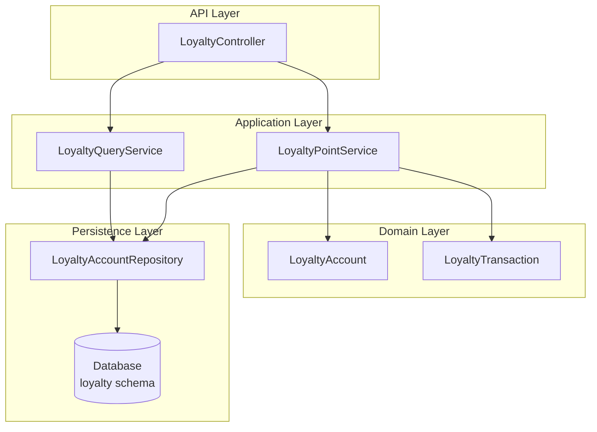

**Diagram sources**
- [LoyaltyController.java:10-27](file://src/main/java/com/smartcoffee/modules/loyalty/api/LoyaltyController.java#L10-L27)
- [LoyaltyQueryService.java:10-24](file://src/main/java/com/smartcoffee/modules/loyalty/application/LoyaltyQueryService.java#L10-L24)
- [LoyaltyPointService.java:10-59](file://src/main/java/com/smartcoffee/modules/loyalty/application/LoyaltyPointService.java#L10-L59)
- [LoyaltyAccount.java:8-31](file://src/main/java/com/smartcoffee/modules/loyalty/domain/LoyaltyAccount.java#L8-L31)
- [LoyaltyTransaction.java:7-31](file://src/main/java/com/smartcoffee/modules/loyalty/domain/LoyaltyTransaction.java#L7-L31)
- [LoyaltyAccountRepository.java:9-15](file://src/main/java/com/smartcoffee/modules/loyalty/persistence/LoyaltyAccountRepository.java#L9-L15)

**Section sources**
- [LoyaltyController.java:10-27](file://src/main/java/com/smartcoffee/modules/loyalty/api/LoyaltyController.java#L10-L27)
- [LoyaltyQueryService.java:10-24](file://src/main/java/com/smartcoffee/modules/loyalty/application/LoyaltyQueryService.java#L10-L24)
- [LoyaltyPointService.java:10-59](file://src/main/java/com/smartcoffee/modules/loyalty/application/LoyaltyPointService.java#L10-L59)
- [LoyaltyAccount.java:8-31](file://src/main/java/com/smartcoffee/modules/loyalty/domain/LoyaltyAccount.java#L8-L31)
- [LoyaltyTransaction.java:7-31](file://src/main/java/com/smartcoffee/modules/loyalty/domain/LoyaltyTransaction.java#L7-L31)
- [LoyaltyAccountRepository.java:9-15](file://src/main/java/com/smartcoffee/modules/loyalty/persistence/LoyaltyAccountRepository.java#L9-L15)

## Core Components
- LoyaltyAccount: Represents a customer’s loyalty account with available and reserved points, lifetime earned/redeemed counters, status, timestamps, and version for optimistic locking.
- LoyaltyTransaction: Immutable ledger entries capturing before/after balances, deltas, order context, and source events for idempotency and auditability.
- LoyaltyPointService: Transactional service implementing earn(), reserve(), redeem(), release() with validation and ledger recording.
- LoyaltyQueryService: Read-only service returning current account snapshot.
- LoyaltyController: Exposes GET /api/v1/customers/me/loyalty to retrieve the authenticated customer’s loyalty account.
- Repositories and Schema: JPA repository with pessimistic lock query; PostgreSQL schema enforcing constraints and indexes.

Key responsibilities:
- Enforce business rules on point movements
- Maintain consistent balances using optimistic locking and pessimistic reads
- Record immutable audit trails per operation
- Provide idempotent earning via source event deduplication

**Section sources**
- [LoyaltyAccount.java:8-105](file://src/main/java/com/smartcoffee/modules/loyalty/domain/LoyaltyAccount.java#L8-L105)
- [LoyaltyTransaction.java:7-50](file://src/main/java/com/smartcoffee/modules/loyalty/domain/LoyaltyTransaction.java#L7-L50)
- [LoyaltyPointService.java:10-59](file://src/main/java/com/smartcoffee/modules/loyalty/application/LoyaltyPointService.java#L10-L59)
- [LoyaltyQueryService.java:10-24](file://src/main/java/com/smartcoffee/modules/loyalty/application/LoyaltyQueryService.java#L10-L24)
- [LoyaltyController.java:10-27](file://src/main/java/com/smartcoffee/modules/loyalty/api/LoyaltyController.java#L10-L27)
- [LoyaltyAccountRepository.java:9-15](file://src/main/java/com/smartcoffee/modules/loyalty/persistence/LoyaltyAccountRepository.java#L9-L15)
- [V009__promotions_loyalty.sql:119-169](file://src/main/resources/db/migration/V009__promotions_loyalty.sql#L119-L169)

## Architecture Overview
The system follows a layered design with clear separation between API, application services, domain logic, and persistence. Point operations are executed within transactions that update the account entity and append a transaction record. Earning is idempotent based on a source event identifier.

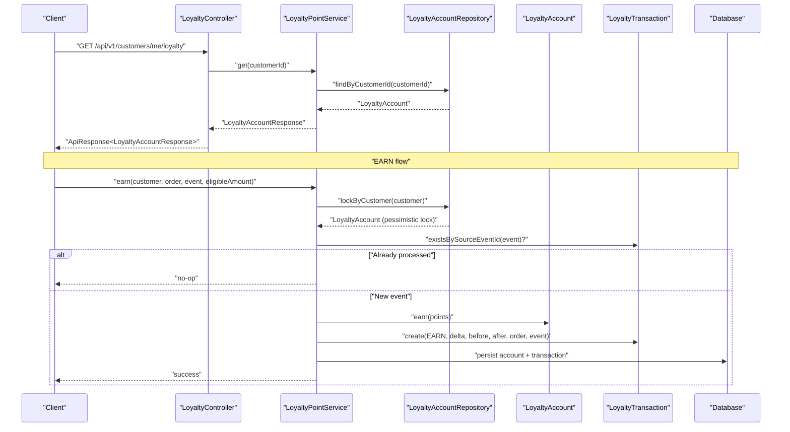

**Diagram sources**
- [LoyaltyController.java:23-27](file://src/main/java/com/smartcoffee/modules/loyalty/api/LoyaltyController.java#L23-L27)
- [LoyaltyQueryService.java:18-24](file://src/main/java/com/smartcoffee/modules/loyalty/application/LoyaltyQueryService.java#L18-L24)
- [LoyaltyPointService.java:20-32](file://src/main/java/com/smartcoffee/modules/loyalty/application/LoyaltyPointService.java#L20-L32)
- [LoyaltyAccountRepository.java:10-12](file://src/main/java/com/smartcoffee/modules/loyalty/persistence/LoyaltyAccountRepository.java#L10-L12)

## Detailed Component Analysis

### Account Lifecycle and State Model
- Creation: Accounts are created lazily when first needed for a customer during earning. The factory sets initial status to ACTIVE and records join timestamp.
- Status: The account carries a status field persisted in the database. In this implementation, active accounts remain ACTIVE throughout their lifecycle.
- Customer Association: Each account is uniquely tied to a customer via a unique constraint.
- Version Control: A version column enables optimistic locking at the entity level to prevent lost updates.

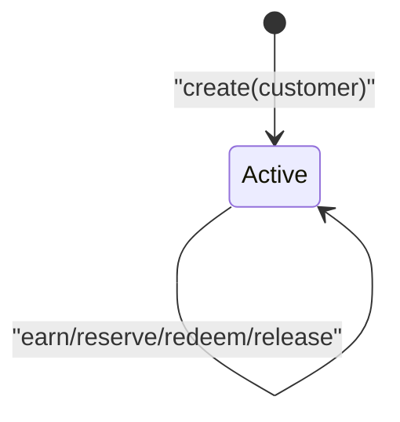

**Diagram sources**
- [LoyaltyAccount.java:36-44](file://src/main/java/com/smartcoffee/modules/loyalty/domain/LoyaltyAccount.java#L36-L44)
- [V009__promotions_loyalty.sql:119-136](file://src/main/resources/db/migration/V009__promotions_loyalty.sql#L119-L136)

**Section sources**
- [LoyaltyAccount.java:36-44](file://src/main/java/com/smartcoffee/modules/loyalty/domain/LoyaltyAccount.java#L36-L44)
- [V009__promotions_loyalty.sql:119-136](file://src/main/resources/db/migration/V009__promotions_loyalty.sql#L119-L136)

### Data Consistency and Concurrency Handling
- Optimistic Locking: The account entity uses a version field to detect concurrent modifications.
- Pessimistic Reads: Earning and other mutating operations lock the account row with a write lock to serialize access and avoid race conditions.
- Idempotent Earning: Earning checks for a prior source event to ensure duplicate events do not double-count points.

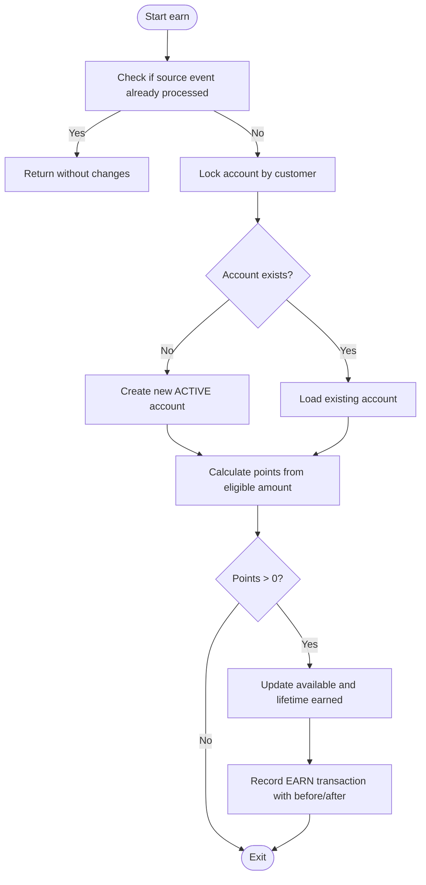

**Diagram sources**
- [LoyaltyPointService.java:20-32](file://src/main/java/com/smartcoffee/modules/loyalty/application/LoyaltyPointService.java#L20-L32)
- [LoyaltyAccountRepository.java:10-12](file://src/main/java/com/smartcoffee/modules/loyalty/persistence/LoyaltyAccountRepository.java#L10-L12)

**Section sources**
- [LoyaltyPointService.java:20-32](file://src/main/java/com/smartcoffee/modules/loyalty/application/LoyaltyPointService.java#L20-L32)
- [LoyaltyAccountRepository.java:10-12](file://src/main/java/com/smartcoffee/modules/loyalty/persistence/LoyaltyAccountRepository.java#L10-L12)

### Point Operations and Business Rules

#### Earn
- Purpose: Add points to the account based on eligible order amount.
- Validation: Points must be positive; zero or negative values result in no-op.
- Behavior: Increases available points and lifetime earned; records an EARN transaction with before/after balances and associates the source event for idempotency.

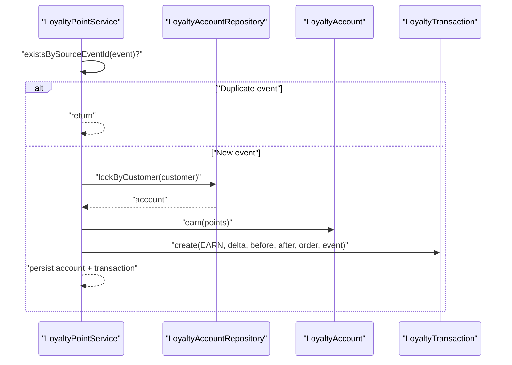

**Diagram sources**
- [LoyaltyPointService.java:20-32](file://src/main/java/com/smartcoffee/modules/loyalty/application/LoyaltyPointService.java#L20-L32)
- [LoyaltyAccount.java:46-52](file://src/main/java/com/smartcoffee/modules/loyalty/domain/LoyaltyAccount.java#L46-L52)
- [LoyaltyTransaction.java:36-50](file://src/main/java/com/smartcoffee/modules/loyalty/domain/LoyaltyTransaction.java#L36-L50)

**Section sources**
- [LoyaltyPointService.java:20-32](file://src/main/java/com/smartcoffee/modules/loyalty/application/LoyaltyPointService.java#L20-L32)
- [LoyaltyAccount.java:46-52](file://src/main/java/com/smartcoffee/modules/loyalty/domain/LoyaltyAccount.java#L46-L52)
- [LoyaltyTransaction.java:36-50](file://src/main/java/com/smartcoffee/modules/loyalty/domain/LoyaltyTransaction.java#L36-L50)

#### Reserve
- Purpose: Move points from available to reserved for pending redemption.
- Validation: Must have sufficient available points; otherwise throws a conflict error.
- Behavior: Decreases available and increases reserved; records a RESERVE transaction with before/after balances.

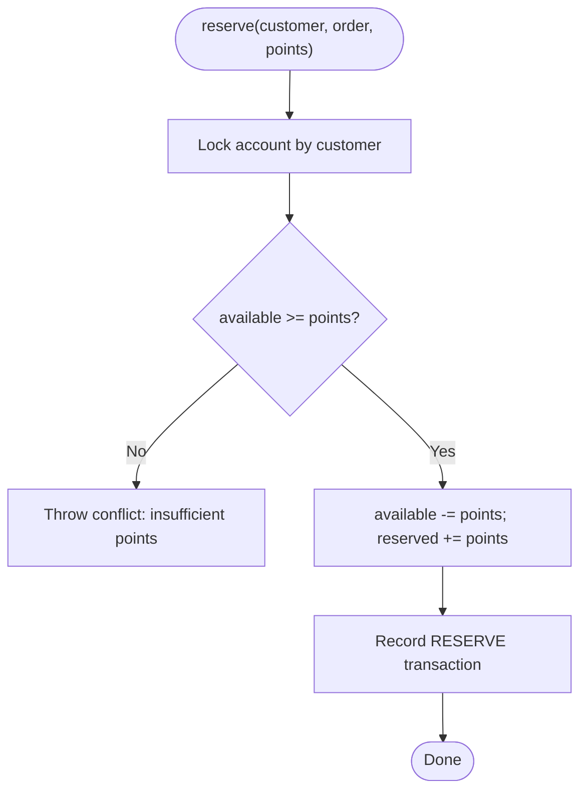

**Diagram sources**
- [LoyaltyPointService.java:34-41](file://src/main/java/com/smartcoffee/modules/loyalty/application/LoyaltyPointService.java#L34-L41)
- [LoyaltyAccount.java:54-60](file://src/main/java/com/smartcoffee/modules/loyalty/domain/LoyaltyAccount.java#L54-L60)

**Section sources**
- [LoyaltyPointService.java:34-41](file://src/main/java/com/smartcoffee/modules/loyalty/application/LoyaltyPointService.java#L34-L41)
- [LoyaltyAccount.java:54-60](file://src/main/java/com/smartcoffee/modules/loyalty/domain/LoyaltyAccount.java#L54-L60)

#### Redeem
- Purpose: Convert reserved points into redeemed points.
- Validation: Must have sufficient reserved points; otherwise throws a conflict error.
- Behavior: Decreases reserved and increases lifetime redeemed; records a REDEEM transaction.

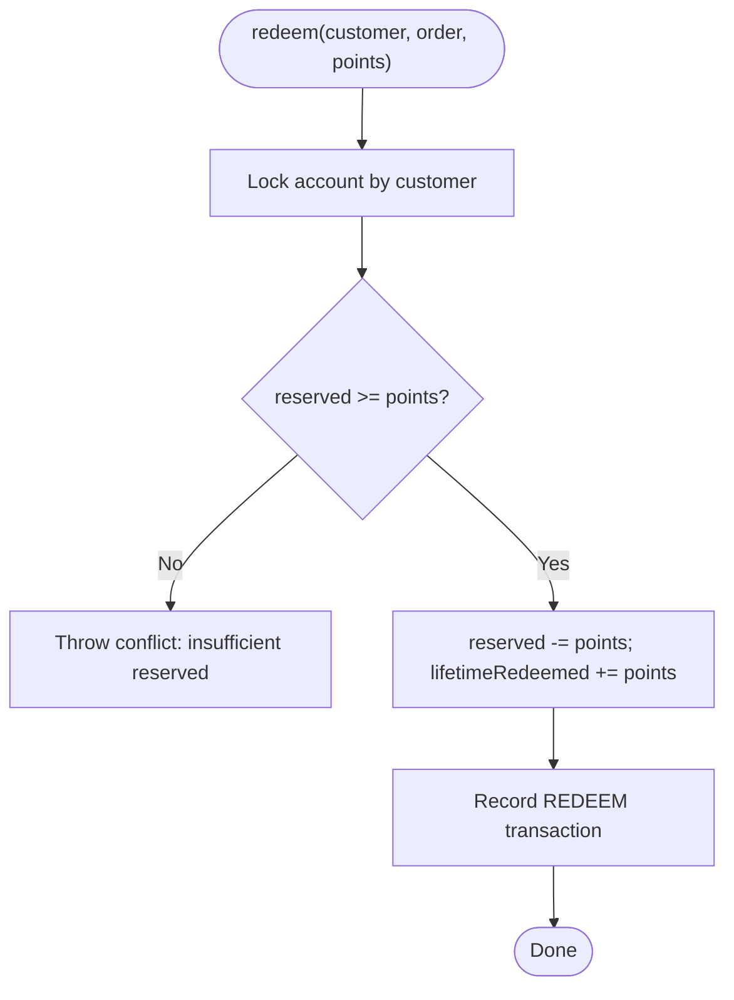

**Diagram sources**
- [LoyaltyPointService.java:43-50](file://src/main/java/com/smartcoffee/modules/loyalty/application/LoyaltyPointService.java#L43-L50)
- [LoyaltyAccount.java:62-68](file://src/main/java/com/smartcoffee/modules/loyalty/domain/LoyaltyAccount.java#L62-L68)

**Section sources**
- [LoyaltyPointService.java:43-50](file://src/main/java/com/smartcoffee/modules/loyalty/application/LoyaltyPointService.java#L43-L50)
- [LoyaltyAccount.java:62-68](file://src/main/java/com/smartcoffee/modules/loyalty/domain/LoyaltyAccount.java#L62-L68)

#### Release
- Purpose: Return reserved points back to available when a reservation is canceled or expires.
- Validation: Must have sufficient reserved points; otherwise throws a conflict error.
- Behavior: Decreases reserved and increases available; records a RELEASE transaction.

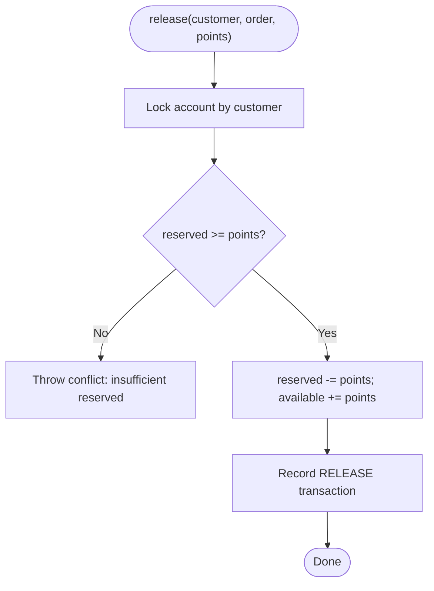

**Diagram sources**
- [LoyaltyPointService.java:52-59](file://src/main/java/com/smartcoffee/modules/loyalty/application/LoyaltyPointService.java#L52-L59)
- [LoyaltyAccount.java:70-76](file://src/main/java/com/smartcoffee/modules/loyalty/domain/LoyaltyAccount.java#L70-L76)

**Section sources**
- [LoyaltyPointService.java:52-59](file://src/main/java/com/smartcoffee/modules/loyalty/application/LoyaltyPointService.java#L52-L59)
- [LoyaltyAccount.java:70-76](file://src/main/java/com/smartcoffee/modules/loyalty/domain/LoyaltyAccount.java#L70-L76)

### Querying Account Balance
- Endpoint: GET /api/v1/customers/me/loyalty returns the current customer’s loyalty account snapshot including available, reserved, lifetime earned/redeemed, and version.
- Service: Uses a read-only transaction to fetch the account by customer ID and map to response DTO.

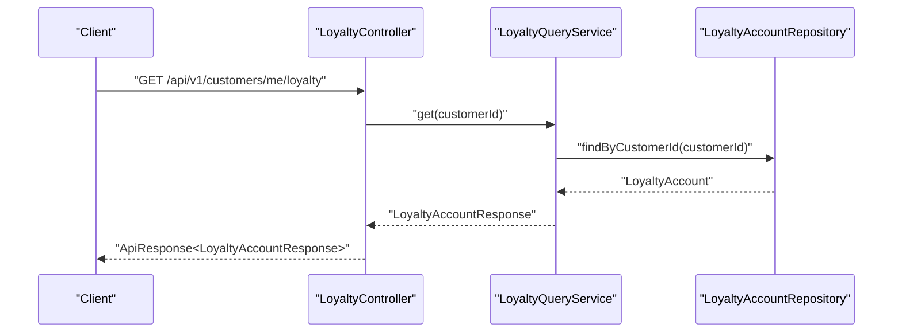

**Diagram sources**
- [LoyaltyController.java:23-27](file://src/main/java/com/smartcoffee/modules/loyalty/api/LoyaltyController.java#L23-L27)
- [LoyaltyQueryService.java:18-24](file://src/main/java/com/smartcoffee/modules/loyalty/application/LoyaltyQueryService.java#L18-L24)

**Section sources**
- [LoyaltyController.java:23-27](file://src/main/java/com/smartcoffee/modules/loyalty/api/LoyaltyController.java#L23-L27)
- [LoyaltyQueryService.java:18-24](file://src/main/java/com/smartcoffee/modules/loyalty/application/LoyaltyQueryService.java#L18-L24)

### Audit Trail and Ledger
- Immutable Transactions: Every point movement creates a LoyaltyTransaction with type, delta, balance_before, balance_after, order context, and occurrence time.
- Idempotency Key: Earning uses a unique source_event_id to prevent duplicate processing across retries or out-of-order events.
- Database Constraints: The schema enforces non-negative balances and valid transaction types, ensuring data integrity at the storage layer.

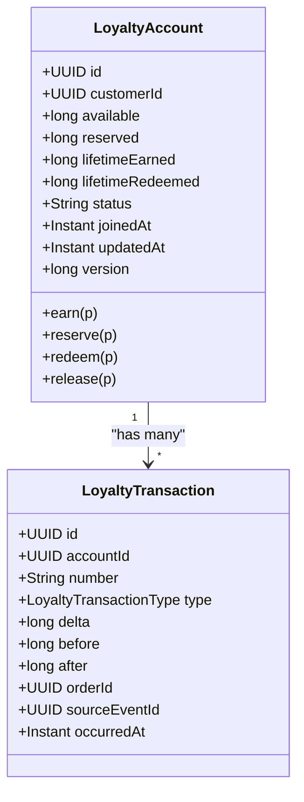

**Diagram sources**
- [LoyaltyAccount.java:8-105](file://src/main/java/com/smartcoffee/modules/loyalty/domain/LoyaltyAccount.java#L8-L105)
- [LoyaltyTransaction.java:7-50](file://src/main/java/com/smartcoffee/modules/loyalty/domain/LoyaltyTransaction.java#L7-L50)
- [V009__promotions_loyalty.sql:138-169](file://src/main/resources/db/migration/V009__promotions_loyalty.sql#L138-L169)

**Section sources**
- [LoyaltyTransaction.java:7-50](file://src/main/java/com/smartcoffee/modules/loyalty/domain/LoyaltyTransaction.java#L7-L50)
- [V009__promotions_loyalty.sql:138-169](file://src/main/resources/db/migration/V009__promotions_loyalty.sql#L138-L169)

## Dependency Analysis
- API depends on query and command services for reading and mutating accounts.
- Application services depend on domain entities for business rules and repositories for persistence.
- Repository provides both read and locked-write access to accounts.
- Database schema enforces referential integrity and value constraints.

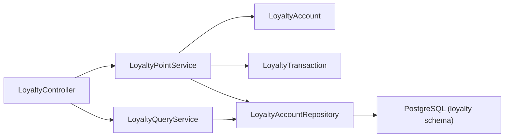

**Diagram sources**
- [LoyaltyController.java:10-27](file://src/main/java/com/smartcoffee/modules/loyalty/api/LoyaltyController.java#L10-L27)
- [LoyaltyQueryService.java:10-24](file://src/main/java/com/smartcoffee/modules/loyalty/application/LoyaltyQueryService.java#L10-L24)
- [LoyaltyPointService.java:10-59](file://src/main/java/com/smartcoffee/modules/loyalty/application/LoyaltyPointService.java#L10-L59)
- [LoyaltyAccountRepository.java:9-15](file://src/main/java/com/smartcoffee/modules/loyalty/persistence/LoyaltyAccountRepository.java#L9-L15)
- [V009__promotions_loyalty.sql:119-169](file://src/main/resources/db/migration/V009__promotions_loyalty.sql#L119-L169)

**Section sources**
- [LoyaltyController.java:10-27](file://src/main/java/com/smartcoffee/modules/loyalty/api/LoyaltyController.java#L10-L27)
- [LoyaltyQueryService.java:10-24](file://src/main/java/com/smartcoffee/modules/loyalty/application/LoyaltyQueryService.java#L10-L24)
- [LoyaltyPointService.java:10-59](file://src/main/java/com/smartcoffee/modules/loyalty/application/LoyaltyPointService.java#L10-L59)
- [LoyaltyAccountRepository.java:9-15](file://src/main/java/com/smartcoffee/modules/loyalty/persistence/LoyaltyAccountRepository.java#L9-L15)
- [V009__promotions_loyalty.sql:119-169](file://src/main/resources/db/migration/V009__promotions_loyalty.sql#L119-L169)

## Performance Considerations
- Pessimistic locking on account rows prevents contention issues during high-throughput earning and redemption flows.
- Transaction boundaries ensure atomicity of account updates and ledger writes.
- Unique constraints on source_event_id and transaction_number provide strong guarantees against duplicates and support efficient lookups.
- Indexes on account and transaction tables optimize queries by customer and time-based scans.

[No sources needed since this section provides general guidance]

## Troubleshooting Guide
- Insufficient Points Errors: Reserve/redeem/release operations validate availability or reservations and throw conflict exceptions when constraints are violated.
- Duplicate Events: Earning checks for prior source events; repeated events are ignored to maintain idempotency.
- Not Found: Querying a customer without an account will raise a resource not found exception.
- Database Integrity: Schema-level constraints enforce non-negative balances and valid transaction types; violations indicate application logic errors.

**Section sources**
- [LoyaltyAccount.java:54-76](file://src/main/java/com/smartcoffee/modules/loyalty/domain/LoyaltyAccount.java#L54-L76)
- [LoyaltyPointService.java:20-59](file://src/main/java/com/smartcoffee/modules/loyalty/application/LoyaltyPointService.java#L20-L59)
- [LoyaltyQueryService.java:18-24](file://src/main/java/com/smartcoffee/modules/loyalty/application/LoyaltyQueryService.java#L18-L24)
- [V009__promotions_loyalty.sql:119-169](file://src/main/resources/db/migration/V009__promotions_loyalty.sql#L119-L169)

## Conclusion
The Loyalty Account system provides a robust, auditable, and concurrent-safe mechanism for managing customer points. It combines optimistic locking with pessimistic reads, immutable transaction ledgers, and strict database constraints to ensure data consistency. The API exposes simple queries while application services encapsulate complex business rules for earning, reserving, redeeming, and releasing points. This design supports reliable integration with ordering and promotion workflows and offers a solid foundation for future enhancements such as tiered rewards or expiration policies.

[No sources needed since this section summarizes without analyzing specific files]