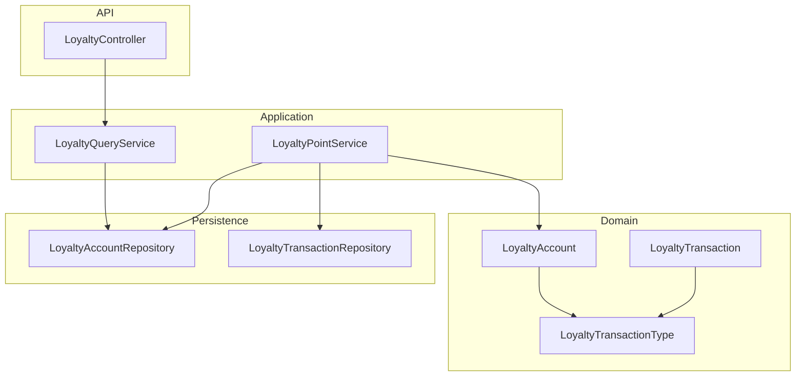
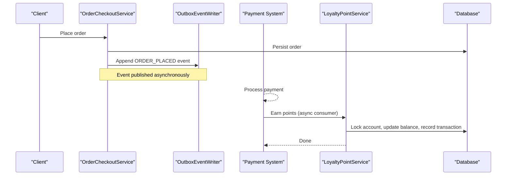
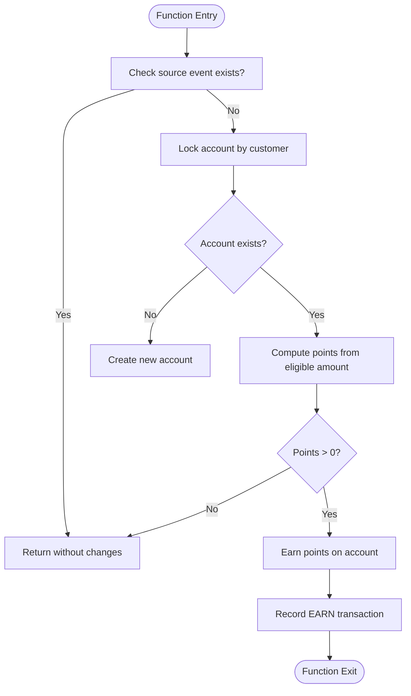
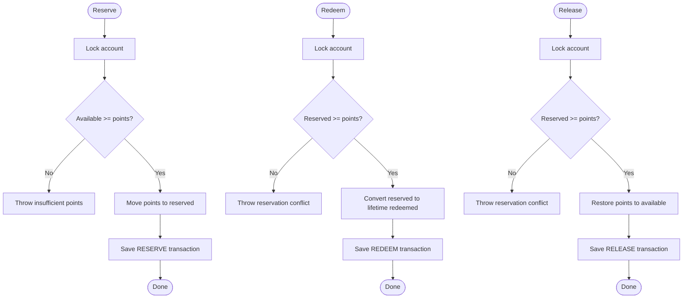
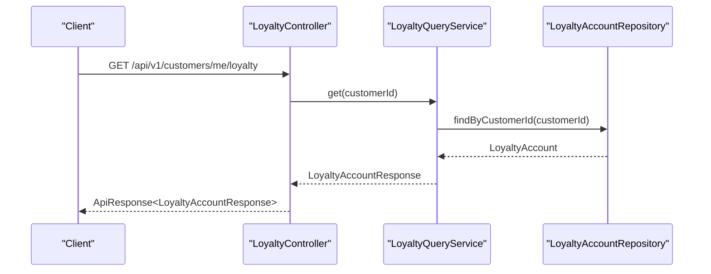
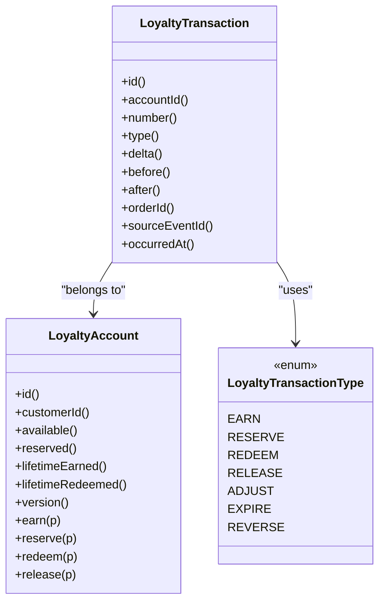
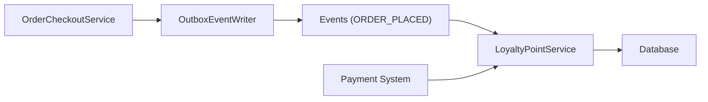

# Loyalty Point Service

<cite>
**Referenced Files in This Document**
- [LoyaltyPointService.java](file://src/main/java/com/smartcoffee/modules/loyalty/application/LoyaltyPointService.java)
- [LoyaltyController.java](file://src/main/java/com/smartcoffee/modules/loyalty/api/LoyaltyController.java)
- [LoyaltyQueryService.java](file://src/main/java/com/smartcoffee/modules/loyalty/application/LoyaltyQueryService.java)
- [LoyaltyAccount.java](file://src/main/java/com/smartcoffee/modules/loyalty/domain/LoyaltyAccount.java)
- [LoyaltyTransaction.java](file://src/main/java/com/smartcoffee/modules/loyalty/domain/LoyaltyTransaction.java)
- [LoyaltyTransactionType.java](file://src/main/java/com/smartcoffee/modules/loyalty/domain/LoyaltyTransactionType.java)
- [LoyaltyAccountRepository.java](file://src/main/java/com/smartcoffee/modules/loyalty/persistence/LoyaltyAccountRepository.java)
- [LoyaltyTransactionRepository.java](file://src/main/java/com/smartcoffee/modules/loyalty/persistence/LoyaltyTransactionRepository.java)
- [OrderCheckoutService.java](file://src/main/java/com/smartcoffee/modules/ordering/application/OrderCheckoutService.java)
- [PAYMENT_LOYALTY_PATCH.md](file://PAYMENT_LOYALTY_PATCH.md)
</cite>

## Table of Contents
1. [Introduction](#introduction)
2. [Project Structure](#project-structure)
3. [Core Components](#core-components)
4. [Architecture Overview](#architecture-overview)
5. [Detailed Component Analysis](#detailed-component-analysis)
6. [Dependency Analysis](#dependency-analysis)
7. [Performance Considerations](#performance-considerations)
8. [Troubleshooting Guide](#troubleshooting-guide)
9. [Conclusion](#conclusion)

## Introduction
This document describes the Loyalty Point Service layer responsible for managing customer loyalty points. It covers point earning from orders, reservation and redemption workflows, querying balances, transaction boundaries, idempotency for event-driven earnings, and integration patterns with ordering and payment systems. The service is designed to be robust under concurrency, consistent with domain rules, and decoupled from external systems via events.

## Project Structure
The loyalty module follows a layered structure:
- API layer exposes read-only endpoints for account balance.
- Application layer orchestrates point operations (earn, reserve, redeem, release).
- Domain layer encapsulates business rules for accounts and transactions.
- Persistence layer provides repositories for accounts and transaction ledger.

**Diagram sources**
- [LoyaltyController.java:10-27](file://src/main/java/com/smartcoffee/modules/loyalty/api/LoyaltyController.java#L10-L27)
- [LoyaltyPointService.java:10-59](file://src/main/java/com/smartcoffee/modules/loyalty/application/LoyaltyPointService.java#L10-L59)
- [LoyaltyQueryService.java:10-24](file://src/main/java/com/smartcoffee/modules/loyalty/application/LoyaltyQueryService.java#L10-L24)
- [LoyaltyAccount.java:8-105](file://src/main/java/com/smartcoffee/modules/loyalty/domain/LoyaltyAccount.java#L8-L105)
- [LoyaltyTransaction.java:7-50](file://src/main/java/com/smartcoffee/modules/loyalty/domain/LoyaltyTransaction.java#L7-L50)
- [LoyaltyTransactionType.java:3-5](file://src/main/java/com/smartcoffee/modules/loyalty/domain/LoyaltyTransactionType.java#L3-L5)
- [LoyaltyAccountRepository.java:9-14](file://src/main/java/com/smartcoffee/modules/loyalty/persistence/LoyaltyAccountRepository.java#L9-L14)
- [LoyaltyTransactionRepository.java:8-12](file://src/main/java/com/smartcoffee/modules/loyalty/persistence/LoyaltyTransactionRepository.java#L8-L12)

**Section sources**
- [LoyaltyController.java:10-27](file://src/main/java/com/smartcoffee/modules/loyalty/api/LoyaltyController.java#L10-L27)
- [LoyaltyPointService.java:10-59](file://src/main/java/com/smartcoffee/modules/loyalty/application/LoyaltyPointService.java#L10-L59)
- [LoyaltyQueryService.java:10-24](file://src/main/java/com/smartcoffee/modules/loyalty/application/LoyaltyQueryService.java#L10-L24)
- [LoyaltyAccount.java:8-105](file://src/main/java/com/smartcoffee/modules/loyalty/domain/LoyaltyAccount.java#L8-L105)
- [LoyaltyTransaction.java:7-50](file://src/main/java/com/smartcoffee/modules/loyalty/domain/LoyaltyTransaction.java#L7-L50)
- [LoyaltyTransactionType.java:3-5](file://src/main/java/com/smartcoffee/modules/loyalty/domain/LoyaltyTransactionType.java#L3-L5)
- [LoyaltyAccountRepository.java:9-14](file://src/main/java/com/smartcoffee/modules/loyalty/persistence/LoyaltyAccountRepository.java#L9-L14)
- [LoyaltyTransactionRepository.java:8-12](file://src/main/java/com/smartcoffee/modules/loyalty/persistence/LoyaltyTransactionRepository.java#L8-L12)

## Core Components
- LoyaltyPointService: Orchestrates point operations within transactions, enforces idempotency for earnings, and records immutable transactions.
- LoyaltyAccount: Encapsulates point state transitions (earn, reserve, redeem, release) with validation and conflict handling.
- LoyaltyTransaction: Immutable ledger entry capturing before/after balances, type, order linkage, and source event correlation.
- Repositories: Provide pessimistic locking for write paths and query capabilities for reads.
- Query Service and Controller: Expose read-only access to current account balances.

Key responsibilities:
- Earning points from eligible order amounts with idempotent processing.
- Reserving points during checkout or promotion redemption flows.
- Confirming redemptions by converting reserved points into lifetime redeemed.
- Releasing reservations when orders are canceled or payments fail.
- Providing up-to-date account snapshots for clients.

**Section sources**
- [LoyaltyPointService.java:20-59](file://src/main/java/com/smartcoffee/modules/loyalty/application/LoyaltyPointService.java#L20-L59)
- [LoyaltyAccount.java:46-76](file://src/main/java/com/smartcoffee/modules/loyalty/domain/LoyaltyAccount.java#L46-L76)
- [LoyaltyTransaction.java:36-50](file://src/main/java/com/smartcoffee/modules/loyalty/domain/LoyaltyTransaction.java#L36-L50)
- [LoyaltyAccountRepository.java:10-14](file://src/main/java/com/smartcoffee/modules/loyalty/persistence/LoyaltyAccountRepository.java#L10-L14)
- [LoyaltyTransactionRepository.java:9-12](file://src/main/java/com/smartcoffee/modules/loyalty/persistence/LoyaltyTransactionRepository.java#L9-L12)
- [LoyaltyQueryService.java:18-24](file://src/main/java/com/smartcoffee/modules/loyalty/application/LoyaltyQueryService.java#L18-L24)
- [LoyaltyController.java:23-27](file://src/main/java/com/smartcoffee/modules/loyalty/api/LoyaltyController.java#L23-L27)

## Architecture Overview
The loyalty system integrates with ordering and payment modules primarily through events and explicit service calls:
- Ordering emits an order-placed event; loyalty earning should be handled asynchronously after payment completion.
- Payment completion triggers downstream processes; loyalty earning is recommended as an asynchronous consumer rather than synchronous at payment completion.
- Promotion redemption may coordinate with loyalty reservations and redemptions.

**Diagram sources**
- [OrderCheckoutService.java:120-125](file://src/main/java/com/smartcoffee/modules/ordering/application/OrderCheckoutService.java#L120-L125)
- [PAYMENT_LOYALTY_PATCH.md:1-3](file://PAYMENT_LOYALTY_PATCH.md#L1-L3)
- [LoyaltyPointService.java:20-32](file://src/main/java/com/smartcoffee/modules/loyalty/application/LoyaltyPointService.java#L20-L32)

## Detailed Component Analysis

### LoyaltyPointService Orchestration
Responsibilities:
- Idempotent earning based on source event ID.
- Account creation if missing.
- Transactional updates to available/reserved/lifetime counters.
- Immutable transaction recording with before/after balances.

**Diagram sources**
- [LoyaltyPointService.java:20-32](file://src/main/java/com/smartcoffee/modules/loyalty/application/LoyaltyPointService.java#L20-L32)
- [LoyaltyTransactionRepository.java:9-9](file://src/main/java/com/smartcoffee/modules/loyalty/persistence/LoyaltyTransactionRepository.java#L9-L9)
- [LoyaltyAccountRepository.java:10-12](file://src/main/java/com/smartcoffee/modules/loyalty/persistence/LoyaltyAccountRepository.java#L10-L12)

**Section sources**
- [LoyaltyPointService.java:20-32](file://src/main/java/com/smartcoffee/modules/loyalty/application/LoyaltyPointService.java#L20-L32)

### Reservation, Redemption, and Release Flows
Reservation locks points for future redemption; redemption confirms usage; release restores availability when reservation is canceled.

**Diagram sources**
- [LoyaltyPointService.java:34-59](file://src/main/java/com/smartcoffee/modules/loyalty/application/LoyaltyPointService.java#L34-L59)
- [LoyaltyAccount.java:54-76](file://src/main/java/com/smartcoffee/modules/loyalty/domain/LoyaltyAccount.java#L54-L76)

**Section sources**
- [LoyaltyPointService.java:34-59](file://src/main/java/com/smartcoffee/modules/loyalty/application/LoyaltyPointService.java#L34-L59)
- [LoyaltyAccount.java:54-76](file://src/main/java/com/smartcoffee/modules/loyalty/domain/LoyaltyAccount.java#L54-L76)

### API Surface and Query Flow
Read-only endpoint returns current loyalty account snapshot including available, reserved, and lifetime totals.

**Diagram sources**
- [LoyaltyController.java:23-27](file://src/main/java/com/smartcoffee/modules/loyalty/api/LoyaltyController.java#L23-L27)
- [LoyaltyQueryService.java:18-24](file://src/main/java/com/smartcoffee/modules/loyalty/application/LoyaltyQueryService.java#L18-L24)
- [LoyaltyAccountRepository.java:14-14](file://src/main/java/com/smartcoffee/modules/loyalty/persistence/LoyaltyAccountRepository.java#L14-L14)

**Section sources**
- [LoyaltyController.java:23-27](file://src/main/java/com/smartcoffee/modules/loyalty/api/LoyaltyController.java#L23-L27)
- [LoyaltyQueryService.java:18-24](file://src/main/java/com/smartcoffee/modules/loyalty/application/LoyaltyQueryService.java#L18-L24)

### Data Model Relationships

**Diagram sources**
- [LoyaltyAccount.java:8-105](file://src/main/java/com/smartcoffee/modules/loyalty/domain/LoyaltyAccount.java#L8-L105)
- [LoyaltyTransaction.java:7-50](file://src/main/java/com/smartcoffee/modules/loyalty/domain/LoyaltyTransaction.java#L7-L50)
- [LoyaltyTransactionType.java:3-5](file://src/main/java/com/smartcoffee/modules/loyalty/domain/LoyaltyTransactionType.java#L3-L5)

## Dependency Analysis
- Ordering module publishes order events; loyalty earning is intended to be processed asynchronously after payment completion.
- Payment module completes payments; loyalty earning is not called synchronously at payment completion but via consumers.
- Loyalty module depends on repositories for persistence and uses pessimistic locking to ensure consistency.

**Diagram sources**
- [OrderCheckoutService.java:120-125](file://src/main/java/com/smartcoffee/modules/ordering/application/OrderCheckoutService.java#L120-L125)
- [PAYMENT_LOYALTY_PATCH.md:1-3](file://PAYMENT_LOYALTY_PATCH.md#L1-L3)
- [LoyaltyPointService.java:20-59](file://src/main/java/com/smartcoffee/modules/loyalty/application/LoyaltyPointService.java#L20-L59)

**Section sources**
- [OrderCheckoutService.java:120-125](file://src/main/java/com/smartcoffee/modules/ordering/application/OrderCheckoutService.java#L120-L125)
- [PAYMENT_LOYALTY_PATCH.md:1-3](file://PAYMENT_LOYALTY_PATCH.md#L1-L3)

## Performance Considerations
- Pessimistic locking on account writes prevents race conditions during concurrent earn/reserve/redeem/release operations.
- Idempotency check on source event avoids duplicate earnings when events are retried.
- Transaction boundaries ensure atomicity of account updates and transaction ledger entries.
- Read queries are read-only transactions for performance isolation.

[No sources needed since this section provides general guidance]

## Troubleshooting Guide
Common issues and resolutions:
- Insufficient points during reserve: Ensure sufficient available points before reserving.
- Reserved points insufficient during redeem or release: Verify that reservation was created and not already consumed.
- Duplicate earnings: Confirm source event uniqueness; the service skips processing if the event has been seen.
- Missing loyalty account: The service creates an account on first earn; ensure customer mapping is correct.

Operational checks:
- Verify transaction ledger entries exist for each operation.
- Monitor outbox events for order placement and ensure consumers process them reliably.
- Use pessimistic locking to avoid lost updates under high concurrency.

**Section sources**
- [LoyaltyAccount.java:54-76](file://src/main/java/com/smartcoffee/modules/loyalty/domain/LoyaltyAccount.java#L54-L76)
- [LoyaltyPointService.java:20-32](file://src/main/java/com/smartcoffee/modules/loyalty/application/LoyaltyPointService.java#L20-L32)
- [LoyaltyTransactionRepository.java:9-9](file://src/main/java/com/smartcoffee/modules/loyalty/persistence/LoyaltyTransactionRepository.java#L9-L9)

## Conclusion
The Loyalty Point Service provides a robust, transactional foundation for managing customer points across earning, reservation, redemption, and release workflows. It integrates with ordering and payment systems through asynchronous events, ensuring scalability and resilience. The design emphasizes idempotency, strong consistency under concurrency, and clear auditability via immutable transaction records.

[No sources needed since this section summarizes without analyzing specific files]