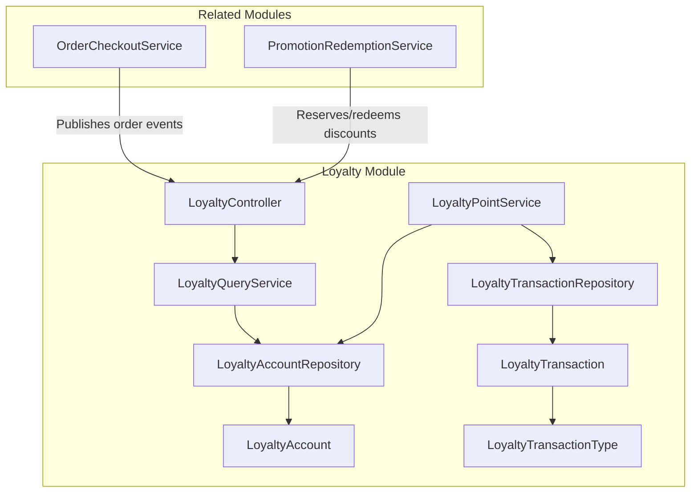
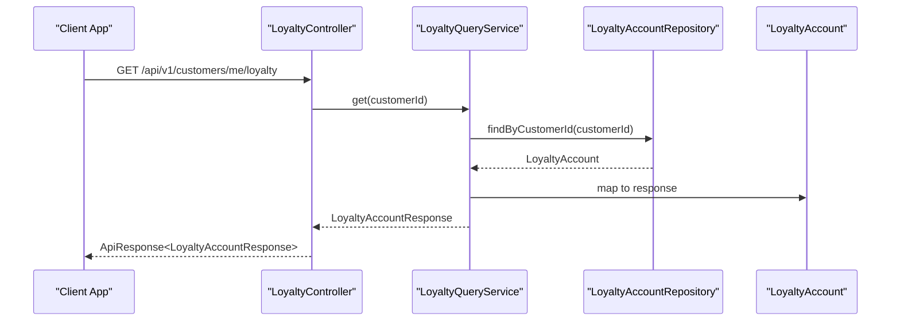
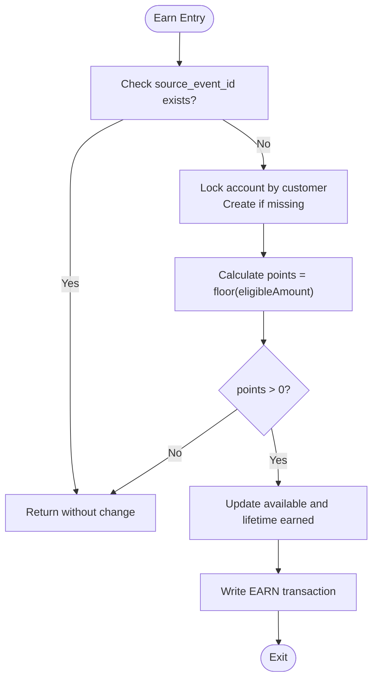
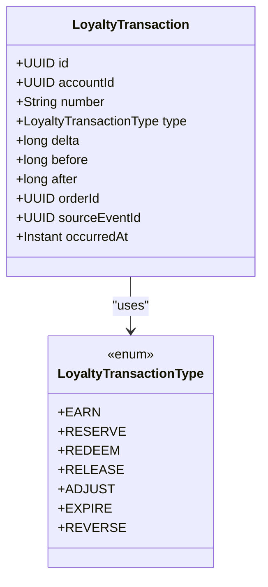
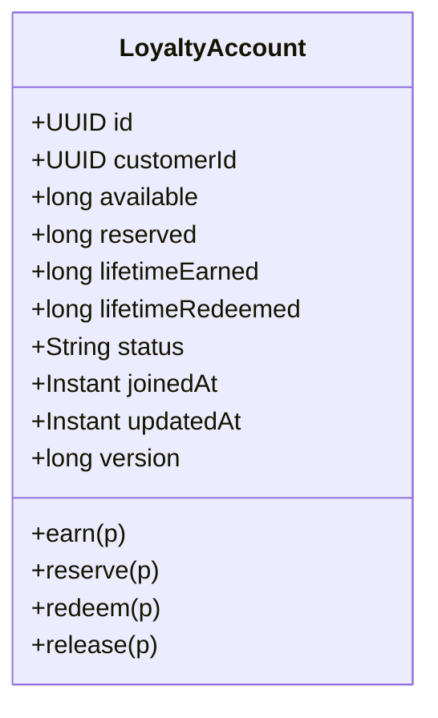
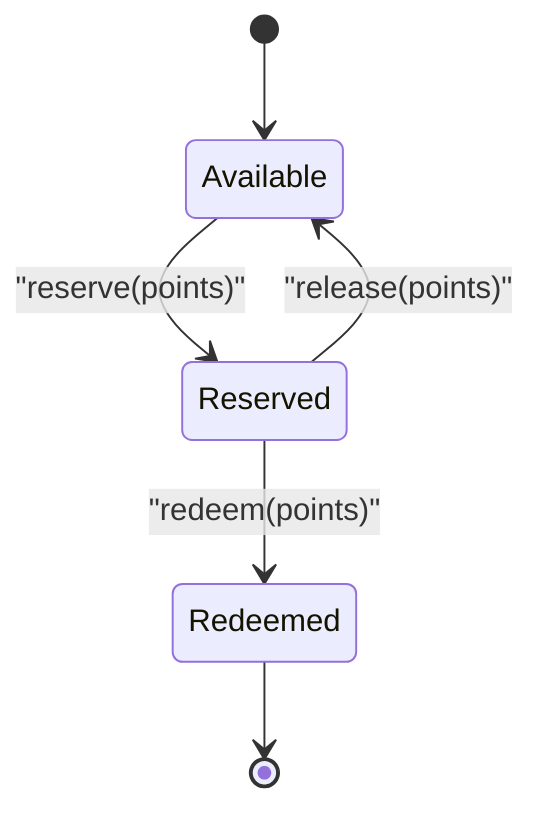
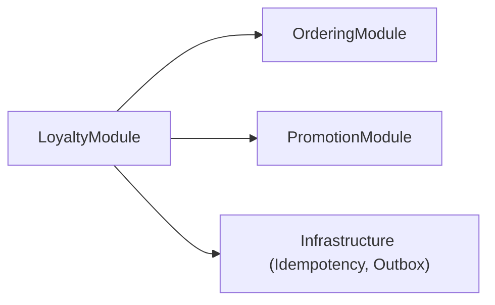

# Loyalty Program Module

<cite>
**Referenced Files in This Document**
- [LoyaltyController.java](file://src/main/java/com/smartcoffee/modules/loyalty/api/LoyaltyController.java)
- [LoyaltyAccountResponse.java](file://src/main/java/com/smartcoffee/modules/loyalty/api/LoyaltyAccountResponse.java)
- [LoyaltyQueryService.java](file://src/main/java/com/smartcoffee/modules/loyalty/application/LoyaltyQueryService.java)
- [LoyaltyPointService.java](file://src/main/java/com/smartcoffee/modules/loyalty/application/LoyaltyPointService.java)
- [LoyaltyAccount.java](file://src/main/java/com/smartcoffee/modules/loyalty/domain/LoyaltyAccount.java)
- [LoyaltyTransaction.java](file://src/main/java/com/smartcoffee/modules/loyalty/domain/LoyaltyTransaction.java)
- [LoyaltyTransactionType.java](file://src/main/java/com/smartcoffee/modules/loyalty/domain/LoyaltyTransactionType.java)
- [LoyaltyAccountRepository.java](file://src/main/java/com/smartcoffee/modules/loyalty/persistence/LoyaltyAccountRepository.java)
- [LoyaltyTransactionRepository.java](file://src/main/java/com/smartcoffee/modules/loyalty/persistence/LoyaltyTransactionRepository.java)
- [OrderCheckoutService.java](file://src/main/java/com/smartcoffee/modules/ordering/application/OrderCheckoutService.java)
- [PromotionRedemptionService.java](file://src/main/java/com/smartcoffee/modules/promotion/application/PromotionRedemptionService.java)
- [smart-coffee-logical.dbml](file://database/smart-coffee-logical.dbml)
- [V009__promotions_loyalty.sql](file://src/main/resources/db/migration/V009__promotions_loyalty.sql)
- [CHECKOUT_PROMOTION_LOYALTY_PATCH.md](file://CHECKOUT_PROMOTION_LOYALTY_PATCH.md)
- [PAYMENT_LOYALTY_PATCH.md](file://PAYMENT_LOYALTY_PATCH.md)
</cite>

## Table of Contents
1. [Introduction](#introduction)
2. [Project Structure](#project-structure)
3. [Core Components](#core-components)
4. [Architecture Overview](#architecture-overview)
5. [Detailed Component Analysis](#detailed-component-analysis)
6. [Dependency Analysis](#dependency-analysis)
7. [Performance Considerations](#performance-considerations)
8. [Troubleshooting Guide](#troubleshooting-guide)
9. [Conclusion](#conclusion)

## Introduction
This document explains the Loyalty Program module in the Smart Coffee backend. It covers point accumulation rules, transaction tracking, account management, redemption workflows, balance calculations, and integration with orders, promotions, and customer profiles. It also addresses idempotency, fraud prevention, and scalability considerations for high-volume transactions.

The loyalty system is implemented as a modular component within a Spring Boot monolith. It uses an append-only ledger model to ensure auditability and consistency, while exposing a read API for customers to query their loyalty balances.

## Project Structure
The Loyalty module follows a layered structure:
- API layer: REST controller for querying the current customer’s loyalty account.
- Application layer: Services for point operations and queries.
- Domain layer: Account and transaction entities with business rules.
- Persistence layer: JPA repositories for accounts and transactions.



**Diagram sources**
- [LoyaltyController.java:10-27](file://src/main/java/com/smartcoffee/modules/loyalty/api/LoyaltyController.java#L10-L27)
- [LoyaltyQueryService.java:10-24](file://src/main/java/com/smartcoffee/modules/loyalty/application/LoyaltyQueryService.java#L10-L24)
- [LoyaltyPointService.java:10-60](file://src/main/java/com/smartcoffee/modules/loyalty/application/LoyaltyPointService.java#L10-L60)
- [LoyaltyAccount.java:8-105](file://src/main/java/com/smartcoffee/modules/loyalty/domain/LoyaltyAccount.java#L8-L105)
- [LoyaltyTransaction.java:7-51](file://src/main/java/com/smartcoffee/modules/loyalty/domain/LoyaltyTransaction.java#L7-L51)
- [LoyaltyTransactionType.java:3-5](file://src/main/java/com/smartcoffee/modules/loyalty/domain/LoyaltyTransactionType.java#L3-L5)
- [LoyaltyAccountRepository.java:9-15](file://src/main/java/com/smartcoffee/modules/loyalty/persistence/LoyaltyAccountRepository.java#L9-L15)
- [LoyaltyTransactionRepository.java:8-12](file://src/main/java/com/smartcoffee/modules/loyalty/persistence/LoyaltyTransactionRepository.java#L8-L12)
- [OrderCheckoutService.java:28-133](file://src/main/java/com/smartcoffee/modules/ordering/application/OrderCheckoutService.java#L28-L133)
- [PromotionRedemptionService.java:12-53](file://src/main/java/com/smartcoffee/modules/promotion/application/PromotionRedemptionService.java#L12-L53)

**Section sources**
- [LoyaltyController.java:10-27](file://src/main/java/com/smartcoffee/modules/loyalty/api/LoyaltyController.java#L10-L27)
- [LoyaltyQueryService.java:10-24](file://src/main/java/com/smartcoffee/modules/loyalty/application/LoyaltyQueryService.java#L10-L24)
- [LoyaltyPointService.java:10-60](file://src/main/java/com/smartcoffee/modules/loyalty/application/LoyaltyPointService.java#L10-L60)
- [LoyaltyAccount.java:8-105](file://src/main/java/com/smartcoffee/modules/loyalty/domain/LoyaltyAccount.java#L8-L105)
- [LoyaltyTransaction.java:7-51](file://src/main/java/com/smartcoffee/modules/loyalty/domain/LoyaltyTransaction.java#L7-L51)
- [LoyaltyTransactionType.java:3-5](file://src/main/java/com/smartcoffee/modules/loyalty/domain/LoyaltyTransactionType.java#L3-L5)
- [LoyaltyAccountRepository.java:9-15](file://src/main/java/com/smartcoffee/modules/loyalty/persistence/LoyaltyAccountRepository.java#L9-L15)
- [LoyaltyTransactionRepository.java:8-12](file://src/main/java/com/smartcoffee/modules/loyalty/persistence/LoyaltyTransactionRepository.java#L8-L12)
- [OrderCheckoutService.java:28-133](file://src/main/java/com/smartcoffee/modules/ordering/application/OrderCheckoutService.java#L28-L133)
- [PromotionRedemptionService.java:12-53](file://src/main/java/com/smartcoffee/modules/promotion/application/PromotionRedemptionService.java#L12-L53)

## Core Components
- LoyaltyAccount: Represents a customer’s loyalty state, including available points, reserved points, lifetime earned and redeemed totals, status, and version.
- LoyaltyTransaction: Append-only record of each point movement, capturing type, delta, before/after balances, order reference, source event id, and timestamp.
- LoyaltyTransactionType: Enumerates allowed point movements such as EARN, RESERVE, REDEEM, RELEASE, ADJUST, EXPIRE, REVERSE.
- LoyaltyPointService: Command service that performs point operations with idempotency and locking.
- LoyaltyQueryService: Read service returning the current loyalty account snapshot.
- Repositories: Provide persistence access with pessimistic locking for write paths and standard queries for reads.

Key responsibilities:
- Point earning based on eligible amounts.
- Point reservation during checkout.
- Point redemption upon payment success.
- Point release when reservations are canceled or expire.
- Balance calculation through domain methods and ledger records.

**Section sources**
- [LoyaltyAccount.java:8-105](file://src/main/java/com/smartcoffee/modules/loyalty/domain/LoyaltyAccount.java#L8-L105)
- [LoyaltyTransaction.java:7-51](file://src/main/java/com/smartcoffee/modules/loyalty/domain/LoyaltyTransaction.java#L7-L51)
- [LoyaltyTransactionType.java:3-5](file://src/main/java/com/smartcoffee/modules/loyalty/domain/LoyaltyTransactionType.java#L3-L5)
- [LoyaltyPointService.java:10-60](file://src/main/java/com/smartcoffee/modules/loyalty/application/LoyaltyPointService.java#L10-L60)
- [LoyaltyQueryService.java:10-24](file://src/main/java/com/smartcoffee/modules/loyalty/application/LoyaltyQueryService.java#L10-L24)
- [LoyaltyAccountRepository.java:9-15](file://src/main/java/com/smartcoffee/modules/loyalty/persistence/LoyaltyAccountRepository.java#L9-L15)
- [LoyaltyTransactionRepository.java:8-12](file://src/main/java/com/smartcoffee/modules/loyalty/persistence/LoyaltyTransactionRepository.java#L8-L12)

## Architecture Overview
The loyalty architecture separates commands (point changes) from queries (balance retrieval). Commands use pessimistic row locks and an append-only ledger to prevent race conditions and ensure auditability. Queries return a consistent snapshot of the account.



**Diagram sources**
- [LoyaltyController.java:10-27](file://src/main/java/com/smartcoffee/modules/loyalty/api/LoyaltyController.java#L10-L27)
- [LoyaltyQueryService.java:10-24](file://src/main/java/com/smartcoffee/modules/loyalty/application/LoyaltyQueryService.java#L10-L24)
- [LoyaltyAccountRepository.java:9-15](file://src/main/java/com/smartcoffee/modules/loyalty/persistence/LoyaltyAccountRepository.java#L9-L15)
- [LoyaltyAccount.java:8-105](file://src/main/java/com/smartcoffee/modules/loyalty/domain/LoyaltyAccount.java#L8-L105)

## Detailed Component Analysis

### Point Accumulation Rules
- Eligible amount conversion: The service converts the eligible monetary amount into integer points using floor rounding. If the resulting points are zero or less, no transaction is recorded.
- Deduplication: Earn operations are deduplicated by a source event identifier. Duplicate events are ignored safely.
- Account creation: If a customer has no loyalty account, one is created automatically during earn.
- Ledger recording: Each successful earn writes a transaction with type EARN, positive delta, and updated before/after balances.



**Diagram sources**
- [LoyaltyPointService.java:20-31](file://src/main/java/com/smartcoffee/modules/loyalty/application/LoyaltyPointService.java#L20-L31)
- [LoyaltyAccountRepository.java:9-15](file://src/main/java/com/smartcoffee/modules/loyalty/persistence/LoyaltyAccountRepository.java#L9-L15)
- [LoyaltyTransaction.java:36-50](file://src/main/java/com/smartcoffee/modules/loyalty/domain/LoyaltyTransaction.java#L36-L50)

**Section sources**
- [LoyaltyPointService.java:20-31](file://src/main/java/com/smartcoffee/modules/loyalty/application/LoyaltyPointService.java#L20-L31)
- [LoyaltyTransactionRepository.java:8-12](file://src/main/java/com/smartcoffee/modules/loyalty/persistence/LoyaltyTransactionRepository.java#L8-L12)

### Transaction Tracking and Ledger Model
- Append-only ledger: Every point movement is recorded as a transaction with immutable fields including type, delta, before/after balances, order reference, and occurrence time.
- Transaction types: EARN, RESERVE, REDEEM, RELEASE, ADJUST, EXPIRE, REVERSE.
- Database constraints: The migration enforces valid transaction types and non-negative balances.
- Indexing: Transactions are indexed by account and time for efficient history queries.



**Diagram sources**
- [LoyaltyTransaction.java:7-51](file://src/main/java/com/smartcoffee/modules/loyalty/domain/LoyaltyTransaction.java#L7-L51)
- [LoyaltyTransactionType.java:3-5](file://src/main/java/com/smartcoffee/modules/loyalty/domain/LoyaltyTransactionType.java#L3-L5)
- [V009__promotions_loyalty.sql:138-169](file://src/main/resources/db/migration/V009__promotions_loyalty.sql#L138-L169)

**Section sources**
- [LoyaltyTransaction.java:7-51](file://src/main/java/com/smartcoffee/modules/loyalty/domain/LoyaltyTransaction.java#L7-L51)
- [LoyaltyTransactionType.java:3-5](file://src/main/java/com/smartcoffee/modules/loyalty/domain/LoyaltyTransactionType.java#L3-L5)
- [V009__promotions_loyalty.sql:138-169](file://src/main/resources/db/migration/V009__promotions_loyalty.sql#L138-L169)

### Account Management and Balance Calculations
- Account fields: Available points, reserved points, lifetime earned, lifetime redeemed, status, join date, update timestamp, and optimistic version.
- Balance calculation: The effective available balance equals available; reserved points are separate and must be released or redeemed. Lifetime counters provide cumulative metrics.
- Versioning: Optimistic concurrency control prevents lost updates.



**Diagram sources**
- [LoyaltyAccount.java:8-105](file://src/main/java/com/smartcoffee/modules/loyalty/domain/LoyaltyAccount.java#L8-L105)

**Section sources**
- [LoyaltyAccount.java:8-105](file://src/main/java/com/smartcoffee/modules/loyalty/domain/LoyaltyAccount.java#L8-L105)

### Redemption Processes and Reservation Lifecycle
- Reserve: Moves points from available to reserved. Requires sufficient available points.
- Redeem: Converts reserved points into lifetime redeemed. Requires sufficient reserved points.
- Release: Returns reserved points back to available. Requires sufficient reserved points.
- Integration with promotions: Promotions reserve discount capacity; loyalty reserves points similarly during checkout. Payment success redeems both promotion and loyalty; payment expiration releases both.



**Diagram sources**
- [LoyaltyAccount.java:54-76](file://src/main/java/com/smartcoffee/modules/loyalty/domain/LoyaltyAccount.java#L54-L76)
- [LoyaltyPointService.java:34-59](file://src/main/java/com/smartcoffee/modules/loyalty/application/LoyaltyPointService.java#L34-L59)
- [PromotionRedemptionService.java:25-53](file://src/main/java/com/smartcoffee/modules/promotion/application/PromotionRedemptionService.java#L25-L53)

**Section sources**
- [LoyaltyAccount.java:54-76](file://src/main/java/com/smartcoffee/modules/loyalty/domain/LoyaltyAccount.java#L54-L76)
- [LoyaltyPointService.java:34-59](file://src/main/java/com/smartcoffee/modules/loyalty/application/LoyaltyPointService.java#L34-L59)
- [PromotionRedemptionService.java:25-53](file://src/main/java/com/smartcoffee/modules/promotion/application/PromotionRedemptionService.java#L25-L53)

### Integration with Orders, Promotions, and Customer Profiles
- Orders: Checkout creates an order and publishes an order-placed event via outbox. Loyalty earning is recommended asynchronously after payment completion, not at checkout.
- Promotions: Promotion redemption service reserves discount capacity atomically and transitions between RESERVED, REDEEMED, and RELEASED states. Loyalty should mirror this lifecycle with point reservation and redemption.
- Customer profiles: A customer profile may include a loyalty number and cached points balance. The loyalty account is uniquely tied to the customer.

```mermaid
sequenceDiagram
participant Client as "Client App"
participant OrderSvc as "OrderCheckoutService"
participant Outbox as "Outbox"
participant PaySvc as "Payment Service"
participant Promo as "PromotionRedemptionService"
participant Loyalty as "LoyaltyPointService"
Client->>OrderSvc : POST /orders (checkout)
OrderSvc->>OrderSvc : Validate cart, compute totals
OrderSvc->>Outbox : Append ORDER_PLACED event
Note over OrderSvc,Outbox : Order persisted; async consumers handle downstream effects
PaySvc->>Promo : redeemForOrder(orderId)
PaySvc->>Loyalty : redeem(customerId, orderId, points)
Promo-->>PaySvc : Promotion applied
Loyalty-->>PaySvc : Points redeemed
```

**Diagram sources**
- [OrderCheckoutService.java:62-133](file://src/main/java/com/smartcoffee/modules/ordering/application/OrderCheckoutService.java#L62-L133)
- [PromotionRedemptionService.java:47-53](file://src/main/java/com/smartcoffee/modules/promotion/application/PromotionRedemptionService.java#L47-L53)
- [LoyaltyPointService.java:43-50](file://src/main/java/com/smartcoffee/modules/loyalty/application/LoyaltyPointService.java#L43-L50)

**Section sources**
- [OrderCheckoutService.java:62-133](file://src/main/java/com/smartcoffee/modules/ordering/application/OrderCheckoutService.java#L62-L133)
- [PromotionRedemptionService.java:25-53](file://src/main/java/com/smartcoffee/modules/promotion/application/PromotionRedemptionService.java#L25-L53)
- [smart-coffee-logical.dbml:163-171](file://database/smart-coffee-logical.dbml#L163-L171)

### Examples of Point Transactions, Redemption Scenarios, and Balance Queries
- Point transaction example: An order completes with eligible amount 12.50 currency units. Floor rounding yields 12 points. A transaction is written with type EARN, delta +12, before balance B, after balance B+12.
- Redemption scenario: During checkout, 5 points are reserved. If payment succeeds, those 5 points are redeemed; if payment expires, they are released back to available.
- Balance query: GET /api/v1/customers/me/loyalty returns available points, reserved points, lifetime earned, lifetime redeemed, and version.

These examples align with the implementation:
- Earn logic and rounding behavior.
- Reserve/redeem/release transitions.
- Read endpoint mapping to response fields.

**Section sources**
- [LoyaltyPointService.java:20-31](file://src/main/java/com/smartcoffee/modules/loyalty/application/LoyaltyPointService.java#L20-L31)
- [LoyaltyPointService.java:34-59](file://src/main/java/com/smartcoffee/modules/loyalty/application/LoyaltyPointService.java#L34-L59)
- [LoyaltyController.java:23-27](file://src/main/java/com/smartcoffee/modules/loyalty/api/LoyaltyController.java#L23-L27)
- [LoyaltyAccountResponse.java:5-7](file://src/main/java/com/smartcoffee/modules/loyalty/api/LoyaltyAccountResponse.java#L5-L7)

### Point Expiration Policies
- Current implementation: No explicit expiration policy is present in the loyalty domain or services. The database schema includes an entry type EXPIRE, indicating future support for expiring points.
- Recommendation: Implement a scheduled job that scans aged points and writes EXPIRE transactions, respecting business rules such as minimum balance protection and notification requirements.

**Section sources**
- [LoyaltyTransactionType.java:3-5](file://src/main/java/com/smartcoffee/modules/loyalty/domain/LoyaltyTransactionType.java#L3-L5)
- [V009__promotions_loyalty.sql:138-169](file://src/main/resources/db/migration/V009__promotions_loyalty.sql#L138-L169)

### Fraud Prevention Measures
- Idempotent earn: Earn operations check for duplicate source_event_id to prevent double-counting from repeated events.
- Pessimistic locking: Account writes lock rows per customer to avoid concurrent modifications.
- Validation and constraints: Domain methods enforce non-negative deltas and sufficient balances; database constraints enforce valid transaction types and non-negative balances.
- Audit trail: Append-only ledger provides full traceability for investigations.

**Section sources**
- [LoyaltyPointService.java:20-31](file://src/main/java/com/smartcoffee/modules/loyalty/application/LoyaltyPointService.java#L20-L31)
- [LoyaltyAccountRepository.java:9-15](file://src/main/java/com/smartcoffee/modules/loyalty/persistence/LoyaltyAccountRepository.java#L9-L15)
- [LoyaltyAccount.java:46-76](file://src/main/java/com/smartcoffee/modules/loyalty/domain/LoyaltyAccount.java#L46-L76)
- [V009__promotions_loyalty.sql:138-169](file://src/main/resources/db/migration/V009__promotions_loyalty.sql#L138-L169)

### Scalability Considerations for High-Volume Transactions
- Asynchronous processing: Loyalty earning should be triggered by order completion events rather than synchronously in checkout to reduce latency.
- Batch operations: For bulk adjustments or expirations, process in batches with bounded page sizes to avoid long-running transactions.
- Read scaling: Use read replicas or caching for frequent balance queries; keep cache invalidation consistent with ledger updates.
- Concurrency control: Maintain pessimistic locks for writes and optimistic versioning to prevent lost updates under load.
- Indexing: Ensure indexes on account and time columns support efficient history queries and aging jobs.

[No sources needed since this section provides general guidance]

## Dependency Analysis
The loyalty module depends on:
- Ordering module: Through order events and order references in transactions.
- Promotion module: Through coordinated reservation and redemption lifecycles.
- Infrastructure modules: Idempotency and outbox for reliable event handling.



**Diagram sources**
- [OrderCheckoutService.java:62-133](file://src/main/java/com/smartcoffee/modules/ordering/application/OrderCheckoutService.java#L62-L133)
- [PromotionRedemptionService.java:25-53](file://src/main/java/com/smartcoffee/modules/promotion/application/PromotionRedemptionService.java#L25-L53)
- [LoyaltyPointService.java:20-31](file://src/main/java/com/smartcoffee/modules/loyalty/application/LoyaltyPointService.java#L20-L31)

**Section sources**
- [OrderCheckoutService.java:62-133](file://src/main/java/com/smartcoffee/modules/ordering/application/OrderCheckoutService.java#L62-L133)
- [PromotionRedemptionService.java:25-53](file://src/main/java/com/smartcoffee/modules/promotion/application/PromotionRedemptionService.java#L25-L53)
- [LoyaltyPointService.java:20-31](file://src/main/java/com/smartcoffee/modules/loyalty/application/LoyaltyPointService.java#L20-L31)

## Performance Considerations
- Minimize synchronous calls: Avoid calling loyalty services inside checkout; use events instead.
- Efficient queries: Use pagination for transaction history and avoid scanning entire ledgers.
- Cache strategy: Cache balance snapshots with short TTLs and invalidate on write operations.
- Transaction boundaries: Keep transactions small and focused to reduce lock contention.

[No sources needed since this section provides general guidance]

## Troubleshooting Guide
Common issues and resolutions:
- Insufficient points: Occurs when attempting to reserve more available points than owned. Resolve by adjusting eligible amounts or informing the customer.
- Reserved points insufficient: Occurs when redeeming without prior reservation. Ensure checkout reserves points before payment confirmation.
- Duplicate earn events: Detected by source_event_id; duplicates are ignored. Investigate upstream event producers for retries.
- Missing loyalty account: Query endpoint throws resource not found if no account exists. Create account lazily on first earn.

Operational checks:
- Verify transaction types and balances in the ledger.
- Confirm pessimistic locks are held during writes.
- Review outbox events for order placement and payment completion.

**Section sources**
- [LoyaltyAccount.java:54-76](file://src/main/java/com/smartcoffee/modules/loyalty/domain/LoyaltyAccount.java#L54-L76)
- [LoyaltyPointService.java:20-31](file://src/main/java/com/smartcoffee/modules/loyalty/application/LoyaltyPointService.java#L20-L31)
- [LoyaltyQueryService.java:18-24](file://src/main/java/com/smartcoffee/modules/loyalty/application/LoyaltyQueryService.java#L18-L24)

## Conclusion
The Loyalty Program module provides a robust, auditable foundation for point accumulation, reservation, redemption, and balance management. It integrates with orders and promotions through well-defined lifecycles and leverages idempotency and pessimistic locking to ensure correctness under concurrency. While expiration policies are not yet implemented, the schema and transaction types support future enhancements. For high-volume scenarios, asynchronous processing, batching, and careful caching will improve performance and reliability.

[No sources needed since this section summarizes without analyzing specific files]