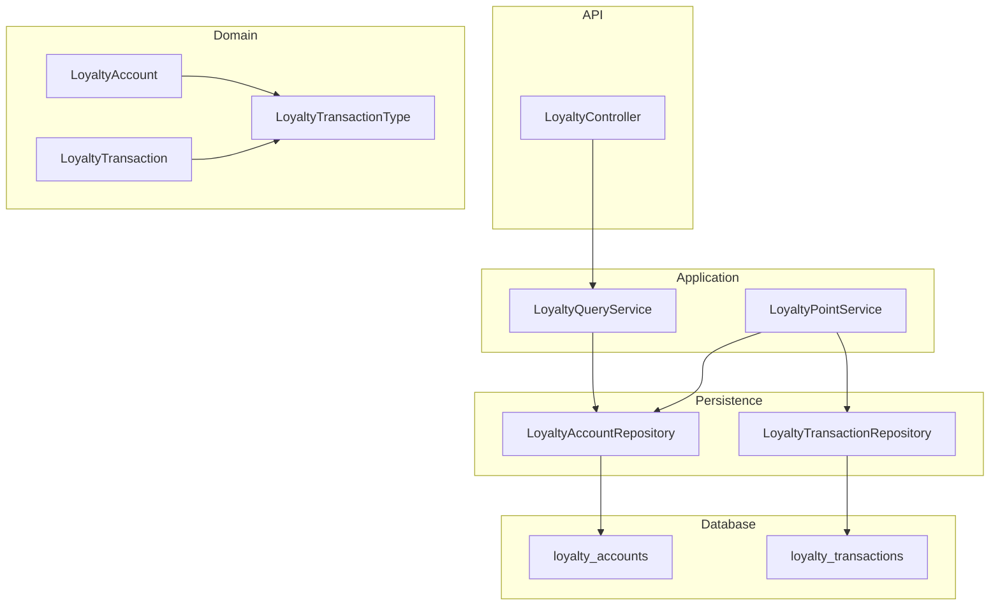
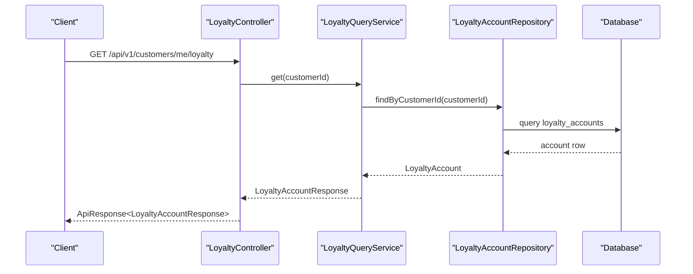
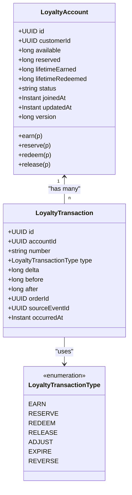
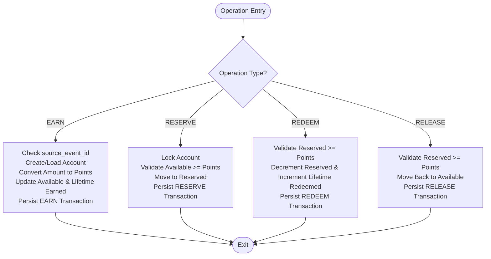
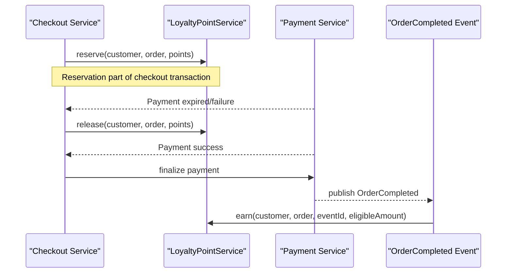
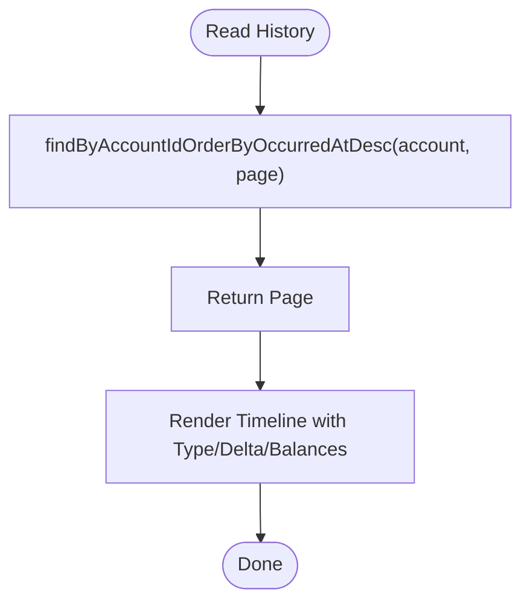
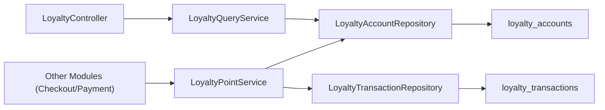

# Point Transaction Tracking

<cite>
**Referenced Files in This Document**
- [LoyaltyAccount.java](file://src/main/java/com/smartcoffee/modules/loyalty/domain/LoyaltyAccount.java)
- [LoyaltyTransaction.java](file://src/main/java/com/smartcoffee/modules/loyalty/domain/LoyaltyTransaction.java)
- [LoyaltyTransactionType.java](file://src/main/java/com/smartcoffee/modules/loyalty/domain/LoyaltyTransactionType.java)
- [LoyaltyPointService.java](file://src/main/java/com/smartcoffee/modules/loyalty/application/LoyaltyPointService.java)
- [LoyaltyQueryService.java](file://src/main/java/com/smartcoffee/modules/loyalty/application/LoyaltyQueryService.java)
- [LoyaltyController.java](file://src/main/java/com/smartcoffee/modules/loyalty/api/LoyaltyController.java)
- [LoyaltyAccountResponse.java](file://src/main/java/com/smartcoffee/modules/loyalty/api/LoyaltyAccountResponse.java)
- [LoyaltyAccountRepository.java](file://src/main/java/com/smartcoffee/modules/loyalty/persistence/LoyaltyAccountRepository.java)
- [LoyaltyTransactionRepository.java](file://src/main/java/com/smartcoffee/modules/loyalty/persistence/LoyaltyTransactionRepository.java)
- [V009__promotions_loyalty.sql](file://src/main/resources/db/migration/V009__promotions_loyalty.sql)
- [CHECKOUT_PROMOTION_LOYALTY_PATCH.md](file://CHECKOUT_PROMOTION_LOYALTY_PATCH.md)
- [PAYMENT_LOYALTY_PATCH.md](file://PAYMENT_LOYALTY_PATCH.md)
- [LoyaltyDuplicateEventIT.java](file://src/test/java/com/smartcoffee/modules/loyalty/LoyaltyDuplicateEventIT.java)
</cite>

## Table of Contents
1. [Introduction](#introduction)
2. [Project Structure](#project-structure)
3. [Core Components](#core-components)
4. [Architecture Overview](#architecture-overview)
5. [Detailed Component Analysis](#detailed-component-analysis)
6. [Dependency Analysis](#dependency-analysis)
7. [Performance Considerations](#performance-considerations)
8. [Troubleshooting Guide](#troubleshooting-guide)
9. [Conclusion](#conclusion)

## Introduction
This document explains the point transaction tracking system for loyalty points. It covers the data model, transaction types (earn, reserve/redeem/release, adjust), and the end-to-end lifecycle from order completion to point crediting, reservation during checkout, redemption on payment success, and release on failure. It also documents how transactions are recorded, validated, persisted with audit trails, and how they affect loyalty account balances. Finally, it addresses integrity guarantees, rollback behavior, idempotency, and reporting capabilities.

## Project Structure
The loyalty module is organized by domain, application, persistence, and API layers:
- Domain: LoyaltyAccount, LoyaltyTransaction, LoyaltyTransactionType
- Application: LoyaltyPointService (commands), LoyaltyQueryService (queries)
- Persistence: JPA repositories for accounts and transactions
- API: LoyaltyController exposes account balance queries
- Database: Migration defines schemas and constraints for accounts and transactions

**Diagram sources**
- [LoyaltyController.java:10-27](file://src/main/java/com/smartcoffee/modules/loyalty/api/LoyaltyController.java#L10-L27)
- [LoyaltyPointService.java:10-59](file://src/main/java/com/smartcoffee/modules/loyalty/application/LoyaltyPointService.java#L10-L59)
- [LoyaltyQueryService.java:10-24](file://src/main/java/com/smartcoffee/modules/loyalty/application/LoyaltyQueryService.java#L10-L24)
- [LoyaltyAccount.java:8-31](file://src/main/java/com/smartcoffee/modules/loyalty/domain/LoyaltyAccount.java#L8-L31)
- [LoyaltyTransaction.java:7-31](file://src/main/java/com/smartcoffee/modules/loyalty/domain/LoyaltyTransaction.java#L7-L31)
- [LoyaltyTransactionType.java:3-5](file://src/main/java/com/smartcoffee/modules/loyalty/domain/LoyaltyTransactionType.java#L3-L5)
- [LoyaltyAccountRepository.java:9-14](file://src/main/java/com/smartcoffee/modules/loyalty/persistence/LoyaltyAccountRepository.java#L9-L14)
- [LoyaltyTransactionRepository.java:8-11](file://src/main/java/com/smartcoffee/modules/loyalty/persistence/LoyaltyTransactionRepository.java#L8-L11)
- [V009__promotions_loyalty.sql:119-169](file://src/main/resources/db/migration/V009__promotions_loyalty.sql#L119-L169)

**Section sources**
- [LoyaltyController.java:10-27](file://src/main/java/com/smartcoffee/modules/loyalty/api/LoyaltyController.java#L10-L27)
- [LoyaltyPointService.java:10-59](file://src/main/java/com/smartcoffee/modules/loyalty/application/LoyaltyPointService.java#L10-L59)
- [LoyaltyQueryService.java:10-24](file://src/main/java/com/smartcoffee/modules/loyalty/application/LoyaltyQueryService.java#L10-L24)
- [LoyaltyAccount.java:8-31](file://src/main/java/com/smartcoffee/modules/loyalty/domain/LoyaltyAccount.java#L8-L31)
- [LoyaltyTransaction.java:7-31](file://src/main/java/com/smartcoffee/modules/loyalty/domain/LoyaltyTransaction.java#L7-L31)
- [LoyaltyTransactionType.java:3-5](file://src/main/java/com/smartcoffee/modules/loyalty/domain/LoyaltyTransactionType.java#L3-L5)
- [LoyaltyAccountRepository.java:9-14](file://src/main/java/com/smartcoffee/modules/loyalty/persistence/LoyaltyAccountRepository.java#L9-L14)
- [LoyaltyTransactionRepository.java:8-11](file://src/main/java/com/smartcoffee/modules/loyalty/persistence/LoyaltyTransactionRepository.java#L8-L11)
- [V009__promotions_loyalty.sql:119-169](file://src/main/resources/db/migration/V009__promotions_loyalty.sql#L119-L169)

## Core Components
- LoyaltyAccount: Represents a customer’s point balance with available and reserved buckets, lifetime earned/redeemed counters, status, timestamps, and optimistic versioning. Provides domain methods to earn, reserve, redeem, and release points with validation.
- LoyaltyTransaction: Immutable ledger entry capturing type, delta, before/after balances, associated order, source event id, and timestamp.
- LoyaltyTransactionType: Enumerates EARN, RESERVE, REDEEM, RELEASE, ADJUST, EXPIRE, REVERSE.
- LoyaltyPointService: Command service orchestrating point operations within transactions, including idempotent earning via source event deduplication.
- Repositories: Provide pessimistic locking for writes and read-only queries; include existence checks for idempotency and pagination-friendly history queries.
- API: Exposes account balance retrieval for the current customer.

Key responsibilities:
- Earn points after order completion (idempotent).
- Reserve points during checkout to secure them for potential redemption.
- Redeem reserved points upon successful payment.
- Release reserved points when payment fails or expires.
- Record all changes as immutable transactions with before/after balances.

**Section sources**
- [LoyaltyAccount.java:36-76](file://src/main/java/com/smartcoffee/modules/loyalty/domain/LoyaltyAccount.java#L36-L76)
- [LoyaltyTransaction.java:36-50](file://src/main/java/com/smartcoffee/modules/loyalty/domain/LoyaltyTransaction.java#L36-L50)
- [LoyaltyTransactionType.java:3-5](file://src/main/java/com/smartcoffee/modules/loyalty/domain/LoyaltyTransactionType.java#L3-L5)
- [LoyaltyPointService.java:20-59](file://src/main/java/com/smartcoffee/modules/loyalty/application/LoyaltyPointService.java#L20-L59)
- [LoyaltyAccountRepository.java:9-14](file://src/main/java/com/smartcoffee/modules/loyalty/persistence/LoyaltyAccountRepository.java#L9-L14)
- [LoyaltyTransactionRepository.java:8-11](file://src/main/java/com/smartcoffee/modules/loyalty/persistence/LoyaltyTransactionRepository.java#L8-L11)
- [LoyaltyController.java:23-27](file://src/main/java/com/smartcoffee/modules/loyalty/api/LoyaltyController.java#L23-L27)

## Architecture Overview
The system follows a layered architecture with clear separation between API, application services, domain logic, and persistence. Transactions are the single source of truth for point movements, while the account entity maintains current balances.

**Diagram sources**
- [LoyaltyController.java:23-27](file://src/main/java/com/smartcoffee/modules/loyalty/api/LoyaltyController.java#L23-L27)
- [LoyaltyQueryService.java:18-24](file://src/main/java/com/smartcoffee/modules/loyalty/application/LoyaltyQueryService.java#L18-L24)
- [LoyaltyAccountRepository.java:14](file://src/main/java/com/smartcoffee/modules/loyalty/persistence/LoyaltyAccountRepository.java#L14)
- [V009__promotions_loyalty.sql:119-136](file://src/main/resources/db/migration/V009__promotions_loyalty.sql#L119-L136)

## Detailed Component Analysis

### Data Model and Relationships
- LoyaltyAccount stores per-customer balances:
  - available_points: spendable points
  - reserved_points: points held pending redemption
  - lifetime_earned_points/lifetime_redeemed_points: cumulative totals
  - status, joined_at, updated_at, version
- LoyaltyTransaction records each movement:
  - type (EARN, RESERVE, REDEEM, RELEASE, ADJUST, EXPIRE, REVERSE)
  - points_delta: change to available (negative for reserve, zero for redeem)
  - balance_before/balance_after: snapshot for auditability
  - order_id: links to originating order
  - source_event_id: idempotency key for async earners
  - occurred_at: timestamp

**Diagram sources**
- [LoyaltyAccount.java:8-31](file://src/main/java/com/smartcoffee/modules/loyalty/domain/LoyaltyAccount.java#L8-L31)
- [LoyaltyTransaction.java:7-31](file://src/main/java/com/smartcoffee/modules/loyalty/domain/LoyaltyTransaction.java#L7-L31)
- [LoyaltyTransactionType.java:3-5](file://src/main/java/com/smartcoffee/modules/loyalty/domain/LoyaltyTransactionType.java#L3-L5)

**Section sources**
- [LoyaltyAccount.java:8-31](file://src/main/java/com/smartcoffee/modules/loyalty/domain/LoyaltyAccount.java#L8-L31)
- [LoyaltyTransaction.java:7-31](file://src/main/java/com/smartcoffee/modules/loyalty/domain/LoyaltyTransaction.java#L7-L31)
- [LoyaltyTransactionType.java:3-5](file://src/main/java/com/smartcoffee/modules/loyalty/domain/LoyaltyTransactionType.java#L3-L5)
- [V009__promotions_loyalty.sql:119-169](file://src/main/resources/db/migration/V009__promotions_loyalty.sql#L119-L169)

### Transaction Lifecycle and Operations
- Earn:
  - Idempotent via source_event_id uniqueness check.
  - Creates account if missing, converts eligible amount to integer points, updates available and lifetime earned, persists EARN transaction.
- Reserve:
  - Locks account pessimistically, validates sufficient available points, moves points to reserved, persists RESERVE transaction with negative delta.
- Redeem:
  - Validates sufficient reserved points, decrements reserved and increments lifetime redeemed, persists REDEEM transaction.
- Release:
  - Moves reserved points back to available, persists RELEASE transaction.

**Diagram sources**
- [LoyaltyPointService.java:20-59](file://src/main/java/com/smartcoffee/modules/loyalty/application/LoyaltyPointService.java#L20-L59)
- [LoyaltyAccount.java:46-76](file://src/main/java/com/smartcoffee/modules/loyalty/domain/LoyaltyAccount.java#L46-L76)
- [LoyaltyTransactionRepository.java:8-11](file://src/main/java/com/smartcoffee/modules/loyalty/persistence/LoyaltyTransactionRepository.java#L8-L11)
- [LoyaltyAccountRepository.java:9-12](file://src/main/java/com/smartcoffee/modules/loyalty/persistence/LoyaltyAccountRepository.java#L9-L12)

**Section sources**
- [LoyaltyPointService.java:20-59](file://src/main/java/com/smartcoffee/modules/loyalty/application/LoyaltyPointService.java#L20-L59)
- [LoyaltyAccount.java:46-76](file://src/main/java/com/smartcoffee/modules/loyalty/domain/LoyaltyAccount.java#L46-L76)

### Integration with Orders and Payments
- Checkout integration:
  - Before finalizing order totals, reserve promotion usage and optional loyalty points. If checkout rolls back, reservations roll back automatically.
  - On payment expiration, release reserved promotions and loyalty points.
  - On payment success, redeem promotions and confirm loyalty redemption.
- Payment integration:
  - After successful payment, call promotion redemption.
  - Loyalty earning should be performed asynchronously via an OrderCompleted consumer using Consumer Inbox to ensure idempotency and decoupling.

**Diagram sources**
- [CHECKOUT_PROMOTION_LOYALTY_PATCH.md:1-3](file://CHECKOUT_PROMOTION_LOYALTY_PATCH.md#L1-L3)
- [PAYMENT_LOYALTY_PATCH.md:1-3](file://PAYMENT_LOYALTY_PATCH.md#L1-L3)
- [LoyaltyPointService.java:20-59](file://src/main/java/com/smartcoffee/modules/loyalty/application/LoyaltyPointService.java#L20-L59)

**Section sources**
- [CHECKOUT_PROMOTION_LOYALTY_PATCH.md:1-3](file://CHECKOUT_PROMOTION_LOYALTY_PATCH.md#L1-L3)
- [PAYMENT_LOYALTY_PATCH.md:1-3](file://PAYMENT_LOYALTY_PATCH.md#L1-L3)

### Reporting and Audit Trails
- Ledger-based auditing:
  - Each operation persists a LoyaltyTransaction with type, delta, balance_before, balance_after, order reference, source event id, and timestamp.
  - Unique transaction_number provides a human-readable identifier.
- History queries:
  - Repository supports fetching transactions by account ordered by occurrence time descending, enabling paginated history views.
- Balance exposure:
  - API returns available, reserved, lifetime earned, lifetime redeemed, and version for client-side consistency checks.

**Diagram sources**
- [LoyaltyTransactionRepository.java:8-11](file://src/main/java/com/smartcoffee/modules/loyalty/persistence/LoyaltyTransactionRepository.java#L8-L11)
- [LoyaltyTransaction.java:15-31](file://src/main/java/com/smartcoffee/modules/loyalty/domain/LoyaltyTransaction.java#L15-L31)
- [LoyaltyAccountResponse.java:5-6](file://src/main/java/com/smartcoffee/modules/loyalty/api/LoyaltyAccountResponse.java#L5-L6)

**Section sources**
- [LoyaltyTransactionRepository.java:8-11](file://src/main/java/com/smartcoffee/modules/loyalty/persistence/LoyaltyTransactionRepository.java#L8-L11)
- [LoyaltyTransaction.java:15-31](file://src/main/java/com/smartcoffee/modules/loyalty/domain/LoyaltyTransaction.java#L15-L31)
- [LoyaltyAccountResponse.java:5-6](file://src/main/java/com/smartcoffee/modules/loyalty/api/LoyaltyAccountResponse.java#L5-L6)

### Examples of Transaction Scenarios
- Order-based point earnings:
  - Triggered asynchronously after order completion.
  - Deduplicated by source_event_id to prevent double-earning.
  - Converts eligible monetary amount to integer points and records EARN transaction.
- Redemption transactions:
  - During checkout, points are reserved (RESERVE) to secure them.
  - On payment success, reserved points are confirmed (REDEEM).
  - On payment failure/expiry, reserved points are released (RELEASE).
- Adjustment transactions:
  - Supported by ADJUST type for manual corrections or system adjustments.
  - Should be used sparingly and audited with clear rationale.

**Section sources**
- [LoyaltyPointService.java:20-59](file://src/main/java/com/smartcoffee/modules/loyalty/application/LoyaltyPointService.java#L20-L59)
- [LoyaltyTransactionType.java:3-5](file://src/main/java/com/smartcoffee/modules/loyalty/domain/LoyaltyTransactionType.java#L3-L5)
- [CHECKOUT_PROMOTION_LOYALTY_PATCH.md:1-3](file://CHECKOUT_PROMOTION_LOYALTY_PATCH.md#L1-L3)
- [PAYMENT_LOYALTY_PATCH.md:1-3](file://PAYMENT_LOYALTY_PATCH.md#L1-L3)

## Dependency Analysis
- Coupling:
  - LoyaltyPointService depends on both repositories; domain entities encapsulate business rules.
  - API layer depends only on query service for reads; write operations are invoked by other modules (checkout/payment consumers).
- Cohesion:
  - Domain methods keep balance invariants within LoyaltyAccount.
  - Repositories provide focused access patterns (pessimistic lock, existence check, history pagination).
- External dependencies:
  - Database schema enforces referential integrity and value constraints.
  - Asynchronous earning integrates with messaging infrastructure via Consumer Inbox pattern.

**Diagram sources**
- [LoyaltyController.java:10-27](file://src/main/java/com/smartcoffee/modules/loyalty/api/LoyaltyController.java#L10-L27)
- [LoyaltyQueryService.java:10-24](file://src/main/java/com/smartcoffee/modules/loyalty/application/LoyaltyQueryService.java#L10-L24)
- [LoyaltyPointService.java:10-59](file://src/main/java/com/smartcoffee/modules/loyalty/application/LoyaltyPointService.java#L10-L59)
- [LoyaltyAccountRepository.java:9-14](file://src/main/java/com/smartcoffee/modules/loyalty/persistence/LoyaltyAccountRepository.java#L9-L14)
- [LoyaltyTransactionRepository.java:8-11](file://src/main/java/com/smartcoffee/modules/loyalty/persistence/LoyaltyTransactionRepository.java#L8-L11)
- [V009__promotions_loyalty.sql:119-169](file://src/main/resources/db/migration/V009__promotions_loyalty.sql#L119-L169)

**Section sources**
- [LoyaltyController.java:10-27](file://src/main/java/com/smartcoffee/modules/loyalty/api/LoyaltyController.java#L10-L27)
- [LoyaltyPointService.java:10-59](file://src/main/java/com/smartcoffee/modules/loyalty/application/LoyaltyPointService.java#L10-L59)
- [LoyaltyAccountRepository.java:9-14](file://src/main/java/com/smartcoffee/modules/loyalty/persistence/LoyaltyAccountRepository.java#L9-L14)
- [LoyaltyTransactionRepository.java:8-11](file://src/main/java/com/smartcoffee/modules/loyalty/persistence/LoyaltyTransactionRepository.java#L8-L11)
- [V009__promotions_loyalty.sql:119-169](file://src/main/resources/db/migration/V009__promotions_loyalty.sql#L119-L169)

## Performance Considerations
- Pessimistic locking on account writes prevents race conditions during concurrent earns/reserves/redeems/releases.
- Idempotent earning via source_event_id avoids duplicate processing under message retries.
- Paginated history queries reduce payload size for large ledgers.
- Optimistic versioning on accounts helps detect concurrent modifications at the persistence layer.

[No sources needed since this section provides general guidance]

## Troubleshooting Guide
- Duplicate earning prevention:
  - Ensure source_event_id is unique per event; repository includes existsBySourceEventId guard.
  - Integration test placeholder demonstrates expected behavior for duplicate events.
- Insufficient points errors:
  - Reserve/redeem/release validate available/reserved balances and throw conflict exceptions when insufficient.
- Rollback behavior:
  - All operations are wrapped in transactions; failures revert account state and ledger entries atomically.
- Observability:
  - Use transaction history queries to reconstruct timeline and diagnose discrepancies.

**Section sources**
- [LoyaltyTransactionRepository.java:8-11](file://src/main/java/com/smartcoffee/modules/loyalty/persistence/LoyaltyTransactionRepository.java#L8-L11)
- [LoyaltyDuplicateEventIT.java:5-10](file://src/test/java/com/smartcoffee/modules/loyalty/LoyaltyDuplicateEventIT.java#L5-L10)
- [LoyaltyAccount.java:54-76](file://src/main/java/com/smartcoffee/modules/loyalty/domain/LoyaltyAccount.java#L54-L76)
- [LoyaltyPointService.java:20-59](file://src/main/java/com/smartcoffee/modules/loyalty/application/LoyaltyPointService.java#L20-L59)

## Conclusion
The point transaction tracking system uses a robust ledger-based design with clear domain boundaries and strong integrity guarantees. Transactions capture every change with before/after snapshots, while account-level validations enforce balance invariants. The integration with checkout and payment flows ensures that points are reserved, redeemed, or released appropriately, and asynchronous earning is idempotent. Reporting through transaction history provides full auditability for compliance and analytics.

[No sources needed since this section summarizes without analyzing specific files]