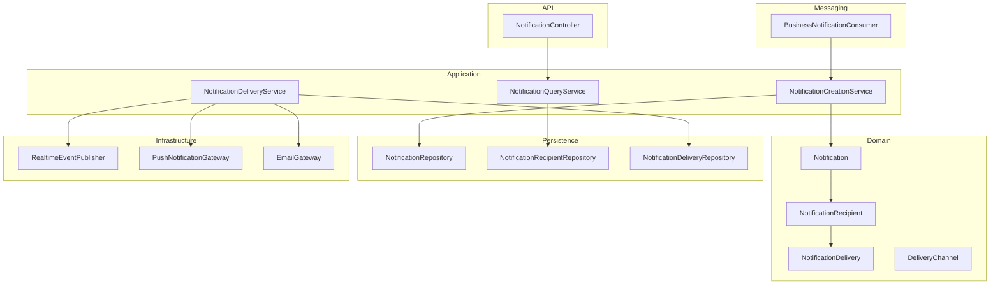
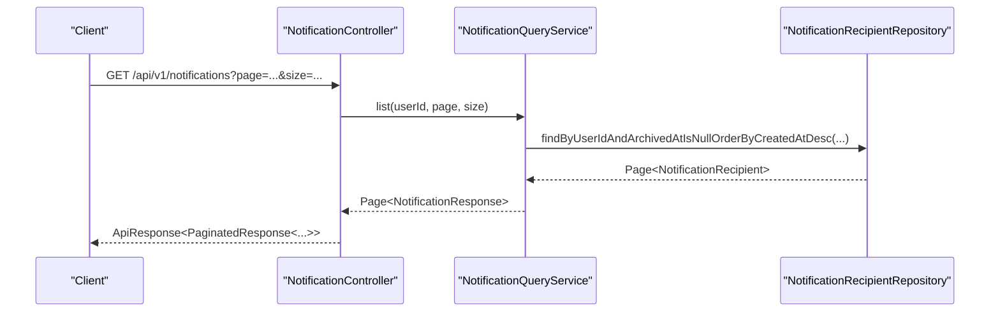
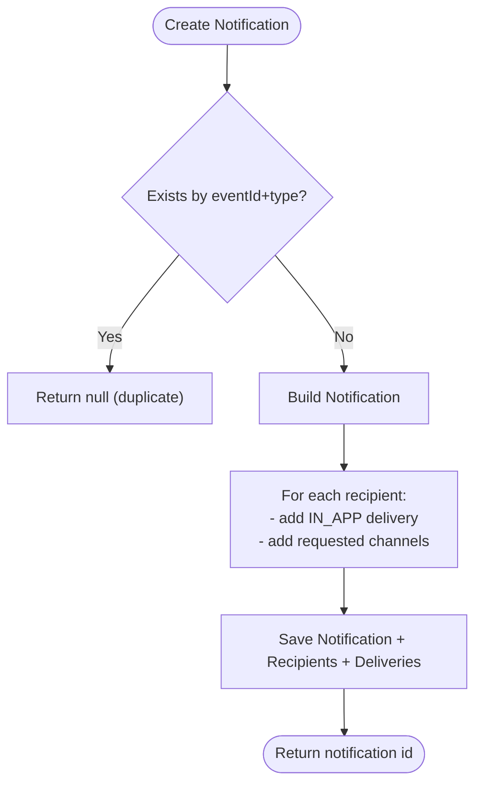
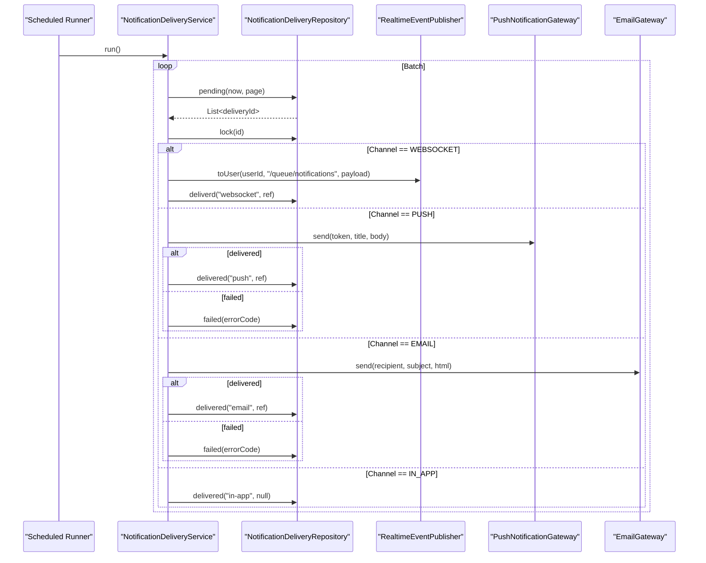
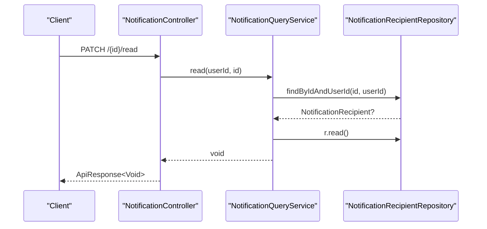
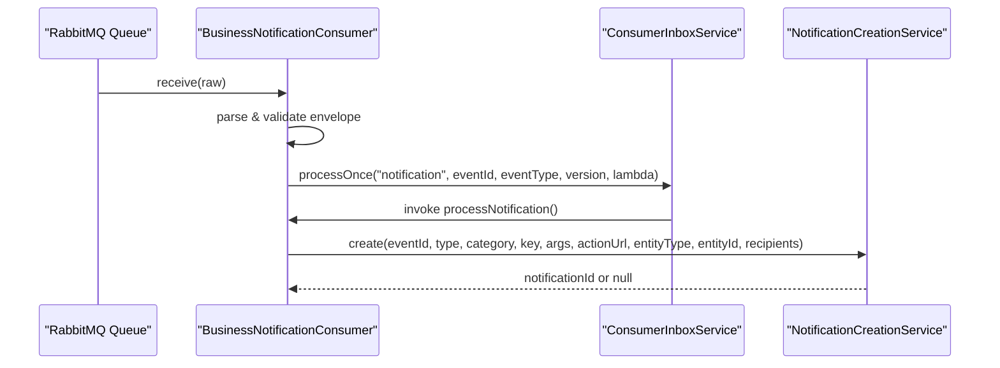
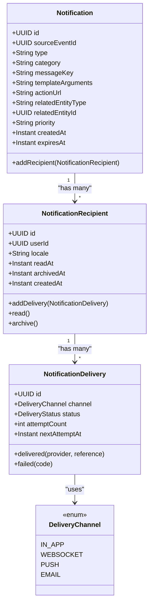
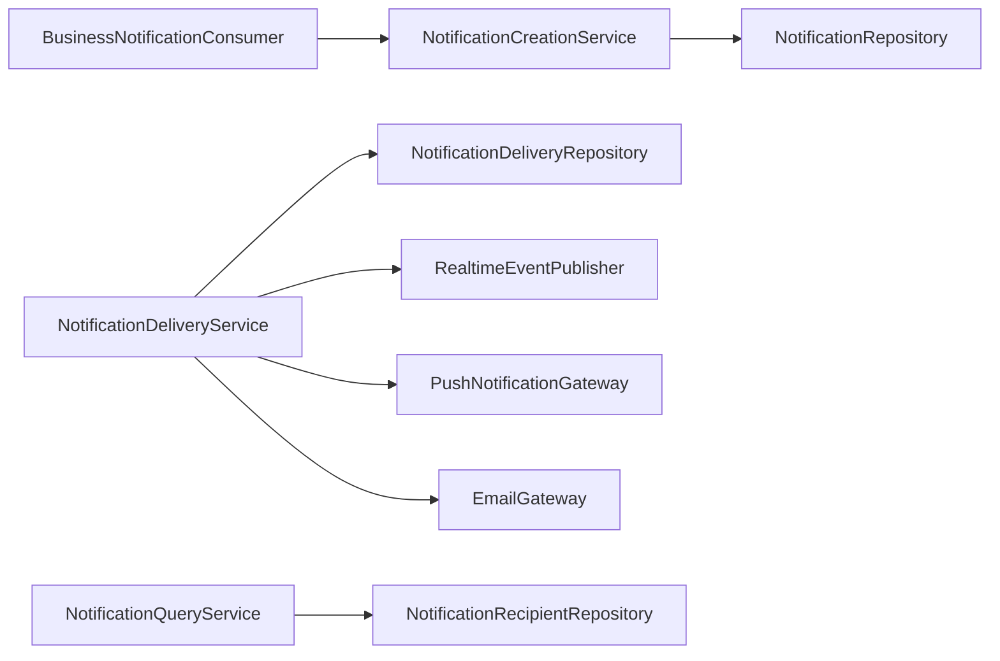

# Application Services & Business Logic

<cite>
**Referenced Files in This Document**
- [NotificationCreationService.java](file://src/main/java/com/smartcoffee/modules/notification/application/NotificationCreationService.java)
- [NotificationDeliveryService.java](file://src/main/java/com/smartcoffee/modules/notification/application/NotificationDeliveryService.java)
- [NotificationQueryService.java](file://src/main/java/com/smartcoffee/modules/notification/application/NotificationQueryService.java)
- [BusinessNotificationConsumer.java](file://src/main/java/com/smartcoffee/modules/notification/consumer/BusinessNotificationConsumer.java)
- [NotificationController.java](file://src/main/java/com/smartcoffee/modules/notification/api/NotificationController.java)
- [Notification.java](file://src/main/java/com/smartcoffee/modules/notification/domain/Notification.java)
- [NotificationRecipient.java](file://src/main/java/com/smartcoffee/modules/notification/domain/NotificationRecipient.java)
- [NotificationDelivery.java](file://src/main/java/com/smartcoffee/modules/notification/domain/NotificationDelivery.java)
- [DeliveryChannel.java](file://src/main/java/com/smartcoffee/modules/notification/domain/DeliveryChannel.java)
- [NotificationRepository.java](file://src/main/java/com/smartcoffee/modules/notification/persistence/NotificationRepository.java)
- [NotificationRecipientRepository.java](file://src/main/java/com/smartcoffee/modules/notification/persistence/NotificationRecipientRepository.java)
- [NotificationDeliveryRepository.java](file://src/main/java/com/smartcoffee/modules/notification/persistence/NotificationDeliveryRepository.java)
- [EmailGateway.java](file://src/main/java/com/smartcoffee/infrastructure/notification/EmailGateway.java)
- [PushNotificationGateway.java](file://src/main/java/com/smartcoffee/infrastructure/notification/PushNotificationGateway.java)
- [RealtimeEventPublisher.java](file://src/main/java/com/smartcoffee/infrastructure/realtime/RealtimeEventPublisher.java)
</cite>

## Table of Contents
1. Introduction
2. Project Structure
3. Core Components
4. Architecture Overview
5. Detailed Component Analysis
6. Dependency Analysis
7. Performance Considerations
8. Troubleshooting Guide
9. Conclusion

## Introduction
This document explains the notification application services layer, focusing on how notifications are created, delivered across multiple channels (in-app, WebSocket, push, email), and queried by users. It covers service orchestration patterns, validation rules, integration with domain entities, transaction boundaries, error handling, and performance considerations.

## Project Structure
The notification module is organized into:
- API: REST endpoints for listing notifications, unread counts, and marking as read.
- Application: Services that coordinate business logic for creation, delivery, and queries.
- Consumer: Inbound message handler that creates notifications from events.
- Domain: Entities modeling notifications, recipients, deliveries, and channel/status enums.
- Persistence: JPA repositories for data access.

**Diagram sources**
- [NotificationController.java:1-50](file://src/main/java/com/smartcoffee/modules/notification/api/NotificationController.java#L1-L50)
- [NotificationCreationService.java:1-39](file://src/main/java/com/smartcoffee/modules/notification/application/NotificationCreationService.java#L1-L39)
- [NotificationDeliveryService.java:1-68](file://src/main/java/com/smartcoffee/modules/notification/application/NotificationDeliveryService.java#L1-L68)
- [NotificationQueryService.java:1-47](file://src/main/java/com/smartcoffee/modules/notification/application/NotificationQueryService.java#L1-L47)
- [BusinessNotificationConsumer.java:1-161](file://src/main/java/com/smartcoffee/modules/notification/consumer/BusinessNotificationConsumer.java#L1-L161)
- [Notification.java:1-99](file://src/main/java/com/smartcoffee/modules/notification/domain/Notification.java#L1-L99)
- [NotificationRecipient.java:1-86](file://src/main/java/com/smartcoffee/modules/notification/domain/NotificationRecipient.java#L1-L86)
- [NotificationDelivery.java:1-98](file://src/main/java/com/smartcoffee/modules/notification/domain/NotificationDelivery.java#L1-L98)
- [DeliveryChannel.java:1-7](file://src/main/java/com/smartcoffee/modules/notification/domain/DeliveryChannel.java#L1-L7)
- [NotificationRepository.java:1-11](file://src/main/java/com/smartcoffee/modules/notification/persistence/NotificationRepository.java#L1-L11)
- [NotificationRecipientRepository.java:1-23](file://src/main/java/com/smartcoffee/modules/notification/persistence/NotificationRecipientRepository.java#L1-L23)
- [NotificationDeliveryRepository.java:1-21](file://src/main/java/com/smartcoffee/modules/notification/persistence/NotificationDeliveryRepository.java#L1-L21)
- [RealtimeEventPublisher.java:1-4](file://src/main/java/com/smartcoffee/infrastructure/realtime/RealtimeEventPublisher.java#L1-L4)
- [PushNotificationGateway.java:1-4](file://src/main/java/com/smartcoffee/infrastructure/notification/PushNotificationGateway.java#L1-L4)
- [EmailGateway.java:1-9](file://src/main/java/com/smartcoffee/infrastructure/notification/EmailGateway.java#L1-L9)

**Section sources**
- [NotificationController.java:1-50](file://src/main/java/com/smartcoffee/modules/notification/api/NotificationController.java#L1-L50)
- [NotificationCreationService.java:1-39](file://src/main/java/com/smartcoffee/modules/notification/application/NotificationCreationService.java#L1-L39)
- [NotificationDeliveryService.java:1-68](file://src/main/java/com/smartcoffee/modules/notification/application/NotificationDeliveryService.java#L1-L68)
- [NotificationQueryService.java:1-47](file://src/main/java/com/smartcoffee/modules/notification/application/NotificationQueryService.java#L1-L47)
- [BusinessNotificationConsumer.java:1-161](file://src/main/java/com/smartcoffee/modules/notification/consumer/BusinessNotificationConsumer.java#L1-L161)

## Core Components
- NotificationCreationService: Creates a notification entity with recipients and per-channel delivery records within a transaction. Enforces idempotency via source event deduplication.
- NotificationDeliveryService: Scheduled worker that picks pending deliveries, locks them, dispatches to channels, and updates status or schedules retries.
- NotificationQueryService: Provides paginated lists, unread counts, and mark-as-read operations for a user’s notifications.
- BusinessNotificationConsumer: Listens to inbound messages, validates payloads, ensures single processing via inbox, and delegates creation to the service.
- API Controller: Exposes read-only and state-changing endpoints for users to manage their notifications.

Key responsibilities and interactions:
- Creation: Validates input, prevents duplicate notifications for the same source event/type, builds domain objects, persists, and returns the notification ID.
- Delivery: Polls pending deliveries, locks rows, routes to appropriate channel, updates status, and handles failures with retry scheduling.
- Querying: Reads user-specific notifications, computes unread counts, and marks items as read atomically.

**Section sources**
- [NotificationCreationService.java:1-39](file://src/main/java/com/smartcoffee/modules/notification/application/NotificationCreationService.java#L1-L39)
- [NotificationDeliveryService.java:1-68](file://src/main/java/com/smartcoffee/modules/notification/application/NotificationDeliveryService.java#L1-L68)
- [NotificationQueryService.java:1-47](file://src/main/java/com/smartcoffee/modules/notification/application/NotificationQueryService.java#L1-L47)
- [BusinessNotificationConsumer.java:1-161](file://src/main/java/com/smartcoffee/modules/notification/consumer/BusinessNotificationConsumer.java#L1-L161)
- [NotificationController.java:1-50](file://src/main/java/com/smartcoffee/modules/notification/api/NotificationController.java#L1-L50)

## Architecture Overview
The system follows a clear separation of concerns:
- API layer exposes simple endpoints for reading and managing notifications.
- Application services encapsulate business workflows and orchestrate domain and infrastructure.
- Domain models represent core concepts and enforce invariants.
- Persistence provides efficient queries and safe locking for concurrent delivery processing.
- Infrastructure adapters abstract external systems (WebSocket, push providers, email).

**Diagram sources**
- [NotificationController.java:22-29](file://src/main/java/com/smartcoffee/modules/notification/api/NotificationController.java#L22-L29)
- [NotificationQueryService.java:19-27](file://src/main/java/com/smartcoffee/modules/notification/application/NotificationQueryService.java#L19-L27)
- [NotificationRecipientRepository.java:9-14](file://src/main/java/com/smartcoffee/modules/notification/persistence/NotificationRecipientRepository.java#L9-L14)

## Detailed Component Analysis

### Notification Creation Workflow
- Idempotent creation: The service checks if a notification already exists for the given source event and type to avoid duplicates.
- Domain construction: A Notification is created with metadata (type, category, message key, template arguments, action URL, related entity info, priority, expiry).
- Recipients and channels: For each recipient, an in-app delivery is always added; additional channels (WebSocket, push, email) are added based on provided preferences.
- Transactional boundary: All persistence happens within a single transaction to ensure consistency.

**Diagram sources**
- [NotificationCreationService.java:21-36](file://src/main/java/com/smartcoffee/modules/notification/application/NotificationCreationService.java#L21-L36)
- [Notification.java:43-59](file://src/main/java/com/smartcoffee/modules/notification/domain/Notification.java#L43-L59)
- [NotificationRecipient.java:35-49](file://src/main/java/com/smartcoffee/modules/notification/domain/NotificationRecipient.java#L35-L49)
- [NotificationDelivery.java:45-52](file://src/main/java/com/smartcoffee/modules/notification/domain/NotificationDelivery.java#L45-L52)
- [NotificationRepository.java:7-9](file://src/main/java/com/smartcoffee/modules/notification/persistence/NotificationRepository.java#L7-L9)

**Section sources**
- [NotificationCreationService.java:1-39](file://src/main/java/com/smartcoffee/modules/notification/application/NotificationCreationService.java#L1-L39)
- [Notification.java:1-99](file://src/main/java/com/smartcoffee/modules/notification/domain/Notification.java#L1-L99)
- [NotificationRecipient.java:1-86](file://src/main/java/com/smartcoffee/modules/notification/domain/NotificationRecipient.java#L1-L86)
- [NotificationDelivery.java:1-98](file://src/main/java/com/smartcoffee/modules/notification/domain/NotificationDelivery.java#L1-L98)
- [NotificationRepository.java:1-11](file://src/main/java/com/smartcoffee/modules/notification/persistence/NotificationRepository.java#L1-L11)

### Delivery Orchestration and Multi-Channel Strategy
- Scheduling: A periodic task polls for pending deliveries up to a batch size.
- Concurrency safety: Each delivery is locked with pessimistic write to prevent race conditions.
- Channel routing:
  - WebSocket: Publishes a real-time event to the user’s queue and marks delivered.
  - Push: Calls the push gateway; marks delivered or failed based on result.
  - Email: Calls the email gateway; marks delivered or failed based on result.
  - In-app: Immediately marked delivered.
- Retry strategy: On failure, attempts increment and next attempt time is scheduled using exponential backoff capped at one hour.

**Diagram sources**
- [NotificationDeliveryService.java:28-65](file://src/main/java/com/smartcoffee/modules/notification/application/NotificationDeliveryService.java#L28-L65)
- [NotificationDeliveryRepository.java:11-18](file://src/main/java/com/smartcoffee/modules/notification/persistence/NotificationDeliveryRepository.java#L11-L18)
- [RealtimeEventPublisher.java:1-4](file://src/main/java/com/smartcoffee/infrastructure/realtime/RealtimeEventPublisher.java#L1-L4)
- [PushNotificationGateway.java:1-4](file://src/main/java/com/smartcoffee/infrastructure/notification/PushNotificationGateway.java#L1-L4)
- [EmailGateway.java:1-9](file://src/main/java/com/smartcoffee/infrastructure/notification/EmailGateway.java#L1-L9)

**Section sources**
- [NotificationDeliveryService.java:1-68](file://src/main/java/com/smartcoffee/modules/notification/application/NotificationDeliveryService.java#L1-L68)
- [NotificationDeliveryRepository.java:1-21](file://src/main/java/com/smartcoffee/modules/notification/persistence/NotificationDeliveryRepository.java#L1-L21)
- [RealtimeEventPublisher.java:1-4](file://src/main/java/com/smartcoffee/infrastructure/realtime/RealtimeEventPublisher.java#L1-L4)
- [PushNotificationGateway.java:1-4](file://src/main/java/com/smartcoffee/infrastructure/notification/PushNotificationGateway.java#L1-L4)
- [EmailGateway.java:1-9](file://src/main/java/com/smartcoffee/infrastructure/notification/EmailGateway.java#L1-L9)

### Query Operations and Read State Management
- Listing: Paginated retrieval of non-archived notifications for a user, ordered by creation time descending.
- Unread count: Efficient count query for unread, non-archived recipients.
- Mark as read: Single recipient read update; bulk mark-all-read operation available.

**Diagram sources**
- [NotificationController.java:37-41](file://src/main/java/com/smartcoffee/modules/notification/api/NotificationController.java#L37-L41)
- [NotificationQueryService.java:34-39](file://src/main/java/com/smartcoffee/modules/notification/application/NotificationQueryService.java#L34-L39)
- [NotificationRecipientRepository.java:16-20](file://src/main/java/com/smartcoffee/modules/notification/persistence/NotificationRecipientRepository.java#L16-L20)

**Section sources**
- [NotificationQueryService.java:1-47](file://src/main/java/com/smartcoffee/modules/notification/application/NotificationQueryService.java#L1-L47)
- [NotificationRecipientRepository.java:1-23](file://src/main/java/com/smartcoffee/modules/notification/persistence/NotificationRecipientRepository.java#L1-L23)

### Event-Driven Creation via Messaging
- Message consumption: Listens to a RabbitMQ queue, parses JSON envelope, and enforces required fields.
- Idempotency: Uses an inbox service to process each event exactly once.
- Delegation: Builds recipients with default locale and preferred channels, then calls the creation service.

**Diagram sources**
- [BusinessNotificationConsumer.java:33-70](file://src/main/java/com/smartcoffee/modules/notification/consumer/BusinessNotificationConsumer.java#L33-L70)
- [BusinessNotificationConsumer.java:72-124](file://src/main/java/com/smartcoffee/modules/notification/consumer/BusinessNotificationConsumer.java#L72-L124)
- [NotificationCreationService.java:21-36](file://src/main/java/com/smartcoffee/modules/notification/application/NotificationCreationService.java#L21-L36)

**Section sources**
- [BusinessNotificationConsumer.java:1-161](file://src/main/java/com/smartcoffee/modules/notification/consumer/BusinessNotificationConsumer.java#L1-L161)
- [NotificationCreationService.java:1-39](file://src/main/java/com/smartcoffee/modules/notification/application/NotificationCreationService.java#L1-L39)

### Domain Model Relationships

**Diagram sources**
- [Notification.java:7-38](file://src/main/java/com/smartcoffee/modules/notification/domain/Notification.java#L7-L38)
- [NotificationRecipient.java:7-30](file://src/main/java/com/smartcoffee/modules/notification/domain/NotificationRecipient.java#L7-L30)
- [NotificationDelivery.java:7-40](file://src/main/java/com/smartcoffee/modules/notification/domain/NotificationDelivery.java#L7-L40)
- [DeliveryChannel.java:3-5](file://src/main/java/com/smartcoffee/modules/notification/domain/DeliveryChannel.java#L3-L5)

**Section sources**
- [Notification.java:1-99](file://src/main/java/com/smartcoffee/modules/notification/domain/Notification.java#L1-L99)
- [NotificationRecipient.java:1-86](file://src/main/java/com/smartcoffee/modules/notification/domain/NotificationRecipient.java#L1-L86)
- [NotificationDelivery.java:1-98](file://src/main/java/com/smartcoffee/modules/notification/domain/NotificationDelivery.java#L1-L98)
- [DeliveryChannel.java:1-7](file://src/main/java/com/smartcoffee/modules/notification/domain/DeliveryChannel.java#L1-L7)

## Dependency Analysis
- Service-to-repository dependencies:
  - NotificationCreationService depends on NotificationRepository for existence checks and persistence.
  - NotificationDeliveryService depends on NotificationDeliveryRepository for querying and locking deliveries.
  - NotificationQueryService depends on NotificationRecipientRepository for reads and updates.
- Infrastructure dependencies:
  - NotificationDeliveryService integrates with RealtimeEventPublisher, PushNotificationGateway, and EmailGateway.
- Messaging dependency:
  - BusinessNotificationConsumer depends on ConsumerInboxService for idempotent processing and delegates to NotificationCreationService.

**Diagram sources**
- [NotificationCreationService.java:1-39](file://src/main/java/com/smartcoffee/modules/notification/application/NotificationCreationService.java#L1-L39)
- [NotificationDeliveryService.java:1-68](file://src/main/java/com/smartcoffee/modules/notification/application/NotificationDeliveryService.java#L1-L68)
- [NotificationQueryService.java:1-47](file://src/main/java/com/smartcoffee/modules/notification/application/NotificationQueryService.java#L1-L47)
- [BusinessNotificationConsumer.java:1-161](file://src/main/java/com/smartcoffee/modules/notification/consumer/BusinessNotificationConsumer.java#L1-L161)
- [NotificationRepository.java:1-11](file://src/main/java/com/smartcoffee/modules/notification/persistence/NotificationRepository.java#L1-L11)
- [NotificationDeliveryRepository.java:1-21](file://src/main/java/com/smartcoffee/modules/notification/persistence/NotificationDeliveryRepository.java#L1-L21)
- [NotificationRecipientRepository.java:1-23](file://src/main/java/com/smartcoffee/modules/notification/persistence/NotificationRecipientRepository.java#L1-L23)
- [RealtimeEventPublisher.java:1-4](file://src/main/java/com/smartcoffee/infrastructure/realtime/RealtimeEventPublisher.java#L1-L4)
- [PushNotificationGateway.java:1-4](file://src/main/java/com/smartcoffee/infrastructure/notification/PushNotificationGateway.java#L1-L4)
- [EmailGateway.java:1-9](file://src/main/java/com/smartcoffee/infrastructure/notification/EmailGateway.java#L1-L9)

**Section sources**
- [NotificationCreationService.java:1-39](file://src/main/java/com/smartcoffee/modules/notification/application/NotificationCreationService.java#L1-L39)
- [NotificationDeliveryService.java:1-68](file://src/main/java/com/smartcoffee/modules/notification/application/NotificationDeliveryService.java#L1-L68)
- [NotificationQueryService.java:1-47](file://src/main/java/com/smartcoffee/modules/notification/application/NotificationQueryService.java#L1-L47)
- [BusinessNotificationConsumer.java:1-161](file://src/main/java/com/smartcoffee/modules/notification/consumer/BusinessNotificationConsumer.java#L1-L161)

## Performance Considerations
- Batching and pagination:
  - Delivery polling uses a fixed delay and a bounded page size to limit memory and DB load.
  - Query endpoints cap page size and normalize inputs to prevent excessive loads.
- Indexing and queries:
  - Pending delivery selection filters by status and next attempt time; ensure indexes exist on status and nextAttemptAt for efficient scans.
  - Entity graphs are used to eagerly fetch related entities where needed to avoid N+1 queries.
- Locking:
  - Pessimistic write lock on delivery rows prevents concurrent processing of the same delivery.
- Retries:
  - Exponential backoff reduces pressure on external providers during transient failures.
- Transactions:
  - Creation and read/update operations use appropriate transaction boundaries to maintain consistency without long-running transactions.

[No sources needed since this section provides general guidance]

## Troubleshooting Guide
- Duplicate notifications:
  - If a notification is not created, verify whether a record already exists for the same source event and type.
- Missing recipients or channels:
  - Ensure the inbound message includes required fields and that recipient preferences include desired channels.
- Delivery stuck in pending:
  - Check nextAttemptAt and attemptCount; failures schedule future attempts. Verify external provider integrations and error codes.
- WebSocket not receiving:
  - Confirm RealtimeEventPublisher publishes to the correct destination and that clients subscribe to the expected queue.
- Read state not updating:
  - Validate that the recipient belongs to the requesting user and that the read operation executes within a transaction.

**Section sources**
- [NotificationCreationService.java:21-36](file://src/main/java/com/smartcoffee/modules/notification/application/NotificationCreationService.java#L21-L36)
- [NotificationDeliveryService.java:34-65](file://src/main/java/com/smartcoffee/modules/notification/application/NotificationDeliveryService.java#L34-L65)
- [NotificationQueryService.java:19-44](file://src/main/java/com/smartcoffee/modules/notification/application/NotificationQueryService.java#L19-L44)
- [BusinessNotificationConsumer.java:33-124](file://src/main/java/com/smartcoffee/modules/notification/consumer/BusinessNotificationConsumer.java#L33-L124)

## Conclusion
The notification application services layer provides robust, scalable functionality for creating, delivering, and querying notifications across multiple channels. It leverages domain-driven design, transactional boundaries, idempotent processing, and resilient delivery strategies to ensure reliability and performance. The modular architecture cleanly separates concerns and enables extensibility for new channels or enhanced delivery policies.