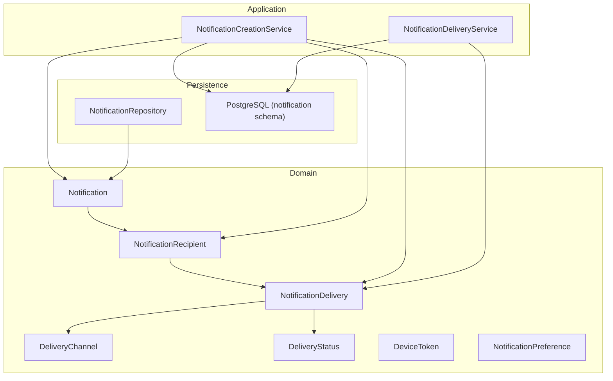
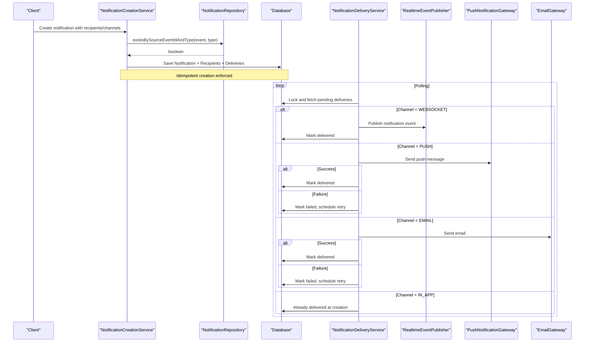
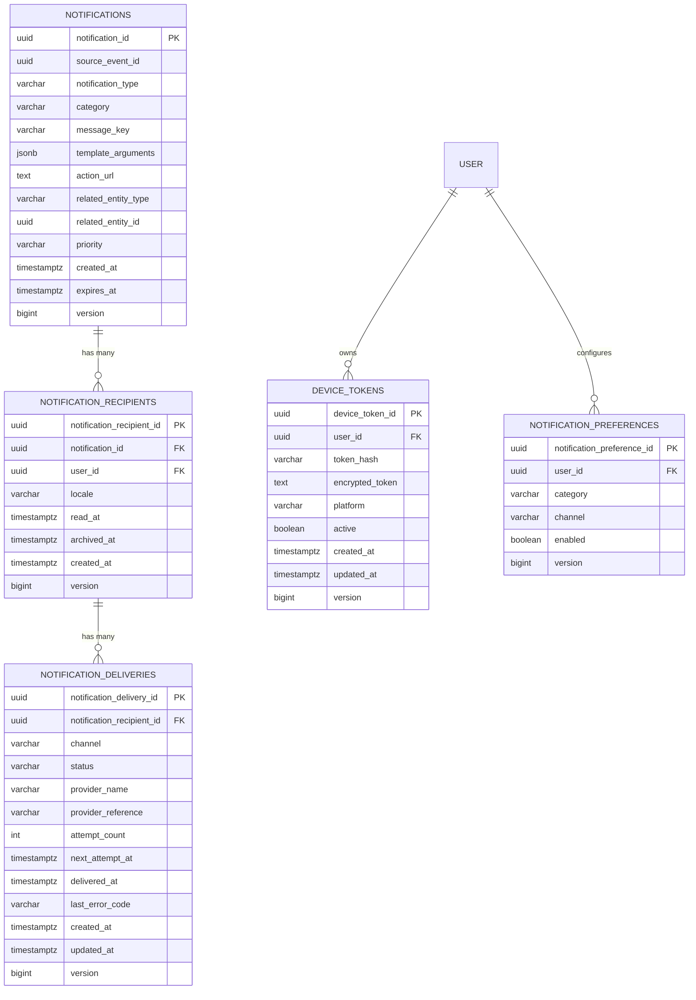
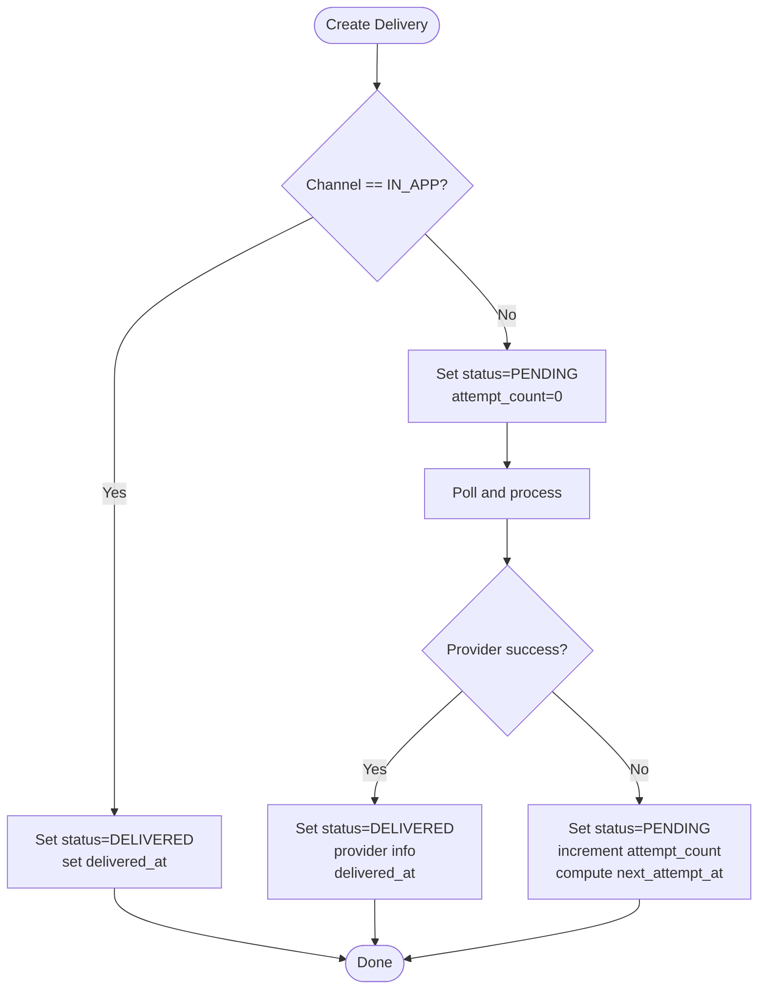
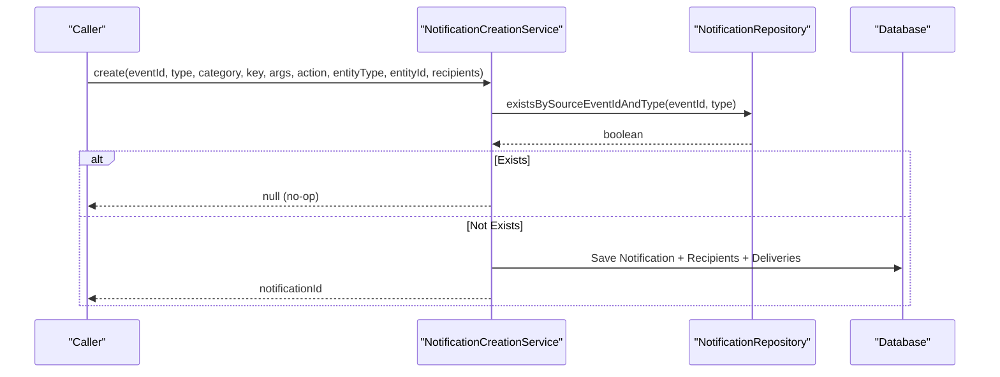
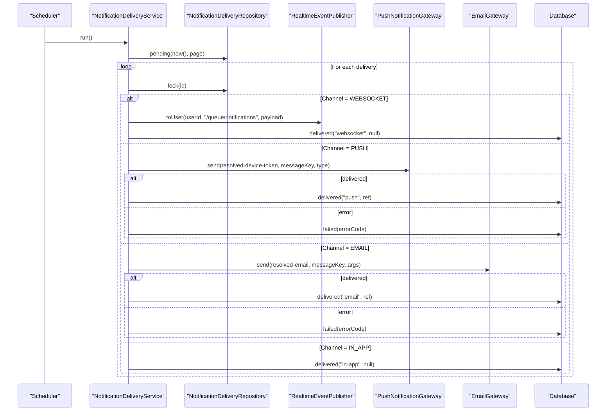
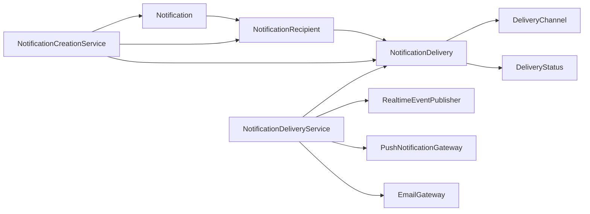
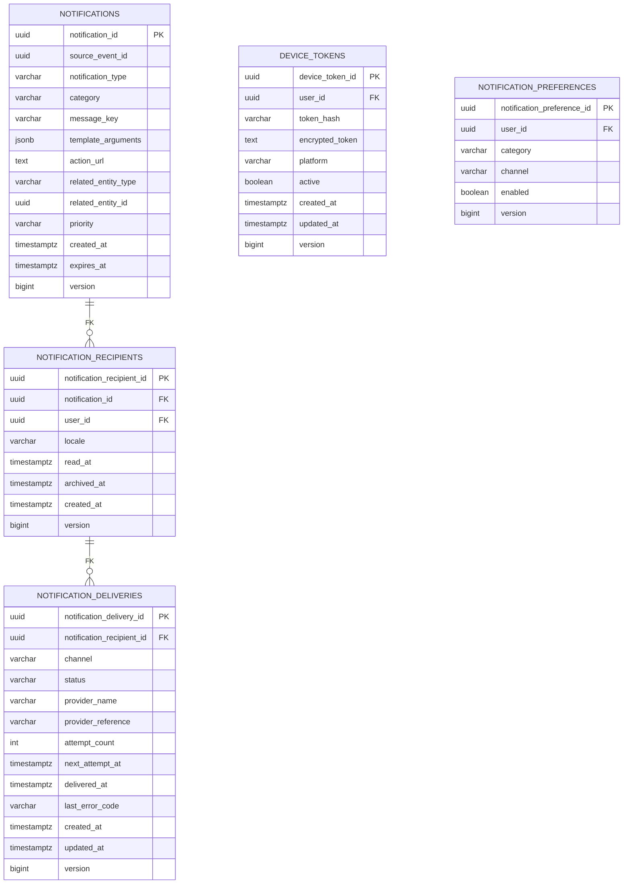

# Domain Models & Entities

<cite>
**Referenced Files in This Document**
- [Notification.java](file://src/main/java/com/smartcoffee/modules/notification/domain/Notification.java)
- [DeliveryChannel.java](file://src/main/java/com/smartcoffee/modules/notification/domain/DeliveryChannel.java)
- [DeviceToken.java](file://src/main/java/com/smartcoffee/modules/notification/domain/DeviceToken.java)
- [NotificationPreference.java](file://src/main/java/com/smartcoffee/modules/notification/domain/NotificationPreference.java)
- [NotificationRecipient.java](file://src/main/java/com/smartcoffee/modules/notification/domain/NotificationRecipient.java)
- [NotificationDelivery.java](file://src/main/java/com/smartcoffee/modules/notification/domain/NotificationDelivery.java)
- [DeliveryStatus.java](file://src/main/java/com/smartcoffee/modules/notification/domain/DeliveryStatus.java)
- [NotificationRepository.java](file://src/main/java/com/smartcoffee/modules/notification/persistence/NotificationRepository.java)
- [NotificationCreationService.java](file://src/main/java/com/smartcoffee/modules/notification/application/NotificationCreationService.java)
- [NotificationDeliveryService.java](file://src/main/java/com/smartcoffee/modules/notification/application/NotificationDeliveryService.java)
- [V010__notifications_audit.sql](file://src/main/resources/db/migration/V010__notifications_audit.sql)
</cite>

## Table of Contents
1. [Introduction](#introduction)
2. [Project Structure](#project-structure)
3. [Core Components](#core-components)
4. [Architecture Overview](#architecture-overview)
5. [Detailed Component Analysis](#detailed-component-analysis)
6. [Dependency Analysis](#dependency-analysis)
7. [Performance Considerations](#performance-considerations)
8. [Troubleshooting Guide](#troubleshooting-guide)
9. [Conclusion](#conclusion)
10. [Appendices](#appendices)

## Introduction
This document provides comprehensive data model documentation for the notification domain entities. It details entity relationships, field definitions, business rules, state transitions, validation constraints, and lifecycle management for Notification, DeliveryChannel, DeviceToken, NotificationPreference, NotificationRecipient, and NotificationDelivery. It also explains the domain-driven design principles applied to notification management and includes database schema diagrams showing relationships between entities.

## Project Structure
The notification domain is implemented as a cohesive module with clear separation between:
- Domain layer: entities, enums, and value objects that encapsulate business logic
- Application layer: services orchestrating creation and delivery workflows
- Persistence layer: JPA repositories and SQL migrations defining the database schema

**Diagram sources**
- [Notification.java:7-38](file://src/main/java/com/smartcoffee/modules/notification/domain/Notification.java#L7-L38)
- [NotificationRecipient.java:7-30](file://src/main/java/com/smartcoffee/modules/notification/domain/NotificationRecipient.java#L7-L30)
- [NotificationDelivery.java:7-40](file://src/main/java/com/smartcoffee/modules/notification/domain/NotificationDelivery.java#L7-L40)
- [DeliveryChannel.java:3-5](file://src/main/java/com/smartcoffee/modules/notification/domain/DeliveryChannel.java#L3-L5)
- [DeliveryStatus.java:3-5](file://src/main/java/com/smartcoffee/modules/notification/domain/DeliveryStatus.java#L3-L5)
- [DeviceToken.java:7-28](file://src/main/java/com/smartcoffee/modules/notification/domain/DeviceToken.java#L7-L28)
- [NotificationPreference.java:6-23](file://src/main/java/com/smartcoffee/modules/notification/domain/NotificationPreference.java#L6-L23)
- [NotificationCreationService.java:10-36](file://src/main/java/com/smartcoffee/modules/notification/application/NotificationCreationService.java#L10-L36)
- [NotificationDeliveryService.java:13-65](file://src/main/java/com/smartcoffee/modules/notification/application/NotificationDeliveryService.java#L13-L65)
- [NotificationRepository.java:5-9](file://src/main/java/com/smartcoffee/modules/notification/persistence/NotificationRepository.java#L5-L9)

**Section sources**
- [Notification.java:7-38](file://src/main/java/com/smartcoffee/modules/notification/domain/Notification.java#L7-L38)
- [NotificationRecipient.java:7-30](file://src/main/java/com/smartcoffee/modules/notification/domain/NotificationRecipient.java#L7-L30)
- [NotificationDelivery.java:7-40](file://src/main/java/com/smartcoffee/modules/notification/domain/NotificationDelivery.java#L7-L40)
- [NotificationCreationService.java:10-36](file://src/main/java/com/smartcoffee/modules/notification/application/NotificationCreationService.java#L10-L36)
- [NotificationDeliveryService.java:13-65](file://src/main/java/com/smartcoffee/modules/notification/application/NotificationDeliveryService.java#L13-L65)
- [NotificationRepository.java:5-9](file://src/main/java/com/smartcoffee/modules/notification/persistence/NotificationRepository.java#L5-L9)

## Core Components
- Notification: Aggregate root representing a single notification event with metadata, template arguments, priority, and expiration. Holds recipients and enforces idempotency via source event linkage.
- NotificationRecipient: Per-user instance of a notification with locale, read/archive state, and associated deliveries.
- NotificationDelivery: Per-channel delivery record tracking status, provider references, attempt counts, retry scheduling, and timestamps.
- DeliveryChannel: Enumerates supported channels (IN_APP, WEBSOCKET, PUSH, EMAIL).
- DeliveryStatus: Enumerates delivery lifecycle states (PENDING, PROCESSING, DELIVERED, FAILED, SKIPPED, CANCELLED).
- DeviceToken: Stores hashed token identifiers and encrypted tokens per device/platform; supports deactivation.
- NotificationPreference: User-level preferences controlling whether specific categories are enabled on specific channels.

Key business rules:
- Idempotent creation: Notifications are created only once per source event and type.
- In-app delivery is immediate; other channels start as pending and are processed asynchronously.
- Retry policy uses exponential backoff capped by maximum attempts.
- Unique constraints prevent duplicate recipients and per-channel deliveries per recipient.

**Section sources**
- [Notification.java:10-38](file://src/main/java/com/smartcoffee/modules/notification/domain/Notification.java#L10-L38)
- [NotificationRecipient.java:11-30](file://src/main/java/com/smartcoffee/modules/notification/domain/NotificationRecipient.java#L11-L30)
- [NotificationDelivery.java:11-40](file://src/main/java/com/smartcoffee/modules/notification/domain/NotificationDelivery.java#L11-L40)
- [DeliveryChannel.java:3-5](file://src/main/java/com/smartcoffee/modules/notification/domain/DeliveryChannel.java#L3-L5)
- [DeliveryStatus.java:3-5](file://src/main/java/com/smartcoffee/modules/notification/domain/DeliveryStatus.java#L3-L5)
- [DeviceToken.java:10-28](file://src/main/java/com/smartcoffee/modules/notification/domain/DeviceToken.java#L10-L28)
- [NotificationPreference.java:6-23](file://src/main/java/com/smartcoffee/modules/notification/domain/NotificationPreference.java#L6-L23)
- [NotificationRepository.java:7-9](file://src/main/java/com/smartcoffee/modules/notification/persistence/NotificationRepository.java#L7-L9)
- [NotificationCreationService.java:21-36](file://src/main/java/com/smartcoffee/modules/notification/application/NotificationCreationService.java#L21-L36)
- [NotificationDeliveryService.java:34-65](file://src/main/java/com/smartcoffee/modules/notification/application/NotificationDeliveryService.java#L34-L65)

## Architecture Overview
The notification system follows domain-driven design with clear boundaries:
- Aggregates: Notification owns recipients; each recipient owns its deliveries.
- Channels: Pluggable delivery mechanisms abstracted behind application services.
- Persistence: JPA entities mapped to a dedicated schema with strict constraints and indexes.
- Scheduling: A background job polls for pending deliveries and processes them with locking.

**Diagram sources**
- [NotificationCreationService.java:21-36](file://src/main/java/com/smartcoffee/modules/notification/application/NotificationCreationService.java#L21-L36)
- [NotificationDeliveryService.java:28-65](file://src/main/java/com/smartcoffee/modules/notification/application/NotificationDeliveryService.java#L28-L65)
- [NotificationRepository.java:7-9](file://src/main/java/com/smartcoffee/modules/notification/persistence/NotificationRepository.java#L7-L9)

## Detailed Component Analysis

### Entity Relationship Model

**Diagram sources**
- [V010__notifications_audit.sql:5-109](file://src/main/resources/db/migration/V010__notifications_audit.sql#L5-L109)

**Section sources**
- [V010__notifications_audit.sql:5-109](file://src/main/resources/db/migration/V010__notifications_audit.sql#L5-L109)

### Notification
- Purpose: Represents a single notification event with metadata and template context.
- Key fields:
  - Identifier and audit: notification_id, version, created_at, expires_at
  - Event linkage: source_event_id, notification_type, category
  - Content: message_key, template_arguments (JSON), action_url
  - Context: related_entity_type, related_entity_id
  - Routing: priority
- Relationships: One-to-many with NotificationRecipient.
- Business rules:
  - Idempotent creation based on source_event_id + notification_type.
  - Default priority NORMAL; expiry set at creation time.
- Validation constraints:
  - Not null fields enforced at DB level.
  - Versioning for optimistic concurrency control.

**Section sources**
- [Notification.java:7-38](file://src/main/java/com/smartcoffee/modules/notification/domain/Notification.java#L7-L38)
- [Notification.java:43-59](file://src/main/java/com/smartcoffee/modules/notification/domain/Notification.java#L43-L59)
- [V010__notifications_audit.sql:5-23](file://src/main/resources/db/migration/V010__notifications_audit.sql#L5-L23)

### NotificationRecipient
- Purpose: Per-user instance of a notification with localization and lifecycle markers.
- Key fields:
  - Linkage: notification_id, user_id
  - Localization: locale
  - Lifecycle: read_at, archived_at, created_at
  - Concurrency: version
- Relationships: Belongs to Notification; one-to-many with NotificationDelivery.
- Business rules:
  - Unique per (notification_id, user_id).
  - Read and archive operations are idempotent (only set if null).
- Validation constraints:
  - Foreign keys to notifications and users.
  - Indexes optimize unread queries and user timelines.

**Section sources**
- [NotificationRecipient.java:7-30](file://src/main/java/com/smartcoffee/modules/notification/domain/NotificationRecipient.java#L7-L30)
- [NotificationRecipient.java:35-59](file://src/main/java/com/smartcoffee/modules/notification/domain/NotificationRecipient.java#L35-L59)
- [V010__notifications_audit.sql:25-42](file://src/main/resources/db/migration/V010__notifications_audit.sql#L25-L42)

### NotificationDelivery
- Purpose: Tracks delivery attempts per channel for a recipient.
- Key fields:
  - Channel and status: channel, status
  - Provider info: provider_name, provider_reference
  - Retry: attempt_count, next_attempt_at
  - Completion: delivered_at
  - Errors: last_error_code
  - Audit: created_at, updated_at, version
- Business rules:
  - In-app deliveries are marked delivered immediately upon creation.
  - Failed deliveries increment attempt_count and compute next_attempt_at using exponential backoff.
  - Unique per (notification_recipient_id, channel).
- State transitions: See flowchart below.

**Diagram sources**
- [NotificationDelivery.java:45-71](file://src/main/java/com/smartcoffee/modules/notification/domain/NotificationDelivery.java#L45-L71)
- [NotificationDeliveryService.java:34-65](file://src/main/java/com/smartcoffee/modules/notification/application/NotificationDeliveryService.java#L34-L65)

**Section sources**
- [NotificationDelivery.java:11-40](file://src/main/java/com/smartcoffee/modules/notification/domain/NotificationDelivery.java#L11-L40)
- [NotificationDelivery.java:45-71](file://src/main/java/com/smartcoffee/modules/notification/domain/NotificationDelivery.java#L45-L71)
- [V010__notifications_audit.sql:44-87](file://src/main/resources/db/migration/V010__notifications_audit.sql#L44-L87)

### DeliveryChannel and DeliveryStatus
- DeliveryChannel: IN_APP, WEBSOCKET, PUSH, EMAIL.
- DeliveryStatus: PENDING, PROCESSING, DELIVERED, FAILED, SKIPPED, CANCELLED.
- Constraints:
  - Channel values constrained at DB level.
  - Status values constrained at DB level.

**Section sources**
- [DeliveryChannel.java:3-5](file://src/main/java/com/smartcoffee/modules/notification/domain/DeliveryChannel.java#L3-L5)
- [DeliveryStatus.java:3-5](file://src/main/java/com/smartcoffee/modules/notification/domain/DeliveryStatus.java#L3-L5)
- [V010__notifications_audit.sql:62-80](file://src/main/resources/db/migration/V010__notifications_audit.sql#L62-L80)

### DeviceToken
- Purpose: Securely stores device tokens for push notifications.
- Key fields:
  - Identity: device_token_id, user_id
  - Security: token_hash (unique), encrypted_token
  - Platform: platform
  - Lifecycle: active, created_at, updated_at
  - Concurrency: version
- Business rules:
  - Deactivation sets active=false and updates timestamp.
  - Token hashing ensures safe storage while enabling lookup.

**Section sources**
- [DeviceToken.java:7-28](file://src/main/java/com/smartcoffee/modules/notification/domain/DeviceToken.java#L7-L28)
- [DeviceToken.java:33-36](file://src/main/java/com/smartcoffee/modules/notification/domain/DeviceToken.java#L33-L36)
- [V010__notifications_audit.sql:89-99](file://src/main/resources/db/migration/V010__notifications_audit.sql#L89-L99)

### NotificationPreference
- Purpose: User-level configuration to enable/disable notification categories per channel.
- Key fields:
  - Identity: notification_preference_id
  - Scope: user_id, category, channel
  - Control: enabled
  - Concurrency: version
- Business rules:
  - Unique per (user_id, category, channel).
  - Defaults to enabled unless explicitly disabled.

**Section sources**
- [NotificationPreference.java:6-23](file://src/main/java/com/smartcoffee/modules/notification/domain/NotificationPreference.java#L6-L23)
- [V010__notifications_audit.sql:101-109](file://src/main/resources/db/migration/V010__notifications_audit.sql#L101-L109)

### Application Services

#### NotificationCreationService
- Responsibilities:
  - Enforce idempotency via source_event_id + type check.
  - Build Notification aggregate with recipients and deliveries.
  - Persist entire graph atomically.
- Workflow highlights:
  - Creates an in-app delivery for every recipient.
  - Adds additional deliveries for requested channels (excluding IN_APP).
  - Sets default priority and expiration.

**Diagram sources**
- [NotificationCreationService.java:21-36](file://src/main/java/com/smartcoffee/modules/notification/application/NotificationCreationService.java#L21-L36)
- [NotificationRepository.java:7-9](file://src/main/java/com/smartcoffee/modules/notification/persistence/NotificationRepository.java#L7-L9)

**Section sources**
- [NotificationCreationService.java:10-36](file://src/main/java/com/smartcoffee/modules/notification/application/NotificationCreationService.java#L10-L36)

#### NotificationDeliveryService
- Responsibilities:
  - Scheduled polling for pending deliveries.
  - Lock-based processing to avoid concurrent handling.
  - Dispatch to appropriate gateways (realtime, push, email).
  - Update delivery status and schedule retries on failure.
- Workflow highlights:
  - WEBSOCKET: publish event and mark delivered.
  - PUSH/EMAIL: call gateway; mark delivered or failed with retry scheduling.
  - IN_APP: already delivered at creation.

**Diagram sources**
- [NotificationDeliveryService.java:28-65](file://src/main/java/com/smartcoffee/modules/notification/application/NotificationDeliveryService.java#L28-L65)

**Section sources**
- [NotificationDeliveryService.java:13-65](file://src/main/java/com/smartcoffee/modules/notification/application/NotificationDeliveryService.java#L13-L65)

## Dependency Analysis
- Cohesion: Each entity encapsulates its own lifecycle and invariants.
- Coupling:
  - Notification depends on NotificationRecipient.
  - NotificationRecipient depends on NotificationDelivery.
  - DeliveryChannel and DeliveryStatus are shared enumerations used across entities.
- External dependencies:
  - RealtimeEventPublisher for WebSocket delivery.
  - PushNotificationGateway and EmailGateway for external providers.
- Database constraints:
  - Unique constraints enforce idempotency and uniqueness.
  - Check constraints validate allowed channel/status values.
  - Indexes optimize common queries (unread count, pending deliveries).

**Diagram sources**
- [Notification.java:37-38](file://src/main/java/com/smartcoffee/modules/notification/domain/Notification.java#L37-L38)
- [NotificationRecipient.java:29-30](file://src/main/java/com/smartcoffee/modules/notification/domain/NotificationRecipient.java#L29-L30)
- [NotificationDelivery.java:14-19](file://src/main/java/com/smartcoffee/modules/notification/domain/NotificationDelivery.java#L14-L19)
- [NotificationCreationService.java:21-36](file://src/main/java/com/smartcoffee/modules/notification/application/NotificationCreationService.java#L21-L36)
- [NotificationDeliveryService.java:28-65](file://src/main/java/com/smartcoffee/modules/notification/application/NotificationDeliveryService.java#L28-L65)

**Section sources**
- [Notification.java:37-38](file://src/main/java/com/smartcoffee/modules/notification/domain/Notification.java#L37-L38)
- [NotificationRecipient.java:29-30](file://src/main/java/com/smartcoffee/modules/notification/domain/NotificationRecipient.java#L29-L30)
- [NotificationDelivery.java:14-19](file://src/main/java/com/smartcoffee/modules/notification/domain/NotificationDelivery.java#L14-L19)
- [NotificationCreationService.java:21-36](file://src/main/java/com/smartcoffee/modules/notification/application/NotificationCreationService.java#L21-L36)
- [NotificationDeliveryService.java:28-65](file://src/main/java/com/smartcoffee/modules/notification/application/NotificationDeliveryService.java#L28-L65)

## Performance Considerations
- Idempotent creation reduces duplicate work and prevents race conditions.
- Optimistic locking via version fields avoids lost updates.
- Database indexes:
  - Unread index accelerates counting and listing unread notifications.
  - Pending delivery index optimizes polling for retries.
- Batching:
  - Delivery service processes up to a fixed batch size per poll cycle.
- Backoff:
  - Exponential backoff limits load on external providers during failures.

[No sources needed since this section provides general guidance]

## Troubleshooting Guide
Common issues and resolutions:
- Duplicate notifications:
  - Cause: Missing idempotency checks.
  - Resolution: Ensure creation path checks existsBySourceEventIdAndType before persisting.
- Stuck deliveries:
  - Cause: Gateway errors or misconfiguration.
  - Resolution: Inspect last_error_code and next_attempt_at; verify provider credentials and connectivity.
- Over-retries:
  - Cause: Incorrect failure handling.
  - Resolution: Confirm failed() increments attempt_count and computes next_attempt_at correctly.
- Preference conflicts:
  - Cause: Missing unique constraint enforcement.
  - Resolution: Validate unique (user_id, category, channel) at persistence layer.

**Section sources**
- [NotificationRepository.java:7-9](file://src/main/java/com/smartcoffee/modules/notification/persistence/NotificationRepository.java#L7-L9)
- [NotificationDelivery.java:65-71](file://src/main/java/com/smartcoffee/modules/notification/domain/NotificationDelivery.java#L65-L71)
- [NotificationDeliveryService.java:34-65](file://src/main/java/com/smartcoffee/modules/notification/application/NotificationDeliveryService.java#L34-L65)

## Conclusion
The notification domain implements a robust, scalable model grounded in domain-driven design. Aggregates encapsulate business rules, channels are pluggable, and persistence enforces strong integrity constraints. The combination of idempotent creation, scheduled delivery with retry logic, and preference controls ensures reliable, user-centric notification experiences.

[No sources needed since this section summarizes without analyzing specific files]

## Appendices

### Database Schema Diagram (Notification Schema)

**Diagram sources**
- [V010__notifications_audit.sql:5-109](file://src/main/resources/db/migration/V010__notifications_audit.sql#L5-L109)