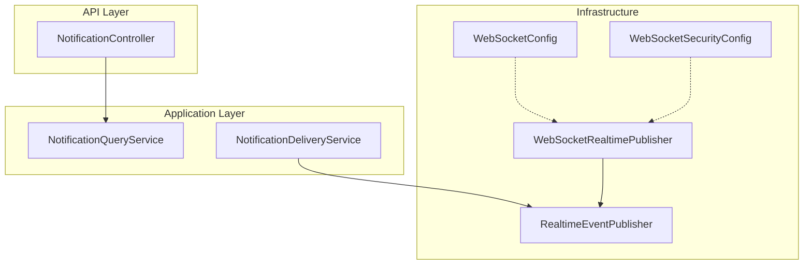
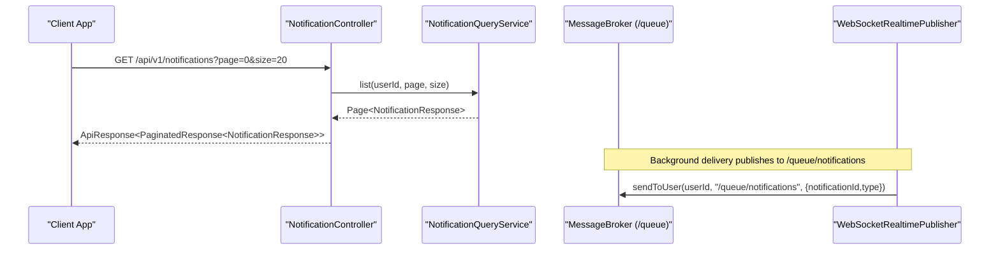
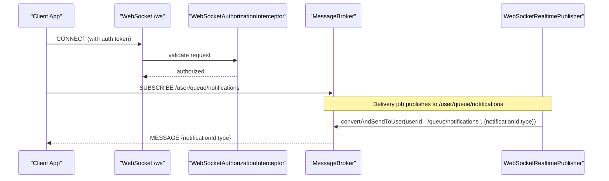
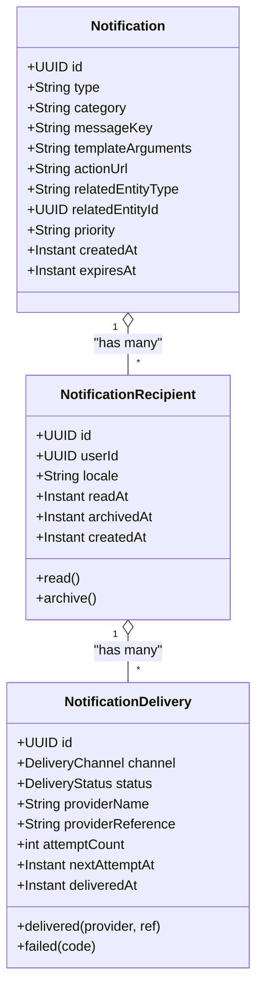
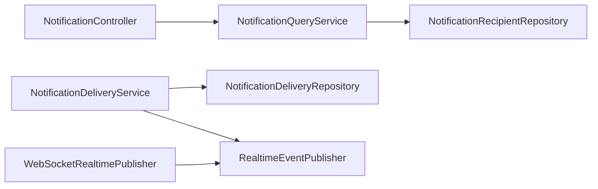

# Notification API Endpoints

<cite>
**Referenced Files in This Document**
- [NotificationController.java](file://src/main/java/com/smartcoffee/modules/notification/api/NotificationController.java)
- [NotificationResponse.java](file://src/main/java/com/smartcoffee/modules/notification/api/NotificationResponse.java)
- [UnreadCountResponse.java](file://src/main/java/com/smartcoffee/modules/notification/api/UnreadCountResponse.java)
- [NotificationQueryService.java](file://src/main/java/com/smartcoffee/modules/notification/application/NotificationQueryService.java)
- [NotificationDeliveryService.java](file://src/main/java/com/smartcoffee/modules/notification/application/NotificationDeliveryService.java)
- [WebSocketConfig.java](file://src/main/java/com/smartcoffee/config/WebSocketConfig.java)
- [WebSocketSecurityConfig.java](file://src/main/java/com/smartcoffee/config/WebSocketSecurityConfig.java)
- [RealtimeEventPublisher.java](file://src/main/java/com/smartcoffee/infrastructure/realtime/RealtimeEventPublisher.java)
- [WebSocketRealtimePublisher.java](file://src/main/java/com/smartcoffee/infrastructure/realtime/WebSocketRealtimePublisher.java)
- [ApiResponse.java](file://src/main/java/com/smartcoffee/common/api/ApiResponse.java)
- [PaginatedResponse.java](file://src/main/java/com/smartcoffee/common/api/PaginatedResponse.java)
</cite>

## Table of Contents
1. [Introduction](#introduction)
2. [Project Structure](#project-structure)
3. [Core Components](#core-components)
4. [Architecture Overview](#architecture-overview)
5. [Detailed Component Analysis](#detailed-component-analysis)
6. [Dependency Analysis](#dependency-analysis)
7. [Performance Considerations](#performance-considerations)
8. [Troubleshooting Guide](#troubleshooting-guide)
9. [Conclusion](#conclusion)

## Introduction
This document provides API documentation for the Notification REST endpoints and WebSocket integration used to manage user notifications. It covers:
- HTTP methods and URL patterns for listing, marking read/unread, and retrieving unread counts
- Request/response schemas and status codes
- Authentication requirements
- Real-time notification delivery via WebSocket (STOMP over WebSocket)
- Error handling patterns and best practices

## Project Structure
The Notification feature is implemented as a Spring Boot module with:
- REST controllers under modules/notification/api
- Application services under modules/notification/application
- Domain entities under modules/notification/domain
- Configuration for WebSocket under config
- Real-time event publishing under infrastructure/realtime

**Diagram sources**
- [NotificationController.java:11-47](file://src/main/java/com/smartcoffee/modules/notification/api/NotificationController.java#L11-L47)
- [NotificationQueryService.java:11-44](file://src/main/java/com/smartcoffee/modules/notification/application/NotificationQueryService.java#L11-L44)
- [NotificationDeliveryService.java:13-65](file://src/main/java/com/smartcoffee/modules/notification/application/NotificationDeliveryService.java#L13-L65)
- [WebSocketConfig.java:7-18](file://src/main/java/com/smartcoffee/config/WebSocketConfig.java#L7-L18)
- [WebSocketSecurityConfig.java:9-34](file://src/main/java/com/smartcoffee/config/WebSocketSecurityConfig.java#L9-L34)
- [RealtimeEventPublisher.java:1-4](file://src/main/java/com/smartcoffee/infrastructure/realtime/RealtimeEventPublisher.java#L1-L4)
- [WebSocketRealtimePublisher.java:1-5](file://src/main/java/com/smartcoffee/infrastructure/realtime/WebSocketRealtimePublisher.java#L1-L5)

**Section sources**
- [NotificationController.java:11-47](file://src/main/java/com/smartcoffee/modules/notification/api/NotificationController.java#L11-L47)
- [NotificationQueryService.java:11-44](file://src/main/java/com/smartcoffee/modules/notification/application/NotificationQueryService.java#L11-L44)
- [WebSocketConfig.java:7-18](file://src/main/java/com/smartcoffee/config/WebSocketConfig.java#L7-L18)
- [WebSocketSecurityConfig.java:9-34](file://src/main/java/com/smartcoffee/config/WebSocketSecurityConfig.java#L9-L34)

## Core Components
- NotificationController: Exposes REST endpoints for listing notifications, reading single/all notifications, and getting unread count.
- NotificationQueryService: Implements business logic for querying and updating notification recipients.
- NotificationDeliveryService: Scheduled worker that delivers notifications via WebSocket, push, email, or marks in-app delivered.
- WebSocket configuration classes: Configure STOMP broker, endpoints, and security interceptors.
- Realtime publishers: Interface and implementation for sending real-time events to users/stores.

**Section sources**
- [NotificationController.java:11-47](file://src/main/java/com/smartcoffee/modules/notification/api/NotificationController.java#L11-L47)
- [NotificationQueryService.java:11-44](file://src/main/java/com/smartcoffee/modules/notification/application/NotificationQueryService.java#L11-L44)
- [NotificationDeliveryService.java:13-65](file://src/main/java/com/smartcoffee/modules/notification/application/NotificationDeliveryService.java#L13-L65)
- [WebSocketConfig.java:7-18](file://src/main/java/com/smartcoffee/config/WebSocketConfig.java#L7-L18)
- [WebSocketSecurityConfig.java:9-34](file://src/main/java/com/smartcoffee/config/WebSocketSecurityConfig.java#L9-L34)
- [RealtimeEventPublisher.java:1-4](file://src/main/java/com/smartcoffee/infrastructure/realtime/RealtimeEventPublisher.java#L1-L4)
- [WebSocketRealtimePublisher.java:1-5](file://src/main/java/com/smartcoffee/infrastructure/realtime/WebSocketRealtimePublisher.java#L1-L5)

## Architecture Overview
The Notification system combines REST APIs for management and WebSocket for real-time delivery:
- Clients call REST endpoints to list notifications, mark them read, and get unread counts.
- A background job polls pending deliveries and sends real-time events via WebSocket or other channels.
- WebSocket connections are secured using an authorization interceptor.

**Diagram sources**
- [NotificationController.java:22-29](file://src/main/java/com/smartcoffee/modules/notification/api/NotificationController.java#L22-L29)
- [NotificationQueryService.java:19-27](file://src/main/java/com/smartcoffee/modules/notification/application/NotificationQueryService.java#L19-L27)
- [NotificationDeliveryService.java:34-44](file://src/main/java/com/smartcoffee/modules/notification/application/NotificationDeliveryService.java#L34-L44)
- [WebSocketRealtimePublisher.java:1-5](file://src/main/java/com/smartcoffee/infrastructure/realtime/WebSocketRealtimePublisher.java#L1-L5)

## Detailed Component Analysis

### REST API: Notifications
Base path: /api/v1/notifications

Authentication
- All endpoints require an authenticated user. The controller resolves the current user via CurrentActorProvider.

Endpoints
- List notifications
  - Method: GET
  - Path: /api/v1/notifications
  - Query parameters:
    - page: integer, default 0
    - size: integer, default 20, max 100 enforced by service
  - Success response: 200 OK
    - Body: ApiResponse<PaginatedResponse<NotificationResponse>>
      - success: boolean
      - data.items: array of NotificationResponse
      - data.pagination.page: integer
      - data.pagination.size: integer
      - data.pagination.totalElements: long
      - data.pagination.totalPages: integer
      - data.pagination.first: boolean
      - data.pagination.last: boolean
      - requestId: string
      - timestamp: ISO-8601 instant
  - Error responses:
    - 401 Unauthorized if not authenticated
    - 403 Forbidden if insufficient permissions
    - 422 Validation errors from framework
    - 500 Internal server error on unexpected failures

- Get unread count
  - Method: GET
  - Path: /api/v1/notifications/unread-count
  - Success response: 200 OK
    - Body: ApiResponse<UnreadCountResponse>
      - data.unreadCount: long
  - Error responses: same as above

- Mark notification as read
  - Method: PATCH
  - Path: /api/v1/notifications/{id}/read
  - Path parameter: id (UUID)
  - Success response: 200 OK
    - Body: ApiResponse<Void>
  - Error responses:
    - 404 Not Found if notification recipient does not exist for the user
    - 401/403 for authentication/authorization issues

- Mark all notifications as read
  - Method: PATCH
  - Path: /api/v1/notifications/read-all
  - Success response: 200 OK
    - Body: ApiResponse<Void>
  - Error responses: same as above

Request/Response Schemas
- NotificationResponse fields:
  - notificationRecipientId: UUID
  - notificationId: UUID
  - type: string
  - category: string
  - messageKey: string
  - templateArguments: string (JSON-encoded)
  - actionUrl: string (nullable)
  - priority: string
  - createdAt: ISO-8601 instant
  - readAt: ISO-8601 instant (nullable)

- UnreadCountResponse fields:
  - unreadCount: long

- PaginatedResponse fields:
  - items: array of T
  - pagination: object with page, size, totalElements, totalPages, first, last

- ApiResponse fields:
  - success: boolean
  - data: T
  - requestId: string
  - timestamp: ISO-8601 instant

Example Requests/Responses
- GET /api/v1/notifications?page=0&size=20
  - Response:
    - success: true
    - data.items: [NotificationResponse objects]
    - data.pagination: {page: 0, size: 20, totalElements: 123, totalPages: 7, first: true, last: false}
    - requestId: "req-uuid"
    - timestamp: "2025-01-01T12:00:00Z"

- GET /api/v1/notifications/unread-count
  - Response:
    - success: true
    - data.unreadCount: 5
    - requestId: "req-uuid"
    - timestamp: "2025-01-01T12:00:00Z"

- PATCH /api/v1/notifications/{id}/read
  - Response:
    - success: true
    - data: null
    - requestId: "req-uuid"
    - timestamp: "2025-01-01T12:00:00Z"

- PATCH /api/v1/notifications/read-all
  - Response:
    - success: true
    - data: null
    - requestId: "req-uuid"
    - timestamp: "2025-01-01T12:00:00Z"

Error Handling
- 404 Not Found: Returned when a specific notification recipient is not found for the current user.
- 401/403: Returned when authentication or authorization fails.
- 422: Returned for invalid query parameters or validation errors.
- 500: Returned for unexpected server-side exceptions.

Notes
- Pagination enforces min(page)=0 and clamps size to [1,100].
- All responses include a correlation requestId and timestamp.

**Section sources**
- [NotificationController.java:11-47](file://src/main/java/com/smartcoffee/modules/notification/api/NotificationController.java#L11-L47)
- [NotificationResponse.java:1-11](file://src/main/java/com/smartcoffee/modules/notification/api/NotificationResponse.java#L1-L11)
- [UnreadCountResponse.java:1-6](file://src/main/java/com/smartcoffee/modules/notification/api/UnreadCountResponse.java#L1-L6)
- [NotificationQueryService.java:19-44](file://src/main/java/com/smartcoffee/modules/notification/application/NotificationQueryService.java#L19-L44)
- [ApiResponse.java:1-11](file://src/main/java/com/smartcoffee/common/api/ApiResponse.java#L1-L11)
- [PaginatedResponse.java:1-10](file://src/main/java/com/smartcoffee/common/api/PaginatedResponse.java#L1-L10)

### WebSocket Integration: Real-Time Notifications
Connection
- Endpoint: ws://host/ws
- Protocol: STOMP over WebSocket
- Allowed origins: Configurable; defaults include http://localhost:*

Broker Topics/Queues
- User-specific queue: /user/queue/notifications
- Topic prefix: /topic
- Application destination prefix: /app
- User destination prefix: /user

Message Format
- Server-to-client payload for new notifications:
  - notificationId: UUID
  - type: string

Authentication
- Connections are intercepted by WebSocketAuthorizationInterceptor to ensure the client is authenticated before subscribing to /user destinations.

Client Flow
- Connect to ws://host/ws
- Subscribe to /user/queue/notifications
- Receive messages containing notificationId and type

**Diagram sources**
- [WebSocketConfig.java:7-18](file://src/main/java/com/smartcoffee/config/WebSocketConfig.java#L7-L18)
- [WebSocketSecurityConfig.java:9-34](file://src/main/java/com/smartcoffee/config/WebSocketSecurityConfig.java#L9-L34)
- [WebSocketRealtimePublisher.java:1-5](file://src/main/java/com/smartcoffee/infrastructure/realtime/WebSocketRealtimePublisher.java#L1-L5)
- [NotificationDeliveryService.java:34-44](file://src/main/java/com/smartcoffee/modules/notification/application/NotificationDeliveryService.java#L34-L44)

**Section sources**
- [WebSocketConfig.java:7-18](file://src/main/java/com/smartcoffee/config/WebSocketConfig.java#L7-L18)
- [WebSocketSecurityConfig.java:9-34](file://src/main/java/com/smartcoffee/config/WebSocketSecurityConfig.java#L9-L34)
- [RealtimeEventPublisher.java:1-4](file://src/main/java/com/smartcoffee/infrastructure/realtime/RealtimeEventPublisher.java#L1-L4)
- [WebSocketRealtimePublisher.java:1-5](file://src/main/java/com/smartcoffee/infrastructure/realtime/WebSocketRealtimePublisher.java#L1-L5)
- [NotificationDeliveryService.java:34-44](file://src/main/java/com/smartcoffee/modules/notification/application/NotificationDeliveryService.java#L34-L44)

### Data Models and Relationships

**Diagram sources**
- [Notification.java:7-97](file://src/main/java/com/smartcoffee/modules/notification/domain/Notification.java#L7-L97)
- [NotificationRecipient.java:7-84](file://src/main/java/com/smartcoffee/modules/notification/domain/NotificationRecipient.java#L7-L84)
- [NotificationDelivery.java:7-96](file://src/main/java/com/smartcoffee/modules/notification/domain/NotificationDelivery.java#L7-L96)

**Section sources**
- [Notification.java:7-97](file://src/main/java/com/smartcoffee/modules/notification/domain/Notification.java#L7-L97)
- [NotificationRecipient.java:7-84](file://src/main/java/com/smartcoffee/modules/notification/domain/NotificationRecipient.java#L7-L84)
- [NotificationDelivery.java:7-96](file://src/main/java/com/smartcoffee/modules/notification/domain/NotificationDelivery.java#L7-L96)

## Dependency Analysis
- NotificationController depends on NotificationQueryService and CurrentActorProvider.
- NotificationQueryService depends on NotificationRecipientRepository and maps domain entities to NotificationResponse.
- NotificationDeliveryService depends on NotificationDeliveryRepository, RealtimeEventPublisher, PushNotificationGateway, and EmailGateway.
- WebSocketRealtimePublisher implements RealtimeEventPublisher and uses SimpMessagingTemplate.

**Diagram sources**
- [NotificationController.java:11-47](file://src/main/java/com/smartcoffee/modules/notification/api/NotificationController.java#L11-L47)
- [NotificationQueryService.java:11-44](file://src/main/java/com/smartcoffee/modules/notification/application/NotificationQueryService.java#L11-L44)
- [NotificationDeliveryService.java:13-65](file://src/main/java/com/smartcoffee/modules/notification/application/NotificationDeliveryService.java#L13-L65)
- [WebSocketRealtimePublisher.java:1-5](file://src/main/java/com/smartcoffee/infrastructure/realtime/WebSocketRealtimePublisher.java#L1-L5)

**Section sources**
- [NotificationController.java:11-47](file://src/main/java/com/smartcoffee/modules/notification/api/NotificationController.java#L11-L47)
- [NotificationQueryService.java:11-44](file://src/main/java/com/smartcoffee/modules/notification/application/NotificationQueryService.java#L11-L44)
- [NotificationDeliveryService.java:13-65](file://src/main/java/com/smartcoffee/modules/notification/application/NotificationDeliveryService.java#L13-L65)
- [WebSocketRealtimePublisher.java:1-5](file://src/main/java/com/smartcoffee/infrastructure/realtime/WebSocketRealtimePublisher.java#L1-L5)

## Performance Considerations
- Pagination: The list endpoint enforces a maximum page size of 100 to prevent large payloads.
- Read operations: List and unread count are read-only transactions to optimize performance.
- Delivery scheduling: Delivery runs at a fixed delay configured by app.notification.poll-ms (default 2000 ms), processing up to 100 pending deliveries per run.
- Backoff: Failed deliveries use exponential backoff capped at 1 hour between attempts.

[No sources needed since this section provides general guidance]

## Troubleshooting Guide
Common issues and resolutions:
- 404 Not Found when marking a notification as read
  - Cause: The notification recipient does not exist for the current user.
  - Resolution: Verify the notification ID belongs to the authenticated user.

- WebSocket connection rejected
  - Cause: Missing or invalid authentication token.
  - Resolution: Ensure the client connects with a valid token and the origin matches allowed patterns.

- No real-time notifications received
  - Cause: Client not subscribed to /user/queue/notifications or delivery job not running.
  - Resolution: Confirm subscription and that the scheduled delivery task is active.

- High latency in listing notifications
  - Cause: Large page sizes or missing indexes.
  - Resolution: Use appropriate page size and verify database indexes on user_id and created_at.

**Section sources**
- [NotificationQueryService.java:34-44](file://src/main/java/com/smartcoffee/modules/notification/application/NotificationQueryService.java#L34-L44)
- [NotificationDeliveryService.java:28-32](file://src/main/java/com/smartcoffee/modules/notification/application/NotificationDeliveryService.java#L28-L32)
- [NotificationDeliveryService.java:62-65](file://src/main/java/com/smartcoffee/modules/notification/application/NotificationDeliveryService.java#L62-L65)

## Conclusion
The Notification API provides a secure and efficient way to manage user notifications via REST and deliver them in real time through WebSocket. Clients can list notifications, check unread counts, and mark notifications as read. The backend ensures scalability with pagination, scheduled delivery, and robust error handling. For real-time updates, clients should connect to the WebSocket endpoint and subscribe to the user-specific notification queue.