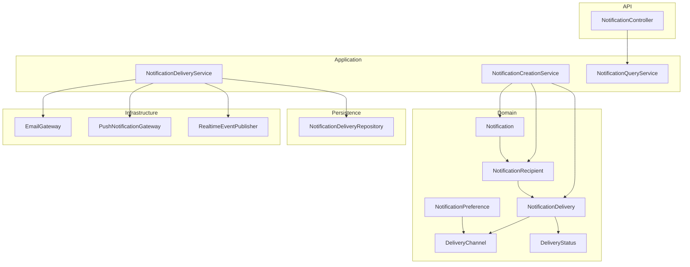
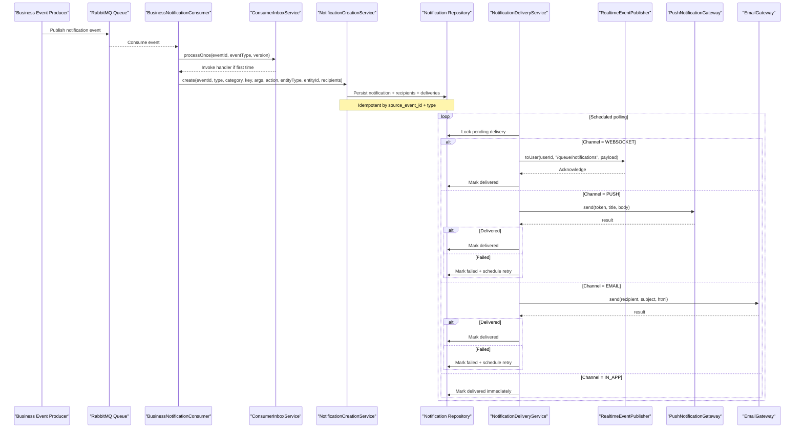
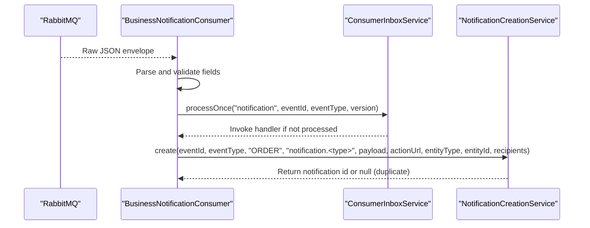
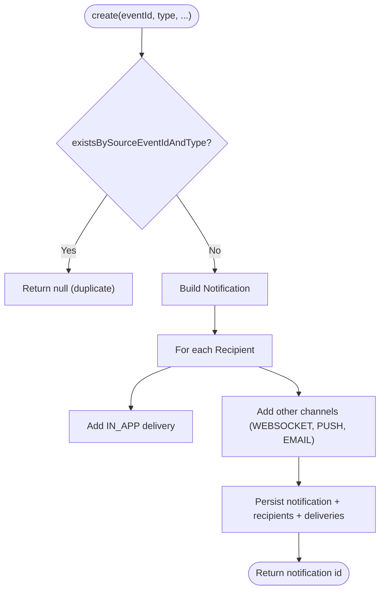
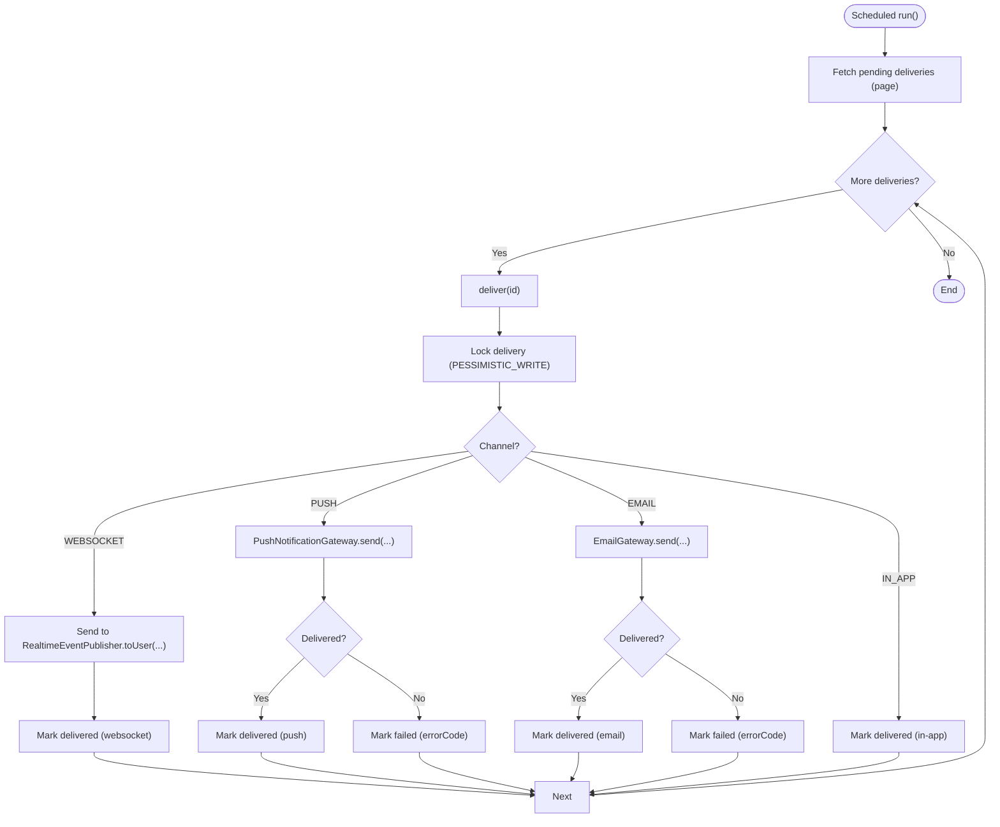
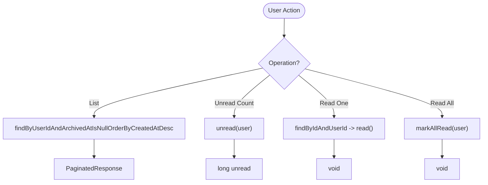
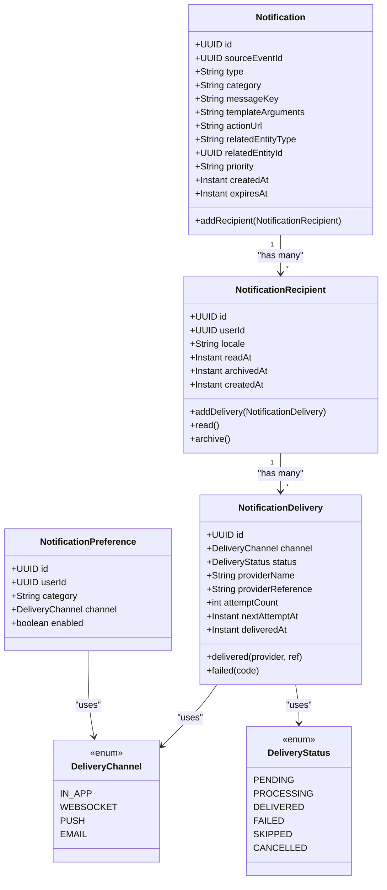
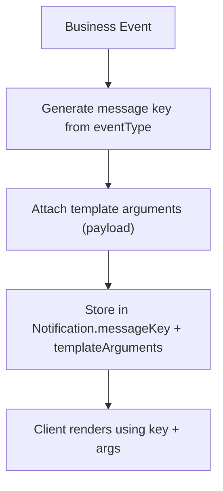
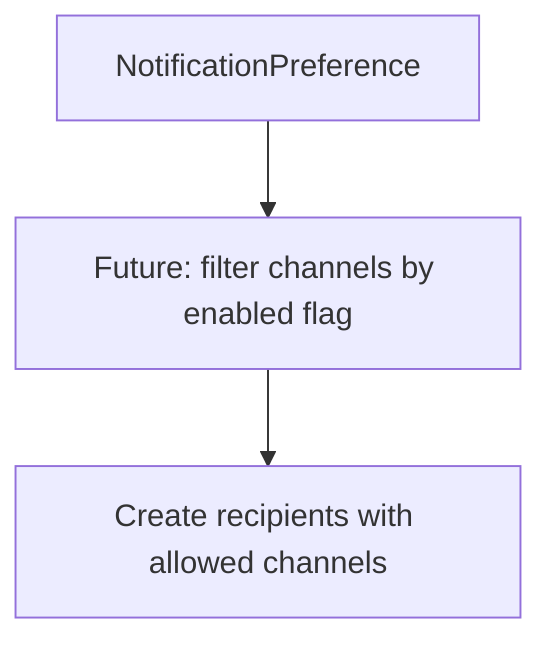
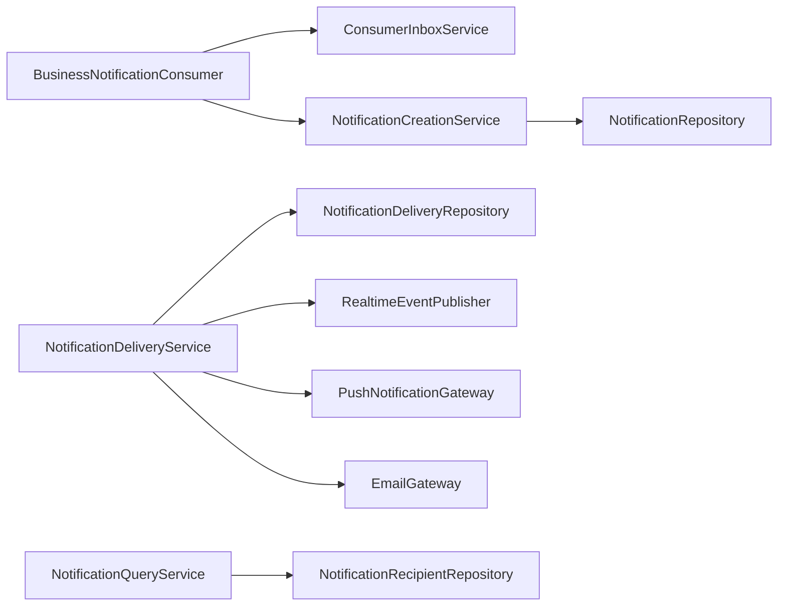

# Notification System Module

<cite>
**Referenced Files in This Document**
- [NotificationController.java](file://src/main/java/com/smartcoffee/modules/notification/api/NotificationController.java)
- [NotificationCreationService.java](file://src/main/java/com/smartcoffee/modules/notification/application/NotificationCreationService.java)
- [NotificationDeliveryService.java](file://src/main/java/com/smartcoffee/modules/notification/application/NotificationDeliveryService.java)
- [NotificationQueryService.java](file://src/main/java/com/smartcoffee/modules/notification/application/NotificationQueryService.java)
- [BusinessNotificationConsumer.java](file://src/main/java/com/smartcoffee/modules/notification/consumer/BusinessNotificationConsumer.java)
- [Notification.java](file://src/main/java/com/smartcoffee/modules/notification/domain/Notification.java)
- [NotificationRecipient.java](file://src/main/java/com/smartcoffee/modules/notification/domain/NotificationRecipient.java)
- [NotificationDelivery.java](file://src/main/java/com/smartcoffee/modules/notification/domain/NotificationDelivery.java)
- [DeliveryChannel.java](file://src/main/java/com/smartcoffee/modules/notification/domain/DeliveryChannel.java)
- [DeliveryStatus.java](file://src/main/java/com/smartcoffee/modules/notification/domain/DeliveryStatus.java)
- [NotificationPreference.java](file://src/main/java/com/smartcoffee/modules/notification/domain/NotificationPreference.java)
- [NotificationDeliveryRepository.java](file://src/main/java/com/smartcoffee/modules/notification/persistence/NotificationDeliveryRepository.java)
- [EmailGateway.java](file://src/main/java/com/smartcoffee/infrastructure/notification/EmailGateway.java)
- [PushNotificationGateway.java](file://src/main/java/com/smartcoffee/infrastructure/notification/PushNotificationGateway.java)
- [RealtimeEventPublisher.java](file://src/main/java/com/smartcoffee/infrastructure/realtime/RealtimeEventPublisher.java)
</cite>

## Table of Contents
1. [Introduction](#introduction)
2. [Project Structure](#project-structure)
3. [Core Components](#core-components)
4. [Architecture Overview](#architecture-overview)
5. [Detailed Component Analysis](#detailed-component-analysis)
6. [Dependency Analysis](#dependency-analysis)
7. [Performance Considerations](#performance-considerations)
8. [Troubleshooting Guide](#troubleshooting-guide)
9. [Conclusion](#conclusion)

## Introduction
This document explains the Notification System module that powers multi-channel notifications (in-app, WebSocket, push, email), user preference management, delivery tracking, and event-driven creation. It covers how business events trigger notifications, how templates are referenced via keys and arguments, and how delivery status is monitored. It also includes examples of workflows for creating notifications, delivering them across channels, and managing preferences. Reliability mechanisms such as idempotent processing, retry scheduling, and optimistic locking are highlighted.

## Project Structure
The notification module follows a layered design:
- API layer exposes endpoints to list notifications, mark them read, and get unread counts.
- Application services orchestrate creation, querying, and delivery.
- Domain models represent notifications, recipients, deliveries, channels, statuses, and preferences.
- Persistence provides repositories for queries and locking.
- Infrastructure interfaces abstract external providers (email, push) and real-time messaging.



**Diagram sources**
- [NotificationController.java:11-47](file://src/main/java/com/smartcoffee/modules/notification/api/NotificationController.java#L11-L47)
- [NotificationCreationService.java:10-36](file://src/main/java/com/smartcoffee/modules/notification/application/NotificationCreationService.java#L10-L36)
- [NotificationDeliveryService.java:13-65](file://src/main/java/com/smartcoffee/modules/notification/application/NotificationDeliveryService.java#L13-L65)
- [NotificationQueryService.java:11-44](file://src/main/java/com/smartcoffee/modules/notification/application/NotificationQueryService.java#L11-L44)
- [Notification.java:7-38](file://src/main/java/com/smartcoffee/modules/notification/domain/Notification.java#L7-L38)
- [NotificationRecipient.java:7-30](file://src/main/java/com/smartcoffee/modules/notification/domain/NotificationRecipient.java#L7-L30)
- [NotificationDelivery.java:7-40](file://src/main/java/com/smartcoffee/modules/notification/domain/NotificationDelivery.java#L7-L40)
- [DeliveryChannel.java:1-5](file://src/main/java/com/smartcoffee/modules/notification/domain/DeliveryChannel.java#L1-L5)
- [DeliveryStatus.java:1-5](file://src/main/java/com/smartcoffee/modules/notification/domain/DeliveryStatus.java#L1-L5)
- [NotificationPreference.java:6-23](file://src/main/java/com/smartcoffee/modules/notification/domain/NotificationPreference.java#L6-L23)
- [NotificationDeliveryRepository.java:11-18](file://src/main/java/com/smartcoffee/modules/notification/persistence/NotificationDeliveryRepository.java#L11-L18)
- [EmailGateway.java:1-8](file://src/main/java/com/smartcoffee/infrastructure/notification/EmailGateway.java#L1-L8)
- [PushNotificationGateway.java:1-2](file://src/main/java/com/smartcoffee/infrastructure/notification/PushNotificationGateway.java#L1-L2)
- [RealtimeEventPublisher.java:1-2](file://src/main/java/com/smartcoffee/infrastructure/realtime/RealtimeEventPublisher.java#L1-L2)

**Section sources**
- [NotificationController.java:11-47](file://src/main/java/com/smartcoffee/modules/notification/api/NotificationController.java#L11-L47)
- [NotificationCreationService.java:10-36](file://src/main/java/com/smartcoffee/modules/notification/application/NotificationCreationService.java#L10-L36)
- [NotificationDeliveryService.java:13-65](file://src/main/java/com/smartcoffee/modules/notification/application/NotificationDeliveryService.java#L13-L65)
- [NotificationQueryService.java:11-44](file://src/main/java/com/smartcoffee/modules/notification/application/NotificationQueryService.java#L11-L44)
- [Notification.java:7-38](file://src/main/java/com/smartcoffee/modules/notification/domain/Notification.java#L7-L38)
- [NotificationRecipient.java:7-30](file://src/main/java/com/smartcoffee/modules/notification/domain/NotificationRecipient.java#L7-L30)
- [NotificationDelivery.java:7-40](file://src/main/java/com/smartcoffee/modules/notification/domain/NotificationDelivery.java#L7-L40)
- [DeliveryChannel.java:1-5](file://src/main/java/com/smartcoffee/modules/notification/domain/DeliveryChannel.java#L1-L5)
- [DeliveryStatus.java:1-5](file://src/main/java/com/smartcoffee/modules/notification/domain/DeliveryStatus.java#L1-L5)
- [NotificationPreference.java:6-23](file://src/main/java/com/smartcoffee/modules/notification/domain/NotificationPreference.java#L6-L23)
- [NotificationDeliveryRepository.java:11-18](file://src/main/java/com/smartcoffee/modules/notification/persistence/NotificationDeliveryRepository.java#L11-L18)
- [EmailGateway.java:1-8](file://src/main/java/com/smartcoffee/infrastructure/notification/EmailGateway.java#L1-L8)
- [PushNotificationGateway.java:1-2](file://src/main/java/com/smartcoffee/infrastructure/notification/PushNotificationGateway.java#L1-L2)
- [RealtimeEventPublisher.java:1-2](file://src/main/java/com/smartcoffee/infrastructure/realtime/RealtimeEventPublisher.java#L1-L2)

## Core Components
- API Controller: Provides endpoints to list notifications, get unread count, mark single or all notifications as read.
- Creation Service: Creates a notification with metadata and recipients, attaching delivery records per channel.
- Delivery Service: Polls pending deliveries, locks each record, and dispatches to the appropriate channel; updates status and schedules retries on failure.
- Query Service: Reads notifications for a user, marks them read, and computes unread counts.
- Consumer: Listens to RabbitMQ, validates payloads, ensures idempotency, and delegates to creation service.
- Domain Models: Represent notifications, recipients, deliveries, channels, statuses, and preferences.
- Repositories: Provide paginated pending delivery queries and pessimistic locking for safe concurrent processing.
- Infrastructure Interfaces: Abstract email and push gateways and real-time publisher.

Key responsibilities and interactions:
- Business events arrive via RabbitMQ and are processed once to create notifications.
- Notifications include message keys and template arguments for rendering by clients or downstream systems.
- Delivery attempts are tracked with attempt counts, next attempt times, and provider references.
- Real-time notifications are sent over WebSocket destinations per user.

**Section sources**
- [NotificationController.java:11-47](file://src/main/java/com/smartcoffee/modules/notification/api/NotificationController.java#L11-L47)
- [NotificationCreationService.java:10-36](file://src/main/java/com/smartcoffee/modules/notification/application/NotificationCreationService.java#L10-L36)
- [NotificationDeliveryService.java:13-65](file://src/main/java/com/smartcoffee/modules/notification/application/NotificationDeliveryService.java#L13-L65)
- [NotificationQueryService.java:11-44](file://src/main/java/com/smartcoffee/modules/notification/application/NotificationQueryService.java#L11-L44)
- [BusinessNotificationConsumer.java:16-124](file://src/main/java/com/smartcoffee/modules/notification/consumer/BusinessNotificationConsumer.java#L16-L124)
- [Notification.java:7-97](file://src/main/java/com/smartcoffee/modules/notification/domain/Notification.java#L7-L97)
- [NotificationRecipient.java:7-84](file://src/main/java/com/smartcoffee/modules/notification/domain/NotificationRecipient.java#L7-L84)
- [NotificationDelivery.java:7-96](file://src/main/java/com/smartcoffee/modules/notification/domain/NotificationDelivery.java#L7-L96)
- [DeliveryChannel.java:1-5](file://src/main/java/com/smartcoffee/modules/notification/domain/DeliveryChannel.java#L1-L5)
- [DeliveryStatus.java:1-5](file://src/main/java/com/smartcoffee/modules/notification/domain/DeliveryStatus.java#L1-L5)
- [NotificationPreference.java:6-43](file://src/main/java/com/smartcoffee/modules/notification/domain/NotificationPreference.java#L6-L43)
- [NotificationDeliveryRepository.java:11-18](file://src/main/java/com/smartcoffee/modules/notification/persistence/NotificationDeliveryRepository.java#L11-L18)
- [EmailGateway.java:1-8](file://src/main/java/com/smartcoffee/infrastructure/notification/EmailGateway.java#L1-L8)
- [PushNotificationGateway.java:1-2](file://src/main/java/com/smartcoffee/infrastructure/notification/PushNotificationGateway.java#L1-L2)
- [RealtimeEventPublisher.java:1-2](file://src/main/java/com/smartcoffee/infrastructure/realtime/RealtimeEventPublisher.java#L1-L2)

## Architecture Overview
The system integrates with business events through RabbitMQ, creates notifications, and delivers them via multiple channels. Real-time updates are pushed using WebSocket destinations. Delivery outcomes are persisted for observability and analytics.



**Diagram sources**
- [BusinessNotificationConsumer.java:33-124](file://src/main/java/com/smartcoffee/modules/notification/consumer/BusinessNotificationConsumer.java#L33-L124)
- [NotificationCreationService.java:21-36](file://src/main/java/com/smartcoffee/modules/notification/application/NotificationCreationService.java#L21-L36)
- [NotificationDeliveryService.java:28-65](file://src/main/java/com/smartcoffee/modules/notification/application/NotificationDeliveryService.java#L28-L65)
- [NotificationDeliveryRepository.java:11-18](file://src/main/java/com/smartcoffee/modules/notification/persistence/NotificationDeliveryRepository.java#L11-L18)
- [RealtimeEventPublisher.java:1-2](file://src/main/java/com/smartcoffee/infrastructure/realtime/RealtimeEventPublisher.java#L1-L2)
- [PushNotificationGateway.java:1-2](file://src/main/java/com/smartcoffee/infrastructure/notification/PushNotificationGateway.java#L1-L2)
- [EmailGateway.java:1-8](file://src/main/java/com/smartcoffee/infrastructure/notification/EmailGateway.java#L1-L8)

## Detailed Component Analysis

### API Layer: NotificationController
- Exposes REST endpoints for listing notifications, retrieving unread counts, marking individual notifications as read, and marking all as read.
- Uses CurrentActorProvider to resolve the authenticated user context.
- Returns standardized API responses with correlation IDs.

```mermaid
flowchart TD
Start(["HTTP Request"]) --> Auth["Resolve current actor"]
Auth --> Route{"Endpoint?"}
Route --> |GET /api/v1/notifications| List["List notifications (paginated)"]
Route --> |GET /api/v1/notifications/unread-count| Unread["Get unread count"]
Route --> |PATCH /api/v1/notifications/{id}/read| ReadOne["Mark one as read"]
Route --> |PATCH /api/v1/notifications/read-all| ReadAll["Mark all as read"]
List --> Resp["ApiResponse<PaginatedResponse<NotificationResponse>>"]
Unread --> Resp2["ApiResponse<UnreadCountResponse>"]
ReadOne --> Resp3["ApiResponse<Void>"]
ReadAll --> Resp4["ApiResponse<Void>"]
```

**Diagram sources**
- [NotificationController.java:11-47](file://src/main/java/com/smartcoffee/modules/notification/api/NotificationController.java#L11-L47)

**Section sources**
- [NotificationController.java:11-47](file://src/main/java/com/smartcoffee/modules/notification/api/NotificationController.java#L11-L47)

### Event Ingestion: BusinessNotificationConsumer
- Listens to a RabbitMQ queue configured via application properties.
- Validates required fields (eventId, eventType, userId) and optional fields (actionUrl, entityType, entityId).
- Ensures idempotent processing using ConsumerInboxService keyed by eventId and eventType.
- Delegates to NotificationCreationService with a default locale and selected channels (WebSocket and Push).



**Diagram sources**
- [BusinessNotificationConsumer.java:33-124](file://src/main/java/com/smartcoffee/modules/notification/consumer/BusinessNotificationConsumer.java#L33-L124)
- [NotificationCreationService.java:21-36](file://src/main/java/com/smartcoffee/modules/notification/application/NotificationCreationService.java#L21-L36)

**Section sources**
- [BusinessNotificationConsumer.java:16-124](file://src/main/java/com/smartcoffee/modules/notification/consumer/BusinessNotificationConsumer.java#L16-L124)

### Notification Creation: NotificationCreationService
- Prevents duplicate notifications based on source event ID and type.
- Creates a Notification with metadata (type, category, message key, template arguments, action URL, related entity).
- Adds recipients with locale and channels; attaches an in-app delivery automatically and additional deliveries for non-in-app channels.



**Diagram sources**
- [NotificationCreationService.java:21-36](file://src/main/java/com/smartcoffee/modules/notification/application/NotificationCreationService.java#L21-L36)
- [Notification.java:43-59](file://src/main/java/com/smartcoffee/modules/notification/domain/Notification.java#L43-L59)
- [NotificationRecipient.java:35-49](file://src/main/java/com/smartcoffee/modules/notification/domain/NotificationRecipient.java#L35-L49)
- [NotificationDelivery.java:45-52](file://src/main/java/com/smartcoffee/modules/notification/domain/NotificationDelivery.java#L45-L52)

**Section sources**
- [NotificationCreationService.java:10-36](file://src/main/java/com/smartcoffee/modules/notification/application/NotificationCreationService.java#L10-L36)

### Delivery Orchestration: NotificationDeliveryService
- Scheduled poller retrieves pending deliveries up to a batch size.
- Locks each delivery record to avoid concurrent processing.
- Dispatches to channels:
  - WebSocket: Sends a lightweight event to the user’s destination.
  - Push: Calls PushNotificationGateway; updates status based on result.
  - Email: Calls EmailGateway; updates status based on result.
  - In-app: Marks delivered immediately.
- On exceptions, marks delivery as failed with error code.



**Diagram sources**
- [NotificationDeliveryService.java:28-65](file://src/main/java/com/smartcoffee/modules/notification/application/NotificationDeliveryService.java#L28-L65)
- [NotificationDeliveryRepository.java:11-18](file://src/main/java/com/smartcoffee/modules/notification/persistence/NotificationDeliveryRepository.java#L11-L18)
- [RealtimeEventPublisher.java:1-2](file://src/main/java/com/smartcoffee/infrastructure/realtime/RealtimeEventPublisher.java#L1-L2)
- [PushNotificationGateway.java:1-2](file://src/main/java/com/smartcoffee/infrastructure/notification/PushNotificationGateway.java#L1-L2)
- [EmailGateway.java:1-8](file://src/main/java/com/smartcoffee/infrastructure/notification/EmailGateway.java#L1-L8)

**Section sources**
- [NotificationDeliveryService.java:13-65](file://src/main/java/com/smartcoffee/modules/notification/application/NotificationDeliveryService.java#L13-L65)

### Querying and User Interactions: NotificationQueryService
- Lists notifications for a user with pagination and ordering.
- Computes unread counts.
- Marks individual or all notifications as read.



**Diagram sources**
- [NotificationQueryService.java:19-44](file://src/main/java/com/smartcoffee/modules/notification/application/NotificationQueryService.java#L19-L44)

**Section sources**
- [NotificationQueryService.java:11-44](file://src/main/java/com/smartcoffee/modules/notification/application/NotificationQueryService.java#L11-L44)

### Domain Model Relationships


**Diagram sources**
- [Notification.java:7-97](file://src/main/java/com/smartcoffee/modules/notification/domain/Notification.java#L7-L97)
- [NotificationRecipient.java:7-84](file://src/main/java/com/smartcoffee/modules/notification/domain/NotificationRecipient.java#L7-L84)
- [NotificationDelivery.java:7-96](file://src/main/java/com/smartcoffee/modules/notification/domain/NotificationDelivery.java#L7-L96)
- [DeliveryChannel.java:1-5](file://src/main/java/com/smartcoffee/modules/notification/domain/DeliveryChannel.java#L1-L5)
- [DeliveryStatus.java:1-5](file://src/main/java/com/smartcoffee/modules/notification/domain/DeliveryStatus.java#L1-L5)
- [NotificationPreference.java:6-43](file://src/main/java/com/smartcoffee/modules/notification/domain/NotificationPreference.java#L6-L43)

**Section sources**
- [Notification.java:7-97](file://src/main/java/com/smartcoffee/modules/notification/domain/Notification.java#L7-L97)
- [NotificationRecipient.java:7-84](file://src/main/java/com/smartcoffee/modules/notification/domain/NotificationRecipient.java#L7-L84)
- [NotificationDelivery.java:7-96](file://src/main/java/com/smartcoffee/modules/notification/domain/NotificationDelivery.java#L7-L96)
- [DeliveryChannel.java:1-5](file://src/main/java/com/smartcoffee/modules/notification/domain/DeliveryChannel.java#L1-L5)
- [DeliveryStatus.java:1-5](file://src/main/java/com/smartcoffee/modules/notification/domain/DeliveryStatus.java#L1-L5)
- [NotificationPreference.java:6-43](file://src/main/java/com/smartcoffee/modules/notification/domain/NotificationPreference.java#L6-L43)

### Template Management and Rendering
- Notifications carry a message key and template arguments (JSON string).
- The consumer sets a default message key pattern based on event type.
- Actual template resolution and rendering are delegated to clients or downstream systems using these values.



**Diagram sources**
- [BusinessNotificationConsumer.java:103-123](file://src/main/java/com/smartcoffee/modules/notification/consumer/BusinessNotificationConsumer.java#L103-L123)
- [Notification.java:19-22](file://src/main/java/com/smartcoffee/modules/notification/domain/Notification.java#L19-L22)

**Section sources**
- [BusinessNotificationConsumer.java:103-123](file://src/main/java/com/smartcoffee/modules/notification/consumer/BusinessNotificationConsumer.java#L103-L123)
- [Notification.java:19-22](file://src/main/java/com/smartcoffee/modules/notification/domain/Notification.java#L19-L22)

### User Preferences
- NotificationPreference defines per-user, per-category, per-channel enablement flags.
- While not directly used in the current creation flow, it provides the schema for future preference-based filtering of channels.



**Diagram sources**
- [NotificationPreference.java:6-43](file://src/main/java/com/smartcoffee/modules/notification/domain/NotificationPreference.java#L6-L43)

**Section sources**
- [NotificationPreference.java:6-43](file://src/main/java/com/smartcoffee/modules/notification/domain/NotificationPreference.java#L6-L43)

## Dependency Analysis
- External integrations:
  - RabbitMQ: Event ingestion via @RabbitListener.
  - RealtimeEventPublisher: WebSocket delivery to users.
  - PushNotificationGateway: Push provider abstraction.
  - EmailGateway: Email provider abstraction.
- Internal dependencies:
  - Consumer depends on Inbox for idempotency and CreationService for persistence.
  - DeliveryService depends on repository for locking and infrastructure interfaces for delivery.
  - QueryService depends on recipient repository for read operations.



**Diagram sources**
- [BusinessNotificationConsumer.java:16-124](file://src/main/java/com/smartcoffee/modules/notification/consumer/BusinessNotificationConsumer.java#L16-L124)
- [NotificationCreationService.java:10-36](file://src/main/java/com/smartcoffee/modules/notification/application/NotificationCreationService.java#L10-L36)
- [NotificationDeliveryService.java:13-65](file://src/main/java/com/smartcoffee/modules/notification/application/NotificationDeliveryService.java#L13-L65)
- [NotificationQueryService.java:11-44](file://src/main/java/com/smartcoffee/modules/notification/application/NotificationQueryService.java#L11-L44)

**Section sources**
- [BusinessNotificationConsumer.java:16-124](file://src/main/java/com/smartcoffee/modules/notification/consumer/BusinessNotificationConsumer.java#L16-L124)
- [NotificationCreationService.java:10-36](file://src/main/java/com/smartcoffee/modules/notification/application/NotificationCreationService.java#L10-L36)
- [NotificationDeliveryService.java:13-65](file://src/main/java/com/smartcoffee/modules/notification/application/NotificationDeliveryService.java#L13-L65)
- [NotificationQueryService.java:11-44](file://src/main/java/com/smartcoffee/modules/notification/application/NotificationQueryService.java#L11-L44)

## Performance Considerations
- Batched polling: DeliveryService fetches up to 100 pending deliveries per poll cycle.
- Optimistic concurrency: Entities use version fields to detect conflicts.
- Pessimistic locking: Delivery records are locked during processing to prevent duplicate work.
- Pagination limits: QueryService enforces maximum page size to protect performance.
- Retry backoff: Failed deliveries compute exponential backoff capped at 1 hour.

Recommendations:
- Tune poll interval and batch size according to throughput requirements.
- Monitor database lock contention and adjust isolation levels if needed.
- Use metrics around delivery success/failure rates and retry counts.

[No sources needed since this section provides general guidance]

## Troubleshooting Guide
Common issues and resolutions:
- Duplicate notifications: Ensure source event ID and type are unique; creation service prevents duplicates.
- Missing required fields: Consumer validates eventId, eventType, userId; invalid payloads throw validation errors.
- Delivery failures: Check lastErrorCode and attemptCount; verify provider credentials and connectivity.
- WebSocket not receiving: Confirm RealtimeEventPublisher routing and client subscription to /queue/notifications.
- Preference misconfiguration: Validate NotificationPreference entries for user/category/channel combinations.

Operational checks:
- Inspect delivery status transitions and timestamps.
- Review inbox deduplication logs to ensure events are processed exactly once.
- Verify scheduled task execution intervals and batch sizes.

**Section sources**
- [BusinessNotificationConsumer.java:126-160](file://src/main/java/com/smartcoffee/modules/notification/consumer/BusinessNotificationConsumer.java#L126-L160)
- [NotificationDelivery.java:58-71](file://src/main/java/com/smartcoffee/modules/notification/domain/NotificationDelivery.java#L58-L71)
- [NotificationDeliveryService.java:34-65](file://src/main/java/com/smartcoffee/modules/notification/application/NotificationDeliveryService.java#L34-L65)

## Conclusion
The Notification System module provides a robust, event-driven pipeline for creating and delivering notifications across multiple channels. It emphasizes reliability through idempotent processing, optimistic concurrency, and retry scheduling. The architecture cleanly separates concerns between API, application services, domain models, persistence, and infrastructure abstractions, enabling extensibility and maintainability. With clear delivery tracking and real-time capabilities, it supports both asynchronous and synchronous notification experiences while offering a foundation for preference-based control and analytics.

[No sources needed since this section summarizes without analyzing specific files]