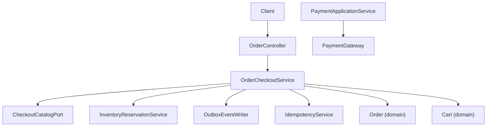
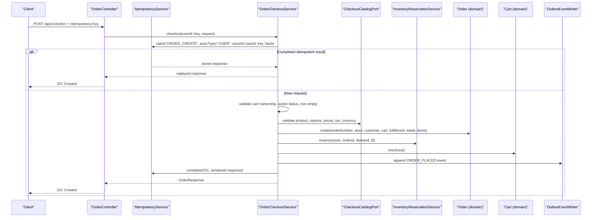
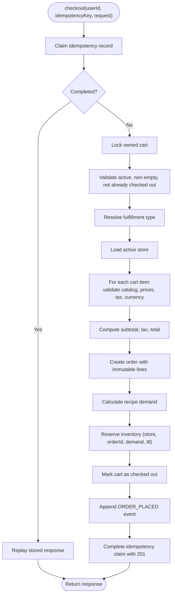
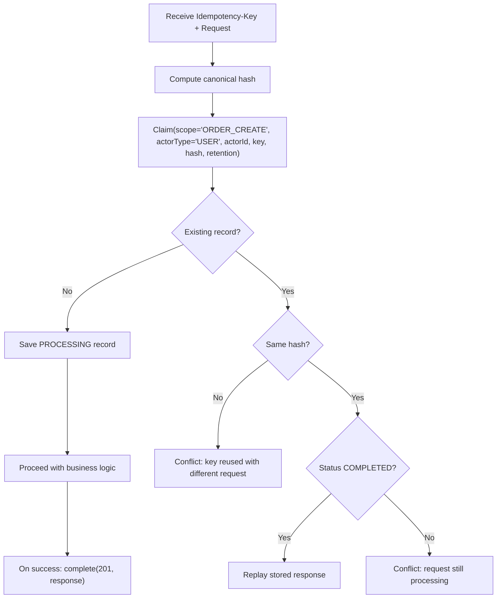
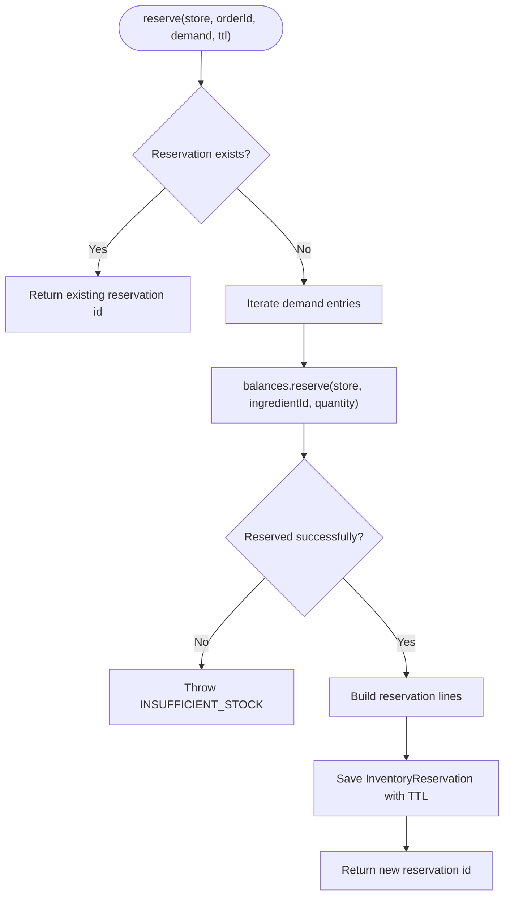
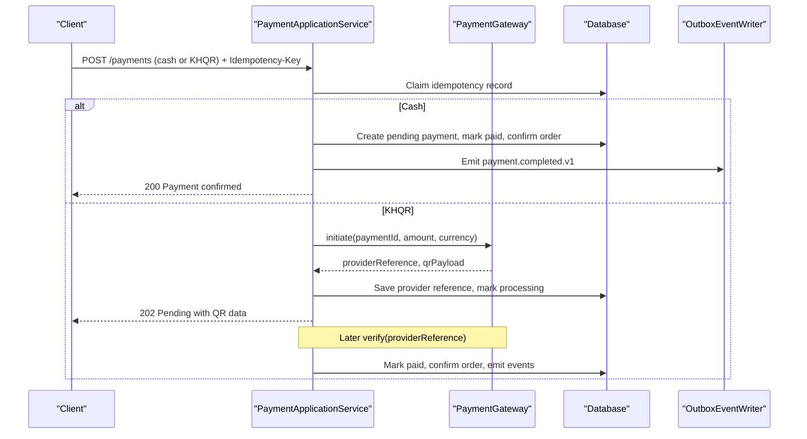
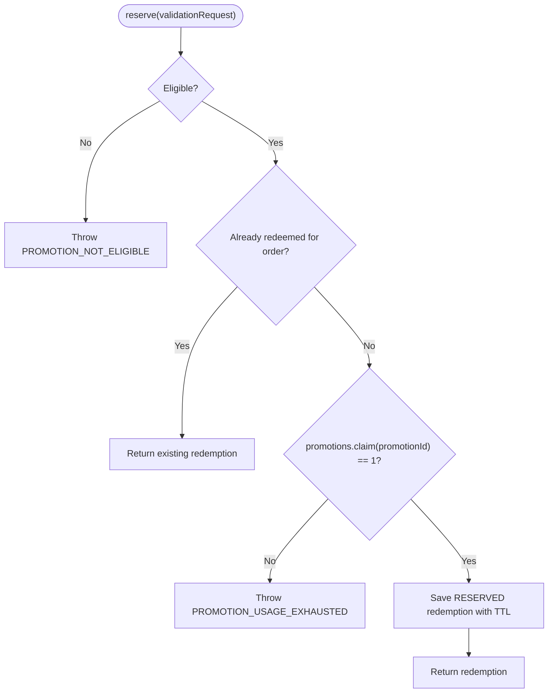
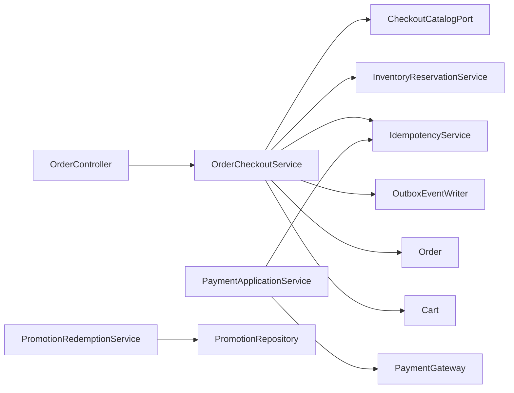

# Checkout Workflow

<cite>
**Referenced Files in This Document**
- [OrderController.java](file://src/main/java/com/smartcoffee/modules/ordering/api/OrderController.java)
- [OrderCheckoutService.java](file://src/main/java/com/smartcoffee/modules/ordering/application/OrderCheckoutService.java)
- [CheckoutCatalogPort.java](file://src/main/java/com/smartcoffee/modules/ordering/application/CheckoutCatalogPort.java)
- [Order.java](file://src/main/java/com/smartcoffee/modules/ordering/domain/Order.java)
- [Cart.java](file://src/main/java/com/smartcoffee/modules/cart/domain/Cart.java)
- [InventoryReservationService.java](file://src/main/java/com/smartcoffee/modules/inventory/application/InventoryReservationService.java)
- [PaymentApplicationService.java](file://src/main/java/com/smartcoffee/modules/payment/application/PaymentApplicationService.java)
- [PromotionRedemptionService.java](file://src/main/java/com/smartcoffee/modules/promotion/application/PromotionRedemptionService.java)
- [IdempotencyService.java](file://src/main/java/com/smartcoffee/infrastructure/idempotency/IdempotencyService.java)
- [GlobalExceptionHandler.java](file://src/main/java/com/smartcoffee/common/api/GlobalExceptionHandler.java)
- [BusinessException.java](file://src/main/java/com/smartcoffee/common/exception/BusinessException.java)
- [ORDER_FLOW.mermaid](file://architecture/ORDER_FLOW.mermaid)
- [PAYMENT_FLOW.mermaid](file://architecture/PAYMENT_FLOW.mermaid)
</cite>

## Table of Contents
1. [Introduction](#introduction)
2. [Project Structure](#project-structure)
3. [Core Components](#core-components)
4. [Architecture Overview](#architecture-overview)
5. [Detailed Component Analysis](#detailed-component-analysis)
6. [Dependency Analysis](#dependency-analysis)
7. [Performance Considerations](#performance-considerations)
8. [Troubleshooting Guide](#troubleshooting-guide)
9. [Conclusion](#conclusion)

## Introduction
This document explains the end-to-end checkout workflow orchestration, from cart validation through order creation, inventory reservation coordination, payment initiation, and promotion application. It focuses on the OrderCheckoutService orchestration logic, validation steps, error handling strategies, and the idempotency mechanism using Idempotency-Key headers to prevent duplicate orders. It also documents integration points with inventory, payment, and promotion modules during checkout, including failure scenarios and rollback mechanisms.

## Project Structure
The checkout flow is implemented across several modules:
- Ordering module: API controller and orchestration service for creating orders.
- Cart module: Domain model for carts and their lifecycle.
- Inventory module: Reservation and consumption of ingredients.
- Payment module: Payment initiation and completion flows.
- Promotion module: Eligibility checks and redemption reservations.
- Infrastructure: Idempotency service and global exception handling.

**Diagram sources**
- [OrderController.java:29-34](file://src/main/java/com/smartcoffee/modules/ordering/api/OrderController.java#L29-L34)
- [OrderCheckoutService.java:62-133](file://src/main/java/com/smartcoffee/modules/ordering/application/OrderCheckoutService.java#L62-L133)
- [CheckoutCatalogPort.java:6-18](file://src/main/java/com/smartcoffee/modules/ordering/application/CheckoutCatalogPort.java#L6-L18)
- [InventoryReservationService.java:43-54](file://src/main/java/com/smartcoffee/modules/inventory/application/InventoryReservationService.java#L43-L54)
- [PaymentApplicationService.java:48-87](file://src/main/java/com/smartcoffee/modules/payment/application/PaymentApplicationService.java#L48-L87)

**Section sources**
- [OrderController.java:13-40](file://src/main/java/com/smartcoffee/modules/ordering/api/OrderController.java#L13-L40)
- [OrderCheckoutService.java:28-60](file://src/main/java/com/smartcoffee/modules/ordering/application/OrderCheckoutService.java#L28-L60)

## Core Components
- OrderController: Exposes POST /api/v1/orders that accepts an Idempotency-Key header and delegates to OrderCheckoutService.
- OrderCheckoutService: Orchestrates cart validation, catalog price validation, order creation, recipe demand calculation, inventory reservation, cart state update, outbox event emission, and idempotent response storage.
- InventoryReservationService: Reserves stock atomically per ingredient, supports release/consume/expire operations.
- PaymentApplicationService: Initiates payments (cash/KHQR), handles provider interactions, and emits payment events.
- PromotionRedemptionService: Validates eligibility, reserves promotions, and supports release/redeem transitions.
- IdempotencyService: Claims and stores idempotency records to ensure request uniqueness and replayability.
- GlobalExceptionHandler: Normalizes business and validation errors into consistent API responses.

**Section sources**
- [OrderController.java:29-34](file://src/main/java/com/smartcoffee/modules/ordering/api/OrderController.java#L29-L34)
- [OrderCheckoutService.java:62-133](file://src/main/java/com/smartcoffee/modules/ordering/application/OrderCheckoutService.java#L62-L133)
- [InventoryReservationService.java:43-54](file://src/main/java/com/smartcoffee/modules/inventory/application/InventoryReservationService.java#L43-L54)
- [PaymentApplicationService.java:48-87](file://src/main/java/com/smartcoffee/modules/payment/application/PaymentApplicationService.java#L48-L87)
- [PromotionRedemptionService.java:25-52](file://src/main/java/com/smartcoffee/modules/promotion/application/PromotionRedemptionService.java#L25-L52)
- [IdempotencyService.java:3-5](file://src/main/java/com/smartcoffee/infrastructure/idempotency/IdempotencyService.java#L3-L5)
- [GlobalExceptionHandler.java:11-37](file://src/main/java/com/smartcoffee/common/api/GlobalExceptionHandler.java#L11-L37)

## Architecture Overview
The checkout sequence begins at the API layer, enforces idempotency, validates the cart and catalog pricing, creates the order, reserves inventory, marks the cart as checked out, publishes an order-placed event via outbox, and returns a deterministic response keyed by Idempotency-Key.

**Diagram sources**
- [OrderController.java:29-34](file://src/main/java/com/smartcoffee/modules/ordering/api/OrderController.java#L29-L34)
- [OrderCheckoutService.java:62-133](file://src/main/java/com/smartcoffee/modules/ordering/application/OrderCheckoutService.java#L62-L133)
- [CheckoutCatalogPort.java:6-18](file://src/main/java/com/smartcoffee/modules/ordering/application/CheckoutCatalogPort.java#L6-L18)
- [InventoryReservationService.java:43-54](file://src/main/java/com/smartcoffee/modules/inventory/application/InventoryReservationService.java#L43-L54)
- [Order.java:66-95](file://src/main/java/com/smartcoffee/modules/ordering/domain/Order.java#L66-L95)
- [Cart.java:147-158](file://src/main/java/com/smartcoffee/modules/cart/domain/Cart.java#L147-L158)

## Detailed Component Analysis

### OrderCheckoutService Orchestration Logic
Responsibilities:
- Enforce idempotency using Idempotency-Key and request hashing.
- Validate cart ownership, active status, emptiness, and prior checkout.
- Resolve fulfillment type and store context.
- Validate each cart item against catalog authoritative data (prices, tax rate, options).
- Compute line totals and aggregate subtotal/tax/total.
- Create order with immutable lines and status history.
- Calculate recipe demand and reserve inventory atomically.
- Mark cart as checked out.
- Emit order-placed event via outbox.
- Store idempotent response for replay.

Validation steps:
- Cart existence and ownership lock.
- Cart active and not expired.
- Non-empty cart and no existing order for the same cart.
- Valid fulfillment type enum.
- Store active existence.
- Catalog validation for each item: currency match, base price and customization price match, tax rate availability.

Error handling:
- ResourceNotFoundException when cart or store missing.
- ConflictException for empty cart, already checked out, currency mismatch, price changed.
- ValidationException for invalid fulfillment type.
- InfrastructureException for idempotency response storage failures.

Rollback behavior:
- The method is transactional; if any step fails after order creation but before successful completion, the transaction rolls back, undoing order persistence and inventory reservation.

Idempotency mechanism:
- Uses IdempotencyService to claim a record with scope "ORDER_CREATE", actor type "USER", actor ID, key, and request hash.
- If a completed record exists with the same hash, it replays the stored response.
- If the same key has a different hash, it rejects with conflict.
- On success, completes the claim with HTTP 201 and serialized response.

Integration points:
- Catalog: CheckoutCatalogPort.validate(...) ensures authoritative pricing and options.
- Inventory: InventoryReservationService.reserve(...) atomically reserves ingredients based on recipe demand.
- Outbox: Emits ORDER_PLACED event for downstream consumers.

**Diagram sources**
- [OrderCheckoutService.java:62-133](file://src/main/java/com/smartcoffee/modules/ordering/application/OrderCheckoutService.java#L62-L133)

**Section sources**
- [OrderCheckoutService.java:62-133](file://src/main/java/com/smartcoffee/modules/ordering/application/OrderCheckoutService.java#L62-L133)

### Idempotency Mechanism
- Scope: "ORDER_CREATE" for order creation.
- Actor Type: "USER".
- Key: UUID provided in Idempotency-Key header.
- Hash: CanonicalRequestHasher.hash(request) ensures identical payloads produce identical hashes.
- Behavior:
  - If a record exists with the same key and hash:
    - If status is COMPLETED, replay stored response.
    - If status is PROCESSING, reject with conflict.
  - If key reused with different hash: reject with conflict.
  - Otherwise, create new processing record with retention duration.

**Diagram sources**
- [IdempotencyService.java:3-5](file://src/main/java/com/smartcoffee/infrastructure/idempotency/IdempotencyService.java#L3-L5)
- [OrderCheckoutService.java:62-73](file://src/main/java/com/smartcoffee/modules/ordering/application/OrderCheckoutService.java#L62-L73)

**Section sources**
- [IdempotencyService.java:3-5](file://src/main/java/com/smartcoffee/infrastructure/idempotency/IdempotencyService.java#L3-L5)
- [OrderCheckoutService.java:62-73](file://src/main/java/com/smartcoffee/modules/ordering/application/OrderCheckoutService.java#L62-L73)

### Inventory Reservation Coordination
- Atomic reservation per ingredient based on recipe demand.
- If insufficient stock, throws conflict; entire transaction rolls back.
- Supports release, consume, and expire operations for lifecycle management.

**Diagram sources**
- [InventoryReservationService.java:43-54](file://src/main/java/com/smartcoffee/modules/inventory/application/InventoryReservationService.java#L43-L54)

**Section sources**
- [InventoryReservationService.java:43-54](file://src/main/java/com/smartcoffee/modules/inventory/application/InventoryReservationService.java#L43-L54)

### Payment Initiation Integration
- PaymentApplicationService handles cash and KHQR payment flows.
- Cash: Validates tender amount, converts currency if needed, marks payment paid, confirms order, requests receipt, emits events.
- KHQR: Creates pending payment, initiates provider interaction, returns QR payload, verifies later, updates order upon success.
- Idempotency applied per payment operation.

**Diagram sources**
- [PaymentApplicationService.java:48-87](file://src/main/java/com/smartcoffee/modules/payment/application/PaymentApplicationService.java#L48-L87)
- [PAYMENT_FLOW.mermaid:14-39](file://architecture/PAYMENT_FLOW.mermaid#L14-L39)

**Section sources**
- [PaymentApplicationService.java:48-87](file://src/main/java/com/smartcoffee/modules/payment/application/PaymentApplicationService.java#L48-L87)

### Promotion Application
- PromotionRedemptionService validates eligibility, claims usage, and reserves redemption with TTL.
- Supports release and redeem transitions tied to order lifecycle.
- During checkout, promotions should be evaluated and reserved before finalizing totals; on rollback, reservations roll back automatically.

**Diagram sources**
- [PromotionRedemptionService.java:25-36](file://src/main/java/com/smartcoffee/modules/promotion/application/PromotionRedemptionService.java#L25-L36)

**Section sources**
- [PromotionRedemptionService.java:25-52](file://src/main/java/com/smartcoffee/modules/promotion/application/PromotionRedemptionService.java#L25-L52)

### Step-by-Step Checkout Example
1. Client sends POST /api/v1/orders with body containing cartId, fulfillmentType, and other required fields, plus Idempotency-Key header.
2. OrderController extracts userId from security context and calls OrderCheckoutService.checkout(userId, key, request).
3. OrderCheckoutService claims idempotency record; if completed, replays stored response.
4. Service locks cart by owner, ensures it is active and not expired, and verifies it is non-empty and not already checked out.
5. Service resolves fulfillment type and loads active store.
6. For each cart item:
   - Call CheckoutCatalogPort.validate(storeId, productId, quantity, selectedOptions).
   - Verify currency matches cart currency.
   - Verify basePrice and customizationPrice match cart item prices.
   - Compute line totals and accumulate subtotal and tax.
7. Create Order with generated order number, store, customer, cart, fulfillment, currency, subtotal, tax, total, and immutable items.
8. Calculate recipe demand and call InventoryReservationService.reserve(storeId, orderId, demand, Duration.ofMinutes(15)).
9. Mark cart as checked out.
10. Append ORDER_PLACED event to outbox.
11. Complete idempotency claim with HTTP 201 and serialized OrderResponse.
12. Return OrderResponse to client.

**Section sources**
- [OrderController.java:29-34](file://src/main/java/com/smartcoffee/modules/ordering/api/OrderController.java#L29-L34)
- [OrderCheckoutService.java:62-133](file://src/main/java/com/smartcoffee/modules/ordering/application/OrderCheckoutService.java#L62-L133)
- [CheckoutCatalogPort.java:6-18](file://src/main/java/com/smartcoffee/modules/ordering/application/CheckoutCatalogPort.java#L6-L18)
- [Order.java:66-95](file://src/main/java/com/smartcoffee/modules/ordering/domain/Order.java#L66-L95)
- [Cart.java:147-158](file://src/main/java/com/smartcoffee/modules/cart/domain/Cart.java#L147-L158)

### Failure Scenarios and Rollback Mechanisms
- Empty cart: ConflictException thrown; transaction rolls back.
- Cart already checked out: ConflictException thrown; transaction rolls back.
- Currency mismatch or price changed: ConflictException thrown; transaction rolls back.
- Invalid fulfillment type: ValidationException thrown; transaction rolls back.
- Insufficient stock: InventoryReservationService throws ConflictException; transaction rolls back.
- Idempotency conflicts:
  - Key reused with different hash: ConflictException thrown.
  - Request still processing: ConflictException thrown.
- Idempotency response storage failure: InfrastructureException thrown; transaction may roll back depending on where it occurs.

Rollbacks:
- All critical steps are within a @Transactional boundary; any exception triggers rollback, ensuring atomicity of order creation and inventory reservation.

**Section sources**
- [OrderCheckoutService.java:74-133](file://src/main/java/com/smartcoffee/modules/ordering/application/OrderCheckoutService.java#L74-L133)
- [InventoryReservationService.java:43-54](file://src/main/java/com/smartcoffee/modules/inventory/application/InventoryReservationService.java#L43-L54)
- [IdempotencyService.java:3-5](file://src/main/java/com/smartcoffee/infrastructure/idempotency/IdempotencyService.java#L3-L5)

## Dependency Analysis

**Diagram sources**
- [OrderController.java:13-40](file://src/main/java/com/smartcoffee/modules/ordering/api/OrderController.java#L13-L40)
- [OrderCheckoutService.java:28-60](file://src/main/java/com/smartcoffee/modules/ordering/application/OrderCheckoutService.java#L28-L60)
- [PaymentApplicationService.java:20-46](file://src/main/java/com/smartcoffee/modules/payment/application/PaymentApplicationService.java#L20-L46)
- [PromotionRedemptionService.java:12-23](file://src/main/java/com/smartcoffee/modules/promotion/application/PromotionRedemptionService.java#L12-L23)

**Section sources**
- [OrderController.java:13-40](file://src/main/java/com/smartcoffee/modules/ordering/api/OrderController.java#L13-L40)
- [OrderCheckoutService.java:28-60](file://src/main/java/com/smartcoffee/modules/ordering/application/OrderCheckoutService.java#L28-L60)
- [PaymentApplicationService.java:20-46](file://src/main/java/com/smartcoffee/modules/payment/application/PaymentApplicationService.java#L20-L46)
- [PromotionRedemptionService.java:12-23](file://src/main/java/com/smartcoffee/modules/promotion/application/PromotionRedemptionService.java#L12-L23)

## Performance Considerations
- Idempotency lookups are O(1) by key and scope; caching can reduce latency for repeated replays.
- Catalog validation is per-item; consider batching or caching validated items if frequently accessed.
- Inventory reservation iterates demand entries; sorting by ingredientId ensures deterministic ledger entries.
- Outbox writes are append-only; polling throughput affects event publication latency.
- Transaction boundaries keep critical sections short; avoid long-running external calls inside transactions.

[No sources needed since this section provides general guidance]

## Troubleshooting Guide
Common errors and resolutions:
- EMPTY_CART: Ensure cart contains at least one item before checkout.
- CART_ALREADY_CHECKED_OUT: Reuse a fresh cart or verify previous checkout succeeded.
- CURRENCY_MISMATCH: Ensure catalog currency matches cart currency; re-add items if currency changed.
- PRICE_CHANGED: Prices updated between cart creation and checkout; refresh cart and retry.
- INSUFFICIENT_STOCK: Ingredients unavailable; wait for restock or adjust quantities.
- INVALID_FULFILLMENT_TYPE: Use valid fulfillment type values defined in domain.
- IDEMPOTENCY_KEY_REUSED: Same key used with different request payload; generate a new key.
- IDEMPOTENCY_REQUEST_IN_PROGRESS: Wait for the original request to complete; do not retry immediately.

Global exception handling normalizes these into structured API responses with correlation IDs.

**Section sources**
- [GlobalExceptionHandler.java:11-37](file://src/main/java/com/smartcoffee/common/api/GlobalExceptionHandler.java#L11-L37)
- [BusinessException.java:3-26](file://src/main/java/com/smartcoffee/common/exception/BusinessException.java#L3-L26)

## Conclusion
The checkout workflow orchestrates cart validation, catalog price verification, order creation, inventory reservation, and event emission within a single transactional boundary. Idempotency guarantees protect against duplicate orders using Idempotency-Key headers and request hashing. Integration points with inventory, payment, and promotion modules are clearly delineated, with robust error handling and rollback semantics ensuring data consistency. Proper use of outbox events enables reliable asynchronous processing for downstream systems.