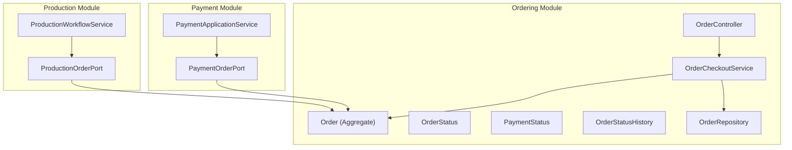
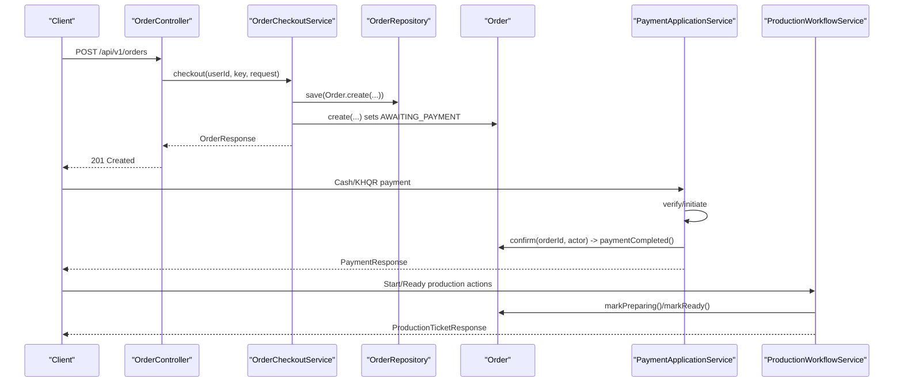
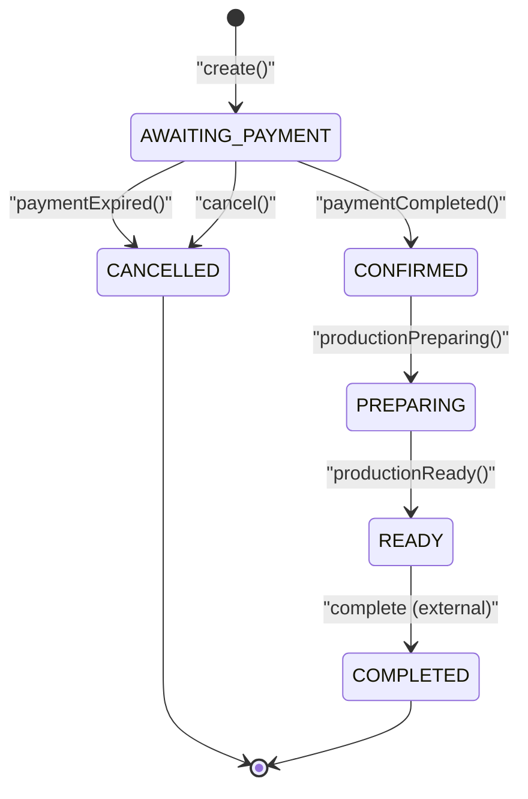
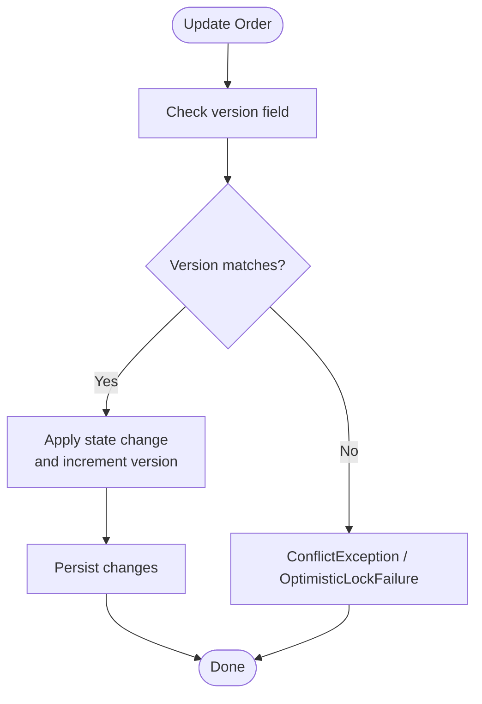
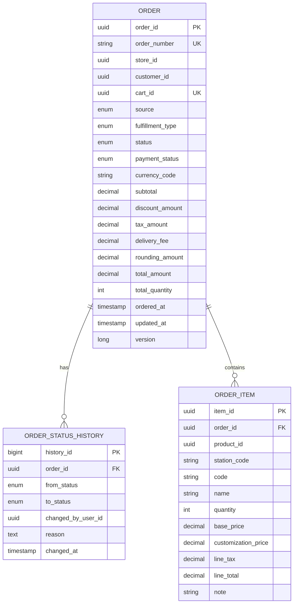
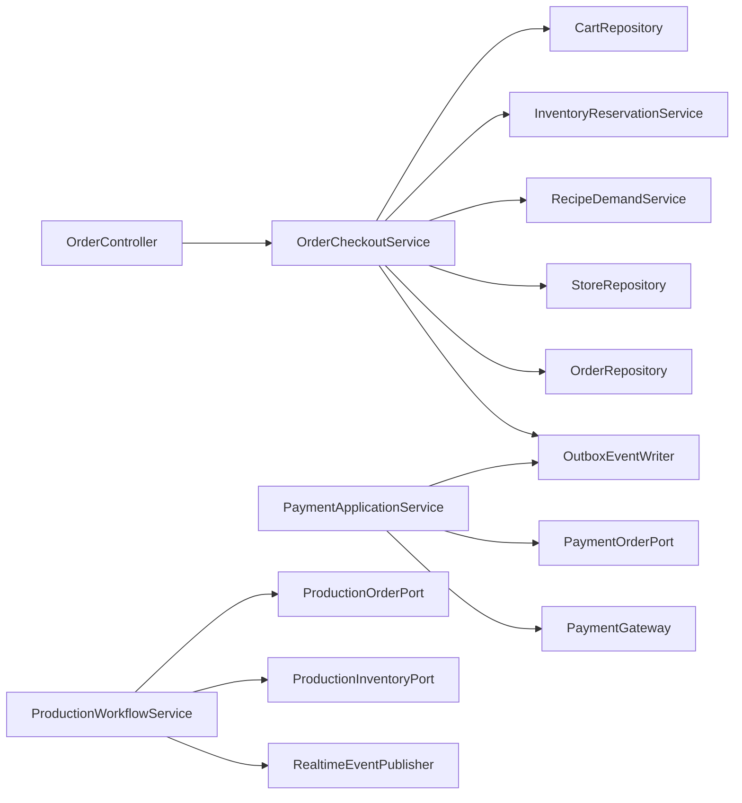

# Order Lifecycle Management

<cite>
**Referenced Files in This Document**
- [Order.java](file://src/main/java/com/smartcoffee/modules/ordering/domain/Order.java)
- [OrderStatus.java](file://src/main/java/com/smartcoffee/modules/ordering/domain/OrderStatus.java)
- [PaymentStatus.java](file://src/main/java/com/smartcoffee/modules/ordering/domain/PaymentStatus.java)
- [OrderStatusHistory.java](file://src/main/java/com/smartcoffee/modules/ordering/domain/OrderStatusHistory.java)
- [OrderRepository.java](file://src/main/java/com/smartcoffee/modules/ordering/persistence/OrderRepository.java)
- [OrderController.java](file://src/main/java/com/smartcoffee/modules/ordering/api/OrderController.java)
- [OrderCheckoutService.java](file://src/main/java/com/smartcoffee/modules/ordering/application/OrderCheckoutService.java)
- [PaymentApplicationService.java](file://src/main/java/com/smartcoffee/modules/payment/application/PaymentApplicationService.java)
- [ProductionWorkflowService.java](file://src/main/java/com/smartcoffee/modules/production/application/ProductionWorkflowService.java)
- [PaymentOrderPort.java](file://src/main/java/com/smartcoffee/modules/payment/application/PaymentOrderPort.java)
- [ProductionOrderPort.java](file://src/main/java/com/smartcoffee/modules/production/application/ProductionOrderPort.java)
</cite>

## Table of Contents
1. [Introduction](#introduction)
2. [Project Structure](#project-structure)
3. [Core Components](#core-components)
4. [Architecture Overview](#architecture-overview)
5. [Detailed Component Analysis](#detailed-component-analysis)
6. [Dependency Analysis](#dependency-analysis)
7. [Performance Considerations](#performance-considerations)
8. [Troubleshooting Guide](#troubleshooting-guide)
9. [Conclusion](#conclusion)

## Introduction
This document explains the Order lifecycle management system, focusing on the complete state machine from order creation through fulfillment. It details the Order aggregate root, its invariants, status transitions, validation rules, error handling, and concurrency control mechanisms used to maintain consistency across states.

## Project Structure
The Order lifecycle spans multiple modules:
- Ordering module: defines the Order aggregate, statuses, persistence, API, and checkout orchestration.
- Payment module: handles payment initiation, verification, and confirmation that transitions the Order to confirmed.
- Production module: drives preparation and readiness steps that transition the Order into production and ready states.

**Diagram sources**
- [OrderController.java:13-40](file://src/main/java/com/smartcoffee/modules/ordering/api/OrderController.java#L13-L40)
- [OrderCheckoutService.java:28-133](file://src/main/java/com/smartcoffee/modules/ordering/application/OrderCheckoutService.java#L28-L133)
- [Order.java:9-61](file://src/main/java/com/smartcoffee/modules/ordering/domain/Order.java#L9-L61)
- [OrderStatus.java:3-5](file://src/main/java/com/smartcoffee/modules/ordering/domain/OrderStatus.java#L3-L5)
- [PaymentStatus.java:3-5](file://src/main/java/com/smartcoffee/modules/ordering/domain/PaymentStatus.java#L3-L5)
- [OrderStatusHistory.java:7-40](file://src/main/java/com/smartcoffee/modules/ordering/domain/OrderStatusHistory.java#L7-L40)
- [OrderRepository.java:10-20](file://src/main/java/com/smartcoffee/modules/ordering/persistence/OrderRepository.java#L10-L20)
- [PaymentApplicationService.java:20-163](file://src/main/java/com/smartcoffee/modules/payment/application/PaymentApplicationService.java#L20-L163)
- [PaymentOrderPort.java:6-15](file://src/main/java/com/smartcoffee/modules/payment/application/PaymentOrderPort.java#L6-L15)
- [ProductionWorkflowService.java:19-134](file://src/main/java/com/smartcoffee/modules/production/application/ProductionWorkflowService.java#L19-L134)
- [ProductionOrderPort.java:5-17](file://src/main/java/com/smartcoffee/modules/production/application/ProductionOrderPort.java#L5-L17)

**Section sources**
- [OrderController.java:13-40](file://src/main/java/com/smartcoffee/modules/ordering/api/OrderController.java#L13-L40)
- [OrderCheckoutService.java:28-133](file://src/main/java/com/smartcoffee/modules/ordering/application/OrderCheckoutService.java#L28-L133)
- [Order.java:9-61](file://src/main/java/com/smartcoffee/modules/ordering/domain/Order.java#L9-L61)
- [OrderStatus.java:3-5](file://src/main/java/com/smartcoffee/modules/ordering/domain/OrderStatus.java#L3-L5)
- [PaymentStatus.java:3-5](file://src/main/java/com/smartcoffee/modules/ordering/domain/PaymentStatus.java#L3-L5)
- [OrderStatusHistory.java:7-40](file://src/main/java/com/smartcoffee/modules/ordering/domain/OrderStatusHistory.java#L7-L40)
- [OrderRepository.java:10-20](file://src/main/java/com/smartcoffee/modules/ordering/persistence/OrderRepository.java#L10-L20)
- [PaymentApplicationService.java:20-163](file://src/main/java/com/smartcoffee/modules/payment/application/PaymentApplicationService.java#L20-L163)
- [PaymentOrderPort.java:6-15](file://src/main/java/com/smartcoffee/modules/payment/application/PaymentOrderPort.java#L6-L15)
- [ProductionWorkflowService.java:19-134](file://src/main/java/com/smartcoffee/modules/production/application/ProductionWorkflowService.java#L19-L134)
- [ProductionOrderPort.java:5-17](file://src/main/java/com/smartcoffee/modules/production/application/ProductionOrderPort.java#L5-L17)

## Core Components
- Order aggregate root: Encapsulates order state, financial totals, items, and history. Provides domain methods for state transitions with strict validation.
- OrderStatus enum: Defines all possible order states.
- PaymentStatus enum: Tracks payment lifecycle relative to an order.
- OrderStatusHistory: Records every state change with actor and reason.
- OrderRepository: Persistence access with optimistic locking via version field and pessimistic lock option.
- OrderController: Entry point for creating orders via REST API.
- OrderCheckoutService: Orchestrates checkout, validates cart/catalog data, persists Order, reserves inventory, and emits events.
- PaymentApplicationService: Handles cash and KHQR payments; confirms orders and emits payment events.
- ProductionWorkflowService: Drives production workflow; marks orders preparing and ready when tickets are completed.

**Section sources**
- [Order.java:9-61](file://src/main/java/com/smartcoffee/modules/ordering/domain/Order.java#L9-L61)
- [OrderStatus.java:3-5](file://src/main/java/com/smartcoffee/modules/ordering/domain/OrderStatus.java#L3-L5)
- [PaymentStatus.java:3-5](file://src/main/java/com/smartcoffee/modules/ordering/domain/PaymentStatus.java#L3-L5)
- [OrderStatusHistory.java:7-40](file://src/main/java/com/smartcoffee/modules/ordering/domain/OrderStatusHistory.java#L7-L40)
- [OrderRepository.java:10-20](file://src/main/java/com/smartcoffee/modules/ordering/persistence/OrderRepository.java#L10-L20)
- [OrderController.java:13-40](file://src/main/java/com/smartcoffee/modules/ordering/api/OrderController.java#L13-L40)
- [OrderCheckoutService.java:28-133](file://src/main/java/com/smartcoffee/modules/ordering/application/OrderCheckoutService.java#L28-L133)
- [PaymentApplicationService.java:20-163](file://src/main/java/com/smartcoffee/modules/payment/application/PaymentApplicationService.java#L20-L163)
- [ProductionWorkflowService.java:19-134](file://src/main/java/com/smartcoffee/modules/production/application/ProductionWorkflowService.java#L19-L134)

## Architecture Overview
The Order lifecycle is driven by three primary flows:
- Checkout flow: Creates an order in AWAITING_PAYMENT, reserves inventory, and publishes ORDER_PLACED event.
- Payment flow: Confirms payment and transitions order to CONFIRMED; emits PAYMENT_COMPLETED and receipt events.
- Production flow: Marks order PREPARING when first ticket starts; marks READY when all tickets are ready.

**Diagram sources**
- [OrderController.java:29-40](file://src/main/java/com/smartcoffee/modules/ordering/api/OrderController.java#L29-L40)
- [OrderCheckoutService.java:62-133](file://src/main/java/com/smartcoffee/modules/ordering/application/OrderCheckoutService.java#L62-L133)
- [Order.java:66-94](file://src/main/java/com/smartcoffee/modules/ordering/domain/Order.java#L66-L94)
- [PaymentApplicationService.java:48-108](file://src/main/java/com/smartcoffee/modules/payment/application/PaymentApplicationService.java#L48-L108)
- [ProductionWorkflowService.java:53-92](file://src/main/java/com/smartcoffee/modules/production/application/ProductionWorkflowService.java#L53-L92)

## Detailed Component Analysis

### Order Aggregate Root and State Machine
The Order aggregate enforces business invariants and encapsulates all valid state transitions. Key responsibilities:
- Creation: Initializes order with AWAITING_PAYMENT and PENDING payment status, attaches items, and records initial history.
- Payment completion: Transitions from AWAITING_PAYMENT + PENDING to CONFIRMED + PAID.
- Payment expiration: Transitions from AWAITING_PAYMENT + PENDING to CANCELLED + FAILED.
- Cancellation: Allows cancellation unless already COMPLETED or CANCELLED.
- Production preparation: Requires CONFIRMED + PAID to move to PREPARING.
- Production readiness: Requires PREPARING to move to READY.

**Diagram sources**
- [Order.java:66-94](file://src/main/java/com/smartcoffee/modules/ordering/domain/Order.java#L66-L94)
- [Order.java:174-286](file://src/main/java/com/smartcoffee/modules/ordering/domain/Order.java#L174-L286)

#### OrderStatus Enum Values
- AWAITING_PAYMENT: Order created, awaiting payment.
- CONFIRMED: Payment completed; order confirmed.
- PREPARING: Production started.
- READY: All production items ready.
- COMPLETED: Fulfillment completed (e.g., handed over).
- CANCELLED: Order cancelled due to user action or payment expiration.

**Section sources**
- [OrderStatus.java:3-5](file://src/main/java/com/smartcoffee/modules/ordering/domain/OrderStatus.java#L3-L5)

#### PaymentStatus Enum Values
- PENDING: Payment not yet settled.
- PAID: Payment successfully settled.
- FAILED: Payment rejected/expired.
- REFUNDED: Refund processed.

**Section sources**
- [PaymentStatus.java:3-5](file://src/main/java/com/smartcoffee/modules/ordering/domain/PaymentStatus.java#L3-L5)

#### Validation Rules at Each Stage
- Creation:
  - Cart must be active and non-empty.
  - Catalog prices and currency must match cart expectations.
  - Store must exist and be active.
- Payment Completion:
  - Order must be AWAITING_PAYMENT with PENDING payment status.
  - Idempotency prevents duplicate confirmations.
- Payment Expiration:
  - Order must be AWAITING_PAYMENT with PENDING payment status.
- Cancellation:
  - Cannot cancel if already COMPLETED or CANCELLED.
- Production Preparing:
  - Order must be CONFIRMED and paid.
- Production Ready:
  - Order must be PREPARING.

**Section sources**
- [OrderCheckoutService.java:74-118](file://src/main/java/com/smartcoffee/modules/ordering/application/OrderCheckoutService.java#L74-L118)
- [Order.java:174-286](file://src/main/java/com/smartcoffee/modules/ordering/domain/Order.java#L174-L286)
- [PaymentApplicationService.java:48-108](file://src/main/java/com/smartcoffee/modules/payment/application/PaymentApplicationService.java#L48-L108)
- [ProductionWorkflowService.java:53-92](file://src/main/java/com/smartcoffee/modules/production/application/ProductionWorkflowService.java#L53-L92)

#### Error Handling for Invalid Transitions
- ConflictException thrown for invalid state transitions (e.g., cancelling a completed order, starting production on unpaid order).
- ValidationException for invalid input (e.g., invalid fulfillment type).
- ResourceNotFoundException for missing entities (e.g., cart/store/payment).
- InfrastructureException for idempotency response replay/storage failures.

**Section sources**
- [Order.java:174-286](file://src/main/java/com/smartcoffee/modules/ordering/domain/Order.java#L174-L286)
- [OrderCheckoutService.java:82-131](file://src/main/java/com/smartcoffee/modules/ordering/application/OrderCheckoutService.java#L82-L131)
- [PaymentApplicationService.java:48-108](file://src/main/java/com/smartcoffee/modules/payment/application/PaymentApplicationService.java#L48-L108)

#### Examples of Order State Changes
- Create order:
  - Status becomes AWAITING_PAYMENT; payment status PENDING.
  - History entry recorded with reason "Order created".
- Complete payment:
  - Status moves to CONFIRMED; payment status PAID.
  - History entry recorded with reason "Payment completed".
- Expire payment:
  - Status moves to CANCELLED; payment status FAILED.
  - History entry recorded with reason "Payment window expired".
- Start production:
  - Status moves to PREPARING; requires CONFIRMED + PAID.
  - History entry recorded with reason "Production started".
- Mark ready:
  - Status moves to READY; requires PREPARING.
  - History entry recorded with reason "Production completed".

**Section sources**
- [Order.java:66-94](file://src/main/java/com/smartcoffee/modules/ordering/domain/Order.java#L66-L94)
- [Order.java:184-286](file://src/main/java/com/smartcoffee/modules/ordering/domain/Order.java#L184-L286)

### Concurrency Control and Optimistic Locking
- Optimistic locking:
  - Order entity uses a version field to detect concurrent updates.
  - Any update to Order (including state transitions) increments version; conflicting writes raise exceptions handled by JPA.
- Pessimistic locking:
  - OrderRepository provides a method to lock an Order row for exclusive write during critical operations.
- Idempotency:
  - Order creation and payment endpoints use idempotency keys to prevent duplicate processing.
  - Responses are cached and replayed for repeated requests within TTL.

**Diagram sources**
- [Order.java:55-56](file://src/main/java/com/smartcoffee/modules/ordering/domain/Order.java#L55-L56)
- [OrderRepository.java:18-20](file://src/main/java/com/smartcoffee/modules/ordering/persistence/OrderRepository.java#L18-L20)
- [OrderCheckoutService.java:62-133](file://src/main/java/com/smartcoffee/modules/ordering/application/OrderCheckoutService.java#L62-L133)
- [PaymentApplicationService.java:48-108](file://src/main/java/com/smartcoffee/modules/payment/application/PaymentApplicationService.java#L48-L108)

**Section sources**
- [Order.java:55-56](file://src/main/java/com/smartcoffee/modules/ordering/domain/Order.java#L55-L56)
- [OrderRepository.java:18-20](file://src/main/java/com/smartcoffee/modules/ordering/persistence/OrderRepository.java#L18-L20)
- [OrderCheckoutService.java:62-133](file://src/main/java/com/smartcoffee/modules/ordering/application/OrderCheckoutService.java#L62-L133)
- [PaymentApplicationService.java:48-108](file://src/main/java/com/smartcoffee/modules/payment/application/PaymentApplicationService.java#L48-L108)

### Data Model Relationships

**Diagram sources**
- [Order.java:9-61](file://src/main/java/com/smartcoffee/modules/ordering/domain/Order.java#L9-L61)
- [OrderStatusHistory.java:7-40](file://src/main/java/com/smartcoffee/modules/ordering/domain/OrderStatusHistory.java#L7-L40)

**Section sources**
- [Order.java:9-61](file://src/main/java/com/smartcoffee/modules/ordering/domain/Order.java#L9-L61)
- [OrderStatusHistory.java:7-40](file://src/main/java/com/smartcoffee/modules/ordering/domain/OrderStatusHistory.java#L7-L40)

## Dependency Analysis
- Ordering module depends on:
  - Cart module for cart ownership and validation.
  - Inventory module for reservation.
  - Recipe module for demand calculation.
  - Organization module for store lookup.
- Payment module depends on:
  - Payment gateway implementations.
  - Outbox for event emission.
  - Order port to confirm orders.
- Production module depends on:
  - Order port to mark preparing/ready.
  - Inventory port to consume ingredients.
  - Realtime publisher for live updates.

**Diagram sources**
- [OrderController.java:13-40](file://src/main/java/com/smartcoffee/modules/ordering/api/OrderController.java#L13-L40)
- [OrderCheckoutService.java:28-133](file://src/main/java/com/smartcoffee/modules/ordering/application/OrderCheckoutService.java#L28-L133)
- [PaymentApplicationService.java:20-163](file://src/main/java/com/smartcoffee/modules/payment/application/PaymentApplicationService.java#L20-L163)
- [ProductionWorkflowService.java:19-134](file://src/main/java/com/smartcoffee/modules/production/application/ProductionWorkflowService.java#L19-L134)

**Section sources**
- [OrderController.java:13-40](file://src/main/java/com/smartcoffee/modules/ordering/api/OrderController.java#L13-L40)
- [OrderCheckoutService.java:28-133](file://src/main/java/com/smartcoffee/modules/ordering/application/OrderCheckoutService.java#L28-L133)
- [PaymentApplicationService.java:20-163](file://src/main/java/com/smartcoffee/modules/payment/application/PaymentApplicationService.java#L20-L163)
- [ProductionWorkflowService.java:19-134](file://src/main/java/com/smartcoffee/modules/production/application/ProductionWorkflowService.java#L19-L134)

## Performance Considerations
- Use optimistic locking to avoid expensive row locks during normal updates.
- Reserve pessimistic locks only around critical sections where necessary (e.g., specific payment verification paths).
- Batch operations where possible (e.g., catalog validation and recipe demand calculation).
- Emit outbox events asynchronously to decouple side effects from transactional boundaries.
- Cache idempotency responses to reduce repeated computation and database writes.

[No sources needed since this section provides general guidance]

## Troubleshooting Guide
Common issues and resolutions:
- Invalid state transition errors:
  - Ensure order is in the expected state before invoking transition methods.
  - Validate payment status aligns with business rules (e.g., production requires paid).
- Duplicate order creation:
  - Verify idempotency key usage; check idempotency storage for existing claims.
- Price or currency mismatch:
  - Re-validate catalog prices and currency against cart before checkout.
- Payment conflicts:
  - Confirm order is not already paid; handle provider verification results properly.
- Production race conditions:
  - Ensure ticket items are locked before mutating; verify all tickets are ready before marking order ready.

**Section sources**
- [Order.java:174-286](file://src/main/java/com/smartcoffee/modules/ordering/domain/Order.java#L174-L286)
- [OrderCheckoutService.java:74-131](file://src/main/java/com/smartcoffee/modules/ordering/application/OrderCheckoutService.java#L74-L131)
- [PaymentApplicationService.java:48-108](file://src/main/java/com/smartcoffee/modules/payment/application/PaymentApplicationService.java#L48-L108)
- [ProductionWorkflowService.java:53-92](file://src/main/java/com/smartcoffee/modules/production/application/ProductionWorkflowService.java#L53-L92)

## Conclusion
The Order lifecycle management system enforces robust state transitions through the Order aggregate, supported by clear validation rules, comprehensive history tracking, and strong concurrency controls. The integration points with payment and production domains ensure consistent progression from creation through fulfillment while maintaining data integrity and operational reliability.

[No sources needed since this section summarizes without analyzing specific files]