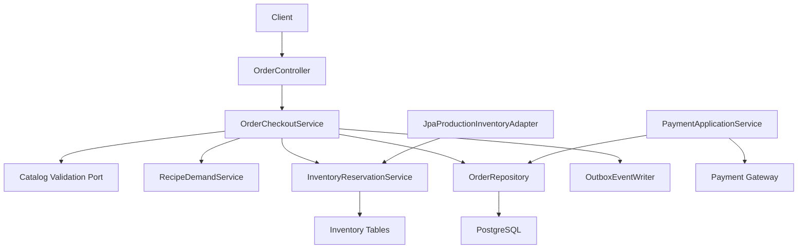
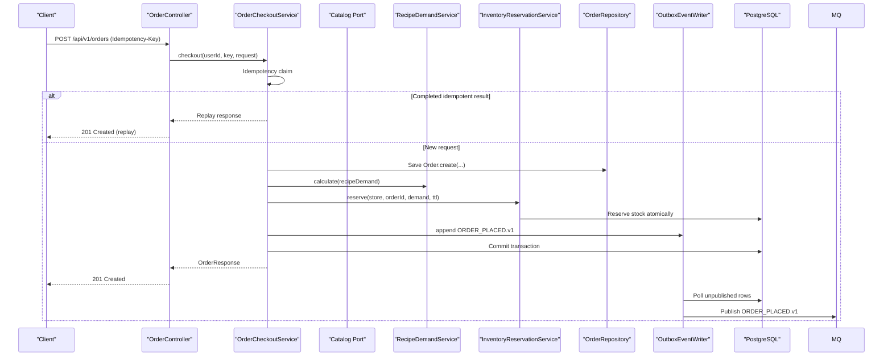
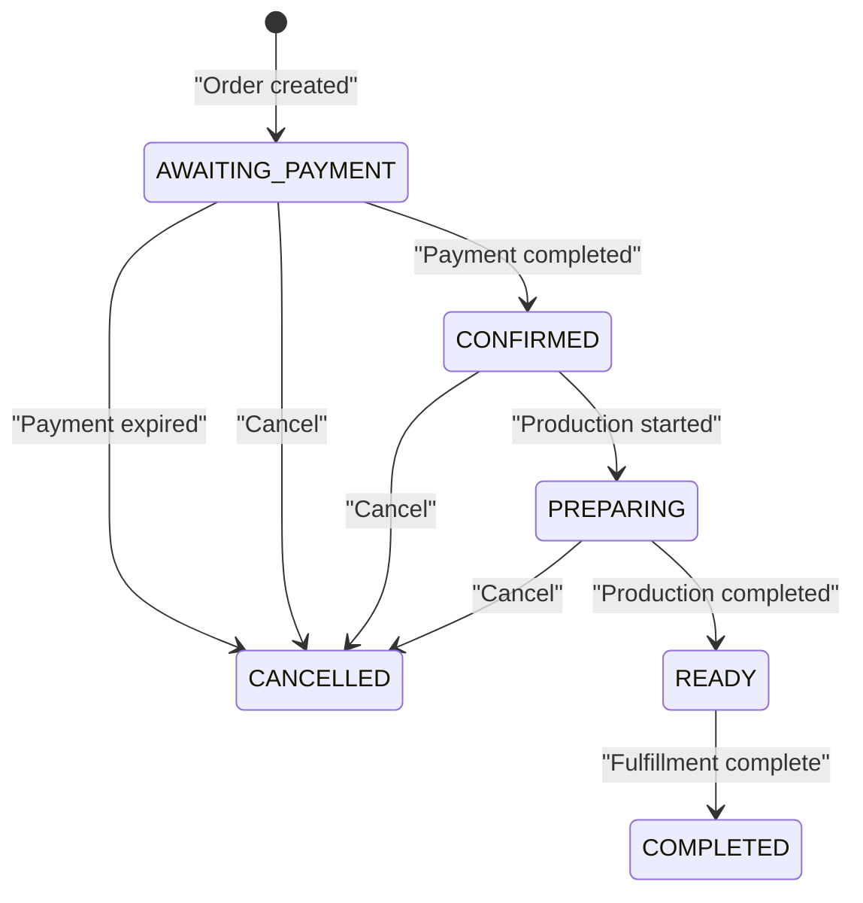
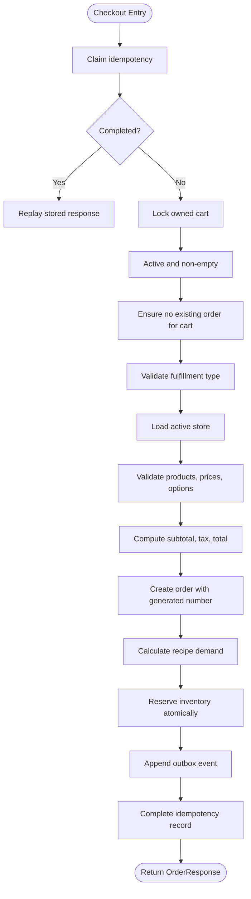
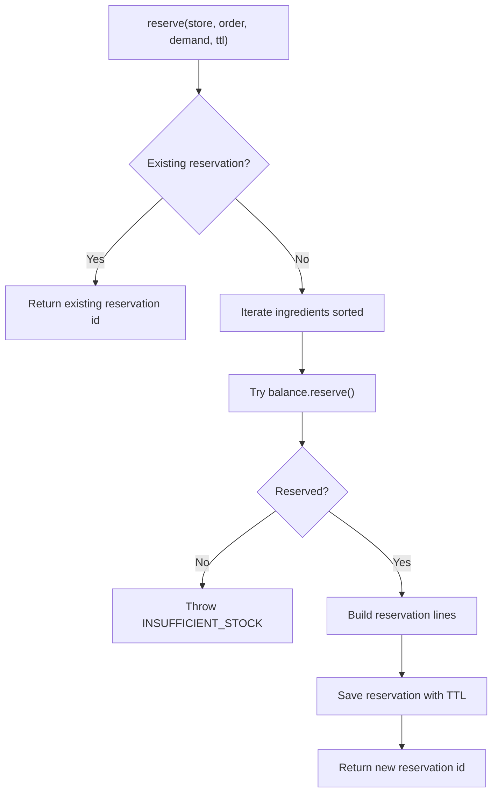
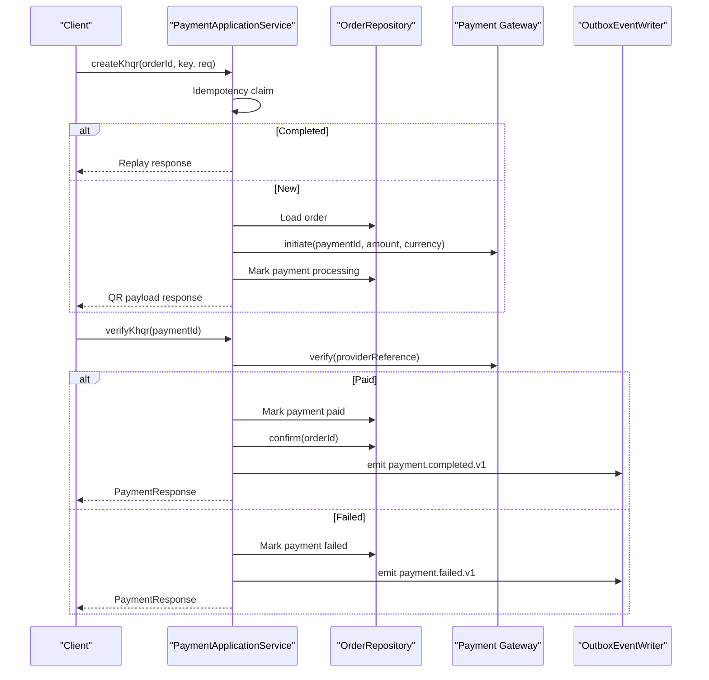
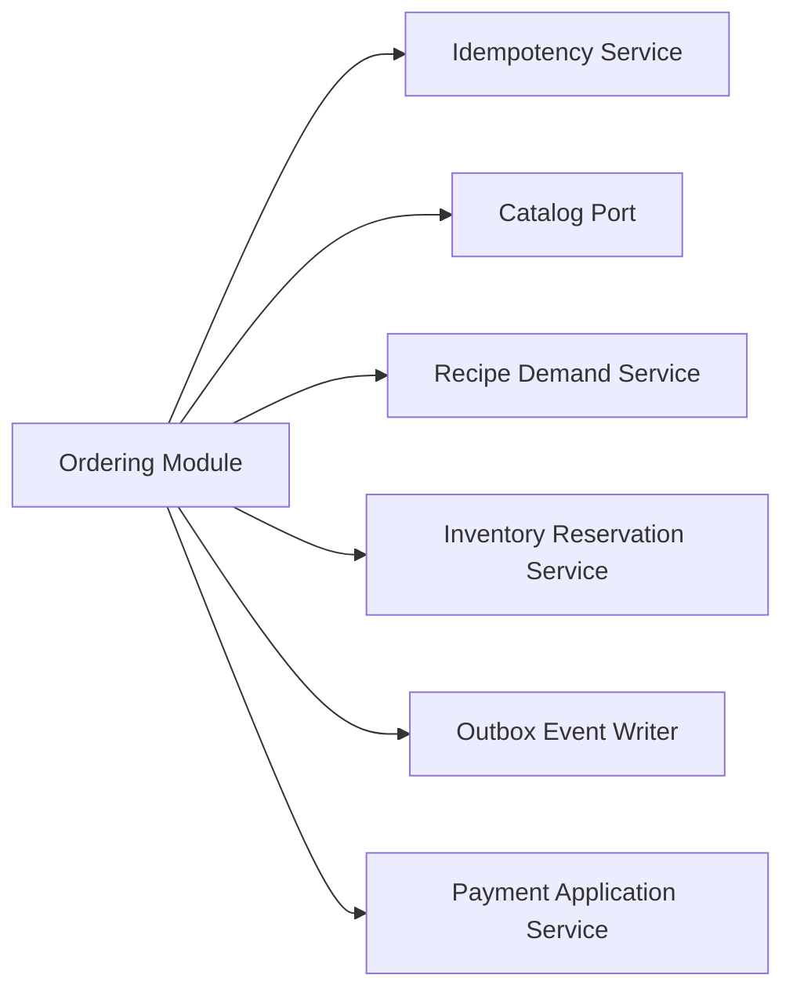

# Order Processing Module

<cite>
**Referenced Files in This Document**
- [OrderController.java](file://src/main/java/com/smartcoffee/modules/ordering/api/OrderController.java)
- [OrderCheckoutService.java](file://src/main/java/com/smartcoffee/modules/ordering/application/OrderCheckoutService.java)
- [OrderQueryService.java](file://src/main/java/com/smartcoffee/modules/ordering/application/OrderQueryService.java)
- [OrderNumberGenerator.java](file://src/main/java/com/smartcoffee/modules/ordering/application/OrderNumberGenerator.java)
- [Order.java](file://src/main/java/com/smartcoffee/modules/ordering/domain/Order.java)
- [OrderStatus.java](file://src/main/java/com/smartcoffee/modules/ordering/domain/OrderStatus.java)
- [PaymentStatus.java](file://src/main/java/com/smartcoffee/modules/ordering/domain/PaymentStatus.java)
- [OrderStatusHistory.java](file://src/main/java/com/smartcoffee/modules/ordering/domain/OrderStatusHistory.java)
- [InventoryReservationService.java](file://src/main/java/com/smartcoffee/modules/inventory/application/InventoryReservationService.java)
- [InventoryReservation.java](file://src/main/java/com/smartcoffee/modules/inventory/domain/InventoryReservation.java)
- [InventoryReservationRepository.java](file://src/main/java/com/smartcoffee/modules/inventory/persistence/InventoryReservationRepository.java)
- [JpaProductionInventoryAdapter.java](file://src/main/java/com/smartcoffee/modules/production/application/JpaProductionInventoryAdapter.java)
- [PaymentApplicationService.java](file://src/main/java/com/smartcoffee/modules/payment/application/PaymentApplicationService.java)
- [Payment.java](file://src/main/java/com/smartcoffee/modules/payment/domain/Payment.java)
- [ORDER_FLOW.mermaid](file://architecture/ORDER_FLOW.mermaid)
- [INVENTORY_FLOW.mermaid](file://architecture/INVENTORY_FLOW.mermaid)
</cite>

## Table of Contents
1. [Introduction](#introduction)
2. [Project Structure](#project-structure)
3. [Core Components](#core-components)
4. [Architecture Overview](#architecture-overview)
5. [Detailed Component Analysis](#detailed-component-analysis)
6. [Dependency Analysis](#dependency-analysis)
7. [Performance Considerations](#performance-considerations)
8. [Troubleshooting Guide](#troubleshooting-guide)
9. [Conclusion](#conclusion)

## Introduction
This document explains the Order Processing module end-to-end: order creation, checkout workflow, validation, inventory reservation coordination, payment integration points, order number generation, status tracking, historical data management, concurrency control, rollback mechanisms, and recovery scenarios. It is intended for both technical and non-technical readers to understand how orders flow through the system from cart to fulfillment.

## Project Structure
The ordering module follows a layered design with API, application services, domain entities, and persistence. Key files include:
- API layer: OrderController exposes endpoints for creating and retrieving orders.
- Application layer: OrderCheckoutService orchestrates checkout; OrderQueryService provides read operations.
- Domain layer: Order encapsulates business rules and state transitions; OrderStatus and PaymentStatus define enumerations; OrderStatusHistory records audit trail.
- Cross-cutting: OrderNumberGenerator produces human-readable order numbers; InventoryReservationService coordinates stock reservations; Production adapter consumes inventory when preparation starts; PaymentApplicationService integrates payments and updates order confirmation.

**Diagram sources**
- [OrderController.java:13-40](file://src/main/java/com/smartcoffee/modules/ordering/api/OrderController.java#L13-L40)
- [OrderCheckoutService.java:28-133](file://src/main/java/com/smartcoffee/modules/ordering/application/OrderCheckoutService.java#L28-L133)
- [InventoryReservationService.java:30-85](file://src/main/java/com/smartcoffee/modules/inventory/application/InventoryReservationService.java#L30-L85)
- [PaymentApplicationService.java:72-162](file://src/main/java/com/smartcoffee/modules/payment/application/PaymentApplicationService.java#L72-L162)
- [JpaProductionInventoryAdapter.java:9-24](file://src/main/java/com/smartcoffee/modules/production/application/JpaProductionInventoryAdapter.java#L9-L24)

**Section sources**
- [OrderController.java:13-40](file://src/main/java/com/smartcoffee/modules/ordering/api/OrderController.java#L13-L40)
- [OrderCheckoutService.java:28-133](file://src/main/java/com/smartcoffee/modules/ordering/application/OrderCheckoutService.java#L28-L133)
- [OrderQueryService.java:10-24](file://src/main/java/com/smartcoffee/modules/ordering/application/OrderQueryService.java#L10-L24)

## Core Components
- Order entity: Encapsulates order lifecycle, totals, items, and immutable history entries. Provides methods for cancel, payment completion, payment expiration, production start, and readiness.
- OrderStatus and PaymentStatus: Enumerations governing valid states and transitions.
- OrderStatusHistory: Append-only audit trail capturing from/to status, actor, reason, and timestamp.
- OrderCheckoutService: Transactional orchestration for checkout including idempotency, catalog validation, recipe demand calculation, inventory reservation, order creation, outbox event emission, and response replay.
- OrderNumberGenerator: Generates store-scoped, date-partitioned, random-suffixed order numbers.
- InventoryReservationService: Reserves ingredients atomically, releases on cancellation, consumes on preparation, and emits events via outbox.
- JpaProductionInventoryAdapter: Bridges production workflow to inventory consumption by order.
- PaymentApplicationService: Creates payment intents, verifies provider responses, marks orders confirmed, and emits payment events.

**Section sources**
- [Order.java:10-289](file://src/main/java/com/smartcoffee/modules/ordering/domain/Order.java#L10-L289)
- [OrderStatus.java:3-5](file://src/main/java/com/smartcoffee/modules/ordering/domain/OrderStatus.java#L3-L5)
- [PaymentStatus.java:3-5](file://src/main/java/com/smartcoffee/modules/ordering/domain/PaymentStatus.java#L3-L5)
- [OrderStatusHistory.java:7-40](file://src/main/java/com/smartcoffee/modules/ordering/domain/OrderStatusHistory.java#L7-L40)
- [OrderCheckoutService.java:28-133](file://src/main/java/com/smartcoffee/modules/ordering/application/OrderCheckoutService.java#L28-L133)
- [OrderNumberGenerator.java:8-13](file://src/main/java/com/smartcoffee/modules/ordering/application/OrderNumberGenerator.java#L8-L13)
- [InventoryReservationService.java:30-85](file://src/main/java/com/smartcoffee/modules/inventory/application/InventoryReservationService.java#L30-L85)
- [JpaProductionInventoryAdapter.java:9-24](file://src/main/java/com/smartcoffee/modules/production/application/JpaProductionInventoryAdapter.java#L9-L24)
- [PaymentApplicationService.java:72-162](file://src/main/java/com/smartcoffee/modules/payment/application/PaymentApplicationService.java#L72-L162)

## Architecture Overview
The checkout sequence enforces strict validation and atomicity across modules. The client sends an order creation request with an Idempotency-Key header. Authorization and idempotency checks occur first. If authorized, the service locks the cart, validates catalog prices and options, calculates tax and totals, computes recipe demand, reserves inventory, creates the order, writes an outbox event, and returns a deterministic response.

**Diagram sources**
- [ORDER_FLOW.mermaid:1-60](file://architecture/ORDER_FLOW.mermaid#L1-L60)
- [OrderController.java:29-40](file://src/main/java/com/smartcoffee/modules/ordering/api/OrderController.java#L29-L40)
- [OrderCheckoutService.java:62-133](file://src/main/java/com/smartcoffee/modules/ordering/application/OrderCheckoutService.java#L62-L133)

## Detailed Component Analysis

### Order Lifecycle and Status Transitions
The Order entity defines clear state transitions:
- Creation: AWAITING_PAYMENT with PENDING payment.
- Payment completed: CONFIRMED with PAID payment.
- Payment expired: CANCELLED with FAILED payment.
- Production preparing: PREPARING after confirmation and payment.
- Production ready: READY after preparation.
- Cancel: CANCELLED if not already completed or cancelled.

**Diagram sources**
- [Order.java:174-286](file://src/main/java/com/smartcoffee/modules/ordering/domain/Order.java#L174-L286)
- [OrderStatus.java:3-5](file://src/main/java/com/smartcoffee/modules/ordering/domain/OrderStatus.java#L3-L5)
- [PaymentStatus.java:3-5](file://src/main/java/com/smartcoffee/modules/ordering/domain/PaymentStatus.java#L3-L5)

**Section sources**
- [Order.java:66-94](file://src/main/java/com/smartcoffee/modules/ordering/domain/Order.java#L66-L94)
- [Order.java:174-286](file://src/main/java/com/smartcoffee/modules/ordering/domain/Order.java#L174-L286)

### Checkout Workflow and Validation
OrderCheckoutService performs:
- Idempotency claim using scope, actor type, actor ID, key, and canonical hash.
- Cart ownership lock and active state check.
- Empty cart and duplicate checkout prevention.
- Fulfillment type validation.
- Store existence and activity validation.
- Catalog price and option validation per item.
- Tax computation and total aggregation.
- Recipe demand calculation and inventory reservation.
- Order creation with server-authoritative totals.
- Outbox event emission for ORDER_PLACED.
- Response storage for idempotent replay.

**Diagram sources**
- [OrderCheckoutService.java:62-133](file://src/main/java/com/smartcoffee/modules/ordering/application/OrderCheckoutService.java#L62-L133)

**Section sources**
- [OrderCheckoutService.java:62-133](file://src/main/java/com/smartcoffee/modules/ordering/application/OrderCheckoutService.java#L62-L133)

### Inventory Reservation Coordination
InventoryReservationService ensures:
- Idempotent reservation by order ID.
- Atomic ingredient reservation against balances.
- Reservation creation with TTL expiry.
- Release of reserved stock on cancellation.
- Consumption of reserved stock during preparation with ledger entries.
- Event emission via outbox for consumed/released states.

**Diagram sources**
- [InventoryReservationService.java:43-54](file://src/main/java/com/smartcoffee/modules/inventory/application/InventoryReservationService.java#L43-L54)

**Section sources**
- [InventoryReservationService.java:43-85](file://src/main/java/com/smartcoffee/modules/inventory/application/InventoryReservationService.java#L43-L85)
- [InventoryReservation.java:41-79](file://src/main/java/com/smartcoffee/modules/inventory/domain/InventoryReservation.java#L41-L79)
- [InventoryReservationRepository.java:11-21](file://src/main/java/com/smartcoffee/modules/inventory/persistence/InventoryReservationRepository.java#L11-L21)

### Payment Integration Points
PaymentApplicationService handles:
- Idempotent payment creation with KHQR method.
- Provider initiation and processing state.
- Verification of provider responses.
- Idempotent paid state enforcement.
- Order confirmation upon successful payment.
- Receipt request emission.
- Outbox events for payment completion and failure.

**Diagram sources**
- [PaymentApplicationService.java:72-162](file://src/main/java/com/smartcoffee/modules/payment/application/PaymentApplicationService.java#L72-L162)
- [Payment.java:56-99](file://src/main/java/com/smartcoffee/modules/payment/domain/Payment.java#L56-L99)

**Section sources**
- [PaymentApplicationService.java:72-162](file://src/main/java/com/smartcoffee/modules/payment/application/PaymentApplicationService.java#L72-L162)
- [Payment.java:56-99](file://src/main/java/com/smartcoffee/modules/payment/domain/Payment.java#L56-L99)

### Order Number Generation
OrderNumberGenerator produces deterministic, readable order numbers composed of:
- Store code prefix.
- UTC date part.
- Zero-padded six-digit random suffix.

This approach supports human readability and simple sorting while avoiding central sequencing bottlenecks.

**Section sources**
- [OrderNumberGenerator.java:8-13](file://src/main/java/com/smartcoffee/modules/ordering/application/OrderNumberGenerator.java#L8-L13)

### Historical Data Management
OrderStatusHistory captures every significant state change:
- From and to statuses.
- Actor who triggered the transition.
- Reason text.
- Timestamp of change.

This append-only model enables auditing and compliance reporting without mutating past records.

**Section sources**
- [OrderStatusHistory.java:7-40](file://src/main/java/com/smartcoffee/modules/ordering/domain/OrderStatusHistory.java#L7-L40)
- [Order.java:97-100](file://src/main/java/com/smartcoffee/modules/ordering/domain/Order.java#L97-L100)

### Query Operations
OrderQueryService provides customer-scoped retrieval:
- Reads order by ID and customer.
- Maps to response DTOs.
- Throws resource not found when missing.

**Section sources**
- [OrderQueryService.java:10-24](file://src/main/java/com/smartcoffee/modules/ordering/application/OrderQueryService.java#L10-L24)
- [OrderController.java:36-40](file://src/main/java/com/smartcoffee/modules/ordering/api/OrderController.java#L36-L40)

## Dependency Analysis
The ordering module depends on several cross-cutting services:
- IdempotencyService and CanonicalRequestHasher ensure safe retries and conflict detection.
- CheckoutCatalogPort validates product pricing and customization options.
- RecipeDemandService translates ordered items into ingredient demands.
- InventoryReservationService manages stock reservations and consumption.
- OutboxEventWriter persists events for asynchronous delivery.
- PaymentApplicationService integrates external payment providers and updates order confirmation.

**Diagram sources**
- [OrderCheckoutService.java:28-133](file://src/main/java/com/smartcoffee/modules/ordering/application/OrderCheckoutService.java#L28-L133)
- [PaymentApplicationService.java:72-162](file://src/main/java/com/smartcoffee/modules/payment/application/PaymentApplicationService.java#L72-L162)

**Section sources**
- [OrderCheckoutService.java:28-133](file://src/main/java/com/smartcoffee/modules/ordering/application/OrderCheckoutService.java#L28-L133)
- [PaymentApplicationService.java:72-162](file://src/main/java/com/smartcoffee/modules/payment/application/PaymentApplicationService.java#L72-L162)

## Performance Considerations
- Idempotency reduces redundant processing and protects downstream systems.
- Catalog validation occurs once per item to prevent price drift and ensure authoritative totals.
- Inventory reservation uses pessimistic locking where necessary to avoid race conditions.
- Outbox pattern decouples synchronous order creation from asynchronous event publishing.
- Server-authoritative totals eliminate client-side trust assumptions and reduce reconciliation overhead.

[No sources needed since this section provides general guidance]

## Troubleshooting Guide
Common issues and resolutions:
- Idempotency conflicts: Occur when different request hashes are submitted under the same key. Ensure clients compute canonical hashes consistently.
- Insufficient stock: Inventory reservation fails when balances cannot cover demand. Review ingredient availability and adjust orders or replenish stock.
- Currency mismatch: Catalog validation rejects carts whose currency differs from validated prices. Re-fetch catalog data before checkout.
- Price changed: Catalog base or customization prices differ from cart snapshot. Refresh cart or re-validate.
- Cart already checked out: Prevents duplicate orders from the same cart. Clear or recreate cart after successful checkout.
- Payment already paid: Verify idempotency and provider verification flows. Avoid double-confirmations.
- Reservation not consumable: Production consumption requires reservation in ACTIVE state. Check reservation lifecycle and TTL expiry.

**Section sources**
- [OrderCheckoutService.java:74-100](file://src/main/java/com/smartcoffee/modules/ordering/application/OrderCheckoutService.java#L74-L100)
- [InventoryReservationService.java:43-54](file://src/main/java/com/smartcoffee/modules/inventory/application/InventoryReservationService.java#L43-L54)
- [PaymentApplicationService.java:72-108](file://src/main/java/com/smartcoffee/modules/payment/application/PaymentApplicationService.java#L72-L108)

## Conclusion
The Order Processing module implements a robust, auditable, and resilient order lifecycle. It combines strong validation, idempotency, atomic inventory reservations, and asynchronous event publishing to support reliable checkout and fulfillment. State transitions are explicit and enforced within the Order aggregate, while cross-module integrations maintain consistency and observability.

[No sources needed since this section summarizes without analyzing specific files]