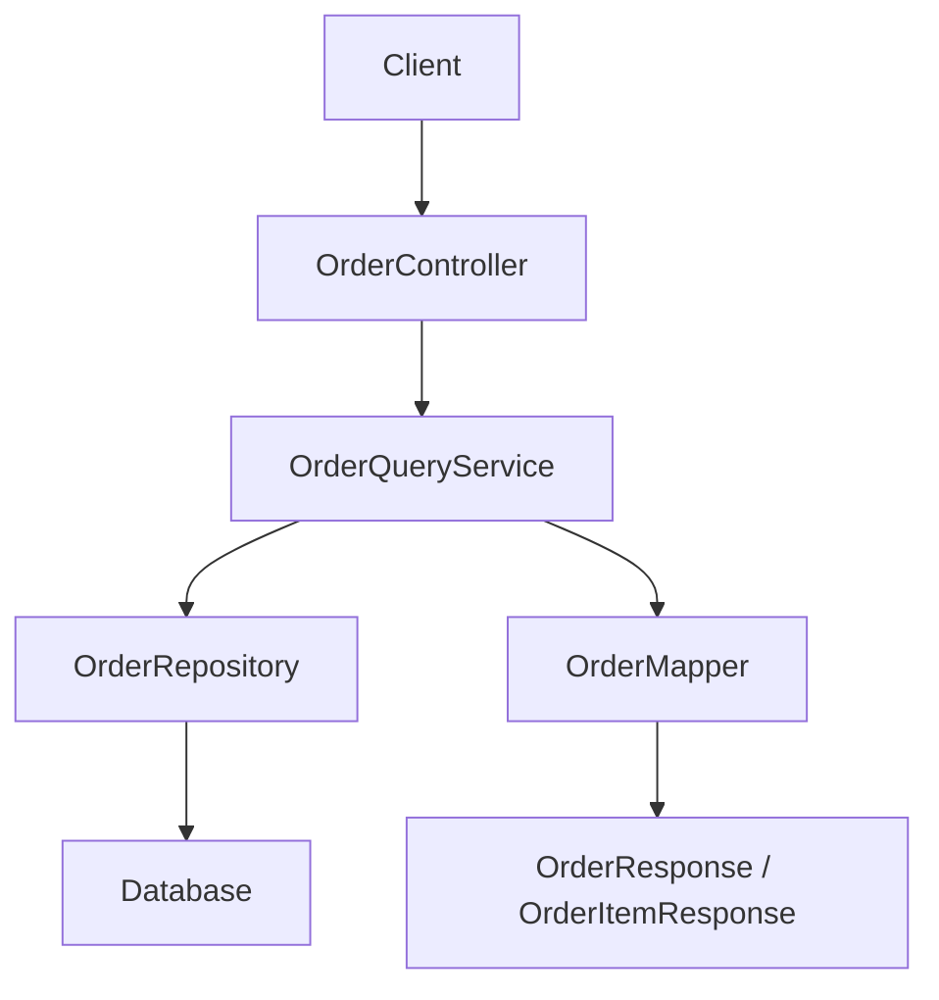
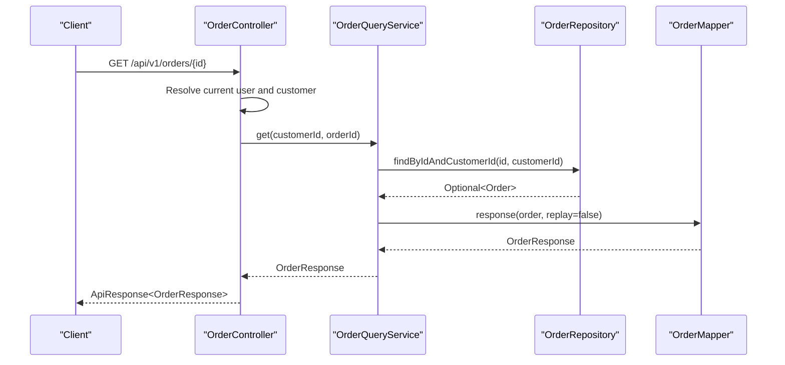
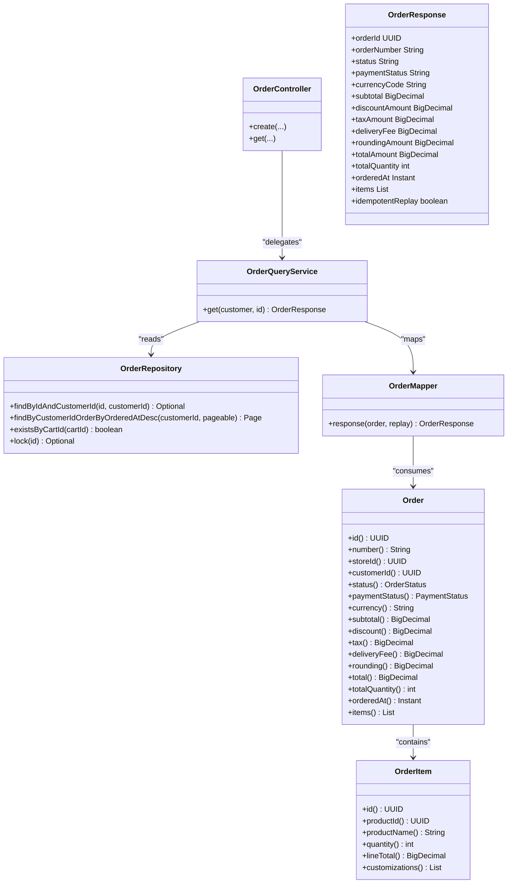

# Order Queries and Reporting

<cite>
**Referenced Files in This Document**
- [OrderQueryService.java](file://src/main/java/com/smartcoffee/modules/ordering/application/OrderQueryService.java)
- [OrderController.java](file://src/main/java/com/smartcoffee/modules/ordering/api/OrderController.java)
- [OrderRepository.java](file://src/main/java/com/smartcoffee/modules/ordering/persistence/OrderRepository.java)
- [OrderMapper.java](file://src/main/java/com/smartcoffee/modules/ordering/application/OrderMapper.java)
- [OrderResponse.java](file://src/main/java/com/smartcoffee/modules/ordering/api/OrderResponse.java)
- [OrderItemResponse.java](file://src/main/java/com/smartcoffee/modules/ordering/api/OrderItemResponse.java)
- [Order.java](file://src/main/java/com/smartcoffee/modules/ordering/domain/Order.java)
- [OrderItem.java](file://src/main/java/com/smartcoffee/modules/ordering/domain/OrderItem.java)
- [PaginatedResponse.java](file://src/main/java/com/smartcoffee/common/api/PaginatedResponse.java)
- [StoreQueryService.java](file://src/main/java/com/smartcoffee/modules/organization/application/StoreQueryService.java)
- [StoreController.java](file://src/main/java/com/smartcoffee/modules/organization/api/StoreController.java)
</cite>

## Table of Contents
1. [Introduction](#introduction)
2. [Project Structure](#project-structure)
3. [Core Components](#core-components)
4. [Architecture Overview](#architecture-overview)
5. [Detailed Component Analysis](#detailed-component-analysis)
6. [Dependency Analysis](#dependency-analysis)
7. [Performance Considerations](#performance-considerations)
8. [Troubleshooting Guide](#troubleshooting-guide)
9. [Conclusion](#conclusion)
10. [Appendices](#appendices)

## Introduction
This document explains order query operations and reporting capabilities for the ordering module. It focuses on how orders are retrieved by customer, how pagination is supported, how data is transformed into response DTOs, and what performance and consistency considerations apply to read paths. It also outlines where additional filtering (by store, date ranges, status) can be added and how to implement them consistently with existing patterns.

## Project Structure
The order query path spans the API layer, application service, domain model, and persistence repository:
- API controller exposes endpoints and delegates to the query service.
- Query service orchestrates reads and maps domain entities to DTOs.
- Repository provides JPA queries with optional pagination and entity graph loading.
- Domain models define the authoritative state and relationships.

**Diagram sources**
- [OrderController.java:13-40](file://src/main/java/com/smartcoffee/modules/ordering/api/OrderController.java#L13-L40)
- [OrderQueryService.java:10-24](file://src/main/java/com/smartcoffee/modules/ordering/application/OrderQueryService.java#L10-L24)
- [OrderRepository.java:10-20](file://src/main/java/com/smartcoffee/modules/ordering/persistence/OrderRepository.java#L10-L20)
- [OrderMapper.java:7-19](file://src/main/java/com/smartcoffee/modules/ordering/application/OrderMapper.java#L7-L19)

**Section sources**
- [OrderController.java:13-40](file://src/main/java/com/smartcoffee/modules/ordering/api/OrderController.java#L13-L40)
- [OrderQueryService.java:10-24](file://src/main/java/com/smartcoffee/modules/ordering/application/OrderQueryService.java#L10-L24)
- [OrderRepository.java:10-20](file://src/main/java/com/smartcoffee/modules/ordering/persistence/OrderRepository.java#L10-L20)
- [OrderMapper.java:7-19](file://src/main/java/com/smartcoffee/modules/ordering/application/OrderMapper.java#L7-L19)

## Core Components
- OrderQueryService: Read-only transactional service that fetches an order by ID and customer and maps it to a response DTO.
- OrderRepository: JPA repository providing single-order retrieval with eager-loaded items and a paginated list by customer.
- OrderMapper: Maps Order domain to OrderResponse and aggregates item details into OrderItemResponse.
- OrderResponse and OrderItemResponse: Immutable DTOs used for API responses.

Key responsibilities:
- Enforce authorization at the controller level using current actor and customer resolver.
- Use read-only transactions for query methods.
- Eagerly load related items via EntityGraph to avoid N+1 queries.
- Provide pagination support through Spring Data Pageable for listing orders by customer.

**Section sources**
- [OrderQueryService.java:10-24](file://src/main/java/com/smartcoffee/modules/ordering/application/OrderQueryService.java#L10-L24)
- [OrderRepository.java:10-20](file://src/main/java/com/smartcoffee/modules/ordering/persistence/OrderRepository.java#L10-L20)
- [OrderMapper.java:7-19](file://src/main/java/com/smartcoffee/modules/ordering/application/OrderMapper.java#L7-L19)
- [OrderResponse.java:7-10](file://src/main/java/com/smartcoffee/modules/ordering/api/OrderResponse.java#L7-L10)
- [OrderItemResponse.java:6-7](file://src/main/java/com/smartcoffee/modules/ordering/api/OrderItemResponse.java#L6-L7)

## Architecture Overview
The order query flow demonstrates request handling, authorization, data retrieval, mapping, and response wrapping.

**Diagram sources**
- [OrderController.java:29-40](file://src/main/java/com/smartcoffee/modules/ordering/api/OrderController.java#L29-L40)
- [OrderQueryService.java:20-24](file://src/main/java/com/smartcoffee/modules/ordering/application/OrderQueryService.java#L20-L24)
- [OrderRepository.java:11-12](file://src/main/java/com/smartcoffee/modules/ordering/persistence/OrderRepository.java#L11-L12)
- [OrderMapper.java:9-18](file://src/main/java/com/smartcoffee/modules/ordering/application/OrderMapper.java#L9-L18)

## Detailed Component Analysis

### OrderQueryService
- Purpose: Retrieve a specific order for a given customer and map to response DTO.
- Transactionality: Marked read-only to optimize database interactions.
- Error handling: Throws resource not found when order does not exist for the customer.

Common usage pattern:
- Single order retrieval by ID scoped to the authenticated customer.

Extensibility points:
- Add new query methods for filtering by store, date range, or status following the same read-only transaction pattern.
- Introduce dedicated query DTOs for complex filters if needed.

**Section sources**
- [OrderQueryService.java:10-24](file://src/main/java/com/smartcoffee/modules/ordering/application/OrderQueryService.java#L10-L24)

### OrderRepository
- Provides:
  - Single order lookup by ID and customer with eager loading of items and customizations via EntityGraph.
  - Paginated listing of orders by customer ordered by most recent first.
  - Existence check by cart ID.
  - Pessimistic lock for write-path safety (not used in read-only queries).

Optimization notes:
- EntityGraph ensures efficient loading of nested collections without N+1 queries.
- Pagination uses Spring Data Pageable; ensure indexes on frequently filtered columns (e.g., customer_id, ordered_at, status).

Potential additions:
- Custom queries for store-scoped lists, date-range filters, and status filters using JPQL or native queries.

**Section sources**
- [OrderRepository.java:10-20](file://src/main/java/com/smartcoffee/modules/ordering/persistence/OrderRepository.java#L10-L20)

### OrderMapper and Response DTOs
- OrderMapper transforms Order into OrderResponse, including:
  - Top-level fields: identifiers, statuses, currency, monetary totals, timestamps, and idempotent replay flag.
  - Items: mapped to OrderItemResponse with product details, quantities, line totals, and customization summaries.
- OrderResponse and OrderItemResponse are immutable records suitable for API payloads.

Data transformation highlights:
- Enum values are converted to strings for statuses.
- Customizations are aggregated into human-readable strings per item.

**Section sources**
- [OrderMapper.java:7-19](file://src/main/java/com/smartcoffee/modules/ordering/application/OrderMapper.java#L7-L19)
- [OrderResponse.java:7-10](file://src/main/java/com/smartcoffee/modules/ordering/api/OrderResponse.java#L7-L10)
- [OrderItemResponse.java:6-7](file://src/main/java/com/smartcoffee/modules/ordering/api/OrderItemResponse.java#L6-L7)

### Order and OrderItem Domain Models
- Order holds core order attributes including store association, customer, source, fulfillment type, statuses, monetary totals, quantity, and timestamps.
- OrderItem captures line-level details such as product snapshot, pricing, tax, discounts, and customizations.

Design implications for queries:
- Store-scoped queries should filter by store_id.
- Date-range queries should use ordered_at and updated_at fields.
- Status-based filters should leverage OrderStatus and PaymentStatus enums.

**Section sources**
- [Order.java:9-61](file://src/main/java/com/smartcoffee/modules/ordering/domain/Order.java#L9-L61)
- [OrderItem.java:19-101](file://src/main/java/com/smartcoffee/modules/ordering/domain/OrderItem.java#L19-L101)

### Pagination Support
- The repository supports pagination for listing orders by customer using Pageable.
- A common pattern across modules wraps Page results into PaginatedResponse for consistent API shape.

Example pattern reference:
- Store listing demonstrates pagination wrapping and parameter validation.

**Section sources**
- [OrderRepository.java:14-14](file://src/main/java/com/smartcoffee/modules/ordering/persistence/OrderRepository.java#L14-L14)
- [PaginatedResponse.java:5-7](file://src/main/java/com/smartcoffee/common/api/PaginatedResponse.java#L5-L7)
- [StoreController.java:17-25](file://src/main/java/com/smartcoffee/modules/organization/api/StoreController.java#L17-L25)
- [StoreQueryService.java:20-25](file://src/main/java/com/smartcoffee/modules/organization/application/StoreQueryService.java#L20-L25)

## Dependency Analysis
The order query path depends on:
- Authorization and context services at the controller layer.
- Repository for data access.
- Mapper for DTO transformation.
- Domain models for authoritative state.

**Diagram sources**
- [OrderController.java:13-40](file://src/main/java/com/smartcoffee/modules/ordering/api/OrderController.java#L13-L40)
- [OrderQueryService.java:10-24](file://src/main/java/com/smartcoffee/modules/ordering/application/OrderQueryService.java#L10-L24)
- [OrderRepository.java:10-20](file://src/main/java/com/smartcoffee/modules/ordering/persistence/OrderRepository.java#L10-L20)
- [OrderMapper.java:7-19](file://src/main/java/com/smartcoffee/modules/ordering/application/OrderMapper.java#L7-L19)
- [Order.java:9-61](file://src/main/java/com/smartcoffee/modules/ordering/domain/Order.java#L9-L61)
- [OrderItem.java:19-101](file://src/main/java/com/smartcoffee/modules/ordering/domain/OrderItem.java#L19-L101)
- [OrderResponse.java:7-10](file://src/main/java/com/smartcoffee/modules/ordering/api/OrderResponse.java#L7-L10)

**Section sources**
- [OrderController.java:13-40](file://src/main/java/com/smartcoffee/modules/ordering/api/OrderController.java#L13-L40)
- [OrderQueryService.java:10-24](file://src/main/java/com/smartcoffee/modules/ordering/application/OrderQueryService.java#L10-L24)
- [OrderRepository.java:10-20](file://src/main/java/com/smartcoffee/modules/ordering/persistence/OrderRepository.java#L10-L20)
- [OrderMapper.java:7-19](file://src/main/java/com/smartcoffee/modules/ordering/application/OrderMapper.java#L7-L19)
- [Order.java:9-61](file://src/main/java/com/smartcoffee/modules/ordering/domain/Order.java#L9-L61)
- [OrderItem.java:19-101](file://src/main/java/com/smartcoffee/modules/ordering/domain/OrderItem.java#L19-L101)
- [OrderResponse.java:7-10](file://src/main/java/com/smartcoffee/modules/ordering/api/OrderResponse.java#L7-L10)

## Performance Considerations
- Read-only transactions: Use @Transactional(readOnly = true) for query methods to enable database optimizations.
- EntityGraph: Leverage attributePaths to eagerly load nested collections and avoid N+1 queries.
- Pagination: Always paginate large result sets using Pageable to limit memory and network overhead.
- Indexing: Ensure indexes on commonly filtered columns such as customer_id, store_id, ordered_at, and status to improve query performance.
- Locking: Avoid pessimistic locks on read paths; reserve locking for write operations to prevent contention.

[No sources needed since this section provides general guidance]

## Troubleshooting Guide
- Resource not found: When retrieving an order by ID for a customer, a missing order throws a resource not found exception. Validate inputs and ensure correct scoping by customer.
- Authorization errors: Ensure the current actor and customer resolution are correctly configured so queries are scoped to the authenticated user’s customer profile.
- Pagination bounds: Validate page and size parameters to prevent excessive loads; cap size similar to other list endpoints.

**Section sources**
- [OrderQueryService.java:20-24](file://src/main/java/com/smartcoffee/modules/ordering/application/OrderQueryService.java#L20-L24)
- [OrderController.java:29-40](file://src/main/java/com/smartcoffee/modules/ordering/api/OrderController.java#L29-L40)
- [StoreController.java:17-25](file://src/main/java/com/smartcoffee/modules/organization/api/StoreController.java#L17-L25)

## Conclusion
The ordering module provides a clear, secure, and efficient read path for retrieving orders by customer with robust mapping to response DTOs. Pagination is available for listing orders by customer. To extend reporting capabilities, add repository methods for store, date range, and status filters, expose them via query services, and wrap results in standard paginated responses. Maintain read-only transactions, use EntityGraph for efficient joins, and ensure proper indexing for optimal performance.

[No sources needed since this section summarizes without analyzing specific files]

## Appendices

### Common Query Patterns and Filtering Options
- By customer: Use repository method that accepts customer ID and Pageable for listing; scope single-order retrieval by both ID and customer.
- By store: Add repository method filtering by store_id; consider adding store authorization checks at the controller/service boundary.
- By date range: Add repository method filtering by ordered_at between start and end timestamps; sort by ordered_at descending for recent-first listing.
- By status: Add repository method filtering by OrderStatus; combine with customer/store filters as needed.

Implementation guidance:
- Follow the existing read-only transaction pattern.
- Use JPQL or native queries with named parameters for clarity and safety.
- Return Page<T> from repository and wrap in PaginatedResponse at the API layer.

**Section sources**
- [OrderRepository.java:10-20](file://src/main/java/com/smartcoffee/modules/ordering/persistence/OrderRepository.java#L10-L20)
- [PaginatedResponse.java:5-7](file://src/main/java/com/smartcoffee/common/api/PaginatedResponse.java#L5-L7)
- [StoreQueryService.java:20-25](file://src/main/java/com/smartcoffee/modules/organization/application/StoreQueryService.java#L20-L25)
- [StoreController.java:17-25](file://src/main/java/com/smartcoffee/modules/organization/api/StoreController.java#L17-L25)

### Result Formatting and DTOs
- OrderResponse includes top-level order metadata, monetary breakdown, timestamps, and item list.
- OrderItemResponse includes product identity, quantity, line total, and customization summary.
- Use immutable records for predictable serialization and thread safety.

**Section sources**
- [OrderResponse.java:7-10](file://src/main/java/com/smartcoffee/modules/ordering/api/OrderResponse.java#L7-L10)
- [OrderItemResponse.java:6-7](file://src/main/java/com/smartcoffee/modules/ordering/api/OrderItemResponse.java#L6-L7)
- [OrderMapper.java:9-18](file://src/main/java/com/smartcoffee/modules/ordering/application/OrderMapper.java#L9-L18)

### Read Model Design Decisions and Eventual Consistency
- Current read path uses direct JPA queries against the ordering schema, which is the source of truth for order state.
- For cross-module reporting or analytics, consider building read models via event-driven projections to decouple reporting queries from write-side performance.
- If eventual consistency is acceptable for reports, consume events (e.g., outbox events) to update denormalized tables optimized for analytical queries.
- For real-time operational needs, continue using direct queries with appropriate indexes and caching strategies if necessary.

[No sources needed since this section provides conceptual guidance]