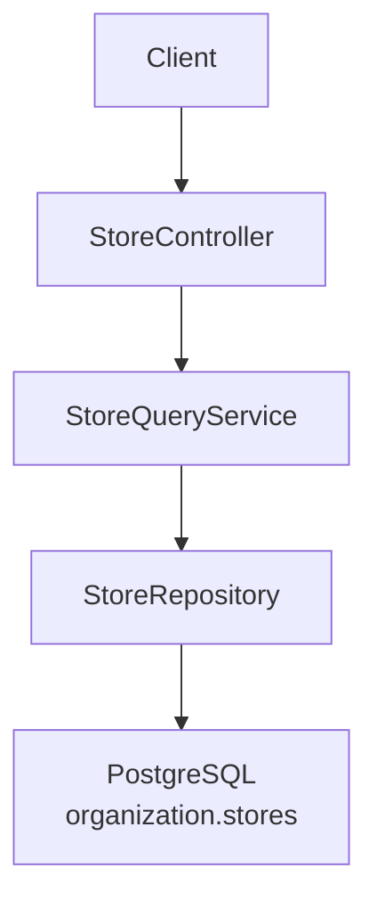
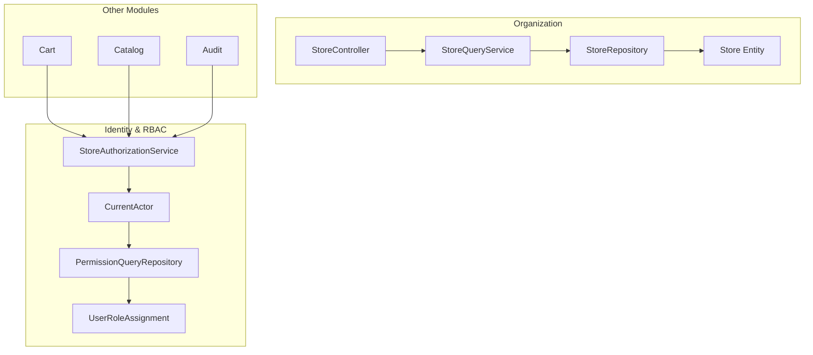
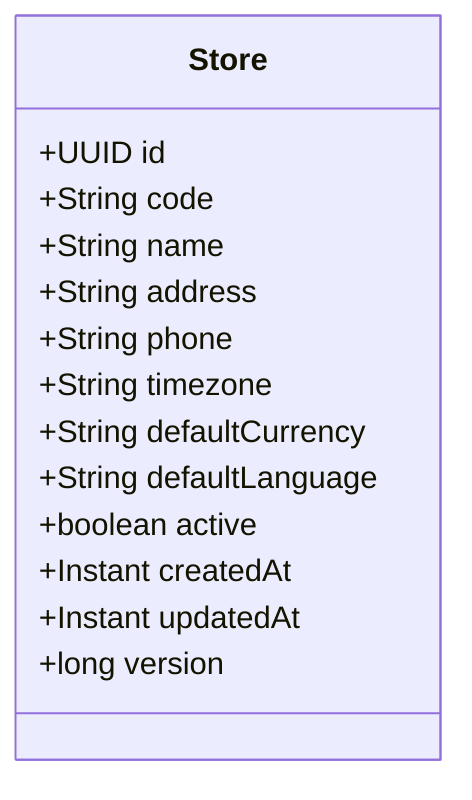
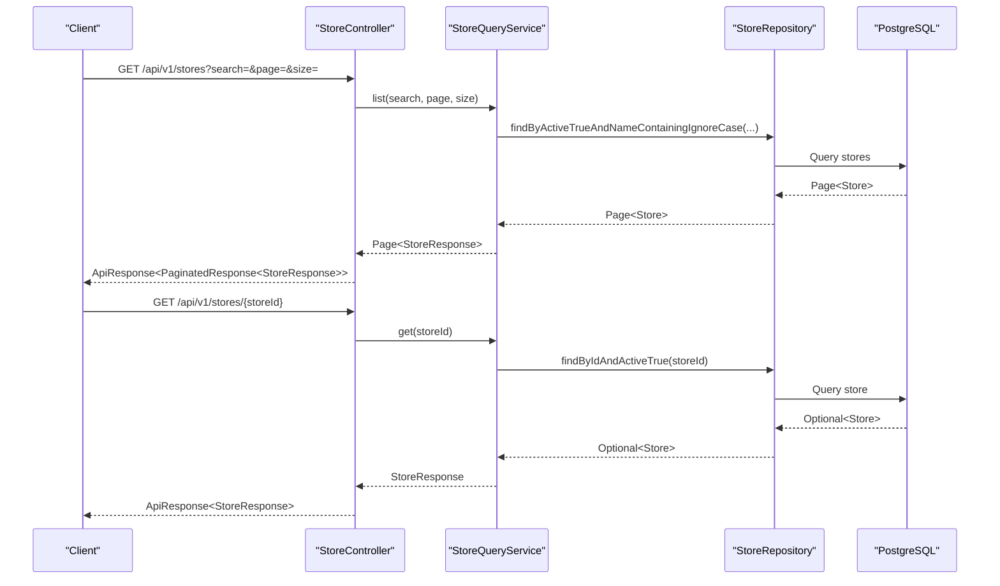
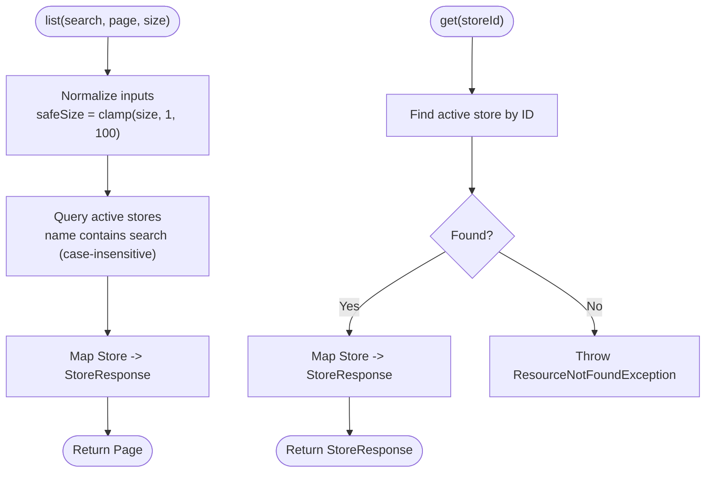
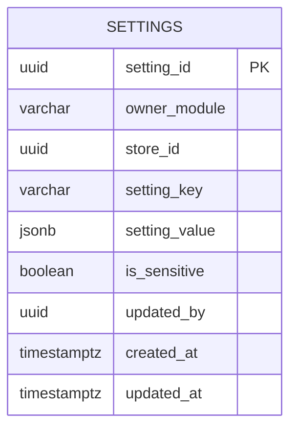
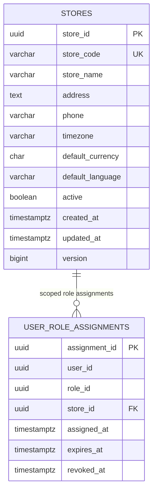
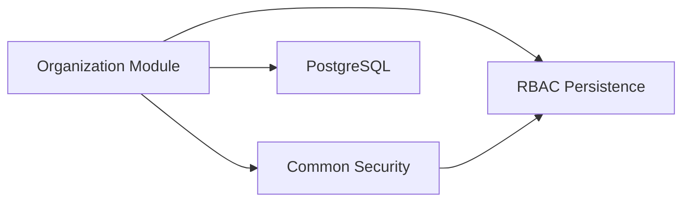

# Organization & Store Management Module

<cite>
**Referenced Files in This Document**
- [Store.java](file://src/main/java/com/smartcoffee/modules/organization/domain/Store.java)
- [StoreController.java](file://src/main/java/com/smartcoffee/modules/organization/api/StoreController.java)
- [StoreResponse.java](file://src/main/java/com/smartcoffee/modules/organization/api/StoreResponse.java)
- [StoreQueryService.java](file://src/main/java/com/smartcoffee/modules/organization/application/StoreQueryService.java)
- [StoreRepository.java](file://src/main/java/com/smartcoffee/modules/organization/persistence/StoreRepository.java)
- [CurrentActor.java](file://src/main/java/com/smartcoffee/common/security/CurrentActor.java)
- [StoreAuthorizationService.java](file://src/main/java/com/smartcoffee/common/security/StoreAuthorizationService.java)
- [PermissionCodes.java](file://src/main/java/com/smartcoffee/common/security/PermissionCodes.java)
- [PermissionQueryRepository.java](file://src/main/java/com/smartcoffee/modules/rbac/persistence/PermissionQueryRepository.java)
- [UserRoleAssignment.java](file://src/main/java/com/smartcoffee/modules/rbac/domain/UserRoleAssignment.java)
- [V002__organization_customer_and_role_seed.sql](file://src/main/resources/db/migration/V002__organization_customer_and_role_seed.sql)
- [smart-coffee-logical.dbml](file://database/smart-coffee-logical.dbml)
- [SYSTEM_ARCHITECTURE.md](file://architecture/SYSTEM_ARCHITECTURE.md)
- [ADR-006-authentication-model.md](file://adr/ADR-006-authentication-model.md)
</cite>

## Table of Contents
1. [Introduction](#introduction)
2. [Project Structure](#project-structure)
3. [Core Components](#core-components)
4. [Architecture Overview](#architecture-overview)
5. [Detailed Component Analysis](#detailed-component-analysis)
6. [Dependency Analysis](#dependency-analysis)
7. [Performance Considerations](#performance-considerations)
8. [Troubleshooting Guide](#troubleshooting-guide)
9. [Conclusion](#conclusion)

## Introduction
This document explains the Organization and Store Management module, focusing on store hierarchy, configuration management, multi-tenant data isolation, store operations, location-related attributes, and organizational structure. It also documents how other modules access store-scoped data and how authorization enforces tenant isolation. The goal is to make the design understandable for both technical and non-technical readers while providing concrete references to source files.

The module currently exposes store read capabilities and integrates with identity and RBAC to enforce store-scoped access. Configuration is modeled through a generic settings table that supports per-store scoping.

## Project Structure
The organization module follows a layered structure:
- Domain: `Store` entity representing a physical or logical store.
- API: REST controller exposing store listing and retrieval.
- Application: Query service orchestrating pagination, filtering, and response mapping.
- Persistence: JPA repository for store queries.



**Diagram sources**
- [StoreController.java:11-31](file://src/main/java/com/smartcoffee/modules/organization/api/StoreController.java#L11-L31)
- [StoreQueryService.java:14-37](file://src/main/java/com/smartcoffee/modules/organization/application/StoreQueryService.java#L14-L37)
- [StoreRepository.java:10-13](file://src/main/java/com/smartcoffee/modules/organization/persistence/StoreRepository.java#L10-L13)
- [V002__organization_customer_and_role_seed.sql:13-27](file://src/main/resources/db/migration/V002__organization_customer_and_role_seed.sql#L13-L27)

**Section sources**
- [Store.java:7-33](file://src/main/java/com/smartcoffee/modules/organization/domain/Store.java#L7-L33)
- [StoreController.java:11-31](file://src/main/java/com/smartcoffee/modules/organization/api/StoreController.java#L11-L31)
- [StoreQueryService.java:14-37](file://src/main/java/com/smartcoffee/modules/organization/application/StoreQueryService.java#L14-L37)
- [StoreRepository.java:10-13](file://src/main/java/com/smartcoffee/modules/organization/persistence/StoreRepository.java#L10-L13)
- [V002__organization_customer_and_role_seed.sql:13-27](file://src/main/resources/db/migration/V002__organization_customer_and_role_seed.sql#L13-L27)

## Core Components
- Store domain model: Represents store identity, code, name, address, phone, timezone, default currency, default language, active status, audit timestamps, and optimistic concurrency version.
- Store API: Provides paginated list and single store lookup.
- Store query service: Applies search filters, enforces safe page sizes, maps entities to responses, and throws resource-not-found errors.
- Store repository: Exposes JPA-derived queries filtered by active status.
- Authorization helpers: Enforce store-scoped access using current actor context and RBAC.

Key responsibilities:
- Store reads are exposed publicly via the controller but can be combined with authorization in downstream use cases.
- Active-only semantics are enforced at the repository layer for list and get operations.
- Pagination bounds are enforced to prevent excessive page sizes.

**Section sources**
- [Store.java:7-46](file://src/main/java/com/smartcoffee/modules/organization/domain/Store.java#L7-L46)
- [StoreController.java:11-31](file://src/main/java/com/smartcoffee/modules/organization/api/StoreController.java#L11-L31)
- [StoreQueryService.java:20-37](file://src/main/java/com/smartcoffee/modules/organization/application/StoreQueryService.java#L20-L37)
- [StoreRepository.java:10-13](file://src/main/java/com/smartcoffee/modules/organization/persistence/StoreRepository.java#L10-L13)

## Architecture Overview
The module participates in a modular monolith where each module owns its data and behavior. The Store module owns stores and operational metadata such as timezone, currency policy, and active status. Other modules reference stores logically and enforce access control through RBAC.



**Diagram sources**
- [Store.java:7-46](file://src/main/java/com/smartcoffee/modules/organization/domain/Store.java#L7-L46)
- [StoreController.java:11-31](file://src/main/java/com/smartcoffee/modules/organization/api/StoreController.java#L11-L31)
- [StoreQueryService.java:14-37](file://src/main/java/com/smartcoffee/modules/organization/application/StoreQueryService.java#L14-L37)
- [StoreRepository.java:10-13](file://src/main/java/com/smartcoffee/modules/organization/persistence/StoreRepository.java#L10-L13)
- [CurrentActor.java:6-14](file://src/main/java/com/smartcoffee/common/security/CurrentActor.java#L6-L14)
- [StoreAuthorizationService.java:8-12](file://src/main/java/com/smartcoffee/common/security/StoreAuthorizationService.java#L8-L12)
- [PermissionQueryRepository.java:10-18](file://src/main/java/com/smartcoffee/modules/rbac/persistence/PermissionQueryRepository.java#L10-L18)
- [UserRoleAssignment.java:7-28](file://src/main/java/com/smartcoffee/modules/rbac/domain/UserRoleAssignment.java#L7-L28)

**Section sources**
- [SYSTEM_ARCHITECTURE.md:136-146](file://architecture/SYSTEM_ARCHITECTURE.md#L136-L146)
- [ADR-006-authentication-model.md:94-109](file://adr/ADR-006-authentication-model.md#L94-L109)

## Detailed Component Analysis

### Store Domain Model
The store entity captures core operational attributes required across the platform:
- Identity and code: Unique identifiers and human-readable codes.
- Location and contact: Address and optional phone number.
- Operational policies: Timezone, default currency, and default language.
- Lifecycle: Active flag, created/updated timestamps, and optimistic concurrency version.



**Diagram sources**
- [Store.java:7-46](file://src/main/java/com/smartcoffee/modules/organization/domain/Store.java#L7-L46)

**Section sources**
- [Store.java:7-46](file://src/main/java/com/smartcoffee/modules/organization/domain/Store.java#L7-L46)

### Store API Layer
The controller exposes:
- Paginated store listing with optional text search against store names.
- Single store retrieval by ID.

Responses are wrapped in a standard API envelope with correlation IDs.



**Diagram sources**
- [StoreController.java:17-31](file://src/main/java/com/smartcoffee/modules/organization/api/StoreController.java#L17-L31)
- [StoreQueryService.java:20-37](file://src/main/java/com/smartcoffee/modules/organization/application/StoreQueryService.java#L20-L37)
- [StoreRepository.java:10-13](file://src/main/java/com/smartcoffee/modules/organization/persistence/StoreRepository.java#L10-L13)

**Section sources**
- [StoreController.java:11-31](file://src/main/java/com/smartcoffee/modules/organization/api/StoreController.java#L11-L31)
- [StoreResponse.java:5-15](file://src/main/java/com/smartcoffee/modules/organization/api/StoreResponse.java#L5-L15)

### Store Query Service
Responsibilities:
- Enforce safe pagination limits.
- Filter by active stores and case-insensitive name search.
- Map domain entities to API responses.
- Throw resource-not-found exceptions when a store is missing.



**Diagram sources**
- [StoreQueryService.java:20-37](file://src/main/java/com/smartcoffee/modules/organization/application/StoreQueryService.java#L20-L37)

**Section sources**
- [StoreQueryService.java:20-37](file://src/main/java/com/smartcoffee/modules/organization/application/StoreQueryService.java#L20-L37)

### Store Repository
Exposes derived queries:
- Retrieve an active store by ID.
- List active stores with case-insensitive name search and pagination.

These methods ensure that inactive stores are never returned through normal read paths.

**Section sources**
- [StoreRepository.java:10-13](file://src/main/java/com/smartcoffee/modules/organization/persistence/StoreRepository.java#L10-L13)

### Multi-Tenant Data Isolation and Authorization
Multi-tenancy is implemented through store-scoped authorization:
- Current actor carries user ID, permissions, allowed store IDs, and global access flag.
- StoreAuthorizationService enforces that a request targets only stores the actor can access.
- PermissionQueryRepository computes permissions and store scopes from RBAC assignments, considering expiration and revocation.
- UserRoleAssignment links users to roles optionally scoped to a store.

```mermaid
sequenceDiagram
participant Mod as "Calling Module"
participant SAS as "StoreAuthorizationService"
participant Actor as "CurrentActor"
participant PQR as "PermissionQueryRepository"
Mod->>SAS : requireStore(actor, requestedStoreId)
SAS->>Actor : canAccessStore(requestedStoreId)
Actor-->>SAS : true/false
alt Access denied
SAS-->>Mod : Throw ForbiddenException
else Access granted
SAS-->>Mod : Continue
end
```

**Diagram sources**
- [StoreAuthorizationService.java:8-12](file://src/main/java/com/smartcoffee/common/security/StoreAuthorizationService.java#L8-L12)
- [CurrentActor.java:6-14](file://src/main/java/com/smartcoffee/common/security/CurrentActor.java#L6-L14)
- [PermissionQueryRepository.java:10-18](file://src/main/java/com/smartcoffee/modules/rbac/persistence/PermissionQueryRepository.java#L10-L18)

**Section sources**
- [ADR-006-authentication-model.md:94-109](file://adr/ADR-006-authentication-model.md#L94-L109)
- [CurrentActor.java:6-14](file://src/main/java/com/smartcoffee/common/security/CurrentActor.java#L6-L14)
- [StoreAuthorizationService.java:8-12](file://src/main/java/com/smartcoffee/common/security/StoreAuthorizationService.java#L8-L12)
- [PermissionQueryRepository.java:10-18](file://src/main/java/com/smartcoffee/modules/rbac/persistence/PermissionQueryRepository.java#L10-L18)
- [UserRoleAssignment.java:7-28](file://src/main/java/com/smartcoffee/modules/rbac/domain/UserRoleAssignment.java#L7-L28)

### Configuration Management and Settings
Configuration is modeled through a generic settings table that supports:
- Owner module identification.
- Optional store scoping for per-store configuration.
- JSON values and sensitive flags.
- Indexing on owner module, store, and key for efficient lookups.



**Diagram sources**
- [smart-coffee-logical.dbml:758-770](file://database/smart-coffee-logical.dbml#L758-L770)

**Section sources**
- [smart-coffee-logical.dbml:758-770](file://database/smart-coffee-logical.dbml#L758-L770)

### Store Operations and Location Management
Current implementation provides:
- Listing active stores with optional name search and pagination.
- Retrieving a single active store by ID.

Location-related fields include address, phone, timezone, and default currency/language. These fields support store-specific localization and operational policies.

Operational availability is represented by the active flag. Future enhancements may add opening hours and real-time availability.

**Section sources**
- [Store.java:10-33](file://src/main/java/com/smartcoffee/modules/organization/domain/Store.java#L10-L33)
- [StoreController.java:17-31](file://src/main/java/com/smartcoffee/modules/organization/api/StoreController.java#L17-L31)
- [StoreQueryService.java:20-37](file://src/main/java/com/smartcoffee/modules/organization/application/StoreQueryService.java#L20-L37)

### Organizational Structure
The organization schema includes:
- Stores table under the organization schema.
- Foreign key constraints linking role assignments to stores.
- Unique indexes supporting global and store-scoped role assignments.



**Diagram sources**
- [V002__organization_customer_and_role_seed.sql:13-43](file://src/main/resources/db/migration/V002__organization_customer_and_role_seed.sql#L13-L43)
- [UserRoleAssignment.java:7-28](file://src/main/java/com/smartcoffee/modules/rbac/domain/UserRoleAssignment.java#L7-L28)

**Section sources**
- [V002__organization_customer_and_role_seed.sql:13-43](file://src/main/resources/db/migration/V002__organization_customer_and_role_seed.sql#L13-L43)
- [UserRoleAssignment.java:7-28](file://src/main/java/com/smartcoffee/modules/rbac/domain/UserRoleAssignment.java#L7-L28)

## Dependency Analysis
The module depends on:
- Common security abstractions for actor context and store authorization.
- RBAC persistence for computing permissions and store scopes.
- Database migrations defining the stores table and relationships.



**Diagram sources**
- [StoreController.java:11-31](file://src/main/java/com/smartcoffee/modules/organization/api/StoreController.java#L11-L31)
- [StoreQueryService.java:14-37](file://src/main/java/com/smartcoffee/modules/organization/application/StoreQueryService.java#L14-L37)
- [StoreRepository.java:10-13](file://src/main/java/com/smartcoffee/modules/organization/persistence/StoreRepository.java#L10-L13)
- [StoreAuthorizationService.java:8-12](file://src/main/java/com/smartcoffee/common/security/StoreAuthorizationService.java#L8-L12)
- [PermissionQueryRepository.java:10-18](file://src/main/java/com/smartcoffee/modules/rbac/persistence/PermissionQueryRepository.java#L10-L18)

**Section sources**
- [StoreController.java:11-31](file://src/main/java/com/smartcoffee/modules/organization/api/StoreController.java#L11-L31)
- [StoreQueryService.java:14-37](file://src/main/java/com/smartcoffee/modules/organization/application/StoreQueryService.java#L14-L37)
- [StoreRepository.java:10-13](file://src/main/java/com/smartcoffee/modules/organization/persistence/StoreRepository.java#L10-L13)
- [StoreAuthorizationService.java:8-12](file://src/main/java/com/smartcoffee/common/security/StoreAuthorizationService.java#L8-L12)
- [PermissionQueryRepository.java:10-18](file://src/main/java/com/smartcoffee/modules/rbac/persistence/PermissionQueryRepository.java#L10-L18)

## Performance Considerations
- Pagination safety: The query service clamps page size to a maximum bound to avoid large result sets.
- Read-only transactions: Query methods are marked read-only to optimize database interactions.
- Active-only filtering: Repository methods filter by active status, reducing noise and improving index utilization.
- Search scope: Name-based search is limited to active stores; consider adding full-text indexing if search performance becomes a bottleneck.
- Optimistic concurrency: The store entity uses a version column for write conflicts; future write endpoints should handle version mismatches appropriately.

Recommendations:
- Add database indexes for common search patterns if needed.
- Cache frequently accessed store metadata behind store-scoped cache keys.
- Use read replicas for heavy read workloads once scale increases.

[No sources needed since this section provides general guidance]

## Troubleshooting Guide
Common issues and resolutions:
- Store not found: Occurs when querying an inactive or non-existent store. Ensure the store exists and is active.
- Store access denied: Occurs when the current actor lacks permission to access the requested store. Verify RBAC assignments and store scopes.
- Pagination errors: If clients pass invalid page or size parameters, the service normalizes them; validate client input to reduce unexpected behavior.

Actionable checks:
- Validate store existence and active status.
- Confirm user has role assignments scoped to the target store or global access.
- Inspect error responses for standardized error codes and messages.

**Section sources**
- [StoreQueryService.java:28-31](file://src/main/java/com/smartcoffee/modules/organization/application/StoreQueryService.java#L28-L31)
- [StoreAuthorizationService.java:8-12](file://src/main/java/com/smartcoffee/common/security/StoreAuthorizationService.java#L8-L12)

## Conclusion
The Organization and Store Management module provides foundational store definitions, operational metadata, and read APIs integrated with store-scoped authorization. Multi-tenant isolation is enforced through RBAC and actor context, ensuring that users can only access stores they are permitted to use. Configuration is supported through a generic settings table with optional store scoping. For production readiness, consider expanding write operations, enhancing search performance, and introducing explicit opening hours and availability features.

[No sources needed since this section summarizes without analyzing specific files]