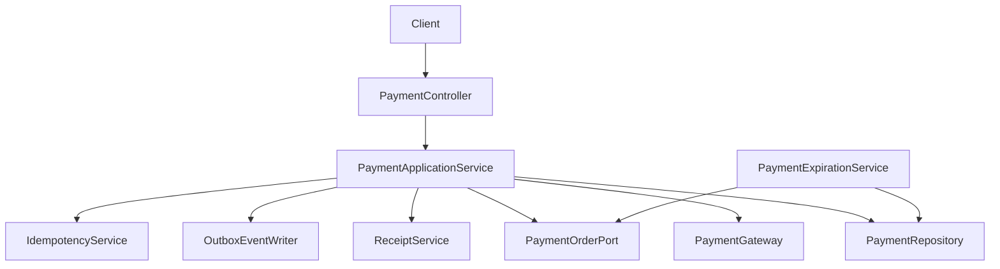
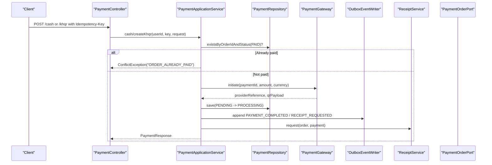
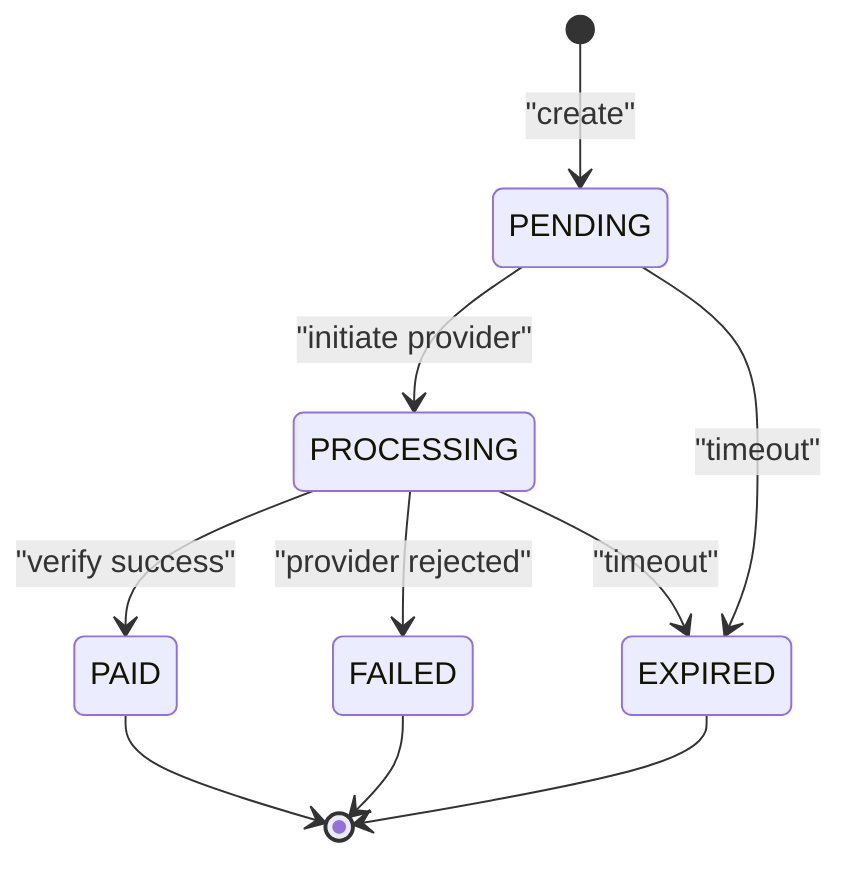
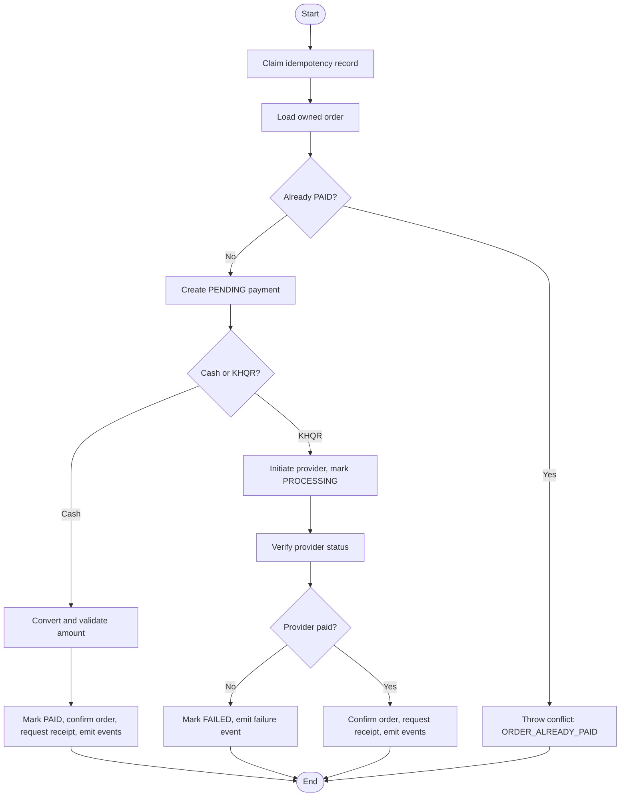
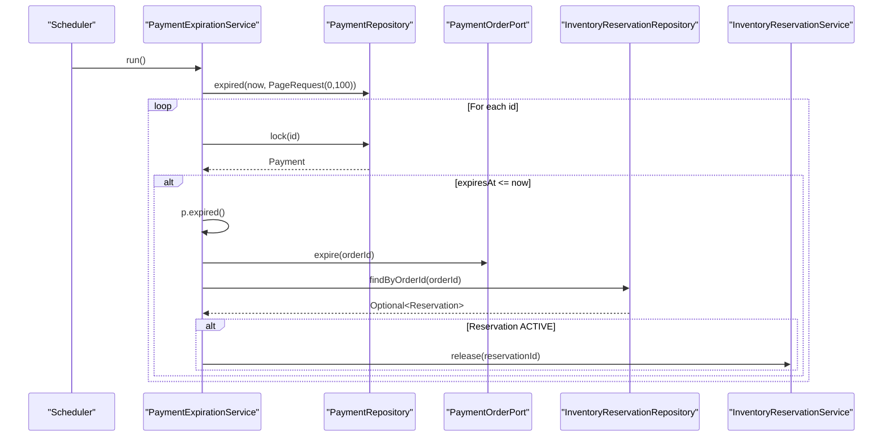
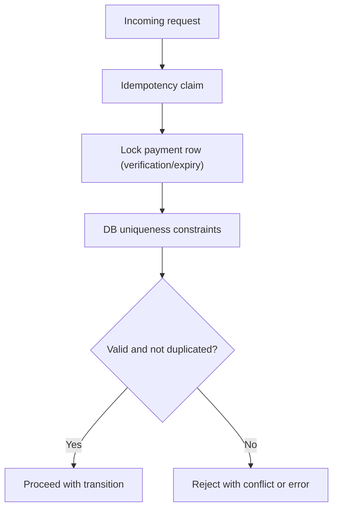
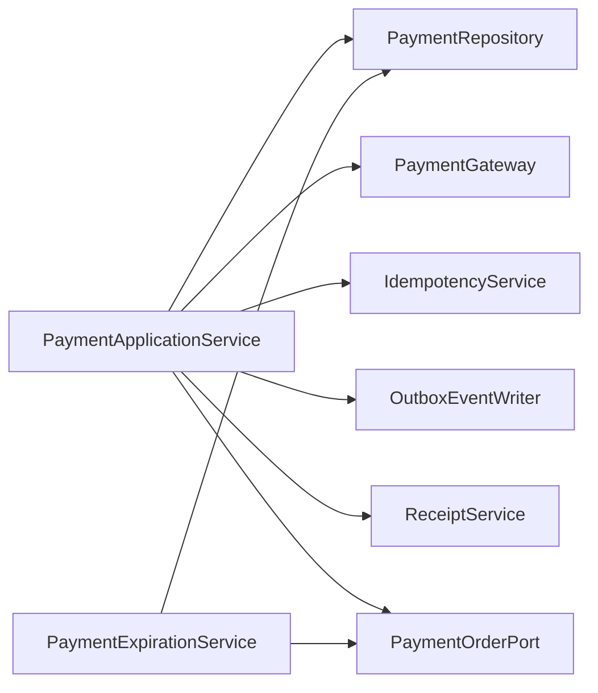

# Payment Lifecycle Management

<cite>
**Referenced Files in This Document**
- [PaymentApplicationService.java](file://src/main/java/com/smartcoffee/modules/payment/application/PaymentApplicationService.java)
- [Payment.java](file://src/main/java/com/smartcoffee/modules/payment/domain/Payment.java)
- [PaymentStatus.java](file://src/main/java/com/smartcoffee/modules/payment/domain/PaymentStatus.java)
- [PaymentExpirationService.java](file://src/main/java/com/smartcoffee/modules/payment/application/PaymentExpirationService.java)
- [PaymentRepository.java](file://src/main/java/com/smartcoffee/modules/payment/persistence/PaymentRepository.java)
- [PaymentController.java](file://src/main/java/com/smartcoffee/modules/payment/api/PaymentController.java)
- [PaymentGateway.java](file://src/main/java/com/smartcoffee/infrastructure/payment/PaymentGateway.java)
- [IdempotencyService.java](file://src/main/java/com/smartcoffee/infrastructure/idempotency/IdempotencyService.java)
- [ReceiptService.java](file://src/main/java/com/smartcoffee/modules/payment/application/ReceiptService.java)
- [AuditWriter.java](file://src/main/java/com/smartcoffee/modules/audit/application/AuditWriter.java)
- [PAYMENT_FLOW.mermaid](file://architecture/PAYMENT_FLOW.mermaid)
- [V007__payments_receipts.sql](file://src/main/resources/db/migration/V007__payments_receipts.sql)
</cite>

## Table of Contents
1. [Introduction](#introduction)
2. [Project Structure](#project-structure)
3. [Core Components](#core-components)
4. [Architecture Overview](#architecture-overview)
5. [Detailed Component Analysis](#detailed-component-analysis)
6. [Dependency Analysis](#dependency-analysis)
7. [Performance Considerations](#performance-considerations)
8. [Troubleshooting Guide](#troubleshooting-guide)
9. [Conclusion](#conclusion)

## Introduction
This document explains the payment lifecycle management in the system, focusing on how payments are created, validated, processed, and completed or failed. It covers the state machine for payments (PENDING, PROCESSING, PAID, FAILED, EXPIRED), the orchestration performed by PaymentApplicationService, expiration handling, validation rules, concurrency safeguards, rollback behavior, idempotency, and audit trail maintenance.

## Project Structure
The payment capability is implemented as a modular component with clear separation between API, application services, domain entities, persistence, and infrastructure integrations:
- API layer exposes endpoints for cash and KHQR payments and verification.
- Application service orchestrates business logic, including validation, gateway calls, event emission, and receipt creation.
- Domain models define the payment aggregate and its state transitions.
- Persistence provides repositories and locking mechanisms to ensure consistency.
- Infrastructure includes payment gateways, idempotency, outbox events, receipts, and audit logging.

**Diagram sources**
- [PaymentController.java:22-37](file://src/main/java/com/smartcoffee/modules/payment/api/PaymentController.java#L22-L37)
- [PaymentApplicationService.java:20-163](file://src/main/java/com/smartcoffee/modules/payment/application/PaymentApplicationService.java#L20-L163)
- [PaymentRepository.java:11-24](file://src/main/java/com/smartcoffee/modules/payment/persistence/PaymentRepository.java#L11-L24)
- [PaymentGateway.java:1-5](file://src/main/java/com/smartcoffee/infrastructure/payment/PaymentGateway.java#L1-L5)
- [ReceiptService.java:11-35](file://src/main/java/com/smartcoffee/modules/payment/application/ReceiptService.java#L11-L35)
- [PaymentExpirationService.java:12-43](file://src/main/java/com/smartcoffee/modules/payment/application/PaymentExpirationService.java#L12-L43)

**Section sources**
- [PaymentController.java:1-40](file://src/main/java/com/smartcoffee/modules/payment/api/PaymentController.java#L1-L40)
- [PaymentApplicationService.java:1-163](file://src/main/java/com/smartcoffee/modules/payment/application/PaymentApplicationService.java#L1-L163)
- [PaymentRepository.java:1-26](file://src/main/java/com/smartcoffee/modules/payment/persistence/PaymentRepository.java#L1-L26)
- [PaymentExpirationService.java:1-43](file://src/main/java/com/smartcoffee/modules/payment/application/PaymentExpirationService.java#L1-L43)

## Core Components
- PaymentApplicationService: Orchestrates payment creation and verification, enforces idempotency, validates orders and amounts, interacts with payment gateways, emits outbox events, and requests receipts.
- Payment domain model: Encapsulates payment state transitions and timestamps, ensuring open-state constraints before mutating.
- PaymentExpirationService: Periodically expires open payments, marks them expired, triggers order expiration, and releases inventory reservations.
- PaymentRepository: Provides pessimistic locking and queries for expired payments and duplicate checks.
- PaymentGateway: Abstraction for external payment providers (e.g., KHQR).
- IdempotencyService: Ensures idempotent request handling per user and key.
- ReceiptService: Creates receipt snapshots tied to successful payments.
- AuditWriter: Records audit logs within mandatory transactions.

Key responsibilities and interactions are detailed in the following sections.

**Section sources**
- [PaymentApplicationService.java:20-163](file://src/main/java/com/smartcoffee/modules/payment/application/PaymentApplicationService.java#L20-L163)
- [Payment.java:56-105](file://src/main/java/com/smartcoffee/modules/payment/domain/Payment.java#L56-L105)
- [PaymentExpirationService.java:12-43](file://src/main/java/com/smartcoffee/modules/payment/application/PaymentExpirationService.java#L12-L43)
- [PaymentRepository.java:11-24](file://src/main/java/com/smartcoffee/modules/payment/persistence/PaymentRepository.java#L11-L24)
- [PaymentGateway.java:1-5](file://src/main/java/com/smartcoffee/infrastructure/payment/PaymentGateway.java#L1-L5)
- [IdempotencyService.java:1-7](file://src/main/java/com/smartcoffee/infrastructure/idempotency/IdempotencyService.java#L1-L7)
- [ReceiptService.java:11-35](file://src/main/java/com/smartcoffee/modules/payment/application/ReceiptService.java#L11-L35)
- [AuditWriter.java:11-31](file://src/main/java/com/smartcoffee/modules/audit/application/AuditWriter.java#L11-L31)

## Architecture Overview
The payment flow supports both cash and KHQR payments with idempotent creation, provider interaction, verification, completion, and asynchronous event-driven confirmation of orders.

**Diagram sources**
- [PaymentController.java:22-37](file://src/main/java/com/smartcoffee/modules/payment/api/PaymentController.java#L22-L37)
- [PaymentApplicationService.java:48-87](file://src/main/java/com/smartcoffee/modules/payment/application/PaymentApplicationService.java#L48-L87)
- [PaymentRepository.java:20-20](file://src/main/java/com/smartcoffee/modules/payment/persistence/PaymentRepository.java#L20-L20)
- [PaymentGateway.java:1-5](file://src/main/java/com/smartcoffee/infrastructure/payment/PaymentGateway.java#L1-L5)
- [ReceiptService.java:21-35](file://src/main/java/com/smartcoffee/modules/payment/application/ReceiptService.java#L21-L35)

**Section sources**
- [PAYMENT_FLOW.mermaid:1-73](file://architecture/PAYMENT_FLOW.mermaid#L1-L73)

## Detailed Component Analysis

### Payment State Machine
The payment entity defines explicit state transitions guarded by an open-state check:
- PENDING: Initial state when created.
- PROCESSING: Transitioned after initiating provider interaction.
- PAID: Finalized upon successful payment; records received amount and change.
- FAILED: Terminal state when provider rejects or verification fails.
- EXPIRED: Terminal state when expiry time passes without completion.

**Diagram sources**
- [Payment.java:56-105](file://src/main/java/com/smartcoffee/modules/payment/domain/Payment.java#L56-L105)
- [PaymentStatus.java:3-5](file://src/main/java/com/smartcoffee/modules/payment/domain/PaymentStatus.java#L3-L5)

**Section sources**
- [Payment.java:56-105](file://src/main/java/com/smartcoffee/modules/payment/domain/Payment.java#L56-L105)
- [PaymentStatus.java:3-5](file://src/main/java/com/smartcoffee/modules/payment/domain/PaymentStatus.java#L3-L5)

### PaymentApplicationService Orchestration
- Cash payment workflow:
  - Claims idempotency record scoped to user and key.
  - Loads owned order and validates store match.
  - Prevents double payment via existence check for PAID status.
  - Converts tender amount using exchange rate if needed and validates sufficiency.
  - Creates PENDING payment, transitions to processing, then immediately marks PAID, confirms order, requests receipt, and emits events.
- KHQR payment workflow:
  - Claims idempotency record scoped to user and key.
  - Loads owned order and prevents double payment.
  - Creates PENDING payment with short expiry window.
  - Initiates provider interaction, transitions to PROCESSING with provider reference.
  - Verification endpoint locks payment, checks provider status, handles failure or success, confirms order, requests receipt, and emits events.

**Diagram sources**
- [PaymentApplicationService.java:48-108](file://src/main/java/com/smartcoffee/modules/payment/application/PaymentApplicationService.java#L48-L108)
- [PaymentRepository.java:20-20](file://src/main/java/com/smartcoffee/modules/payment/persistence/PaymentRepository.java#L20-L20)
- [PaymentGateway.java:1-5](file://src/main/java/com/smartcoffee/infrastructure/payment/PaymentGateway.java#L1-L5)

**Section sources**
- [PaymentApplicationService.java:48-108](file://src/main/java/com/smartcoffee/modules/payment/application/PaymentApplicationService.java#L48-L108)

### Payment Expiration Handling
- A scheduled task polls for expired payments within a page size and processes up to 100 at a time.
- For each candidate, it locks the row to prevent concurrent updates.
- If the payment has passed its expiry time, it marks the payment as EXPIRED, triggers order expiration through the order port, and releases any active inventory reservation associated with the order.

**Diagram sources**
- [PaymentExpirationService.java:27-40](file://src/main/java/com/smartcoffee/modules/payment/application/PaymentExpirationService.java#L27-L40)
- [PaymentRepository.java:22-23](file://src/main/java/com/smartcoffee/modules/payment/persistence/PaymentRepository.java#L22-L23)

**Section sources**
- [PaymentExpirationService.java:27-40](file://src/main/java/com/smartcoffee/modules/payment/application/PaymentExpirationService.java#L27-L40)
- [PaymentRepository.java:22-23](file://src/main/java/com/smartcoffee/modules/payment/persistence/PaymentRepository.java#L22-L23)

### Validation Rules
- Store ownership: The order must belong to the requested store; otherwise, a conflict exception is raised.
- Duplicate payment prevention: If an order already has a PAID payment, further attempts raise a conflict.
- Amount validation: Cash payments require sufficient tender; conversion uses provided exchange rate when currencies differ.
- Exchange rate requirement: When tender currency differs from settlement currency, a valid positive exchange rate must be supplied.
- Payment method availability: Active payment methods must exist; otherwise, an infrastructure exception is thrown.
- Gateway availability: Required gateway implementations must be present; otherwise, an infrastructure exception is thrown.

**Section sources**
- [PaymentApplicationService.java:53-61](file://src/main/java/com/smartcoffee/modules/payment/application/PaymentApplicationService.java#L53-L61)
- [PaymentApplicationService.java:110-126](file://src/main/java/com/smartcoffee/modules/payment/application/PaymentApplicationService.java#L110-L126)

### Concurrent Payment Processing
- Idempotency: Each payment initiation claims a unique idempotency record per user and key, preventing duplicate processing and enforcing request hash matching.
- Row-level locking: Verification and expiration paths use pessimistic write locks to avoid race conditions on payment rows.
- Database constraints: Unique indexes enforce that only one PAID payment exists per order and that provider references remain unique per provider.

**Diagram sources**
- [IdempotencyService.java:3-5](file://src/main/java/com/smartcoffee/infrastructure/idempotency/IdempotencyService.java#L3-L5)
- [PaymentRepository.java:12-14](file://src/main/java/com/smartcoffee/modules/payment/persistence/PaymentRepository.java#L12-L14)
- [V007__payments_receipts.sql:63-78](file://src/main/resources/db/migration/V007__payments_receipts.sql#L63-L78)

**Section sources**
- [IdempotencyService.java:3-5](file://src/main/java/com/smartcoffee/infrastructure/idempotency/IdempotencyService.java#L3-L5)
- [PaymentRepository.java:12-14](file://src/main/java/com/smartcoffee/modules/payment/persistence/PaymentRepository.java#L12-L14)
- [V007__payments_receipts.sql:63-78](file://src/main/resources/db/migration/V007__payments_receipts.sql#L63-L78)

### Rollback Mechanisms
- Transactional boundaries: Payment operations are wrapped in transactions to ensure atomicity across payment updates, order confirmation, receipt creation, and event emission.
- Failure handling: On provider rejection or verification failure, the payment is marked FAILED and a failure event is emitted; no partial state persists beyond the transaction boundary.
- Inventory release: On expiration, active inventory reservations are released to roll back stock commitments.

**Section sources**
- [PaymentApplicationService.java:48-108](file://src/main/java/com/smartcoffee/modules/payment/application/PaymentApplicationService.java#L48-L108)
- [PaymentExpirationService.java:27-40](file://src/main/java/com/smartcoffee/modules/payment/application/PaymentExpirationService.java#L27-L40)

### Examples: Payment Creation Workflows
- Cash payment creation:
  - Client sends cash payment request with idempotency key.
  - Service validates order ownership, prevents duplicate payment, converts and validates amount, creates payment, marks PAID, confirms order, requests receipt, and emits events.
- KHQR payment creation:
  - Client sends KHQR payment request with idempotency key.
  - Service validates order ownership, prevents duplicate payment, creates PENDING payment with expiry, initiates provider, marks PROCESSING, returns QR payload.
- KHQR verification:
  - Client verifies payment status; service locks payment, checks provider, handles failure or success, confirms order, requests receipt, and emits events.

**Section sources**
- [PaymentController.java:22-37](file://src/main/java/com/smartcoffee/modules/payment/api/PaymentController.java#L22-L37)
- [PaymentApplicationService.java:48-108](file://src/main/java/com/smartcoffee/modules/payment/application/PaymentApplicationService.java#L48-L108)

### Timeout Handling
- KHQR payments have a short expiry window set at creation time.
- Scheduled expiration scans process overdue payments, mark them EXPIRED, trigger order expiration, and release inventory reservations.

**Section sources**
- [PaymentApplicationService.java:81-82](file://src/main/java/com/smartcoffee/modules/payment/application/PaymentApplicationService.java#L81-L82)
- [PaymentExpirationService.java:27-40](file://src/main/java/com/smartcoffee/modules/payment/application/PaymentExpirationService.java#L27-L40)

### Recovery Procedures for Failed Payments
- Provider rejection leads to FAILED status and emission of a failure event for downstream consumers.
- Expiration leads to EXPIRED status and order expiration; inventory reservations are released.
- Idempotency ensures retries do not create duplicate charges or states.

**Section sources**
- [PaymentApplicationService.java:95-107](file://src/main/java/com/smartcoffee/modules/payment/application/PaymentApplicationService.java#L95-L107)
- [PaymentExpirationService.java:27-40](file://src/main/java/com/smartcoffee/modules/payment/application/PaymentExpirationService.java#L27-L40)

### Idempotency Considerations
- Each payment initiation claims an idempotency record scoped by user and key, with request hashing to detect misuse.
- Completed responses are stored and replayed for subsequent identical requests within retention windows.
- Database constraints complement idempotency by preventing duplicate PAID payments per order and ensuring unique provider references.

**Section sources**
- [IdempotencyService.java:3-5](file://src/main/java/com/smartcoffee/infrastructure/idempotency/IdempotencyService.java#L3-L5)
- [PaymentApplicationService.java:48-87](file://src/main/java/com/smartcoffee/modules/payment/application/PaymentApplicationService.java#L48-L87)
- [V007__payments_receipts.sql:63-78](file://src/main/resources/db/migration/V007__payments_receipts.sql#L63-L78)

### Audit Trail Maintenance
- Audit writer records successful actions within mandatory transactions, capturing actor, store, action, category, aggregate type, IDs, reasons, and correlation context.
- While payment-specific audit entries are not shown in the analyzed files, the pattern demonstrates consistent audit logging practices applicable across modules.

**Section sources**
- [AuditWriter.java:21-31](file://src/main/java/com/smartcoffee/modules/audit/application/AuditWriter.java#L21-L31)

## Dependency Analysis
The payment module depends on several cross-cutting services and interfaces:
- PaymentApplicationService depends on repositories, ports, gateways, idempotency, outbox, and receipt services.
- PaymentExpirationService depends on repositories and order/inventory ports.
- PaymentRepository provides locking and queries used by both application and expiration flows.
- PaymentGateway abstracts external provider interactions.
- IdempotencyService ensures safe retries and deduplication.
- ReceiptService creates immutable receipt snapshots tied to payments.

**Diagram sources**
- [PaymentApplicationService.java:20-163](file://src/main/java/com/smartcoffee/modules/payment/application/PaymentApplicationService.java#L20-L163)
- [PaymentExpirationService.java:12-43](file://src/main/java/com/smartcoffee/modules/payment/application/PaymentExpirationService.java#L12-L43)
- [PaymentRepository.java:11-24](file://src/main/java/com/smartcoffee/modules/payment/persistence/PaymentRepository.java#L11-L24)
- [PaymentGateway.java:1-5](file://src/main/java/com/smartcoffee/infrastructure/payment/PaymentGateway.java#L1-L5)
- [IdempotencyService.java:1-7](file://src/main/java/com/smartcoffee/infrastructure/idempotency/IdempotencyService.java#L1-L7)
- [ReceiptService.java:11-35](file://src/main/java/com/smartcoffee/modules/payment/application/ReceiptService.java#L11-L35)

**Section sources**
- [PaymentApplicationService.java:20-163](file://src/main/java/com/smartcoffee/modules/payment/application/PaymentApplicationService.java#L20-L163)
- [PaymentExpirationService.java:12-43](file://src/main/java/com/smartcoffee/modules/payment/application/PaymentExpirationService.java#L12-L43)

## Performance Considerations
- Use pagination and batching in expiration scans to limit memory usage and database load.
- Leverage pessimistic locking only where necessary (verification and expiration) to minimize contention.
- Ensure indexes support frequent queries (e.g., expired payments, order-based lookups).
- Keep idempotency retention windows reasonable to balance safety and storage growth.

[No sources needed since this section provides general guidance]

## Troubleshooting Guide
Common issues and resolutions:
- ORDER_ALREADY_PAID: Indicates a duplicate payment attempt; verify order state and ensure idempotency keys are unique per request.
- STORE_MISMATCH: Ensure the order belongs to the requested store; validate caller context and store association.
- INSUFFICIENT_CASH_RECEIVED: Validate tender amount and exchange rate; ensure correct currency conversion.
- PAYMENT_GATEWAY_UNAVAILABLE: Check that required gateway implementations are registered and active.
- PROVIDER_REJECTED: Review provider response and failure code; consider retry policies and reconciliation.
- IDEMPOTENCY_KEY_REUSED or REQUEST_IN_PROGRESS: Ensure clients use unique idempotency keys per request and handle in-progress responses appropriately.

**Section sources**
- [PaymentApplicationService.java:53-61](file://src/main/java/com/smartcoffee/modules/payment/application/PaymentApplicationService.java#L53-L61)
- [PaymentApplicationService.java:95-107](file://src/main/java/com/smartcoffee/modules/payment/application/PaymentApplicationService.java#L95-L107)
- [IdempotencyService.java:3-5](file://src/main/java/com/smartcoffee/infrastructure/idempotency/IdempotencyService.java#L3-L5)

## Conclusion
The payment lifecycle is designed around robust state transitions, idempotent operations, and strong consistency guarantees via locking and database constraints. PaymentApplicationService orchestrates validation, provider interactions, and side effects like order confirmation and receipt creation. Expiration handling ensures timely cleanup and inventory release. Idempotency and audit trails provide resilience and traceability. Together, these components deliver a reliable and auditable payment processing pipeline suitable for high-concurrency environments.

[No sources needed since this section summarizes without analyzing specific files]