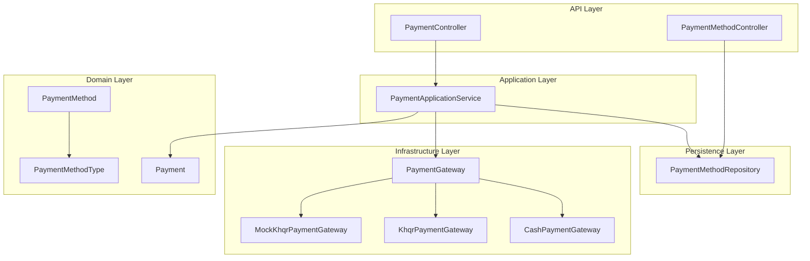
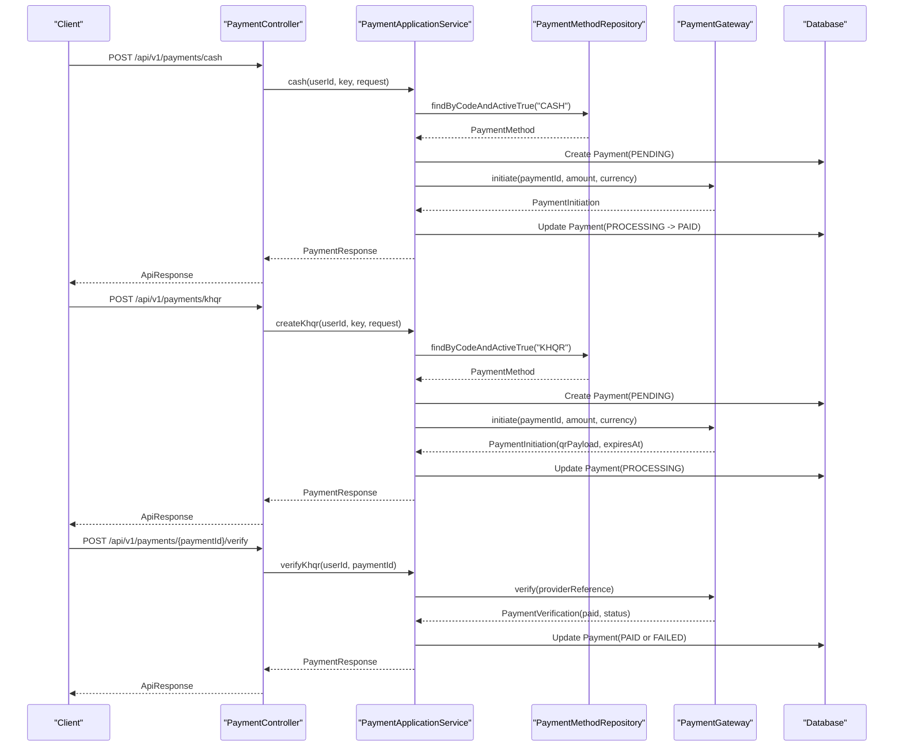
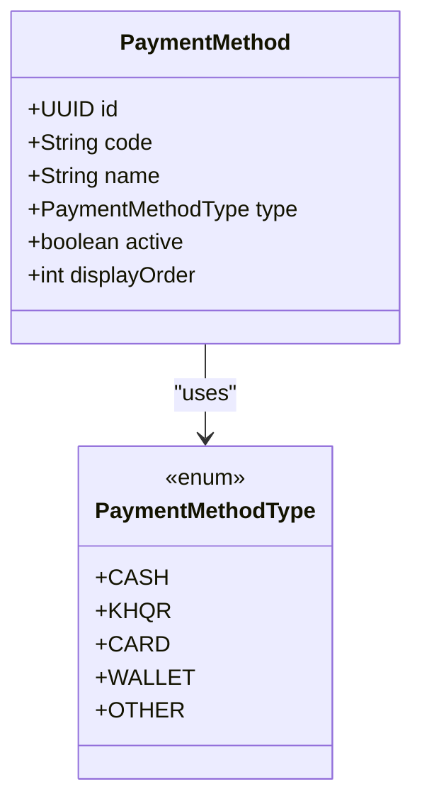
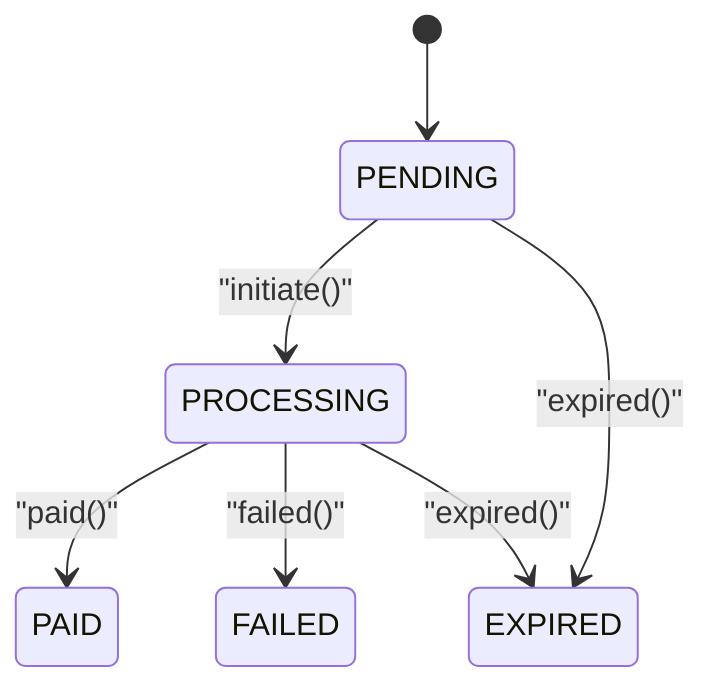
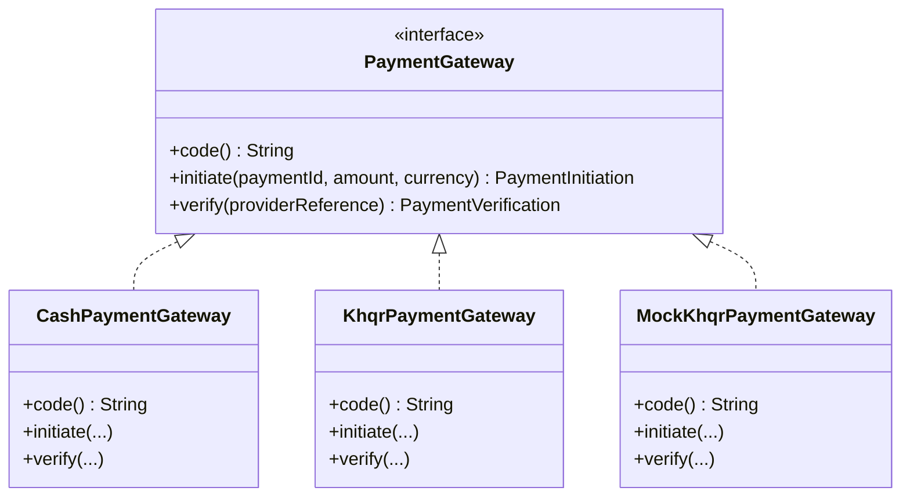
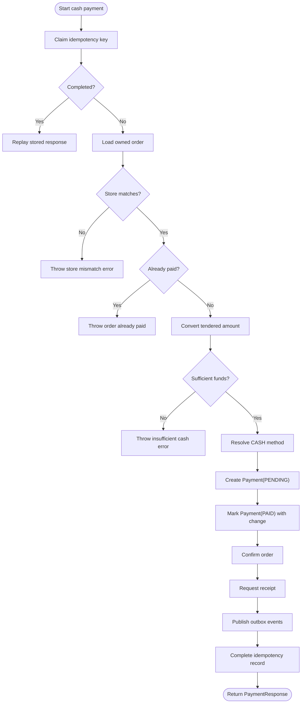
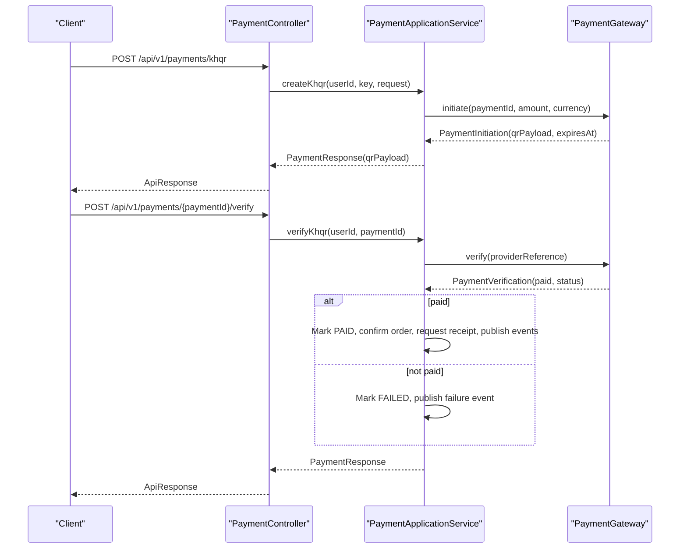
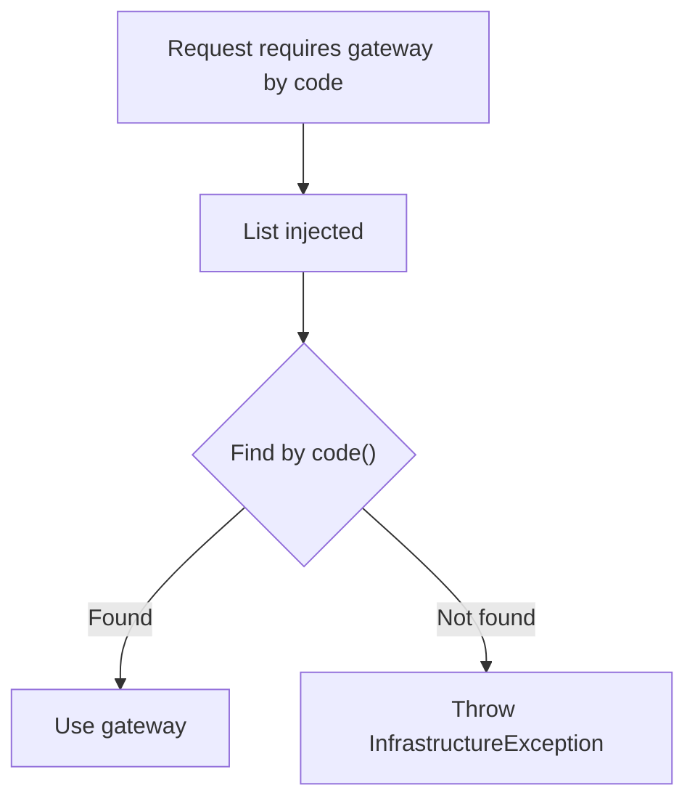
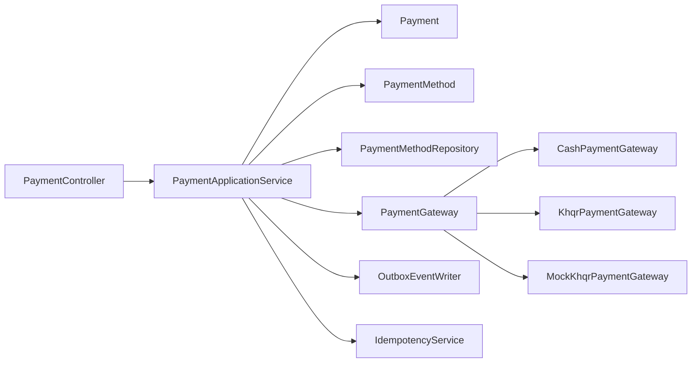

# Payment Methods & Gateways

<cite>
**Referenced Files in This Document**
- [PaymentMethod.java](file://src/main/java/com/smartcoffee/modules/payment/domain/PaymentMethod.java)
- [PaymentMethodType.java](file://src/main/java/com/smartcoffee/modules/payment/domain/PaymentMethodType.java)
- [Payment.java](file://src/main/java/com/smartcoffee/modules/payment/domain/Payment.java)
- [PaymentGateway.java](file://src/main/java/com/smartcoffee/infrastructure/payment/PaymentGateway.java)
- [CashPaymentGateway.java](file://src/main/java/com/smartcoffee/infrastructure/payment/CashPaymentGateway.java)
- [KhqrPaymentGateway.java](file://src/main/java/com/smartcoffee/infrastructure/payment/KhqrPaymentGateway.java)
- [MockKhqrPaymentGateway.java](file://src/main/java/com/smartcoffee/infrastructure/payment/MockKhqrPaymentGateway.java)
- [PaymentApplicationService.java](file://src/main/java/com/smartcoffee/modules/payment/application/PaymentApplicationService.java)
- [PaymentController.java](file://src/main/java/com/smartcoffee/modules/payment/api/PaymentController.java)
- [PaymentMethodController.java](file://src/main/java/com/smartcoffee/modules/payment/api/PaymentMethodController.java)
- [PaymentMethodRepository.java](file://src/main/java/com/smartcoffee/modules/payment/persistence/PaymentMethodRepository.java)
- [V007__payments_receipts.sql](file://src/main/resources/db/migration/V007__payments_receipts.sql)
</cite>

## Table of Contents
1. [Introduction](#introduction)
2. [Project Structure](#project-structure)
3. [Core Components](#core-components)
4. [Architecture Overview](#architecture-overview)
5. [Detailed Component Analysis](#detailed-component-analysis)
6. [Dependency Analysis](#dependency-analysis)
7. [Performance Considerations](#performance-considerations)
8. [Troubleshooting Guide](#troubleshooting-guide)
9. [Conclusion](#conclusion)

## Introduction
This document explains the payment methods and gateway integrations in the Smart Coffee system. It covers:
- The PaymentMethod domain model and supported types (cash, KHQR).
- The pluggable gateway architecture via PaymentGateway.
- Cash payment processing flow.
- KHQR digital payment integration with provider verification.
- Mock implementations for testing.
- Configuration examples, gateway selection logic, and error handling strategies.

## Project Structure
The payment feature is split across domain, application, API, persistence, and infrastructure layers:
- Domain models define payment method metadata and payment lifecycle.
- Application service orchestrates business rules, idempotency, order confirmation, receipts, and outbox events.
- API controllers expose endpoints for cash and KHQR payments and listing available payment methods.
- Persistence provides repositories for payment methods and related entities.
- Infrastructure contains pluggable payment gateways (cash, KHQR, mock KHQR).

**Diagram sources**
- [PaymentController.java:11-37](file://src/main/java/com/smartcoffee/modules/payment/api/PaymentController.java#L11-L37)
- [PaymentMethodController.java:9-24](file://src/main/java/com/smartcoffee/modules/payment/api/PaymentMethodController.java#L9-L24)
- [PaymentApplicationService.java:20-46](file://src/main/java/com/smartcoffee/modules/payment/application/PaymentApplicationService.java#L20-L46)
- [PaymentMethod.java:6-24](file://src/main/java/com/smartcoffee/modules/payment/domain/PaymentMethod.java#L6-L24)
- [Payment.java:9-51](file://src/main/java/com/smartcoffee/modules/payment/domain/Payment.java#L9-L51)
- [PaymentMethodType.java:3-5](file://src/main/java/com/smartcoffee/modules/payment/domain/PaymentMethodType.java#L3-L5)
- [PaymentMethodRepository.java:7-10](file://src/main/java/com/smartcoffee/modules/payment/persistence/PaymentMethodRepository.java#L7-L10)
- [PaymentGateway.java:1-5](file://src/main/java/com/smartcoffee/infrastructure/payment/PaymentGateway.java#L1-L5)
- [CashPaymentGateway.java:1-5](file://src/main/java/com/smartcoffee/infrastructure/payment/CashPaymentGateway.java#L1-L5)
- [KhqrPaymentGateway.java:1-8](file://src/main/java/com/smartcoffee/infrastructure/payment/KhqrPaymentGateway.java#L1-L8)
- [MockKhqrPaymentGateway.java:1-5](file://src/main/java/com/smartcoffee/infrastructure/payment/MockKhqrPaymentGateway.java#L1-L5)

**Section sources**
- [PaymentController.java:11-37](file://src/main/java/com/smartcoffee/modules/payment/api/PaymentController.java#L11-L37)
- [PaymentMethodController.java:9-24](file://src/main/java/com/smartcoffee/modules/payment/api/PaymentMethodController.java#L9-L24)
- [PaymentApplicationService.java:20-46](file://src/main/java/com/smartcoffee/modules/payment/application/PaymentApplicationService.java#L20-L46)
- [PaymentMethod.java:6-24](file://src/main/java/com/smartcoffee/modules/payment/domain/PaymentMethod.java#L6-L24)
- [Payment.java:9-51](file://src/main/java/com/smartcoffee/modules/payment/domain/Payment.java#L9-L51)
- [PaymentMethodType.java:3-5](file://src/main/java/com/smartcoffee/modules/payment/domain/PaymentMethodType.java#L3-L5)
- [PaymentMethodRepository.java:7-10](file://src/main/java/com/smartcoffee/modules/payment/persistence/PaymentMethodRepository.java#L7-L10)
- [PaymentGateway.java:1-5](file://src/main/java/com/smartcoffee/infrastructure/payment/PaymentGateway.java#L1-L5)
- [CashPaymentGateway.java:1-5](file://src/main/java/com/smartcoffee/infrastructure/payment/CashPaymentGateway.java#L1-L5)
- [KhqrPaymentGateway.java:1-8](file://src/main/java/com/smartcoffee/infrastructure/payment/KhqrPaymentGateway.java#L1-L8)
- [MockKhqrPaymentGateway.java:1-5](file://src/main/java/com/smartcoffee/infrastructure/payment/MockKhqrPaymentGateway.java#L1-L5)

## Core Components
- PaymentMethod: Stores configured payment methods with code, name, type, active flag, and display order.
- PaymentMethodType: Enumerates supported types including CASH and KHQR.
- Payment: Represents a payment lifecycle with states like PENDING, PROCESSING, PAID, FAILED, EXPIRED; tracks amounts, currency, provider details, and timestamps.
- PaymentGateway: Pluggable interface for initiating and verifying payments with provider-specific behavior.
- CashPaymentGateway: In-process cash settlement with immediate verification.
- KhqrPaymentGateway: Placeholder for production KHQR provider integration.
- MockKhqrPaymentGateway: Test-friendly KHQR implementation returning deterministic payloads and verified status.

Key responsibilities:
- PaymentMethod and PaymentMethodType provide configuration and classification of payment methods.
- Payment encapsulates state transitions and monetary data.
- PaymentApplicationService coordinates business flows, idempotency, gateway selection, and event publishing.
- Gateway implementations abstract provider differences behind a uniform interface.

**Section sources**
- [PaymentMethod.java:6-48](file://src/main/java/com/smartcoffee/modules/payment/domain/PaymentMethod.java#L6-L48)
- [PaymentMethodType.java:3-5](file://src/main/java/com/smartcoffee/modules/payment/domain/PaymentMethodType.java#L3-L5)
- [Payment.java:9-164](file://src/main/java/com/smartcoffee/modules/payment/domain/Payment.java#L9-L164)
- [PaymentGateway.java:1-5](file://src/main/java/com/smartcoffee/infrastructure/payment/PaymentGateway.java#L1-L5)
- [CashPaymentGateway.java:1-5](file://src/main/java/com/smartcoffee/infrastructure/payment/CashPaymentGateway.java#L1-L5)
- [KhqrPaymentGateway.java:1-8](file://src/main/java/com/smartcoffee/infrastructure/payment/KhqrPaymentGateway.java#L1-L8)
- [MockKhqrPaymentGateway.java:1-5](file://src/main/java/com/smartcoffee/infrastructure/payment/MockKhqrPaymentGateway.java#L1-L5)

## Architecture Overview
The payment architecture follows a layered design with clear separation of concerns:
- API layer exposes REST endpoints for cash and KHQR payments and lists available payment methods.
- Application layer implements use cases with idempotency, validation, and orchestration.
- Domain layer defines entities and value objects representing business concepts.
- Infrastructure layer provides pluggable payment gateways.

**Diagram sources**
- [PaymentController.java:22-37](file://src/main/java/com/smartcoffee/modules/payment/api/PaymentController.java#L22-L37)
- [PaymentApplicationService.java:48-108](file://src/main/java/com/smartcoffee/modules/payment/application/PaymentApplicationService.java#L48-L108)
- [PaymentMethodRepository.java:7-10](file://src/main/java/com/smartcoffee/modules/payment/persistence/PaymentMethodRepository.java#L7-L10)
- [PaymentGateway.java:1-5](file://src/main/java/com/smartcoffee/infrastructure/payment/PaymentGateway.java#L1-L5)

## Detailed Component Analysis

### PaymentMethod Domain Model
- Purpose: Persist and expose configured payment methods used by the system.
- Key fields:
  - id: Unique identifier.
  - code: Stable machine-readable code (e.g., "CASH", "KHQR").
  - name: Human-readable label.
  - type: Enumerated category from PaymentMethodType.
  - active: Whether the method is enabled.
  - displayOrder: Sorting for UI presentation.
- Validation: Database enforces unique code and allowed types.

**Diagram sources**
- [PaymentMethod.java:6-48](file://src/main/java/com/smartcoffee/modules/payment/domain/PaymentMethod.java#L6-L48)
- [PaymentMethodType.java:3-5](file://src/main/java/com/smartcoffee/modules/payment/domain/PaymentMethodType.java#L3-L5)

**Section sources**
- [PaymentMethod.java:6-48](file://src/main/java/com/smartcoffee/modules/payment/domain/PaymentMethod.java#L6-L48)
- [PaymentMethodType.java:3-5](file://src/main/java/com/smartcoffee/modules/payment/domain/PaymentMethodType.java#L3-L5)
- [V007__payments_receipts.sql:3-20](file://src/main/resources/db/migration/V007__payments_receipts.sql#L3-L20)

### Payment Lifecycle Entity
- Purpose: Track payment state, amounts, provider references, and timestamps.
- State transitions:
  - PENDING: Initial state when created.
  - PROCESSING: When interacting with a gateway.
  - PAID: Successful completion.
  - FAILED: Provider rejection or error.
  - EXPIRED: Timed-out pending/processing payment.
- Monetary fields:
  - amount: Order total to be paid.
  - amountReceived: Amount tendered (for cash).
  - changeAmount: Change returned (for cash).
- Provider fields:
  - providerName: Gateway code (e.g., "CASH", "KHQR").
  - providerReference: External reference for verification.

**Diagram sources**
- [Payment.java:56-105](file://src/main/java/com/smartcoffee/modules/payment/domain/Payment.java#L56-L105)

**Section sources**
- [Payment.java:9-164](file://src/main/java/com/smartcoffee/modules/payment/domain/Payment.java#L9-L164)

### Pluggable Gateway Architecture
- Interface: PaymentGateway defines:
  - code(): Identifies the gateway (e.g., "CASH", "KHQR").
  - initiate(paymentId, amount, currency): Creates a provider session and returns initiation details.
  - verify(providerReference): Checks provider status and returns verification result.
- Implementations:
  - CashPaymentGateway: Immediate local settlement and verification.
  - KhqrPaymentGateway: Production placeholder for real KHQR provider.
  - MockKhqrPaymentGateway: Deterministic test implementation.

**Diagram sources**
- [PaymentGateway.java:1-5](file://src/main/java/com/smartcoffee/infrastructure/payment/PaymentGateway.java#L1-L5)
- [CashPaymentGateway.java:1-5](file://src/main/java/com/smartcoffee/infrastructure/payment/CashPaymentGateway.java#L1-L5)
- [KhqrPaymentGateway.java:1-8](file://src/main/java/com/smartcoffee/infrastructure/payment/KhqrPaymentGateway.java#L1-L8)
- [MockKhqrPaymentGateway.java:1-5](file://src/main/java/com/smartcoffee/infrastructure/payment/MockKhqrPaymentGateway.java#L1-L5)

**Section sources**
- [PaymentGateway.java:1-5](file://src/main/java/com/smartcoffee/infrastructure/payment/PaymentGateway.java#L1-L5)
- [CashPaymentGateway.java:1-5](file://src/main/java/com/smartcoffee/infrastructure/payment/CashPaymentGateway.java#L1-L5)
- [KhqrPaymentGateway.java:1-8](file://src/main/java/com/smartcoffee/infrastructure/payment/KhqrPaymentGateway.java#L1-L8)
- [MockKhqrPaymentGateway.java:1-5](file://src/main/java/com/smartcoffee/infrastructure/payment/MockKhqrPaymentGateway.java#L1-L5)

### Cash Payment Processing Flow
- Steps:
  1. Idempotency claim using user, key, and request hash.
  2. Load owned order and validate store ownership.
  3. Ensure order is not already paid.
  4. Convert tendered amount to settlement currency using exchange rate if needed.
  5. Validate sufficient funds received.
  6. Resolve active CASH payment method.
  7. Create Payment(PENDING), then mark paid with change calculation.
  8. Confirm order, request receipt, and publish outbox events.
  9. Complete idempotency record with response payload.

**Diagram sources**
- [PaymentApplicationService.java:48-70](file://src/main/java/com/smartcoffee/modules/payment/application/PaymentApplicationService.java#L48-L70)

**Section sources**
- [PaymentApplicationService.java:48-70](file://src/main/java/com/smartcoffee/modules/payment/application/PaymentApplicationService.java#L48-L70)

### KHQR Digital Payment Integration
- Creation:
  1. Idempotency claim for creation request.
  2. Load owned order and ensure not already paid.
  3. Resolve active KHQR method.
  4. Create Payment(PENDING) with expiry window.
  5. Call gateway.initiate to obtain provider reference and QR payload.
  6. Mark Payment(PROCESSING) with provider details.
  7. Return QR payload to client.
- Verification:
  1. Lock payment and load associated order.
  2. If already PAID, return current state.
  3. Call gateway.verify(providerReference).
  4. If not paid, mark Payment(FAILED) and publish failure event.
  5. If paid, mark Payment(PAID), confirm order, request receipt, and publish completion events.

**Diagram sources**
- [PaymentController.java:28-37](file://src/main/java/com/smartcoffee/modules/payment/api/PaymentController.java#L28-L37)
- [PaymentApplicationService.java:72-108](file://src/main/java/com/smartcoffee/modules/payment/application/PaymentApplicationService.java#L72-L108)
- [PaymentGateway.java:1-5](file://src/main/java/com/smartcoffee/infrastructure/payment/PaymentGateway.java#L1-L5)

**Section sources**
- [PaymentApplicationService.java:72-108](file://src/main/java/com/smartcoffee/modules/payment/application/PaymentApplicationService.java#L72-L108)

### Mock Implementations for Testing
- MockKhqrPaymentGateway:
  - Profile-scoped for local/test environments.
  - Returns deterministic provider reference and QR payload.
  - Always verifies as paid with current timestamp.
- Use cases:
  - Unit tests for payment flows without external dependencies.
  - Integration tests simulating provider responses.

**Section sources**
- [MockKhqrPaymentGateway.java:1-5](file://src/main/java/com/smartcoffee/infrastructure/payment/MockKhqrPaymentGateway.java#L1-L5)

### How to Implement New Payment Gateways
Steps to add a new gateway:
1. Implement PaymentGateway:
   - Provide a stable code().
   - Implement initiate to create a provider session and return PaymentInitiation with providerReference and qrPayload.
   - Implement verify to check provider status and return PaymentVerification with paid flag and providerStatus.
2. Register as a Spring component:
   - Annotate with @Component.
   - Optionally scope with @Profile for environment-specific behavior (e.g., prod vs local/test).
3. Configure PaymentMethod:
   - Add a row in payment_methods with a unique code matching gateway.code(), appropriate type, and active=true.
4. Wire into application:
   - PaymentApplicationService resolves gateways by code automatically via List<PaymentGateway>.
5. Handle errors:
   - Throw domain-appropriate exceptions for invalid inputs or provider failures.
   - Publish outbox events for success/failure outcomes.

Example pattern:
- Define a new class implementing PaymentGateway.
- Use @Profile("prod") for production and @Profile({"local","test"}) for mocks.
- Ensure database has a corresponding PaymentMethod entry.

**Section sources**
- [PaymentGateway.java:1-5](file://src/main/java/com/smartcoffee/infrastructure/payment/PaymentGateway.java#L1-L5)
- [KhqrPaymentGateway.java:1-8](file://src/main/java/com/smartcoffee/infrastructure/payment/KhqrPaymentGateway.java#L1-L8)
- [MockKhqrPaymentGateway.java:1-5](file://src/main/java/com/smartcoffee/infrastructure/payment/MockKhqrPaymentGateway.java#L1-L5)
- [PaymentMethodRepository.java:7-10](file://src/main/java/com/smartcoffee/modules/payment/persistence/PaymentMethodRepository.java#L7-L10)
- [V007__payments_receipts.sql:3-20](file://src/main/resources/db/migration/V007__payments_receipts.sql#L3-L20)

### Payment Method Configuration
- Database schema:
  - payment_methods table includes method_code, method_name, method_type, active, display_order.
  - Constraint ensures method_type values are within allowed enum set.
- Repository queries:
  - findByCodeAndActiveTrue(code) retrieves an active method by code.
  - findByActiveTrueOrderByDisplayOrderAsc() lists active methods sorted for UI.
- Controller exposure:
  - GET /api/v1/payment-methods returns active methods with id, code, name, and type.

Configuration example:
- Insert rows for CASH and KHQR with distinct codes and names.
- Set active=true and appropriate display_order values.
- Ensure method_type aligns with PaymentMethodType enum.

**Section sources**
- [V007__payments_receipts.sql:3-20](file://src/main/resources/db/migration/V007__payments_receipts.sql#L3-L20)
- [PaymentMethodRepository.java:7-10](file://src/main/java/com/smartcoffee/modules/payment/persistence/PaymentMethodRepository.java#L7-L10)
- [PaymentMethodController.java:18-24](file://src/main/java/com/smartcoffee/modules/payment/api/PaymentMethodController.java#L18-L24)

### Gateway Selection Logic
- Resolution:
  - PaymentApplicationService.injects List<PaymentGateway>.
  - Resolves gateway by code via stream filter on PaymentGateway.code().
- Behavior:
  - Throws InfrastructureException if no matching gateway is found.
- Environment scoping:
  - Profiles control which implementation is active (e.g., MockKhqrPaymentGateway for local/test, KhqrPaymentGateway for prod).

**Diagram sources**
- [PaymentApplicationService.java:123-126](file://src/main/java/com/smartcoffee/modules/payment/application/PaymentApplicationService.java#L123-L126)

**Section sources**
- [PaymentApplicationService.java:123-126](file://src/main/java/com/smartcoffee/modules/payment/application/PaymentApplicationService.java#L123-L126)

### Error Handling Strategies
- Business conflicts:
  - ORDER_ALREADY_PAID: Prevent duplicate settlements.
  - STORE_MISMATCH: Ensure order belongs to the requested store.
  - INSUFFICIENT_CASH_RECEIVED: Validate tendered amount against order total.
- Validation:
  - Exchange rate required when tender currency differs from settlement currency.
- Infrastructure:
  - PAYMENT_METHOD_UNAVAILABLE: Active method not found.
  - PAYMENT_GATEWAY_UNAVAILABLE: No gateway implementation for code.
  - IDEMPOTENCY_RESPONSE_ERROR: Failure storing or replaying idempotency response.
- Provider failures:
  - PROVIDER_REJECTED: KHQR verification indicates unpaid; marks payment failed and publishes failure event.

**Section sources**
- [PaymentApplicationService.java:48-108](file://src/main/java/com/smartcoffee/modules/payment/application/PaymentApplicationService.java#L48-L108)
- [PaymentApplicationService.java:110-126](file://src/main/java/com/smartcoffee/modules/payment/application/PaymentApplicationService.java#L110-L126)
- [PaymentApplicationService.java:145-160](file://src/main/java/com/smartcoffee/modules/payment/application/PaymentApplicationService.java#L145-L160)

## Dependency Analysis
The payment module depends on:
- Domain entities for modeling payment method and payment lifecycle.
- Repositories for persistence operations.
- Infrastructure gateways for provider interactions.
- Outbox messaging for asynchronous event publishing.
- Idempotency service for request deduplication.

**Diagram sources**
- [PaymentController.java:11-37](file://src/main/java/com/smartcoffee/modules/payment/api/PaymentController.java#L11-L37)
- [PaymentApplicationService.java:20-46](file://src/main/java/com/smartcoffee/modules/payment/application/PaymentApplicationService.java#L20-L46)
- [Payment.java:9-164](file://src/main/java/com/smartcoffee/modules/payment/domain/Payment.java#L9-L164)
- [PaymentMethod.java:6-48](file://src/main/java/com/smartcoffee/modules/payment/domain/PaymentMethod.java#L6-L48)
- [PaymentMethodRepository.java:7-10](file://src/main/java/com/smartcoffee/modules/payment/persistence/PaymentMethodRepository.java#L7-L10)
- [PaymentGateway.java:1-5](file://src/main/java/com/smartcoffee/infrastructure/payment/PaymentGateway.java#L1-L5)
- [CashPaymentGateway.java:1-5](file://src/main/java/com/smartcoffee/infrastructure/payment/CashPaymentGateway.java#L1-L5)
- [KhqrPaymentGateway.java:1-8](file://src/main/java/com/smartcoffee/infrastructure/payment/KhqrPaymentGateway.java#L1-L8)
- [MockKhqrPaymentGateway.java:1-5](file://src/main/java/com/smartcoffee/infrastructure/payment/MockKhqrPaymentGateway.java#L1-L5)

**Section sources**
- [PaymentController.java:11-37](file://src/main/java/com/smartcoffee/modules/payment/api/PaymentController.java#L11-L37)
- [PaymentApplicationService.java:20-46](file://src/main/java/com/smartcoffee/modules/payment/application/PaymentApplicationService.java#L20-L46)
- [Payment.java:9-164](file://src/main/java/com/smartcoffee/modules/payment/domain/Payment.java#L9-L164)
- [PaymentMethod.java:6-48](file://src/main/java/com/smartcoffee/modules/payment/domain/PaymentMethod.java#L6-L48)
- [PaymentMethodRepository.java:7-10](file://src/main/java/com/smartcoffee/modules/payment/persistence/PaymentMethodRepository.java#L7-L10)
- [PaymentGateway.java:1-5](file://src/main/java/com/smartcoffee/infrastructure/payment/PaymentGateway.java#L1-L5)
- [CashPaymentGateway.java:1-5](file://src/main/java/com/smartcoffee/infrastructure/payment/CashPaymentGateway.java#L1-L5)
- [KhqrPaymentGateway.java:1-8](file://src/main/java/com/smartcoffee/infrastructure/payment/KhqrPaymentGateway.java#L1-L8)
- [MockKhqrPaymentGateway.java:1-5](file://src/main/java/com/smartcoffee/infrastructure/payment/MockKhqrPaymentGateway.java#L1-L5)

## Performance Considerations
- Idempotency reduces duplicate processing overhead and prevents redundant provider calls.
- Gateway abstraction allows swapping lightweight mocks in non-production environments.
- Outbox events decouple downstream processing, improving responsiveness.
- Avoid heavy computations in gateway implementations; delegate to providers where possible.

[No sources needed since this section provides general guidance]

## Troubleshooting Guide
Common issues and resolutions:
- Payment method unavailable:
  - Ensure PaymentMethod exists with active=true and correct code.
- Gateway unavailable:
  - Verify that a PaymentGateway implementation is registered and profile-scoped appropriately.
- Order already paid:
  - Check Payment status and avoid re-submitting payment requests.
- Insufficient cash received:
  - Validate tendered amount and exchange rate before submission.
- Exchange rate required:
  - Provide a positive exchange rate when tender currency differs from settlement currency.
- Idempotency response errors:
  - Investigate storage/replay failures in idempotency records.

**Section sources**
- [PaymentApplicationService.java:110-126](file://src/main/java/com/smartcoffee/modules/payment/application/PaymentApplicationService.java#L110-L126)
- [PaymentApplicationService.java:145-160](file://src/main/java/com/smartcoffee/modules/payment/application/PaymentApplicationService.java#L145-L160)

## Conclusion
Smart Coffee’s payment subsystem combines a robust domain model with a flexible gateway architecture. Cash payments settle immediately, while KHQR integrates with external providers through a standardized interface. The system emphasizes idempotency, clear state management, and extensibility, enabling straightforward addition of new payment methods and providers while maintaining reliable error handling and observability.

[No sources needed since this section summarizes without analyzing specific files]