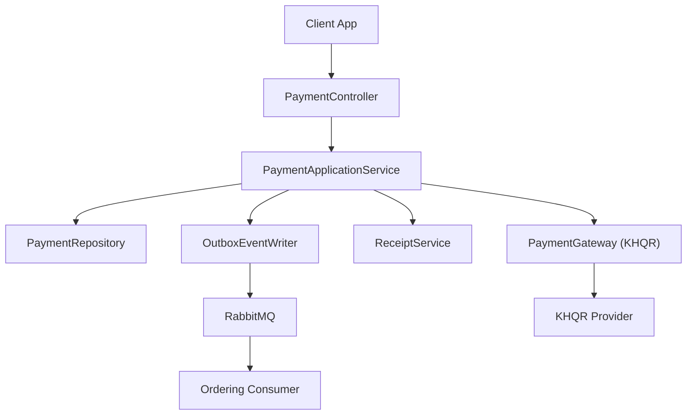
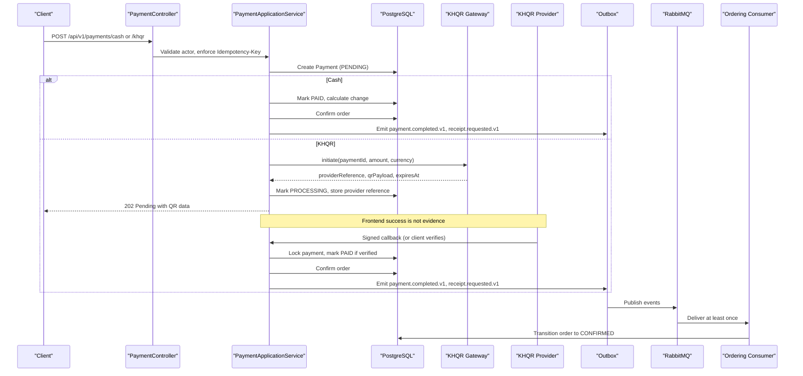
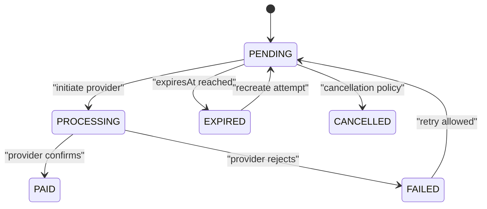
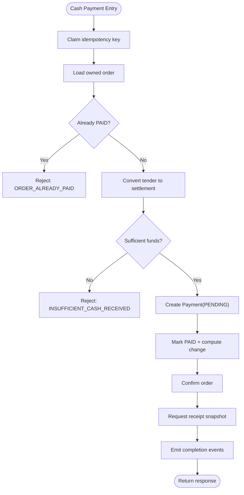
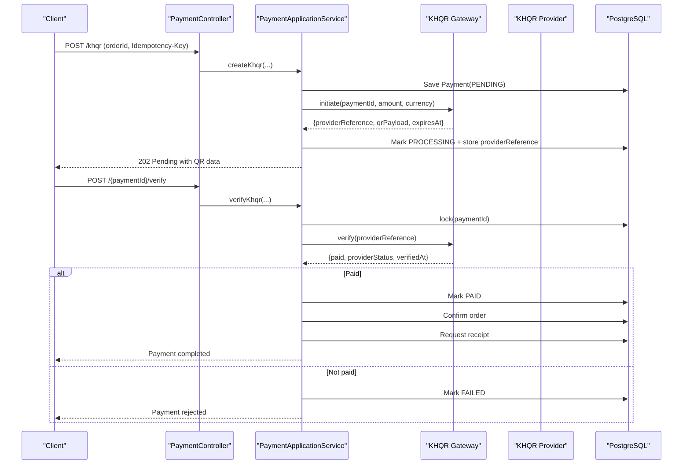
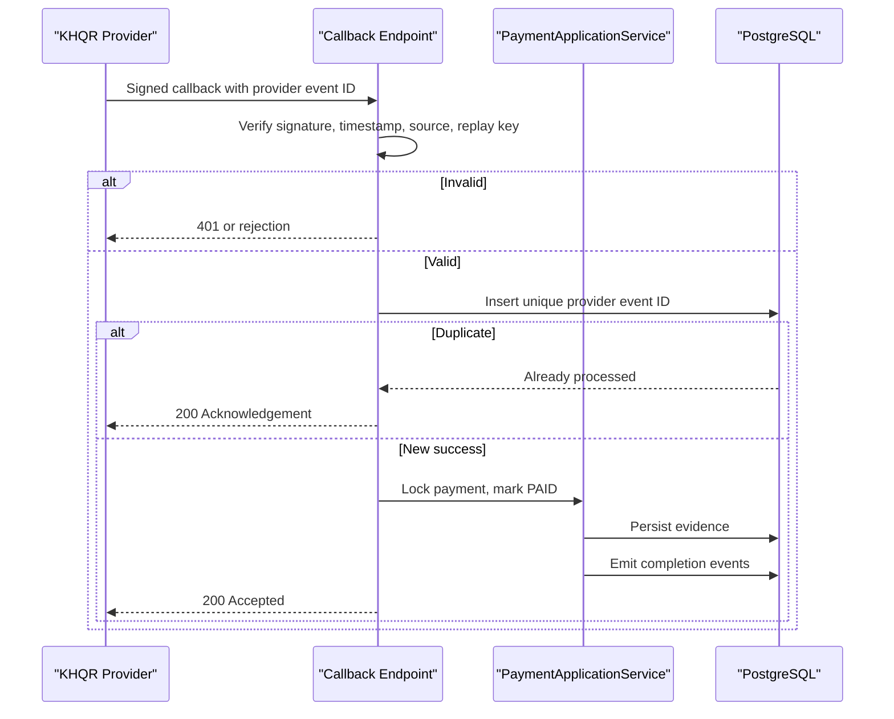
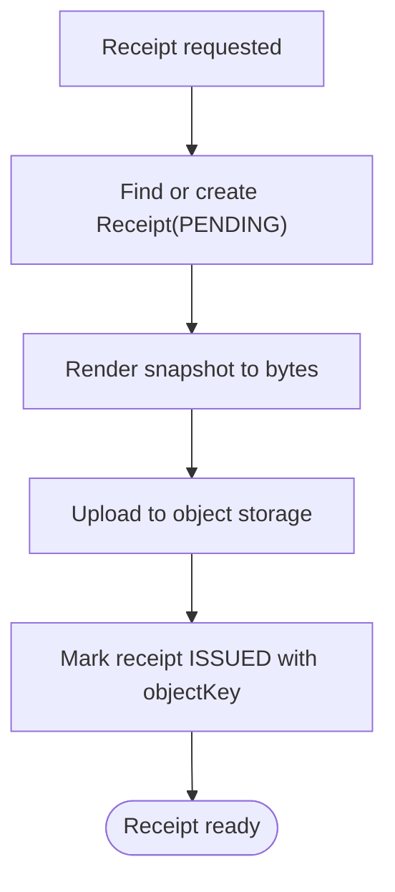
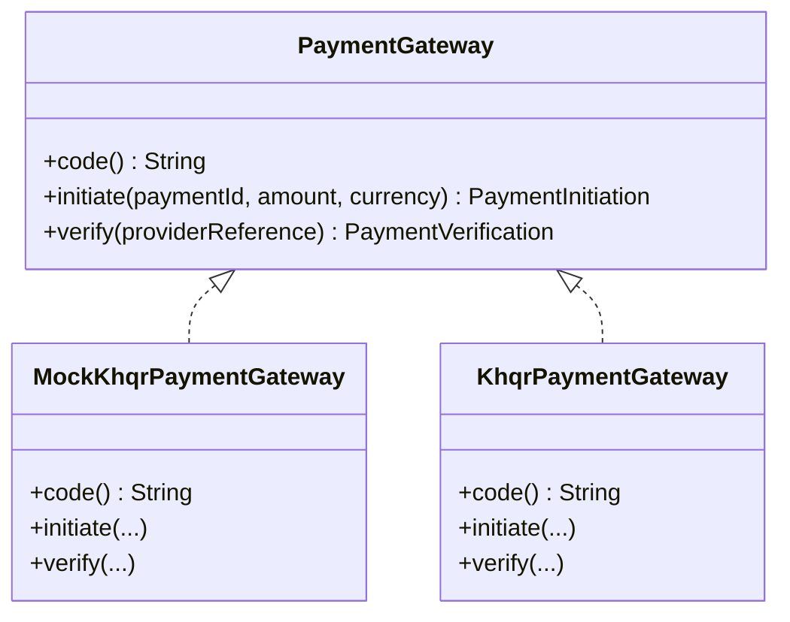
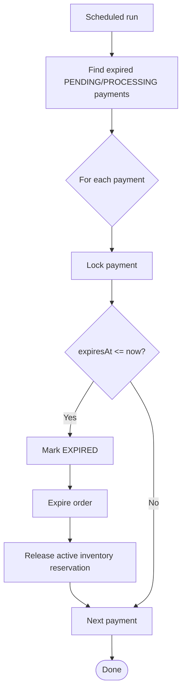
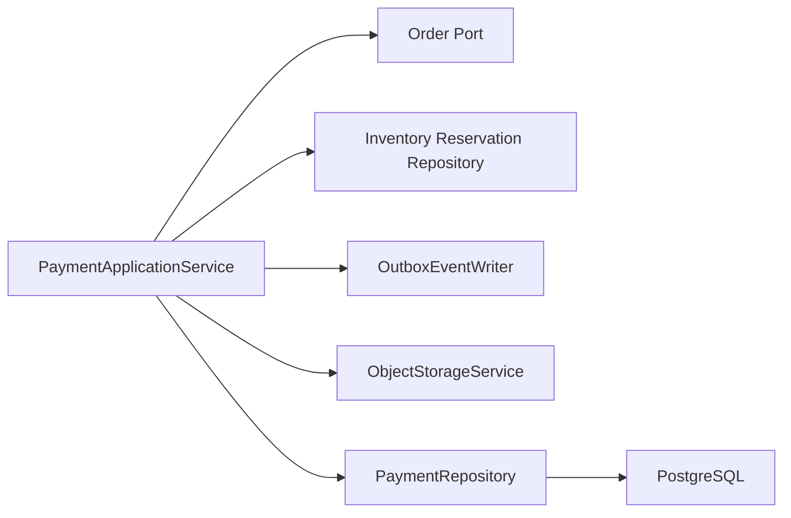

# Payment Processing Module

<cite>
**Referenced Files in This Document**
- [PaymentController.java](file://src/main/java/com/smartcoffee/modules/payment/api/PaymentController.java)
- [PaymentApplicationService.java](file://src/main/java/com/smartcoffee/modules/payment/application/PaymentApplicationService.java)
- [Payment.java](file://src/main/java/com/smartcoffee/modules/payment/domain/Payment.java)
- [PaymentStatus.java](file://src/main/java/com/smartcoffee/modules/payment/domain/PaymentStatus.java)
- [PaymentMethodType.java](file://src/main/java/com/smartcoffee/modules/payment/domain/PaymentMethodType.java)
- [Receipt.java](file://src/main/java/com/smartcoffee/modules/payment/domain/Receipt.java)
- [ReceiptService.java](file://src/main/java/com/smartcoffee/modules/payment/application/ReceiptService.java)
- [ReceiptProcessor.java](file://src/main/java/com/smartcoffee/modules/payment/application/ReceiptProcessor.java)
- [SimpleReceiptDocumentRenderer.java](file://src/main/java/com/smartcoffee/modules/payment/application/SimpleReceiptDocumentRenderer.java)
- [PaymentGateway.java](file://src/main/java/com/smartcoffee/infrastructure/payment/PaymentGateway.java)
- [KhqrPaymentGateway.java](file://src/main/java/com/smartcoffee/infrastructure/payment/KhqrPaymentGateway.java)
- [MockKhqrPaymentGateway.java](file://src/main/java/com/smartcoffee/infrastructure/payment/MockKhqrPaymentGateway.java)
- [PaymentRepository.java](file://src/main/java/com/smartcoffee/modules/payment/persistence/PaymentRepository.java)
- [V007__payments_receipts.sql](file://src/main/resources/db/migration/V007__payments_receipts.sql)
- [PAYMENT_FLOW.mermaid](file://architecture/PAYMENT_FLOW.mermaid)
- [ORDER_DOMAIN_PATCH.md](file://ORDER_DOMAIN_PATCH.md)
- [RECEIPT_ENTITY_PATCH.md](file://RECEIPT_ENTITY_PATCH.md)
- [README_STEP8.md](file://README_STEP8.md)
- [smart-coffee-logical.dbml](file://database/smart-coffee-logical.dbml)
</cite>

## Table of Contents
1. [Introduction](#introduction)
2. [Project Structure](#project-structure)
3. [Core Components](#core-components)
4. [Architecture Overview](#architecture-overview)
5. [Detailed Component Analysis](#detailed-component-analysis)
6. [Dependency Analysis](#dependency-analysis)
7. [Performance Considerations](#performance-considerations)
8. [Troubleshooting Guide](#troubleshooting-guide)
9. [Conclusion](#conclusion)
10. [Appendices](#appendices)

## Introduction
This document explains the Payment Processing module, focusing on the payment state machine, support for multiple payment methods (cash and KHQR), receipt generation, gateway integrations, callback handling, reconciliation, expiration handling, refund planning, audit trail, error handling, settlement procedures, security considerations, PCI compliance aspects, and failure scenarios. It is designed to be accessible to both technical and non-technical readers while remaining grounded in the repository’s code and configuration.

## Project Structure
The payment functionality is organized by domain-driven boundaries:
- API layer exposes endpoints for cash payments, KHQR initiation, verification, and method listing.
- Application service orchestrates business rules, idempotency, gateway calls, order confirmation, receipt creation, and event emission.
- Domain models define payment lifecycle states and receipts.
- Persistence provides repositories and database schema for payments, receipts, and related indexes.
- Infrastructure contains payment gateway adapters for KHQR (mock and production placeholder).
- Architecture diagrams illustrate end-to-end flows including provider callbacks and outbox-based delivery.

**Diagram sources**
- [PaymentController.java:11-38](file://src/main/java/com/smartcoffee/modules/payment/api/PaymentController.java#L11-L38)
- [PaymentApplicationService.java:20-46](file://src/main/java/com/smartcoffee/modules/payment/application/PaymentApplicationService.java#L20-L46)
- [PaymentRepository.java:11-24](file://src/main/java/com/smartcoffee/modules/payment/persistence/PaymentRepository.java#L11-L24)
- [PaymentGateway.java:1-5](file://src/main/java/com/smartcoffee/infrastructure/payment/PaymentGateway.java#L1-L5)
- [ReceiptService.java:11-32](file://src/main/java/com/smartcoffee/modules/payment/application/ReceiptService.java#L11-L32)

**Section sources**
- [PaymentController.java:11-38](file://src/main/java/com/smartcoffee/modules/payment/api/PaymentController.java#L11-L38)
- [PaymentApplicationService.java:20-46](file://src/main/java/com/smartcoffee/modules/payment/application/PaymentApplicationService.java#L20-L46)
- [PaymentRepository.java:11-24](file://src/main/java/com/smartcoffee/modules/payment/persistence/PaymentRepository.java#L11-L24)
- [PaymentGateway.java:1-5](file://src/main/java/com/smartcoffee/infrastructure/payment/PaymentGateway.java#L1-L5)
- [ReceiptService.java:11-32](file://src/main/java/com/smartcoffee/modules/payment/application/ReceiptService.java#L11-L32)

## Core Components
- PaymentController: Exposes REST endpoints for cash, KHQR, and verification with idempotency key enforcement.
- PaymentApplicationService: Implements business logic for cash and KHQR flows, idempotency, gateway integration, order confirmation, receipt request, and event emission.
- Payment domain model: Encapsulates payment state transitions (pending, processing, paid, failed, expired, cancelled) and metadata such as provider reference and expiry.
- Payment status and method types: Enumerations defining allowed statuses and supported method categories.
- Receipt subsystem: Creates receipt snapshots, renders documents, stores them in object storage, and marks receipts issued or failed.
- Payment gateways: Abstraction for external providers; includes a mock implementation for local/test and a production placeholder for KHQR.
- Repositories and schema: Provide locking, queries, and constraints ensuring data integrity and concurrency safety.

**Section sources**
- [PaymentController.java:22-37](file://src/main/java/com/smartcoffee/modules/payment/api/PaymentController.java#L22-L37)
- [PaymentApplicationService.java:48-116](file://src/main/java/com/smartcoffee/modules/payment/application/PaymentApplicationService.java#L48-L116)
- [Payment.java:56-105](file://src/main/java/com/smartcoffee/modules/payment/domain/Payment.java#L56-L105)
- [PaymentStatus.java:3-5](file://src/main/java/com/smartcoffee/modules/payment/domain/PaymentStatus.java#L3-L5)
- [PaymentMethodType.java:3-5](file://src/main/java/com/smartcoffee/modules/payment/domain/PaymentMethodType.java#L3-L5)
- [Receipt.java:62-180](file://src/main/java/com/smartcoffee/modules/payment/domain/Receipt.java#L62-L180)
- [ReceiptService.java:21-32](file://src/main/java/com/smartcoffee/modules/payment/application/ReceiptService.java#L21-L32)
- [ReceiptProcessor.java:33-59](file://src/main/java/com/smartcoffee/modules/payment/application/ReceiptProcessor.java#L33-L59)
- [PaymentGateway.java:1-5](file://src/main/java/com/smartcoffee/infrastructure/payment/PaymentGateway.java#L1-L5)
- [KhqrPaymentGateway.java:1-8](file://src/main/java/com/smartcoffee/infrastructure/payment/KhqrPaymentGateway.java#L1-L8)
- [MockKhqrPaymentGateway.java:1-4](file://src/main/java/com/smartcoffee/infrastructure/payment/MockKhqrPaymentGateway.java#L1-L4)
- [PaymentRepository.java:11-24](file://src/main/java/com/smartcoffee/modules/payment/persistence/PaymentRepository.java#L11-L24)
- [V007__payments_receipts.sql:63-95](file://src/main/resources/db/migration/V007__payments_receipts.sql#L63-L95)

## Architecture Overview
The system supports two primary payment paths:
- Cash: Immediate settlement with change calculation, order confirmation, receipt request, and completion events.
- KHQR: Asynchronous payment via an external provider, with QR payload issuance, polling/verification, callback handling, and eventual consistency through outbox events.

**Diagram sources**
- [PaymentController.java:22-37](file://src/main/java/com/smartcoffee/modules/payment/api/PaymentController.java#L22-L37)
- [PaymentApplicationService.java:48-116](file://src/main/java/com/smartcoffee/modules/payment/application/PaymentApplicationService.java#L48-L116)
- [PaymentGateway.java:1-5](file://src/main/java/com/smartcoffee/infrastructure/payment/PaymentGateway.java#L1-L5)
- [PAYMENT_FLOW.mermaid:1-72](file://architecture/PAYMENT_FLOW.mermaid#L1-L72)

## Detailed Component Analysis

### Payment State Machine
The payment entity enforces strict state transitions:
- PENDING: Initial state when a payment attempt is created.
- PROCESSING: When interacting with an external provider (e.g., KHQR).
- PAID: Successful settlement with recorded received amount and change.
- FAILED: Rejection by provider or validation failure.
- EXPIRED: Time window elapsed without successful settlement.
- CANCELLED: Reserved for cancellation workflows.

Transitions are guarded by domain methods that reject invalid moves and update timestamps.

**Diagram sources**
- [Payment.java:56-105](file://src/main/java/com/smartcoffee/modules/payment/domain/Payment.java#L56-L105)
- [PaymentStatus.java:3-5](file://src/main/java/com/smartcoffee/modules/payment/domain/PaymentStatus.java#L3-L5)

**Section sources**
- [Payment.java:56-105](file://src/main/java/com/smartcoffee/modules/payment/domain/Payment.java#L56-L105)
- [PaymentStatus.java:3-5](file://src/main/java/com/smartcoffee/modules/payment/domain/PaymentStatus.java#L3-L5)

### Cash Payment Flow
Cash payments validate ownership, store membership, outstanding balance, and tender conversion. On success:
- A payment record is created and immediately marked PAID with calculated change.
- The order is confirmed.
- A receipt snapshot is requested.
- Completion events are emitted via the outbox.

**Diagram sources**
- [PaymentApplicationService.java:48-70](file://src/main/java/com/smartcoffee/modules/payment/application/PaymentApplicationService.java#L48-L70)

**Section sources**
- [PaymentApplicationService.java:48-70](file://src/main/java/com/smartcoffee/modules/payment/application/PaymentApplicationService.java#L48-L70)

### KHQR Payment Flow
KHQR payments create a pending payment, call the provider to initiate a charge, and return QR data. Verification can occur via:
- Client polling using verify endpoint.
- Provider asynchronous callback (as documented in architecture diagram).

On successful verification:
- Payment is locked and marked PAID.
- Order is confirmed.
- Receipt is requested.
- Completion events are emitted.

**Diagram sources**
- [PaymentController.java:28-37](file://src/main/java/com/smartcoffee/modules/payment/api/PaymentController.java#L28-L37)
- [PaymentApplicationService.java:72-108](file://src/main/java/com/smartcoffee/modules/payment/application/PaymentApplicationService.java#L72-L108)
- [PaymentGateway.java:1-5](file://src/main/java/com/smartcoffee/infrastructure/payment/PaymentGateway.java#L1-L5)

**Section sources**
- [PaymentController.java:28-37](file://src/main/java/com/smartcoffee/modules/payment/api/PaymentController.java#L28-L37)
- [PaymentApplicationService.java:72-108](file://src/main/java/com/smartcoffee/modules/payment/application/PaymentApplicationService.java#L72-L108)
- [PaymentGateway.java:1-5](file://src/main/java/com/smartcoffee/infrastructure/payment/PaymentGateway.java#L1-L5)

### Callback Handling and Reconciliation
Per the architecture diagram, provider callbacks must:
- Verify signature, timestamp freshness, source, and replay prevention.
- Use unique provider event IDs to avoid duplicate processing.
- Lock and transition the payment attempt atomically.
- Persist external evidence and emit completion events.

Reconciliation ensures provider state is authoritative before creating charges or confirming orders.

**Diagram sources**
- [PAYMENT_FLOW.mermaid:41-69](file://architecture/PAYMENT_FLOW.mermaid#L41-L69)

**Section sources**
- [PAYMENT_FLOW.mermaid:41-69](file://architecture/PAYMENT_FLOW.mermaid#L41-L69)

### Receipt Generation
Receipts are created from payment snapshots and rendered into documents stored in object storage:
- ReceiptService creates or retrieves a receipt linked to a payment and order.
- ReceiptProcessor renders the snapshot and uploads it to storage, then marks the receipt issued.
- SimpleReceiptDocumentRenderer provides a text-based template suitable for development; replace with PDF rendering for production.

**Diagram sources**
- [ReceiptService.java:21-32](file://src/main/java/com/smartcoffee/modules/payment/application/ReceiptService.java#L21-L32)
- [ReceiptProcessor.java:33-59](file://src/main/java/com/smartcoffee/modules/payment/application/ReceiptProcessor.java#L33-L59)
- [SimpleReceiptDocumentRenderer.java:6-11](file://src/main/java/com/smartcoffee/modules/payment/application/SimpleReceiptDocumentRenderer.java#L6-L11)

**Section sources**
- [ReceiptService.java:21-32](file://src/main/java/com/smartcoffee/modules/payment/application/ReceiptService.java#L21-L32)
- [ReceiptProcessor.java:33-59](file://src/main/java/com/smartcoffee/modules/payment/application/ReceiptProcessor.java#L33-L59)
- [SimpleReceiptDocumentRenderer.java:6-11](file://src/main/java/com/smartcoffee/modules/payment/application/SimpleReceiptDocumentRenderer.java#L6-L11)
- [RECEIPT_ENTITY_PATCH.md:1-9](file://RECEIPT_ENTITY_PATCH.md#L1-L9)

### Payment Gateway Integrations
- PaymentGateway defines a uniform interface for initiating and verifying payments.
- MockKhqrPaymentGateway provides deterministic behavior for local/test environments.
- KhqrPaymentGateway is a production placeholder requiring a real provider adapter.

**Diagram sources**
- [PaymentGateway.java:1-5](file://src/main/java/com/smartcoffee/infrastructure/payment/PaymentGateway.java#L1-L5)
- [MockKhqrPaymentGateway.java:1-4](file://src/main/java/com/smartcoffee/infrastructure/payment/MockKhqrPaymentGateway.java#L1-L4)
- [KhqrPaymentGateway.java:1-8](file://src/main/java/com/smartcoffee/infrastructure/payment/KhqrPaymentGateway.java#L1-L8)

**Section sources**
- [PaymentGateway.java:1-5](file://src/main/java/com/smartcoffee/infrastructure/payment/PaymentGateway.java#L1-L5)
- [MockKhqrPaymentGateway.java:1-4](file://src/main/java/com/smartcoffee/infrastructure/payment/MockKhqrPaymentGateway.java#L1-L4)
- [KhqrPaymentGateway.java:1-8](file://src/main/java/com/smartcoffee/infrastructure/payment/KhqrPaymentGateway.java#L1-L8)

### Payment Expiration Handling
A scheduled job periodically scans expiring payments:
- Loads expired candidates within a page size.
- Locks each payment to prevent races.
- Marks payments expired and triggers order expiration.
- Releases active inventory reservations tied to the order.

**Diagram sources**
- [PaymentExpirationService.java:27-40](file://src/main/java/com/smartcoffee/modules/payment/application/PaymentExpirationService.java#L27-L40)
- [PaymentRepository.java:22-23](file://src/main/java/com/smartcoffee/modules/payment/persistence/PaymentRepository.java#L22-L23)

**Section sources**
- [PaymentExpirationService.java:27-40](file://src/main/java/com/smartcoffee/modules/payment/application/PaymentExpirationService.java#L27-L40)
- [PaymentRepository.java:22-23](file://src/main/java/com/smartcoffee/modules/payment/persistence/PaymentRepository.java#L22-L23)
- [ORDER_DOMAIN_PATCH.md:14-21](file://ORDER_DOMAIN_PATCH.md#L14-L21)

### Refund Processing
The database schema includes tables for refunds and refund items, indicating planned support for partial or full refunds:
- Refunds track reference, status, amount, currency, reason, idempotency key, provider reference, requester, and timestamps.
- Refund items associate refunds with order lines and quantities.

Implementation details for refund commands and workflows are not present in the analyzed files; however, the schema establishes the necessary structure for future development.

**Section sources**
- [smart-coffee-logical.dbml:522-544](file://database/smart-coffee-logical.dbml#L522-L544)

### Audit Trail Maintenance
Audit trails are maintained via the broader audit module and infrastructure patterns:
- Business actions (order status changes, payment confirmations/expirations) should be recorded with actor context.
- The ordering patch demonstrates adding history entries during state transitions.
- Payment failures and completions emit events that can be consumed by downstream systems for auditing.

**Section sources**
- [ORDER_DOMAIN_PATCH.md:4-12](file://ORDER_DOMAIN_PATCH.md#L4-L12)
- [PaymentApplicationService.java:128-143](file://src/main/java/com/smartcoffee/modules/payment/application/PaymentApplicationService.java#L128-L143)

### Examples of Payment Flows
- Cash flow: Client submits cash payment with idempotency key; backend validates, settles, confirms order, requests receipt, emits completion events.
- KHQR flow: Client initiates KHQR payment; backend creates pending payment, obtains QR payload from provider; client verifies or provider sends callback; upon success, backend confirms order, requests receipt, emits completion events.

**Section sources**
- [PaymentController.java:22-37](file://src/main/java/com/smartcoffee/modules/payment/api/PaymentController.java#L22-L37)
- [PaymentApplicationService.java:48-108](file://src/main/java/com/smartcoffee/modules/payment/application/PaymentApplicationService.java#L48-L108)
- [PAYMENT_FLOW.mermaid:14-69](file://architecture/PAYMENT_FLOW.mermaid#L14-L69)

### Error Handling
Common errors include:
- Store mismatch: Rejects cash payment if order belongs to another store.
- Order already paid: Prevents duplicate settlements.
- Insufficient cash received: Validates tender against order total after conversion.
- Exchange rate required: Ensures valid conversion when tender differs from settlement currency.
- Payment method unavailable: Fails if configured method is inactive.
- Payment gateway unavailable: Fails if no matching gateway is registered.
- Payment state conflict: Disallows invalid transitions on closed payments.
- Receipt state conflict: Prevents issuing or marking failed non-pending receipts.

These errors are thrown as domain-specific exceptions and surfaced consistently to clients.

**Section sources**
- [PaymentApplicationService.java:53-61](file://src/main/java/com/smartcoffee/modules/payment/application/PaymentApplicationService.java#L53-L61)
- [PaymentApplicationService.java:110-126](file://src/main/java/com/smartcoffee/modules/payment/application/PaymentApplicationService.java#L110-L126)
- [Payment.java:73-105](file://src/main/java/com/smartcoffee/modules/payment/domain/Payment.java#L73-L105)
- [Receipt.java:146-180](file://src/main/java/com/smartcoffee/modules/payment/domain/Receipt.java#L146-L180)

### Settlement Procedures
Settlement is enforced by:
- Unique index preventing more than one PAID payment per order.
- Pessimistic locking when verifying KHQR to avoid race conditions.
- Eventual consistency via outbox events and consumer inbox deduplication.

**Section sources**
- [V007__payments_receipts.sql:63-78](file://src/main/resources/db/migration/V007__payments_receipts.sql#L63-L78)
- [PaymentRepository.java:12-14](file://src/main/java/com/smartcoffee/modules/payment/persistence/PaymentRepository.java#L12-L14)
- [PaymentApplicationService.java:90-108](file://src/main/java/com/smartcoffee/modules/payment/application/PaymentApplicationService.java#L90-L108)

### Security Considerations and PCI Compliance
Security measures and compliance guidance:
- Idempotency keys protect against duplicate submissions.
- Actor authorization is enforced before payment operations.
- Provider callbacks must validate signatures, timestamps, source, and replay keys; never trust frontend success as evidence.
- Avoid storing sensitive cardholder data; rely on provider-hosted flows for KHQR and future card/wallet methods.
- Use secure channels (TLS) for all external communications.
- Follow least privilege for service accounts and restrict access to payment-related endpoints.
- Ensure audit logs do not capture sensitive payment data.

**Section sources**
- [PaymentController.java:22-37](file://src/main/java/com/smartcoffee/modules/payment/api/PaymentController.java#L22-L37)
- [PAYMENT_FLOW.mermaid:41-49](file://architecture/PAYMENT_FLOW.mermaid#L41-L49)
- [README_STEP8.md:7-11](file://README_STEP8.md#L7-L11)

### Payment Failure Scenarios
Failure modes and behaviors:
- Provider rejection: Payment marked FAILED; failure event emitted; order remains AWAITING_PAYMENT for retry.
- Timeout or unknown result: Payment may remain PENDING or UNKNOWN until reconciliation resolves state.
- Expiration: Payments past their expiresAt are marked EXPIRED; orders expire and inventory reservations release.

**Section sources**
- [PaymentApplicationService.java:95-100](file://src/main/java/com/smartcoffee/modules/payment/application/PaymentApplicationService.java#L95-L100)
- [PAYMENT_FLOW.mermaid:34-38](file://architecture/PAYMENT_FLOW.mermaid#L34-L38)
- [PaymentExpirationService.java:27-40](file://src/main/java/com/smartcoffee/modules/payment/application/PaymentExpirationService.java#L27-L40)

## Dependency Analysis
The payment module depends on:
- Ordering module for loading orders, confirming them, and handling expiration.
- Inventory module for releasing reservations upon expiration.
- Messaging infrastructure for outbox publishing and event consumption.
- Storage infrastructure for receipt document persistence.
- Database schema for constraints and indexes ensuring correctness.

**Diagram sources**
- [PaymentApplicationService.java:20-46](file://src/main/java/com/smartcoffee/modules/payment/application/PaymentApplicationService.java#L20-L46)
- [PaymentRepository.java:11-24](file://src/main/java/com/smartcoffee/modules/payment/persistence/PaymentRepository.java#L11-L24)

**Section sources**
- [PaymentApplicationService.java:20-46](file://src/main/java/com/smartcoffee/modules/payment/application/PaymentApplicationService.java#L20-L46)
- [PaymentRepository.java:11-24](file://src/main/java/com/smartcoffee/modules/payment/persistence/PaymentRepository.java#L11-L24)

## Performance Considerations
- Use pessimistic locks for critical sections (payment verification) to prevent races.
- Page-size bounded scans for expiration jobs to avoid long-running transactions.
- Leverage unique indexes to prevent duplicate settlements efficiently.
- Keep outbound events small and structured for efficient messaging.
- Replace simple receipt renderer with optimized PDF generation in production.

[No sources needed since this section provides general guidance]

## Troubleshooting Guide
Common issues and resolutions:
- Duplicate payment attempts: Ensure idempotency keys are used; check idempotency records for replays.
- Provider callback reprocessing: Validate provider event IDs and ensure unique insertion.
- Stuck payments: Check expiresAt and status; run expiration job or reconcile with provider.
- Receipt generation failures: Verify storage connectivity and permissions; inspect renderer output.
- Order not confirmed: Confirm payment state transitions and event delivery; check consumer inbox for duplicates.

**Section sources**
- [PaymentApplicationService.java:145-160](file://src/main/java/com/smartcoffee/modules/payment/application/PaymentApplicationService.java#L145-L160)
- [ReceiptProcessor.java:33-59](file://src/main/java/com/smartcoffee/modules/payment/application/ReceiptProcessor.java#L33-L59)
- [PaymentRepository.java:12-14](file://src/main/java/com/smartcoffee/modules/payment/persistence/PaymentRepository.java#L12-L14)

## Conclusion
The Payment Processing module implements a robust, auditable, and extensible foundation for handling cash and KHQR payments. It enforces strong state management, idempotency, and eventual consistency through outbox events. Receipt generation integrates with object storage, and expiration handling safeguards inventory and order states. While refund processing is scaffolded by schema, further implementation is needed. Security and PCI compliance are addressed through provider-hosted flows, callback validation, and careful data handling.

[No sources needed since this section summarizes without analyzing specific files]

## Appendices

### API Endpoints Summary
- POST /api/v1/payments/cash: Submit cash payment with idempotency key.
- POST /api/v1/payments/khqr: Initiate KHQR payment with idempotency key.
- POST /api/v1/payments/{paymentId}/verify: Verify KHQR payment status.

**Section sources**
- [PaymentController.java:22-37](file://src/main/java/com/smartcoffee/modules/payment/api/PaymentController.java#L22-L37)

### Data Model Highlights
- Payments: Stores payment lifecycle, amounts, provider references, and expiry.
- Receipts: Captures snapshots, storage keys, and issuance timestamps.
- Refunds and reconciliations: Schema prepared for future refund workflows and reconciliation records.

**Section sources**
- [Payment.java:11-51](file://src/main/java/com/smartcoffee/modules/payment/domain/Payment.java#L11-L51)
- [Receipt.java:17-57](file://src/main/java/com/smartcoffee/modules/payment/domain/Receipt.java#L17-L57)
- [smart-coffee-logical.dbml:522-567](file://database/smart-coffee-logical.dbml#L522-L567)