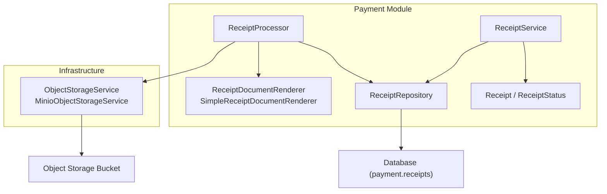
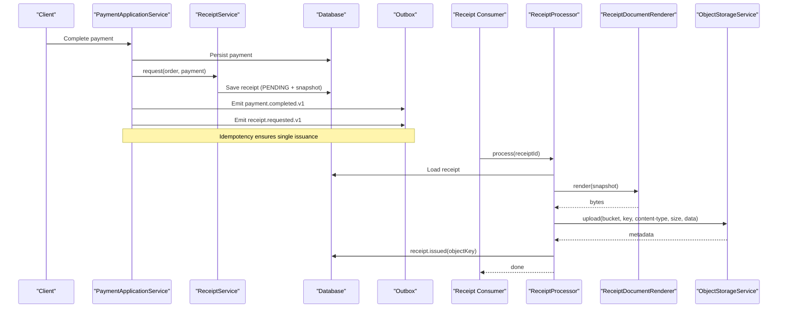
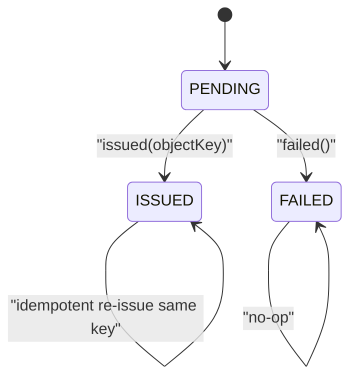
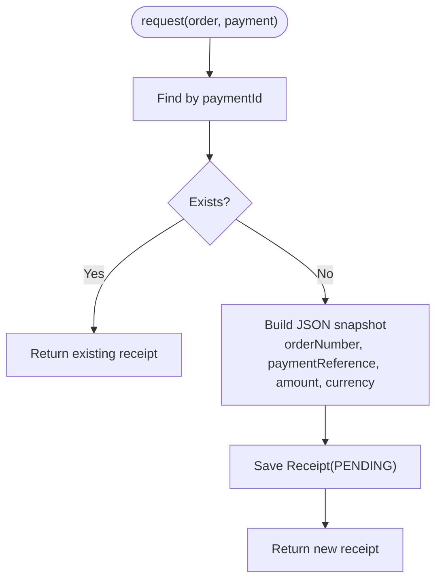
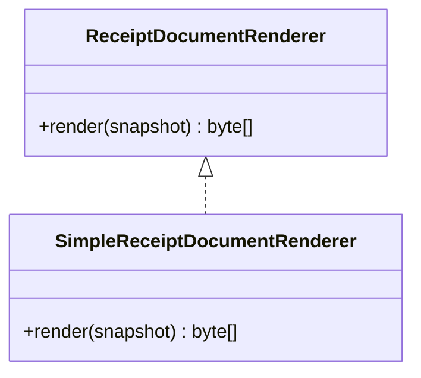
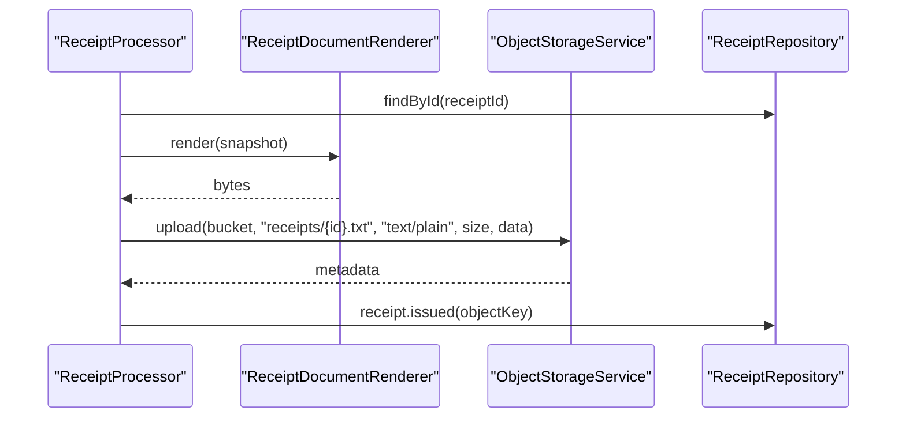
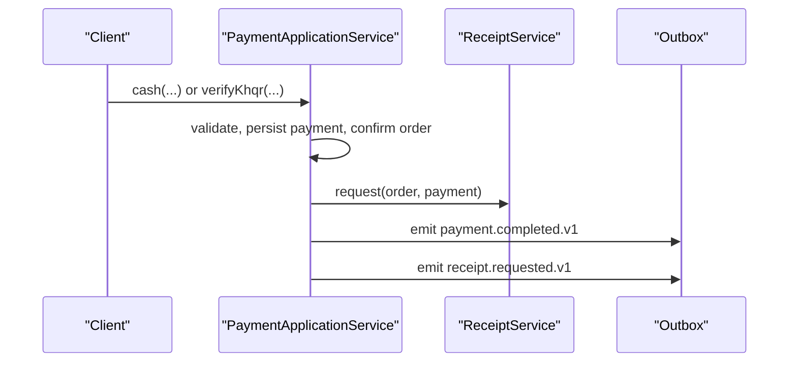
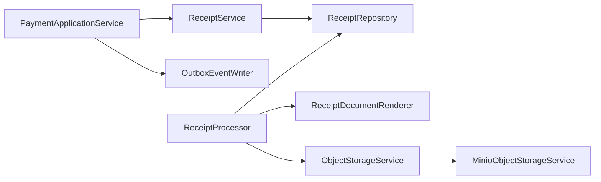

# Receipt Generation & Processing

<cite>
**Referenced Files in This Document**
- [Receipt.java](file://src/main/java/com/smartcoffee/modules/payment/domain/Receipt.java)
- [ReceiptStatus.java](file://src/main/java/com/smartcoffee/modules/payment/domain/ReceiptStatus.java)
- [ReceiptService.java](file://src/main/java/com/smartcoffee/modules/payment/application/ReceiptService.java)
- [ReceiptProcessor.java](file://src/main/java/com/smartcoffee/modules/payment/application/ReceiptProcessor.java)
- [ReceiptDocumentRenderer.java](file://src/main/java/com/smartcoffee/modules/payment/application/ReceiptDocumentRenderer.java)
- [SimpleReceiptDocumentRenderer.java](file://src/main/java/com/smartcoffee/modules/payment/application/SimpleReceiptDocumentRenderer.java)
- [PaymentApplicationService.java](file://src/main/java/com/smartcoffee/modules/payment/application/PaymentApplicationService.java)
- [ObjectStorageService.java](file://src/main/java/com/smartcoffee/infrastructure/storage/ObjectStorageService.java)
- [MinioObjectStorageService.java](file://src/main/java/com/smartcoffee/infrastructure/storage/MinioObjectStorageService.java)
- [V007__payments_receipts.sql](file://src/main/resources/db/migration/V007__payments_receipts.sql)
</cite>

## Table of Contents
1. [Introduction](#introduction)
2. [Project Structure](#project-structure)
3. [Core Components](#core-components)
4. [Architecture Overview](#architecture-overview)
5. [Detailed Component Analysis](#detailed-component-analysis)
6. [Dependency Analysis](#dependency-analysis)
7. [Performance Considerations](#performance-considerations)
8. [Troubleshooting Guide](#troubleshooting-guide)
9. [Conclusion](#conclusion)
10. [Appendices](#appendices)

## Introduction
This document explains the receipt generation and processing functionality within the payment module. It covers the Receipt domain model, status tracking, rendering pipeline, storage integration, and how receipts are created during payment completion flows. It also provides guidance for customizing templates, retrieving receipts, and ensuring compliance for financial documents.

## Project Structure
The receipt feature spans domain, application, persistence, and infrastructure layers:
- Domain: Receipt entity and ReceiptStatus enum define the core model and lifecycle.
- Application: ReceiptService orchestrates receipt creation; ReceiptProcessor renders and stores receipts; PaymentApplicationService integrates receipt creation into payment flows.
- Persistence: JPA repository for receipts backed by a database migration.
- Infrastructure: Object storage abstraction with MinIO implementation for storing rendered receipts.

**Diagram sources**
- [ReceiptService.java:21-32](file://src/main/java/com/smartcoffee/modules/payment/application/ReceiptService.java#L21-L32)
- [ReceiptProcessor.java:33-59](file://src/main/java/com/smartcoffee/modules/payment/application/ReceiptProcessor.java#L33-L59)
- [ReceiptDocumentRenderer.java:3-5](file://src/main/java/com/smartcoffee/modules/payment/application/ReceiptDocumentRenderer.java#L3-L5)
- [SimpleReceiptDocumentRenderer.java:7-10](file://src/main/java/com/smartcoffee/modules/payment/application/SimpleReceiptDocumentRenderer.java#L7-L10)
- [ObjectStorageService.java:7-27](file://src/main/java/com/smartcoffee/infrastructure/storage/ObjectStorageService.java#L7-L27)
- [MinioObjectStorageService.java:27-79](file://src/main/java/com/smartcoffee/infrastructure/storage/MinioObjectStorageService.java#L27-L79)
- [V007__payments_receipts.sql:80-95](file://src/main/resources/db/migration/V007__payments_receipts.sql#L80-L95)

**Section sources**
- [Receipt.java:16-57](file://src/main/java/com/smartcoffee/modules/payment/domain/Receipt.java#L16-L57)
- [ReceiptStatus.java:3-5](file://src/main/java/com/smartcoffee/modules/payment/domain/ReceiptStatus.java#L3-L5)
- [ReceiptService.java:11-32](file://src/main/java/com/smartcoffee/modules/payment/application/ReceiptService.java#L11-L32)
- [ReceiptProcessor.java:12-31](file://src/main/java/com/smartcoffee/modules/payment/application/ReceiptProcessor.java#L12-L31)
- [ObjectStorageService.java:7-27](file://src/main/java/com/smartcoffee/infrastructure/storage/ObjectStorageService.java#L7-L27)
- [MinioObjectStorageService.java:15-79](file://src/main/java/com/smartcoffee/infrastructure/storage/MinioObjectStorageService.java#L15-L79)
- [V007__payments_receipts.sql:80-95](file://src/main/resources/db/migration/V007__payments_receipts.sql#L80-L95)

## Core Components
- Receipt domain model: Represents a receipt with identifiers, links to order/store/payment, JSON snapshot, object key, timestamps, versioning, and state transitions.
- ReceiptStatus: Enumerates PENDING, ISSUED, FAILED states with strict transition rules enforced in the domain.
- ReceiptService: Creates or retrieves a receipt for a completed payment and persists a JSON snapshot containing order number, payment reference, amount, and currency.
- ReceiptDocumentRenderer: Pluggable interface for rendering a receipt from its snapshot; default implementation produces a simple text document.
- ReceiptProcessor: Renders the receipt, uploads it to object storage, and marks the receipt as issued with the stored object key.
- ObjectStorageService: Abstraction for upload, signed URL generation, and deletion; implemented with MinIO.

**Section sources**
- [Receipt.java:16-180](file://src/main/java/com/smartcoffee/modules/payment/domain/Receipt.java#L16-L180)
- [ReceiptStatus.java:3-5](file://src/main/java/com/smartcoffee/modules/payment/domain/ReceiptStatus.java#L3-L5)
- [ReceiptService.java:21-32](file://src/main/java/com/smartcoffee/modules/payment/application/ReceiptService.java#L21-L32)
- [ReceiptDocumentRenderer.java:3-5](file://src/main/java/com/smartcoffee/modules/payment/application/ReceiptDocumentRenderer.java#L3-L5)
- [SimpleReceiptDocumentRenderer.java:7-10](file://src/main/java/com/smartcoffee/modules/payment/application/SimpleReceiptDocumentRenderer.java#L7-L10)
- [ReceiptProcessor.java:33-59](file://src/main/java/com/smartcoffee/modules/payment/application/ReceiptProcessor.java#L33-L59)
- [ObjectStorageService.java:7-27](file://src/main/java/com/smartcoffee/infrastructure/storage/ObjectStorageService.java#L7-L27)
- [MinioObjectStorageService.java:27-79](file://src/main/java/com/smartcoffee/infrastructure/storage/MinioObjectStorageService.java#L27-L79)

## Architecture Overview
The receipt flow is integrated into payment completion:
- On payment success, PaymentApplicationService creates a receipt via ReceiptService and emits events indicating payment completion and receipt request.
- A consumer (outside this code) processes the receipt request event, invoking ReceiptProcessor.process(receiptId).
- ReceiptProcessor renders the receipt using the configured renderer, uploads it to object storage, and updates the receipt status to ISSUED with the object key.

**Diagram sources**
- [PaymentApplicationService.java:48-70](file://src/main/java/com/smartcoffee/modules/payment/application/PaymentApplicationService.java#L48-L70)
- [PaymentApplicationService.java:89-108](file://src/main/java/com/smartcoffee/modules/payment/application/PaymentApplicationService.java#L89-L108)
- [PaymentApplicationService.java:128-136](file://src/main/java/com/smartcoffee/modules/payment/application/PaymentApplicationService.java#L128-L136)
- [ReceiptService.java:21-32](file://src/main/java/com/smartcoffee/modules/payment/application/ReceiptService.java#L21-L32)
- [ReceiptProcessor.java:33-59](file://src/main/java/com/smartcoffee/modules/payment/application/ReceiptProcessor.java#L33-L59)
- [ReceiptDocumentRenderer.java:3-5](file://src/main/java/com/smartcoffee/modules/payment/application/ReceiptDocumentRenderer.java#L3-L5)
- [ObjectStorageService.java:7-27](file://src/main/java/com/smartcoffee/infrastructure/storage/ObjectStorageService.java#L7-L27)

## Detailed Component Analysis

### Receipt Domain Model and Status Tracking
- Fields include unique receipt number, references to payment/order/store, JSON snapshot, optional object key, timestamps, and optimistic locking version.
- Factory method creates a PENDING receipt with validated inputs and auto-generated identifiers.
- State transitions:
  - PENDING -> ISSUED: via issued(objectKey), validates non-blank key and sets issued timestamp.
  - PENDING -> FAILED: via failed(), idempotent if already FAILED.
  - Re-entry guards prevent invalid transitions and throw conflict exceptions.

**Diagram sources**
- [Receipt.java:62-100](file://src/main/java/com/smartcoffee/modules/payment/domain/Receipt.java#L62-L100)
- [Receipt.java:146-180](file://src/main/java/com/smartcoffee/modules/payment/domain/Receipt.java#L146-L180)
- [ReceiptStatus.java:3-5](file://src/main/java/com/smartcoffee/modules/payment/domain/ReceiptStatus.java#L3-L5)

**Section sources**
- [Receipt.java:16-180](file://src/main/java/com/smartcoffee/modules/payment/domain/Receipt.java#L16-L180)
- [ReceiptStatus.java:3-5](file://src/main/java/com/smartcoffee/modules/payment/domain/ReceiptStatus.java#L3-L5)
- [V007__payments_receipts.sql:80-95](file://src/main/resources/db/migration/V007__payments_receipts.sql#L80-L95)

### ReceiptService Orchestration
- Ensures exactly one receipt per payment by looking up by payment ID.
- If missing, creates a new PENDING receipt with a JSON snapshot containing order number, payment reference, amount, and currency.
- Runs within a mandatory transaction context to coordinate with payment persistence.

**Diagram sources**
- [ReceiptService.java:21-32](file://src/main/java/com/smartcoffee/modules/payment/application/ReceiptService.java#L21-L32)

**Section sources**
- [ReceiptService.java:11-32](file://src/main/java/com/smartcoffee/modules/payment/application/ReceiptService.java#L11-L32)

### Rendering Pipeline and Template System
- ReceiptDocumentRenderer defines a pluggable contract for rendering a receipt from its snapshot.
- SimpleReceiptDocumentRenderer provides a basic text-based output that prefixes the snapshot with a header.
- To support PDF generation or branded templates, implement ReceiptDocumentRenderer and register it as a Spring component; the processor will use the active bean automatically.

**Diagram sources**
- [ReceiptDocumentRenderer.java:3-5](file://src/main/java/com/smartcoffee/modules/payment/application/ReceiptDocumentRenderer.java#L3-L5)
- [SimpleReceiptDocumentRenderer.java:7-10](file://src/main/java/com/smartcoffee/modules/payment/application/SimpleReceiptDocumentRenderer.java#L7-L10)

**Section sources**
- [ReceiptDocumentRenderer.java:3-5](file://src/main/java/com/smartcoffee/modules/payment/application/ReceiptDocumentRenderer.java#L3-L5)
- [SimpleReceiptDocumentRenderer.java:7-10](file://src/main/java/com/smartcoffee/modules/payment/application/SimpleReceiptDocumentRenderer.java#L7-L10)

### Storage Integration and File Upload
- ReceiptProcessor renders the receipt and uploads it to object storage under a bucket configured via app.receipt.bucket (default receipts).
- The uploaded file key follows a deterministic pattern including the receipt ID.
- After successful upload, the receipt is marked as ISSUED with the object key and timestamp.

**Diagram sources**
- [ReceiptProcessor.java:33-59](file://src/main/java/com/smartcoffee/modules/payment/application/ReceiptProcessor.java#L33-L59)
- [ObjectStorageService.java:7-27](file://src/main/java/com/smartcoffee/infrastructure/storage/ObjectStorageService.java#L7-L27)
- [MinioObjectStorageService.java:27-79](file://src/main/java/com/smartcoffee/infrastructure/storage/MinioObjectStorageService.java#L27-L79)

**Section sources**
- [ReceiptProcessor.java:12-59](file://src/main/java/com/smartcoffee/modules/payment/application/ReceiptProcessor.java#L12-L59)
- [ObjectStorageService.java:7-27](file://src/main/java/com/smartcoffee/infrastructure/storage/ObjectStorageService.java#L7-L27)
- [MinioObjectStorageService.java:15-79](file://src/main/java/com/smartcoffee/infrastructure/storage/MinioObjectStorageService.java#L15-L79)

### Integration with Payment Completion Flows
- Cash payments: after marking payment paid and confirming order, a receipt is requested and events are emitted.
- KHQR payments: upon verification and payment confirmation, a receipt is requested and events are emitted.
- Events:
  - payment.completed.v1: indicates successful payment settlement.
  - receipt.requested.v1: signals downstream consumers to generate and store the receipt.

**Diagram sources**
- [PaymentApplicationService.java:48-70](file://src/main/java/com/smartcoffee/modules/payment/application/PaymentApplicationService.java#L48-L70)
- [PaymentApplicationService.java:89-108](file://src/main/java/com/smartcoffee/modules/payment/application/PaymentApplicationService.java#L89-L108)
- [PaymentApplicationService.java:128-136](file://src/main/java/com/smartcoffee/modules/payment/application/PaymentApplicationService.java#L128-L136)

**Section sources**
- [PaymentApplicationService.java:48-108](file://src/main/java/com/smartcoffee/modules/payment/application/PaymentApplicationService.java#L48-L108)
- [PaymentApplicationService.java:128-136](file://src/main/java/com/smartcoffee/modules/payment/application/PaymentApplicationService.java#L128-L136)

## Dependency Analysis
- ReceiptService depends on ReceiptRepository and ObjectMapper to build snapshots.
- ReceiptProcessor depends on ReceiptRepository, ReceiptDocumentRenderer, and ObjectStorageService.
- PaymentApplicationService coordinates payment and receipt creation and emits outbox events.
- ObjectStorageService abstracts storage backends; MinioObjectStorageService implements MinIO operations.

**Diagram sources**
- [PaymentApplicationService.java:20-46](file://src/main/java/com/smartcoffee/modules/payment/application/PaymentApplicationService.java#L20-L46)
- [ReceiptService.java:11-19](file://src/main/java/com/smartcoffee/modules/payment/application/ReceiptService.java#L11-L19)
- [ReceiptProcessor.java:12-31](file://src/main/java/com/smartcoffee/modules/payment/application/ReceiptProcessor.java#L12-L31)
- [MinioObjectStorageService.java:15-25](file://src/main/java/com/smartcoffee/infrastructure/storage/MinioObjectStorageService.java#L15-L25)

**Section sources**
- [PaymentApplicationService.java:20-46](file://src/main/java/com/smartcoffee/modules/payment/application/PaymentApplicationService.java#L20-L46)
- [ReceiptService.java:11-19](file://src/main/java/com/smartcoffee/modules/payment/application/ReceiptService.java#L11-L19)
- [ReceiptProcessor.java:12-31](file://src/main/java/com/smartcoffee/modules/payment/application/ReceiptProcessor.java#L12-L31)
- [MinioObjectStorageService.java:15-25](file://src/main/java/com/smartcoffee/infrastructure/storage/MinioObjectStorageService.java#L15-L25)

## Performance Considerations
- Receipt creation is lightweight and runs within the payment transaction to ensure consistency.
- Rendering and storage occur in a separate transaction to avoid blocking payment flows.
- Use efficient renderers (e.g., streaming PDF generation) to minimize memory usage for large receipts.
- Configure appropriate timeouts and retries for object storage uploads to handle transient failures.
- Consider caching frequently accessed receipt metadata while keeping actual files in object storage.

[No sources needed since this section provides general guidance]

## Troubleshooting Guide
Common issues and mitigations:
- Snapshot creation failure: ReceiptService wraps errors when building or saving the receipt snapshot and throws an infrastructure exception. Check database connectivity and JSON serialization.
- Storage upload failure: ReceiptProcessor wraps storage errors and throws an illegal state exception with context. Verify bucket configuration, credentials, and network access.
- Invalid state transitions: Attempting to issue or fail a non-PENDING receipt raises a conflict exception. Ensure only pending receipts are processed.
- Duplicate receipts: ReceiptService uses paymentId lookup to prevent duplicates. Confirm uniqueness constraints and idempotency in upstream flows.

**Section sources**
- [ReceiptService.java:21-32](file://src/main/java/com/smartcoffee/modules/payment/application/ReceiptService.java#L21-L32)
- [ReceiptProcessor.java:33-59](file://src/main/java/com/smartcoffee/modules/payment/application/ReceiptProcessor.java#L33-L59)
- [Receipt.java:146-180](file://src/main/java/com/smartcoffee/modules/payment/domain/Receipt.java#L146-L180)
- [MinioObjectStorageService.java:27-79](file://src/main/java/com/smartcoffee/infrastructure/storage/MinioObjectStorageService.java#L27-L79)

## Conclusion
The receipt system provides a robust, extensible pipeline for generating, storing, and tracking receipts tied to payments. The domain enforces safe state transitions, the application layer integrates seamlessly with payment completion, and the storage abstraction supports flexible backends. Customization points allow branding, formatting, and compliance requirements to be met through renderer implementations and template strategies.

[No sources needed since this section summarizes without analyzing specific files]

## Appendices

### Database Schema Highlights
- payment.receipts includes fields for identity, references, status, JSON snapshot, object key, timestamps, and versioning.
- Constraints enforce valid statuses and relationships to payments and orders.

**Section sources**
- [V007__payments_receipts.sql:80-95](file://src/main/resources/db/migration/V007__payments_receipts.sql#L80-L95)

### Retrieval Workflow Example
- Retrieve a receipt by ID via ReceiptRepository to inspect status, snapshot, and object key.
- Use ObjectStorageService.signedGetUrl to generate a time-limited download link for the stored receipt.
- For audit or reporting, query receipts by paymentId or orderId using repository methods.

**Section sources**
- [ReceiptRepository.java:7-9](file://src/main/java/com/smartcoffee/modules/payment/persistence/ReceiptRepository.java#L7-L9)
- [ObjectStorageService.java:17-21](file://src/main/java/com/smartcoffee/infrastructure/storage/ObjectStorageService.java#L17-L21)

### Compliance Notes
- Maintain immutable snapshots and object keys to preserve audit trails.
- Ensure retention policies for stored receipts align with regulatory requirements.
- Validate and sanitize any customer-facing content generated by renderers to meet financial documentation standards.

[No sources needed since this section provides general guidance]