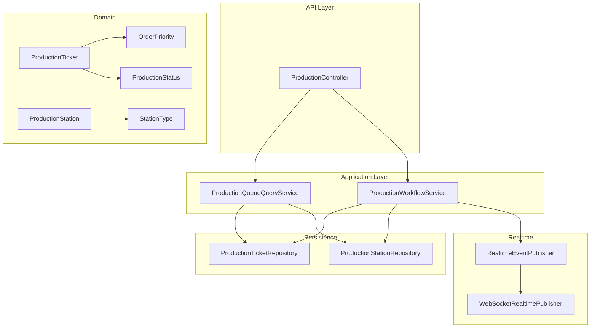
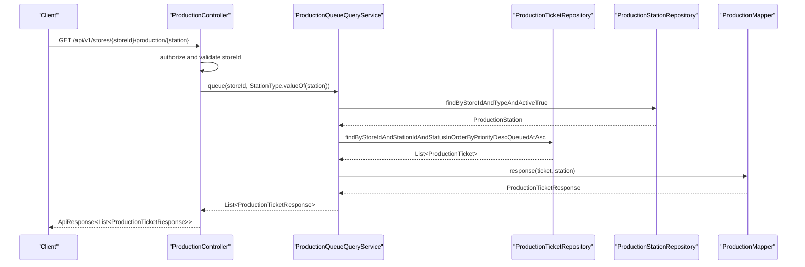
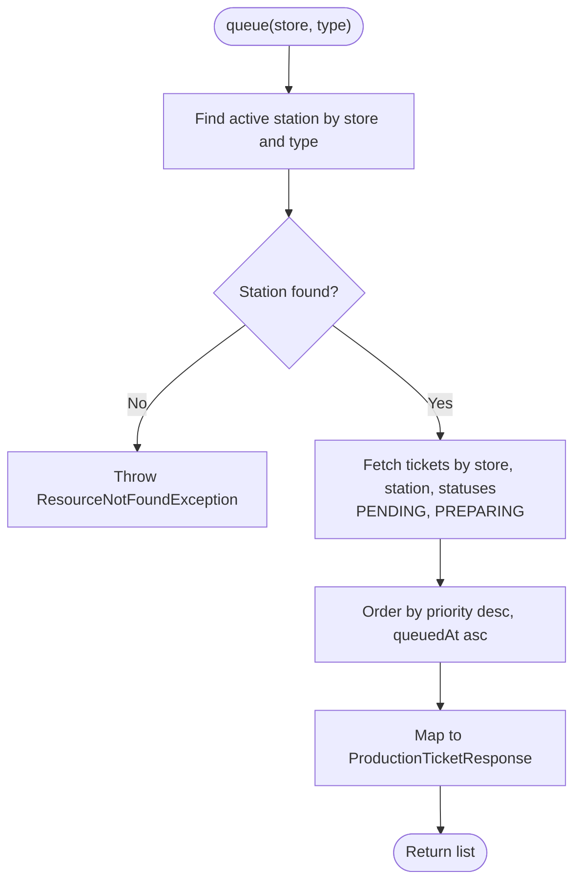
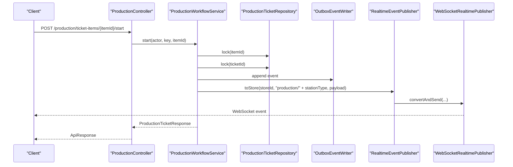
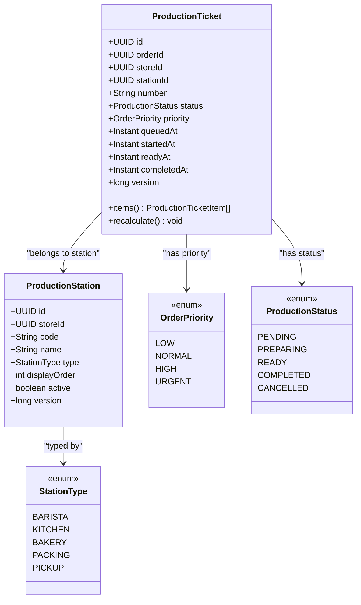
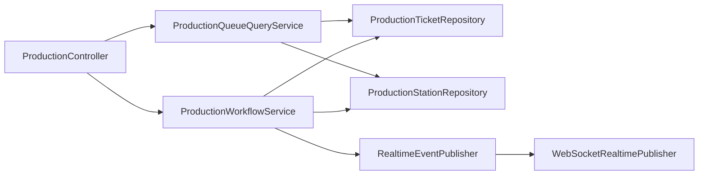

# Production Queue Management

<cite>
**Referenced Files in This Document**
- [ProductionQueueQueryService.java](file://src/main/java/com/smartcoffee/modules/production/application/ProductionQueueQueryService.java)
- [ProductionController.java](file://src/main/java/com/smartcoffee/modules/production/api/ProductionController.java)
- [ProductionTicketRepository.java](file://src/main/java/com/smartcoffee/modules/production/persistence/ProductionTicketRepository.java)
- [ProductionStationRepository.java](file://src/main/java/com/smartcoffee/modules/production/persistence/ProductionStationRepository.java)
- [ProductionTicket.java](file://src/main/java/com/smartcoffee/modules/production/domain/ProductionTicket.java)
- [ProductionStation.java](file://src/main/java/com/smartcoffee/modules/production/domain/ProductionStation.java)
- [StationType.java](file://src/main/java/com/smartcoffee/modules/production/domain/StationType.java)
- [OrderPriority.java](file://src/main/java/com/smartcoffee/modules/production/domain/OrderPriority.java)
- [ProductionStatus.java](file://src/main/java/com/smartcoffee/modules/production/domain/ProductionStatus.java)
- [ProductionTicketResponse.java](file://src/main/java/com/smartcoffee/modules/production/api/ProductionTicketResponse.java)
- [ProductionWorkflowService.java](file://src/main/java/com/smartcoffee/modules/production/application/ProductionWorkflowService.java)
- [RealtimeEventPublisher.java](file://src/main/java/com/smartcoffee/infrastructure/realtime/RealtimeEventPublisher.java)
- [WebSocketRealtimePublisher.java](file://src/main/java/com/smartcoffee/infrastructure/realtime/WebSocketRealtimePublisher.java)
</cite>

## Table of Contents
1. [Introduction](#introduction)
2. [Project Structure](#project-structure)
3. [Core Components](#core-components)
4. [Architecture Overview](#architecture-overview)
5. [Detailed Component Analysis](#detailed-component-analysis)
6. [Dependency Analysis](#dependency-analysis)
7. [Performance Considerations](#performance-considerations)
8. [Troubleshooting Guide](#troubleshooting-guide)
9. [Conclusion](#conclusion)

## Introduction
This document explains the production queue management functionality for organizing and processing orders across station types such as coffee machine (barista), pastry station (bakery), kitchen, packing, and pickup. It focuses on how queues are filtered by station type, ordered by priority and arrival time, and how real-time updates propagate to consumers when items start or complete. It also covers concurrency safeguards and performance considerations for high-throughput environments.

## Project Structure
The production module is organized into domain entities, application services, persistence repositories, API controllers, and infrastructure for real-time messaging:
- Domain: StationType, OrderPriority, ProductionStatus, ProductionTicket, ProductionStation
- Application: ProductionQueueQueryService (read-only queue retrieval), ProductionWorkflowService (state transitions)
- Persistence: Repositories for tickets and stations with query methods and locking
- API: ProductionController exposing endpoints for queue reads and workflow actions
- Realtime: Infrastructure publishers that broadcast events per store and station

**Diagram sources**
- [ProductionController.java:11-53](file://src/main/java/com/smartcoffee/modules/production/api/ProductionController.java#L11-L53)
- [ProductionQueueQueryService.java:11-32](file://src/main/java/com/smartcoffee/modules/production/application/ProductionQueueQueryService.java#L11-L32)
- [ProductionWorkflowService.java:19-131](file://src/main/java/com/smartcoffee/modules/production/application/ProductionWorkflowService.java#L19-L131)
- [ProductionTicket.java:8-40](file://src/main/java/com/smartcoffee/modules/production/domain/ProductionTicket.java#L8-L40)
- [ProductionStation.java:6-27](file://src/main/java/com/smartcoffee/modules/production/domain/ProductionStation.java#L6-L27)
- [ProductionTicketRepository.java:9-22](file://src/main/java/com/smartcoffee/modules/production/persistence/ProductionTicketRepository.java#L9-L22)
- [ProductionStationRepository.java:7-11](file://src/main/java/com/smartcoffee/modules/production/persistence/ProductionStationRepository.java#L7-L11)
- [RealtimeEventPublisher.java:1-3](file://src/main/java/com/smartcoffee/infrastructure/realtime/RealtimeEventPublisher.java#L1-L3)
- [WebSocketRealtimePublisher.java:1-4](file://src/main/java/com/smartcoffee/infrastructure/realtime/WebSocketRealtimePublisher.java#L1-L4)

**Section sources**
- [ProductionController.java:11-53](file://src/main/java/com/smartcoffee/modules/production/api/ProductionController.java#L11-L53)
- [ProductionQueueQueryService.java:11-32](file://src/main/java/com/smartcoffee/modules/production/application/ProductionQueueQueryService.java#L11-L32)
- [ProductionWorkflowService.java:19-131](file://src/main/java/com/smartcoffee/modules/production/application/ProductionWorkflowService.java#L19-L131)

## Core Components
- ProductionQueueQueryService: Provides read-only access to queued items for a given store and station type. Filters by active station and statuses PENDING and PREPARING, then orders by priority descending and queuedAt ascending.
- ProductionController: Exposes an endpoint to retrieve the queue for a specific station type under a store, enforcing permissions and store authorization.
- ProductionWorkflowService: Handles state transitions (start, ready) for ticket items, emits outbox events, and publishes real-time updates to the appropriate store/station destinations.
- Domain models: StationType enumerates supported stations; OrderPriority defines scheduling priorities; ProductionStatus tracks lifecycle; ProductionTicket and ProductionStation model core entities.
- Persistence: Repositories provide typed queries and pessimistic locking for safe concurrent updates.

Key responsibilities:
- Queue retrieval by station type with consistent ordering
- Priority-driven scheduling via database-level ordering
- Real-time propagation of item start and order readiness
- Concurrency safety through pessimistic locks and idempotency

**Section sources**
- [ProductionQueueQueryService.java:24-32](file://src/main/java/com/smartcoffee/modules/production/application/ProductionQueueQueryService.java#L24-L32)
- [ProductionController.java:29-36](file://src/main/java/com/smartcoffee/modules/production/api/ProductionController.java#L29-L36)
- [ProductionWorkflowService.java:53-92](file://src/main/java/com/smartcoffee/modules/production/application/ProductionWorkflowService.java#L53-L92)
- [StationType.java:3-5](file://src/main/java/com/smartcoffee/modules/production/domain/StationType.java#L3-L5)
- [OrderPriority.java:3-5](file://src/main/java/com/smartcoffee/modules/production/domain/OrderPriority.java#L3-L5)
- [ProductionStatus.java:3-5](file://src/main/java/com/smartcoffee/modules/production/domain/ProductionStatus.java#L3-L5)
- [ProductionTicket.java:23-40](file://src/main/java/com/smartcoffee/modules/production/domain/ProductionTicket.java#L23-L40)
- [ProductionStation.java:19-27](file://src/main/java/com/smartcoffee/modules/production/domain/ProductionStation.java#L19-L27)
- [ProductionTicketRepository.java:15-17](file://src/main/java/com/smartcoffee/modules/production/persistence/ProductionTicketRepository.java#L15-L17)
- [ProductionStationRepository.java:10-10](file://src/main/java/com/smartcoffee/modules/production/persistence/ProductionStationRepository.java#L10-L10)

## Architecture Overview
The queue read path resolves the active station by type, fetches relevant tickets, and maps them to responses. The write path transitions item states, updates ticket status, emits events, and publishes real-time updates to store-scoped channels.

**Diagram sources**
- [ProductionController.java:29-36](file://src/main/java/com/smartcoffee/modules/production/api/ProductionController.java#L29-L36)
- [ProductionQueueQueryService.java:24-32](file://src/main/java/com/smartcoffee/modules/production/application/ProductionQueueQueryService.java#L24-L32)
- [ProductionStationRepository.java:10-10](file://src/main/java/com/smartcoffee/modules/production/persistence/ProductionStationRepository.java#L10-L10)
- [ProductionTicketRepository.java:15-17](file://src/main/java/com/smartcoffee/modules/production/persistence/ProductionTicketRepository.java#L15-L17)

## Detailed Component Analysis

### Queue Retrieval by Station Type and Priority
- Filtering: The service locates the active station for the store and requested station type, then retrieves tickets associated with that station whose status is either PENDING or PREPARING.
- Ordering: Results are ordered by priority descending followed by queuedAt ascending. This ensures higher-priority items appear first, and among equal priorities, earlier queued items are processed first.
- Response mapping: Each ticket is mapped to a response including ticket identifiers, order and store references, station details, current status, priority, timestamps, and items.

**Diagram sources**
- [ProductionQueueQueryService.java:24-32](file://src/main/java/com/smartcoffee/modules/production/application/ProductionQueueQueryService.java#L24-L32)
- [ProductionTicketRepository.java:15-17](file://src/main/java/com/smartcoffee/modules/production/persistence/ProductionTicketRepository.java#L15-L17)
- [ProductionStatus.java:3-5](file://src/main/java/com/smartcoffee/modules/production/domain/ProductionStatus.java#L3-L5)

**Section sources**
- [ProductionQueueQueryService.java:24-32](file://src/main/java/com/smartcoffee/modules/production/application/ProductionQueueQueryService.java#L24-L32)
- [ProductionTicketRepository.java:15-17](file://src/main/java/com/smartcoffee/modules/production/persistence/ProductionTicketRepository.java#L15-L17)
- [ProductionStationRepository.java:10-10](file://src/main/java/com/smartcoffee/modules/production/persistence/ProductionStationRepository.java#L10-L10)

### Real-Time Queue Updates
When a ticket item starts or becomes ready, the workflow service:
- Emits an outbox event for durability and eventual consistency
- Publishes a real-time message to a store-scoped destination based on station type or order readiness
- Uses WebSocket infrastructure to deliver messages to subscribers authorized for the store/user

**Diagram sources**
- [ProductionController.java:38-44](file://src/main/java/com/smartcoffee/modules/production/api/ProductionController.java#L38-L44)
- [ProductionWorkflowService.java:53-73](file://src/main/java/com/smartcoffee/modules/production/application/ProductionWorkflowService.java#L53-L73)
- [RealtimeEventPublisher.java:1-3](file://src/main/java/com/smartcoffee/infrastructure/realtime/RealtimeEventPublisher.java#L1-L3)
- [WebSocketRealtimePublisher.java:1-4](file://src/main/java/com/smartcoffee/infrastructure/realtime/WebSocketRealtimePublisher.java#L1-L4)

**Section sources**
- [ProductionWorkflowService.java:53-92](file://src/main/java/com/smartcoffee/modules/production/application/ProductionWorkflowService.java#L53-L92)
- [RealtimeEventPublisher.java:1-3](file://src/main/java/com/smartcoffee/infrastructure/realtime/RealtimeEventPublisher.java#L1-L3)
- [WebSocketRealtimePublisher.java:1-4](file://src/main/java/com/smartcoffee/infrastructure/realtime/WebSocketRealtimePublisher.java#L1-L4)

### Data Models and Relationships

**Diagram sources**
- [ProductionTicket.java:8-40](file://src/main/java/com/smartcoffee/modules/production/domain/ProductionTicket.java#L8-L40)
- [ProductionStation.java:6-27](file://src/main/java/com/smartcoffee/modules/production/domain/ProductionStation.java#L6-L27)
- [StationType.java:3-5](file://src/main/java/com/smartcoffee/modules/production/domain/StationType.java#L3-L5)
- [OrderPriority.java:3-5](file://src/main/java/com/smartcoffee/modules/production/domain/OrderPriority.java#L3-L5)
- [ProductionStatus.java:3-5](file://src/main/java/com/smartcoffee/modules/production/domain/ProductionStatus.java#L3-L5)

### Queue Query Examples and Response Format
- Endpoint: GET /api/v1/stores/{storeId}/production/{station}
  - Path parameters:
    - storeId: UUID identifying the store
    - station: one of BARISTA, KITCHEN, BAKERY, PACKING, PICKUP
  - Authorization: Requires permission code production:queue-read and store access
  - Response: ApiResponse wrapping a list of ProductionTicketResponse objects
- ProductionTicketResponse fields include:
  - ticketId, ticketNumber, orderId, storeId, stationId, stationType
  - status, priority, queuedAt
  - items: list of ProductionItemResponse
  - version: optimistic lock version for conflict detection

Example usage patterns:
- Retrieve barista queue: GET /api/v1/stores/{storeId}/production/BARISTA
- Retrieve bakery queue: GET /api/v1/stores/{storeId}/production/BAKERY
- Retrieve packing queue: GET /api/v1/stores/{storeId}/production/PACKING

Notes:
- Only active stations are considered
- Only tickets with status PENDING or PREPARING are returned
- Ordering: highest priority first, then earliest queuedAt

**Section sources**
- [ProductionController.java:29-36](file://src/main/java/com/smartcoffee/modules/production/api/ProductionController.java#L29-L36)
- [ProductionQueueQueryService.java:24-32](file://src/main/java/com/smartcoffee/modules/production/application/ProductionQueueQueryService.java#L24-L32)
- [ProductionTicketResponse.java:6-8](file://src/main/java/com/smartcoffee/modules/production/api/ProductionTicketResponse.java#L6-L8)
- [StationType.java:3-5](file://src/main/java/com/smartcoffee/modules/production/domain/StationType.java#L3-L5)

### Relationship Between Order Priorities and Production Scheduling
- Priority values: LOW, NORMAL, HIGH, URGENT
- Scheduling rule: Tickets are ordered by priority descending, ensuring URGENT and HIGH items are served before lower priorities
- Tie-breaking: When priorities are equal, queuedAt ascending ensures FIFO within the same priority level
- Status-based inclusion: Only PENDING and PREPARING tickets are included in the active queue view, reflecting work-in-progress and upcoming work

Implications:
- Higher priority items will be visible at the top of the queue
- Operational dashboards can rely on this ordering to guide staff attention
- Consistent ordering reduces ambiguity during peak load

**Section sources**
- [OrderPriority.java:3-5](file://src/main/java/com/smartcoffee/modules/production/domain/OrderPriority.java#L3-L5)
- [ProductionTicketRepository.java:15-17](file://src/main/java/com/smartcoffee/modules/production/persistence/ProductionTicketRepository.java#L15-L17)
- [ProductionStatus.java:3-5](file://src/main/java/com/smartcoffee/modules/production/domain/ProductionStatus.java#L3-L5)

### Concurrent Queue Access and Performance Considerations
Concurrency safeguards:
- Pessimistic locking: Item and ticket operations use pessimistic write locks to prevent race conditions during state transitions
- Idempotency: Start and ready actions are protected by idempotency keys to avoid duplicate processing
- Optimistic versioning: Entities carry version fields to detect conflicts on concurrent updates

Performance characteristics:
- Read path uses a single repository query with explicit ordering and status filtering, minimizing round-trips
- Entity graphs eagerly load related items to reduce N+1 queries during mapping
- Realtime publishing decouples event emission from request processing, improving responsiveness

Recommendations:
- Ensure database indexes support filters on storeId, stationId, status, and ordering columns
- Monitor WebSocket subscriber counts and scale horizontally if needed
- Use pagination for large queues if required by UI constraints

**Section sources**
- [ProductionTicketRepository.java:10-17](file://src/main/java/com/smartcoffee/modules/production/persistence/ProductionTicketRepository.java#L10-L17)
- [ProductionWorkflowService.java:53-92](file://src/main/java/com/smartcoffee/modules/production/application/ProductionWorkflowService.java#L53-L92)
- [ProductionTicket.java:37-38](file://src/main/java/com/smartcoffee/modules/production/domain/ProductionTicket.java#L37-L38)
- [ProductionStation.java:26-27](file://src/main/java/com/smartcoffee/modules/production/domain/ProductionStation.java#L26-L27)

## Dependency Analysis

**Diagram sources**
- [ProductionController.java:11-53](file://src/main/java/com/smartcoffee/modules/production/api/ProductionController.java#L11-L53)
- [ProductionQueueQueryService.java:11-32](file://src/main/java/com/smartcoffee/modules/production/application/ProductionQueueQueryService.java#L11-L32)
- [ProductionWorkflowService.java:19-131](file://src/main/java/com/smartcoffee/modules/production/application/ProductionWorkflowService.java#L19-L131)
- [RealtimeEventPublisher.java:1-3](file://src/main/java/com/smartcoffee/infrastructure/realtime/RealtimeEventPublisher.java#L1-L3)
- [WebSocketRealtimePublisher.java:1-4](file://src/main/java/com/smartcoffee/infrastructure/realtime/WebSocketRealtimePublisher.java#L1-L4)

**Section sources**
- [ProductionController.java:11-53](file://src/main/java/com/smartcoffee/modules/production/api/ProductionController.java#L11-L53)
- [ProductionQueueQueryService.java:11-32](file://src/main/java/com/smartcoffee/modules/production/application/ProductionQueueQueryService.java#L11-L32)
- [ProductionWorkflowService.java:19-131](file://src/main/java/com/smartcoffee/modules/production/application/ProductionWorkflowService.java#L19-L131)

## Performance Considerations
- Query efficiency: The repository method returns results already ordered by priority and queuedAt, reducing client-side sorting overhead
- Eager loading: Entity graphs ensure ticket items are loaded efficiently during mapping
- Realtime scalability: Publishing to store-scoped topics limits fan-out scope; consider connection pooling and backpressure strategies for high subscriber volumes
- Lock contention: Pessimistic locks protect critical sections but may serialize writes; monitor lock wait times and adjust workload distribution if necessary

[No sources needed since this section provides general guidance]

## Troubleshooting Guide
Common issues and resolutions:
- Station not found: Occurs when no active station matches the requested type for the store. Verify station configuration and activation status.
- Item not found: Happens when attempting to start or ready a non-existent item. Confirm itemId and ownership.
- Duplicate processing: If idempotency keys are reused incorrectly, requests may be replayed. Ensure unique keys per action.
- Realtime delivery failures: Check WebSocket authorization and subscription paths; ensure clients subscribe to correct store-scoped destinations.

Operational checks:
- Validate permissions: Ensure callers have production:queue-read and appropriate action permissions
- Inspect outbox events: Confirm events are written for auditability and downstream consumers
- Monitor queue depth: Track counts of PENDING and PREPARING tickets per station to identify bottlenecks

**Section sources**
- [ProductionQueueQueryService.java:24-32](file://src/main/java/com/smartcoffee/modules/production/application/ProductionQueueQueryService.java#L24-L32)
- [ProductionWorkflowService.java:53-92](file://src/main/java/com/smartcoffee/modules/production/application/ProductionWorkflowService.java#L53-L92)
- [ProductionController.java:29-51](file://src/main/java/com/smartcoffee/modules/production/api/ProductionController.java#L29-L51)

## Conclusion
The production queue system organizes work by station type and enforces priority-based scheduling with robust concurrency controls. The read path provides deterministic ordering for operational clarity, while the write path ensures reliable state transitions, durable event emission, and timely real-time updates. Together, these components enable efficient, scalable production workflows across diverse station types in a cafe environment.

[No sources needed since this section summarizes without analyzing specific files]