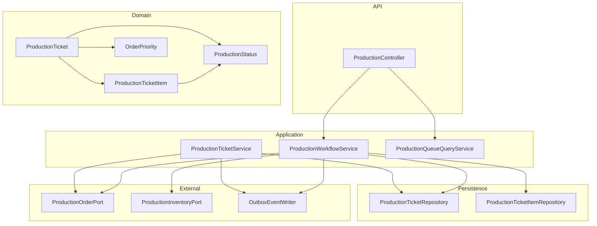
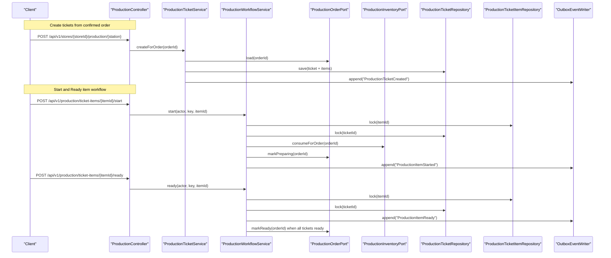
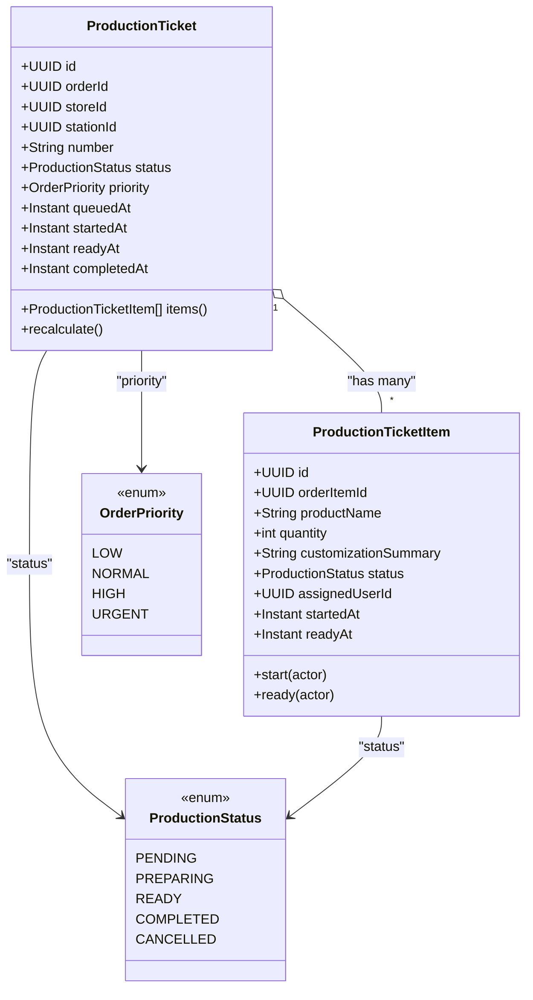
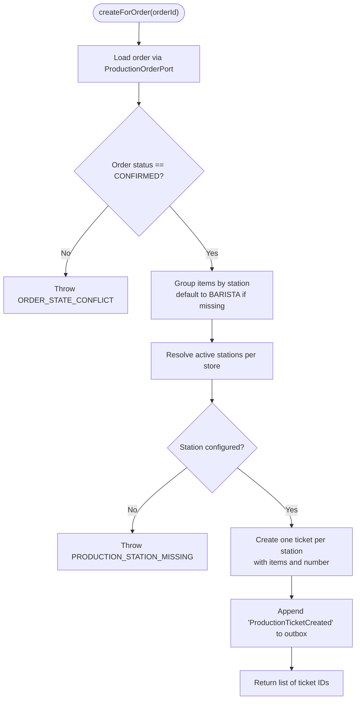
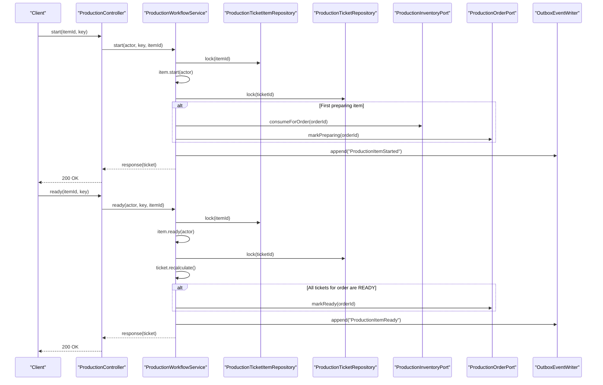
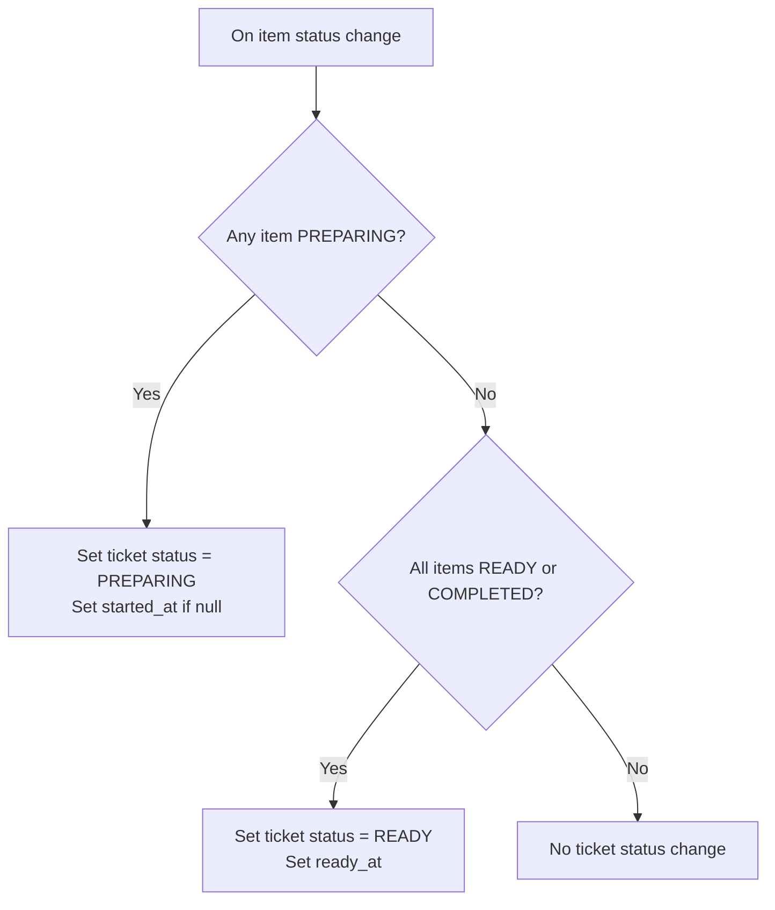
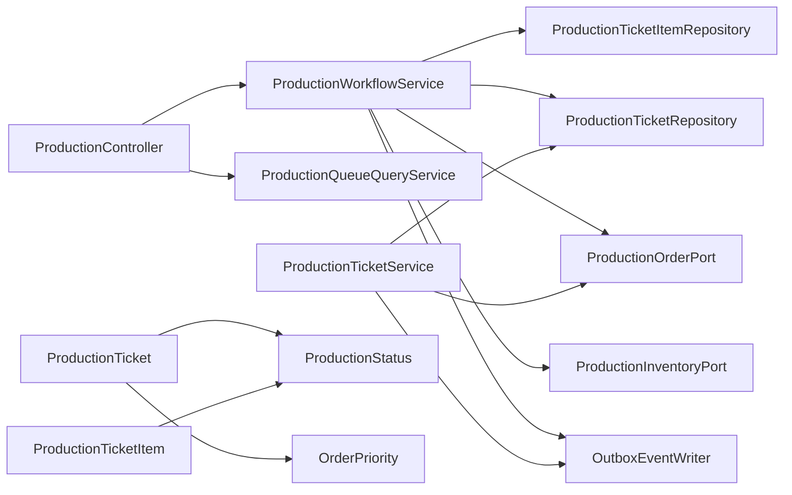

# Production Ticket Management

<cite>
**Referenced Files in This Document**
- [ProductionTicket.java](file://src/main/java/com/smartcoffee/modules/production/domain/ProductionTicket.java)
- [ProductionTicketItem.java](file://src/main/java/com/smartcoffee/modules/production/domain/ProductionTicketItem.java)
- [ProductionStatus.java](file://src/main/java/com/smartcoffee/modules/production/domain/ProductionStatus.java)
- [OrderPriority.java](file://src/main/java/com/smartcoffee/modules/production/domain/OrderPriority.java)
- [ProductionTicketService.java](file://src/main/java/com/smartcoffee/modules/production/application/ProductionTicketService.java)
- [ProductionWorkflowService.java](file://src/main/java/com/smartcoffee/modules/production/application/ProductionWorkflowService.java)
- [ProductionController.java](file://src/main/java/com/smartcoffee/modules/production/api/ProductionController.java)
- [ProductionQueueQueryService.java](file://src/main/java/com/smartcoffee/modules/production/application/ProductionQueueQueryService.java)
- [ProductionTicketRepository.java](file://src/main/java/com/smartcoffee/modules/production/persistence/ProductionTicketRepository.java)
- [ProductionTicketItemRepository.java](file://src/main/java/com/smartcoffee/modules/production/persistence/ProductionTicketItemRepository.java)
- [smart-coffee-logical.dbml](file://database/smart-coffee-logical.dbml)
</cite>

## Table of Contents
1. [Introduction](#introduction)
2. [Project Structure](#project-structure)
3. [Core Components](#core-components)
4. [Architecture Overview](#architecture-overview)
5. [Detailed Component Analysis](#detailed-component-analysis)
6. [Dependency Analysis](#dependency-analysis)
7. [Performance Considerations](#performance-considerations)
8. [Troubleshooting Guide](#troubleshooting-guide)
9. [Conclusion](#conclusion)

## Introduction
This document explains the production ticket management functionality for creating, tracking, and operating on production tickets derived from orders. It focuses on the domain models ProductionTicket and ProductionTicketItem, their lifecycle states, relationships to orders and stations, item-level tracking, status transitions, persistence, querying patterns, and data integrity constraints.

## Project Structure
The production feature is implemented as a module under modules/production with clear separation:
- Domain: entities and enums that define business rules and state transitions
- Application: services orchestrating workflows (creation, start, ready), integration with order/inventory/outbox
- API: REST endpoints for queue listing and item actions
- Persistence: JPA repositories with locking and queries for concurrency control and performance

**Diagram sources**
- [ProductionController.java:11-52](file://src/main/java/com/smartcoffee/modules/production/api/ProductionController.java#L11-L52)
- [ProductionTicketService.java:24-144](file://src/main/java/com/smartcoffee/modules/production/application/ProductionTicketService.java#L24-L144)
- [ProductionWorkflowService.java:19-134](file://src/main/java/com/smartcoffee/modules/production/application/ProductionWorkflowService.java#L19-L134)
- [ProductionTicket.java:8-116](file://src/main/java/com/smartcoffee/modules/production/domain/ProductionTicket.java#L8-L116)
- [ProductionTicketItem.java:8-106](file://src/main/java/com/smartcoffee/modules/production/domain/ProductionTicketItem.java#L8-L106)
- [ProductionStatus.java:1-7](file://src/main/java/com/smartcoffee/modules/production/domain/ProductionStatus.java#L1-L7)
- [OrderPriority.java:1-7](file://src/main/java/com/smartcoffee/modules/production/domain/OrderPriority.java#L1-L7)
- [ProductionTicketRepository.java:9-22](file://src/main/java/com/smartcoffee/modules/production/persistence/ProductionTicketRepository.java#L9-L22)
- [ProductionTicketItemRepository.java:9-16](file://src/main/java/com/smartcoffee/modules/production/persistence/ProductionTicketItemRepository.java#L9-L16)

**Section sources**
- [ProductionController.java:11-52](file://src/main/java/com/smartcoffee/modules/production/api/ProductionController.java#L11-L52)
- [ProductionTicketService.java:24-144](file://src/main/java/com/smartcoffee/modules/production/application/ProductionTicketService.java#L24-L144)
- [ProductionWorkflowService.java:19-134](file://src/main/java/com/smartcoffee/modules/production/application/ProductionWorkflowService.java#L19-L134)

## Core Components
- ProductionTicket: Represents a station-scoped production unit for an order. It stores order and store identifiers, station association, ticket number, priority, timestamps, and aggregates items.
- ProductionTicketItem: Represents a single order item within a ticket, capturing product snapshot, quantity, customization summary, per-item status, assignment, and timing.
- ProductionStatus: Enumerates lifecycle states for both ticket and item: PENDING, PREPARING, READY, COMPLETED, CANCELLED.
- OrderPriority: Defines ticket priority levels used for queue ordering.

Key behaviors:
- Ticket creation groups order items by station and creates one ticket per station.
- Item-level transitions: PENDING → PREPARING → READY; ticket recalculation updates ticket status based on item statuses.
- Idempotent workflow actions with optimistic locking and pessimistic reads where needed.

**Section sources**
- [ProductionTicket.java:8-116](file://src/main/java/com/smartcoffee/modules/production/domain/ProductionTicket.java#L8-L116)
- [ProductionTicketItem.java:8-106](file://src/main/java/com/smartcoffee/modules/production/domain/ProductionTicketItem.java#L8-L106)
- [ProductionStatus.java:1-7](file://src/main/java/com/smartcoffee/modules/production/domain/ProductionStatus.java#L1-L7)
- [OrderPriority.java:1-7](file://src/main/java/com/smartcoffee/modules/production/domain/OrderPriority.java#L1-L7)

## Architecture Overview
The system integrates with ordering and inventory domains through ports, persists tickets via JPA, and publishes events using an outbox pattern. Realtime notifications are emitted for operational visibility.

**Diagram sources**
- [ProductionController.java:29-52](file://src/main/java/com/smartcoffee/modules/production/api/ProductionController.java#L29-L52)
- [ProductionTicketService.java:47-144](file://src/main/java/com/smartcoffee/modules/production/application/ProductionTicketService.java#L47-L144)
- [ProductionWorkflowService.java:53-92](file://src/main/java/com/smartcoffee/modules/production/application/ProductionWorkflowService.java#L53-L92)
- [ProductionTicketRepository.java:9-22](file://src/main/java/com/smartcoffee/modules/production/persistence/ProductionTicketRepository.java#L9-L22)
- [ProductionTicketItemRepository.java:9-16](file://src/main/java/com/smartcoffee/modules/production/persistence/ProductionTicketItemRepository.java#L9-L16)

## Detailed Component Analysis

### Domain Models and Relationships
- ProductionTicket holds references to orderId, storeId, stationId, and aggregates ProductionTicketItem instances. It enforces uniqueness at the database level for (order_id, station_id).
- ProductionTicketItem links back to its parent ticket and records the original order_item_id along with snapshots of product name and customizations. It maintains per-item status and timestamps for started_at and ready_at.
- Both entities use versioning for optimistic concurrency control.

**Diagram sources**
- [ProductionTicket.java:8-116](file://src/main/java/com/smartcoffee/modules/production/domain/ProductionTicket.java#L8-L116)
- [ProductionTicketItem.java:8-106](file://src/main/java/com/smartcoffee/modules/production/domain/ProductionTicketItem.java#L8-L106)
- [ProductionStatus.java:1-7](file://src/main/java/com/smartcoffee/modules/production/domain/ProductionStatus.java#L1-L7)
- [OrderPriority.java:1-7](file://src/main/java/com/smartcoffee/modules/production/domain/OrderPriority.java#L1-L7)

**Section sources**
- [ProductionTicket.java:8-116](file://src/main/java/com/smartcoffee/modules/production/domain/ProductionTicket.java#L8-L116)
- [ProductionTicketItem.java:8-106](file://src/main/java/com/smartcoffee/modules/production/domain/ProductionTicketItem.java#L8-L106)

### Ticket Creation from Orders
- The service loads the order via ProductionOrderPort and validates that the order is CONFIRMED before creating tickets.
- Items are grouped by station code; if unassigned or UNASSIGNED, they default to BARISTA.
- For each station group, a ticket is created with a number composed of station code and order number.
- An outbox event is appended for downstream consumers.

**Diagram sources**
- [ProductionTicketService.java:47-144](file://src/main/java/com/smartcoffee/modules/production/application/ProductionTicketService.java#L47-L144)

**Section sources**
- [ProductionTicketService.java:47-144](file://src/main/java/com/smartcoffee/modules/production/application/ProductionTicketService.java#L47-L144)

### Item-Level Tracking and Status Transitions
- Start action:
  - Claims idempotency for the actor and request key.
  - Locks the item and transitions it from PENDING to PREPARING, recording assigned user and started timestamp.
  - Locks the associated ticket; if this is the first preparing item, consumes inventory for the order and marks the order as preparing.
  - Emits a “ProductionItemStarted” event and realtime notification scoped to the station type.
- Ready action:
  - Claims idempotency and locks the item, transitioning from PREPARING to READY with timestamps.
  - Recalculates ticket status; if all tickets for the order are READY, marks the order as ready and emits a realtime notification.

**Diagram sources**
- [ProductionController.java:38-52](file://src/main/java/com/smartcoffee/modules/production/api/ProductionController.java#L38-L52)
- [ProductionWorkflowService.java:53-92](file://src/main/java/com/smartcoffee/modules/production/application/ProductionWorkflowService.java#L53-L92)
- [ProductionTicketItemRepository.java:9-16](file://src/main/java/com/smartcoffee/modules/production/persistence/ProductionTicketItemRepository.java#L9-L16)
- [ProductionTicketRepository.java:9-22](file://src/main/java/com/smartcoffee/modules/production/persistence/ProductionTicketRepository.java#L9-L22)

**Section sources**
- [ProductionWorkflowService.java:53-92](file://src/main/java/com/smartcoffee/modules/production/application/ProductionWorkflowService.java#L53-L92)
- [ProductionTicketItem.java:54-68](file://src/main/java/com/smartcoffee/modules/production/domain/ProductionTicketItem.java#L54-L68)

### Ticket Recalculation Logic
- When any item enters PREPARING, the ticket moves to PREPARING and sets started_at if not already set.
- When all items are READY or COMPLETED, the ticket moves to READY and sets ready_at.

**Diagram sources**
- [ProductionTicket.java:63-73](file://src/main/java/com/smartcoffee/modules/production/domain/ProductionTicket.java#L63-L73)

**Section sources**
- [ProductionTicket.java:63-73](file://src/main/java/com/smartcoffee/modules/production/domain/ProductionTicket.java#L63-L73)

### Association with Stations and Order Items
- Each ticket is bound to a specific station via stationId; items are grouped by station during creation.
- Each item retains the original order_item_id, enabling traceability back to the originating order line.
- Customization details are captured as a summary string per item.

**Section sources**
- [ProductionTicketService.java:58-97](file://src/main/java/com/smartcoffee/modules/production/application/ProductionTicketService.java#L58-L97)
- [ProductionTicketItem.java:18-25](file://src/main/java/com/smartcoffee/modules/production/domain/ProductionTicketItem.java#L18-L25)

### Validation Rules and Business Constraints
- Order must be CONFIRMED to create tickets; otherwise, a conflict exception is raised.
- Station must exist and be active for the store; otherwise, an infrastructure exception is raised.
- Per-item transitions enforce state machine rules:
  - Start requires item status PENDING; otherwise, a conflict exception is raised.
  - Ready requires item status PREPARING; otherwise, a conflict exception is raised.
- Database constraints:
  - Unique constraint on (order_id, station_id) ensures one ticket per order per station.
  - Unique constraint on (ticket_id, order_item_id) prevents duplicate item entries within a ticket.

**Section sources**
- [ProductionTicketService.java:47-82](file://src/main/java/com/smartcoffee/modules/production/application/ProductionTicketService.java#L47-L82)
- [ProductionTicketItem.java:54-68](file://src/main/java/com/smartcoffee/modules/production/domain/ProductionTicketItem.java#L54-L68)
- [ProductionTicket.java:8-11](file://src/main/java/com/smartcoffee/modules/production/domain/ProductionTicket.java#L8-L11)
- [ProductionTicketItem.java:8-11](file://src/main/java/com/smartcoffee/modules/production/domain/ProductionTicketItem.java#L8-L11)

### Persistence and Querying Patterns
- Repositories provide pessimistic locking for concurrent operations:
  - ProductionTicketRepository.lock uses PESSIMISTIC_WRITE with entity graph to eagerly load items.
  - ProductionTicketItemRepository.lock uses PESSIMISTIC_WRITE with join fetch to load ticket context.
- Queries support:
  - Listing tickets by store, station, and status set ordered by priority and queue time.
  - Checking existence of non-terminal tickets per order.
  - Retrieving tickets by order ID.

**Section sources**
- [ProductionTicketRepository.java:9-22](file://src/main/java/com/smartcoffee/modules/production/persistence/ProductionTicketRepository.java#L9-L22)
- [ProductionTicketItemRepository.java:9-16](file://src/main/java/com/smartcoffee/modules/production/persistence/ProductionTicketItemRepository.java#L9-L16)
- [ProductionQueueQueryService.java:14-25](file://src/main/java/com/smartcoffee/modules/production/application/ProductionQueueQueryService.java#L14-L25)

### Data Integrity Requirements
- Optimistic concurrency:
  - Version fields on entities prevent lost updates.
- Idempotency:
  - Workflow actions claim and replay responses to avoid duplicate processing.
- Eventual consistency:
  - Outbox events ensure reliable delivery of ticket lifecycle events.
- Referential integrity:
  - Database unique constraints protect against duplicates and enforce logical relationships.

**Section sources**
- [ProductionTicket.java:37-38](file://src/main/java/com/smartcoffee/modules/production/domain/ProductionTicket.java#L37-L38)
- [ProductionTicketItem.java:35-36](file://src/main/java/com/smartcoffee/modules/production/domain/ProductionTicketItem.java#L35-L36)
- [ProductionWorkflowService.java:53-92](file://src/main/java/com/smartcoffee/modules/production/application/ProductionWorkflowService.java#L53-L92)
- [ProductionTicketService.java:119-140](file://src/main/java/com/smartcoffee/modules/production/application/ProductionTicketService.java#L119-L140)

## Dependency Analysis
- ProductionController depends on ProductionQueueQueryService and ProductionWorkflowService for read and write operations.
- ProductionTicketService depends on ProductionOrderPort, ProductionStationRepository, ProductionTicketRepository, and OutboxEventWriter.
- ProductionWorkflowService depends on repositories, ports, idempotency, outbox, and realtime publishing.
- Entities depend on enums for state and priority.

**Diagram sources**
- [ProductionController.java:11-52](file://src/main/java/com/smartcoffee/modules/production/api/ProductionController.java#L11-L52)
- [ProductionWorkflowService.java:19-134](file://src/main/java/com/smartcoffee/modules/production/application/ProductionWorkflowService.java#L19-L134)
- [ProductionTicketService.java:24-144](file://src/main/java/com/smartcoffee/modules/production/application/ProductionTicketService.java#L24-L144)
- [ProductionTicket.java:8-116](file://src/main/java/com/smartcoffee/modules/production/domain/ProductionTicket.java#L8-L116)
- [ProductionTicketItem.java:8-106](file://src/main/java/com/smartcoffee/modules/production/domain/ProductionTicketItem.java#L8-L106)
- [ProductionStatus.java:1-7](file://src/main/java/com/smartcoffee/modules/production/domain/ProductionStatus.java#L1-L7)
- [OrderPriority.java:1-7](file://src/main/java/com/smartcoffee/modules/production/domain/OrderPriority.java#L1-L7)

**Section sources**
- [ProductionController.java:11-52](file://src/main/java/com/smartcoffee/modules/production/api/ProductionController.java#L11-L52)
- [ProductionWorkflowService.java:19-134](file://src/main/java/com/smartcoffee/modules/production/application/ProductionWorkflowService.java#L19-L134)
- [ProductionTicketService.java:24-144](file://src/main/java/com/smartcoffee/modules/production/application/ProductionTicketService.java#L24-L144)

## Performance Considerations
- Use pessimistic locks only around critical sections (item and ticket updates) to minimize contention.
- Entity graphs in queries eagerly load necessary associations to avoid N+1 issues.
- Grouping items by station reduces the number of tickets created per order, improving throughput.
- Ordering by priority and queued time supports efficient queue rendering and dispatch.

[No sources needed since this section provides general guidance]

## Troubleshooting Guide
Common issues and resolutions:
- ORDER_STATE_CONFLICT: Ensure the order is CONFIRMED before creating tickets.
- PRODUCTION_STATION_MISSING: Verify that the station exists and is active for the store.
- PRODUCTION_STATE_CONFLICT: Check current item status before calling start or ready; transitions are enforced.
- ResourceNotFoundException: Confirm that the item and ticket exist and are accessible by the actor.
- Idempotency errors: If requests are retried, ensure Idempotency-Key headers are consistent; the service replays previous successful responses.

Operational checks:
- Inspect outbox events for ProductionTicketCreated, ProductionItemStarted, and ProductionItemReady.
- Use queue endpoints to verify tickets are visible for the correct station and status set.

**Section sources**
- [ProductionTicketService.java:47-82](file://src/main/java/com/smartcoffee/modules/production/application/ProductionTicketService.java#L47-L82)
- [ProductionWorkflowService.java:53-92](file://src/main/java/com/smartcoffee/modules/production/application/ProductionWorkflowService.java#L53-L92)
- [ProductionController.java:29-52](file://src/main/java/com/smartcoffee/modules/production/api/ProductionController.java#L29-L52)

## Conclusion
The production ticket management system models tickets and items with clear lifecycle states, enforces strict validation and state transitions, and integrates with order and inventory domains. It ensures data integrity through optimistic and pessimistic locking, idempotency, and outbox-based eventing. Tickets are associated with specific stations and order items, enabling precise tracking and operational visibility across the production workflow.