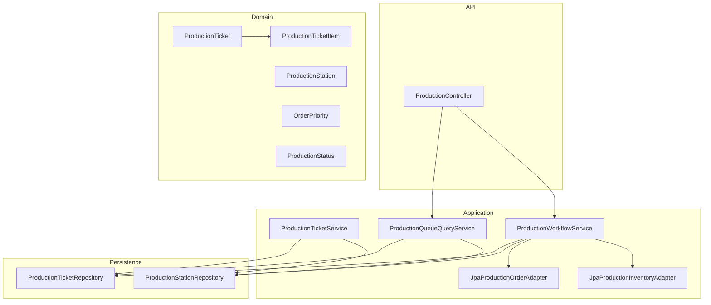
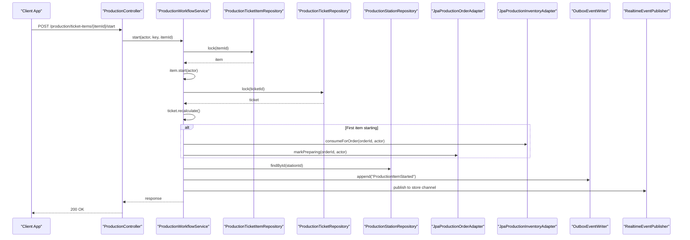
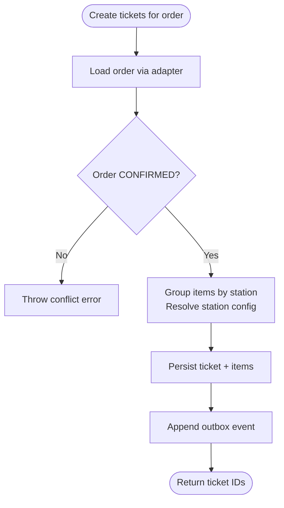
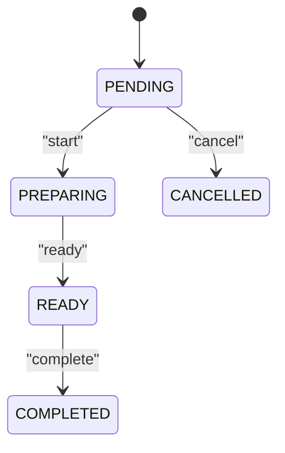
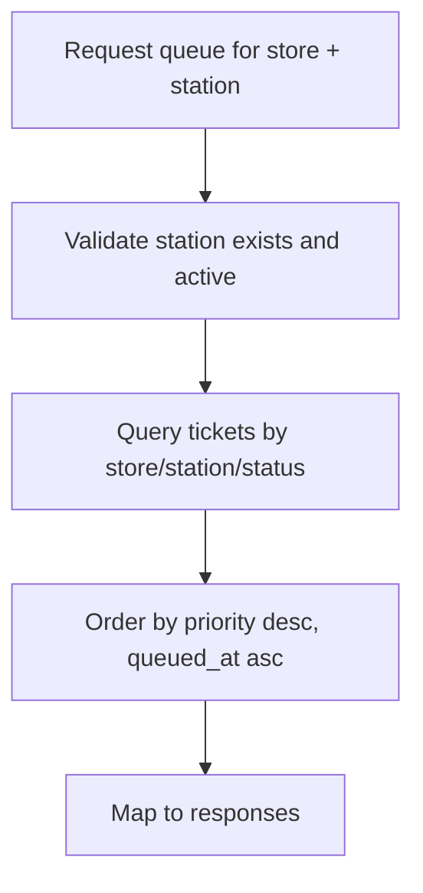
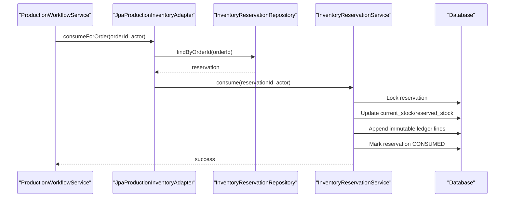
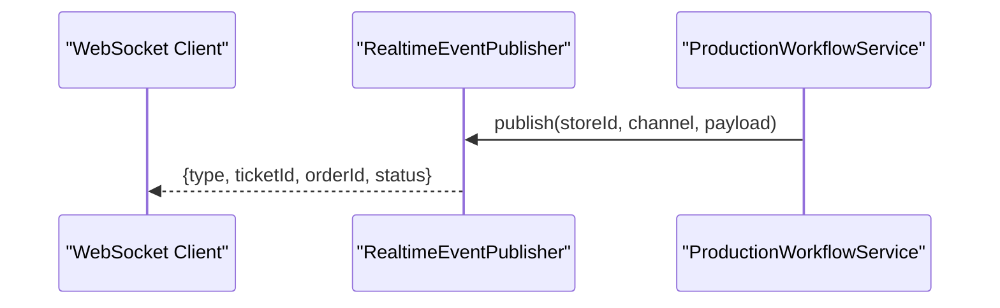
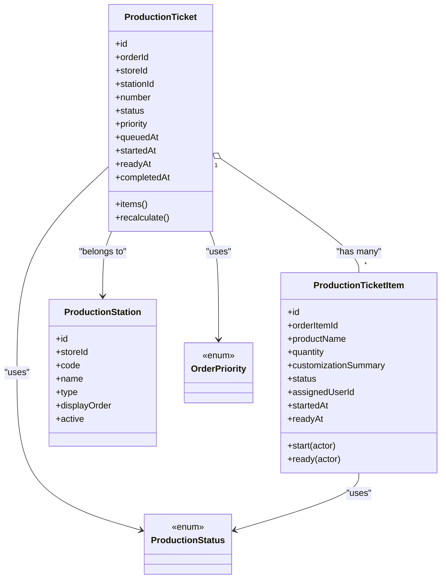
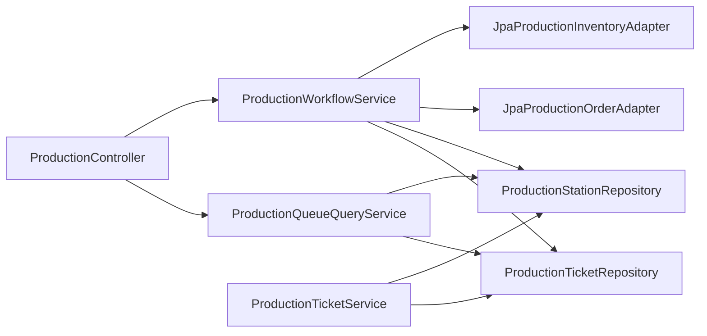

# Production Workflow Module

<cite>
**Referenced Files in This Document**
- [ProductionController.java](file://src/main/java/com/smartcoffee/modules/production/api/ProductionController.java)
- [ProductionTicketService.java](file://src/main/java/com/smartcoffee/modules/production/application/ProductionTicketService.java)
- [ProductionWorkflowService.java](file://src/main/java/com/smartcoffee/modules/production/application/ProductionWorkflowService.java)
- [ProductionQueueQueryService.java](file://src/main/java/com/smartcoffee/modules/production/application/ProductionQueueQueryService.java)
- [JpaProductionOrderAdapter.java](file://src/main/java/com/smartcoffee/modules/production/application/JpaProductionOrderAdapter.java)
- [JpaProductionInventoryAdapter.java](file://src/main/java/com/smartcoffee/modules/production/application/JpaProductionInventoryAdapter.java)
- [ProductionTicket.java](file://src/main/java/com/smartcoffee/modules/production/domain/ProductionTicket.java)
- [ProductionTicketItem.java](file://src/main/java/com/smartcoffee/modules/production/domain/ProductionTicketItem.java)
- [ProductionStation.java](file://src/main/java/com/smartcoffee/modules/production/domain/ProductionStation.java)
- [OrderPriority.java](file://src/main/java/com/smartcoffee/modules/production/domain/OrderPriority.java)
- [ProductionStatus.java](file://src/main/java/com/smartcoffee/modules/production/domain/ProductionStatus.java)
- [ProductionTicketRepository.java](file://src/main/java/com/smartcoffee/modules/production/persistence/ProductionTicketRepository.java)
- [ProductionStationRepository.java](file://src/main/java/com/smartcoffee/modules/production/persistence/ProductionStationRepository.java)
- [INVENTORY_FLOW.mermaid](file://architecture/INVENTORY_FLOW.mermaid)
</cite>

## Table of Contents
1. [Introduction](#introduction)
2. [Project Structure](#project-structure)
3. [Core Components](#core-components)
4. [Architecture Overview](#architecture-overview)
5. [Detailed Component Analysis](#detailed-component-analysis)
6. [Dependency Analysis](#dependency-analysis)
7. [Performance Considerations](#performance-considerations)
8. [Troubleshooting Guide](#troubleshooting-guide)
9. [Conclusion](#conclusion)

## Introduction
This document explains the Production Workflow module that coordinates kitchen ticket management, production station coordination, and order fulfillment tracking. It covers how tickets are created from confirmed orders, how items move through a production queue with priority handling, how inventory is consumed at preparation start, and how real-time status updates propagate to clients. It also documents concurrent safety mechanisms, idempotency, and integration points with ordering and inventory modules.

## Project Structure
The Production module follows a layered design:
- API layer exposes endpoints for queue reads and item lifecycle actions.
- Application layer orchestrates workflows, persistence, events, and integrations.
- Domain layer models tickets, items, stations, statuses, and priorities.
- Persistence layer provides repositories for tickets and stations.

**Diagram sources**
- [ProductionController.java:11-53](file://src/main/java/com/smartcoffee/modules/production/api/ProductionController.java#L11-L53)
- [ProductionTicketService.java:24-45](file://src/main/java/com/smartcoffee/modules/production/application/ProductionTicketService.java#L24-L45)
- [ProductionWorkflowService.java:19-51](file://src/main/java/com/smartcoffee/modules/production/application/ProductionWorkflowService.java#L19-L51)
- [ProductionQueueQueryService.java:11-22](file://src/main/java/com/smartcoffee/modules/production/application/ProductionQueueQueryService.java#L11-L22)
- [JpaProductionOrderAdapter.java:9-35](file://src/main/java/com/smartcoffee/modules/production/application/JpaProductionOrderAdapter.java#L9-L35)
- [JpaProductionInventoryAdapter.java:9-23](file://src/main/java/com/smartcoffee/modules/production/application/JpaProductionInventoryAdapter.java#L9-L23)
- [ProductionTicket.java:8-40](file://src/main/java/com/smartcoffee/modules/production/domain/ProductionTicket.java#L8-L40)
- [ProductionTicketItem.java:8-36](file://src/main/java/com/smartcoffee/modules/production/domain/ProductionTicketItem.java#L8-L36)
- [ProductionStation.java:6-27](file://src/main/java/com/smartcoffee/modules/production/domain/ProductionStation.java#L6-L27)
- [ProductionTicketRepository.java:9-21](file://src/main/java/com/smartcoffee/modules/production/persistence/ProductionTicketRepository.java#L9-L21)
- [ProductionStationRepository.java:7-10](file://src/main/java/com/smartcoffee/modules/production/persistence/ProductionStationRepository.java#L7-L10)

**Section sources**
- [ProductionController.java:11-53](file://src/main/java/com/smartcoffee/modules/production/api/ProductionController.java#L11-L53)
- [ProductionTicketService.java:24-45](file://src/main/java/com/smartcoffee/modules/production/application/ProductionTicketService.java#L24-L45)
- [ProductionWorkflowService.java:19-51](file://src/main/java/com/smartcoffee/modules/production/application/ProductionWorkflowService.java#L19-L51)
- [ProductionQueueQueryService.java:11-22](file://src/main/java/com/smartcoffee/modules/production/application/ProductionQueueQueryService.java#L11-L22)

## Core Components
- ProductionController: REST endpoints for reading a station’s queue and starting or marking items ready. Enforces permissions and store authorization.
- ProductionTicketService: Creates one ticket per station for a confirmed order, groups order items by station, persists tickets and items, and emits an outbox event.
- ProductionWorkflowService: Handles item lifecycle transitions (start, ready), idempotency, inventory consumption on first start, order status progression, and real-time notifications.
- ProductionQueueQueryService: Reads active queue entries for a station, ordered by priority and creation time.
- Domain entities: ProductionTicket, ProductionTicketItem, ProductionStation, OrderPriority, ProductionStatus model the state machine and relationships.
- Adapters: JpaProductionOrderAdapter integrates with the Ordering module; JpaProductionInventoryAdapter consumes reservations into stock ledger.

Key responsibilities:
- Ticket creation from confirmed orders.
- Station-based grouping and numbering.
- Priority-aware queue retrieval.
- Idempotent start/ready transitions.
- Inventory reservation consumption on first preparation.
- Real-time broadcasting of item and order readiness.

**Section sources**
- [ProductionController.java:29-52](file://src/main/java/com/smartcoffee/modules/production/api/ProductionController.java#L29-L52)
- [ProductionTicketService.java:47-143](file://src/main/java/com/smartcoffee/modules/production/application/ProductionTicketService.java#L47-L143)
- [ProductionWorkflowService.java:53-92](file://src/main/java/com/smartcoffee/modules/production/application/ProductionWorkflowService.java#L53-L92)
- [ProductionQueueQueryService.java:24-32](file://src/main/java/com/smartcoffee/modules/production/application/ProductionQueueQueryService.java#L24-L32)
- [ProductionTicket.java:45-73](file://src/main/java/com/smartcoffee/modules/production/domain/ProductionTicket.java#L45-L73)
- [ProductionTicketItem.java:54-68](file://src/main/java/com/smartcoffee/modules/production/domain/ProductionTicketItem.java#L54-L68)
- [JpaProductionOrderAdapter.java:17-35](file://src/main/java/com/smartcoffee/modules/production/application/JpaProductionOrderAdapter.java#L17-L35)
- [JpaProductionInventoryAdapter.java:19-23](file://src/main/java/com/smartcoffee/modules/production/application/JpaProductionInventoryAdapter.java#L19-L23)

## Architecture Overview
The Production Workflow module integrates three primary subsystems:
- Ordering: Provides order details and accepts status changes to PREPARING and READY.
- Inventory: Consumes pre-reserved ingredients when preparation begins.
- Realtime: Publishes WebSocket events for live dashboards.

**Diagram sources**
- [ProductionController.java:38-44](file://src/main/java/com/smartcoffee/modules/production/api/ProductionController.java#L38-L44)
- [ProductionWorkflowService.java:53-73](file://src/main/java/com/smartcoffee/modules/production/application/ProductionWorkflowService.java#L53-L73)
- [ProductionTicketRepository.java:10-13](file://src/main/java/com/smartcoffee/modules/production/persistence/ProductionTicketRepository.java#L10-L13)
- [JpaProductionOrderAdapter.java:27-30](file://src/main/java/com/smartcoffee/modules/production/application/JpaProductionOrderAdapter.java#L27-L30)
- [JpaProductionInventoryAdapter.java:19-23](file://src/main/java/com/smartcoffee/modules/production/application/JpaProductionInventoryAdapter.java#L19-L23)

## Detailed Component Analysis

### Ticket Creation Flow
When an order is confirmed, the system creates one production ticket per station. Items are grouped by station using configured station codes, defaulting to BARISTA if unassigned. Each ticket receives a unique number derived from station code and order number. An outbox event is emitted for downstream consumers.

**Diagram sources**
- [ProductionTicketService.java:47-143](file://src/main/java/com/smartcoffee/modules/production/application/ProductionTicketService.java#L47-L143)

**Section sources**
- [ProductionTicketService.java:47-143](file://src/main/java/com/smartcoffee/modules/production/application/ProductionTicketService.java#L47-L143)

### Item Lifecycle Transitions
Each item moves from PENDING to PREPARING to READY. The first item starting triggers inventory consumption and sets the order to PREPARING. When all items across all station tickets for an order become READY, the order is marked READY and a real-time notification is broadcast.

**Diagram sources**
- [ProductionStatus.java:3-5](file://src/main/java/com/smartcoffee/modules/production/domain/ProductionStatus.java#L3-L5)
- [ProductionTicketItem.java:54-68](file://src/main/java/com/smartcoffee/modules/production/domain/ProductionTicketItem.java#L54-L68)

**Section sources**
- [ProductionWorkflowService.java:53-92](file://src/main/java/com/smartcoffee/modules/production/application/ProductionWorkflowService.java#L53-L92)
- [ProductionTicket.java:63-73](file://src/main/java/com/smartcoffee/modules/production/domain/ProductionTicket.java#L63-L73)

### Queue Management and Priority Handling
Queues are read per station and filtered to active statuses (PENDING, PREPARING). Results are ordered by priority descending then queued time ascending, ensuring urgent and high-priority items surface first.

**Diagram sources**
- [ProductionQueueQueryService.java:24-32](file://src/main/java/com/smartcoffee/modules/production/application/ProductionQueueQueryService.java#L24-L32)
- [ProductionTicketRepository.java:15-17](file://src/main/java/com/smartcoffee/modules/production/persistence/ProductionTicketRepository.java#L15-L17)
- [OrderPriority.java:3-5](file://src/main/java/com/smartcoffee/modules/production/domain/OrderPriority.java#L3-L5)

**Section sources**
- [ProductionQueueQueryService.java:24-32](file://src/main/java/com/smartcoffee/modules/production/application/ProductionQueueQueryService.java#L24-L32)

### Integration with Inventory Consumption
At the first item start, the system consumes the order’s inventory reservation, updating stock levels and ledger entries. The inventory flow uses optimistic locking and idempotent semantics to prevent double consumption.

**Diagram sources**
- [JpaProductionInventoryAdapter.java:19-23](file://src/main/java/com/smartcoffee/modules/production/application/JpaProductionInventoryAdapter.java#L19-L23)
- [INVENTORY_FLOW.mermaid:41-53](file://architecture/INVENTORY_FLOW.mermaid#L41-L53)

**Section sources**
- [JpaProductionInventoryAdapter.java:19-23](file://src/main/java/com/smartcoffee/modules/production/application/JpaProductionInventoryAdapter.java#L19-L23)
- [INVENTORY_FLOW.mermaid:41-53](file://architecture/INVENTORY_FLOW.mermaid#L41-L53)

### Real-Time Status Updates
On item start and ready transitions, the service publishes events to a store-scoped WebSocket channel. Clients can subscribe to channels such as production/barista, production/kitchen, and production/ready to receive live updates.

**Diagram sources**
- [ProductionWorkflowService.java:68-72](file://src/main/java/com/smartcoffee/modules/production/application/ProductionWorkflowService.java#L68-L72)
- [ProductionWorkflowService.java:85-90](file://src/main/java/com/smartcoffee/modules/production/application/ProductionWorkflowService.java#L85-L90)

**Section sources**
- [ProductionWorkflowService.java:68-72](file://src/main/java/com/smartcoffee/modules/production/application/ProductionWorkflowService.java#L68-L72)
- [ProductionWorkflowService.java:85-90](file://src/main/java/com/smartcoffee/modules/production/application/ProductionWorkflowService.java#L85-L90)

### Class Model

**Diagram sources**
- [ProductionTicket.java:8-40](file://src/main/java/com/smartcoffee/modules/production/domain/ProductionTicket.java#L8-L40)
- [ProductionTicket.java:45-73](file://src/main/java/com/smartcoffee/modules/production/domain/ProductionTicket.java#L45-L73)
- [ProductionTicketItem.java:8-36](file://src/main/java/com/smartcoffee/modules/production/domain/ProductionTicketItem.java#L8-L36)
- [ProductionTicketItem.java:54-68](file://src/main/java/com/smartcoffee/modules/production/domain/ProductionTicketItem.java#L54-L68)
- [ProductionStation.java:6-27](file://src/main/java/com/smartcoffee/modules/production/domain/ProductionStation.java#L6-L27)
- [OrderPriority.java:3-5](file://src/main/java/com/smartcoffee/modules/production/domain/OrderPriority.java#L3-L5)
- [ProductionStatus.java:3-5](file://src/main/java/com/smartcoffee/modules/production/domain/ProductionStatus.java#L3-L5)

## Dependency Analysis

**Diagram sources**
- [ProductionController.java:11-53](file://src/main/java/com/smartcoffee/modules/production/api/ProductionController.java#L11-L53)
- [ProductionQueueQueryService.java:11-22](file://src/main/java/com/smartcoffee/modules/production/application/ProductionQueueQueryService.java#L11-L22)
- [ProductionWorkflowService.java:19-51](file://src/main/java/com/smartcoffee/modules/production/application/ProductionWorkflowService.java#L19-L51)
- [ProductionTicketService.java:24-45](file://src/main/java/com/smartcoffee/modules/production/application/ProductionTicketService.java#L24-L45)
- [ProductionTicketRepository.java:9-21](file://src/main/java/com/smartcoffee/modules/production/persistence/ProductionTicketRepository.java#L9-L21)
- [ProductionStationRepository.java:7-10](file://src/main/java/com/smartcoffee/modules/production/persistence/ProductionStationRepository.java#L7-L10)

**Section sources**
- [ProductionController.java:11-53](file://src/main/java/com/smartcoffee/modules/production/api/ProductionController.java#L11-L53)
- [ProductionQueueQueryService.java:11-22](file://src/main/java/com/smartcoffee/modules/production/application/ProductionQueueQueryService.java#L11-L22)
- [ProductionWorkflowService.java:19-51](file://src/main/java/com/smartcoffee/modules/production/application/ProductionWorkflowService.java#L19-L51)
- [ProductionTicketService.java:24-45](file://src/main/java/com/smartcoffee/modules/production/application/ProductionTicketService.java#L24-L45)

## Performance Considerations
- Concurrency control: Pessimistic locks on tickets and items prevent race conditions during transitions.
- Idempotency: Start and ready operations use idempotency keys to avoid duplicate processing.
- Query efficiency: Queue queries filter by active statuses and order by priority and timestamp to minimize client-side sorting.
- Event-driven decoupling: Outbox events offload cross-module communication without blocking request paths.
- Realtime scaling: Store-scoped channels limit fan-out to relevant clients.

[No sources needed since this section provides general guidance]

## Troubleshooting Guide
Common issues and resolutions:
- Duplicate start attempts: Ensure clients send unique Idempotency-Key headers. The system replays previous successful responses when duplicates arrive.
- Missing production station configuration: Verify station code mapping and ensure the station is active for the store.
- Inventory reservation not found: Confirm that inventory was reserved before calling start; otherwise, the reservation must be created upstream.
- Order state conflicts: Tickets can only be created for orders in CONFIRMED state; coordinate with the ordering workflow.
- Realtime not receiving updates: Validate WebSocket subscription to the correct store-scoped channel and verify event publishing succeeded.

Operational checks:
- Inspect outbox events for ProductionTicketCreated, ProductionItemStarted, and ProductionItemReady.
- Monitor order status transitions to PREPARING and READY after item lifecycle changes.
- Review inventory ledger entries for SALE_CONSUMPTION lines corresponding to the order.

**Section sources**
- [ProductionWorkflowService.java:53-92](file://src/main/java/com/smartcoffee/modules/production/application/ProductionWorkflowService.java#L53-L92)
- [ProductionTicketService.java:47-143](file://src/main/java/com/smartcoffee/modules/production/application/ProductionTicketService.java#L47-L143)
- [JpaProductionInventoryAdapter.java:19-23](file://src/main/java/com/smartcoffee/modules/production/application/JpaProductionInventoryAdapter.java#L19-L23)

## Conclusion
The Production Workflow module provides robust, concurrent-safe orchestration of kitchen operations. It transforms confirmed orders into station-specific tickets, enforces priority-driven queues, consumes inventory deterministically, and keeps clients updated in real time. With idempotency, pessimistic locking, and outbox-based eventing, it ensures correctness under load while maintaining clear integration boundaries with ordering and inventory domains.

[No sources needed since this section summarizes without analyzing specific files]