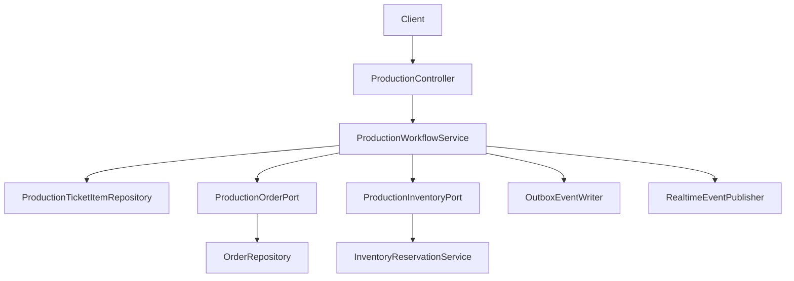
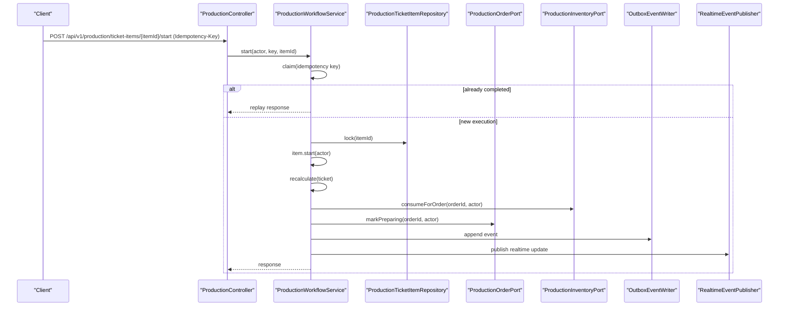
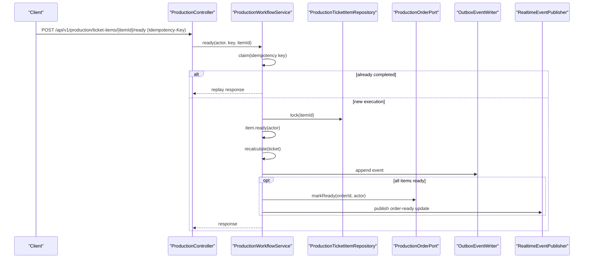
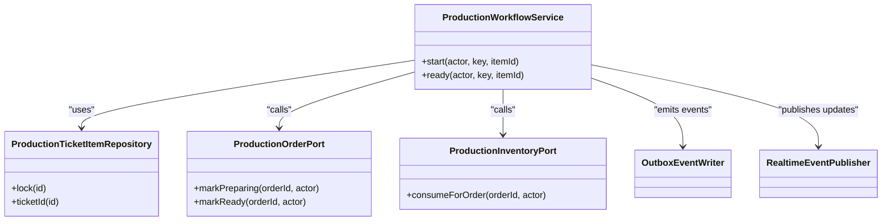

# Production Workflow Orchestration

<cite>
**Referenced Files in This Document**
- [ProductionWorkflowService.java](file://src/main/java/com/smartcoffee/modules/production/application/ProductionWorkflowService.java)
- [ProductionController.java](file://src/main/java/com/smartcoffee/modules/production/api/ProductionController.java)
- [StoreAuthorizationService.java](file://src/main/java/com/smartcoffee/common/security/StoreAuthorizationService.java)
- [PermissionEvaluator.java](file://src/main/java/com/smartcoffee/common/security/PermissionEvaluator.java)
- [ProductionTicket.java](file://src/main/java/com/smartcoffee/modules/production/domain/ProductionTicket.java)
- [ProductionTicketItem.java](file://src/main/java/com/smartcoffee/modules/production/domain/ProductionTicketItem.java)
- [ProductionStatus.java](file://src/main/java/com/smartcoffee/modules/production/domain/ProductionStatus.java)
- [ProductionOrderPort.java](file://src/main/java/com/smartcoffee/modules/production/application/ProductionOrderPort.java)
- [JpaProductionOrderAdapter.java](file://src/main/java/com/smartcoffee/modules/production/application/JpaProductionOrderAdapter.java)
- [ProductionInventoryPort.java](file://src/main/java/com/smartcoffee/modules/production/application/ProductionInventoryPort.java)
- [JpaProductionInventoryAdapter.java](file://src/main/java/com/smartcoffee/modules/production/application/JpaProductionInventoryAdapter.java)
- [ProductionTicketItemRepository.java](file://src/main/java/com/smartcoffee/modules/production/persistence/ProductionTicketItemRepository.java)
- [ProductionWorkflowConcurrencyIT.java](file://src/test/java/com/smartcoffee/modules/production/ProductionWorkflowConcurrencyIT.java)
- [ProductionAuthorizationIT.java](file://src/test/java/com/smartcoffee/modules/production/ProductionAuthorizationIT.java)
</cite>

## Table of Contents
1. Introduction
2. Project Structure
3. Core Components
4. Architecture Overview
5. Detailed Component Analysis
6. Dependency Analysis
7. Performance Considerations
8. Troubleshooting Guide
9. Conclusion

## Introduction
This document explains the production workflow orchestration that moves ticket items from start to ready, including idempotency, permissions, inventory consumption, and order status updates. It focuses on the ProductionWorkflowService and its integration points with ordering and inventory domains, and provides guidance for concurrent access and error handling.

## Project Structure
The production workflow is implemented within the production module and integrates with:
- API layer: ProductionController exposes endpoints for starting and completing production items.
- Application layer: ProductionWorkflowService orchestrates state transitions, idempotency, events, and cross-domain calls.
- Domain layer: ProductionTicket and ProductionTicketItem model states and transitions.
- Ports and adapters: ProductionOrderPort and ProductionInventoryPort abstract interactions with ordering and inventory modules.
- Security: PermissionEvaluator and StoreAuthorizationService enforce per-operation permissions and store-level authorization.

**Diagram sources**
- [ProductionController.java:29-52](file://src/main/java/com/smartcoffee/modules/production/api/ProductionController.java#L29-L52)
- [ProductionWorkflowService.java:53-92](file://src/main/java/com/smartcoffee/modules/production/application/ProductionWorkflowService.java#L53-L92)
- [ProductionOrderPort.java:5-17](file://src/main/java/com/smartcoffee/modules/production/application/ProductionOrderPort.java#L5-L17)
- [ProductionInventoryPort.java:5-7](file://src/main/java/com/smartcoffee/modules/production/application/ProductionInventoryPort.java#L5-L7)

**Section sources**
- [ProductionController.java:29-52](file://src/main/java/com/smartcoffee/modules/production/api/ProductionController.java#L29-L52)
- [ProductionWorkflowService.java:53-92](file://src/main/java/com/smartcoffee/modules/production/application/ProductionWorkflowService.java#L53-L92)

## Core Components
- ProductionWorkflowService: Orchestrates item start and ready transitions, enforces idempotency, emits events, and coordinates inventory and order updates.
- ProductionTicket and ProductionTicketItem: Domain entities modeling ticket-level and item-level states and transitions.
- ProductionOrderPort / JpaProductionOrderAdapter: Updates order status to preparing and ready when appropriate.
- ProductionInventoryPort / JpaProductionInventoryAdapter: Consumes inventory reservations tied to an order at item start.
- Security: PermissionEvaluator checks operation-specific permissions; StoreAuthorizationService validates store access for queue reads.

Key responsibilities:
- Idempotent start and ready operations using a key-based claim mechanism.
- Pessimistic locking on ticket items to prevent concurrent state conflicts.
- Emitting outbox events and publishing real-time updates for live dashboards.
- Transitioning order statuses based on all-item readiness.

**Section sources**
- [ProductionWorkflowService.java:53-92](file://src/main/java/com/smartcoffee/modules/production/application/ProductionWorkflowService.java#L53-L92)
- [ProductionTicket.java:63-73](file://src/main/java/com/smartcoffee/modules/production/domain/ProductionTicket.java#L63-L73)
- [ProductionTicketItem.java:54-68](file://src/main/java/com/smartcoffee/modules/production/domain/ProductionTicketItem.java#L54-L68)
- [JpaProductionOrderAdapter.java:27-35](file://src/main/java/com/smartcoffee/modules/production/application/JpaProductionOrderAdapter.java#L27-L35)
- [JpaProductionInventoryAdapter.java:19-23](file://src/main/java/com/smartcoffee/modules/production/application/JpaProductionInventoryAdapter.java#L19-L23)

## Architecture Overview
The workflow follows a request-driven sequence with strict transactional boundaries and idempotency guarantees.

**Diagram sources**
- [ProductionController.java:38-44](file://src/main/java/com/smartcoffee/modules/production/api/ProductionController.java#L38-L44)
- [ProductionWorkflowService.java:53-73](file://src/main/java/com/smartcoffee/modules/production/application/ProductionWorkflowService.java#L53-L73)
- [ProductionTicketItemRepository.java:10-12](file://src/main/java/com/smartcoffee/modules/production/persistence/ProductionTicketItemRepository.java#L10-L12)
- [JpaProductionInventoryAdapter.java:19-23](file://src/main/java/com/smartcoffee/modules/production/application/JpaProductionInventoryAdapter.java#L19-L23)
- [JpaProductionOrderAdapter.java:27-30](file://src/main/java/com/smartcoffee/modules/production/application/JpaProductionOrderAdapter.java#L27-L30)

**Diagram sources**
- [ProductionController.java:46-52](file://src/main/java/com/smartcoffee/modules/production/api/ProductionController.java#L46-L52)
- [ProductionWorkflowService.java:75-92](file://src/main/java/com/smartcoffee/modules/production/application/ProductionWorkflowService.java#L75-L92)
- [ProductionTicketItemRepository.java:10-12](file://src/main/java/com/smartcoffee/modules/production/persistence/ProductionTicketItemRepository.java#L10-L12)
- [JpaProductionOrderAdapter.java:32-35](file://src/main/java/com/smartcoffee/modules/production/application/JpaProductionOrderAdapter.java#L32-L35)

## Detailed Component Analysis

### ProductionWorkflowService
Responsibilities:
- Enforce idempotency via a claim mechanism keyed by operation type, user, and canonical request hash.
- Lock and transition ProductionTicketItem states safely under pessimistic write locks.
- Recalculate ticket-level status based on item statuses.
- Consume inventory reservations once per order when the first item starts.
- Update order status to preparing on first item start and to ready when all items are ready.
- Emit domain events through an outbox and publish real-time updates for live dashboards.

Idempotency handling:
- Each start and ready call claims a unique idempotency record. If already completed, the stored response is replayed.
- Claims are scoped by operation name, user, and hashed request payload to ensure safety across retries.

Concurrency control:
- Uses pessimistic locking on ticket items to serialize concurrent modifications.
- Relies on database versioning and constraints to avoid lost updates.

Error handling:
- Throws resource not found when item or ticket cannot be located.
- Throws conflict exceptions when invalid state transitions are attempted at the domain level.
- Wraps idempotency storage errors as infrastructure exceptions.

Integration points:
- Inventory: consumes reservation for the order when the first item starts.
- Ordering: marks order preparing on first item start; marks order ready when all items reach ready.
- Events: appends outbox events and publishes real-time messages to store-scoped channels.

**Section sources**
- [ProductionWorkflowService.java:53-92](file://src/main/java/com/smartcoffee/modules/production/application/ProductionWorkflowService.java#L53-L92)
- [ProductionWorkflowService.java:98-131](file://src/main/java/com/smartcoffee/modules/production/application/ProductionWorkflowService.java#L98-L131)

### Domain Models: ProductionTicket and ProductionTicketItem
State transitions:
- ProductionTicketItem:
  - start: PENDING -> PREPARING, records assigned user and timestamp.
  - ready: PREPARING -> READY, records assigned user and timestamp.
- ProductionTicket:
  - recalculate sets ticket status to PREPARING if any item is preparing, and to READY when all items are ready or completed.

Concurrency and integrity:
- Both entities use optimistic versioning to detect concurrent writes.
- Unique constraints ensure one-to-one relationships between tickets and items per order item.

**Section sources**
- [ProductionTicketItem.java:54-68](file://src/main/java/com/smartcoffee/modules/production/domain/ProductionTicketItem.java#L54-L68)
- [ProductionTicket.java:63-73](file://src/main/java/com/smartcoffee/modules/production/domain/ProductionTicket.java#L63-L73)
- [ProductionStatus.java:3-5](file://src/main/java/com/smartcoffee/modules/production/domain/ProductionStatus.java#L3-L5)

### API Endpoints and Permissions
Endpoints:
- Start production item: POST /api/v1/production/ticket-items/{itemId}/start
  - Requires header Idempotency-Key.
  - Requires permission production:item-start.
  - Requires store access validation for queue read endpoints; item start does not require store path but uses current actor context.
- Ready production item: POST /api/v1/production/ticket-items/{itemId}/ready
  - Requires header Idempotency-Key.
  - Requires permission production:item-ready.

Queue read endpoint:
- GET /api/v1/stores/{storeId}/production/{station}
  - Requires permission production:queue-read.
  - Validates store access via StoreAuthorizationService.

Authorization model:
- PermissionEvaluator enforces operation-level permissions.
- StoreAuthorizationService ensures actors can only access resources belonging to their store.

**Section sources**
- [ProductionController.java:29-52](file://src/main/java/com/smartcoffee/modules/production/api/ProductionController.java#L29-L52)
- [PermissionEvaluator.java:8-11](file://src/main/java/com/smartcoffee/common/security/PermissionEvaluator.java#L8-L11)
- [StoreAuthorizationService.java:9-12](file://src/main/java/com/smartcoffee/common/security/StoreAuthorizationService.java#L9-L12)

### Integration with Inventory Consumption
When the first item of an order starts:
- The service invokes inventory consumption for the order’s reservation.
- The adapter locates the reservation by order ID and delegates to the inventory service to consume it.

This ensures ingredients are reserved and consumed exactly once per order during production.

**Section sources**
- [ProductionWorkflowService.java:64-67](file://src/main/java/com/smartcoffee/modules/production/application/ProductionWorkflowService.java#L64-L67)
- [JpaProductionInventoryAdapter.java:19-23](file://src/main/java/com/smartcoffee/modules/production/application/JpaProductionInventoryAdapter.java#L19-L23)

### Integration with Order Status Updates
Order lifecycle changes driven by production:
- On first item start: order marked preparing.
- When all items are ready: order marked ready and a real-time message is published.

These updates are performed via the ProductionOrderPort implementations, which lock and mutate order state atomically.

**Section sources**
- [ProductionWorkflowService.java:64-67](file://src/main/java/com/smartcoffee/modules/production/application/ProductionWorkflowService.java#L64-L67)
- [ProductionWorkflowService.java:87-90](file://src/main/java/com/smartcoffee/modules/production/application/ProductionWorkflowService.java#L87-L90)
- [JpaProductionOrderAdapter.java:27-35](file://src/main/java/com/smartcoffee/modules/production/application/JpaProductionOrderAdapter.java#L27-L35)

### Workflow State Changes
Example state progression:
- Item: PENDING -> PREPARING (on start) -> READY (on ready).
- Ticket: PENDING -> PREPARING (when any item prepares) -> READY (when all items ready).
- Order: Not started -> PREPARING (first item start) -> READY (all items ready).

Transitions are enforced by domain methods and recalculated at the ticket level.

**Section sources**
- [ProductionTicketItem.java:54-68](file://src/main/java/com/smartcoffee/modules/production/domain/ProductionTicketItem.java#L54-L68)
- [ProductionTicket.java:63-73](file://src/main/java/com/smartcoffee/modules/production/domain/ProductionTicket.java#L63-L73)

### Error Handling
Common errors and causes:
- Resource not found: item or ticket missing; thrown when repository lookups fail.
- Conflict: invalid state transition (e.g., starting an item not in PENDING); thrown by domain methods.
- Infrastructure: idempotency storage failures; wrapped as infrastructure exceptions.

Recommendations:
- Clients should retry with the same Idempotency-Key to leverage idempotent replay.
- Monitor outbox events and real-time channels for downstream processing failures.

**Section sources**
- [ProductionWorkflowService.java:59-61](file://src/main/java/com/smartcoffee/modules/production/application/ProductionWorkflowService.java#L59-L61)
- [ProductionWorkflowService.java:81-83](file://src/main/java/com/smartcoffee/modules/production/application/ProductionWorkflowService.java#L81-L83)
- [ProductionTicketItem.java:54-68](file://src/main/java/com/smartcoffee/modules/production/domain/ProductionTicketItem.java#L54-L68)
- [ProductionWorkflowService.java:116-131](file://src/main/java/com/smartcoffee/modules/production/application/ProductionWorkflowService.java#L116-L131)

### Concurrent Access Scenarios
- Duplicate start requests: Idempotency claim prevents duplicate inventory consumption and order marking.
- Concurrent ready completions: Only when all items are ready does the order transition to ready; concurrency-safe due to locking and recalculation logic.
- Test scaffolding exists for these scenarios to validate behavior under contention.

**Section sources**
- [ProductionWorkflowService.java:53-92](file://src/main/java/com/smartcoffee/modules/production/application/ProductionWorkflowService.java#L53-L92)
- [ProductionWorkflowConcurrencyIT.java:8-19](file://src/test/java/com/smartcoffee/modules/production/ProductionWorkflowConcurrencyIT.java#L8-L19)

## Dependency Analysis
The production workflow depends on several cross-cutting services and modules:

**Diagram sources**
- [ProductionWorkflowService.java:21-31](file://src/main/java/com/smartcoffee/modules/production/application/ProductionWorkflowService.java#L21-L31)
- [ProductionTicketItemRepository.java:10-15](file://src/main/java/com/smartcoffee/modules/production/persistence/ProductionTicketItemRepository.java#L10-L15)
- [ProductionOrderPort.java:5-17](file://src/main/java/com/smartcoffee/modules/production/application/ProductionOrderPort.java#L5-L17)
- [ProductionInventoryPort.java:5-7](file://src/main/java/com/smartcoffee/modules/production/application/ProductionInventoryPort.java#L5-L7)

**Section sources**
- [ProductionWorkflowService.java:21-31](file://src/main/java/com/smartcoffee/modules/production/application/ProductionWorkflowService.java#L21-L31)
- [ProductionOrderPort.java:5-17](file://src/main/java/com/smartcoffee/modules/production/application/ProductionOrderPort.java#L5-L17)
- [ProductionInventoryPort.java:5-7](file://src/main/java/com/smartcoffee/modules/production/application/ProductionInventoryPort.java#L5-L7)

## Performance Considerations
- Use pessimistic locking on ticket items to serialize state transitions and avoid race conditions.
- Keep transactions short and focused around critical state changes to reduce lock contention.
- Leverage idempotency to allow safe retries without side effects.
- Batch or defer non-critical work (events, real-time messages) to minimize transaction time.
- Monitor database performance for lock waits and adjust indexing accordingly.

[No sources needed since this section provides general guidance]

## Troubleshooting Guide
Symptoms and resolutions:
- Item not found: Ensure the item exists and belongs to the current store context; check repository queries and foreign keys.
- Invalid state transition: Verify current item status before invoking start or ready; handle conflict exceptions gracefully.
- Duplicate inventory consumption: Confirm idempotency key usage; verify claim completion and replay behavior.
- Order not transitioning to ready: Check that all items reached ready; inspect recalculation logic and concurrent updates.
- Authorization failures: Validate required permissions and store access; ensure actor has correct roles and store association.

Operational tips:
- Inspect outbox events for emitted production events.
- Observe real-time channels for store-scoped updates.
- Use correlation IDs to trace requests across components.

**Section sources**
- [ProductionWorkflowService.java:59-61](file://src/main/java/com/smartcoffee/modules/production/application/ProductionWorkflowService.java#L59-L61)
- [ProductionWorkflowService.java:81-83](file://src/main/java/com/smartcoffee/modules/production/application/ProductionWorkflowService.java#L81-L83)
- [ProductionController.java:29-52](file://src/main/java/com/smartcoffee/modules/production/api/ProductionController.java#L29-L52)
- [ProductionAuthorizationIT.java:7-9](file://src/test/java/com/smartcoffee/modules/production/ProductionAuthorizationIT.java#L7-L9)

## Conclusion
The production workflow provides a robust, idempotent, and secure mechanism to move ticket items from start to ready while coordinating inventory consumption and order status updates. Through careful use of pessimistic locking, domain-driven state transitions, and event-driven integrations, it supports reliable multi-station production in a concurrent environment. Adhering to the documented endpoints, permissions, and idempotency practices ensures consistent behavior under retries and high load.

[No sources needed since this section summarizes without analyzing specific files]