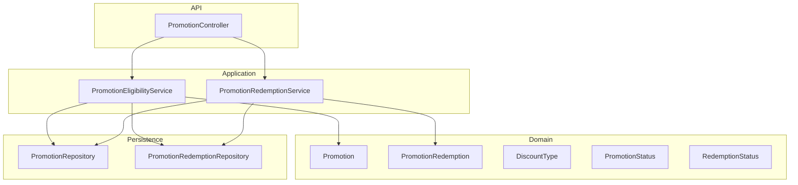
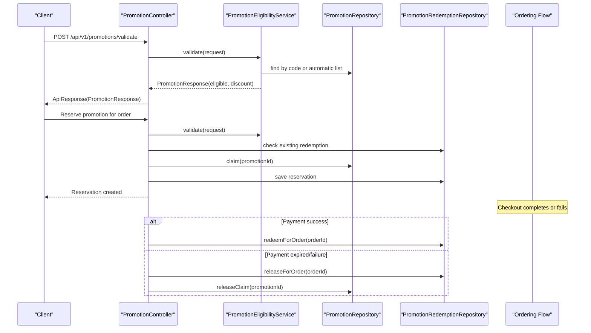
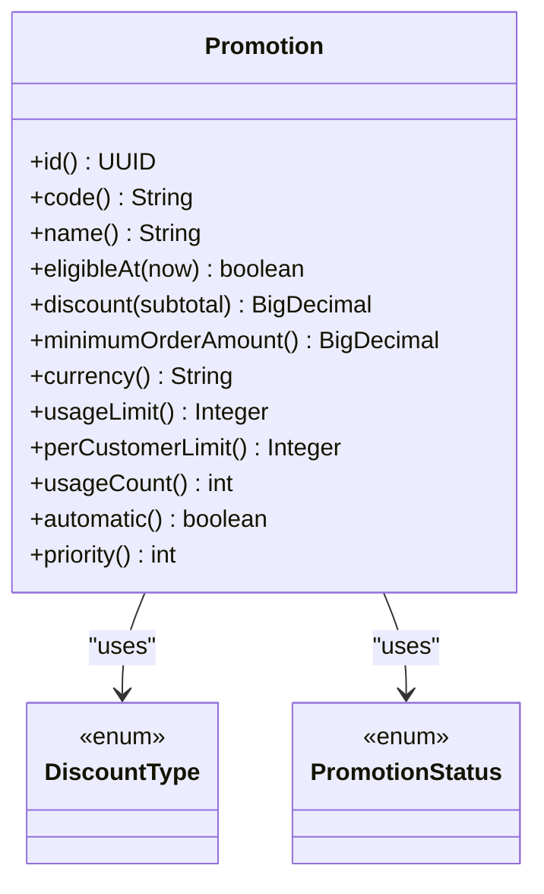
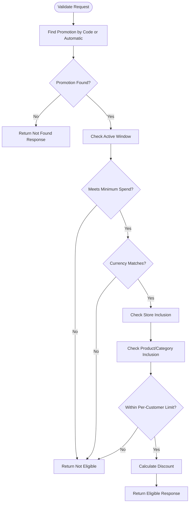
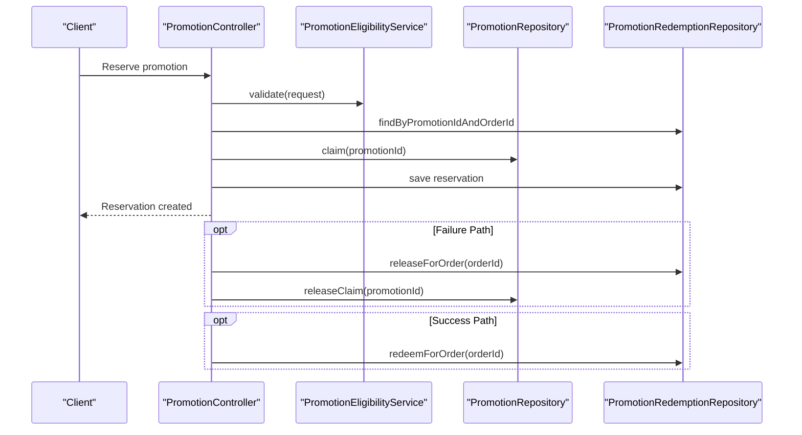
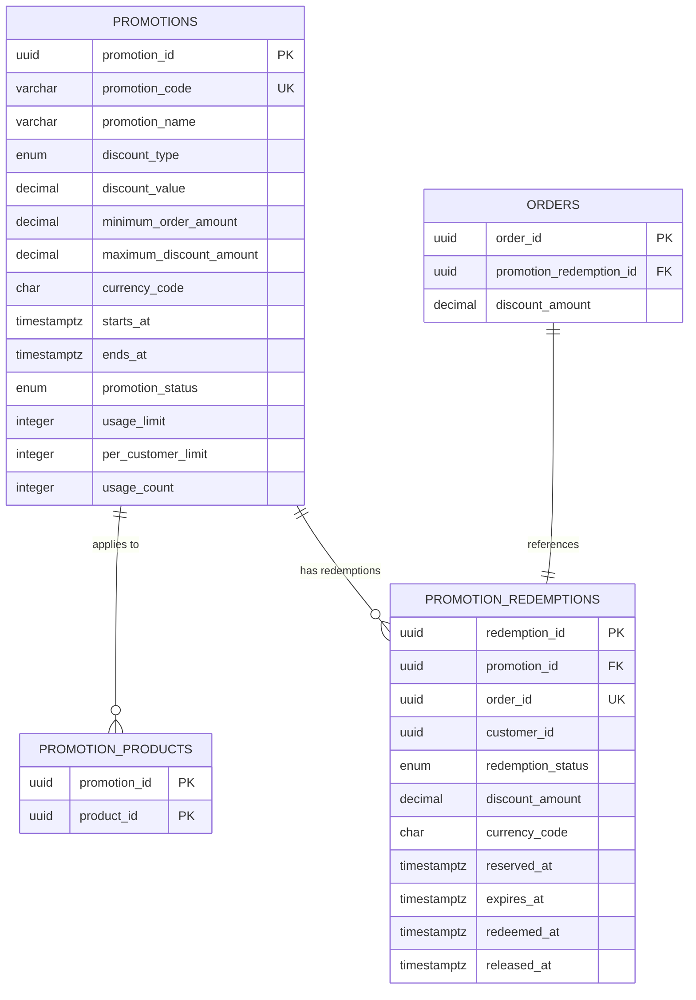
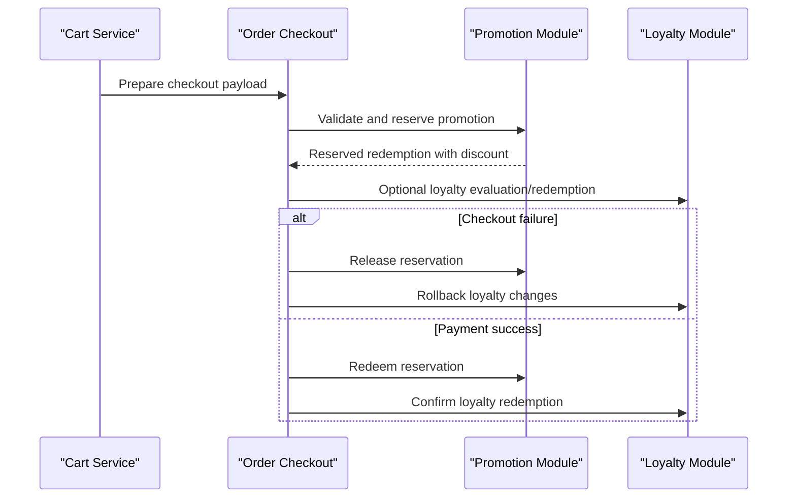
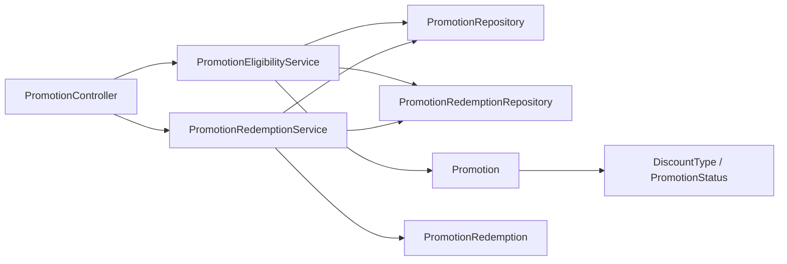

# Promotion & Discount Module

<cite>
**Referenced Files in This Document**
- [PromotionController.java](file://src/main/java/com/smartcoffee/modules/promotion/api/PromotionController.java)
- [PromotionValidationRequest.java](file://src/main/java/com/smartcoffee/modules/promotion/api/PromotionValidationRequest.java)
- [PromotionResponse.java](file://src/main/java/com/smartcoffee/modules/promotion/api/PromotionResponse.java)
- [PromotionEligibilityService.java](file://src/main/java/com/smartcoffee/modules/promotion/application/PromotionEligibilityService.java)
- [PromotionRedemptionService.java](file://src/main/java/com/smartcoffee/modules/promotion/application/PromotionRedemptionService.java)
- [Promotion.java](file://src/main/java/com/smartcoffee/modules/promotion/domain/Promotion.java)
- [PromotionRedemption.java](file://src/main/java/com/smartcoffee/modules/promotion/domain/PromotionRedemption.java)
- [DiscountType.java](file://src/main/java/com/smartcoffee/modules/promotion/domain/DiscountType.java)
- [PromotionStatus.java](file://src/main/java/com/smartcoffee/modules/promotion/domain/PromotionStatus.java)
- [RedemptionStatus.java](file://src/main/java/com/smartcoffee/modules/promotion/domain/RedemptionStatus.java)
- [PromotionRepository.java](file://src/main/java/com/smartcoffee/modules/promotion/persistence/PromotionRepository.java)
- [PromotionRedemptionRepository.java](file://src/main/java/com/smartcoffee/modules/promotion/persistence/PromotionRedemptionRepository.java)
- [smart-coffee-logical.dbml](file://database/smart-coffee-logical.dbml)
- [CHECKOUT_PROMOTION_LOYALTY_PATCH.md](file://CHECKOUT_PROMOTION_LOYALTY_PATCH.md)
</cite>

## Table of Contents
1. Introduction
2. Project Structure
3. Core Components
4. Architecture Overview
5. Detailed Component Analysis
6. Dependency Analysis
7. Performance Considerations
8. Troubleshooting Guide
9. Conclusion
10. Appendices

## Introduction
This document explains the Promotion & Discount module, covering promotion types, eligibility rules, discount calculation, campaign management, usage limits, redemption tracking, and integration with orders, cart validation, and loyalty program interactions. It also documents promotion stacking rules, conflict resolution, and performance optimization strategies for complex discount scenarios.

## Project Structure
The Promotion & Discount module follows a layered design:
- API layer exposes endpoints to validate promotions and manage redemptions.
- Application layer orchestrates eligibility checks and redemption workflows.
- Domain layer models promotions, discounts, statuses, and redemption lifecycle.
- Persistence layer provides repositories and raw SQL for high-performance checks and atomic claim/release operations.

**Diagram sources**
- [PromotionController.java:9-22](file://src/main/java/com/smartcoffee/modules/promotion/api/PromotionController.java#L9-L22)
- [PromotionEligibilityService.java:12-38](file://src/main/java/com/smartcoffee/modules/promotion/application/PromotionEligibilityService.java#L12-L38)
- [PromotionRedemptionService.java:12-52](file://src/main/java/com/smartcoffee/modules/promotion/application/PromotionRedemptionService.java#L12-L52)
- [Promotion.java:8-49](file://src/main/java/com/smartcoffee/modules/promotion/domain/Promotion.java#L8-L49)
- [PromotionRedemption.java:9-40](file://src/main/java/com/smartcoffee/modules/promotion/domain/PromotionRedemption.java#L9-L40)
- [PromotionRepository.java:10-27](file://src/main/java/com/smartcoffee/modules/promotion/persistence/PromotionRepository.java#L10-L27)
- [PromotionRedemptionRepository.java:7-14](file://src/main/java/com/smartcoffee/modules/promotion/persistence/PromotionRedemptionRepository.java#L7-L14)

**Section sources**
- [PromotionController.java:9-22](file://src/main/java/com/smartcoffee/modules/promotion/api/PromotionController.java#L9-L22)
- [PromotionEligibilityService.java:12-38](file://src/main/java/com/smartcoffee/modules/promotion/application/PromotionEligibilityService.java#L12-L38)
- [PromotionRedemptionService.java:12-52](file://src/main/java/com/smartcoffee/modules/promotion/application/PromotionRedemptionService.java#L12-L52)
- [Promotion.java:8-49](file://src/main/java/com/smartcoffee/modules/promotion/domain/Promotion.java#L8-L49)
- [PromotionRedemption.java:9-40](file://src/main/java/com/smartcoffee/modules/promotion/domain/PromotionRedemption.java#L9-L40)
- [PromotionRepository.java:10-27](file://src/main/java/com/smartcoffee/modules/promotion/persistence/PromotionRepository.java#L10-L27)
- [PromotionRedemptionRepository.java:7-14](file://src/main/java/com/smartcoffee/modules/promotion/persistence/PromotionRedemptionRepository.java#L7-L14)

## Core Components
- Promotion entity defines campaign attributes including discount type (percentage or fixed amount), value, minimum order amount, maximum discount cap, currency scope, validity window, status, usage limits, per-customer limits, stackability flag, automatic application flag, and priority.
- Redemption entity tracks reservation, redemption, release, and expiration states per order and promotion, capturing discount amount and currency at time of application.
- Eligibility service validates whether a promotion applies based on time windows, minimum spend, currency match, store/product/category inclusion, and per-customer usage limits.
- Redemption service reserves a promotion for an order, claims its usage atomically, and supports releasing or redeeming reservations during checkout flows.

Key behaviors:
- Automatic vs manual promotions: automatic promotions are selected by priority when no code is provided; manual promotions are validated by code.
- Discount calculation: percentage discounts compute as subtotal multiplied by value percent; fixed discounts use the configured value; both are capped by maximum discount amount and cannot exceed subtotal.
- Usage control: global usage limit via usage_count vs usage_limit; per-customer limit enforced by counting active/reserved redemptions.

**Section sources**
- [Promotion.java:18-49](file://src/main/java/com/smartcoffee/modules/promotion/domain/Promotion.java#L18-L49)
- [Promotion.java:66-103](file://src/main/java/com/smartcoffee/modules/promotion/domain/Promotion.java#L66-L103)
- [PromotionRedemption.java:9-40](file://src/main/java/com/smartcoffee/modules/promotion/domain/PromotionRedemption.java#L9-L40)
- [PromotionRedemption.java:45-76](file://src/main/java/com/smartcoffee/modules/promotion/domain/PromotionRedemption.java#L45-L76)
- [PromotionEligibilityService.java:24-58](file://src/main/java/com/smartcoffee/modules/promotion/application/PromotionEligibilityService.java#L24-L58)
- [PromotionRedemptionService.java:25-52](file://src/main/java/com/smartcoffee/modules/promotion/application/PromotionRedemptionService.java#L25-L52)

## Architecture Overview
The module integrates with ordering and payment flows through reservation semantics:
- During checkout, promotions are validated and reserved before finalizing totals.
- If checkout fails or payment expires, reservations are released and usage claims are rolled back.
- On successful payment, reservations are redeemed and discounts become permanent.

**Diagram sources**
- [PromotionController.java:18-21](file://src/main/java/com/smartcoffee/modules/promotion/api/PromotionController.java#L18-L21)
- [PromotionEligibilityService.java:24-38](file://src/main/java/com/smartcoffee/modules/promotion/application/PromotionEligibilityService.java#L24-L38)
- [PromotionRepository.java:17-26](file://src/main/java/com/smartcoffee/modules/promotion/persistence/PromotionRepository.java#L17-L26)
- [PromotionRedemptionService.java:25-52](file://src/main/java/com/smartcoffee/modules/promotion/application/PromotionRedemptionService.java#L25-L52)
- [CHECKOUT_PROMOTION_LOYALTY_PATCH.md:1-3](file://CHECKOUT_PROMOTION_LOYALTY_PATCH.md#L1-L3)

## Detailed Component Analysis

### Promotion Entity and Discount Engine
- Supports two discount types: percentage and fixed amount.
- Applies maximum discount cap and ensures discount does not exceed subtotal.
- Enforces time-based eligibility and status gating.
- Tracks usage count and supports stackable flags and priority for automatic selection.

**Diagram sources**
- [Promotion.java:8-49](file://src/main/java/com/smartcoffee/modules/promotion/domain/Promotion.java#L8-L49)
- [Promotion.java:66-103](file://src/main/java/com/smartcoffee/modules/promotion/domain/Promotion.java#L66-L103)
- [DiscountType.java:1-7](file://src/main/java/com/smartcoffee/modules/promotion/domain/DiscountType.java#L1-L7)
- [PromotionStatus.java:1-7](file://src/main/java/com/smartcoffee/modules/promotion/domain/PromotionStatus.java#L1-L7)

**Section sources**
- [Promotion.java:18-49](file://src/main/java/com/smartcoffee/modules/promotion/domain/Promotion.java#L18-L49)
- [Promotion.java:66-103](file://src/main/java/com/smartcoffee/modules/promotion/domain/Promotion.java#L66-L103)
- [DiscountType.java:1-7](file://src/main/java/com/smartcoffee/modules/promotion/domain/DiscountType.java#L1-L7)
- [PromotionStatus.java:1-7](file://src/main/java/com/smartcoffee/modules/promotion/domain/PromotionStatus.java#L1-L7)

### Eligibility Rules and Validation Flow
- Validates promotion existence and status.
- Checks time window and minimum order amount.
- Enforces currency matching if specified.
- Verifies store and product/category inclusion using direct SQL queries.
- Enforces per-customer limits by counting active/reserved redemptions.

**Diagram sources**
- [PromotionEligibilityService.java:24-58](file://src/main/java/com/smartcoffee/modules/promotion/application/PromotionEligibilityService.java#L24-L58)

**Section sources**
- [PromotionEligibilityService.java:24-58](file://src/main/java/com/smartcoffee/modules/promotion/application/PromotionEligibilityService.java#L24-L58)

### Redemption Lifecycle and Usage Limits
- Reserves a promotion for an order after eligibility validation.
- Claims usage atomically to prevent overuse under concurrency.
- Releases reservations on checkout failure/payment expiration.
- Redeems reservations on payment success.

**Diagram sources**
- [PromotionRedemptionService.java:25-52](file://src/main/java/com/smartcoffee/modules/promotion/application/PromotionRedemptionService.java#L25-L52)
- [PromotionRepository.java:20-26](file://src/main/java/com/smartcoffee/modules/promotion/persistence/PromotionRepository.java#L20-L26)
- [PromotionRedemptionRepository.java:7-14](file://src/main/java/com/smartcoffee/modules/promotion/persistence/PromotionRedemptionRepository.java#L7-L14)

**Section sources**
- [PromotionRedemptionService.java:25-52](file://src/main/java/com/smartcoffee/modules/promotion/application/PromotionRedemptionService.java#L25-L52)
- [PromotionRepository.java:20-26](file://src/main/java/com/smartcoffee/modules/promotion/persistence/PromotionRepository.java#L20-L26)
- [PromotionRedemptionRepository.java:7-14](file://src/main/java/com/smartcoffee/modules/promotion/persistence/PromotionRedemptionRepository.java#L7-L14)

### Data Model and Relationships
- Promotions table stores campaign definitions and constraints.
- Promotion products/categories define applicability scopes.
- Redemption records track per-order usage with timestamps and status transitions.
- Orders reference the applied promotion redemption for authoritative discount accounting.

**Diagram sources**
- [smart-coffee-logical.dbml:311-349](file://database/smart-coffee-logical.dbml#L311-L349)
- [smart-coffee-logical.dbml:386-416](file://database/smart-coffee-logical.dbml#L386-L416)

**Section sources**
- [smart-coffee-logical.dbml:311-349](file://database/smart-coffee-logical.dbml#L311-L349)
- [smart-coffee-logical.dbml:386-416](file://database/smart-coffee-logical.dbml#L386-L416)

### Integration with Orders, Cart Validation, and Loyalty
- Before finalizing order totals, the system evaluates and reserves promotions and optionally interacts with loyalty points.
- If checkout rolls back, reservations are released automatically within the transaction boundary.
- On payment success, reservations are redeemed and loyalty redemptions are confirmed.

**Diagram sources**
- [CHECKOUT_PROMOTION_LOYALTY_PATCH.md:1-3](file://CHECKOUT_PROMOTION_LOYALTY_PATCH.md#L1-L3)
- [PromotionRedemptionService.java:38-52](file://src/main/java/com/smartcoffee/modules/promotion/application/PromotionRedemptionService.java#L38-L52)

**Section sources**
- [CHECKOUT_PROMOTION_LOYALTY_PATCH.md:1-3](file://CHECKOUT_PROMOTION_LOYALTY_PATCH.md#L1-L3)
- [PromotionRedemptionService.java:38-52](file://src/main/java/com/smartcoffee/modules/promotion/application/PromotionRedemptionService.java#L38-L52)

## Dependency Analysis
- PromotionController depends on PromotionEligibilityService for validation responses.
- PromotionEligibilityService depends on PromotionRepository for finding promotions and PromotionRedemptionRepository for per-customer limit checks; uses JdbcTemplate for fast store/product/category inclusion checks.
- PromotionRedemptionService depends on PromotionEligibilityService, PromotionRepository for atomic claim/release, and PromotionRedemptionRepository for persistence.
- Domain entities depend on enums for discount type, promotion status, and redemption status.

**Diagram sources**
- [PromotionController.java:9-22](file://src/main/java/com/smartcoffee/modules/promotion/api/PromotionController.java#L9-L22)
- [PromotionEligibilityService.java:12-38](file://src/main/java/com/smartcoffee/modules/promotion/application/PromotionEligibilityService.java#L12-L38)
- [PromotionRedemptionService.java:12-52](file://src/main/java/com/smartcoffee/modules/promotion/application/PromotionRedemptionService.java#L12-L52)
- [PromotionRepository.java:10-27](file://src/main/java/com/smartcoffee/modules/promotion/persistence/PromotionRepository.java#L10-L27)
- [PromotionRedemptionRepository.java:7-14](file://src/main/java/com/smartcoffee/modules/promotion/persistence/PromotionRedemptionRepository.java#L7-L14)
- [Promotion.java:18-49](file://src/main/java/com/smartcoffee/modules/promotion/domain/Promotion.java#L18-L49)
- [PromotionRedemption.java:9-40](file://src/main/java/com/smartcoffee/modules/promotion/domain/PromotionRedemption.java#L9-L40)

**Section sources**
- [PromotionController.java:9-22](file://src/main/java/com/smartcoffee/modules/promotion/api/PromotionController.java#L9-L22)
- [PromotionEligibilityService.java:12-38](file://src/main/java/com/smartcoffee/modules/promotion/application/PromotionEligibilityService.java#L12-L38)
- [PromotionRedemptionService.java:12-52](file://src/main/java/com/smartcoffee/modules/promotion/application/PromotionRedemptionService.java#L12-L52)
- [PromotionRepository.java:10-27](file://src/main/java/com/smartcoffee/modules/promotion/persistence/PromotionRepository.java#L10-L27)
- [PromotionRedemptionRepository.java:7-14](file://src/main/java/com/smartcoffee/modules/promotion/persistence/PromotionRedemptionRepository.java#L7-L14)
- [Promotion.java:18-49](file://src/main/java/com/smartcoffee/modules/promotion/domain/Promotion.java#L18-L49)
- [PromotionRedemption.java:9-40](file://src/main/java/com/smartcoffee/modules/promotion/domain/PromotionRedemption.java#L9-L40)

## Performance Considerations
- Use automatic promotion selection ordered by priority to minimize candidate sets and avoid unnecessary eligibility checks.
- Leverage direct SQL queries for store/product/category inclusion checks to reduce ORM overhead and improve throughput.
- Employ pessimistic locking and atomic native updates for claiming and releasing promotion usage to handle concurrent checkout scenarios safely.
- Keep validation read-only transactions to avoid contention during eligibility checks.
- Cache frequently accessed promotion metadata where appropriate, ensuring cache invalidation on promotion updates.

[No sources needed since this section provides general guidance]

## Troubleshooting Guide
Common issues and resolutions:
- Promotion not found: Ensure the promotion code exists and is active; verify request includes correct store and currency context.
- Promotion not eligible: Check minimum order amount, time window, currency match, store/product/category inclusion, and per-customer limits.
- Promotion usage exhausted: Global usage limit reached; adjust usage_limit or monitor usage_count via repository methods.
- Redemption conflict: Attempted to redeem or release a non-reserved redemption; ensure state transitions follow RESERVED -> REDEEMED or RESERVED -> RELEASED.

Operational tips:
- Verify indexes on promotion_stores, promotion_products, and redemption tables for efficient filtering.
- Monitor database locks and contention around promotion claim/release operations under high concurrency.
- Audit redemption lifecycle via timestamps and status fields to diagnose stuck reservations.

**Section sources**
- [PromotionEligibilityService.java:24-58](file://src/main/java/com/smartcoffee/modules/promotion/application/PromotionEligibilityService.java#L24-L58)
- [PromotionRedemptionService.java:25-52](file://src/main/java/com/smartcoffee/modules/promotion/application/PromotionRedemptionService.java#L25-L52)
- [PromotionRedemption.java:61-76](file://src/main/java/com/smartcoffee/modules/promotion/domain/PromotionRedemption.java#L61-L76)
- [PromotionRepository.java:20-26](file://src/main/java/com/smartcoffee/modules/promotion/persistence/PromotionRepository.java#L20-L26)

## Conclusion
The Promotion & Discount module provides a robust foundation for managing campaigns, enforcing eligibility rules, calculating discounts, and tracking redemptions with strong concurrency controls. Its integration with ordering and loyalty flows ensures consistent discount accounting and reliable rollback behavior. By leveraging priority-based automatic promotions, atomic usage claims, and targeted SQL checks, the system scales effectively under complex discount scenarios.

[No sources needed since this section summarizes without analyzing specific files]

## Appendices

### API Reference Summary
- Validate promotion: POST /api/v1/promotions/validate with store, customer, order, subtotal, currency, optional code and product/category filters.
- Reserve promotion: Create a reservation tied to an order, claim usage, and set expiry window.
- Release reservation: On checkout failure or payment expiration, release reservation and decrement usage count.
- Redeem reservation: On payment success, transition reservation to redeemed and confirm discount.

**Section sources**
- [PromotionController.java:18-21](file://src/main/java/com/smartcoffee/modules/promotion/api/PromotionController.java#L18-L21)
- [PromotionValidationRequest.java:7-10](file://src/main/java/com/smartcoffee/modules/promotion/api/PromotionValidationRequest.java#L7-L10)
- [PromotionResponse.java:6-8](file://src/main/java/com/smartcoffee/modules/promotion/api/PromotionResponse.java#L6-L8)
- [PromotionRedemptionService.java:25-52](file://src/main/java/com/smartcoffee/modules/promotion/application/PromotionRedemptionService.java#L25-L52)