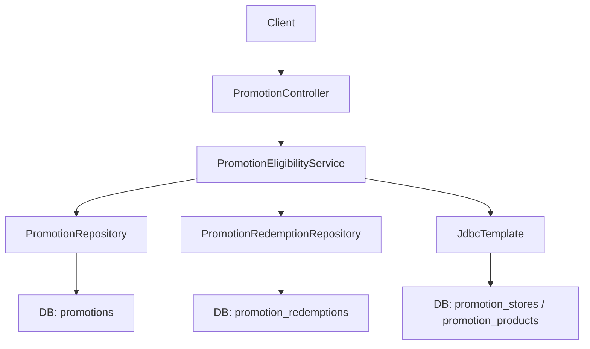
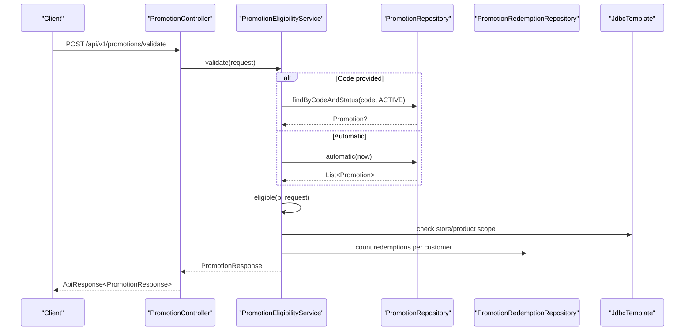
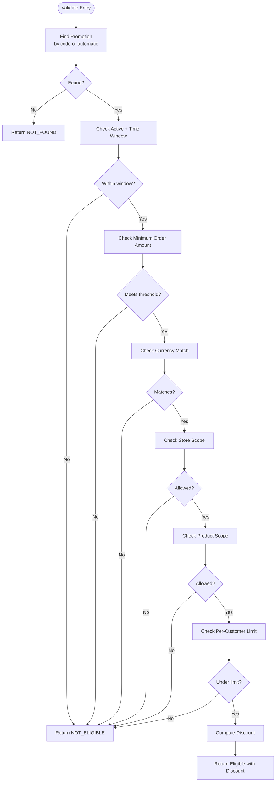
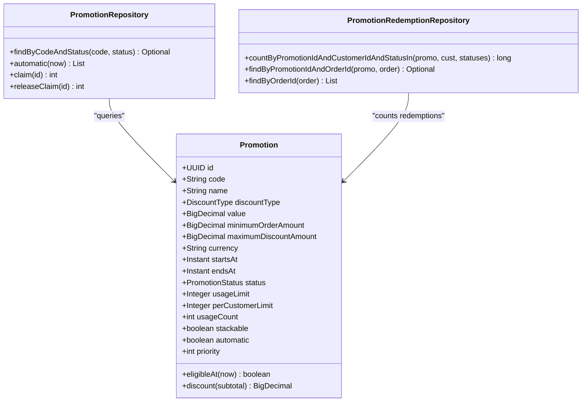
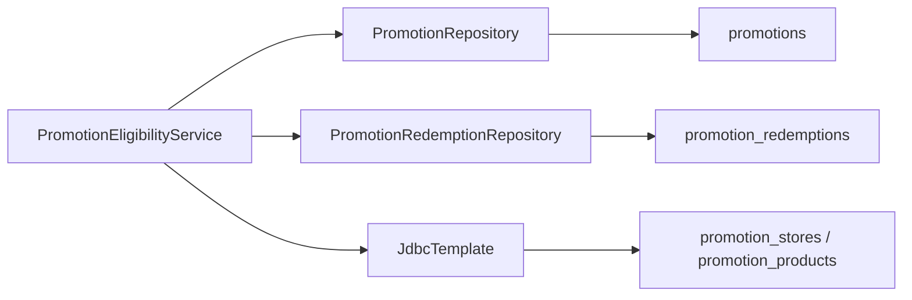

# Promotion Eligibility & Validation

<cite>
**Referenced Files in This Document**
- [PromotionController.java](file://src/main/java/com/smartcoffee/modules/promotion/api/PromotionController.java)
- [PromotionValidationRequest.java](file://src/main/java/com/smartcoffee/modules/promotion/api/PromotionValidationRequest.java)
- [PromotionResponse.java](file://src/main/java/com/smartcoffee/modules/promotion/api/PromotionResponse.java)
- [PromotionEligibilityService.java](file://src/main/java/com/smartcoffee/modules/promotion/application/PromotionEligibilityService.java)
- [Promotion.java](file://src/main/java/com/smartcoffee/modules/promotion/domain/Promotion.java)
- [PromotionStatus.java](file://src/main/java/com/smartcoffee/modules/promotion/domain/PromotionStatus.java)
- [DiscountType.java](file://src/main/java/com/smartcoffee/modules/promotion/domain/DiscountType.java)
- [PromotionRepository.java](file://src/main/java/com/smartcoffee/modules/promotion/persistence/PromotionRepository.java)
- [PromotionRedemptionRepository.java](file://src/main/java/com/smartcoffee/modules/promotion/persistence/PromotionRedemptionRepository.java)
</cite>

## Table of Contents
1. [Introduction](#introduction)
2. [Project Structure](#project-structure)
3. [Core Components](#core-components)
4. [Architecture Overview](#architecture-overview)
5. [Detailed Component Analysis](#detailed-component-analysis)
6. [Dependency Analysis](#dependency-analysis)
7. [Performance Considerations](#performance-considerations)
8. [Troubleshooting Guide](#troubleshooting-guide)
9. [Conclusion](#conclusion)

## Introduction
This document explains how promotion eligibility is determined and validated for orders or carts. It focuses on the PromotionEligibilityService, which evaluates whether a promotion can be applied based on time windows, status, usage limits, minimum order requirements, store/product scope, currency, and per-customer redemption counts. It also documents the API endpoint for validation, request/response schemas, example scenarios, failure conditions, error responses, concurrency considerations, and performance optimization strategies.

## Project Structure
The promotion module is organized into three layers:
- API layer: controllers and DTOs for requests/responses
- Application layer: business logic for eligibility checks
- Domain and persistence layers: entities, enums, repositories, and raw SQL queries for scoping and redemption counting

**Diagram sources**
- [PromotionController.java:9-21](file://src/main/java/com/smartcoffee/modules/promotion/api/PromotionController.java#L9-L21)
- [PromotionEligibilityService.java:12-58](file://src/main/java/com/smartcoffee/modules/promotion/application/PromotionEligibilityService.java#L12-L58)
- [PromotionRepository.java:10-26](file://src/main/java/com/smartcoffee/modules/promotion/persistence/PromotionRepository.java#L10-L26)
- [PromotionRedemptionRepository.java:7-13](file://src/main/java/com/smartcoffee/modules/promotion/persistence/PromotionRedemptionRepository.java#L7-L13)

**Section sources**
- [PromotionController.java:9-21](file://src/main/java/com/smartcoffee/modules/promotion/api/PromotionController.java#L9-L21)
- [PromotionEligibilityService.java:12-58](file://src/main/java/com/smartcoffee/modules/promotion/application/PromotionEligibilityService.java#L12-L58)

## Core Components
- PromotionController: Exposes a POST /api/v1/promotions/validate endpoint that delegates to the eligibility service.
- PromotionEligibilityService: Orchestrates eligibility checks using domain rules and persistence queries.
- Promotion (domain): Encapsulates promotion metadata, discount calculation, and time-based eligibility.
- Repositories: PromotionRepository for promotion retrieval and atomic claim/release; PromotionRedemptionRepository for per-customer redemption counts.
- DTOs: PromotionValidationRequest and PromotionResponse define the API contract.

Key responsibilities:
- Resolve promotion by code or select automatic promotions
- Validate time window, status, currency, store/product scope, minimum order amount
- Enforce per-customer redemption limits
- Compute discount amount when eligible

**Section sources**
- [PromotionController.java:9-21](file://src/main/java/com/smartcoffee/modules/promotion/api/PromotionController.java#L9-L21)
- [PromotionEligibilityService.java:24-58](file://src/main/java/com/smartcoffee/modules/promotion/application/PromotionEligibilityService.java#L24-L58)
- [Promotion.java:10-104](file://src/main/java/com/smartcoffee/modules/promotion/domain/Promotion.java#L10-L104)
- [PromotionRepository.java:10-26](file://src/main/java/com/smartcoffee/modules/promotion/persistence/PromotionRepository.java#L10-L26)
- [PromotionRedemptionRepository.java:7-13](file://src/main/java/com/smartcoffee/modules/promotion/persistence/PromotionRedemptionRepository.java#L7-L13)
- [PromotionValidationRequest.java:7-9](file://src/main/java/com/smartcoffee/modules/promotion/api/PromotionValidationRequest.java#L7-L9)
- [PromotionResponse.java:6-7](file://src/main/java/com/smartcoffee/modules/promotion/api/PromotionResponse.java#L6-L7)

## Architecture Overview
The validation flow starts at the controller and proceeds through the eligibility service to persistence and raw SQL for scoping and redemption checks. The service returns a response indicating eligibility and computed discount or a reason for ineligibility.

**Diagram sources**
- [PromotionController.java:18-21](file://src/main/java/com/smartcoffee/modules/promotion/api/PromotionController.java#L18-L21)
- [PromotionEligibilityService.java:24-58](file://src/main/java/com/smartcoffee/modules/promotion/application/PromotionEligibilityService.java#L24-L58)
- [PromotionRepository.java:10-18](file://src/main/java/com/smartcoffee/modules/promotion/persistence/PromotionRepository.java#L10-L18)
- [PromotionRedemptionRepository.java:7-9](file://src/main/java/com/smartcoffee/modules/promotion/persistence/PromotionRedemptionRepository.java#L7-L9)

## Detailed Component Analysis

### API Endpoints and Schemas
- Endpoint: POST /api/v1/promotions/validate
- Request schema: PromotionValidationRequest
  - Fields: storeId, customerId, orderId, promotionCode (optional), subtotal, currencyCode, productIds, categoryIds
  - Validation: Not-null constraints and numeric bounds enforced via annotations
- Response schema: PromotionResponse
  - Fields: promotionId, code, name, eligible, discountAmount, currencyCode, reason
  - When not eligible: eligible=false, discountAmount=0, reason indicates cause (e.g., PROMOTION_NOT_FOUND, PROMOTION_NOT_ELIGIBLE)

Example request payload:
{
  "storeId": "uuid",
  "customerId": "uuid",
  "orderId": "uuid",
  "promotionCode": "SUMMER25",
  "subtotal": 120.00,
  "currencyCode": "USD",
  "productIds": ["uuid1","uuid2"],
  "categoryIds": ["uuidA","uuidB"]
}

Example success response:
{
  "promotionId": "uuid",
  "code": "SUMMER25",
  "name": "Summer Discount",
  "eligible": true,
  "discountAmount": 30.00,
  "currencyCode": "USD",
  "reason": null
}

Example failure response:
{
  "promotionId": null,
  "code": "SUMMER25",
  "name": null,
  "eligible": false,
  "discountAmount": 0.00,
  "currencyCode": "USD",
  "reason": "PROMOTION_NOT_FOUND"
}

**Section sources**
- [PromotionController.java:18-21](file://src/main/java/com/smartcoffee/modules/promotion/api/PromotionController.java#L18-L21)
- [PromotionValidationRequest.java:7-9](file://src/main/java/com/smartcoffee/modules/promotion/api/PromotionValidationRequest.java#L7-L9)
- [PromotionResponse.java:6-7](file://src/main/java/com/smartcoffee/modules/promotion/api/PromotionResponse.java#L6-L7)
- [PromotionEligibilityService.java:24-37](file://src/main/java/com/smartcoffee/modules/promotion/application/PromotionEligibilityService.java#L24-L37)

### Eligibility Rules and Logic
The eligibility algorithm evaluates multiple conditions in sequence:

- Time-based eligibility: Promotion must be active and within its start/end window.
- Status check: Only ACTIVE promotions are considered.
- Minimum order requirement: Subtotal must meet or exceed the promotion’s minimumOrderAmount.
- Currency match: If the promotion specifies a currency, it must match the request’s currencyCode.
- Store scope: Either no stores are restricted or the requested storeId is included.
- Product scope: Either no products are restricted or at least one product from the cart/order matches.
- Per-customer limit: Count of reserved/redeemed redemptions for this customer and promotion must be below perCustomerLimit.

Discount computation:
- Percentage discounts apply percentage to subtotal.
- Fixed amount discounts use the configured value.
- Maximum discount cap is enforced if configured.
- Final discount cannot exceed subtotal.

**Diagram sources**
- [PromotionEligibilityService.java:24-58](file://src/main/java/com/smartcoffee/modules/promotion/application/PromotionEligibilityService.java#L24-L58)
- [Promotion.java:66-75](file://src/main/java/com/smartcoffee/modules/promotion/domain/Promotion.java#L66-L75)

**Section sources**
- [PromotionEligibilityService.java:24-58](file://src/main/java/com/smartcoffee/modules/promotion/application/PromotionEligibilityService.java#L24-L58)
- [Promotion.java:66-75](file://src/main/java/com/smartcoffee/modules/promotion/domain/Promotion.java#L66-L75)

### Data Models and Relationships

**Diagram sources**
- [Promotion.java:10-104](file://src/main/java/com/smartcoffee/modules/promotion/domain/Promotion.java#L10-L104)
- [PromotionRepository.java:10-26](file://src/main/java/com/smartcoffee/modules/promotion/persistence/PromotionRepository.java#L10-L26)
- [PromotionRedemptionRepository.java:7-13](file://src/main/java/com/smartcoffee/modules/promotion/persistence/PromotionRedemptionRepository.java#L7-L13)

**Section sources**
- [Promotion.java:10-104](file://src/main/java/com/smartcoffee/modules/promotion/domain/Promotion.java#L10-L104)
- [PromotionRepository.java:10-26](file://src/main/java/com/smartcoffee/modules/promotion/persistence/PromotionRepository.java#L10-L26)
- [PromotionRedemptionRepository.java:7-13](file://src/main/java/com/smartcoffee/modules/promotion/persistence/PromotionRedemptionRepository.java#L7-L13)

### Error Handling and Failure Conditions
Common reasons for ineligibility returned in the response:
- PROMOTION_NOT_FOUND: No matching promotion found for the given code or none eligible automatically.
- PROMOTION_NOT_ELIGIBLE: Promotion exists but fails one or more eligibility checks (time window, status, minimum order, currency, store/product scope, per-customer limit).

Behavior:
- The service returns a non-null response with eligible=false and a descriptive reason when a promotion is not applicable.
- Input validation errors (e.g., missing required fields) are handled by framework-level validation prior to reaching the service.

**Section sources**
- [PromotionEligibilityService.java:24-37](file://src/main/java/com/smartcoffee/modules/promotion/application/PromotionEligibilityService.java#L24-L37)
- [PromotionValidationRequest.java:7-9](file://src/main/java/com/smartcoffee/modules/promotion/api/PromotionValidationRequest.java#L7-L9)

### Concurrency and Atomicity
- Promotion claims and releases are implemented with atomic SQL updates that increment/decrement usage_count and version, ensuring safe concurrent usage under contention.
- A pessimistic lock method is available for exclusive access when needed during redemption workflows.
- Per-customer limits are enforced by counting existing reservations and redemptions before allowing new ones.

Recommendations:
- Use the repository’s claim/release methods when applying or rolling back promotions to avoid race conditions.
- Ensure redemption operations are wrapped in transactions to maintain consistency between promotion usage counts and redemption records.

**Section sources**
- [PromotionRepository.java:13-26](file://src/main/java/com/smartcoffee/modules/promotion/persistence/PromotionRepository.java#L13-L26)
- [PromotionRedemptionRepository.java:7-9](file://src/main/java/com/smartcoffee/modules/promotion/persistence/PromotionRedemptionRepository.java#L7-L9)

### Performance Optimization
- Read-only validation uses a read-only transaction to reduce overhead.
- Automatic promotion selection leverages indexed queries filtering by status, automatic flag, and time window, ordered by priority.
- Raw SQL for store/product scoping avoids additional ORM overhead and allows efficient set membership checks.
- Consider caching frequently accessed promotion metadata and scoping relationships where appropriate, invalidating on promotion changes.

[No sources needed since this section provides general guidance]

## Dependency Analysis
The eligibility service depends on:
- PromotionRepository for promotion lookup and atomic usage management
- PromotionRedemptionRepository for per-customer redemption counts
- JdbcTemplate for direct SQL checks against store/product scoping tables

**Diagram sources**
- [PromotionEligibilityService.java:12-58](file://src/main/java/com/smartcoffee/modules/promotion/application/PromotionEligibilityService.java#L12-L58)
- [PromotionRepository.java:10-26](file://src/main/java/com/smartcoffee/modules/promotion/persistence/PromotionRepository.java#L10-L26)
- [PromotionRedemptionRepository.java:7-13](file://src/main/java/com/smartcoffee/modules/promotion/persistence/PromotionRedemptionRepository.java#L7-L13)

**Section sources**
- [PromotionEligibilityService.java:12-58](file://src/main/java/com/smartcoffee/modules/promotion/application/PromotionEligibilityService.java#L12-L58)

## Performance Considerations
- Keep validation reads lightweight: use read-only transactions and selective queries.
- Indexing recommendations: ensure indexes exist on promotion status, automatic flag, starts_at, ends_at, and foreign keys used in scoping queries.
- Avoid N+1 queries: batch load promotion details and scoping data when evaluating multiple promotions.
- Cache hot paths: consider short-lived caches for promotion lists and scoping data with proper invalidation on updates.

[No sources needed since this section provides general guidance]

## Troubleshooting Guide
Common issues and diagnostics:
- Promotion not found: Verify the promotion code exists and is ACTIVE; confirm automatic selection criteria if no code provided.
- Not eligible due to time: Check startsAt and endsAt relative to current time; ensure timezone handling is consistent.
- Minimum order not met: Confirm subtotal meets minimumOrderAmount.
- Currency mismatch: Ensure promotion currency matches request currencyCode if specified.
- Store/product restrictions: Validate that storeId and productIds satisfy scoping rules.
- Per-customer limit reached: Review existing reservations and redemptions for the customer and promotion.

Operational tips:
- Inspect response.reason for quick identification of failure cause.
- Log inputs and outputs around eligibility checks for traceability.
- Use database query plans for slow scoping checks to optimize indexes.

**Section sources**
- [PromotionEligibilityService.java:24-58](file://src/main/java/com/smartcoffee/modules/promotion/application/PromotionEligibilityService.java#L24-L58)

## Conclusion
The promotion eligibility system combines clear domain rules with robust persistence patterns to determine applicability and compute discounts safely. By following the outlined validation rules, leveraging atomic operations for concurrency, and optimizing queries and caching, the system delivers accurate and performant promotion checks suitable for high-throughput checkout flows.