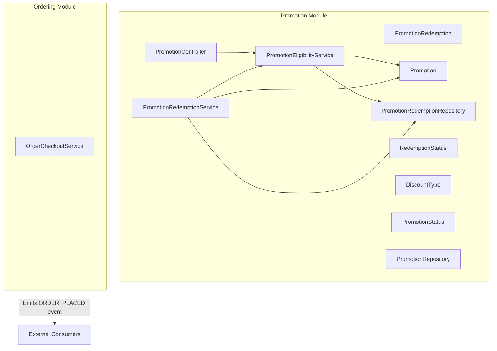
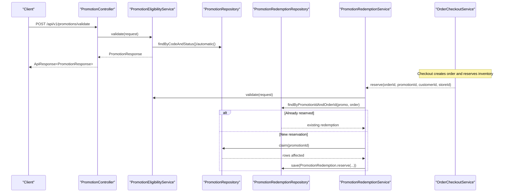
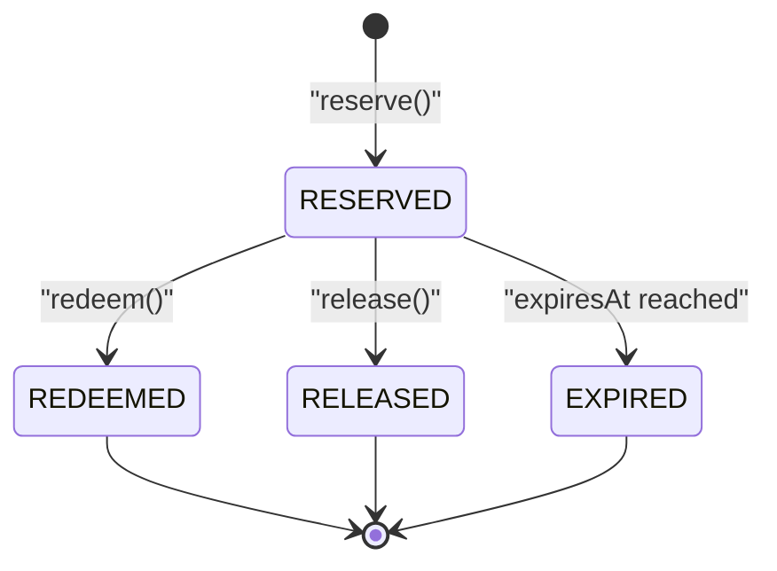
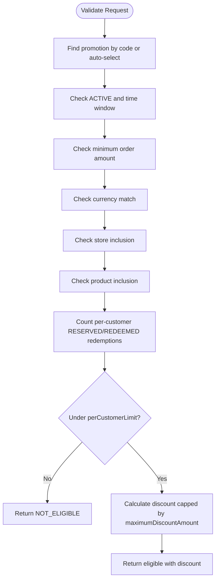
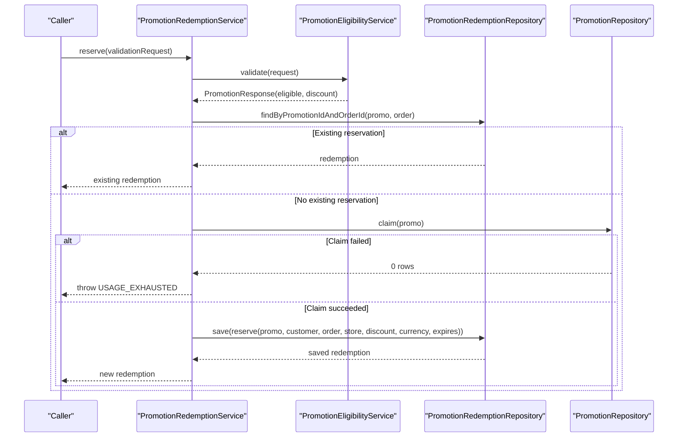
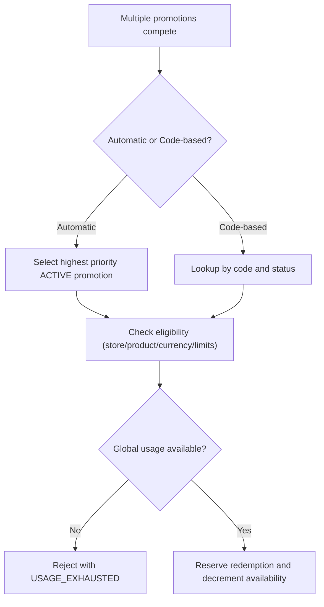
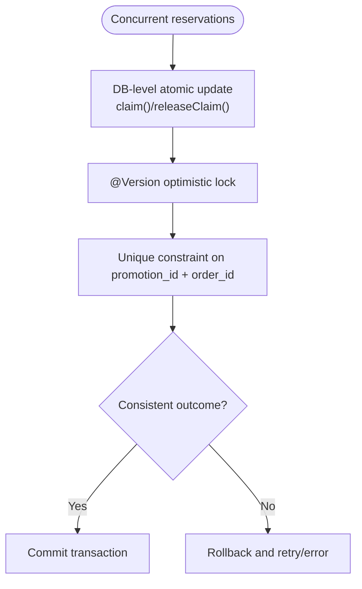
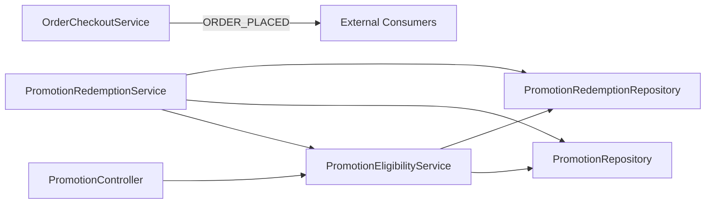

# Promotion Redemption & Usage Tracking

<cite>
**Referenced Files in This Document**
- [PromotionRedemption.java](file://src/main/java/com/smartcoffee/modules/promotion/domain/PromotionRedemption.java)
- [PromotionRedemptionService.java](file://src/main/java/com/smartcoffee/modules/promotion/application/PromotionRedemptionService.java)
- [PromotionEligibilityService.java](file://src/main/java/com/smartcoffee/modules/promotion/application/PromotionEligibilityService.java)
- [PromotionRepository.java](file://src/main/java/com/smartcoffee/modules/promotion/persistence/PromotionRepository.java)
- [PromotionRedemptionRepository.java](file://src/main/java/com/smartcoffee/modules/promotion/persistence/PromotionRedemptionRepository.java)
- [PromotionController.java](file://src/main/java/com/smartcoffee/modules/promotion/api/PromotionController.java)
- [Promotion.java](file://src/main/java/com/smartcoffee/modules/promotion/domain/Promotion.java)
- [RedemptionStatus.java](file://src/main/java/com/smartcoffee/modules/promotion/domain/RedemptionStatus.java)
- [DiscountType.java](file://src/main/java/com/smartcoffee/modules/promotion/domain/DiscountType.java)
- [PromotionStatus.java](file://src/main/java/com/smartcoffee/modules/promotion/domain/PromotionStatus.java)
- [OrderCheckoutService.java](file://src/main/java/com/smartcoffee/modules/ordering/application/OrderCheckoutService.java)
- [PromotionUsageConcurrencyIT.java](file://src/test/java/com/smartcoffee/modules/promotion/PromotionUsageConcurrencyIT.java)
</cite>

## Table of Contents
1. Introduction
2. Project Structure
3. Core Components
4. Architecture Overview
5. Detailed Component Analysis
6. Dependency Analysis
7. Performance Considerations
8. Troubleshooting Guide
9. Conclusion

## Introduction
This document explains how promotions are validated, reserved, redeemed, and released across orders and customers. It focuses on the PromotionRedemption entity, its lifecycle, usage limit enforcement (global usageLimit and per-customer perCustomerLimit), status transitions, conflict resolution when multiple promotions compete, and concurrency safeguards to ensure data consistency during redemption processing.

## Project Structure
The promotion feature is implemented as a cohesive module with domain entities, application services, persistence repositories, and an API controller:
- Domain: Promotion, PromotionRedemption, RedemptionStatus, DiscountType, PromotionStatus
- Application: PromotionEligibilityService, PromotionRedemptionService
- Persistence: PromotionRepository, PromotionRedemptionRepository
- API: PromotionController
- Integration points: OrderCheckoutService emits order events; inventory reservation uses a similar reserve/redeem/release pattern

**Diagram sources**
- [PromotionController.java:18-21](file://src/main/java/com/smartcoffee/modules/promotion/api/PromotionController.java#L18-L21)
- [PromotionEligibilityService.java:24-38](file://src/main/java/com/smartcoffee/modules/promotion/application/PromotionEligibilityService.java#L24-L38)
- [PromotionRedemptionService.java:25-36](file://src/main/java/com/smartcoffee/modules/promotion/application/PromotionRedemptionService.java#L25-L36)
- [PromotionRepository.java:10-26](file://src/main/java/com/smartcoffee/modules/promotion/persistence/PromotionRepository.java#L10-L26)
- [PromotionRedemptionRepository.java:7-14](file://src/main/java/com/smartcoffee/modules/promotion/persistence/PromotionRedemptionRepository.java#L7-L14)
- [OrderCheckoutService.java:120-125](file://src/main/java/com/smartcoffee/modules/ordering/application/OrderCheckoutService.java#L120-L125)

**Section sources**
- [PromotionController.java:1-24](file://src/main/java/com/smartcoffee/modules/promotion/api/PromotionController.java#L1-L24)
- [PromotionEligibilityService.java:1-61](file://src/main/java/com/smartcoffee/modules/promotion/application/PromotionEligibilityService.java#L1-L61)
- [PromotionRedemptionService.java:1-55](file://src/main/java/com/smartcoffee/modules/promotion/application/PromotionRedemptionService.java#L1-L55)
- [PromotionRepository.java:1-29](file://src/main/java/com/smartcoffee/modules/promotion/persistence/PromotionRepository.java#L1-L29)
- [PromotionRedemptionRepository.java:1-16](file://src/main/java/com/smartcoffee/modules/promotion/persistence/PromotionRedemptionRepository.java#L1-L16)
- [OrderCheckoutService.java:62-133](file://src/main/java/com/smartcoffee/modules/ordering/application/OrderCheckoutService.java#L62-L133)

## Core Components
- PromotionRedemption: Represents a single reservation of a promotion for an order, including discount amount, currency, timestamps, and status. Enforces state transitions from RESERVED to REDEEMED or RELEASED.
- Promotion: Defines promotion rules such as discount type/value, time windows, global usageLimit, per-customer perCustomerLimit, stackability, automatic eligibility, and priority.
- PromotionEligibilityService: Validates whether a promotion applies to a given request (code lookup, store/product filters, currency, minimum order amount, per-customer limits).
- PromotionRedemptionService: Orchestrates reservation, redemption, and release of promotions tied to orders.
- Repositories: Provide atomic claim/release operations for global usage counts and queries for per-customer usage and existing reservations.

Key responsibilities:
- Eligibility checks: time window, store/product inclusion, currency, minimum subtotal, per-customer usage count.
- Global usage enforcement: atomic increment via claim() and decrement via releaseClaim().
- Per-order uniqueness: prevent duplicate reservations for the same promotion and order.
- Lifecycle management: reserve -> redeem or release; expiration handling is supported by timestamps.

**Section sources**
- [PromotionRedemption.java:9-40](file://src/main/java/com/smartcoffee/modules/promotion/domain/PromotionRedemption.java#L9-L40)
- [Promotion.java:8-49](file://src/main/java/com/smartcoffee/modules/promotion/domain/Promotion.java#L8-L49)
- [PromotionEligibilityService.java:24-58](file://src/main/java/com/smartcoffee/modules/promotion/application/PromotionEligibilityService.java#L24-L58)
- [PromotionRedemptionService.java:25-52](file://src/main/java/com/smartcoffee/modules/promotion/application/PromotionRedemptionService.java#L25-L52)
- [PromotionRepository.java:10-26](file://src/main/java/com/smartcoffee/modules/promotion/persistence/PromotionRepository.java#L10-L26)
- [PromotionRedemptionRepository.java:7-14](file://src/main/java/com/smartcoffee/modules/promotion/persistence/PromotionRedemptionRepository.java#L7-L14)

## Architecture Overview
The promotion flow integrates validation and redemption into the ordering process:
- Clients validate promotions via the API.
- During checkout, orders are created and inventory is reserved.
- Promotions can be reserved at checkout time, then redeemed upon payment success or released on failure/cancellation.

**Diagram sources**
- [PromotionController.java:18-21](file://src/main/java/com/smartcoffee/modules/promotion/api/PromotionController.java#L18-L21)
- [PromotionEligibilityService.java:24-38](file://src/main/java/com/smartcoffee/modules/promotion/application/PromotionEligibilityService.java#L24-L38)
- [PromotionRepository.java:10-22](file://src/main/java/com/smartcoffee/modules/promotion/persistence/PromotionRepository.java#L10-L22)
- [PromotionRedemptionService.java:25-36](file://src/main/java/com/smartcoffee/modules/promotion/application/PromotionRedemptionService.java#L25-L36)
- [PromotionRedemptionRepository.java:11-13](file://src/main/java/com/smartcoffee/modules/promotion/persistence/PromotionRedemptionRepository.java#L11-L13)
- [OrderCheckoutService.java:114-125](file://src/main/java/com/smartcoffee/modules/ordering/application/OrderCheckoutService.java#L114-L125)

## Detailed Component Analysis

### PromotionRedemption Entity and Lifecycle
PromotionRedemption models a reservation of a promotion for a specific order. It enforces strict state transitions:
- Creation: reserve(...) sets status to RESERVED and records reservedAt and expiresAt.
- Redemption: redeem() requires current status to be RESERVED; updates status to REDEEMED and records redeemedAt.
- Release: release() requires current status to be RESERVED; updates status to RELEASED and records releasedAt.
- Expiration: EXPIRED is modeled but not automatically transitioned by this entity; consumers may handle expiration based on expiresAt.

**Diagram sources**
- [PromotionRedemption.java:45-76](file://src/main/java/com/smartcoffee/modules/promotion/domain/PromotionRedemption.java#L45-L76)
- [RedemptionStatus.java:3-5](file://src/main/java/com/smartcoffee/modules/promotion/domain/RedemptionStatus.java#L3-L5)

**Section sources**
- [PromotionRedemption.java:9-40](file://src/main/java/com/smartcoffee/modules/promotion/domain/PromotionRedemption.java#L9-L40)
- [PromotionRedemption.java:45-76](file://src/main/java/com/smartcoffee/modules/promotion/domain/PromotionRedemption.java#L45-L76)
- [RedemptionStatus.java:1-7](file://src/main/java/com/smartcoffee/modules/promotion/domain/RedemptionStatus.java#L1-L7)

### Promotion Eligibility and Usage Limits
PromotionEligibilityService validates promotions against:
- Time window and active status
- Minimum order amount
- Currency match
- Store and product inclusion via raw SQL checks
- Per-customer limit: counts existing RESERVED or REDEEMED redemptions for the customer and promotion

Global usage limit is enforced atomically by PromotionRepository.claim(), which increments usage_count only if usage_limit is null or usage_count < usage_limit.

**Diagram sources**
- [PromotionEligibilityService.java:24-58](file://src/main/java/com/smartcoffee/modules/promotion/application/PromotionEligibilityService.java#L24-L58)
- [Promotion.java:66-75](file://src/main/java/com/smartcoffee/modules/promotion/domain/Promotion.java#L66-L75)

**Section sources**
- [PromotionEligibilityService.java:24-58](file://src/main/java/com/smartcoffee/modules/promotion/application/PromotionEligibilityService.java#L24-L58)
- [Promotion.java:66-75](file://src/main/java/com/smartcoffee/modules/promotion/domain/Promotion.java#L66-L75)
- [PromotionRepository.java:20-26](file://src/main/java/com/smartcoffee/modules/promotion/persistence/PromotionRepository.java#L20-L26)

### Reservation, Redemption, and Release Orchestration
PromotionRedemptionService coordinates:
- reserve(): validates eligibility, prevents duplicate reservation per order, claims global usage, and persists a RESERVED redemption with a 15-minute expiry.
- redeemForOrder(): transitions all RESERVED redemptions for an order to REDEEMED.
- releaseForOrder(): releases all RESERVED redemptions for an order back to available capacity and decrements global usage.

**Diagram sources**
- [PromotionRedemptionService.java:25-36](file://src/main/java/com/smartcoffee/modules/promotion/application/PromotionRedemptionService.java#L25-L36)
- [PromotionEligibilityService.java:24-38](file://src/main/java/com/smartcoffee/modules/promotion/application/PromotionEligibilityService.java#L24-L38)
- [PromotionRepository.java:20-22](file://src/main/java/com/smartcoffee/modules/promotion/persistence/PromotionRepository.java#L20-L22)
- [PromotionRedemptionRepository.java:11-13](file://src/main/java/com/smartcoffee/modules/promotion/persistence/PromotionRedemptionRepository.java#L11-L13)

**Section sources**
- [PromotionRedemptionService.java:25-52](file://src/main/java/com/smartcoffee/modules/promotion/application/PromotionRedemptionService.java#L25-L52)
- [PromotionRedemption.java:45-76](file://src/main/java/com/smartcoffee/modules/promotion/domain/PromotionRedemption.java#L45-L76)

### Conflict Resolution and Multiple Promotions
- Duplicate order-promotion reservation: prevented by checking findByPromotionIdAndOrderId before creating a new reservation.
- Global usage exhaustion: claim() returns 0 rows when usageLimit is reached; service throws a conflict error.
- Automatic vs manual promotions: automatic promotions are selected by priority; manual codes are validated explicitly.
- Stackable flag: indicates whether multiple promotions can apply together; selection logic is driven by eligibility and repository queries.

**Diagram sources**
- [PromotionRepository.java:17-22](file://src/main/java/com/smartcoffee/modules/promotion/persistence/PromotionRepository.java#L17-L22)
- [PromotionEligibilityService.java:24-58](file://src/main/java/com/smartcoffee/modules/promotion/application/PromotionEligibilityService.java#L24-L58)
- [PromotionRedemptionService.java:25-36](file://src/main/java/com/smartcoffee/modules/promotion/application/PromotionRedemptionService.java#L25-L36)

**Section sources**
- [PromotionRepository.java:10-26](file://src/main/java/com/smartcoffee/modules/promotion/persistence/PromotionRepository.java#L10-L26)
- [PromotionEligibilityService.java:24-58](file://src/main/java/com/smartcoffee/modules/promotion/application/PromotionEligibilityService.java#L24-L58)
- [PromotionRedemptionService.java:25-36](file://src/main/java/com/smartcoffee/modules/promotion/application/PromotionRedemptionService.java#L25-L36)

### Race Condition Handling, Atomicity, and Consistency
- Atomic global usage control: claim() and releaseClaim() use native SQL that increments/decrements usage_count and version atomically under constraints.
- Optimistic locking: both Promotion and PromotionRedemption use @Version fields to detect concurrent modifications.
- Idempotency at checkout: OrderCheckoutService uses idempotency keys to avoid duplicate order creation; while not directly part of promotion redemption, it ensures consistent downstream events.
- Concurrency test placeholder: PromotionUsageConcurrencyIT outlines intent to assert one winner when usageLimit=1.

**Diagram sources**
- [PromotionRepository.java:20-26](file://src/main/java/com/smartcoffee/modules/promotion/persistence/PromotionRepository.java#L20-L26)
- [Promotion.java:48-49](file://src/main/java/com/smartcoffee/modules/promotion/domain/Promotion.java#L48-L49)
- [PromotionRedemption.java:39-40](file://src/main/java/com/smartcoffee/modules/promotion/domain/PromotionRedemption.java#L39-L40)
- [PromotionRedemption.java:10-11](file://src/main/java/com/smartcoffee/modules/promotion/domain/PromotionRedemption.java#L10-L11)
- [OrderCheckoutService.java:62-73](file://src/main/java/com/smartcoffee/modules/ordering/application/OrderCheckoutService.java#L62-L73)
- [PromotionUsageConcurrencyIT.java:6-10](file://src/test/java/com/smartcoffee/modules/promotion/PromotionUsageConcurrencyIT.java#L6-L10)

**Section sources**
- [PromotionRepository.java:20-26](file://src/main/java/com/smartcoffee/modules/promotion/persistence/PromotionRepository.java#L20-L26)
- [Promotion.java:48-49](file://src/main/java/com/smartcoffee/modules/promotion/domain/Promotion.java#L48-L49)
- [PromotionRedemption.java:39-40](file://src/main/java/com/smartcoffee/modules/promotion/domain/PromotionRedemption.java#L39-L40)
- [PromotionRedemption.java:10-11](file://src/main/java/com/smartcoffee/modules/promotion/domain/PromotionRedemption.java#L10-L11)
- [OrderCheckoutService.java:62-73](file://src/main/java/com/smartcoffee/modules/ordering/application/OrderCheckoutService.java#L62-L73)
- [PromotionUsageConcurrencyIT.java:6-10](file://src/test/java/com/smartcoffee/modules/promotion/PromotionUsageConcurrencyIT.java#L6-L10)

## Dependency Analysis
- PromotionController depends on PromotionEligibilityService for validation responses.
- PromotionEligibilityService depends on PromotionRepository and PromotionRedemptionRepository to evaluate eligibility and per-customer usage.
- PromotionRedemptionService depends on PromotionEligibilityService, PromotionRepository, and PromotionRedemptionRepository to orchestrate reservation, redemption, and release.
- OrderCheckoutService emits ORDER_PLACED events; external consumers can trigger promotion redemption flows post-checkout.

**Diagram sources**
- [PromotionController.java:18-21](file://src/main/java/com/smartcoffee/modules/promotion/api/PromotionController.java#L18-L21)
- [PromotionEligibilityService.java:24-38](file://src/main/java/com/smartcoffee/modules/promotion/application/PromotionEligibilityService.java#L24-L38)
- [PromotionRedemptionService.java:25-36](file://src/main/java/com/smartcoffee/modules/promotion/application/PromotionRedemptionService.java#L25-L36)
- [OrderCheckoutService.java:120-125](file://src/main/java/com/smartcoffee/modules/ordering/application/OrderCheckoutService.java#L120-L125)

**Section sources**
- [PromotionController.java:1-24](file://src/main/java/com/smartcoffee/modules/promotion/api/PromotionController.java#L1-L24)
- [PromotionEligibilityService.java:1-61](file://src/main/java/com/smartcoffee/modules/promotion/application/PromotionEligibilityService.java#L1-L61)
- [PromotionRedemptionService.java:1-55](file://src/main/java/com/smartcoffee/modules/promotion/application/PromotionRedemptionService.java#L1-L55)
- [OrderCheckoutService.java:120-125](file://src/main/java/com/smartcoffee/modules/ordering/application/OrderCheckoutService.java#L120-L125)

## Performance Considerations
- Use read-only transactions for eligibility checks to reduce contention.
- Prefer batch operations where possible when releasing or redeeming multiple redemptions for an order.
- Keep reservation TTL short (e.g., 15 minutes) to minimize locked resources.
- Monitor database locks and contention around claim()/releaseClaim(); consider tuning isolation levels if needed.

[No sources needed since this section provides general guidance]

## Troubleshooting Guide
Common issues and resolutions:
- PROMOTION_NOT_FOUND: The requested code does not exist or is not active. Verify code casing and status.
- PROMOTION_NOT_ELIGIBLE: Subtotal below minimum, wrong currency, store/product mismatch, or per-customer limit reached. Review eligibility criteria and per-customer redemption counts.
- PROMOTION_USAGE_EXHAUSTED: Global usageLimit reached. Wait for releases or adjust usageLimit.
- Duplicate reservation attempts: Handled by unique constraint on promotion_id + order_id; returning existing redemption avoids duplicates.
- Stale reservations: If orders fail after reservation, call releaseForOrder to free global usage and revert per-customer counts.

Operational tips:
- Inspect RedemptionStatus values to determine if a redemption is still RESERVED, REDEEMED, or RELEASED.
- Use expiresAt to identify expired reservations that need cleanup.
- Leverage @Version conflicts to detect concurrent updates; retry with backoff if necessary.

**Section sources**
- [PromotionEligibilityService.java:24-38](file://src/main/java/com/smartcoffee/modules/promotion/application/PromotionEligibilityService.java#L24-L38)
- [PromotionRedemptionService.java:25-52](file://src/main/java/com/smartcoffee/modules/promotion/application/PromotionRedemptionService.java#L25-L52)
- [PromotionRedemption.java:61-76](file://src/main/java/com/smartcoffee/modules/promotion/domain/PromotionRedemption.java#L61-L76)
- [PromotionRedemptionRepository.java:7-14](file://src/main/java/com/smartcoffee/modules/promotion/persistence/PromotionRedemptionRepository.java#L7-L14)

## Conclusion
The promotion system combines robust eligibility checks with atomic usage controls and clear lifecycle management for redemptions. Global usageLimit and per-customer perCustomerLimit are enforced through database-level atomic operations and repository queries. The design supports safe concurrency via optimistic locking and unique constraints, while providing clear status transitions and hooks for integration with order and payment workflows. External consumers can react to ORDER_PLACED events to finalize redemption states consistently.

[No sources needed since this section summarizes without analyzing specific files]