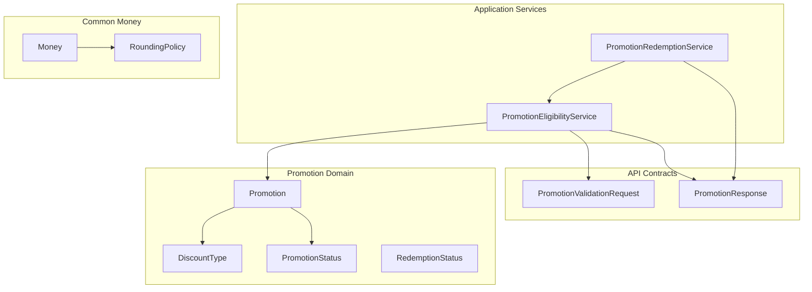
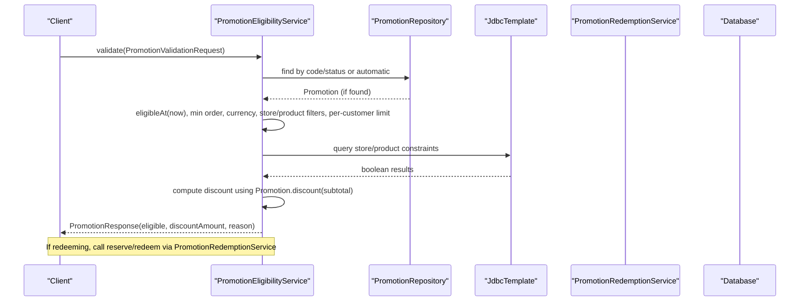
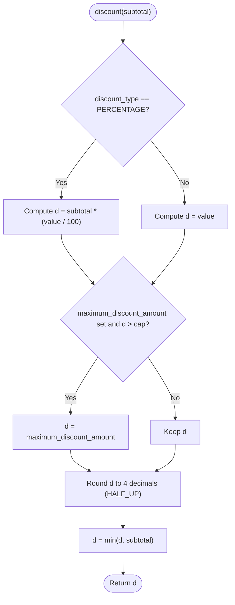
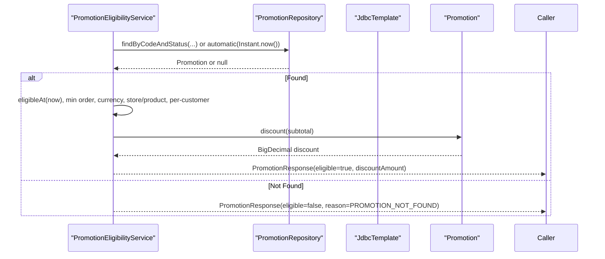
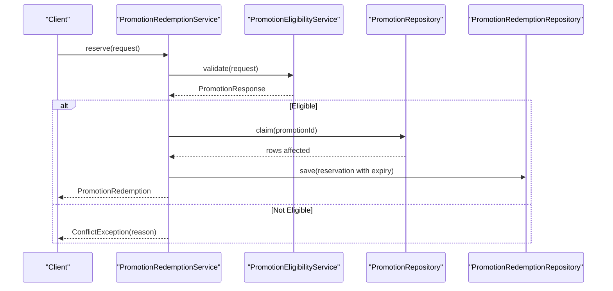
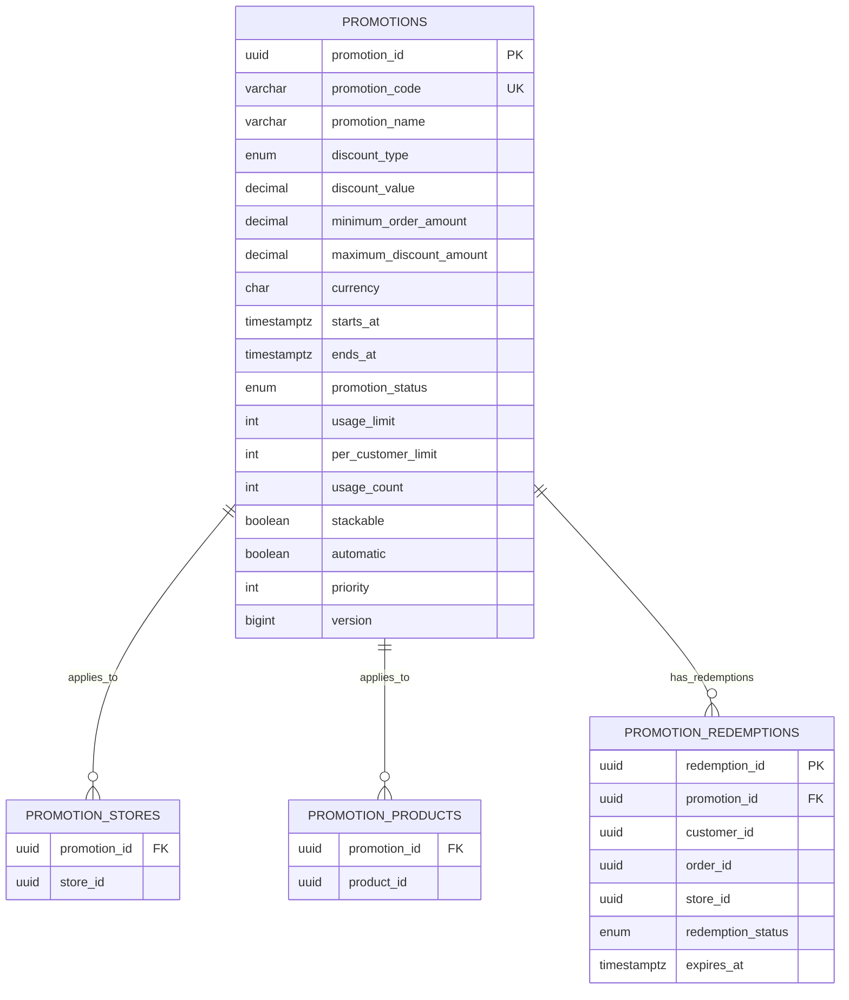
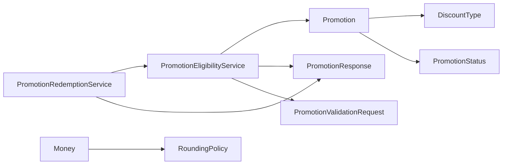

# Promotion Types & Discount Engine

<cite>
**Referenced Files in This Document**
- [Promotion.java](file://src/main/java/com/smartcoffee/modules/promotion/domain/Promotion.java)
- [DiscountType.java](file://src/main/java/com/smartcoffee/modules/promotion/domain/DiscountType.java)
- [PromotionStatus.java](file://src/main/java/com/smartcoffee/modules/promotion/domain/PromotionStatus.java)
- [RedemptionStatus.java](file://src/main/java/com/smartcoffee/modules/promotion/domain/RedemptionStatus.java)
- [PromotionEligibilityService.java](file://src/main/java/com/smartcoffee/modules/promotion/application/PromotionEligibilityService.java)
- [PromotionRedemptionService.java](file://src/main/java/com/smartcoffee/modules/promotion/application/PromotionRedemptionService.java)
- [PromotionValidationRequest.java](file://src/main/java/com/smartcoffee/modules/promotion/api/PromotionValidationRequest.java)
- [PromotionResponse.java](file://src/main/java/com/smartcoffee/modules/promotion/api/PromotionResponse.java)
- [Money.java](file://src/main/java/com/smartcoffee/common/money/Money.java)
- [RoundingPolicy.java](file://src/main/java/com/smartcoffee/common/money/RoundingPolicy.java)
- [V009__promotions_loyalty.sql](file://src/main/resources/db/migration/V009__promotions_loyalty.sql)
</cite>

## Table of Contents
1. Introduction
2. Project Structure
3. Core Components
4. Architecture Overview
5. Detailed Component Analysis
6. Dependency Analysis
7. Performance Considerations
8. Troubleshooting Guide
9. Conclusion
10. Appendices

## Introduction
This document explains the promotion types and the discount calculation engine used by the system. It focuses on how percentage-based and fixed-amount discounts are computed, the structure of the Promotion entity (including discount_value, maximum_discount_amount, minimum_order_amount, and currency handling), and the behavior of the discount() method. It also provides examples, edge-case guidance, and diagrams to help both technical and non-technical readers understand the flow from request validation to final discount computation.

## Project Structure
The promotion feature is implemented as a domain module with application services and API contracts:
- Domain models define promotion configuration and discount logic.
- Application services handle eligibility checks, redemption lifecycle, and orchestration.
- API records model requests and responses for promotion validation and usage.
- Money utilities provide consistent currency handling and rounding policies across the system.

**Diagram sources**
- [Promotion.java:8-49](file://src/main/java/com/smartcoffee/modules/promotion/domain/Promotion.java#L8-L49)
- [DiscountType.java:3-5](file://src/main/java/com/smartcoffee/modules/promotion/domain/DiscountType.java#L3-L5)
- [PromotionStatus.java:3-5](file://src/main/java/com/smartcoffee/modules/promotion/domain/PromotionStatus.java#L3-L5)
- [RedemptionStatus.java:3-5](file://src/main/java/com/smartcoffee/modules/promotion/domain/RedemptionStatus.java#L3-L5)
- [PromotionEligibilityService.java:12-38](file://src/main/java/com/smartcoffee/modules/promotion/application/PromotionEligibilityService.java#L12-L38)
- [PromotionRedemptionService.java:12-36](file://src/main/java/com/smartcoffee/modules/promotion/application/PromotionRedemptionService.java#L12-L36)
- [PromotionValidationRequest.java:7-9](file://src/main/java/com/smartcoffee/modules/promotion/api/PromotionValidationRequest.java#L7-L9)
- [PromotionResponse.java:6-7](file://src/main/java/com/smartcoffee/modules/promotion/api/PromotionResponse.java#L6-L7)
- [Money.java:6-27](file://src/main/java/com/smartcoffee/common/money/Money.java#L6-L27)
- [RoundingPolicy.java:5-10](file://src/main/java/com/smartcoffee/common/money/RoundingPolicy.java#L5-L10)

**Section sources**
- [Promotion.java:8-49](file://src/main/java/com/smartcoffee/modules/promotion/domain/Promotion.java#L8-L49)
- [PromotionEligibilityService.java:12-38](file://src/main/java/com/smartcoffee/modules/promotion/application/PromotionEligibilityService.java#L12-L38)
- [PromotionRedemptionService.java:12-36](file://src/main/java/com/smartcoffee/modules/promotion/application/PromotionRedemptionService.java#L12-L36)
- [PromotionValidationRequest.java:7-9](file://src/main/java/com/smartcoffee/modules/promotion/api/PromotionValidationRequest.java#L7-L9)
- [PromotionResponse.java:6-7](file://src/main/java/com/smartcoffee/modules/promotion/api/PromotionResponse.java#L6-L7)
- [Money.java:6-27](file://src/main/java/com/smartcoffee/common/money/Money.java#L6-L27)
- [RoundingPolicy.java:5-10](file://src/main/java/com/smartcoffee/common/money/RoundingPolicy.java#L5-L10)

## Core Components
- Promotion entity: Holds all promotion configuration including discount type, value, caps, thresholds, currency, validity window, limits, stackability, automatic application, and priority.
- DiscountType enum: Defines supported discount types (percentage or fixed amount).
- PromotionEligibilityService: Validates whether a promotion applies to a given order context (time window, minimum order amount, currency match, store/product filters, per-customer limits).
- PromotionRedemptionService: Manages reservation, release, and redemption of promotions with concurrency-safe claiming.
- API contracts: PromotionValidationRequest carries order context; PromotionResponse returns eligibility and computed discount.
- Money utilities: Provide currency validation and rounding policy abstraction.

Key responsibilities:
- Eligibility checks ensure that only valid promotions are considered for discounting.
- The discount() method computes the actual discount based on discount type, caps, and rounding.
- Redemption services enforce usage limits and track state transitions.

**Section sources**
- [Promotion.java:18-49](file://src/main/java/com/smartcoffee/modules/promotion/domain/Promotion.java#L18-L49)
- [DiscountType.java:3-5](file://src/main/java/com/smartcoffee/modules/promotion/domain/DiscountType.java#L3-L5)
- [PromotionEligibilityService.java:24-58](file://src/main/java/com/smartcoffee/modules/promotion/application/PromotionEligibilityService.java#L24-L58)
- [PromotionRedemptionService.java:25-52](file://src/main/java/com/smartcoffee/modules/promotion/application/PromotionRedemptionService.java#L25-L52)
- [PromotionValidationRequest.java:7-9](file://src/main/java/com/smartcoffee/modules/promotion/api/PromotionValidationRequest.java#L7-L9)
- [PromotionResponse.java:6-7](file://src/main/java/com/smartcoffee/modules/promotion/api/PromotionResponse.java#L6-L7)
- [Money.java:6-27](file://src/main/java/com/smartcoffee/common/money/Money.java#L6-L27)
- [RoundingPolicy.java:5-10](file://src/main/java/com/smartcoffee/common/money/RoundingPolicy.java#L5-L10)

## Architecture Overview
The promotion workflow starts with an eligibility check and ends with a computed discount applied to the order subtotal.

**Diagram sources**
- [PromotionEligibilityService.java:24-58](file://src/main/java/com/smartcoffee/modules/promotion/application/PromotionEligibilityService.java#L24-L58)
- [Promotion.java:66-75](file://src/main/java/com/smartcoffee/modules/promotion/domain/Promotion.java#L66-L75)
- [PromotionRedemptionService.java:25-52](file://src/main/java/com/smartcoffee/modules/promotion/application/PromotionRedemptionService.java#L25-L52)

## Detailed Component Analysis

### Promotion Entity and Discount Calculation
- Fields:
  - discount_type: Enum indicating PERCENTAGE or FIXED_AMOUNT.
  - discount_value: Numeric value representing either a percentage (e.g., 15 means 15%) or a fixed monetary amount.
  - minimum_order_amount: Minimum subtotal required for the promotion to apply.
  - maximum_discount_amount: Optional cap on the discount amount.
  - currency: Optional currency code; must match the order’s currency when specified.
  - Validity window: starts_at and ends_at determine eligibility time.
  - Limits and flags: usage_limit, per_customer_limit, stackable, automatic, priority.
- discount() method behavior:
  - Percentage conversion: When discount_type is PERCENTAGE, the value is treated as a percent and converted by moving the decimal point left by two positions (i.e., dividing by 100).
  - Cap enforcement: If maximum_discount_amount is set and the computed discount exceeds it, the discount is capped at that maximum.
  - Rounding: The result is rounded to four decimal places using HALF_UP rounding.
  - Safety bound: The discount cannot exceed the subtotal (ensures non-negative effective price).

**Diagram sources**
- [Promotion.java:70-75](file://src/main/java/com/smartcoffee/modules/promotion/domain/Promotion.java#L70-L75)

**Section sources**
- [Promotion.java:18-49](file://src/main/java/com/smartcoffee/modules/promotion/domain/Promotion.java#L18-L49)
- [Promotion.java:70-75](file://src/main/java/com/smartcoffee/modules/promotion/domain/Promotion.java#L70-L75)

### Eligibility and Validation Flow
- Inputs:
  - storeId, customerId, orderId, optional promotionCode, subtotal, currencyCode, productIds/categoryIds.
- Checks performed:
  - Time window: promotion must be ACTIVE and within starts_at..ends_at.
  - Minimum order amount: subtotal must meet or exceed minimum_order_amount.
  - Currency match: if promotion has a currency, it must equal the order’s currency.
  - Store/product filters: validated via database queries against promotion_stores and promotion_products.
  - Per-customer limit: count of prior redemptions (RESERVED/REDEEMED) must be below per_customer_limit.
- Output:
  - If eligible, returns PromotionResponse with discountAmount computed by Promotion.discount(subtotal).
  - If not eligible, returns reason codes such as PROMOTION_NOT_FOUND or PROMOTION_NOT_ELIGIBLE.

**Diagram sources**
- [PromotionEligibilityService.java:24-58](file://src/main/java/com/smartcoffee/modules/promotion/application/PromotionEligibilityService.java#L24-L58)
- [Promotion.java:66-75](file://src/main/java/com/smartcoffee/modules/promotion/domain/Promotion.java#L66-L75)

**Section sources**
- [PromotionEligibilityService.java:24-58](file://src/main/java/com/smartcoffee/modules/promotion/application/PromotionEligibilityService.java#L24-L58)
- [PromotionValidationRequest.java:7-9](file://src/main/java/com/smartcoffee/modules/promotion/api/PromotionValidationRequest.java#L7-L9)
- [PromotionResponse.java:6-7](file://src/main/java/com/smartcoffee/modules/promotion/api/PromotionResponse.java#L6-L7)

### Redemption Lifecycle
- Reserve:
  - Validates eligibility first.
  - Claims one usage slot atomically.
  - Creates a redemption record with expiry (15 minutes) and stores discount amount and currency.
- Release:
  - Releases reserved redemptions for an order and releases claimed slots.
- Redeem:
  - Marks reserved redemptions as redeemed.

**Diagram sources**
- [PromotionRedemptionService.java:25-36](file://src/main/java/com/smartcoffee/modules/promotion/application/PromotionRedemptionService.java#L25-L36)
- [PromotionEligibilityService.java:24-38](file://src/main/java/com/smartcoffee/modules/promotion/application/PromotionEligibilityService.java#L24-L38)

**Section sources**
- [PromotionRedemptionService.java:25-52](file://src/main/java/com/smartcoffee/modules/promotion/application/PromotionRedemptionService.java#L25-L52)

### Data Model and Persistence
- Schema highlights:
  - promotion.promotions table includes fields for code, name, discount_type, discount_value, minimum_order_amount, maximum_discount_amount, currency, start/end times, status, usage limits, stackable flag, automatic flag, priority, and versioning.
  - Additional tables link promotions to stores, products, and categories to constrain applicability.
  - Redemption tracking ensures one-time use per order and supports per-customer limits.

**Diagram sources**
- [V009__promotions_loyalty.sql:5-115](file://src/main/resources/db/migration/V009__promotions_loyalty.sql#L5-L115)

**Section sources**
- [V009__promotions_loyalty.sql:5-115](file://src/main/resources/db/migration/V009__promotions_loyalty.sql#L5-L115)

## Dependency Analysis
- Promotion depends on DiscountType and PromotionStatus enums.
- PromotionEligibilityService depends on PromotionRepository, PromotionRedemptionRepository, and JdbcTemplate for store/product filtering and per-customer limit checks.
- PromotionRedemptionService depends on PromotionEligibilityService for validation and repositories for persistence and atomic claiming.
- API records (request/response) decouple external callers from internal domain details.
- Money utilities provide currency validation and rounding policy abstraction used elsewhere in the system.

**Diagram sources**
- [Promotion.java:18-49](file://src/main/java/com/smartcoffee/modules/promotion/domain/Promotion.java#L18-L49)
- [DiscountType.java:3-5](file://src/main/java/com/smartcoffee/modules/promotion/domain/DiscountType.java#L3-L5)
- [PromotionStatus.java:3-5](file://src/main/java/com/smartcoffee/modules/promotion/domain/PromotionStatus.java#L3-L5)
- [PromotionEligibilityService.java:12-38](file://src/main/java/com/smartcoffee/modules/promotion/application/PromotionEligibilityService.java#L12-L38)
- [PromotionRedemptionService.java:12-36](file://src/main/java/com/smartcoffee/modules/promotion/application/PromotionRedemptionService.java#L12-L36)
- [PromotionValidationRequest.java:7-9](file://src/main/java/com/smartcoffee/modules/promotion/api/PromotionValidationRequest.java#L7-L9)
- [PromotionResponse.java:6-7](file://src/main/java/com/smartcoffee/modules/promotion/api/PromotionResponse.java#L6-L7)
- [Money.java:6-27](file://src/main/java/com/smartcoffee/common/money/Money.java#L6-L27)
- [RoundingPolicy.java:5-10](file://src/main/java/com/smartcoffee/common/money/RoundingPolicy.java#L5-L10)

**Section sources**
- [Promotion.java:18-49](file://src/main/java/com/smartcoffee/modules/promotion/domain/Promotion.java#L18-L49)
- [PromotionEligibilityService.java:12-38](file://src/main/java/com/smartcoffee/modules/promotion/application/PromotionEligibilityService.java#L12-L38)
- [PromotionRedemptionService.java:12-36](file://src/main/java/com/smartcoffee/modules/promotion/application/PromotionRedemptionService.java#L12-L36)
- [PromotionValidationRequest.java:7-9](file://src/main/java/com/smartcoffee/modules/promotion/api/PromotionValidationRequest.java#L7-L9)
- [PromotionResponse.java:6-7](file://src/main/java/com/smartcoffee/modules/promotion/api/PromotionResponse.java#L6-L7)
- [Money.java:6-27](file://src/main/java/com/smartcoffee/common/money/Money.java#L6-L27)
- [RoundingPolicy.java:5-10](file://src/main/java/com/smartcoffee/common/money/RoundingPolicy.java#L5-L10)

## Performance Considerations
- Eligibility checks include database queries for store/product constraints and per-customer redemption counts; ensure appropriate indexes exist on promotion_stores, promotion_products, and redemption tables.
- Atomic claiming prevents race conditions during high-concurrency reservations.
- Rounding to four decimal places avoids excessive precision while maintaining accuracy for intermediate calculations; final display rounding can be handled by UI or downstream services.

[No sources needed since this section provides general guidance]

## Troubleshooting Guide
Common issues and resolutions:
- Promotion not found:
  - Ensure promotion code exists and is ACTIVE.
  - Check time window (starts_at..ends_at).
- Promotion not eligible:
  - Verify subtotal meets minimum_order_amount.
  - Confirm currency matches promotion currency (if set).
  - Validate store/product filters and per-customer limits.
- Usage exhausted:
  - Promotion usage_limit reached; create a new promotion or adjust limits.
- Negative or zero discounts:
  - If subtotal is zero or less than minimum_order_amount, no discount applies.
  - For percentage discounts, ensure discount_value is positive; negative values should be prevented at input validation.
- Currency precision:
  - Use Money for arithmetic where applicable; ensure rounding aligns with business rules (e.g., currency-specific scale via RoundingPolicy).

**Section sources**
- [PromotionEligibilityService.java:24-58](file://src/main/java/com/smartcoffee/modules/promotion/application/PromotionEligibilityService.java#L24-L58)
- [PromotionRedemptionService.java:25-36](file://src/main/java/com/smartcoffee/modules/promotion/application/PromotionRedemptionService.java#L25-L36)
- [Money.java:6-27](file://src/main/java/com/smartcoffee/common/money/Money.java#L6-L27)
- [RoundingPolicy.java:5-10](file://src/main/java/com/smartcoffee/common/money/RoundingPolicy.java#L5-L10)

## Conclusion
The promotion system provides flexible discount configurations through percentage and fixed-amount types, robust eligibility checks, and safe redemption workflows. The discount() method centralizes calculation logic with clear rules for percentage conversion, maximum cap enforcement, and rounding. By combining domain modeling, application services, and persistence constraints, the system ensures accurate and reliable discount application across diverse scenarios.

[No sources needed since this section summarizes without analyzing specific files]

## Appendices

### Examples of Promotion Configurations and Calculations
- Example A: Percentage discount with cap
  - Configuration: discount_type=PERCENTAGE, discount_value=20, maximum_discount_amount=10.00, minimum_order_amount=50.00, currency=USD.
  - Subtotal=80.00:
    - Raw discount = 80.00 * (20/100) = 16.00.
    - Cap enforced: discount = min(16.00, 10.00) = 10.00.
    - Rounded to 4 decimals: 10.0000.
  - Subtotal=40.00:
    - Below minimum_order_amount => not eligible.
- Example B: Fixed amount discount
  - Configuration: discount_type=FIXED_AMOUNT, discount_value=5.00, minimum_order_amount=20.00, currency=USD.
  - Subtotal=25.00:
    - Raw discount = 5.00.
    - No cap => discount = 5.00.
    - Rounded to 4 decimals: 5.0000.
- Example C: Percentage discount without cap
  - Configuration: discount_type=PERCENTAGE, discount_value=15, minimum_order_amount=0.00, currency=USD.
  - Subtotal=100.00:
    - Raw discount = 100.00 * (15/100) = 15.00.
    - Rounded to 4 decimals: 15.0000.

[No sources needed since this section provides illustrative examples]

### Edge Cases and Policies
- Zero discounts:
  - If subtotal is zero or below minimum_order_amount, discount remains zero and promotion is not eligible.
- Negative values:
  - Input validation should prevent negative discount_value or negative subtotal; ensure DecimalMin constraints are enforced at API layer.
- Currency precision:
  - Use Money for consistent arithmetic and RoundingPolicy for display rounding aligned with currency conventions (e.g., KHR vs others).

**Section sources**
- [PromotionValidationRequest.java:7-9](file://src/main/java/com/smartcoffee/modules/promotion/api/PromotionValidationRequest.java#L7-L9)
- [Money.java:6-27](file://src/main/java/com/smartcoffee/common/money/Money.java#L6-L27)
- [RoundingPolicy.java:5-10](file://src/main/java/com/smartcoffee/common/money/RoundingPolicy.java#L5-L10)