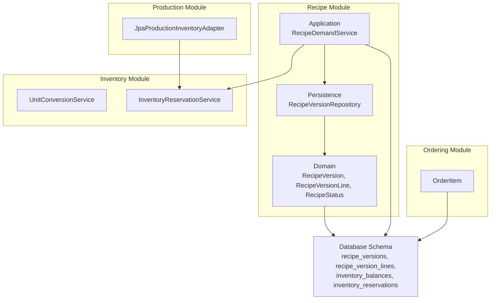
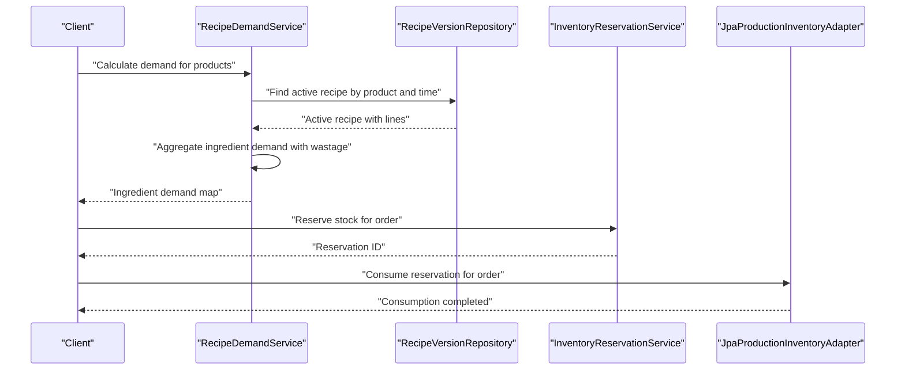
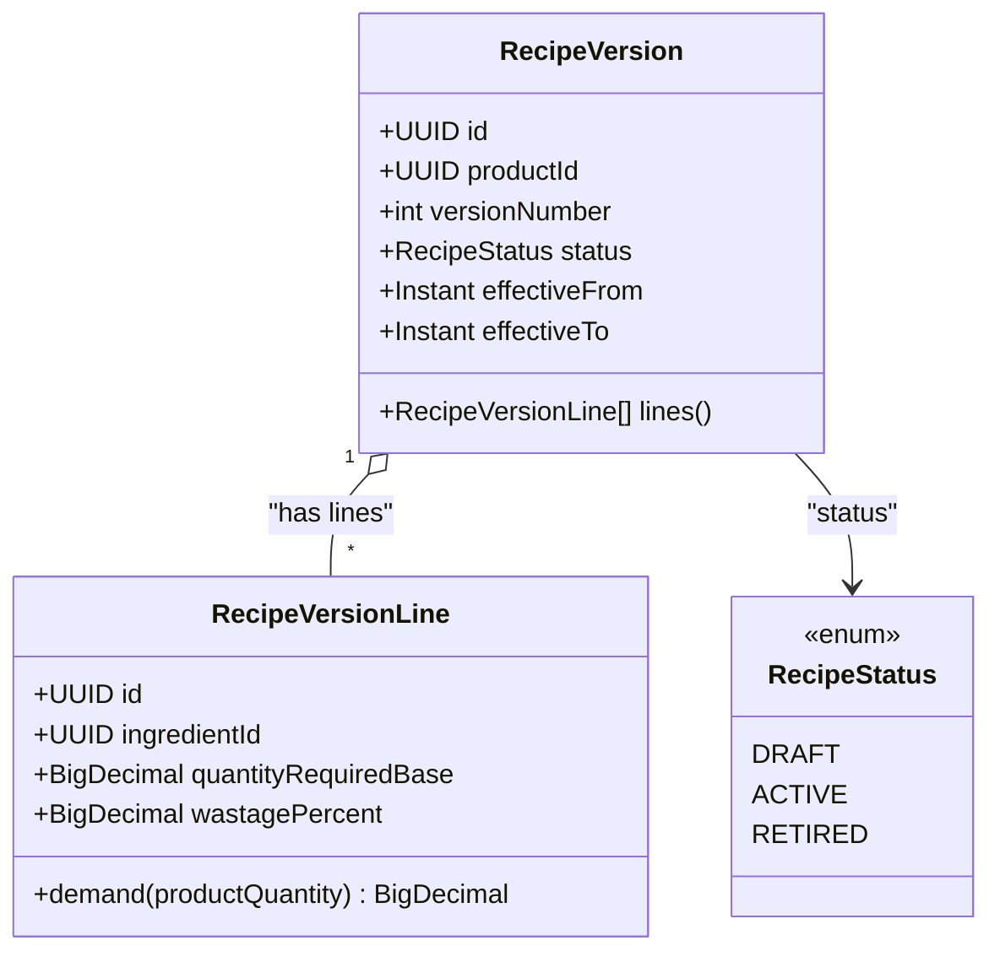
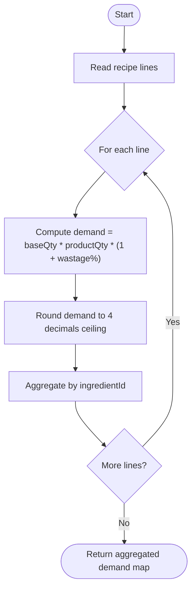
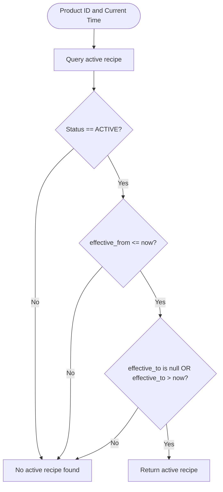
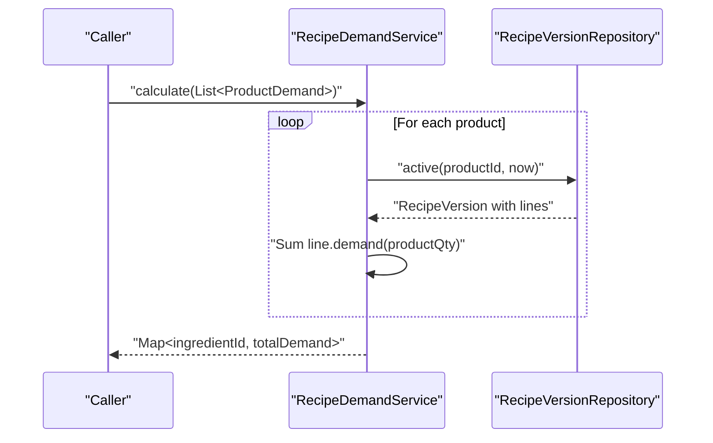
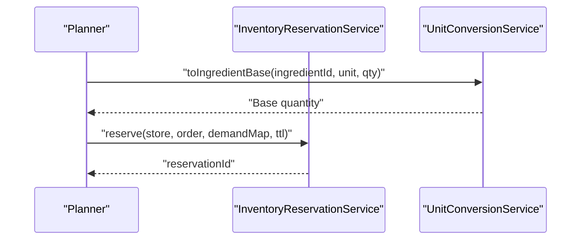
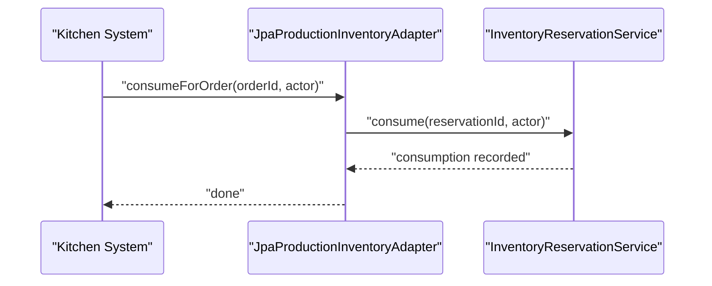
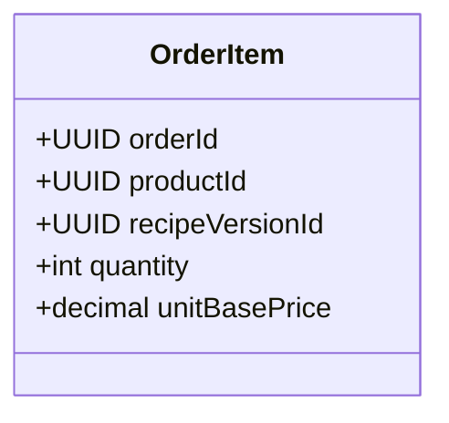
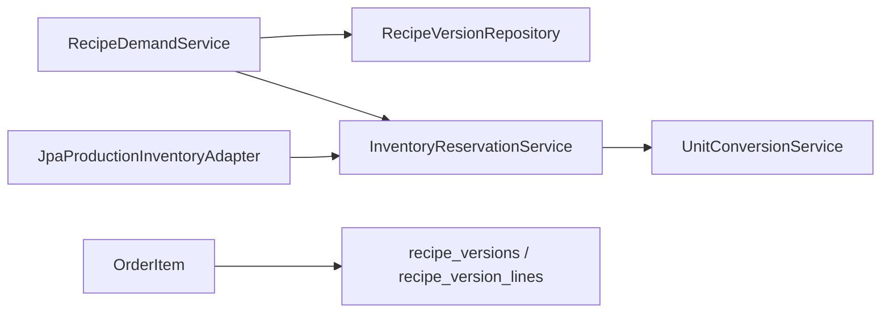

# Recipe Management Module

<cite>
**Referenced Files in This Document**
- [RecipeDemandService.java](file://src/main/java/com/smartcoffee/modules/recipe/application/RecipeDemandService.java)
- [RecipeVersion.java](file://src/main/java/com/smartcoffee/modules/recipe/domain/RecipeVersion.java)
- [RecipeVersionLine.java](file://src/main/java/com/smartcoffee/modules/recipe/domain/RecipeVersionLine.java)
- [RecipeStatus.java](file://src/main/java/com/smartcoffee/modules/recipe/domain/RecipeStatus.java)
- [RecipeVersionRepository.java](file://src/main/java/com/smartcoffee/modules/recipe/persistence/RecipeVersionRepository.java)
- [V005__recipe_inventory_uom_reservation_ledger.sql](file://src/main/resources/db/migration/V005__recipe_inventory_uom_reservation_ledger.sql)
- [smart-coffee-logical.dbml](file://database/smart-coffee-logical.dbml)
- [UnitConversionService.java](file://src/main/java/com/smartcoffee/modules/inventory/application/UnitConversionService.java)
- [InventoryReservationService.java](file://src/main/java/com/smartcoffee/modules/inventory/application/InventoryReservationService.java)
- [JpaProductionInventoryAdapter.java](file://src/main/java/com/smartcoffee/modules/production/application/JpaProductionInventoryAdapter.java)
- [OrderItem.java](file://src/main/java/com/smartcoffee/modules/ordering/domain/OrderItem.java)
</cite>

## Table of Contents
1. [Introduction](#introduction)
2. [Project Structure](#project-structure)
3. [Core Components](#core-components)
4. [Architecture Overview](#architecture-overview)
5. [Detailed Component Analysis](#detailed-component-analysis)
6. [Dependency Analysis](#dependency-analysis)
7. [Performance Considerations](#performance-considerations)
8. [Troubleshooting Guide](#troubleshooting-guide)
9. [Conclusion](#conclusion)
10. [Appendices](#appendices)

## Introduction
This document explains the Recipe Management module and how it models product recipes, manages recipe versions, calculates ingredient demand, and integrates with inventory planning, production, and cost calculation. It also provides guidance on approval workflows, version control, change management, optimization, nutritional information, and regulatory compliance considerations.

The module centers around:
- Versioned recipes tied to products
- Ingredient requirements per recipe version
- Active recipe selection by time window
- Demand calculation for forecasting and inventory reservation
- Integration points with inventory reservations and production consumption

## Project Structure
The Recipe Management module is organized into domain, application, and persistence layers under `modules/recipe`. The database schema is defined in migrations and logical model files.

**Diagram sources**
- [RecipeVersion.java:7-25](file://src/main/java/com/smartcoffee/modules/recipe/domain/RecipeVersion.java#L7-L25)
- [RecipeVersionLine.java:7-21](file://src/main/java/com/smartcoffee/modules/recipe/domain/RecipeVersionLine.java#L7-L21)
- [RecipeStatus.java:1-5](file://src/main/java/com/smartcoffee/modules/recipe/domain/RecipeStatus.java#L1-L5)
- [RecipeDemandService.java:11-19](file://src/main/java/com/smartcoffee/modules/recipe/application/RecipeDemandService.java#L11-L19)
- [RecipeVersionRepository.java:9-12](file://src/main/java/com/smartcoffee/modules/recipe/persistence/RecipeVersionRepository.java#L9-L12)
- [UnitConversionService.java:11-32](file://src/main/java/com/smartcoffee/modules/inventory/application/UnitConversionService.java#L11-L32)
- [InventoryReservationService.java:43-54](file://src/main/java/com/smartcoffee/modules/inventory/application/InventoryReservationService.java#L43-L54)
- [JpaProductionInventoryAdapter.java:9-23](file://src/main/java/com/smartcoffee/modules/production/application/JpaProductionInventoryAdapter.java#L9-L23)
- [OrderItem.java:34-34](file://src/main/java/com/smartcoffee/modules/ordering/domain/OrderItem.java#L34-L34)

**Section sources**
- [RecipeVersion.java:7-25](file://src/main/java/com/smartcoffee/modules/recipe/domain/RecipeVersion.java#L7-L25)
- [RecipeVersionLine.java:7-21](file://src/main/java/com/smartcoffee/modules/recipe/domain/RecipeVersionLine.java#L7-L21)
- [RecipeStatus.java:1-5](file://src/main/java/com/smartcoffee/modules/recipe/domain/RecipeStatus.java#L1-L5)
- [RecipeDemandService.java:11-19](file://src/main/java/com/smartcoffee/modules/recipe/application/RecipeDemandService.java#L11-L19)
- [RecipeVersionRepository.java:9-12](file://src/main/java/com/smartcoffee/modules/recipe/persistence/RecipeVersionRepository.java#L9-L12)
- [V005__recipe_inventory_uom_reservation_ledger.sql:43-83](file://src/main/resources/db/migration/V005__recipe_inventory_uom_reservation_ledger.sql#L43-L83)
- [smart-coffee-logical.dbml:590-605](file://database/smart-coffee-logical.dbml#L590-L605)

## Core Components
- RecipeVersion: Represents a versioned snapshot of a product’s recipe with status and effective time window.
- RecipeVersionLine: Represents an ingredient requirement within a recipe version, including base quantity and wastage percentage.
- RecipeStatus: Enumerates lifecycle states for a recipe version (DRAFT, ACTIVE, RETIRED).
- RecipeVersionRepository: Provides queries to find the active recipe version at a given point in time.
- RecipeDemandService: Calculates total ingredient demand across multiple products using active recipes.

Key responsibilities:
- Maintain versioned recipes and their ingredient lines
- Enforce active recipe selection based on status and effective dates
- Compute ingredient demand with wastage and rounding rules
- Integrate with inventory reservation and production consumption flows

**Section sources**
- [RecipeVersion.java:7-40](file://src/main/java/com/smartcoffee/modules/recipe/domain/RecipeVersion.java#L7-L40)
- [RecipeVersionLine.java:7-33](file://src/main/java/com/smartcoffee/modules/recipe/domain/RecipeVersionLine.java#L7-L33)
- [RecipeStatus.java:1-5](file://src/main/java/com/smartcoffee/modules/recipe/domain/RecipeStatus.java#L1-L5)
- [RecipeVersionRepository.java:9-12](file://src/main/java/com/smartcoffee/modules/recipe/persistence/RecipeVersionRepository.java#L9-L12)
- [RecipeDemandService.java:11-59](file://src/main/java/com/smartcoffee/modules/recipe/application/RecipeDemandService.java#L11-L59)

## Architecture Overview
The recipe module participates in broader business processes:
- Forecasting: Given product quantities, calculate required ingredients.
- Inventory Planning: Reserve stock based on calculated demand.
- Production: Consume reserved stock when orders are fulfilled.
- Cost Calculation: Use ingredient standard costs and average unit costs to estimate product cost.

**Diagram sources**
- [RecipeDemandService.java:22-59](file://src/main/java/com/smartcoffee/modules/recipe/application/RecipeDemandService.java#L22-L59)
- [RecipeVersionRepository.java:9-12](file://src/main/java/com/smartcoffee/modules/recipe/persistence/RecipeVersionRepository.java#L9-L12)
- [InventoryReservationService.java:43-54](file://src/main/java/com/smartcoffee/modules/inventory/application/InventoryReservationService.java#L43-L54)
- [JpaProductionInventoryAdapter.java:19-23](file://src/main/java/com/smartcoffee/modules/production/application/JpaProductionInventoryAdapter.java#L19-L23)

## Detailed Component Analysis

### Recipe Versioning and Status Lifecycle
- RecipeVersion stores:
  - Product association
  - Version number
  - Status (DRAFT, ACTIVE, RETIRED)
  - Effective period (effective_from, effective_to)
  - Lines referencing ingredients and quantities
- RecipeStatus defines allowed lifecycle states.
- Database constraints enforce:
  - Unique (product_id, version_number)
  - Valid status values
  - Valid effective period ordering

**Diagram sources**
- [RecipeVersion.java:7-40](file://src/main/java/com/smartcoffee/modules/recipe/domain/RecipeVersion.java#L7-L40)
- [RecipeVersionLine.java:7-33](file://src/main/java/com/smartcoffee/modules/recipe/domain/RecipeVersionLine.java#L7-L33)
- [RecipeStatus.java:1-5](file://src/main/java/com/smartcoffee/modules/recipe/domain/RecipeStatus.java#L1-L5)

**Section sources**
- [RecipeVersion.java:7-40](file://src/main/java/com/smartcoffee/modules/recipe/domain/RecipeVersion.java#L7-L40)
- [RecipeStatus.java:1-5](file://src/main/java/com/smartcoffee/modules/recipe/domain/RecipeStatus.java#L1-L5)
- [V005__recipe_inventory_uom_reservation_ledger.sql:43-60](file://src/main/resources/db/migration/V005__recipe_inventory_uom_reservation_ledger.sql#L43-L60)
- [smart-coffee-logical.dbml:590-598](file://database/smart-coffee-logical.dbml#L590-L598)

### Ingredient Requirements and Wastage
- Each RecipeVersionLine defines:
  - Base quantity required per single product unit
  - Wastage percent applied to account for spoilage or process loss
- Demand calculation multiplies base quantity by product quantity and applies wastage factor.

**Diagram sources**
- [RecipeVersionLine.java:30-33](file://src/main/java/com/smartcoffee/modules/recipe/domain/RecipeVersionLine.java#L30-L33)
- [RecipeDemandService.java:43-55](file://src/main/java/com/smartcoffee/modules/recipe/application/RecipeDemandService.java#L43-L55)

**Section sources**
- [RecipeVersionLine.java:16-33](file://src/main/java/com/smartcoffee/modules/recipe/domain/RecipeVersionLine.java#L16-L33)
- [RecipeDemandService.java:43-55](file://src/main/java/com/smartcoffee/modules/recipe/application/RecipeDemandService.java#L43-L55)
- [V005__recipe_inventory_uom_reservation_ledger.sql:62-76](file://src/main/resources/db/migration/V005__recipe_inventory_uom_reservation_ledger.sql#L62-L76)

### Active Recipe Selection and Time-Based Versioning
- The repository query selects the active recipe version for a product at a specific timestamp:
  - Status must be ACTIVE
  - effective_from must be less than or equal to current time
  - effective_to must be null or greater than current time
- This enables time-based versioning so that historical orders can reference the correct recipe snapshot.

**Diagram sources**
- [RecipeVersionRepository.java:9-12](file://src/main/java/com/smartcoffee/modules/recipe/persistence/RecipeVersionRepository.java#L9-L12)

**Section sources**
- [RecipeVersionRepository.java:9-12](file://src/main/java/com/smartcoffee/modules/recipe/persistence/RecipeVersionRepository.java#L9-L12)
- [V005__recipe_inventory_uom_reservation_ledger.sql:43-60](file://src/main/resources/db/migration/V005__recipe_inventory_uom_reservation_ledger.sql#L43-L60)

### Demand Calculation Service
- RecipeDemandService:
  - Validates product quantities are positive
  - Retrieves active recipe for each product
  - Computes ingredient demand per line with wastage
  - Aggregates demands by ingredient
  - Returns a map from ingredient ID to total demand

**Diagram sources**
- [RecipeDemandService.java:22-59](file://src/main/java/com/smartcoffee/modules/recipe/application/RecipeDemandService.java#L22-L59)
- [RecipeVersionRepository.java:9-12](file://src/main/java/com/smartcoffee/modules/recipe/persistence/RecipeVersionRepository.java#L9-L12)

**Section sources**
- [RecipeDemandService.java:22-59](file://src/main/java/com/smartcoffee/modules/recipe/application/RecipeDemandService.java#L22-L59)

### Integration with Inventory Planning
- InventoryReservationService reserves stock based on ingredient demand:
  - Checks existing reservations for the order
  - Reserves required quantities per ingredient
  - Creates reservation with expiration TTL
- UnitConversionService ensures units are compatible and converts submitted units to ingredient base units.

**Diagram sources**
- [UnitConversionService.java:21-32](file://src/main/java/com/smartcoffee/modules/inventory/application/UnitConversionService.java#L21-L32)
- [InventoryReservationService.java:43-54](file://src/main/java/com/smartcoffee/modules/inventory/application/InventoryReservationService.java#L43-L54)

**Section sources**
- [UnitConversionService.java:11-32](file://src/main/java/com/smartcoffee/modules/inventory/application/UnitConversionService.java#L11-L32)
- [InventoryReservationService.java:43-65](file://src/main/java/com/smartcoffee/modules/inventory/application/InventoryReservationService.java#L43-L65)

### Integration with Production Recipes
- JpaProductionInventoryAdapter consumes inventory reservations when production completes:
  - Finds reservation by order
  - Calls consume on the reservation service

**Diagram sources**
- [JpaProductionInventoryAdapter.java:19-23](file://src/main/java/com/smartcoffee/modules/production/application/JpaProductionInventoryAdapter.java#L19-L23)

**Section sources**
- [JpaProductionInventoryAdapter.java:9-23](file://src/main/java/com/smartcoffee/modules/production/application/JpaProductionInventoryAdapter.java#L9-L23)

### Order Snapshotting of Recipe Versions
- OrderItem includes a snapshot field for recipe_version_id, ensuring historical orders retain the exact recipe used at order time.

**Diagram sources**
- [OrderItem.java:34-34](file://src/main/java/com/smartcoffee/modules/ordering/domain/OrderItem.java#L34-L34)

**Section sources**
- [OrderItem.java:34-34](file://src/main/java/com/smartcoffee/modules/ordering/domain/OrderItem.java#L34-L34)

## Dependency Analysis
The recipe module depends on:
- Persistence layer for reading active recipes
- Inventory module for unit conversion and reservation
- Production module for consuming reservations
- Ordering module via snapshot fields for traceability

**Diagram sources**
- [RecipeDemandService.java:11-19](file://src/main/java/com/smartcoffee/modules/recipe/application/RecipeDemandService.java#L11-L19)
- [RecipeVersionRepository.java:9-12](file://src/main/java/com/smartcoffee/modules/recipe/persistence/RecipeVersionRepository.java#L9-L12)
- [InventoryReservationService.java:43-54](file://src/main/java/com/smartcoffee/modules/inventory/application/InventoryReservationService.java#L43-L54)
- [UnitConversionService.java:11-32](file://src/main/java/com/smartcoffee/modules/inventory/application/UnitConversionService.java#L11-L32)
- [JpaProductionInventoryAdapter.java:9-23](file://src/main/java/com/smartcoffee/modules/production/application/JpaProductionInventoryAdapter.java#L9-L23)
- [OrderItem.java:34-34](file://src/main/java/com/smartcoffee/modules/ordering/domain/OrderItem.java#L34-L34)

**Section sources**
- [RecipeDemandService.java:11-59](file://src/main/java/com/smartcoffee/modules/recipe/application/RecipeDemandService.java#L11-L59)
- [InventoryReservationService.java:43-65](file://src/main/java/com/smartcoffee/modules/inventory/application/InventoryReservationService.java#L43-L65)
- [UnitConversionService.java:11-32](file://src/main/java/com/smartcoffee/modules/inventory/application/UnitConversionService.java#L11-L32)
- [JpaProductionInventoryAdapter.java:9-23](file://src/main/java/com/smartcoffee/modules/production/application/JpaProductionInventoryAdapter.java#L9-L23)
- [OrderItem.java:34-34](file://src/main/java/com/smartcoffee/modules/ordering/domain/OrderItem.java#L34-L34)

## Performance Considerations
- Active recipe lookup uses indexed columns (product_id, status, effective_from, effective_to) to efficiently select the correct version at runtime.
- Demand aggregation uses TreeMap to ensure deterministic ordering and efficient merging of ingredient demands.
- Rounding to four decimal places with CEILING prevents under-reserving ingredients.
- Reservation creation validates sufficient stock before persisting, avoiding partial allocations.

Recommendations:
- Keep recipe lines minimal and avoid excessive wastage percentages to reduce over-reservation.
- Batch demand calculations where possible to minimize repeated active recipe lookups.
- Monitor reservation TTLs to prevent long-lived reservations blocking stock availability.

[No sources needed since this section provides general guidance]

## Troubleshooting Guide
Common issues and resolutions:
- No active recipe found:
  - Ensure the recipe version has status ACTIVE and effective_from/effective_to cover the current time.
  - Validate that the product exists and has a valid version sequence.
- Insufficient stock:
  - Verify ingredient balances and minimum stock thresholds.
  - Review wastage percentages; high wastage increases demand.
- Unit mismatch:
  - Confirm the submitted unit type matches the ingredient base unit type.
  - Use UnitConversionService to normalize units before reservation.

Operational checks:
- Validate reservation state transitions (ACTIVE -> CONSUMED/RELEASED/EXPIRED).
- Audit changes to recipe versions and lines for compliance and traceability.

**Section sources**
- [RecipeVersionRepository.java:9-12](file://src/main/java/com/smartcoffee/modules/recipe/persistence/RecipeVersionRepository.java#L9-L12)
- [InventoryReservationService.java:43-65](file://src/main/java/com/smartcoffee/modules/inventory/application/InventoryReservationService.java#L43-L65)
- [UnitConversionService.java:21-32](file://src/main/java/com/smartcoffee/modules/inventory/application/UnitConversionService.java#L21-L32)

## Conclusion
The Recipe Management module provides robust versioning, ingredient requirement modeling, and demand calculation capabilities. It integrates seamlessly with inventory planning and production workflows, ensuring accurate stock reservations and consumption. By leveraging time-based active recipe selection and standardized wastage handling, the system supports reliable forecasting and operational efficiency. Future enhancements may include explicit approval workflows, nutritional data modeling, and advanced optimization features.

[No sources needed since this section summarizes without analyzing specific files]

## Appendices

### Examples

#### Recipe Creation and Version Management
- Create a new recipe version for a product with:
  - A unique version number
  - Status set to DRAFT initially
  - Effective period starting at a future date if needed
- Add ingredient lines with base quantities and wastage percentages.
- Promote to ACTIVE when ready, setting effective_from appropriately.
- Retire previous versions by setting effective_to or changing status to RETIRED.

References:
- [V005__recipe_inventory_uom_reservation_ledger.sql:43-76](file://src/main/resources/db/migration/V005__recipe_inventory_uom_reservation_ledger.sql#L43-L76)
- [RecipeVersion.java:7-40](file://src/main/java/com/smartcoffee/modules/recipe/domain/RecipeVersion.java#L7-L40)
- [RecipeVersionLine.java:7-33](file://src/main/java/com/smartcoffee/modules/recipe/domain/RecipeVersionLine.java#L7-L33)

#### Demand Forecasting
- Provide a list of product IDs and desired quantities.
- Call RecipeDemandService.calculate to obtain ingredient demand totals.
- Use the result to plan purchases or trigger replenishment workflows.

References:
- [RecipeDemandService.java:22-59](file://src/main/java/com/smartcoffee/modules/recipe/application/RecipeDemandService.java#L22-L59)

#### Inventory Reservation Flow
- Convert input units to ingredient base units.
- Reserve stock for the order using the calculated demand map.
- Track reservation expiration and consume upon production completion.

References:
- [UnitConversionService.java:21-32](file://src/main/java/com/smartcoffee/modules/inventory/application/UnitConversionService.java#L21-L32)
- [InventoryReservationService.java:43-65](file://src/main/java/com/smartcoffee/modules/inventory/application/InventoryReservationService.java#L43-L65)
- [JpaProductionInventoryAdapter.java:19-23](file://src/main/java/com/smartcoffee/modules/production/application/JpaProductionInventoryAdapter.java#L19-L23)

### Approval Workflows, Change Management, and Compliance Guidance
- Approval workflow:
  - Introduce an approval step between DRAFT and ACTIVE states.
  - Record approvals in audit logs with actor and timestamps.
- Change management:
  - Enforce version increments and effective periods for all recipe changes.
  - Require reason codes for changes and link them to audit entries.
- Regulatory compliance:
  - Store allergen and nutritional attributes at the ingredient level.
  - Snapshot nutrition facts with recipe versions for reporting.
  - Ensure labeling compliance by validating ingredient declarations against regional regulations.

[No sources needed since this section provides conceptual guidance]