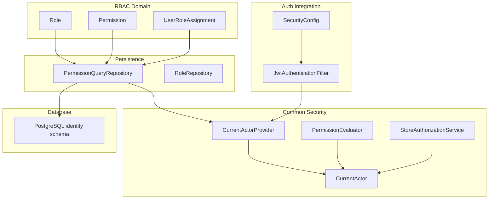
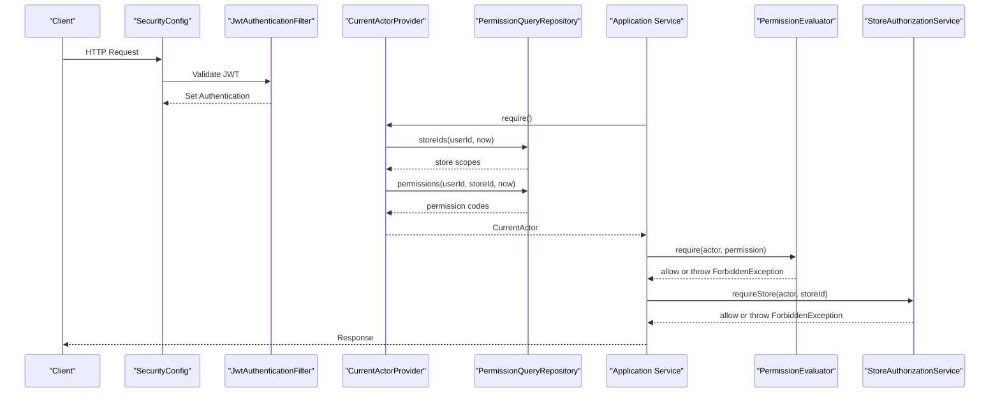
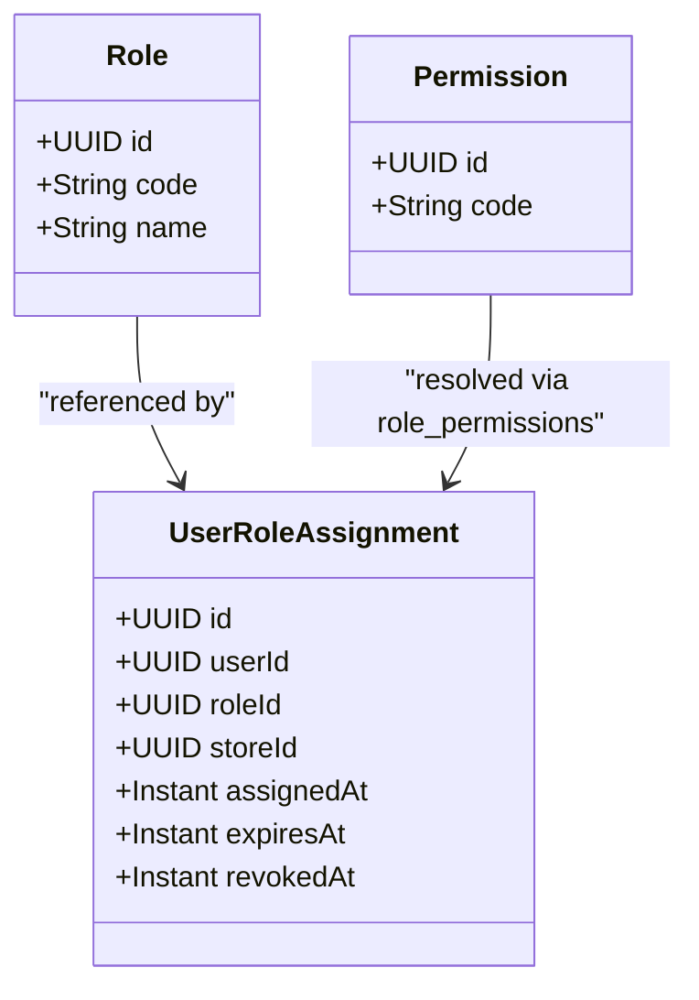
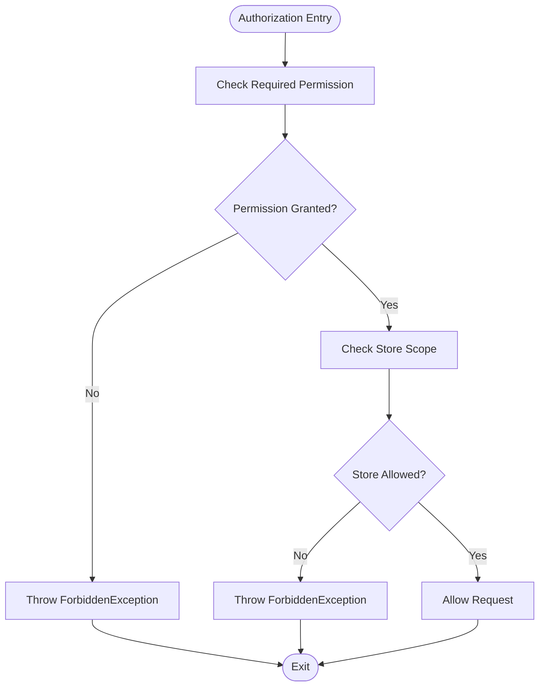
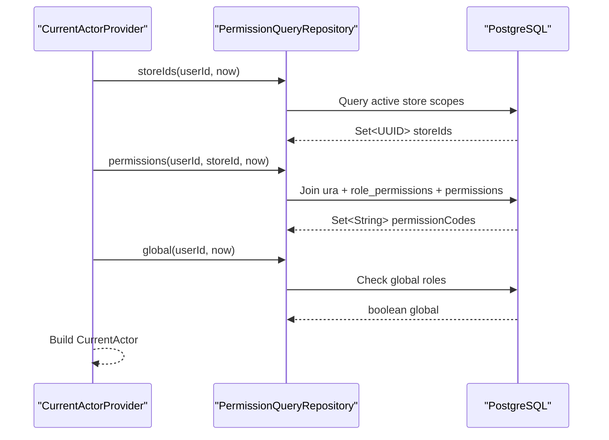
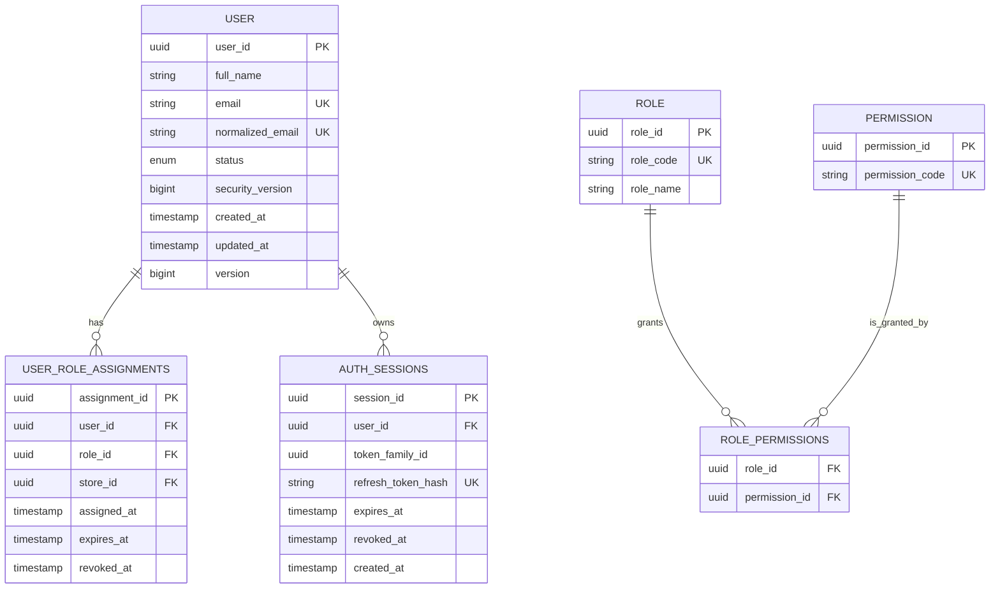
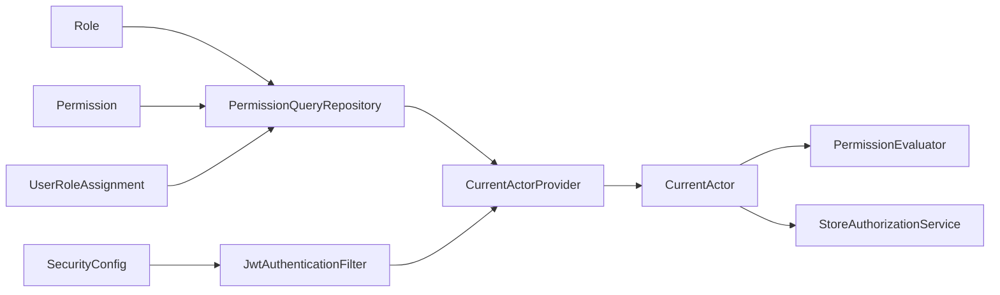

# Role-Based Access Control Module

<cite>
**Referenced Files in This Document**
- [Role.java](file://src/main/java/com/smartcoffee/modules/rbac/domain/Role.java)
- [Permission.java](file://src/main/java/com/smartcoffee/modules/rbac/domain/Permission.java)
- [UserRoleAssignment.java](file://src/main/java/com/smartcoffee/modules/rbac/domain/UserRoleAssignment.java)
- [PermissionQueryRepository.java](file://src/main/java/com/smartcoffee/modules/rbac/persistence/PermissionQueryRepository.java)
- [RoleRepository.java](file://src/main/java/com/smartcoffee/modules/rbac/persistence/RoleRepository.java)
- [CurrentActor.java](file://src/main/java/com/smartcoffee/common/security/CurrentActor.java)
- [CurrentActorProvider.java](file://src/main/java/com/smartcoffee/common/security/CurrentActorProvider.java)
- [PermissionEvaluator.java](file://src/main/java/com/smartcoffee/common/security/PermissionEvaluator.java)
- [StoreAuthorizationService.java](file://src/main/java/com/smartcoffee/common/security/StoreAuthorizationService.java)
- [SecurityConfig.java](file://src/main/java/com/smartcoffee/config/SecurityConfig.java)
- [JwtAuthenticationFilter.java](file://src/main/java/com/smartcoffee/modules/auth/security/JwtAuthenticationFilter.java)
- [V001__identity_auth_rbac.sql](file://src/main/resources/db/migration/V001__identity_auth_rbac.sql)
- [V002__organization_customer_and_role_seed.sql](file://src/main/resources/db/migration/V002__organization_customer_and_role_seed.sql)
- [AuditController.java](file://src/main/java/com/smartcoffee/modules/audit/api/AuditController.java)
- [InventoryController.java](file://src/main/java/com/smartcoffee/modules/inventory/api/InventoryController.java)
</cite>

## Table of Contents
1. [Introduction](#introduction)
2. [Project Structure](#project-structure)
3. [Core Components](#core-components)
4. [Architecture Overview](#architecture-overview)
5. [Detailed Component Analysis](#detailed-component-analysis)
6. [Dependency Analysis](#dependency-analysis)
7. [Performance Considerations](#performance-considerations)
8. [Troubleshooting Guide](#troubleshooting-guide)
9. [Conclusion](#conclusion)

## Introduction
This document explains the Role-Based Access Control (RBAC) module and its integration with authentication, store-scoped authorization, and dynamic permission checks. It covers role definitions, permission hierarchies, user-role assignments, permission evaluation, store-scoped authorization, and security best practices. The RBAC model supports:
- Roles and permissions as core entities
- User-to-role assignments scoped to stores or globally
- Time-based assignment validity and revocation
- Dynamic permission resolution at runtime
- Store isolation for multi-store operations
- Integration with Spring Security and JWT-based authentication

## Project Structure
The RBAC implementation spans domain models, persistence queries, and common security utilities:
- Domain models define roles, permissions, and user-role assignments
- Persistence layer provides efficient queries for permissions, store scopes, and global access
- Common security components provide CurrentActor, PermissionEvaluator, and StoreAuthorizationService
- Database migrations define schema, constraints, indexes, and seed data



**Diagram sources**
- [Role.java:6-15](file://src/main/java/com/smartcoffee/modules/rbac/domain/Role.java#L6-L15)
- [Permission.java:6-13](file://src/main/java/com/smartcoffee/modules/rbac/domain/Permission.java#L6-L13)
- [UserRoleAssignment.java:7-24](file://src/main/java/com/smartcoffee/modules/rbac/domain/UserRoleAssignment.java#L7-L24)
- [PermissionQueryRepository.java:10-18](file://src/main/java/com/smartcoffee/modules/rbac/persistence/PermissionQueryRepository.java#L10-L18)
- [RoleRepository.java:7-8](file://src/main/java/com/smartcoffee/modules/rbac/persistence/RoleRepository.java#L7-L8)
- [CurrentActor.java:6-14](file://src/main/java/com/smartcoffee/common/security/CurrentActor.java#L6-L14)
- [CurrentActorProvider.java:12-39](file://src/main/java/com/smartcoffee/common/security/CurrentActorProvider.java#L12-L39)
- [PermissionEvaluator.java:6-11](file://src/main/java/com/smartcoffee/common/security/PermissionEvaluator.java#L6-L11)
- [StoreAuthorizationService.java:7-12](file://src/main/java/com/smartcoffee/common/security/StoreAuthorizationService.java#L7-L12)
- [SecurityConfig.java:46-79](file://src/main/java/com/smartcoffee/config/SecurityConfig.java#L46-L79)
- [JwtAuthenticationFilter.java:1-5](file://src/main/java/com/smartcoffee/modules/auth/security/JwtAuthenticationFilter.java#L1-L5)

**Section sources**
- [Role.java:1-29](file://src/main/java/com/smartcoffee/modules/rbac/domain/Role.java#L1-L29)
- [Permission.java:1-23](file://src/main/java/com/smartcoffee/modules/rbac/domain/Permission.java#L1-L23)
- [UserRoleAssignment.java:1-30](file://src/main/java/com/smartcoffee/modules/rbac/domain/UserRoleAssignment.java#L1-L30)
- [PermissionQueryRepository.java:1-21](file://src/main/java/com/smartcoffee/modules/rbac/persistence/PermissionQueryRepository.java#L1-L21)
- [RoleRepository.java:1-11](file://src/main/java/com/smartcoffee/modules/rbac/persistence/RoleRepository.java#L1-L11)
- [CurrentActor.java:1-17](file://src/main/java/com/smartcoffee/common/security/CurrentActor.java#L1-L17)
- [CurrentActorProvider.java:1-44](file://src/main/java/com/smartcoffee/common/security/CurrentActorProvider.java#L1-L44)
- [PermissionEvaluator.java:1-14](file://src/main/java/com/smartcoffee/common/security/PermissionEvaluator.java#L1-L14)
- [StoreAuthorizationService.java:1-15](file://src/main/java/com/smartcoffee/common/security/StoreAuthorizationService.java#L1-L15)
- [SecurityConfig.java:1-81](file://src/main/java/com/smartcoffee/config/SecurityConfig.java#L1-L81)
- [JwtAuthenticationFilter.java:1-5](file://src/main/java/com/smartcoffee/modules/auth/security/JwtAuthenticationFilter.java#L1-L5)

## Core Components
- Role: Represents a named role code used to group permissions.
- Permission: Represents an atomic permission code.
- UserRoleAssignment: Links users to roles, optionally scoped to a store, with time validity and revocation support.
- PermissionQueryRepository: Provides efficient SQL queries for resolving permissions, store scopes, and global access flags.
- CurrentActor: Immutable representation of the authenticated user’s identity, granted permissions, store scopes, and global access flag.
- CurrentActorProvider: Builds CurrentActor from Spring Security context and resolves permissions dynamically via PermissionQueryRepository.
- PermissionEvaluator: Enforces required permissions by checking CurrentActor.
- StoreAuthorizationService: Enforces store-scoped access by validating CurrentActor against requested store IDs.

Key behaviors:
- Permissions are resolved per user and per store scope; global roles grant cross-store access.
- Assignments can be revoked or expired, affecting runtime authorization.
- Store-scoped authorization prevents cross-store data access unless explicitly allowed.

**Section sources**
- [Role.java:6-15](file://src/main/java/com/smartcoffee/modules/rbac/domain/Role.java#L6-L15)
- [Permission.java:6-13](file://src/main/java/com/smartcoffee/modules/rbac/domain/Permission.java#L6-L13)
- [UserRoleAssignment.java:7-24](file://src/main/java/com/smartcoffee/modules/rbac/domain/UserRoleAssignment.java#L7-L24)
- [PermissionQueryRepository.java:10-18](file://src/main/java/com/smartcoffee/modules/rbac/persistence/PermissionQueryRepository.java#L10-L18)
- [CurrentActor.java:6-14](file://src/main/java/com/smartcoffee/common/security/CurrentActor.java#L6-L14)
- [CurrentActorProvider.java:20-39](file://src/main/java/com/smartcoffee/common/security/CurrentActorProvider.java#L20-L39)
- [PermissionEvaluator.java:8-11](file://src/main/java/com/smartcoffee/common/security/PermissionEvaluator.java#L8-L11)
- [StoreAuthorizationService.java:9-12](file://src/main/java/com/smartcoffee/common/security/StoreAuthorizationService.java#L9-L12)

## Architecture Overview
The RBAC architecture integrates with Spring Security and JWT authentication:
- SecurityConfig configures stateless sessions and requires authentication for protected endpoints.
- JwtAuthenticationFilter decodes JWTs and populates SecurityContextHolder with authorities derived from token claims.
- CurrentActorProvider reads the current authentication, resolves store scopes and permissions, and constructs CurrentActor.
- Application services/controllers use PermissionEvaluator and StoreAuthorizationService to enforce fine-grained authorization.



**Diagram sources**
- [SecurityConfig.java:46-79](file://src/main/java/com/smartcoffee/config/SecurityConfig.java#L46-L79)
- [JwtAuthenticationFilter.java:1-5](file://src/main/java/com/smartcoffee/modules/auth/security/JwtAuthenticationFilter.java#L1-L5)
- [CurrentActorProvider.java:20-39](file://src/main/java/com/smartcoffee/common/security/CurrentActorProvider.java#L20-L39)
- [PermissionQueryRepository.java:10-18](file://src/main/java/com/smartcoffee/modules/rbac/persistence/PermissionQueryRepository.java#L10-L18)
- [PermissionEvaluator.java:8-11](file://src/main/java/com/smartcoffee/common/security/PermissionEvaluator.java#L8-L11)
- [StoreAuthorizationService.java:9-12](file://src/main/java/com/smartcoffee/common/security/StoreAuthorizationService.java#L9-L12)

## Detailed Component Analysis

### Role and Permission Models
- Role defines a unique role code and name, used to group permissions.
- Permission defines a unique permission code representing an atomic capability.
- These entities are persisted under the identity schema and referenced by role_permissions and user_role_assignments.



**Diagram sources**
- [Role.java:6-15](file://src/main/java/com/smartcoffee/modules/rbac/domain/Role.java#L6-L15)
- [Permission.java:6-13](file://src/main/java/com/smartcoffee/modules/rbac/domain/Permission.java#L6-L13)
- [UserRoleAssignment.java:7-24](file://src/main/java/com/smartcoffee/modules/rbac/domain/UserRoleAssignment.java#L7-L24)

**Section sources**
- [Role.java:1-29](file://src/main/java/com/smartcoffee/modules/rbac/domain/Role.java#L1-L29)
- [Permission.java:1-23](file://src/main/java/com/smartcoffee/modules/rbac/domain/Permission.java#L1-L23)
- [UserRoleAssignment.java:1-30](file://src/main/java/com/smartcoffee/modules/rbac/domain/UserRoleAssignment.java#L1-L30)

### Permission Evaluation and Store Authorization
- CurrentActor encapsulates the authenticated user’s ID, actor type, granted permissions, store scopes, and global access flag.
- PermissionEvaluator enforces required permissions by checking CurrentActor.permissions.
- StoreAuthorizationService enforces store-scoped access by checking CurrentActor.storeIds or globalAccess.



**Diagram sources**
- [CurrentActor.java:6-14](file://src/main/java/com/smartcoffee/common/security/CurrentActor.java#L6-L14)
- [PermissionEvaluator.java:8-11](file://src/main/java/com/smartcoffee/common/security/PermissionEvaluator.java#L8-L11)
- [StoreAuthorizationService.java:9-12](file://src/main/java/com/smartcoffee/common/security/StoreAuthorizationService.java#L9-L12)

**Section sources**
- [CurrentActor.java:1-17](file://src/main/java/com/smartcoffee/common/security/CurrentActor.java#L1-L17)
- [PermissionEvaluator.java:1-14](file://src/main/java/com/smartcoffee/common/security/PermissionEvaluator.java#L1-L14)
- [StoreAuthorizationService.java:1-15](file://src/main/java/com/smartcoffee/common/security/StoreAuthorizationService.java#L1-L15)

### Dynamic Permission Resolution
- CurrentActorProvider builds CurrentActor by:
  - Validating authentication from SecurityContextHolder
  - Resolving store scopes via PermissionQueryRepository.storeIds
  - Resolving permissions per store via PermissionQueryRepository.permissions
  - Determining global access via PermissionQueryRepository.global
- PermissionQueryRepository uses native SQL to join user_role_assignments, role_permissions, and permissions tables, filtering by revoked_at and expires_at.



**Diagram sources**
- [CurrentActorProvider.java:20-39](file://src/main/java/com/smartcoffee/common/security/CurrentActorProvider.java#L20-L39)
- [PermissionQueryRepository.java:10-18](file://src/main/java/com/smartcoffee/modules/rbac/persistence/PermissionQueryRepository.java#L10-L18)

**Section sources**
- [CurrentActorProvider.java:1-44](file://src/main/java/com/smartcoffee/common/security/CurrentActorProvider.java#L1-L44)
- [PermissionQueryRepository.java:1-21](file://src/main/java/com/smartcoffee/modules/rbac/persistence/PermissionQueryRepository.java#L1-L21)

### Database Schema and Constraints
- Identity schema includes users, user_credentials, roles, permissions, role_permissions, user_role_assignments, and auth_sessions.
- user_role_assignments supports optional store_id scoping, assignment timestamps, expiry, and revocation.
- Indexes optimize queries for active assignments and session management.
- Seed data initializes standard roles and a default store.



**Diagram sources**
- [V001__identity_auth_rbac.sql:3-135](file://src/main/resources/db/migration/V001__identity_auth_rbac.sql#L3-L135)
- [V002__organization_customer_and_role_seed.sql:29-43](file://src/main/resources/db/migration/V002__organization_customer_and_role_seed.sql#L29-L43)

**Section sources**
- [V001__identity_auth_rbac.sql:1-135](file://src/main/resources/db/migration/V001__identity_auth_rbac.sql#L1-L135)
- [V002__organization_customer_and_role_seed.sql:1-166](file://src/main/resources/db/migration/V002__organization_customer_and_role_seed.sql#L1-L166)

### Integration with Authentication and Controllers
- SecurityConfig enables stateless sessions and requires authentication for all requests except explicitly permitAll endpoints.
- JwtAuthenticationFilter extracts JWT claims and sets authorities in SecurityContextHolder.
- Controllers and services call CurrentActorProvider.require() to obtain CurrentActor, then use PermissionEvaluator and StoreAuthorizationService for authorization.

Examples:
- AuditController enforces AUDIT_READ permission and validates store scope.
- InventoryController enforces INVENTORY_READ permission and validates store scope.

```mermaid
sequenceDiagram
participant Controller as "AuditController / InventoryController"
participant Actor as "CurrentActorProvider"
participant Eval as "PermissionEvaluator"
participant Store as "StoreAuthorizationService"
Controller->>Actor : require()
Actor-->>Controller : CurrentActor
Controller->>Eval : require(CurrentActor, "PERMISSION_CODE")
Eval-->>Controller : allow or throw
Controller->>Store : requireStore(CurrentActor, storeId)
Store-->>Controller : allow or throw
Controller-->>Client : Response
```

**Diagram sources**
- [SecurityConfig.java:46-79](file://src/main/java/com/smartcoffee/config/SecurityConfig.java#L46-L79)
- [JwtAuthenticationFilter.java:1-5](file://src/main/java/com/smartcoffee/modules/auth/security/JwtAuthenticationFilter.java#L1-L5)
- [AuditController.java:33-36](file://src/main/java/com/smartcoffee/modules/audit/api/AuditController.java#L33-L36)
- [InventoryController.java:28-30](file://src/main/java/com/smartcoffee/modules/inventory/api/InventoryController.java#L28-L30)

**Section sources**
- [SecurityConfig.java:1-81](file://src/main/java/com/smartcoffee/config/SecurityConfig.java#L1-L81)
- [JwtAuthenticationFilter.java:1-5](file://src/main/java/com/smartcoffee/modules/auth/security/JwtAuthenticationFilter.java#L1-L5)
- [AuditController.java:33-36](file://src/main/java/com/smartcoffee/modules/audit/api/AuditController.java#L33-L36)
- [InventoryController.java:28-30](file://src/main/java/com/smartcoffee/modules/inventory/api/InventoryController.java#L28-L30)

## Dependency Analysis
RBAC dependencies:
- Domain models depend on JPA annotations and UUID identifiers.
- PermissionQueryRepository depends on PostgreSQL native queries joining identity tables.
- CurrentActorProvider depends on Spring Security context and PermissionQueryRepository.
- PermissionEvaluator and StoreAuthorizationService depend on CurrentActor.
- Controllers/services depend on CurrentActorProvider, PermissionEvaluator, and StoreAuthorizationService.



**Diagram sources**
- [Role.java:6-15](file://src/main/java/com/smartcoffee/modules/rbac/domain/Role.java#L6-L15)
- [Permission.java:6-13](file://src/main/java/com/smartcoffee/modules/rbac/domain/Permission.java#L6-L13)
- [UserRoleAssignment.java:7-24](file://src/main/java/com/smartcoffee/modules/rbac/domain/UserRoleAssignment.java#L7-L24)
- [PermissionQueryRepository.java:10-18](file://src/main/java/com/smartcoffee/modules/rbac/persistence/PermissionQueryRepository.java#L10-L18)
- [CurrentActorProvider.java:20-39](file://src/main/java/com/smartcoffee/common/security/CurrentActorProvider.java#L20-L39)
- [CurrentActor.java:6-14](file://src/main/java/com/smartcoffee/common/security/CurrentActor.java#L6-L14)
- [PermissionEvaluator.java:8-11](file://src/main/java/com/smartcoffee/common/security/PermissionEvaluator.java#L8-L11)
- [StoreAuthorizationService.java:9-12](file://src/main/java/com/smartcoffee/common/security/StoreAuthorizationService.java#L9-L12)
- [SecurityConfig.java:46-79](file://src/main/java/com/smartcoffee/config/SecurityConfig.java#L46-L79)
- [JwtAuthenticationFilter.java:1-5](file://src/main/java/com/smartcoffee/modules/auth/security/JwtAuthenticationFilter.java#L1-L5)

**Section sources**
- [PermissionQueryRepository.java:1-21](file://src/main/java/com/smartcoffee/modules/rbac/persistence/PermissionQueryRepository.java#L1-L21)
- [CurrentActorProvider.java:1-44](file://src/main/java/com/smartcoffee/common/security/CurrentActorProvider.java#L1-L44)
- [CurrentActor.java:1-17](file://src/main/java/com/smartcoffee/common/security/CurrentActor.java#L1-L17)
- [PermissionEvaluator.java:1-14](file://src/main/java/com/smartcoffee/common/security/PermissionEvaluator.java#L1-L14)
- [StoreAuthorizationService.java:1-15](file://src/main/java/com/smartcoffee/common/security/StoreAuthorizationService.java#L1-L15)
- [SecurityConfig.java:1-81](file://src/main/java/com/smartcoffee/config/SecurityConfig.java#L1-L81)
- [JwtAuthenticationFilter.java:1-5](file://src/main/java/com/smartcoffee/modules/auth/security/JwtAuthenticationFilter.java#L1-L5)

## Performance Considerations
- Use existing indexes on user_role_assignments and auth_sessions to optimize query performance for active assignments and sessions.
- Avoid redundant permission checks by caching CurrentActor within request scope if needed, but ensure cache invalidation on role changes.
- Prefer store-scoped permission queries to limit result sets and reduce joins.
- Monitor slow queries from PermissionQueryRepository and consider materialized views or read replicas for heavy authorization workloads.
- Keep JWT payloads minimal; rely on runtime permission resolution rather than embedding large permission lists in tokens.

[No sources needed since this section provides general guidance]

## Troubleshooting Guide
Common issues and resolutions:
- Missing required permission: Ensure the user has an active, non-revoked role assignment granting the required permission. Verify expires_at and revoked_at fields.
- Store access denied: Confirm the user has a store-scoped assignment for the requested store or holds a global role.
- Authentication errors: Validate JWT configuration and decoder settings; ensure SecurityContextHolder is populated by JwtAuthenticationFilter.
- Global access not recognized: Verify that the user has a global role (e.g., SUPER_ADMIN or ADMIN) without store scoping and that the assignment is active.

Operational checks:
- Inspect PermissionQueryRepository SQL results for the current user and store.
- Review database constraints and indexes to ensure referential integrity and performance.
- Validate SecurityConfig permitAll vs authenticated rules for endpoints.

**Section sources**
- [PermissionEvaluator.java:8-11](file://src/main/java/com/smartcoffee/common/security/PermissionEvaluator.java#L8-L11)
- [StoreAuthorizationService.java:9-12](file://src/main/java/com/smartcoffee/common/security/StoreAuthorizationService.java#L9-L12)
- [PermissionQueryRepository.java:10-18](file://src/main/java/com/smartcoffee/modules/rbac/persistence/PermissionQueryRepository.java#L10-L18)
- [SecurityConfig.java:46-79](file://src/main/java/com/smartcoffee/config/SecurityConfig.java#L46-L79)

## Conclusion
The RBAC module provides a robust foundation for role-based authorization with store-scoped control and dynamic permission evaluation. It integrates cleanly with Spring Security and JWT authentication, enabling secure, multi-store operations while maintaining clear separation between identity, authorization, and business logic. Proper use of CurrentActor, PermissionEvaluator, and StoreAuthorizationService ensures consistent enforcement across controllers and services. Adhering to the outlined best practices will help maintain security, performance, and scalability.

[No sources needed since this section summarizes without analyzing specific files]