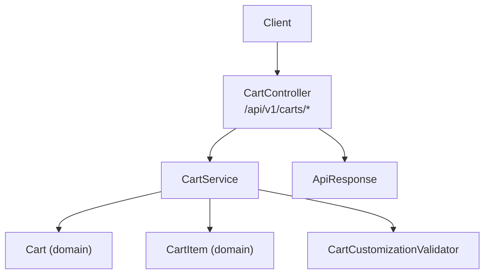
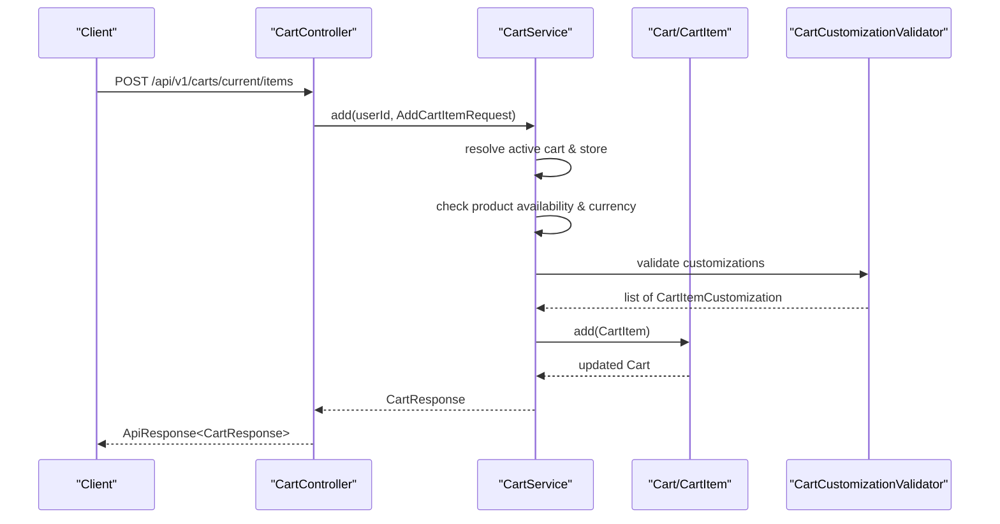
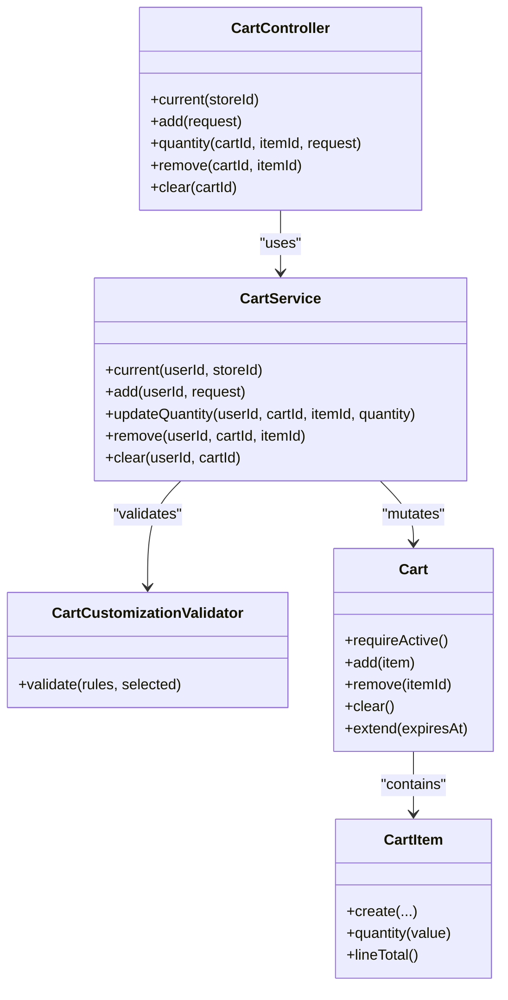

# Cart API Endpoints

<cite>
**Referenced Files in This Document**
- [CartController.java](file://src/main/java/com/smartcoffee/modules/cart/api/CartController.java)
- [AddCartItemRequest.java](file://src/main/java/com/smartcoffee/modules/cart/api/AddCartItemRequest.java)
- [UpdateCartItemRequest.java](file://src/main/java/com/smartcoffee/modules/cart/api/UpdateCartItemRequest.java)
- [SelectedCustomizationRequest.java](file://src/main/java/com/smartcoffee/modules/cart/api/SelectedCustomizationRequest.java)
- [CartResponse.java](file://src/main/java/com/smartcoffee/modules/cart/api/CartResponse.java)
- [CartItemResponse.java](file://src/main/java/com/smartcoffee/modules/cart/api/CartItemResponse.java)
- [CartCustomizationResponse.java](file://src/main/java/com/smartcoffee/modules/cart/api/CartCustomizationResponse.java)
- [CartService.java](file://src/main/java/com/smartcoffee/modules/cart/application/CartService.java)
- [CartCustomizationValidator.java](file://src/main/java/com/smartcoffee/modules/cart/application/CartCustomizationValidator.java)
- [Cart.java](file://src/main/java/com/smartcoffee/modules/cart/domain/Cart.java)
- [CartItem.java](file://src/main/java/com/smartcoffee/modules/cart/domain/CartItem.java)
- [CartStatus.java](file://src/main/java/com/smartcoffee/modules/cart/domain/CartStatus.java)
- [FulfillmentType.java](file://src/main/java/com/smartcoffee/modules/cart/domain/FulfillmentType.java)
- [ApiResponse.java](file://src/main/java/com/smartcoffee/common/api/ApiResponse.java)
</cite>

## Table of Contents
1. Introduction
2. Project Structure
3. Core Components
4. Architecture Overview
5. Detailed Component Analysis
6. Dependency Analysis
7. Performance Considerations
8. Troubleshooting Guide
9. Conclusion

## Introduction
This document provides comprehensive API documentation for the Cart module endpoints. It covers REST endpoints for cart CRUD operations, item management, and customization handling. It specifies request/response schemas, authentication requirements, validation rules, business constraints, status codes, and error responses. It also addresses rate limiting, pagination for large carts, and real-time updates where applicable.

## Project Structure
The Cart API is implemented as a Spring Boot REST controller with application services, domain models, and shared response wrappers. The controller exposes endpoints under /api/v1/carts and delegates to CartService for business logic. Requests are validated using Jakarta Validation annotations on DTOs. Responses are wrapped in a common ApiResponse envelope.

**Diagram sources**
- [CartController.java:11-47](file://src/main/java/com/smartcoffee/modules/cart/api/CartController.java#L11-L47)
- [CartService.java:13-114](file://src/main/java/com/smartcoffee/modules/cart/application/CartService.java#L13-L114)
- [Cart.java:9-158](file://src/main/java/com/smartcoffee/modules/cart/domain/Cart.java#L9-L158)
- [CartItem.java:9-118](file://src/main/java/com/smartcoffee/modules/cart/domain/CartItem.java#L9-L118)
- [CartCustomizationValidator.java:9-50](file://src/main/java/com/smartcoffee/modules/cart/application/CartCustomizationValidator.java#L9-L50)
- [ApiResponse.java:1-11](file://src/main/java/com/smartcoffee/common/api/ApiResponse.java#L1-L11)

**Section sources**
- [CartController.java:11-47](file://src/main/java/com/smartcoffee/modules/cart/api/CartController.java#L11-L47)
- [CartService.java:13-114](file://src/main/java/com/smartcoffee/modules/cart/application/CartService.java#L13-L114)
- [ApiResponse.java:1-11](file://src/main/java/com/smartcoffee/common/api/ApiResponse.java#L1-L11)

## Core Components
- CartController: Exposes REST endpoints for retrieving current cart, adding items, updating quantities, removing items, and clearing the cart.
- CartService: Implements business logic including active cart resolution, product availability checks, currency matching, customization validation, and cart mutation.
- Domain Models: Cart and CartItem enforce state and quantity constraints, compute line totals, and manage customizations.
- Validators: CartCustomizationValidator enforces group selection rules, option validity, and duplication checks.
- Response Wrappers: ApiResponse wraps all successful responses with success flag, data, requestId, and timestamp.

**Section sources**
- [CartController.java:11-47](file://src/main/java/com/smartcoffee/modules/cart/api/CartController.java#L11-L47)
- [CartService.java:35-114](file://src/main/java/com/smartcoffee/modules/cart/application/CartService.java#L35-L114)
- [Cart.java:48-158](file://src/main/java/com/smartcoffee/modules/cart/domain/Cart.java#L48-L158)
- [CartItem.java:44-118](file://src/main/java/com/smartcoffee/modules/cart/domain/CartItem.java#L44-L118)
- [CartCustomizationValidator.java:11-50](file://src/main/java/com/smartcoffee/modules/cart/application/CartCustomizationValidator.java#L11-L50)
- [ApiResponse.java:1-11](file://src/main/java/com/smartcoffee/common/api/ApiResponse.java#L1-L11)

## Architecture Overview
The Cart API follows a layered architecture:
- Presentation Layer: CartController handles HTTP requests and returns ApiResponse envelopes.
- Application Layer: CartService orchestrates use cases, validates inputs, and coordinates domain operations.
- Domain Layer: Cart and CartItem encapsulate business rules, state transitions, and calculations.
- Shared Infrastructure: ApiResponse standardizes responses; Jakarta Validation enforces input constraints.

**Diagram sources**
- [CartController.java:27-30](file://src/main/java/com/smartcoffee/modules/cart/api/CartController.java#L27-L30)
- [CartService.java:48-62](file://src/main/java/com/smartcoffee/modules/cart/application/CartService.java#L48-L62)
- [CartCustomizationValidator.java:11-50](file://src/main/java/com/smartcoffee/modules/cart/application/CartCustomizationValidator.java#L11-L50)
- [Cart.java:72-77](file://src/main/java/com/smartcoffee/modules/cart/domain/Cart.java#L72-L77)
- [CartItem.java:44-59](file://src/main/java/com/smartcoffee/modules/cart/domain/CartItem.java#L44-L59)

## Detailed Component Analysis

### Authentication and Authorization
- Authentication: All endpoints require an authenticated user context provided by CurrentActorProvider. Controllers call actor.require() to obtain the current user ID.
- Authorization: Store access is enforced by resolving the store via StoreRepository and ensuring it is active before operating on the cart.

**Section sources**
- [CartController.java:17-29](file://src/main/java/com/smartcoffee/modules/cart/api/CartController.java#L17-L29)
- [CartService.java:35-46](file://src/main/java/com/smartcoffee/modules/cart/application/CartService.java#L35-L46)

### REST Endpoints

#### Get Current Cart
- Method: GET
- Path: /api/v1/carts/current?storeId={storeId}
- Auth: Required (user context)
- Request Parameters:
  - storeId: UUID (required)
- Success Response:
  - 200 OK with ApiResponse<CartResponse>
  - CartResponse fields: cartId, storeId, status, fulfillmentType, currencyCode, items[], subtotal, discountAmount, taxAmount, totalAmount, expiresAt, version
- Error Responses:
  - 404 Not Found if store not found
  - 409 Conflict if cart is not active or expired

**Section sources**
- [CartController.java:22-25](file://src/main/java/com/smartcoffee/modules/cart/api/CartController.java#L22-L25)
- [CartService.java:35-46](file://src/main/java/com/smartcoffee/modules/cart/application/CartService.java#L35-L46)
- [CartResponse.java:1-5](file://src/main/java/com/smartcoffee/modules/cart/api/CartResponse.java#L1-L5)
- [Cart.java:63-70](file://src/main/java/com/smartcoffee/modules/cart/domain/Cart.java#L63-L70)

#### Add Item to Cart
- Method: POST
- Path: /api/v1/carts/current/items
- Auth: Required (user context)
- Request Body: AddCartItemRequest
  - storeId: UUID (required)
  - productId: UUID (required)
  - quantity: int (min 1, max 99)
  - note: String (max length 500)
  - customizations: List<SelectedCustomizationRequest>
    - groupId: UUID (required)
    - optionId: UUID (required)
    - quantity: int (min 1)
- Success Response:
  - 200 OK with ApiResponse<CartResponse>
- Business Constraints:
  - Product must be available
  - Product currency must match cart currency
  - Customizations must satisfy group rules (minimum/maximum selections, single/multi selection types), valid options, and no duplicates
- Error Responses:
  - 409 Conflict if product unavailable or currency mismatch
  - 422 Unprocessable Entity if customization validation fails

**Section sources**
- [CartController.java:27-30](file://src/main/java/com/smartcoffee/modules/cart/api/CartController.java#L27-L30)
- [AddCartItemRequest.java:1-11](file://src/main/java/com/smartcoffee/modules/cart/api/AddCartItemRequest.java#L1-L11)
- [SelectedCustomizationRequest.java:1-9](file://src/main/java/com/smartcoffee/modules/cart/api/SelectedCustomizationRequest.java#L1-L9)
- [CartService.java:48-62](file://src/main/java/com/smartcoffee/modules/cart/application/CartService.java#L48-L62)
- [CartCustomizationValidator.java:11-50](file://src/main/java/com/smartcoffee/modules/cart/application/CartCustomizationValidator.java#L11-L50)

#### Update Item Quantity
- Method: PATCH
- Path: /api/v1/carts/{cartId}/items/{itemId}
- Auth: Required (user context)
- Path Parameters:
  - cartId: UUID
  - itemId: UUID
- Request Body: UpdateCartItemRequest
  - quantity: int (min 1, max 99)
- Success Response:
  - 200 OK with ApiResponse<CartResponse>
- Error Responses:
  - 404 Not Found if cart or item not found
  - 409 Conflict if cart not active or expired

**Section sources**
- [CartController.java:32-37](file://src/main/java/com/smartcoffee/modules/cart/api/CartController.java#L32-L37)
- [UpdateCartItemRequest.java:1-8](file://src/main/java/com/smartcoffee/modules/cart/api/UpdateCartItemRequest.java#L1-L8)
- [CartService.java:64-72](file://src/main/java/com/smartcoffee/modules/cart/application/CartService.java#L64-L72)
- [Cart.java:63-70](file://src/main/java/com/smartcoffee/modules/cart/domain/Cart.java#L63-L70)

#### Remove Item from Cart
- Method: DELETE
- Path: /api/v1/carts/{cartId}/items/{itemId}
- Auth: Required (user context)
- Path Parameters:
  - cartId: UUID
  - itemId: UUID
- Success Response:
  - 200 OK with ApiResponse<CartResponse>
- Error Responses:
  - 404 Not Found if cart or item not found
  - 409 Conflict if cart not active or expired

**Section sources**
- [CartController.java:39-42](file://src/main/java/com/smartcoffee/modules/cart/api/CartController.java#L39-L42)
- [CartService.java:74-79](file://src/main/java/com/smartcoffee/modules/cart/application/CartService.java#L74-L79)
- [Cart.java:79-84](file://src/main/java/com/smartcoffee/modules/cart/domain/Cart.java#L79-L84)

#### Clear Cart
- Method: DELETE
- Path: /api/v1/carts/{cartId}/items
- Auth: Required (user context)
- Path Parameters:
  - cartId: UUID
- Success Response:
  - 200 OK with ApiResponse<CartResponse>
- Error Responses:
  - 404 Not Found if cart not found
  - 409 Conflict if cart not active or expired

**Section sources**
- [CartController.java:44-47](file://src/main/java/com/smartcoffee/modules/cart/api/CartController.java#L44-L47)
- [CartService.java:81-86](file://src/main/java/com/smartcoffee/modules/cart/application/CartService.java#L81-L86)
- [Cart.java:86-90](file://src/main/java/com/smartcoffee/modules/cart/domain/Cart.java#L86-L90)

### Request and Response Schemas

#### AddCartItemRequest
- Fields:
  - storeId: UUID (required)
  - productId: UUID (required)
  - quantity: int (1..99)
  - note: String (max 500 chars)
  - customizations: List<SelectedCustomizationRequest>
    - groupId: UUID (required)
    - optionId: UUID (required)
    - quantity: int (>= 1)

**Section sources**
- [AddCartItemRequest.java:1-11](file://src/main/java/com/smartcoffee/modules/cart/api/AddCartItemRequest.java#L1-L11)
- [SelectedCustomizationRequest.java:1-9](file://src/main/java/com/smartcoffee/modules/cart/api/SelectedCustomizationRequest.java#L1-L9)

#### UpdateCartItemRequest
- Fields:
  - quantity: int (1..99)

**Section sources**
- [UpdateCartItemRequest.java:1-8](file://src/main/java/com/smartcoffee/modules/cart/api/UpdateCartItemRequest.java#L1-L8)

#### CartResponse
- Fields:
  - cartId: UUID
  - storeId: UUID
  - status: String (ACTIVE, CHECKED_OUT, EXPIRED, ABANDONED)
  - fulfillmentType: String (DINE_IN, PICKUP, DELIVERY)
  - currencyCode: String
  - items: List<CartItemResponse>
  - subtotal: BigDecimal
  - discountAmount: BigDecimal
  - taxAmount: BigDecimal
  - totalAmount: BigDecimal
  - expiresAt: Instant
  - version: long

**Section sources**
- [CartResponse.java:1-5](file://src/main/java/com/smartcoffee/modules/cart/api/CartResponse.java#L1-L5)
- [CartStatus.java:1-7](file://src/main/java/com/smartcoffee/modules/cart/domain/CartStatus.java#L1-L7)
- [FulfillmentType.java:1-4](file://src/main/java/com/smartcoffee/modules/cart/domain/FulfillmentType.java#L1-L4)

#### CartItemResponse
- Fields:
  - cartItemId: UUID
  - productId: UUID
  - productCode: String
  - productName: String
  - quantity: int
  - unitBasePrice: BigDecimal
  - unitCustomizationPrice: BigDecimal
  - lineTotal: BigDecimal
  - note: String
  - customizations: List<CartCustomizationResponse>

**Section sources**
- [CartItemResponse.java:1-11](file://src/main/java/com/smartcoffee/modules/cart/api/CartItemResponse.java#L1-L11)

#### CartCustomizationResponse
- Fields:
  - groupId: UUID
  - optionId: UUID
  - groupName: String
  - optionName: String
  - quantity: int
  - additionalPrice: BigDecimal

**Section sources**
- [CartCustomizationResponse.java:1-10](file://src/main/java/com/smartcoffee/modules/cart/api/CartCustomizationResponse.java#L1-L10)

### Validation Rules and Business Constraints
- Quantity constraints:
  - Item quantity must be between 1 and 99 inclusive.
  - Customization quantity must be positive.
- Customization rules:
  - Each customization group must meet minimum and maximum selection counts.
  - SINGLE selection type allows only one option per group.
  - Duplicate option selections within a group are not allowed.
  - Only active options belonging to the product’s groups are valid.
- Cart state constraints:
  - Cart must be ACTIVE and not expired for mutations.
  - Currency of added product must match cart currency.
- Line totals:
  - Line total = (unitBasePrice + unitCustomizationPrice) * quantity.

**Section sources**
- [AddCartItemRequest.java:1-11](file://src/main/java/com/smartcoffee/modules/cart/api/AddCartItemRequest.java#L1-L11)
- [UpdateCartItemRequest.java:1-8](file://src/main/java/com/smartcoffee/modules/cart/api/UpdateCartItemRequest.java#L1-L8)
- [CartCustomizationValidator.java:11-50](file://src/main/java/com/smartcoffee/modules/cart/application/CartCustomizationValidator.java#L11-L50)
- [Cart.java:63-70](file://src/main/java/com/smartcoffee/modules/cart/domain/Cart.java#L63-L70)
- [CartItem.java:44-76](file://src/main/java/com/smartcoffee/modules/cart/domain/CartItem.java#L44-L76)

### Error Handling and Status Codes
- 200 OK: Successful operations return ApiResponse with data payload.
- 404 Not Found:
  - Store not found when resolving active store.
  - Cart or cart item not found during update/remove/clear.
- 409 Conflict:
  - Product unavailable.
  - Currency mismatch between product and cart.
  - Cart not active or expired.
- 422 Unprocessable Entity:
  - Customization validation failures (missing required groups, too many selections, invalid options, duplicates).
- Global exceptions:
  - ResourceNotFoundException, ConflictException, ValidationException are thrown by service/domain layers and mapped to appropriate HTTP status codes by global exception handling.

**Section sources**
- [CartService.java:35-114](file://src/main/java/com/smartcoffee/modules/cart/application/CartService.java#L35-L114)
- [Cart.java:63-90](file://src/main/java/com/smartcoffee/modules/cart/domain/Cart.java#L63-L90)
- [CartCustomizationValidator.java:11-50](file://src/main/java/com/smartcoffee/modules/cart/application/CartCustomizationValidator.java#L11-L50)

### Real-Time Updates
- WebSocket configuration exists in the project, but there are no explicit cart-related WebSocket endpoints or publishers in the cart module. Real-time updates for cart changes are not currently exposed via dedicated APIs.

[No sources needed since this section does not analyze specific files]

### Rate Limiting and Pagination
- Rate limiting: No rate limiting is implemented in the cart module.
- Pagination: No pagination support is present for cart retrieval; carts are returned as-is. For very large carts, consider client-side limits or server-side pagination in future enhancements.

[No sources needed since this section does not analyze specific files]

## Dependency Analysis
The following diagram shows key dependencies among controllers, services, validators, and domain models.

**Diagram sources**
- [CartController.java:11-47](file://src/main/java/com/smartcoffee/modules/cart/api/CartController.java#L11-L47)
- [CartService.java:13-114](file://src/main/java/com/smartcoffee/modules/cart/application/CartService.java#L13-L114)
- [CartCustomizationValidator.java:9-50](file://src/main/java/com/smartcoffee/modules/cart/application/CartCustomizationValidator.java#L9-L50)
- [Cart.java:9-158](file://src/main/java/com/smartcoffee/modules/cart/domain/Cart.java#L9-L158)
- [CartItem.java:9-118](file://src/main/java/com/smartcoffee/modules/cart/domain/CartItem.java#L9-L118)

**Section sources**
- [CartController.java:11-47](file://src/main/java/com/smartcoffee/modules/cart/api/CartController.java#L11-L47)
- [CartService.java:13-114](file://src/main/java/com/smartcoffee/modules/cart/application/CartService.java#L13-L114)
- [Cart.java:9-158](file://src/main/java/com/smartcoffee/modules/cart/domain/Cart.java#L9-L158)
- [CartItem.java:9-118](file://src/main/java/com/smartcoffee/modules/cart/domain/CartItem.java#L9-L118)

## Performance Considerations
- Active cart resolution: Uses repository queries filtered by customer, store, and status; ensure indexes exist on customer_id, store_id, and status columns for efficient lookups.
- Customization validation: Runs in-memory over group rules and selected options; keep rule sets small and avoid unnecessary deep nesting.
- Line total calculation: Aggregates customization prices per item; minimize repeated computations by caching results where appropriate.
- Concurrency: Cart mutations lock ownership via repository methods; ensure database-level locking or optimistic concurrency controls are effective to prevent race conditions.

[No sources needed since this section provides general guidance]

## Troubleshooting Guide
Common issues and resolutions:
- Store not found: Ensure the store exists and is active before performing cart operations.
- Product unavailable: Check catalog availability and product status.
- Currency mismatch: Verify that the product’s currency matches the cart’s currency code.
- Customization validation errors: Validate group rules, option activity, and selection counts; avoid duplicate option selections.
- Cart not active/expired: Ensure the cart is ACTIVE and not expired before mutations.

**Section sources**
- [CartService.java:35-114](file://src/main/java/com/smartcoffee/modules/cart/application/CartService.java#L35-L114)
- [CartCustomizationValidator.java:11-50](file://src/main/java/com/smartcoffee/modules/cart/application/CartCustomizationValidator.java#L11-L50)
- [Cart.java:63-90](file://src/main/java/com/smartcoffee/modules/cart/domain/Cart.java#L63-L90)

## Conclusion
The Cart API provides a robust set of endpoints for managing shopping carts, including item addition with rich customization support, quantity updates, removal, and clearing. Strong validation and business rules ensure data integrity and consistent behavior. While real-time updates and pagination are not currently implemented, the modular design allows for future enhancements. Clients should handle authentication, respect validation constraints, and manage error responses appropriately.

[No sources needed since this section summarizes without analyzing specific files]