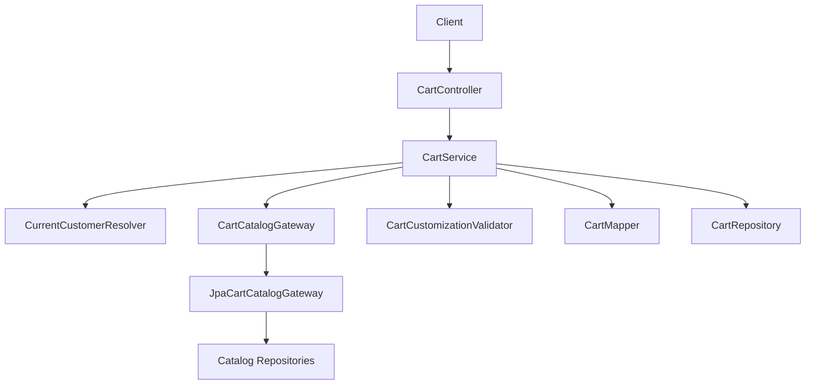
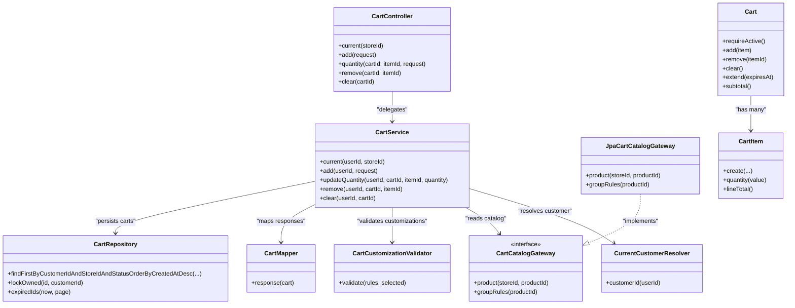
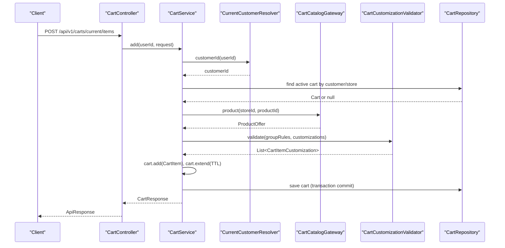
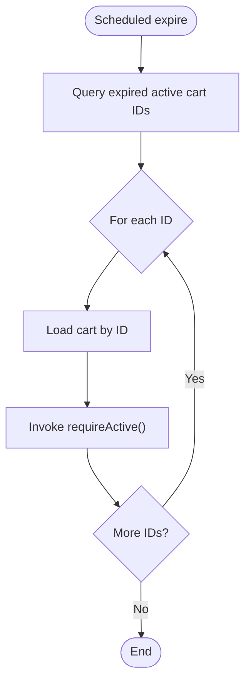
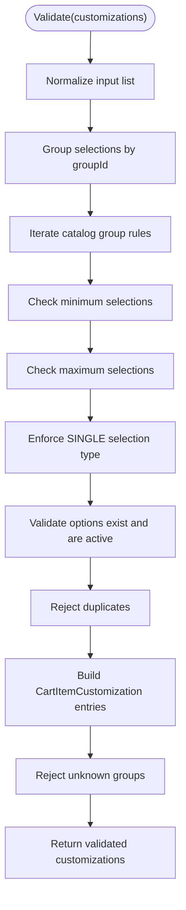
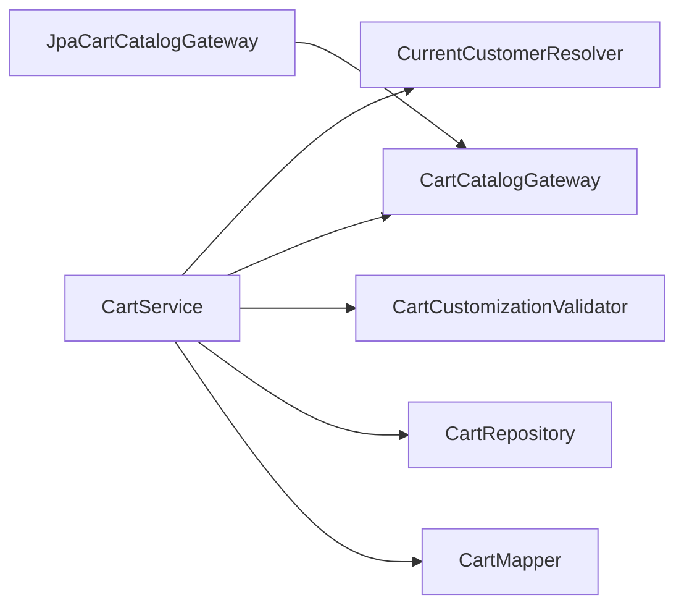

# Cart Application Services

<cite>
**Referenced Files in This Document**
- [CartService.java](file://src/main/java/com/smartcoffee/modules/cart/application/CartService.java)
- [CartExpirationService.java](file://src/main/java/com/smartcoffee/modules/cart/application/CartExpirationService.java)
- [CartCustomizationValidator.java](file://src/main/java/com/smartcoffee/modules/cart/application/CartCustomizationValidator.java)
- [CurrentCustomerResolver.java](file://src/main/java/com/smartcoffee/modules/cart/application/CurrentCustomerResolver.java)
- [CartMapper.java](file://src/main/java/com/smartcoffee/modules/cart/application/CartMapper.java)
- [CartCatalogGateway.java](file://src/main/java/com/smartcoffee/modules/cart/application/CartCatalogGateway.java)
- [JpaCartCatalogGateway.java](file://src/main/java/com/smartcoffee/modules/cart/application/JpaCartCatalogGateway.java)
- [CartController.java](file://src/main/java/com/smartcoffee/modules/cart/api/CartController.java)
- [Cart.java](file://src/main/java/com/smartcoffee/modules/cart/domain/Cart.java)
- [CartItem.java](file://src/main/java/com/smartcoffee/modules/cart/domain/CartItem.java)
- [CartRepository.java](file://src/main/java/com/smartcoffee/modules/cart/persistence/CartRepository.java)
- [CartCustomizationValidatorTest.java](file://src/test/java/com/smartcoffee/modules/cart/application/CartCustomizationValidatorTest.java)
</cite>

## Table of Contents
1. [Introduction](#introduction)
2. [Project Structure](#project-structure)
3. [Core Components](#core-components)
4. [Architecture Overview](#architecture-overview)
5. [Detailed Component Analysis](#detailed-component-analysis)
6. [Dependency Analysis](#dependency-analysis)
7. [Performance Considerations](#performance-considerations)
8. [Troubleshooting Guide](#troubleshooting-guide)
9. [Conclusion](#conclusion)

## Introduction
This document explains the cart application services that power customer-facing cart operations. It focuses on orchestration, validation, context resolution, DTO mapping, and automatic cleanup. The goal is to help developers understand how add, update, remove, and clear operations are orchestrated, how product customizations are validated against catalog constraints, how TTL-based expiration is managed, and how transactions and error handling are applied across the service layer.

## Project Structure
The cart module follows a layered structure:
- API layer exposes REST endpoints for cart operations.
- Application layer orchestrates use cases using domain entities, repositories, and gateways.
- Domain layer encapsulates business rules for carts and cart items.
- Persistence layer provides JPA repositories with locking and pagination queries.

**Diagram sources**
- [CartController.java:11-47](file://src/main/java/com/smartcoffee/modules/cart/api/CartController.java#L11-L47)
- [CartService.java:13-33](file://src/main/java/com/smartcoffee/modules/cart/application/CartService.java#L13-L33)
- [CartCatalogGateway.java:4-10](file://src/main/java/com/smartcoffee/modules/cart/application/CartCatalogGateway.java#L4-L10)
- [JpaCartCatalogGateway.java:8-14](file://src/main/java/com/smartcoffee/modules/cart/application/JpaCartCatalogGateway.java#L8-L14)
- [CartRepository.java:9-14](file://src/main/java/com/smartcoffee/modules/cart/persistence/CartRepository.java#L9-L14)

**Section sources**
- [CartController.java:11-47](file://src/main/java/com/smartcoffee/modules/cart/api/CartController.java#L11-L47)
- [CartService.java:13-33](file://src/main/java/com/smartcoffee/modules/cart/application/CartService.java#L13-L33)

## Core Components
- CartService: Orchestrates cart operations including current cart retrieval, adding items, updating quantities, removing items, and clearing the cart. It enforces ownership, active status, currency consistency, and TTL extension.
- CartExpirationService: Scheduled job that finds expired active carts and marks them as inactive by invoking domain validation.
- CartCustomizationValidator: Validates selected customizations against catalog group rules, enforcing minimums, maximums, single selection, option availability, and duplicate checks.
- CurrentCustomerResolver: Resolves a customer profile from a user identifier used throughout cart operations.
- CartMapper: Converts domain Cart into API response DTOs, computing line totals and rounding subtotals.
- CartCatalogGateway: Abstraction over catalog data needed for product offers and customization rules; implemented by JpaCartCatalogGateway.
- Domain models Cart and CartItem: Encapsulate business invariants such as active state, expiry, item creation, quantity validation, and line totals.
- CartRepository: Provides JPA access with eager loading, pessimistic write locks, and expiration queries.

**Section sources**
- [CartService.java:13-114](file://src/main/java/com/smartcoffee/modules/cart/application/CartService.java#L13-L114)
- [CartExpirationService.java:1-5](file://src/main/java/com/smartcoffee/modules/cart/application/CartExpirationService.java#L1-L5)
- [CartCustomizationValidator.java:9-51](file://src/main/java/com/smartcoffee/modules/cart/application/CartCustomizationValidator.java#L9-L51)
- [CurrentCustomerResolver.java:5-6](file://src/main/java/com/smartcoffee/modules/cart/application/CurrentCustomerResolver.java#L5-L6)
- [CartMapper.java:4-6](file://src/main/java/com/smartcoffee/modules/cart/application/CartMapper.java#L4-L6)
- [CartCatalogGateway.java:4-10](file://src/main/java/com/smartcoffee/modules/cart/application/CartCatalogGateway.java#L4-L10)
- [JpaCartCatalogGateway.java:8-14](file://src/main/java/com/smartcoffee/modules/cart/application/JpaCartCatalogGateway.java#L8-L14)
- [Cart.java:9-158](file://src/main/java/com/smartcoffee/modules/cart/domain/Cart.java#L9-L158)
- [CartItem.java:9-118](file://src/main/java/com/smartcoffee/modules/cart/domain/CartItem.java#L9-L118)
- [CartRepository.java:9-14](file://src/main/java/com/smartcoffee/modules/cart/persistence/CartRepository.java#L9-L14)

## Architecture Overview
The cart subsystem composes controllers, services, validators, mappers, and persistence abstractions. Catalog data is accessed through a gateway interface to keep cart logic decoupled from catalog implementation details.

**Diagram sources**
- [CartController.java:11-47](file://src/main/java/com/smartcoffee/modules/cart/api/CartController.java#L11-L47)
- [CartService.java:13-114](file://src/main/java/com/smartcoffee/modules/cart/application/CartService.java#L13-L114)
- [CartCatalogGateway.java:4-10](file://src/main/java/com/smartcoffee/modules/cart/application/CartCatalogGateway.java#L4-L10)
- [JpaCartCatalogGateway.java:8-14](file://src/main/java/com/smartcoffee/modules/cart/application/JpaCartCatalogGateway.java#L8-L14)
- [CartCustomizationValidator.java:9-51](file://src/main/java/com/smartcoffee/modules/cart/application/CartCustomizationValidator.java#L9-L51)
- [CartMapper.java:4-6](file://src/main/java/com/smartcoffee/modules/cart/application/CartMapper.java#L4-L6)
- [CartRepository.java:9-14](file://src/main/java/com/smartcoffee/modules/cart/persistence/CartRepository.java#L9-L14)
- [Cart.java:9-158](file://src/main/java/com/smartcoffee/modules/cart/domain/Cart.java#L9-L158)
- [CartItem.java:9-118](file://src/main/java/com/smartcoffee/modules/cart/domain/CartItem.java#L9-L118)

## Detailed Component Analysis

### CartService Orchestration
Responsibilities:
- Resolve the current customer from the authenticated user.
- Ensure the target store exists and is active.
- Retrieve or create an active cart for the customer and store.
- Validate product availability and currency compatibility.
- Validate customizations against catalog rules.
- Update cart state and extend TTL on mutations.
- Provide safe mutation methods with ownership lock and active-state checks.

Key behaviors:
- current: Returns the active cart for the given store, creating one if missing.
- add: Validates product availability and currency, validates customizations, adds item, extends TTL.
- updateQuantity: Locks owned cart, updates item quantity, extends TTL.
- remove: Locks owned cart, removes item.
- clear: Locks owned cart, clears all items.

Transaction boundaries:
- All public methods are transactional, ensuring consistent reads/writes within each operation.

Ownership and concurrency:
- ownedLock uses pessimistic write lock to prevent concurrent modifications by different customers.

TTL management:
- New or mutated carts extend expiration time relative to the current time.

Error handling:
- Throws resource not found when store or cart is missing.
- Throws conflict exceptions for unavailable products, currency mismatches, inactive or expired carts, and empty checkout attempts.

**Diagram sources**
- [CartController.java:27-30](file://src/main/java/com/smartcoffee/modules/cart/api/CartController.java#L27-L30)
- [CartService.java:48-62](file://src/main/java/com/smartcoffee/modules/cart/application/CartService.java#L48-L62)
- [CartCatalogGateway.java:4-10](file://src/main/java/com/smartcoffee/modules/cart/application/CartCatalogGateway.java#L4-L10)
- [CartCustomizationValidator.java:11-50](file://src/main/java/com/smartcoffee/modules/cart/application/CartCustomizationValidator.java#L11-L50)
- [CartRepository.java:9-14](file://src/main/java/com/smartcoffee/modules/cart/persistence/CartRepository.java#L9-L14)

**Section sources**
- [CartService.java:35-86](file://src/main/java/com/smartcoffee/modules/cart/application/CartService.java#L35-L86)
- [CartService.java:88-114](file://src/main/java/com/smartcoffee/modules/cart/application/CartService.java#L88-L114)

### CartExpirationService
Purpose:
- Periodically scans for active carts whose expiration time has passed.
- Loads each expired cart and invokes domain validation to mark it as expired.

Scheduling:
- Uses a fixed delay configuration property with a default polling interval.

Transaction boundary:
- Each execution runs in a transaction to safely read and update cart states.

**Diagram sources**
- [CartExpirationService.java:1-5](file://src/main/java/com/smartcoffee/modules/cart/application/CartExpirationService.java#L1-L5)
- [CartRepository.java:13-13](file://src/main/java/com/smartcoffee/modules/cart/persistence/CartRepository.java#L13-L13)
- [Cart.java:63-70](file://src/main/java/com/smartcoffee/modules/cart/domain/Cart.java#L63-L70)

**Section sources**
- [CartExpirationService.java:1-5](file://src/main/java/com/smartcoffee/modules/cart/application/CartExpirationService.java#L1-L5)

### CartCustomizationValidator
Purpose:
- Validates selected customizations against catalog-defined group rules.

Validation rules:
- Customization quantity must be positive.
- Minimum and maximum selections per group are enforced.
- Single-selection groups allow only one option.
- Duplicate options are rejected.
- Options must belong to the product’s groups and be active.
- Unknown groups are rejected.

Output:
- Produces a list of CartItemCustomization objects representing valid selections.

**Diagram sources**
- [CartCustomizationValidator.java:11-50](file://src/main/java/com/smartcoffee/modules/cart/application/CartCustomizationValidator.java#L11-L50)

**Section sources**
- [CartCustomizationValidator.java:9-51](file://src/main/java/com/smartcoffee/modules/cart/application/CartCustomizationValidator.java#L9-L51)
- [CartCustomizationValidatorTest.java:19-34](file://src/test/java/com/smartcoffee/modules/cart/application/CartCustomizationValidatorTest.java#L19-L34)

### CurrentCustomerResolver
Purpose:
- Resolves a customer profile ID from a user ID used by cart operations.

Behavior:
- Looks up the customer profile by user ID.
- Throws resource not found if no profile exists.

**Section sources**
- [CurrentCustomerResolver.java:5-6](file://src/main/java/com/smartcoffee/modules/cart/application/CurrentCustomerResolver.java#L5-L6)

### CartMapper
Purpose:
- Maps domain Cart to CartResponse DTO.
- Computes subtotal using MoneyCalculator rounding policy.
- Includes item-level details and customization summaries.

**Section sources**
- [CartMapper.java:4-6](file://src/main/java/com/smartcoffee/modules/cart/application/CartMapper.java#L4-L6)

### Catalog Gateway
Interface:
- Defines product offer retrieval and customization group rules.

Implementation:
- Reads product and store-product data.
- Computes effective price based on override or base price.
- Aggregates customization groups and active options.

**Section sources**
- [CartCatalogGateway.java:4-10](file://src/main/java/com/smartcoffee/modules/cart/application/CartCatalogGateway.java#L4-L10)
- [JpaCartCatalogGateway.java:8-14](file://src/main/java/com/smartcoffee/modules/cart/application/JpaCartCatalogGateway.java#L8-L14)

### Domain Models: Cart and CartItem
Cart:
- Enforces active state and expiration via requireActive.
- Manages item lifecycle: add, remove, clear.
- Extends TTL on mutations.
- Computes subtotal from items.

CartItem:
- Validates positive quantity.
- Tracks snapshots of product identity and pricing.
- Computes unit customization price and line total.

**Section sources**
- [Cart.java:48-102](file://src/main/java/com/smartcoffee/modules/cart/domain/Cart.java#L48-L102)
- [Cart.java:140-144](file://src/main/java/com/smartcoffee/modules/cart/domain/Cart.java#L140-L144)
- [CartItem.java:44-76](file://src/main/java/com/smartcoffee/modules/cart/domain/CartItem.java#L44-L76)
- [CartItem.java:110-118](file://src/main/java/com/smartcoffee/modules/cart/domain/CartItem.java#L110-L118)

## Dependency Analysis
Coupling and cohesion:
- CartService depends on multiple collaborators but remains cohesive around cart use cases.
- Catalog dependency is abstracted via CartCatalogGateway to isolate catalog implementation changes.
- Validation logic is isolated in CartCustomizationValidator for testability and clarity.
- Mapping logic is isolated in CartMapper to separate concerns between domain and API layers.

Direct dependencies:
- CartService -> CurrentCustomerResolver, CartCatalogGateway, CartCustomizationValidator, CartRepository, StoreRepository, CartMapper.
- JpaCartCatalogGateway -> Catalog persistence repositories.
- CartRepository -> JPA with entity graphs and pessimistic locks.

Potential circular dependencies:
- None observed among cart application components.

External integration points:
- Catalog persistence layer via JpaCartCatalogGateway.
- Customer profile repository via CurrentCustomerResolver.
- Scheduling infrastructure via Spring @Scheduled.

**Diagram sources**
- [CartService.java:13-33](file://src/main/java/com/smartcoffee/modules/cart/application/CartService.java#L13-L33)
- [JpaCartCatalogGateway.java:8-14](file://src/main/java/com/smartcoffee/modules/cart/application/JpaCartCatalogGateway.java#L8-L14)

**Section sources**
- [CartService.java:13-33](file://src/main/java/com/smartcoffee/modules/cart/application/CartService.java#L13-L33)
- [JpaCartCatalogGateway.java:8-14](file://src/main/java/com/smartcoffee/modules/cart/application/JpaCartCatalogGateway.java#L8-L14)

## Performance Considerations
- Entity graphs: Repository queries eagerly load items and customizations to avoid N+1 issues during response mapping.
- Pessimistic locking: Owned cart mutations use pessimistic write locks to prevent race conditions under concurrent requests.
- Pagination: Expiration scan uses page-based queries to limit memory usage during cleanup.
- Read-only catalog access: Catalog gateway methods are read-only transactions to optimize database performance.

[No sources needed since this section provides general guidance]

## Troubleshooting Guide
Common errors and resolutions:
- Resource not found: Occurs when store, product, or customer profile is missing. Verify identifiers and ensure referenced entities exist and are active.
- Conflict exceptions:
  - PRODUCT_UNAVAILABLE: Product is not offered or marked available in the store catalog.
  - CURRENCY_MISMATCH: Cart currency does not match product currency.
  - CART_NOT_ACTIVE or CART_EXPIRED: Cart is inactive or past its expiration time.
  - CART_ITEM_NOT_FOUND: Item ID does not exist in the cart.
  - CART_EMPTY: Attempting to checkout an empty cart.
- ValidationException: Customization validation failures due to missing required options, exceeding limits, invalid options, duplicates, or unknown groups.

Operational tips:
- Ensure scheduling is enabled for CartExpirationService to keep expired carts cleaned up.
- Monitor polling interval configuration for expiration scans.
- Use optimistic versioning on entities to detect concurrent updates at the persistence layer.

**Section sources**
- [CartService.java:35-86](file://src/main/java/com/smartcoffee/modules/cart/application/CartService.java#L35-L86)
- [Cart.java:63-70](file://src/main/java/com/smartcoffee/modules/cart/domain/Cart.java#L63-L70)
- [CartCustomizationValidator.java:11-50](file://src/main/java/com/smartcoffee/modules/cart/application/CartCustomizationValidator.java#L11-L50)

## Conclusion
The cart application services provide a robust, transactional orchestration layer for managing customer carts. They enforce business invariants through domain models, validate customizations against catalog rules, resolve contextual customer information, map domain state to API responses, and schedule automatic cleanup of expired carts. The design emphasizes clear separation of concerns, testable validation, and safe concurrency control.

[No sources needed since this section summarizes without analyzing specific files]