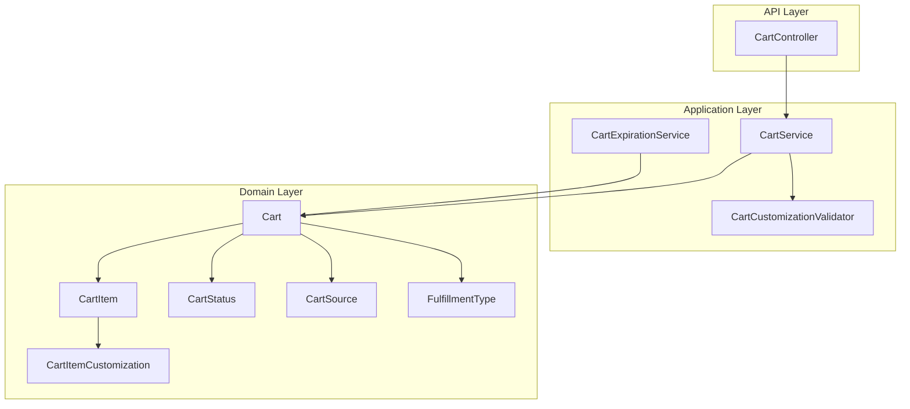
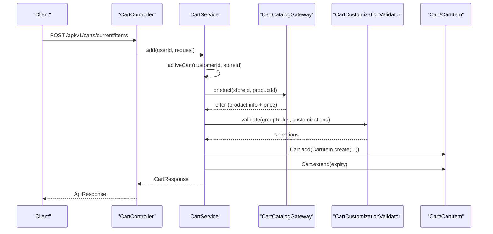
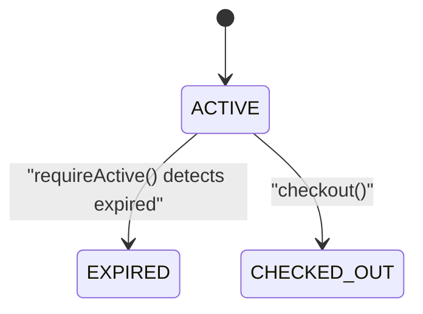
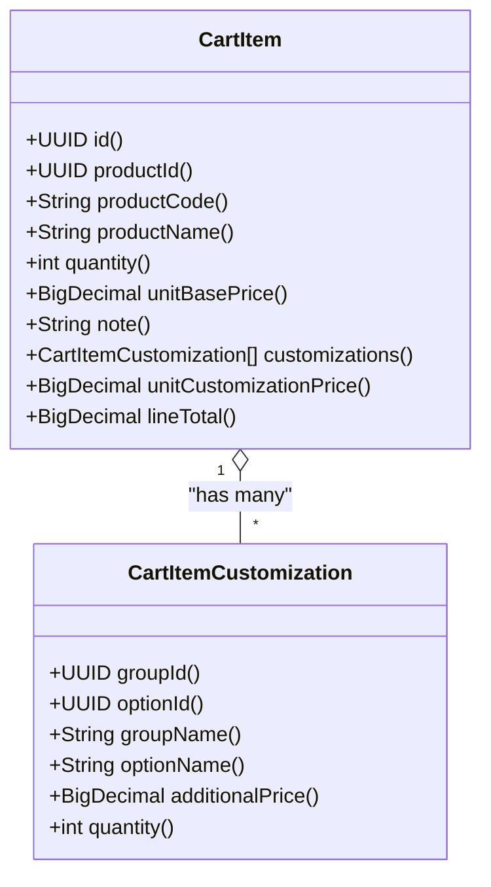
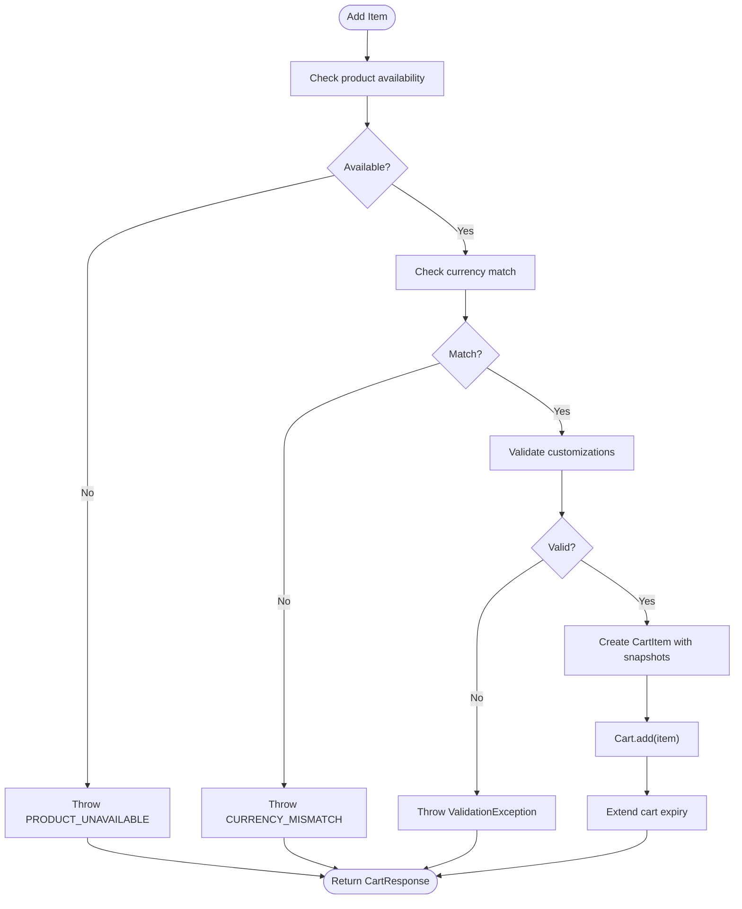
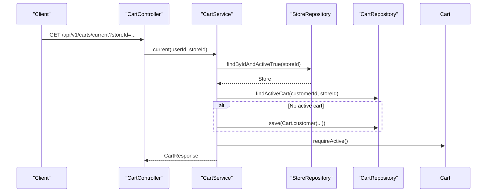
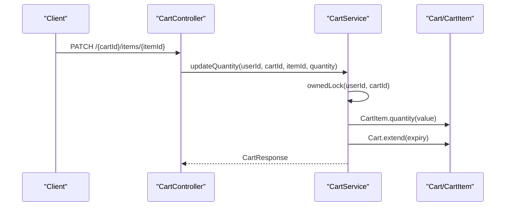
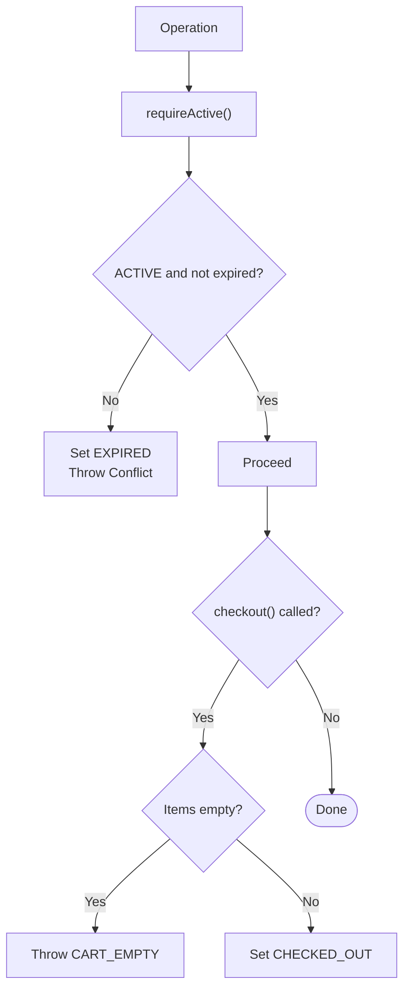
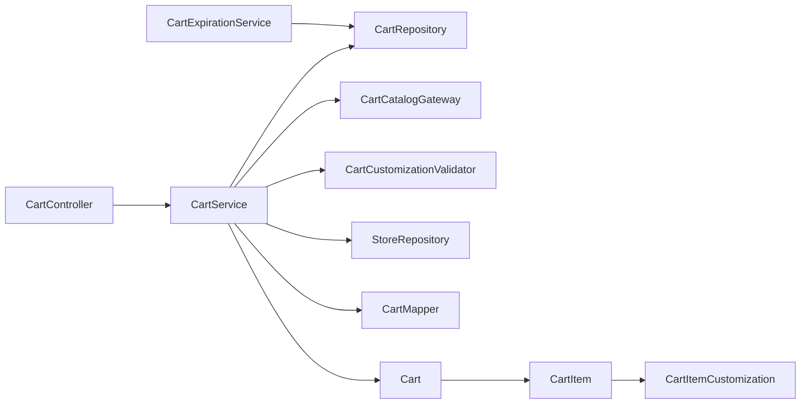

# Cart Domain Model

<cite>
**Referenced Files in This Document**
- [Cart.java](file://src/main/java/com/smartcoffee/modules/cart/domain/Cart.java)
- [CartItem.java](file://src/main/java/com/smartcoffee/modules/cart/domain/CartItem.java)
- [CartItemCustomization.java](file://src/main/java/com/smartcoffee/modules/cart/domain/CartItemCustomization.java)
- [CartStatus.java](file://src/main/java/com/smartcoffee/modules/cart/domain/CartStatus.java)
- [CartSource.java](file://src/main/java/com/smartcoffee/modules/cart/domain/CartSource.java)
- [FulfillmentType.java](file://src/main/java/com/smartcoffee/modules/cart/domain/FulfillmentType.java)
- [CartService.java](file://src/main/java/com/smartcoffee/modules/cart/application/CartService.java)
- [CartController.java](file://src/main/java/com/smartcoffee/modules/cart/api/CartController.java)
- [CartCustomizationValidator.java](file://src/main/java/com/smartcoffee/modules/cart/application/CartCustomizationValidator.java)
- [CartExpirationService.java](file://src/main/java/com/smartcoffee/modules/cart/application/CartExpirationService.java)
</cite>

## Table of Contents
1. [Introduction](#introduction)
2. [Project Structure](#project-structure)
3. [Core Components](#core-components)
4. [Architecture Overview](#architecture-overview)
5. [Detailed Component Analysis](#detailed-component-analysis)
6. [Dependency Analysis](#dependency-analysis)
7. [Performance Considerations](#performance-considerations)
8. [Troubleshooting Guide](#troubleshooting-guide)
9. [Conclusion](#conclusion)

## Introduction
This document explains the cart domain model, focusing on the Cart aggregate root, CartItem entities, and CartItemCustomization relationships. It covers status transitions, source tracking (online/offline), fulfillment type handling, business rules for item validation and pricing, customization constraints, and examples of cart creation, item modification, and state management. It also clarifies how carts relate to customers, stores, and products.

## Project Structure
The cart domain is implemented under the cart module with clear separation between domain, application, API, and persistence layers:
- Domain: Cart, CartItem, CartItemCustomization, CartStatus, CartSource, FulfillmentType
- Application: CartService, CartCustomizationValidator, CartExpirationService
- API: CartController
- Persistence: repositories used by services (CartRepository, CartItemRepository)

**Diagram sources**
- [CartController.java:11-48](file://src/main/java/com/smartcoffee/modules/cart/api/CartController.java#L11-L48)
- [CartService.java:13-115](file://src/main/java/com/smartcoffee/modules/cart/application/CartService.java#L13-L115)
- [CartCustomizationValidator.java:9-51](file://src/main/java/com/smartcoffee/modules/cart/application/CartCustomizationValidator.java#L9-L51)
- [CartExpirationService.java:1-4](file://src/main/java/com/smartcoffee/modules/cart/application/CartExpirationService.java#L1-L4)
- [Cart.java:9-43](file://src/main/java/com/smartcoffee/modules/cart/domain/Cart.java#L9-L43)
- [CartItem.java:9-39](file://src/main/java/com/smartcoffee/modules/cart/domain/CartItem.java#L9-L39)
- [CartItemCustomization.java:6-19](file://src/main/java/com/smartcoffee/modules/cart/domain/CartItemCustomization.java#L6-L19)
- [CartStatus.java:3-5](file://src/main/java/com/smartcoffee/modules/cart/domain/CartStatus.java#L3-L5)
- [CartSource.java:2-2](file://src/main/java/com/smartcoffee/modules/cart/domain/CartSource.java#L2-L2)
- [FulfillmentType.java:2-2](file://src/main/java/com/smartcoffee/modules/cart/domain/FulfillmentType.java#L2-L2)

**Section sources**
- [CartController.java:11-48](file://src/main/java/com/smartcoffee/modules/cart/api/CartController.java#L11-L48)
- [CartService.java:13-115](file://src/main/java/com/smartcoffee/modules/cart/application/CartService.java#L13-L115)
- [CartCustomizationValidator.java:9-51](file://src/main/java/com/smartcoffee/modules/cart/application/CartCustomizationValidator.java#L9-L51)
- [CartExpirationService.java:1-4](file://src/main/java/com/smartcoffee/modules/cart/application/CartExpirationService.java#L1-L4)
- [Cart.java:9-43](file://src/main/java/com/smartcoffee/modules/cart/domain/Cart.java#L9-L43)
- [CartItem.java:9-39](file://src/main/java/com/smartcoffee/modules/cart/domain/CartItem.java#L9-L39)
- [CartItemCustomization.java:6-19](file://src/main/java/com/smartcoffee/modules/cart/domain/CartItemCustomization.java#L6-L19)
- [CartStatus.java:3-5](file://src/main/java/com/smartcoffee/modules/cart/domain/CartStatus.java#L3-L5)
- [CartSource.java:2-2](file://src/main/java/com/smartcoffee/modules/cart/domain/CartSource.java#L2-L2)
- [FulfillmentType.java:2-2](file://src/main/java/com/smartcoffee/modules/cart/domain/FulfillmentType.java#L2-L2)

## Core Components
- Cart aggregate root: owns items, enforces active/expired state, manages fulfillment type, currency, expiration, and checkout transition.
- CartItem entity: represents a product line with snapshots of product identity and price; calculates line totals including customization costs.
- CartItemCustomization entity: captures selected customization options per item with group/option identifiers and additional price.
- Enums: CartStatus, CartSource, FulfillmentType define allowed states and types.

Key responsibilities:
- Cart: lifecycle control (active/expired/checked out), item add/remove/clear, fulfillment selection, subtotal calculation, checkout gating.
- CartItem: quantity validation, snapshotting product details and base price, aggregation of customization prices, line total computation.
- CartItemCustomization: grouping and option selection, per-option additional price multiplied by quantity.

**Section sources**
- [Cart.java:48-158](file://src/main/java/com/smartcoffee/modules/cart/domain/Cart.java#L48-L158)
- [CartItem.java:44-118](file://src/main/java/com/smartcoffee/modules/cart/domain/CartItem.java#L44-L118)
- [CartItemCustomization.java:18-19](file://src/main/java/com/smartcoffee/modules/cart/domain/CartItemCustomization.java#L18-L19)
- [CartStatus.java:3-5](file://src/main/java/com/smartcoffee/modules/cart/domain/CartStatus.java#L3-L5)
- [CartSource.java:2-2](file://src/main/java/com/smartcoffee/modules/cart/domain/CartSource.java#L2-L2)
- [FulfillmentType.java:2-2](file://src/main/java/com/smartcoffee/modules/cart/domain/FulfillmentType.java#L2-L2)

## Architecture Overview
The cart workflow integrates API controllers, application services, domain aggregates, and validators. The controller exposes endpoints for retrieving the current cart, adding/removing items, updating quantities, and clearing the cart. The service orchestrates catalog lookups, customization validation, cart mutation, and response mapping. A background job expires inactive carts.

**Diagram sources**
- [CartController.java:27-30](file://src/main/java/com/smartcoffee/modules/cart/api/CartController.java#L27-L30)
- [CartService.java:48-61](file://src/main/java/com/smartcoffee/modules/cart/application/CartService.java#L48-L61)
- [CartCustomizationValidator.java:11-50](file://src/main/java/com/smartcoffee/modules/cart/application/CartCustomizationValidator.java#L11-L50)
- [Cart.java:72-77](file://src/main/java/com/smartcoffee/modules/cart/domain/Cart.java#L72-L77)
- [CartItem.java:44-60](file://src/main/java/com/smartcoffee/modules/cart/domain/CartItem.java#L44-L60)

## Detailed Component Analysis

### Cart Aggregate Root
Responsibilities:
- Creation with customer, user, store, currency, and expiry.
- State enforcement via requireActive(): ensures status is ACTIVE and not expired; sets EXPIRED when time passes.
- Item operations: add, remove, clear with active-state checks.
- Fulfillment type setting and expiry extension.
- Subtotal calculation across all items.
- Checkout gating: requires non-empty cart and active state; transitions to CHECKED_OUT.

State transitions:
- ACTIVE -> EXPIRED: automatic when requireActive() detects expired time.
- ACTIVE -> CHECKED_OUT: explicit checkout() call.

Source tracking:
- Source defaults to CUSTOMER_WEB at creation; POS is available for offline channels.

Fulfillment handling:
- Stores DINE_IN, PICKUP, DELIVERY; set via fulfillment(type).

Business rules:
- Only active carts can be mutated.
- Cannot checkout an empty cart.
- Currency must match product currency at add-time (enforced in service layer).

**Diagram sources**
- [Cart.java:63-70](file://src/main/java/com/smartcoffee/modules/cart/domain/Cart.java#L63-L70)
- [Cart.java:147-158](file://src/main/java/com/smartcoffee/modules/cart/domain/Cart.java#L147-L158)
- [CartStatus.java:3-5](file://src/main/java/com/smartcoffee/modules/cart/domain/CartStatus.java#L3-L5)

**Section sources**
- [Cart.java:48-158](file://src/main/java/com/smartcoffee/modules/cart/domain/Cart.java#L48-L158)
- [CartStatus.java:3-5](file://src/main/java/com/smartcoffee/modules/cart/domain/CartStatus.java#L3-L5)
- [CartSource.java:2-2](file://src/main/java/com/smartcoffee/modules/cart/domain/CartSource.java#L2-L2)
- [FulfillmentType.java:2-2](file://src/main/java/com/smartcoffee/modules/cart/domain/FulfillmentType.java#L2-L2)

### CartItem Entity
Responsibilities:
- Snapshot product identity (id, code, name) and unit base price to preserve historical values.
- Validate positive quantity.
- Manage customizations collection.
- Compute unit customization price sum and line total (base + customization) * quantity.

Business rules:
- Quantity must be positive.
- Customizations are attached through CartItem’s internal method to maintain bidirectional consistency.

**Diagram sources**
- [CartItem.java:44-118](file://src/main/java/com/smartcoffee/modules/cart/domain/CartItem.java#L44-L118)
- [CartItemCustomization.java:18-19](file://src/main/java/com/smartcoffee/modules/cart/domain/CartItemCustomization.java#L18-L19)

**Section sources**
- [CartItem.java:44-118](file://src/main/java/com/smartcoffee/modules/cart/domain/CartItem.java#L44-L118)
- [CartItemCustomization.java:18-19](file://src/main/java/com/smartcoffee/modules/cart/domain/CartItemCustomization.java#L18-L19)

### CartItemCustomization Relationship
- Captures group and option identifiers plus human-readable names and additional price.
- Additional price is scaled by quantity to reflect per-item cost contribution.
- Enforced by validator to ensure valid groups/options and selection constraints.

Pricing impact:
- Each customization contributes additionalPrice(quantity) to the item’s unit customization price, which is then multiplied by item quantity for line total.

**Section sources**
- [CartItemCustomization.java:18-19](file://src/main/java/com/smartcoffee/modules/cart/domain/CartItemCustomization.java#L18-L19)
- [CartItem.java:110-118](file://src/main/java/com/smartcoffee/modules/cart/domain/CartItem.java#L110-L118)

### Business Rules and Validation

#### Item Validation
- Positive quantity enforced at CartItem creation and update.
- Product availability checked before adding to cart.
- Currency mismatch between cart and product rejected.

#### Pricing Calculations
- Line total = (unitBasePrice + sum of customization additional prices) * quantity.
- Cart subtotal sums all line totals.

#### Customization Constraints
- Minimum and maximum selection counts per group.
- SINGLE selection type allows only one option per group.
- Duplicate option rejection within a group.
- Option must belong to the product and be active.

**Diagram sources**
- [CartService.java:48-61](file://src/main/java/com/smartcoffee/modules/cart/application/CartService.java#L48-L61)
- [CartCustomizationValidator.java:11-50](file://src/main/java/com/smartcoffee/modules/cart/application/CartCustomizationValidator.java#L11-L50)
- [CartItem.java:44-60](file://src/main/java/com/smartcoffee/modules/cart/domain/CartItem.java#L44-L60)

**Section sources**
- [CartService.java:48-61](file://src/main/java/com/smartcoffee/modules/cart/application/CartService.java#L48-L61)
- [CartCustomizationValidator.java:11-50](file://src/main/java/com/smartcoffee/modules/cart/application/CartCustomizationValidator.java#L11-L50)
- [CartItem.java:44-76](file://src/main/java/com/smartcoffee/modules/cart/domain/CartItem.java#L44-L76)

### Examples

#### Cart Creation
- When retrieving the current cart for a user and store, if none exists, a new cart is created with:
  - Customer ID resolved from the authenticated user.
  - Store ID validated against active stores.
  - Default source set to CUSTOMER_WEB.
  - Status set to ACTIVE.
  - Currency taken from store default.
  - Expiration set to now + 24 hours.

**Diagram sources**
- [CartController.java:22-25](file://src/main/java/com/smartcoffee/modules/cart/api/CartController.java#L22-L25)
- [CartService.java:35-46](file://src/main/java/com/smartcoffee/modules/cart/application/CartService.java#L35-L46)
- [Cart.java:48-60](file://src/main/java/com/smartcoffee/modules/cart/domain/Cart.java#L48-L60)

**Section sources**
- [CartController.java:22-25](file://src/main/java/com/smartcoffee/modules/cart/api/CartController.java#L22-L25)
- [CartService.java:35-46](file://src/main/java/com/smartcoffee/modules/cart/application/CartService.java#L35-L46)
- [Cart.java:48-60](file://src/main/java/com/smartcoffee/modules/cart/domain/Cart.java#L48-L60)

#### Item Modification
- Adding an item validates product availability, currency match, and customization rules, then attaches a CartItem with snapshots and extends cart expiry.
- Updating quantity validates positive quantity and extends expiry.
- Removing or clearing requires an active cart.

**Diagram sources**
- [CartController.java:32-37](file://src/main/java/com/smartcoffee/modules/cart/api/CartController.java#L32-L37)
- [CartService.java:64-71](file://src/main/java/com/smartcoffee/modules/cart/application/CartService.java#L64-L71)
- [CartItem.java:71-76](file://src/main/java/com/smartcoffee/modules/cart/domain/CartItem.java#L71-L76)
- [Cart.java:98-102](file://src/main/java/com/smartcoffee/modules/cart/domain/Cart.java#L98-L102)

**Section sources**
- [CartController.java:32-37](file://src/main/java/com/smartcoffee/modules/cart/api/CartController.java#L32-L37)
- [CartService.java:64-71](file://src/main/java/com/smartcoffee/modules/cart/application/CartService.java#L64-L71)
- [CartItem.java:71-76](file://src/main/java/com/smartcoffee/modules/cart/domain/CartItem.java#L71-L76)
- [Cart.java:98-102](file://src/main/java/com/smartcoffee/modules/cart/domain/Cart.java#L98-L102)

#### State Management
- requireActive() enforces ACTIVE status and non-expired time; otherwise throws conflict errors and marks cart EXPIRED.
- checkout() enforces non-empty cart and transitions to CHECKED_OUT.

**Diagram sources**
- [Cart.java:63-70](file://src/main/java/com/smartcoffee/modules/cart/domain/Cart.java#L63-L70)
- [Cart.java:147-158](file://src/main/java/com/smartcoffee/modules/cart/domain/Cart.java#L147-L158)

**Section sources**
- [Cart.java:63-70](file://src/main/java/com/smartcoffee/modules/cart/domain/Cart.java#L63-L70)
- [Cart.java:147-158](file://src/main/java/com/smartcoffee/modules/cart/domain/Cart.java#L147-L158)

### Relationships to Customers, Stores, and Products
- Customer: Cart stores customerId; service resolves customerId from authenticated user context.
- Store: Cart stores storeId; service validates store existence and uses store.defaultCurrency().
- Product: CartItem snapshots productId, productCode, productName, and unitBasePrice; service fetches product offer from catalog gateway and validates availability and currency.

**Section sources**
- [Cart.java:15-20](file://src/main/java/com/smartcoffee/modules/cart/domain/Cart.java#L15-L20)
- [CartService.java:35-46](file://src/main/java/com/smartcoffee/modules/cart/application/CartService.java#L35-L46)
- [CartService.java:48-61](file://src/main/java/com/smartcoffee/modules/cart/application/CartService.java#L48-L61)
- [CartItem.java:18-27](file://src/main/java/com/smartcoffee/modules/cart/domain/CartItem.java#L18-L27)

## Dependency Analysis
- CartService depends on:
  - CartRepository for persistence and locking.
  - CartCatalogGateway for product offers and customization group rules.
  - CartCustomizationValidator for enforcing customization constraints.
  - CurrentCustomerResolver for resolving customerId.
  - StoreRepository for store validation and default currency.
  - CartMapper for DTO conversion.
- Domain aggregates depend on enums for state and type definitions.
- CartExpirationService periodically scans expired carts and triggers requireActive() to mark them expired.

**Diagram sources**
- [CartController.java:11-48](file://src/main/java/com/smartcoffee/modules/cart/api/CartController.java#L11-L48)
- [CartService.java:13-115](file://src/main/java/com/smartcoffee/modules/cart/application/CartService.java#L13-L115)
- [CartExpirationService.java:1-4](file://src/main/java/com/smartcoffee/modules/cart/application/CartExpirationService.java#L1-L4)
- [Cart.java:9-43](file://src/main/java/com/smartcoffee/modules/cart/domain/Cart.java#L9-L43)
- [CartItem.java:9-39](file://src/main/java/com/smartcoffee/modules/cart/domain/CartItem.java#L9-L39)
- [CartItemCustomization.java:6-19](file://src/main/java/com/smartcoffee/modules/cart/domain/CartItemCustomization.java#L6-L19)

**Section sources**
- [CartService.java:13-115](file://src/main/java/com/smartcoffee/modules/cart/application/CartService.java#L13-L115)
- [CartExpirationService.java:1-4](file://src/main/java/com/smartcoffee/modules/cart/application/CartExpirationService.java#L1-L4)

## Performance Considerations
- Lazy loading: Cart.items and CartItem.customizations use LAZY fetching to avoid unnecessary joins.
- Versioning: Both Cart and CartItem use optimistic versioning to prevent concurrent write conflicts.
- Pagination in expiration job: CartExpirationService queries expired IDs in batches to limit memory usage.
- Snapshots: Storing product code/name/price snapshots avoids repeated catalog reads during cart lifetime.

[No sources needed since this section provides general guidance]

## Troubleshooting Guide
Common issues and resolutions:
- Cart not active: Ensure cart status is ACTIVE and not expired; check expiry times and background expiration job.
- Product unavailable: Verify product availability in catalog before adding to cart.
- Currency mismatch: Ensure cart currency matches product currency; create cart using store’s default currency.
- Customization validation failures: Confirm customization groups and options belong to the product, respect minimum/maximum counts, SINGLE selection rules, and no duplicate options.
- Cart item not found: Verify itemId exists in cart before removal or update.

**Section sources**
- [Cart.java:63-70](file://src/main/java/com/smartcoffee/modules/cart/domain/Cart.java#L63-L70)
- [CartService.java:48-61](file://src/main/java/com/smartcoffee/modules/cart/application/CartService.java#L48-L61)
- [CartCustomizationValidator.java:11-50](file://src/main/java/com/smartcoffee/modules/cart/application/CartCustomizationValidator.java#L11-L50)

## Conclusion
The cart domain model centers around a robust Cart aggregate that enforces state and business rules while delegating catalog and customization validations to application-layer components. CartItem snapshots preserve product identity and pricing, and CartItemCustomization captures structured customization choices. Together, they provide a clear, testable foundation for online and offline shopping experiences, with explicit handling of source tracking, fulfillment types, and state transitions.

[No sources needed since this section summarizes without analyzing specific files]