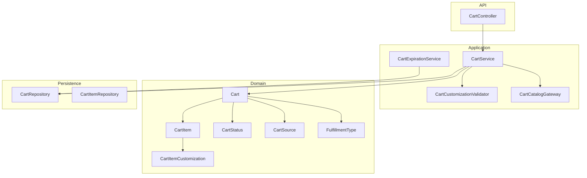
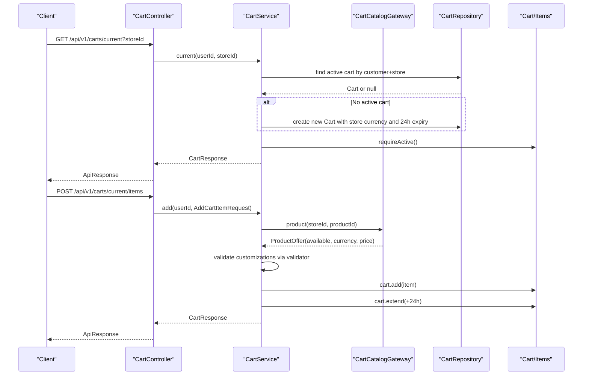
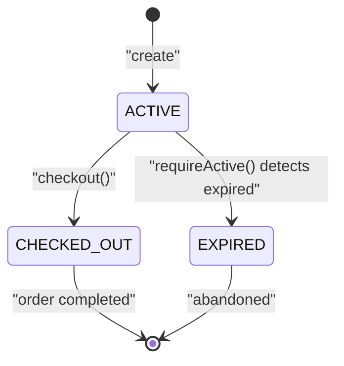
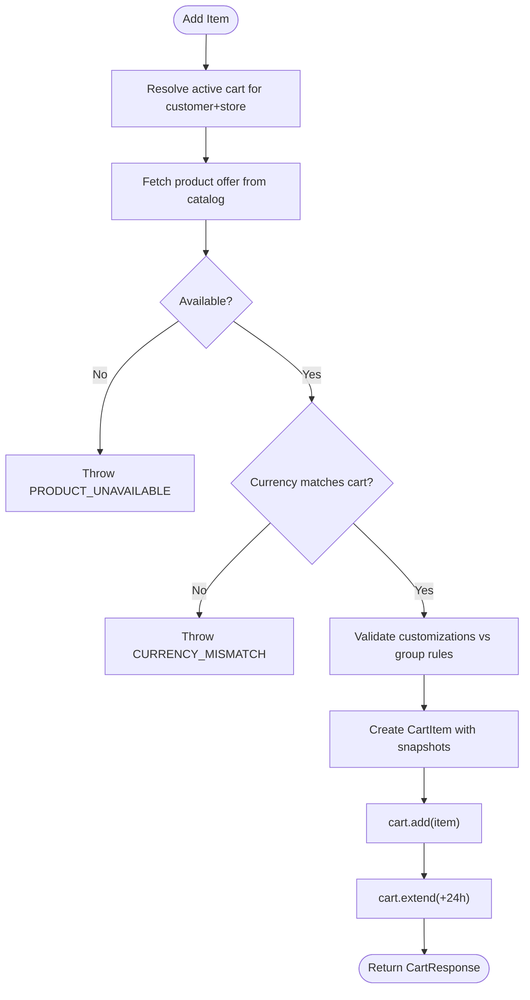
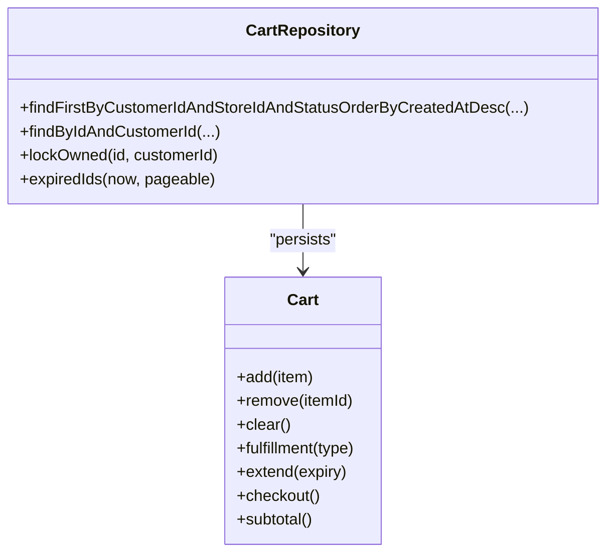
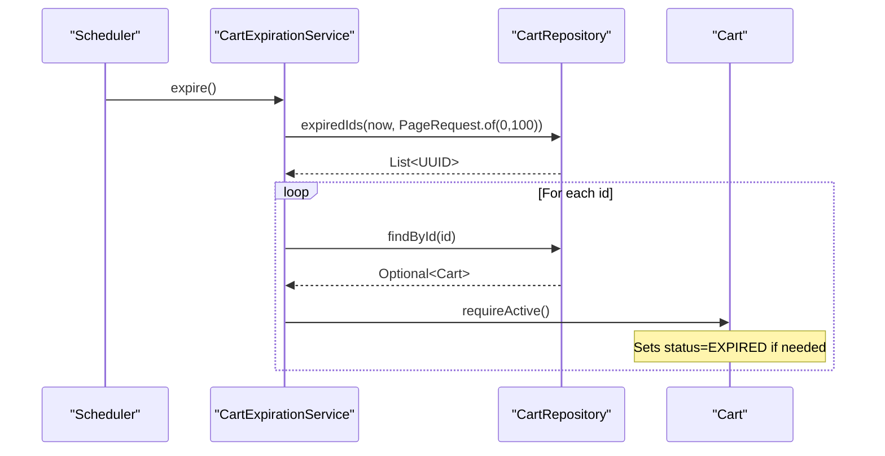
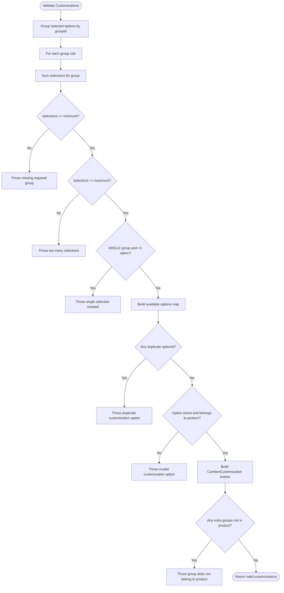
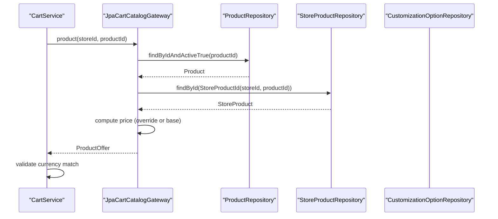
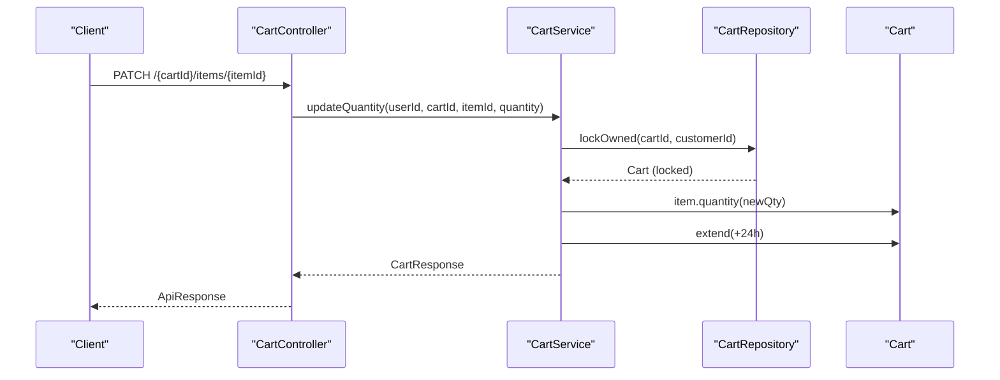
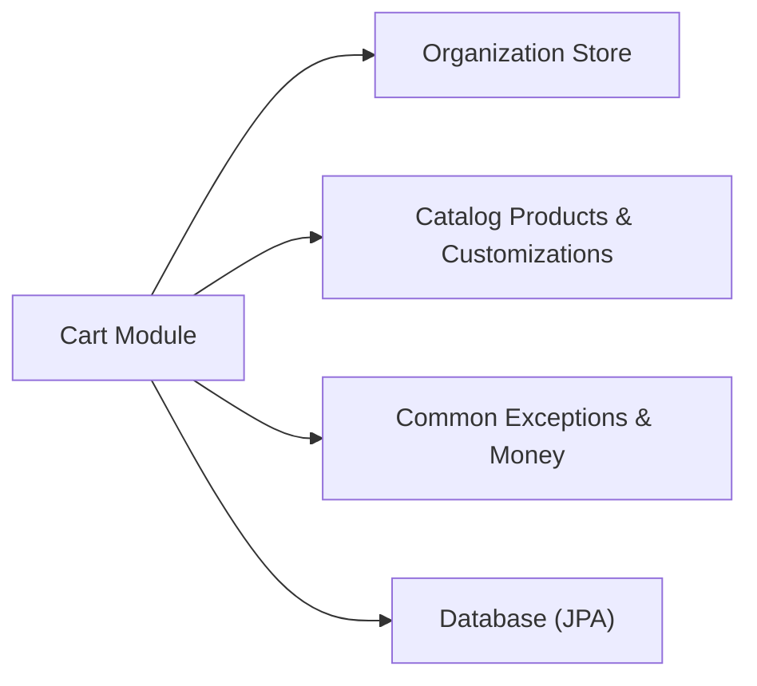

# Shopping Cart Module

<cite>
**Referenced Files in This Document**
- [CartController.java](file://src/main/java/com/smartcoffee/modules/cart/api/CartController.java)
- [AddCartItemRequest.java](file://src/main/java/com/smartcoffee/modules/cart/api/AddCartItemRequest.java)
- [UpdateCartItemRequest.java](file://src/main/java/com/smartcoffee/modules/cart/api/UpdateCartItemRequest.java)
- [SelectedCustomizationRequest.java](file://src/main/java/com/smartcoffee/modules/cart/api/SelectedCustomizationRequest.java)
- [CartResponse.java](file://src/main/java/com/smartcoffee/modules/cart/api/CartResponse.java)
- [CartItemResponse.java](file://src/main/java/com/smartcoffee/modules/cart/api/CartItemResponse.java)
- [CartCustomizationResponse.java](file://src/main/java/com/smartcoffee/modules/cart/api/CartCustomizationResponse.java)
- [CartService.java](file://src/main/java/com/smartcoffee/modules/cart/application/CartService.java)
- [CartCatalogGateway.java](file://src/main/java/com/smartcoffee/modules/cart/application/CartCatalogGateway.java)
- [JpaCartCatalogGateway.java](file://src/main/java/com/smartcoffee/modules/cart/application/JpaCartCatalogGateway.java)
- [CartCustomizationValidator.java](file://src/main/java/com/smartcoffee/modules/cart/application/CartCustomizationValidator.java)
- [CartExpirationService.java](file://src/main/java/com/smartcoffee/modules/cart/application/CartExpirationService.java)
- [CartRepository.java](file://src/main/java/com/smartcoffee/modules/cart/persistence/CartRepository.java)
- [CartItemRepository.java](file://src/main/java/com/smartcoffee/modules/cart/persistence/CartItemRepository.java)
- [Cart.java](file://src/main/java/com/smartcoffee/modules/cart/domain/Cart.java)
- [CartItem.java](file://src/main/java/com/smartcoffee/modules/cart/domain/CartItem.java)
- [CartItemCustomization.java](file://src/main/java/com/smartcoffee/modules/cart/domain/CartItemCustomization.java)
- [CartStatus.java](file://src/main/java/com/smartcoffee/modules/cart/domain/CartStatus.java)
- [CartSource.java](file://src/main/java/com/smartcoffee/modules/cart/domain/CartSource.java)
- [FulfillmentType.java](file://src/main/java/com/smartcoffee/modules/cart/domain/FulfillmentType.java)
</cite>

## Table of Contents
1. [Introduction](#introduction)
2. [Project Structure](#project-structure)
3. [Core Components](#core-components)
4. [Architecture Overview](#architecture-overview)
5. [Detailed Component Analysis](#detailed-component-analysis)
6. [Dependency Analysis](#dependency-analysis)
7. [Performance Considerations](#performance-considerations)
8. [Troubleshooting Guide](#troubleshooting-guide)
9. [Conclusion](#conclusion)
10. [Appendices](#appendices)

## Introduction
This document provides comprehensive documentation for the Shopping Cart module. It explains cart lifecycle management, item addition and removal operations, persistence strategies, expiration handling, validation rules, integration with catalog pricing, customization support, multi-store cart handling, state transitions, concurrent access control, and performance optimization techniques. It also includes examples of typical operations, validation scenarios, and cleanup processes.

## Project Structure
The Shopping Cart module is organized by layers:
- API layer: REST endpoints for current cart retrieval and item operations.
- Application layer: Use cases orchestrating domain logic, catalog integration, validation, and persistence.
- Domain layer: Core entities representing carts, items, customizations, and enumerations for status, source, and fulfillment type.
- Persistence layer: JPA repositories for cart and cart item storage with locking and pagination queries.

**Diagram sources**
- [CartController.java:11-48](file://src/main/java/com/smartcoffee/modules/cart/api/CartController.java#L11-L48)
- [CartService.java:13-115](file://src/main/java/com/smartcoffee/modules/cart/application/CartService.java#L13-L115)
- [Cart.java:9-158](file://src/main/java/com/smartcoffee/modules/cart/domain/Cart.java#L9-L158)
- [CartItem.java:9-118](file://src/main/java/com/smartcoffee/modules/cart/domain/CartItem.java#L9-L118)
- [CartRepository.java:9-14](file://src/main/java/com/smartcoffee/modules/cart/persistence/CartRepository.java#L9-L14)
- [CartExpirationService.java:1-4](file://src/main/java/com/smartcoffee/modules/cart/application/CartExpirationService.java#L1-L4)

**Section sources**
- [CartController.java:11-48](file://src/main/java/com/smartcoffee/modules/cart/api/CartController.java#L11-L48)
- [CartService.java:13-115](file://src/main/java/com/smartcoffee/modules/cart/application/CartService.java#L13-L115)
- [Cart.java:9-158](file://src/main/java/com/smartcoffee/modules/cart/domain/Cart.java#L9-L158)
- [CartItem.java:9-118](file://src/main/java/com/smartcoffee/modules/cart/domain/CartItem.java#L9-L118)
- [CartRepository.java:9-14](file://src/main/java/com/smartcoffee/modules/cart/persistence/CartRepository.java#L9-L14)
- [CartExpirationService.java:1-4](file://src/main/java/com/smartcoffee/modules/cart/application/CartExpirationService.java#L1-L4)

## Core Components
- Cart entity: Represents a customer’s active shopping session scoped to a store, with currency, expiry, and fulfillment type. Provides lifecycle methods like add, remove, clear, extend, and checkout. Enforces activity and expiry checks before mutations.
- CartItem entity: Represents a line item with product snapshot (id, code, name), quantity, base price, optional note, and customizations. Computes line totals including customization prices.
- Customization model: Each item can have multiple customizations grouped by rule sets; each option may carry an additional price and be constrained by group rules.
- Service layer: Orchestrates current cart resolution per store, adding/removing items, updating quantities, clearing, and extending expiry on interactions. Integrates with catalog to validate availability, currency, and customization rules.
- Repository layer: Provides eager loading of items/customizations, pessimistic write locks for concurrency safety, and batched queries for expired carts.
- Expiration service: Periodically scans and expires active carts past their expiry time.

Key responsibilities:
- Multi-store scoping: Carts are created and resolved per store using store context from requests or services.
- Currency consistency: Ensures cart currency matches product currency at add time.
- Validation: Enforces customization selection rules and positive quantities.
- Concurrency: Uses pessimistic locking when mutating a specific cart owned by a customer.

**Section sources**
- [Cart.java:48-158](file://src/main/java/com/smartcoffee/modules/cart/domain/Cart.java#L48-L158)
- [CartItem.java:44-118](file://src/main/java/com/smartcoffee/modules/cart/domain/CartItem.java#L44-L118)
- [CartService.java:35-115](file://src/main/java/com/smartcoffee/modules/cart/application/CartService.java#L35-L115)
- [CartRepository.java:9-14](file://src/main/java/com/smartcoffee/modules/cart/persistence/CartRepository.java#L9-L14)
- [CartExpirationService.java:1-4](file://src/main/java/com/smartcoffee/modules/cart/application/CartExpirationService.java#L1-L4)

## Architecture Overview
The cart module follows a layered architecture with clear separation of concerns:
- API exposes endpoints for retrieving the current cart and managing items.
- Application service coordinates business rules, integrates with catalog, validates customizations, and persists changes.
- Domain encapsulates invariants and state transitions.
- Persistence uses JPA with entity graphs and pessimistic locks for safe concurrent updates.
- A scheduled job handles cart expiration.

**Diagram sources**
- [CartController.java:22-47](file://src/main/java/com/smartcoffee/modules/cart/api/CartController.java#L22-L47)
- [CartService.java:35-62](file://src/main/java/com/smartcoffee/modules/cart/application/CartService.java#L35-L62)
- [CartCatalogGateway.java:4-9](file://src/main/java/com/smartcoffee/modules/cart/application/CartCatalogGateway.java#L4-L9)
- [Cart.java:48-102](file://src/main/java/com/smartcoffee/modules/cart/domain/Cart.java#L48-L102)

## Detailed Component Analysis

### Cart Lifecycle Management
- Creation: When retrieving the current cart for a customer and store, if none exists, a new active cart is created with the store’s default currency and a 24-hour expiry.
- Activity enforcement: All mutating operations call requireActive(), which ensures the cart is ACTIVE and not expired; otherwise, it throws appropriate exceptions and marks expired carts accordingly.
- Checkout: The cart can transition to CHECKED_OUT after validating that it is active and not empty.
- Expiration: A scheduled job periodically finds expired active carts and invokes requireActive() to mark them as EXPIRED.

**Diagram sources**
- [Cart.java:48-158](file://src/main/java/com/smartcoffee/modules/cart/domain/Cart.java#L48-L158)
- [CartExpirationService.java:1-4](file://src/main/java/com/smartcoffee/modules/cart/application/CartExpirationService.java#L1-L4)
- [CartStatus.java:3-5](file://src/main/java/com/smartcoffee/modules/cart/domain/CartStatus.java#L3-L5)

**Section sources**
- [Cart.java:48-158](file://src/main/java/com/smartcoffee/modules/cart/domain/Cart.java#L48-L158)
- [CartExpirationService.java:1-4](file://src/main/java/com/smartcoffee/modules/cart/application/CartExpirationService.java#L1-L4)

### Item Addition and Removal Operations
- Add item: Validates product availability and currency match, validates customizations against group rules, creates a CartItem with snapshots, adds to cart, and extends expiry by 24 hours.
- Update quantity: Locks the cart owned by the customer, updates item quantity, and extends expiry.
- Remove item: Locks the cart, removes the specified item, and returns updated cart.
- Clear cart: Locks the cart and clears all items.

**Diagram sources**
- [CartService.java:48-62](file://src/main/java/com/smartcoffee/modules/cart/application/CartService.java#L48-L62)
- [CartCatalogGateway.java:4-9](file://src/main/java/com/smartcoffee/modules/cart/application/CartCatalogGateway.java#L4-L9)
- [Cart.java:72-102](file://src/main/java/com/smartcoffee/modules/cart/domain/Cart.java#L72-L102)

**Section sources**
- [CartService.java:48-86](file://src/main/java/com/smartcoffee/modules/cart/application/CartService.java#L48-L86)
- [Cart.java:72-102](file://src/main/java/com/smartcoffee/modules/cart/domain/Cart.java#L72-L102)

### Cart Persistence Strategies
- Entity graph loading: Queries eagerly load items and customizations to avoid N+1 issues during response mapping.
- Pessimistic locking: Mutations on a specific cart use a pessimistic write lock scoped to the owning customer to prevent concurrent modifications.
- Pagination for expiration: Expired IDs are fetched in batches to process large volumes efficiently.

**Diagram sources**
- [CartRepository.java:9-14](file://src/main/java/com/smartcoffee/modules/cart/persistence/CartRepository.java#L9-L14)
- [Cart.java:72-158](file://src/main/java/com/smartcoffee/modules/cart/domain/Cart.java#L72-L158)

**Section sources**
- [CartRepository.java:9-14](file://src/main/java/com/smartcoffee/modules/cart/persistence/CartRepository.java#L9-L14)
- [Cart.java:72-158](file://src/main/java/com/smartcoffee/modules/cart/domain/Cart.java#L72-L158)

### Cart Expiration Handling
- Scheduled job: Runs at a configurable interval to fetch expired active cart IDs and invoke requireActive() to mark them as EXPIRED.
- Immediate checks: requireActive() is called on read paths and mutations to enforce expiry semantics immediately.

**Diagram sources**
- [CartExpirationService.java:1-4](file://src/main/java/com/smartcoffee/modules/cart/application/CartExpirationService.java#L1-L4)
- [CartRepository.java:12-14](file://src/main/java/com/smartcoffee/modules/cart/persistence/CartRepository.java#L12-L14)
- [Cart.java:63-70](file://src/main/java/com/smartcoffee/modules/cart/domain/Cart.java#L63-L70)

**Section sources**
- [CartExpirationService.java:1-4](file://src/main/java/com/smartcoffee/modules/cart/application/CartExpirationService.java#L1-L4)
- [Cart.java:63-70](file://src/main/java/com/smartcoffee/modules/cart/domain/Cart.java#L63-L70)

### Validation Rules and Customization Support
- Quantity validation: Positive quantities enforced for items and customizations.
- Group rules: Minimum/maximum selections enforced per customization group; single-selection groups restrict to one option.
- Option validity: Only active options belonging to the product’s groups are allowed; duplicates are rejected.
- Additional pricing: Customization options may add to unit price; line total includes these additions.

**Diagram sources**
- [CartCustomizationValidator.java:11-51](file://src/main/java/com/smartcoffee/modules/cart/application/CartCustomizationValidator.java#L11-L51)
- [CartCatalogGateway.java:4-9](file://src/main/java/com/smartcoffee/modules/cart/application/CartCatalogGateway.java#L4-L9)

**Section sources**
- [CartCustomizationValidator.java:11-51](file://src/main/java/com/smartcoffee/modules/cart/application/CartCustomizationValidator.java#L11-L51)
- [CartItem.java:44-118](file://src/main/java/com/smartcoffee/modules/cart/domain/CartItem.java#L44-L118)

### Integration with Catalog Pricing
- Product offer: Retrieves product details, store-specific override price if present, availability, and currency.
- Currency alignment: Adds are rejected if product currency differs from cart currency.
- Customization pricing: Additional prices from options contribute to line totals.

**Diagram sources**
- [JpaCartCatalogGateway.java:9-14](file://src/main/java/com/smartcoffee/modules/cart/application/JpaCartCatalogGateway.java#L9-L14)
- [CartService.java:48-62](file://src/main/java/com/smartcoffee/modules/cart/application/CartService.java#L48-L62)

**Section sources**
- [JpaCartCatalogGateway.java:9-14](file://src/main/java/com/smartcoffee/modules/cart/application/JpaCartCatalogGateway.java#L9-L14)
- [CartService.java:48-62](file://src/main/java/com/smartcoffee/modules/cart/application/CartService.java#L48-L62)

### Multi-Store Cart Handling
- Store-scoped creation: New carts are created with the store’s default currency and bound to the requesting store.
- Store validation: Requests must include a valid, active store; otherwise, a resource not found error is thrown.
- Resolution: Current cart lookup is filtered by customer and store to ensure isolation across stores.

**Section sources**
- [CartService.java:35-46](file://src/main/java/com/smartcoffee/modules/cart/application/CartService.java#L35-L46)
- [CartService.java:88-107](file://src/main/java/com/smartcoffee/modules/cart/application/CartService.java#L88-L107)

### Concurrent Access Handling
- Pessimistic locking: Mutations on a specific cart use a pessimistic write lock scoped to the owning customer to prevent race conditions.
- Ownership check: Lock query enforces that only the cart owner can mutate, ensuring safe concurrent edits.

**Diagram sources**
- [CartController.java:32-37](file://src/main/java/com/smartcoffee/modules/cart/api/CartController.java#L32-L37)
- [CartService.java:64-72](file://src/main/java/com/smartcoffee/modules/cart/application/CartService.java#L64-L72)
- [CartRepository.java:12](file://src/main/java/com/smartcoffee/modules/cart/persistence/CartRepository.java#L12)

**Section sources**
- [CartRepository.java:12](file://src/main/java/com/smartcoffee/modules/cart/persistence/CartRepository.java#L12)
- [CartService.java:64-72](file://src/main/java/com/smartcoffee/modules/cart/application/CartService.java#L64-L72)

## Dependency Analysis
The module depends on:
- Organization store data to resolve store defaults and active status.
- Catalog module for product offers, store-specific pricing, and customization rules.
- Common modules for exceptions, money handling, and security context.

[No sources needed since this diagram shows conceptual relationships without mapping to specific files]

## Performance Considerations
- Entity graphs: Use eager loading of items and customizations to reduce database round-trips during response mapping.
- Batched expiration: Process expired carts in pages to avoid memory pressure and long transactions.
- Pessimistic locking: Prevents contention and inconsistent states under concurrent writes; consider lock timeout tuning based on expected traffic patterns.
- Snapshotting: Product details are snapshotted into cart items to preserve historical pricing and names even if catalog changes later.
- Read-only catalog queries: Catalog reads are marked read-only to optimize transactional behavior.

[No sources needed since this section provides general guidance]

## Troubleshooting Guide
Common errors and their causes:
- Cart not active or expired: Occurs when attempting operations on non-active or expired carts; requiresActive() enforces this.
- Product unavailable: Add fails if the product is not offered or marked unavailable by the store.
- Currency mismatch: Add fails if product currency differs from cart currency.
- Invalid customization: Missing required groups, exceeding maximum selections, selecting inactive or invalid options, or duplicate options.
- Cart item not found: Remove/update operations fail if the item ID does not exist in the cart.
- Store not found: Requests referencing an inactive or non-existent store will fail.

Operational tips:
- Verify store context and active status before cart operations.
- Ensure customization selections align with group rules retrieved from the catalog.
- Monitor expiration job intervals and adjust polling frequency if necessary.

**Section sources**
- [Cart.java:63-83](file://src/main/java/com/smartcoffee/modules/cart/domain/Cart.java#L63-L83)
- [CartService.java:48-86](file://src/main/java/com/smartcoffee/modules/cart/application/CartService.java#L48-L86)
- [CartCustomizationValidator.java:11-51](file://src/main/java/com/smartcoffee/modules/cart/application/CartCustomizationValidator.java#L11-L51)

## Conclusion
The Shopping Cart module provides a robust, store-scoped cart system with strong invariants, validation, and concurrency controls. It integrates tightly with the catalog for pricing and customization rules, supports multi-store environments, and includes automated expiration handling. The design emphasizes data integrity through snapshots, pessimistic locking, and explicit state transitions, while offering scalable persistence patterns for high-throughput scenarios.

## Appendices

### Example Operations
- Retrieve current cart for a store: GET /api/v1/carts/current?storeId={storeId}
- Add an item: POST /api/v1/carts/current/items with AddCartItemRequest (productId, storeId, quantity, customizations, note)
- Update item quantity: PATCH /api/v1/carts/{cartId}/items/{itemId} with UpdateCartItemRequest (quantity)
- Remove an item: DELETE /api/v1/carts/{cartId}/items/{itemId}
- Clear cart: DELETE /api/v1/carts/{cartId}/items

**Section sources**
- [CartController.java:22-47](file://src/main/java/com/smartcoffee/modules/cart/api/CartController.java#L22-L47)
- [AddCartItemRequest.java](file://src/main/java/com/smartcoffee/modules/cart/api/AddCartItemRequest.java)
- [UpdateCartItemRequest.java](file://src/main/java/com/smartcoffee/modules/cart/api/UpdateCartItemRequest.java)

### Cleanup Processes
- Scheduled expiration: The expiration service periodically identifies and marks expired active carts as EXPIRED.
- Abandonment: Carts that remain inactive beyond their expiry are considered abandoned and can be cleaned up by downstream processes if needed.

**Section sources**
- [CartExpirationService.java:1-4](file://src/main/java/com/smartcoffee/modules/cart/application/CartExpirationService.java#L1-L4)
- [Cart.java:63-70](file://src/main/java/com/smartcoffee/modules/cart/domain/Cart.java#L63-L70)