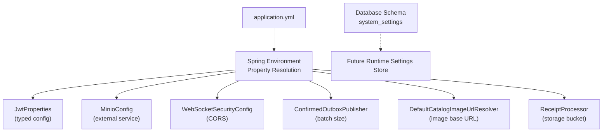
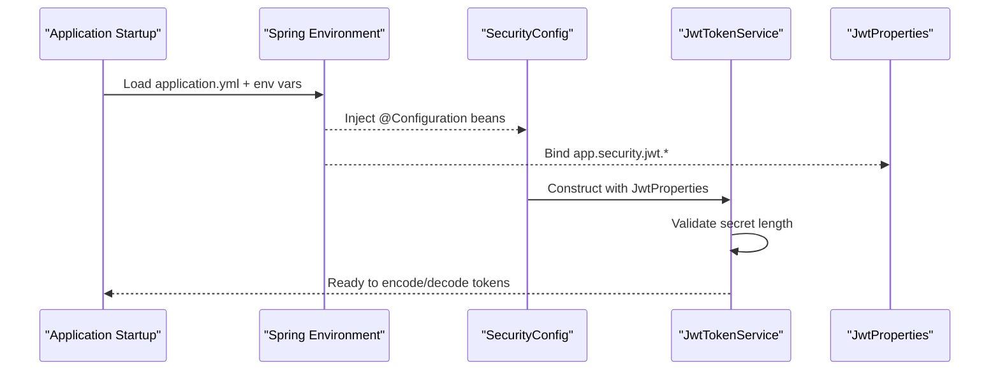
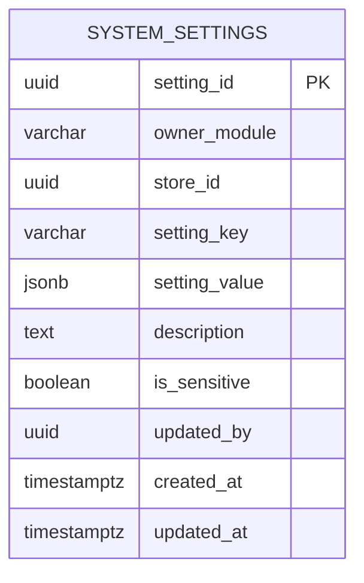
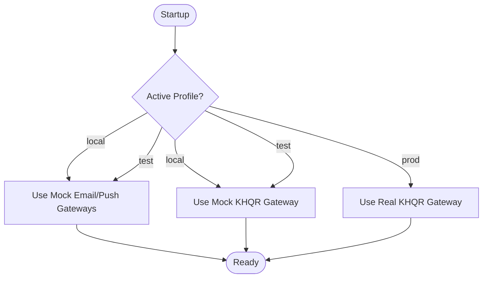
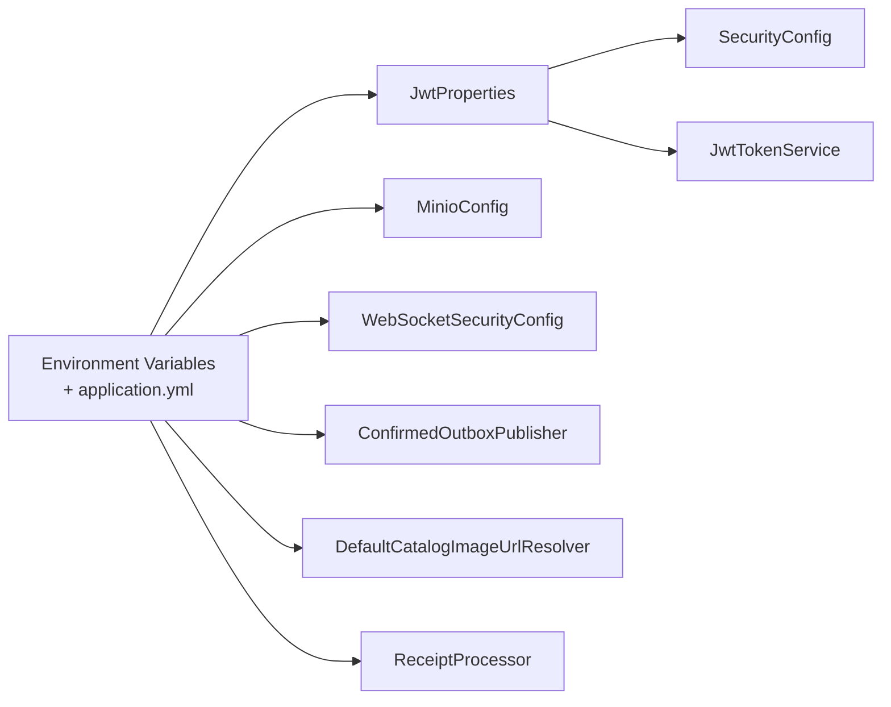

# System Settings Module

<cite>
**Referenced Files in This Document**
- [application.yml](file://src/main/resources/application.yml)
- [JwtProperties.java](file://src/main/java/com/smartcoffee/modules/auth/security/JwtProperties.java)
- [SecurityConfig.java](file://src/main/java/com/smartcoffee/config/SecurityConfig.java)
- [JwtTokenService.java](file://src/main/java/com/smartcoffee/modules/auth/security/JwtTokenService.java)
- [MinioConfig.java](file://src/main/java/com/smartcoffee/config/MinioConfig.java)
- [WebSocketSecurityConfig.java](file://src/main/java/com/smartcoffee/config/WebSocketSecurityConfig.java)
- [ConfirmedOutboxPublisher.java](file://src/main/java/com/smartcoffee/infrastructure/messaging/outbox/ConfirmedOutboxPublisher.java)
- [DefaultCatalogImageUrlResolver.java](file://src/main/java/com/smartcoffee/modules/catalog/application/DefaultCatalogImageUrlResolver.java)
- [ReceiptProcessor.java](file://src/main/java/com/smartcoffee/modules/payment/application/ReceiptProcessor.java)
- [smart-coffee-logical.dbml](file://database/smart-coffee-logical.dbml)
- [Download ARCHITECTURE_AUDIT.md](file://Download%20ARCHITECTURE_AUDIT.md)
</cite>

## Table of Contents
1. [Introduction](#introduction)
2. [Project Structure](#project-structure)
3. [Core Components](#core-components)
4. [Architecture Overview](#architecture-overview)
5. [Detailed Component Analysis](#detailed-component-analysis)
6. [Dependency Analysis](#dependency-analysis)
7. [Performance Considerations](#performance-considerations)
8. [Troubleshooting Guide](#troubleshooting-guide)
9. [Conclusion](#conclusion)
10. [Appendices](#appendices)

## Introduction
This document explains the System Settings module as implemented in this codebase. It focuses on configuration management, environment-specific settings, feature toggling via profiles, validation and defaults, configuration inheritance through Spring Boot properties, and integration points with application startup, runtime behavior, and administrative interfaces. It also addresses security considerations for sensitive settings, auditability, and deployment-specific configurations.

The repository does not include a dedicated “settings” domain module yet; instead, system-wide settings are managed through Spring Boot configuration files and typed configuration classes. The database schema includes a `system_settings` table that can be used to persist runtime settings, but its implementation is not present in the analyzed sources.

## Project Structure
Configuration is centralized under:
- Application-level properties in `application.yml`
- Typed configuration via `@ConfigurationProperties` (for example, JWT settings)
- Feature toggles via Spring profiles (`local`, `test`, `prod`)
- Infrastructure components reading configuration at startup or request time

**Diagram sources**
- [application.yml:43-80](file://src/main/resources/application.yml#L43-L80)
- [JwtProperties.java:1-5](file://src/main/java/com/smartcoffee/modules/auth/security/JwtProperties.java#L1-L5)
- [MinioConfig.java:1-10](file://src/main/java/com/smartcoffee/config/MinioConfig.java#L1-L10)
- [WebSocketSecurityConfig.java:10-20](file://src/main/java/com/smartcoffee/config/WebSocketSecurityConfig.java#L10-L20)
- [ConfirmedOutboxPublisher.java:15-30](file://src/main/java/com/smartcoffee/infrastructure/messaging/outbox/ConfirmedOutboxPublisher.java#L15-L30)
- [DefaultCatalogImageUrlResolver.java:1-15](file://src/main/java/com/smartcoffee/modules/catalog/application/DefaultCatalogImageUrlResolver.java#L1-L15)
- [ReceiptProcessor.java:15-35](file://src/main/java/com/smartcoffee/modules/payment/application/ReceiptProcessor.java#L15-L35)
- [smart-coffee-logical.dbml:758-770](file://database/smart-coffee-logical.dbml#L758-L770)

**Section sources**
- [application.yml:1-93](file://src/main/resources/application.yml#L1-L93)
- [smart-coffee-logical.dbml:758-770](file://database/smart-coffee-logical.dbml#L758-L770)

## Core Components
- Configuration file: `application.yml` defines all application properties, including external integrations (MinIO), security (JWT), catalog image base URL, polling intervals, outbox behavior, WebSocket origins, and receipt storage bucket.
- Typed configuration: `JwtProperties` binds `app.security.jwt.*` into a strongly-typed record consumed by security components.
- Profile-based feature toggles: Mock vs real implementations for notifications and payments are selected using Spring profiles.
- Database-backed settings model: The schema defines a `system_settings` table suitable for storing runtime settings per owner module and store, with sensitivity flags and audit timestamps.

Key responsibilities:
- Provide default values and environment overrides for all subsystems.
- Validate critical configuration at startup (for example, JWT secret length).
- Expose configuration-driven behaviors such as batch sizes, timeouts, and allowed origins.

**Section sources**
- [application.yml:43-80](file://src/main/resources/application.yml#L43-L80)
- [JwtProperties.java:1-5](file://src/main/java/com/smartcoffee/modules/auth/security/JwtProperties.java#L1-L5)
- [smart-coffee-logical.dbml:758-770](file://database/smart-coffee-logical.dbml#L758-L770)

## Architecture Overview
The System Settings architecture follows Spring Boot’s standard configuration model:
- Properties are loaded from `application.yml` and environment variables.
- Components consume configuration via `@Value` or `@ConfigurationProperties`.
- Profiles select alternative implementations for features like payment gateways and notification gateways.
- Security configuration depends on typed properties to initialize encoders and token services.

**Diagram sources**
- [application.yml:49-53](file://src/main/resources/application.yml#L49-L53)
- [SecurityConfig.java:22-44](file://src/main/java/com/smartcoffee/config/SecurityConfig.java#L22-L44)
- [JwtTokenService.java:30-48](file://src/main/java/com/smartcoffee/modules/auth/security/JwtTokenService.java#L30-L48)
- [JwtProperties.java:1-5](file://src/main/java/com/smartcoffee/modules/auth/security/JwtProperties.java#L1-L5)

## Detailed Component Analysis

### Configuration File and Property Model
- Centralized properties in `application.yml` cover:
  - External services: MinIO endpoint and credentials
  - Security: JWT secret and token lifetimes
  - Catalog: public image base URL
  - Polling intervals: cart, inventory, payment expiration checks
  - Messaging: notification queue and poll interval
  - Outbox: batch size and poll delay
  - WebSocket: allowed origins
  - Receipts: object storage bucket
- Defaults are provided inline where appropriate; environment variables override defaults.

Validation and defaults:
- JWT secret decoding and minimum length validation occur during construction of the token service.
- Many properties have sensible defaults (for example, outbox batch size, WebSocket origins, receipt bucket).

Inheritance and precedence:
- Spring Boot property resolution applies environment variable overrides over YAML defaults.
- Profile-specific beans can override behavior without changing core configuration.

**Section sources**
- [application.yml:43-80](file://src/main/resources/application.yml#L43-L80)
- [JwtTokenService.java:30-48](file://src/main/java/com/smartcoffee/modules/auth/security/JwtTokenService.java#L30-L48)

### Typed Configuration: JWT Properties
- `JwtProperties` binds `app.security.jwt.secret`, `accessTokenMinutes`, and `refreshTokenDays`.
- Consumed by `SecurityConfig` and `JwtTokenService` to configure decoding and encoding.

Security implications:
- The secret must be strong and sufficiently long; validation enforces a minimum byte length.
- Secrets should be supplied via environment variables or secret managers, never committed to source control.

**Section sources**
- [JwtProperties.java:1-5](file://src/main/java/com/smartcoffee/modules/auth/security/JwtProperties.java#L1-L5)
- [SecurityConfig.java:31-44](file://src/main/java/com/smartcoffee/config/SecurityConfig.java#L31-L44)
- [JwtTokenService.java:30-48](file://src/main/java/com/smartcoffee/modules/auth/security/JwtTokenService.java#L30-L48)

### External Service Configuration: MinIO
- `MinioConfig` constructs a MinIO client using endpoint and credentials bound from `app.minio.*`.
- These values are typically provided via environment variables for each deployment.

Operational notes:
- Ensure network access and correct credentials per environment.
- Rotate secrets regularly and restrict access to the storage bucket.

**Section sources**
- [MinioConfig.java:1-10](file://src/main/java/com/smartcoffee/config/MinioConfig.java#L1-L10)
- [application.yml:44-47](file://src/main/resources/application.yml#L44-L47)

### WebSocket CORS Configuration
- `WebSocketSecurityConfig` reads allowed origins from `app.websocket.allowed-origins`.
- Restrict origins to trusted domains per environment.

**Section sources**
- [WebSocketSecurityConfig.java:10-20](file://src/main/java/com/smartcoffee/config/WebSocketSecurityConfig.java#L10-L20)
- [application.yml:75-76](file://src/main/resources/application.yml#L75-L76)

### Outbox Publishing Batch Size
- `ConfirmedOutboxPublisher` uses `app.outbox.batch-size` to tune throughput.
- Tune based on message volume and downstream consumer capacity.

**Section sources**
- [ConfirmedOutboxPublisher.java:15-30](file://src/main/java/com/smartcoffee/infrastructure/messaging/outbox/ConfirmedOutboxPublisher.java#L15-L30)
- [application.yml:71-73](file://src/main/resources/application.yml#L71-L73)

### Catalog Image Base URL
- `DefaultCatalogImageUrlResolver` uses `app.catalog.public-image-base-url` to resolve public image URLs.
- Leave empty when images are served relative to the API host.

**Section sources**
- [DefaultCatalogImageUrlResolver.java:1-15](file://src/main/java/com/smartcoffee/modules/catalog/application/DefaultCatalogImageUrlResolver.java#L1-L15)
- [application.yml:55-56](file://src/main/resources/application.yml#L55-L56)

### Receipt Storage Bucket
- `ReceiptProcessor` uses `app.receipt.bucket` to target the object storage bucket for receipts.
- Ensure the bucket exists and policies allow write access for the configured credentials.

**Section sources**
- [ReceiptProcessor.java:15-35](file://src/main/java/com/smartcoffee/modules/payment/application/ReceiptProcessor.java#L15-L35)
- [application.yml:78-79](file://src/main/resources/application.yml#L78-L79)

### Runtime Settings Store (Schema Only)
- The schema defines a `system_settings` table with fields for owner module, store scoping, key/value pairs, description, sensitivity flag, and audit timestamps.
- This provides a foundation for a future runtime settings service that can persist and version settings beyond static configuration.

**Diagram sources**
- [smart-coffee-logical.dbml:758-770](file://database/smart-coffee-logical.dbml#L758-L770)

**Section sources**
- [smart-coffee-logical.dbml:758-770](file://database/smart-coffee-logical.dbml#L758-L770)

### Feature Toggles via Profiles
- Notification gateways: mock implementations for local/test, real implementation excluded there.
- Payment gateway: real KHQR gateway enabled only in production profile; mock available for local/test.

**Diagram sources**
- [LoggingPushNotificationGateway.java:1-10](file://src/main/java/com/smartcoffee/infrastructure/notification/LoggingPushNotificationGateway.java#L1-L10)
- [MockEmailGateway.java:1-10](file://src/main/java/com/smartcoffee/infrastructure/notification/MockEmailGateway.java#L1-L10)
- [MockPushGateway.java:1-10](file://src/main/java/com/smartcoffee/infrastructure/notification/MockPushGateway.java#L1-L10)
- [KhqrPaymentGateway.java:1-15](file://src/main/java/com/smartcoffee/infrastructure/payment/KhqrPaymentGateway.java#L1-L15)
- [MockKhqrPaymentGateway.java:1-10](file://src/main/java/com/smartcoffee/infrastructure/payment/MockKhqrPaymentGateway.java#L1-L10)

**Section sources**
- [LoggingPushNotificationGateway.java:1-10](file://src/main/java/com/smartcoffee/infrastructure/notification/LoggingPushNotificationGateway.java#L1-L10)
- [MockEmailGateway.java:1-10](file://src/main/java/com/smartcoffee/infrastructure/notification/MockEmailGateway.java#L1-L10)
- [MockPushGateway.java:1-10](file://src/main/java/com/smartcoffee/infrastructure/notification/MockPushGateway.java#L1-L10)
- [KhqrPaymentGateway.java:1-15](file://src/main/java/com/smartcoffee/infrastructure/payment/KhqrPaymentGateway.java#L1-L15)
- [MockKhqrPaymentGateway.java:1-10](file://src/main/java/com/smartcoffee/infrastructure/payment/MockKhqrPaymentGateway.java#L1-L10)

## Dependency Analysis
Configuration dependencies flow from the environment into typed properties and then into infrastructure components:

**Diagram sources**
- [application.yml:43-80](file://src/main/resources/application.yml#L43-L80)
- [JwtProperties.java:1-5](file://src/main/java/com/smartcoffee/modules/auth/security/JwtProperties.java#L1-L5)
- [SecurityConfig.java:22-44](file://src/main/java/com/smartcoffee/config/SecurityConfig.java#L22-L44)
- [JwtTokenService.java:30-48](file://src/main/java/com/smartcoffee/modules/auth/security/JwtTokenService.java#L30-L48)
- [MinioConfig.java:1-10](file://src/main/java/com/smartcoffee/config/MinioConfig.java#L1-L10)
- [WebSocketSecurityConfig.java:10-20](file://src/main/java/com/smartcoffee/config/WebSocketSecurityConfig.java#L10-L20)
- [ConfirmedOutboxPublisher.java:15-30](file://src/main/java/com/smartcoffee/infrastructure/messaging/outbox/ConfirmedOutboxPublisher.java#L15-L30)
- [DefaultCatalogImageUrlResolver.java:1-15](file://src/main/java/com/smartcoffee/modules/catalog/application/DefaultCatalogImageUrlResolver.java#L1-L15)
- [ReceiptProcessor.java:15-35](file://src/main/java/com/smartcoffee/modules/payment/application/ReceiptProcessor.java#L15-L35)

**Section sources**
- [application.yml:43-80](file://src/main/resources/application.yml#L43-L80)
- [JwtProperties.java:1-5](file://src/main/java/com/smartcoffee/modules/auth/security/JwtProperties.java#L1-L5)
- [SecurityConfig.java:22-44](file://src/main/java/com/smartcoffee/config/SecurityConfig.java#L22-L44)
- [JwtTokenService.java:30-48](file://src/main/java/com/smartcoffee/modules/auth/security/JwtTokenService.java#L30-L48)

## Performance Considerations
- Outbox batch size: Increase `app.outbox.batch-size` to improve throughput if downstream consumers can handle larger bursts; monitor lag and error rates.
- Polling intervals: Adjust `cart.expiration-poll-ms`, `inventory.expiration-poll-ms`, and `payment.expiration-poll-ms` based on expected order volume and latency requirements.
- WebSocket origins: Keep allowed origins minimal to reduce overhead and risk.
- MinIO and storage: Ensure proper bucket policies and region selection to minimize latency.

[No sources needed since this section provides general guidance]

## Troubleshooting Guide
Common issues and resolutions:
- JWT secret errors:
  - Symptom: Startup failure due to invalid or too-short secret.
  - Cause: Missing or weak `app.security.jwt.secret`.
  - Resolution: Provide a Base64-encoded secret with sufficient entropy; ensure it meets the minimum length check performed by the token service.
- WebSocket connection failures:
  - Symptom: Browser cannot connect to WebSocket endpoints.
  - Cause: Origin not included in `app.websocket.allowed-origins`.
  - Resolution: Add the frontend origin to the allowed list per environment.
- MinIO connectivity issues:
  - Symptom: Storage operations fail.
  - Cause: Incorrect endpoint or credentials in `app.minio.*`.
  - Resolution: Verify endpoint URL and access keys via environment variables.
- Receipt upload failures:
  - Symptom: Receipt generation fails.
  - Cause: Missing or inaccessible bucket specified by `app.receipt.bucket`.
  - Resolution: Create the bucket and grant write permissions to the configured credentials.
- Audit and security notes:
  - The `system_settings.is_sensitive` flag alone does not encrypt stored values; implement encryption and restricted retrieval separately.
  - Audit logs should remain append-only and protected from ordinary users.

**Section sources**
- [JwtTokenService.java:30-48](file://src/main/java/com/smartcoffee/modules/auth/security/JwtTokenService.java#L30-L48)
- [application.yml:44-47](file://src/main/resources/application.yml#L44-L47)
- [application.yml:75-76](file://src/main/resources/application.yml#L75-L76)
- [application.yml:78-79](file://src/main/resources/application.yml#L78-L79)
- [Download ARCHITECTURE_AUDIT.md:731-766](file://Download%20ARCHITECTURE_AUDIT.md#L731-L766)

## Conclusion
The System Settings approach in this project relies on Spring Boot’s configuration model:
- Centralized properties in `application.yml` with environment variable overrides.
- Typed configuration for critical settings like JWT.
- Profile-based feature toggles for development, testing, and production.
- A database schema ready to support a future runtime settings store with sensitivity and audit metadata.

For production readiness:
- Enforce strong secrets and rotate them regularly.
- Restrict WebSocket origins and external endpoints.
- Implement encrypted storage for sensitive runtime settings.
- Ensure audit trails are append-only and access-controlled.

[No sources needed since this section summarizes without analyzing specific files]

## Appendices

### Configuration Reference Summary
- External services:
  - MinIO: endpoint, access-key, secret-key
- Security:
  - JWT: secret, access-token-minutes, refresh-token-days
- Catalog:
  - Public image base URL
- Operational:
  - Cart/inventory/payment expiration polling intervals
  - Notification queue and poll interval
  - Outbox batch size and poll delay
  - WebSocket allowed origins
  - Receipt storage bucket

**Section sources**
- [application.yml:43-80](file://src/main/resources/application.yml#L43-L80)